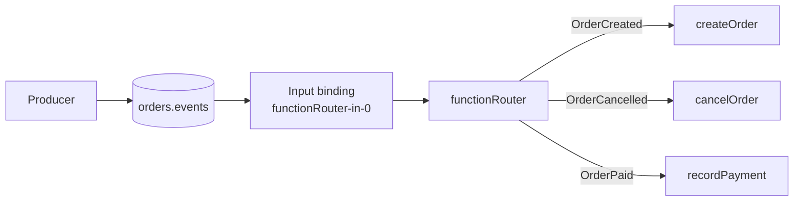

# Routing to Functions Using functionRouter and Routing Expressions

In a Spring Cloud Stream application, an input binding is normally wired to a single function selected at startup. However, some event streams carry multiple message types on the same destination, and each type requires a different handler function. For example, an `orders.events` topic might contain `OrderCreated`, `OrderCancelled`, and `OrderPaid`. If every message passes through one large handler, branching logic quickly becomes complex.

Spring Cloud Function provides **function routing** through the special `functionRouter` function. The router receives a message, determines the target function from metadata or a routing expression, and dispatches the message to the corresponding function in the Function Catalog. This mechanism lets a single input binding select a handler per message without writing a giant `switch` block inside a handler.

This lesson explains how to enable `functionRouter`, select functions with the `spring.cloud.function.definition` header, use SpEL expressions via `spring.cloud.function.routing-expression`, combine routing with function composition, and enforce safety controls when routing dynamically in event-driven systems.

## 1. What is application-layer routing?

Routing can happen at several layers of a system:

- **Broker routing:** the broker decides which topic, partition, exchange, queue, or subscription receives a message.
- **Binding:** Spring Cloud Stream connects an input/output target to a destination and consumer group.
- **Function routing:** after a message reaches the application, the router selects which function bean inside the application will process that message.

`functionRouter` operates at the third layer. It does not change topics, partitions, queues, routing keys, or consumer groups on the broker. It only selects the target function inside the application that received the message.

For example, a Kafka topic `orders.events` has one binding and one consumer group. Messages are received by the binding. Then:

- `OrderCreated` is routed to the `createOrder` function.
- `OrderCancelled` is routed to the `cancelOrder` function.
- `OrderPaid` is routed to the `recordPayment` function.

Diagram:



A single application can group related handlers into one deployable unit sharing configuration and resources. If each event type requires independent access permissions, scaling, SLAs, or lifecycles, consider splitting into separate destinations or services instead of packing everything behind one router.

## 2. functionRouter and the Function Catalog

Spring Cloud Function manages `Supplier`, `Function`, and `Consumer` beans through the Function Catalog. Each bean is registered in the catalog by name; the router uses that name to look up the target function.

To use the routing function, enable the property:

```yaml
spring:
  cloud:
    function:
      routing:
        enabled: true
      definition: functionRouter
```

In Spring Cloud Stream, when using the router as a stream entry point, declare its binding:

```yaml
spring:
  cloud:
    function:
      routing:
        enabled: true
      definition: functionRouter
    stream:
      bindings:
        functionRouter-in-0:
          destination: orders.events
          group: order-router
          content-type: application/json
```

`functionRouter` is the special routing function name provided by Spring Cloud Function when routing is enabled. `functionRouter-in-0` is the input binding following the function naming convention. Destination and group remain core Spring Cloud Stream configuration.

Target functions are still declared as ordinary beans:

```java
public record OrderEvent(
        String eventId,
        String orderId
) {}

@Configuration
public class OrderHandlers {

    @Bean
    Consumer<OrderEvent> createOrder(OrderService service) {
        return event -> service.create(event.orderId(), event.eventId());
    }

    @Bean
    Consumer<OrderEvent> cancelOrder(OrderService service) {
        return event -> service.cancel(event.orderId(), event.eventId());
    }

    @Bean
    Consumer<OrderEvent> recordPayment(PaymentService service) {
        return event -> service.recordOrderPayment(event.orderId(), event.eventId());
    }

    @Bean
    Consumer<OrderEvent> handleUnknown(InvalidEventHandler handler) {
        return handler::handle;
    }
}
```

In this example, the consumers share the same payload type to simplify conversion. In real systems, different message types may have different payloads; you must define content types, schemas, and conversion mechanisms so each target function receives the expected type.

The router can only invoke functions registered in the Function Catalog. Bean names must be unambiguous and unique within the catalog scope. If the application has multiple functions or compositions, verify the registered names and definition names visible to the router.

Because the router takes a message as input, suitable targets are `Consumer` or `Function` beans with compatible inputs. A `Supplier` is not a direct processing target for an incoming message because it takes no input; Suppliers normally produce data via their own mechanism.

## 3. Selecting a function via the spring.cloud.function.definition header

One direct way to route is by setting the `spring.cloud.function.definition` header on the message. The header value is the function or definition name that the router should invoke.

Note the two places with the same name but different roles: the application property `spring.cloud.function.definition` in startup configuration selects `functionRouter` as the bound function; the message header `spring.cloud.function.definition` selects the handler for that individual message. In this example, the application configuration selects the router, while the message header selects `createOrder`.

Example producer creating a message:

```java
Message<OrderEvent> message = MessageBuilder
        .withPayload(new OrderEvent("evt-1001", "order-42"))
        .setHeader("spring.cloud.function.definition", "createOrder")
        .build();

streamBridge.send("orders-out-0", message);
```

The message is sent to the destination configured on the `orders-out-0` output binding. When the message reaches the router's input binding, the header indicates that the target function is `createOrder`.

If another producer wants to invoke the cancellation handler, it can set the definition to `cancelOrder`. This header is application-layer routing control metadata, not a RabbitMQ routing key or Kafka partition key.

### Configuring input and output bindings

Example configuring both bindings:

```yaml
spring:
  cloud:
    function:
      routing:
        enabled: true
      definition: functionRouter
    stream:
      bindings:
        functionRouter-in-0:
          destination: orders.events
          group: order-router
        orders-out-0:
          destination: orders.events
          content-type: application/json
```

A producer can use `StreamBridge` to send messages to the destination with the routing header attached. In multi-producer systems, agree on allowed function names and header rules across all parties.

Headers must survive transport across the broker. The Kafka binder can map message headers to Kafka headers; the Rabbit binder maps them to message properties/headers; the Pulsar binder uses corresponding message properties or metadata. Preservation of header data types and names depends on the binder, header mappers, and configuration. Verify that headers actually arrive at the router using integration tests.

### When should you use the definition header?

Use the header when the sender already knows which handler to invoke or when a trusted gateway has determined the route. For example, an API gateway classifies requests and attaches the corresponding definition before emitting the event.

Do not allow arbitrary external producers to freely send any bean name. Headers can be forged or misconfigured; if the router allows invoking every bean in the catalog, an untrusted producer could trigger unintended internal logic. Restrict the list of permitted routes and trust headers only from authenticated sources.

## 4. Routing with SpEL expressions

When you do not want producers to know function names, the application can decide the route itself based on the payload or headers. Spring Cloud Function supports SpEL routing expressions via the `spring.cloud.function.routing-expression` property.

Example classifying by the `eventType` header:

```yaml
spring:
  cloud:
    function:
      routing:
        enabled: true
      definition: functionRouter
      routing-expression: "headers['eventType'] == 'OrderCreated' ? 'createOrder' : headers['eventType'] == 'OrderCancelled' ? 'cancelOrder' : headers['eventType'] == 'OrderPaid' ? 'recordPayment' : 'handleUnknown'"
    stream:
      bindings:
        functionRouter-in-0:
          destination: orders.events
          group: order-router
```

The expression receives the message in its evaluation context. You can reference headers via `headers['eventType']` and the payload via `payload`. The expression evaluates to the function definition name the router will invoke.

Another example: routing orders by priority:

```yaml
spring:
  cloud:
    function:
      routing:
        enabled: true
      definition: functionRouter
      routing-expression: "headers['priority'] == 'HIGH' ? 'processUrgentOrder' : 'processStandardOrder'"
```

Here the two target functions may share the same payload type while applying different processing policies. If routing on a payload field, you can use an expression such as `payload.orderType == 'RETURN' ? 'processReturn' : 'processSale'`, provided the payload has already been converted into a type the expression can access.

### Using an expression in a header

Spring Cloud Function also supports a routing-expression header so a message can carry a routing expression, for example via the `spring.cloud.function.routing-expression` header. This lets the sender specify an expression alongside the message.

However, this is a powerful control surface: a producer can influence how the router selects functions. In production systems, it is usually best to keep expressions in application configuration and let messages supply only input data such as `eventType`, `priority`, or `tenant`. Avoid evaluating arbitrary SpEL expressions sent by untrusted sources.

Avoid sending multiple competing routing signals simultaneously without clear precedence rules. When an application uses the definition header, routing-expression header, and application-level routing-expression, verify precedence in your exact Spring Cloud Function version with tests rather than assumptions.

## 5. Writing clear routing expressions

An expression should be short, deterministic, and return one of the permitted function definitions. Do not turn the expression into a container for all business logic.

For example, instead of nesting many conditions:

```yaml
spring:
  cloud:
    function:
      routing-expression: "headers['eventType'] == 'A' ? 'handleA' : headers['eventType'] == 'B' ? 'handleB' : headers['eventType'] == 'C' ? 'handleC' : 'handleUnknown'"
```

you can normalize the header at a gateway or produce an explicit route key:

```yaml
spring:
  cloud:
    function:
      routing-expression: "headers['route']"
```

Then the gateway is responsible for mapping the event type to an approved route. The router simply reads the route key and looks up the corresponding function.

If the route key might be missing or invalid, define a policy for unknown cases. One option is routing to a dedicated handler for unsupported messages; another is intentionally throwing an error to send the message to the error flow/DLQ. Never silently send invalid messages to a default business handler, as that can corrupt data.

### Validating data before routing

An expression can reference the payload, but validate messages before relying on those fields. For example, the `eventType` header should be present, belong to the supported list, and match the payload. If the event type says `OrderCreated` but the payload lacks `orderId`, selecting the right function still will not make the message valid.

An input validation layer can enforce:

- The route header is non-empty and in the allowlist.
- The content type is supported.
- The payload has a valid schema/version.
- The tenant or business type is permitted for processing.
- An event ID is present for idempotency and tracing.

## 6. Combining functionRouter with function composition

Function composition and function routing answer two different questions:

- Composition defines which functions are chained together into a processing sequence.
- Routing selects which chain or function will receive a specific message.

Spring Cloud Function represents composition using the `|` separator. For example, `validateOrder|enrichOrder|persistOrder` is a definition of three functions chained sequentially, where each step's output type is compatible with the next step's input type.

You can use the router to select a composed definition based on message type. For example, an expression returning `validateOrder|processNewOrder` or `validateOrder|processCancelledOrder`:

```yaml
spring:
  cloud:
    function:
      routing:
        enabled: true
      definition: functionRouter
      routing-expression: "headers['eventType'] == 'OrderCreated' ? 'validateOrder|processNewOrder' : 'validateOrder|processCancelledOrder'"
```

Only use composition when the functions in the chain have compatible input/output types and are all recognized by the Function Catalog. Test each composition separately, then test that the router selects the right definition. If branches have different side effects, ensure a message cannot be processed through both branches due to routing errors or retries.

For complex multi-step business workflows, it can be easier to maintain if you encapsulate the chain into a named function bean and let the router select that bean. This keeps the routing expression short and allows each pipeline to be tested independently.

## 7. How does function routing differ from broker routing?

Do not confuse function routing with routing at the broker. The table below shows the scope of each mechanism:

| Mechanism | What does it decide? | Example |
|---|---|---|
| Kafka partition key | Which partition receives the message | `orderId` as key |
| Kafka consumer group | Which consumer member in the group receives a partition | `order-router` |
| Rabbit exchange routing key | Which queue receives a copy of the message | `orders.created` |
| Pulsar topic/subscription | Which topic and subscription receive the message | `persistent://public/orders/events` |
| Spring Cloud Stream binding | Which destination the application reads/writes | `functionRouter-in-0` |
| Spring Cloud Function router | Which function bean processes the received message | `createOrder` |

For example, a RabbitMQ exchange can route an `orders.created` message into the `orders.events` queue. After Spring Cloud Stream reads the queue, `functionRouter` selects `createOrder` or `recordAudit`. The routing key determines the queue; the function definition determines the handler inside the application.

Similarly, a Kafka key determines partitioning and consumer group assignment. `functionRouter` cannot move a message from one partition to another consumer member, nor can it create a new consumer group.

### When to use broker routing?

Use broker routing when you need to:

- Isolate backlog and retention across event types.
- Scale or grant permissions independently per consumer.
- Have multiple independent applications consume the same event type.
- Ensure different message types have different retry/DLQ policies.
- Avoid delivering irrelevant messages into an application.

### When to use functionRouter?

Use functionRouter when:

- One application receives multiple message types from the same input destination.
- Handlers belong to the same deployment boundary and can share a consumer group.
- You want to choose handlers based on event type or metadata.
- You want to reuse function beans already registered in the Function Catalog.
- You need a single entry point to dispatch to multiple internal processing pipelines.

## 8. Routing errors and exception handling

Common errors:

- The definition header points to a nonexistent function.
- The expression is invalid or references a missing header/payload field.
- The route returns an empty string or a definition name unrecognized by the catalog.
- The target function has an incompatible data type or payload conversion fails.
- The target function throws an exception during business processing.
- Routing headers are lost across the broker or header mapper.
- Unvalidated messages are routed to handlers with side effects.

Distinguish routing errors from handler errors. If the router cannot find a function, the message never reached business processing. If the handler was invoked and threw an exception, that is a processing failure in the target function. Logs and metrics should include the route name so you know exactly which stage failed.

Spring Cloud Stream provides error handling per binding and binder. Depending on the broker, a message can be retried, sent to a DLQ, or handled via an error channel. When the router fails, the message still belongs to the input binding that received it; retries may re-route the same message. Therefore, handlers with side effects must be idempotent by event ID.

Do not catch every exception and return a fake success result. Doing so can cause offsets to be committed or messages to be acknowledged even though business processing did not complete. Classify transient versus permanent failures, configure bounded retries, and store failed messages for investigation.

## 9. Security in dynamic routing

Function routing turns metadata into behavior selection. Therefore, routes must be controlled like an internal API.

Key principles:

1. **Function allowlist:** allow only approved functions to appear in the route map.
2. **Do not trust function names from arbitrary sources:** accept definition headers only from authenticated producers/gateways.
3. **Keep SpEL in application configuration:** do not allow untrusted messages to supply executable expressions.
4. **Validate payloads and headers:** routing does not replace schema validation or authorization.
5. **Isolate tenants:** do not allow an arbitrary tenant header to select a handler authorized to access another tenant's data.
6. **Do not log secrets:** log route names and event IDs, not tokens or full sensitive payloads.

If handlers require different permissions, sharing a single router and one consumer credential can blur security boundaries. In that case, separating destinations or applications with dedicated credentials may be safer.

## 10. Testing functionRouter

Testing must verify both the function selection decision and the target function's side effects.

### Unit testing expressions

If an expression relies on fixed headers, test cases including:

- `OrderCreated` returns `createOrder`.
- `OrderCancelled` returns `cancelOrder`.
- Missing headers or unknown values return the designated error route or fallback handler.
- Invalid priority headers do not route to high-priority handlers.
- Null or malformed payloads are rejected before processing.

Do not test only the happy path. Incorrect routes are a frequent cause of messages entering unintended handlers.

### Test binder

Use the Spring Cloud Stream Test Binder to send messages into the `functionRouter-in-0` binding. Set appropriate headers or payloads and verify which target function is invoked. You can use mock services or spy beans to verify which handler ran and which did not.

One test should send two different event types consecutively and confirm each event activates only its corresponding handler. If the router returns output from a target function, inspect the output binding and output payload. If the target is a Consumer, verify the side effect or collaborator invocation.

### Integration tests with a real broker

The Test Binder does not fully simulate broker header mapping, partitions, queues, subscriptions, or retries. With Kafka, RabbitMQ, and Pulsar, integration tests should verify:

- Routing headers propagate through the broker and reach the input binding.
- `functionRouter` runs within the right consumer group.
- The routing expression selects the right function on real messages.
- Messages with missing or invalid headers enter the error flow/DLQ as designed.
- Retries do not cause duplicate side effects.
- Broker headers are mapped with the right data types without losing critical metadata.

Use a unique event ID per test, await asynchronous results using assertions with timeouts, and clean up resources afterward.

## 11. Observing routing behavior

In operations, you need to know which handler received each message from the router. Useful log/metric fields include:

- `eventId` and `eventType`.
- Input binding name, destination, and consumer group.
- Selected function definition or route key.
- Routing outcome: succeeded, no route, invalid route.
- Processing duration and errors of the target function.
- Retry count, redelivery count, and DLQ message count.

Never create unbounded-cardinality metric labels from raw route headers or event IDs. Use the finite set of allowlisted route names. Event IDs belong in logs/traces, not metric labels.

When a route fails, logs should distinguish: expression evaluation failure, function not found, conversion failure, or handler exception. This information lets you troubleshoot the right layer without guessing from broker logs.

## 12. Route design workflow

When adding a new message type, follow these steps:

1. Identify which destination carries the message and which binding receives it.
2. Decide whether the route key comes from a header or is computed by an expression.
3. Choose a target function registered in the Function Catalog.
4. Verify payload type, content type, and schema compatibility with the target function.
5. Add the route to the allowlist and define behavior for unknown routes.
6. Verify header mapping across the broker.
7. Test the individual function, the expression, and the full binding.
8. Configure retries, DLQ, and idempotency for failures occurring after routing.
9. Monitor route names, routing errors, and per-handler performance.

`functionRouter` is useful when an application needs to dispatch messages to multiple internal handlers based on metadata or expressions. The `spring.cloud.function.definition` header lets you specify a function definition; `spring.cloud.function.routing-expression` lets the application compute the route from the message. Keep routes bounded, validate schemas and permissions before invoking handlers, and clearly separate in-app function selection from broker-level message routing.

## References

- [Spring Cloud Function — Routing and Filtering](https://docs.spring.io/spring-cloud-function/reference/spring-cloud-function/programming-model.html#_function_routing_and_filtering)
- [Spring Cloud Function — Reference Documentation](https://docs.spring.io/spring-cloud-function/reference/)
- [Spring Cloud Stream — Functional Binding Names](https://docs.spring.io/spring-cloud-stream/reference/spring-cloud-stream/functional-binding-names.html)
- [Spring Cloud Stream — Reference Documentation](https://docs.spring.io/spring-cloud-stream/reference/)
