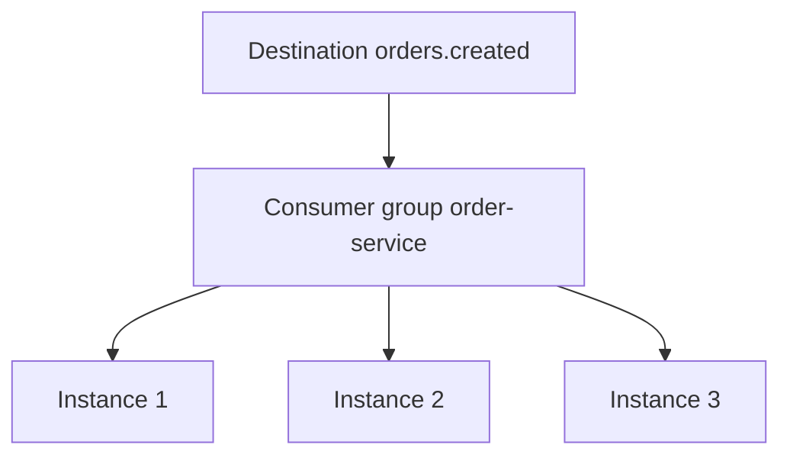
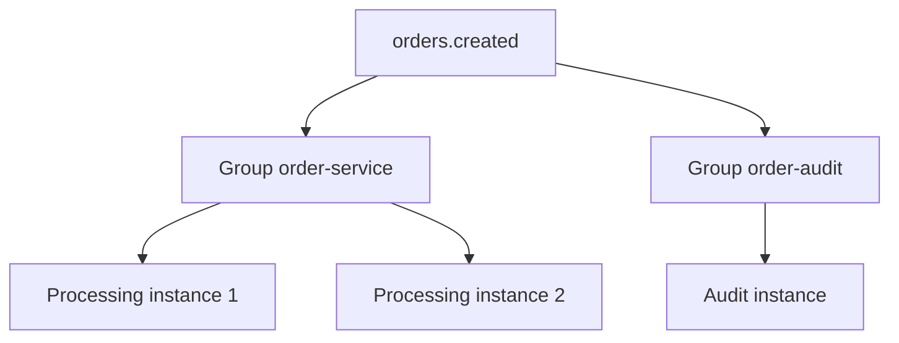
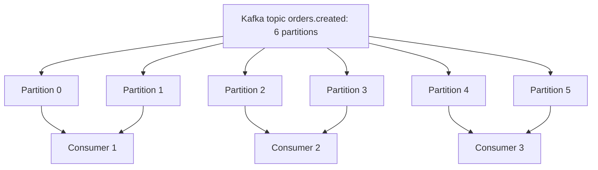
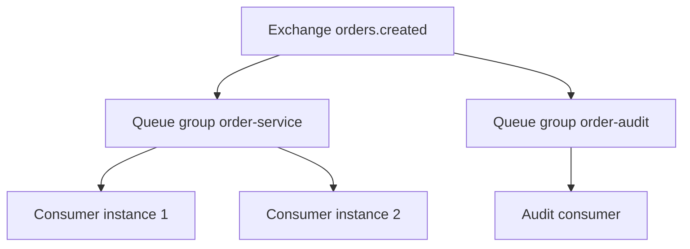

# Consumer Groups and Message Distribution Mechanisms

In a Spring Cloud Stream application, an input binding can run across multiple instances to increase processing capacity and maintain availability. A **consumer group** identifies which consumers coordinate to receive messages from a destination. Instances in the same group typically share the workload; different groups typically receive independent copies of the event stream.

Spring Cloud Stream provides the `group` property at the binding level. The binder translates this general concept into the appropriate broker-specific mechanism: a Kafka consumer group, a group-dedicated queue in RabbitMQ, or a Pulsar subscription. As a result, the same application configuration can preserve its general business semantics while the concrete distribution behavior still depends on the broker and binder.

## 1. What problem do consumer groups solve?

Suppose an order processing service receives events from the `orders.created` destination. When there is only one instance, that instance processes every event it receives. As traffic grows, multiple instances of the same service can be run.

If every instance receives an independent copy of every message, the system may process the same order multiple times. In most parallel processing scenarios, we want the instances to share messages among themselves. A consumer group represents the group of consumers performing that work together.

For example, with three instances:



Because the three instances share the same group name, the binder/broker coordinates message distribution among them. Each message is delivered to one consumer in the group according to the broker's mechanism. If another service also needs to receive all order events, that service uses a different group.

## 2. Declaring a group in Spring Cloud Stream

The group name is declared on the input binding using the `group` property. Here is an example of an event-handling function:

```java
import java.util.function.Consumer;

import org.springframework.context.annotation.Bean;
import org.springframework.context.annotation.Configuration;

public record OrderCreated(String orderId, String customerId) {}

@Configuration
public class OrderConsumers {

    @Bean
    public Consumer<OrderCreated> processOrder() {
        return event -> {
            System.out.println("Processing order " + event.orderId());
        };
    }
}
```

Binding configuration:

```yaml
spring:
  cloud:
    function:
      definition: processOrder
    stream:
      bindings:
        processOrder-in-0:
          destination: orders.created
          group: order-service
          content-type: application/json
```

In this example:

- `processOrder` is the name of the function bean selected for activation.
- `processOrder-in-0` is the input binding of the function.
- `destination` specifies the event stream that the binding reads from.
- `group: order-service` specifies the consumer group coordinating to process that stream.
- `content-type` describes the payload format so the framework can convert it into `OrderCreated`.

When running multiple replicas of the same application with the same configuration, all of them join the `order-service` group. If another service needs to independently read from the same destination, it declares a separate group, such as `order-audit`.

## 3. Same group vs. different groups

Two common deployment patterns produce very different behaviors:

| Configuration | Meaning | Expected outcome |
| --- | --- | --- |
| Multiple instances with the same `destination` and same `group` | The instances are members of a single consuming group | Messages are shared across members according to the broker's mechanism |
| Multiple instances with the same `destination` but different groups | Each group is an independent logical subscriber | Each group can receive the full event stream with its own consumption state |
| No `group` declared | The framework creates an anonymous group according to the binder's mechanism | Instances typically consume independently and may receive copies of the stream |

Example of one order topic with two groups:



The `order-service` group shares work among the processing instances. The `order-audit` group receives an independent stream for logging or auditing purposes. Increasing the number of instances in the same group usually increases parallel processing capacity; creating a new group usually increases the number of systems independently receiving the same events.

## 4. Anonymous groups when no group is declared

If an input binding does not specify the `group` property, Spring Cloud Stream uses an anonymous group. Each consumer instance typically receives its own binder-generated group identifier. Therefore, the instances do not automatically coordinate to share work as they do when using a named group.

The physical behavior of an anonymous group depends on the broker:

- Kafka may use a per-consumer generated group ID; each independent group reads the topic at its own offset.
- The Rabbit binder may create an anonymous queue dedicated to the consumer; this queue typically has a temporary lifecycle.
- The Pulsar binder may create an anonymous subscription according to the binder's mechanism.

Anonymous groups are useful when each instance needs to receive an independent stream for the duration of its lifetime, such as a temporary consumer for testing or a subscriber that does not need to persist a stable group identity. For business-processing services that need to coordinate across multiple replicas and retain consumption identity across restarts, a named group should be declared.

You should not assume that the lifecycle, offset persistence, or durability of anonymous groups are identical across Kafka, RabbitMQ, and Pulsar. Check how your current binder creates and cleans up anonymous resources.

## 5. Kafka: group ID, partitions, and consumer assignment

With Kafka, a consumer group is identified by its group ID. Consumers sharing the same group ID coordinate to read the partitions of a topic. Within a group, at any given time, each partition is assigned to at most one consumer member. A single consumer can be assigned multiple partitions if the number of partitions exceeds the number of consumers.

For example, the `orders.created` topic has six partitions:



With three consumers in the same group, the illustration shows two partitions assigned to each consumer. Actual assignment depends on the assignor and group state. Increasing to six consumers can achieve up to six consumers operating in parallel for a six-partition topic. Increasing to eight consumers means at least two consumers are not assigned any partition and will not receive data from that topic in this group.

### Different groups reading the same topic

Kafka maintains separate offsets for each group. If `order-service` and `order-audit` both read `orders.created`, each group tracks its read position independently. When a new message arrives, both groups can read it, even though within each group the message is assigned to only one consumer member at a time.

### Rebalancing when membership changes

When a consumer joins, leaves the group, loses connection, or the partition count changes, Kafka may trigger a rebalance to reassign partitions. During the transition, consumption may temporarily pause or slow down. Applications must safely handle redelivered messages and must not rely on the assumption that an instance permanently owns a fixed partition.

### Offsets and starting position

Kafka stores offsets per group. When a consumer processes a message, the binder and acknowledgment/commit configuration determine when the offset is committed. A new group without existing offsets can start according to the configured `startOffset` or corresponding `auto.offset.reset` behavior. Choosing `earliest` or `latest` affects whether older messages are re-read or only new messages are received; configure this based on business requirements and verify it against your Kafka binder version.

## 6. RabbitMQ: groups represented through queues

RabbitMQ does not use consumer groups with the same group ID and partition model as Kafka. With the Rabbit binder, a destination is typically mapped to an exchange; a consumer group is represented by a queue created and bound to that exchange.

Instances in the same group consume from the same queue. RabbitMQ distributes messages in the queue across consumers using competing consumers, influenced by prefetch, acknowledgments, and consumer state. Different groups typically have separate queues bound to the exchange, so each queue receives copies of messages according to the configured exchange type and bindings.

Logical example:



The two instances of `order-service` share the `order-service` queue. The separate queue for `order-audit` receives an independent copy for audit processing. How the exchange routes to queues depends on the exchange type, routing key, and binder configuration.

Queues for named groups are usually provisioned as durable according to binder configuration. Consumers without a declared group typically use shorter-lived anonymous queues. Queue naming, durability, auto-delete, exclusivity, and dead-letter exchanges are details to verify in the Rabbit binder configuration; do not assume they behave like Kafka offsets.

## 7. Pulsar: groups mapped to subscriptions

With the Pulsar binder, the `group` property of an input binding is used to determine the subscription name. Consumers sharing the same subscription belong to one consuming group. The subscription type governs how Pulsar distributes messages among the consumers in that subscription.

Common Pulsar subscription types:

| Subscription type | Primary distribution behavior | Use case |
| --- | --- | --- |
| `Exclusive` | Only one active consumer on the subscription | A single consumer reading the stream |
| `Failover` | One active consumer; other consumers remain on standby | Wanting one primary processing consumer with standby failover |
| `Shared` | Messages are distributed across multiple consumers | Increasing parallel throughput without relying on global stream ordering |
| `Key_Shared` | Messages with the same key are kept on the same consumer according to key-distribution rules | Needing parallelism while preserving per-key ordering |

Using the same group name lets consumers join the same subscription. Two different groups create two independent subscriptions on the same topic, allowing each application to read the stream according to its own acknowledgment position. The subscription type must be chosen based on ordering requirements, consumer count, and the capabilities of the Pulsar/binder version in use.

Do not assume the default subscription type is identical across all binder versions. Explicitly declare the consumer subscription type property according to the documentation for your version if distribution behavior is a critical requirement.

## 8. A group is not a partition

Consumer groups and partitions are related, yet they are two distinct concepts:

- **Group** defines the set of consumers coordinating to receive data and is typically the scope for storing consumption state.
- **Partition** splits a stream into segments for storage and parallel processing, which is especially prominent in Kafka and partitioned topics on other brokers.
- **Consumer instance** is a process or running application instance participating in a group.
- **Concurrency** is the number of parallel consumers or processing threads within a single instance, depending on the binder and configuration.

Increasing the number of consumers in a group does not automatically create more partitions. With Kafka, the number of consumers actively processing in parallel is bounded by the number of partitions assigned to the group. To increase parallelism beyond the current limit, consider increasing partitions while ensuring key routing and ordering still satisfy business rules.

With RabbitMQ, parallelism depends on queues, consumer count, prefetch, and message acknowledgment; queues do not share Kafka's partition assignment model. With Pulsar, parallelism depends on partitioned topics, subscription type, and consumer count.

## 9. Partition keys and processing order

If events for the same entity must be processed in order, the producer must use a stable key, such as `orderId` or `customerId`, to route them to the same partition or processing branch according to the broker's mechanism.

Example producer partitioning configuration using a key expression:

```yaml
spring:
  cloud:
    stream:
      bindings:
        publishOrder-out-0:
          destination: orders.created
          producer:
            partition-key-expression: payload.orderId
            partition-count: 6
```

This is an example of Spring Cloud Stream's general partitioning mechanism. Support level and how partitions map to the broker depend on the binder. With Kafka, the record key is typically used to select the partition. With Pulsar, the key and a subscription type like `Key_Shared` can work together to preserve per-key ordering. RabbitMQ uses exchanges, queues, and routing rather than Kafka partition assignment.

Ordering is typically guaranteed only within a partition or key according to the specific mechanism, not across an entire topic when multiple partitions and consumers run in parallel. If the same `orderId` is processed across multiple partitions, instances may complete messages out of order.

## 10. Configuring groups across binders

The common Spring Cloud Stream configuration remains the same:

```yaml
spring:
  cloud:
    function:
      definition: processOrder
    stream:
      bindings:
        processOrder-in-0:
          destination: orders.created
          group: order-service
```

When running with the Kafka binder, the group maps to a Kafka consumer group. Configure brokers, offsets, concurrency, and consumer-specific properties under the Kafka binder namespace when required.

When running with the Rabbit binder, the group is used to provision the corresponding consuming queue. Review queue durability, dead-letter exchange, prefetch, and acknowledgments as required.

When running with the Pulsar binder, the group is used as the subscription name. Choose the appropriate subscription type and configure acknowledgment/receiver settings accordingly.

Do not copy Kafka-specific properties over to Rabbit or Pulsar simply because they all sit under binding consumer settings. The common configuration describes application intent; broker-specific properties must match the binder in use.

## 11. Scaling a consumer group

When you need to increase throughput, identify the current bottleneck first:

1. Measure the incoming message rate and the processing rate per consumer.
2. Check how many partitions, queues, or subscriptions can be consumed in parallel.
3. Verify whether consumers are bottlenecked by I/O, CPU, databases, or downstream APIs.
4. Increase instance count or concurrency within what the broker supports.
5. Monitor rebalances, queue backlog, subscription backlog, and processing latency.
6. Re-verify ordering, duplicates, and behavior when an instance stops abruptly.

With Kafka, if a topic has 4 partitions, scaling from 4 to 10 consumers in the same group does not create 10 active reading streams for that topic; the extra consumers receive no partition assignments. With RabbitMQ, adding consumers can increase concurrent message processing from a queue, though an overly large prefetch value can leave one consumer holding many unacknowledged messages. With Pulsar, the benefit of adding consumers depends on the subscription type and topic partition count.

## 12. Rebalancing, acknowledgments, and duplicate processing

Group members can leave or join due to autoscaling, deployments, network issues, or restarts. The broker adjusts distribution accordingly. During this process, a message may be redelivered if a consumer processed it before completing acknowledgment/commit according to the broker's mechanism.

Therefore, applications should not rely on the assumption that a message is always processed strictly once. You should:

- Use a stable event ID to identify each event.
- Design data writes to be idempotent.
- Acknowledge messages only after required processing steps complete according to the delivery policy.
- Configure retries and dead-letter handling for unprocessable errors.
- Review binder transaction and commit semantics if processing and acknowledgment must be coupled.

Kafka stores offsets per group; RabbitMQ uses message acknowledgments on a queue; Pulsar uses acknowledgments on a subscription. Because these are different mechanisms, a shared Spring Cloud Stream configuration does not imply identical delivery guarantees across all brokers.

## 13. Example implementing two independent groups

Suppose the same `orders.created` event needs to serve both business processing and auditing. Two consumer functions can be declared:

```java
import java.util.function.Consumer;

import org.springframework.context.annotation.Bean;
import org.springframework.context.annotation.Configuration;

@Configuration
public class OrderHandlers {

    @Bean
    public Consumer<OrderCreated> processOrder() {
        return event -> System.out.println("Process " + event.orderId());
    }

    @Bean
    public Consumer<OrderCreated> auditOrder() {
        return event -> System.out.println("Audit " + event.orderId());
    }
}
```

The two bindings share the same destination but have different groups:

```yaml
spring:
  cloud:
    function:
      definition: processOrder;auditOrder
    stream:
      bindings:
        processOrder-in-0:
          destination: orders.created
          group: order-service
          content-type: application/json
        auditOrder-in-0:
          destination: orders.created
          group: order-audit
          content-type: application/json
```

Replicas running `processOrder` join `order-service`; replicas running `auditOrder` join `order-audit`. The two groups receive independent streams. In production, business processing and auditing are typically deployed as separate services or deployments so they can be scaled and granted permissions independently; this example focuses on illustrating the meaning of groups.

## 14. Testing consumer group behavior

The test binder can verify function logic and binding flows inside the application without a real broker. However, the test binder does not fully simulate group IDs, Kafka partition assignment, Rabbit queue competition, or Pulsar subscription types.

You should include these testing layers:

- **Unit tests:** verify payload processing logic, idempotency, and error behavior.
- **Test binder:** verify that the input binding receives the expected payload and selects the intended function.
- **Integration tests with a broker:** run at least two instances in the same group to verify messages are shared according to the broker mechanism.
- **Multi-group integration tests:** verify that two different groups both receive the same event.
- **Scale/restart tests:** add or stop consumers to observe rebalancing, redelivery, backlog, and recovery.

With Kafka, inspect partition assignments and per-group offsets. With RabbitMQ, observe queues, consumer counts, unacknowledged messages, and dead-letter queues. With Pulsar, observe subscriptions, active consumers, backlog, and subscription types.

## 15. Common design mistakes

| Symptom | Possible cause | Resolution |
| --- | --- | --- |
| Every replica processes the same message | Each instance uses an anonymous group or a different group name | Use the same group name for replicas that need to share work. |
| An audit service misses messages | Sharing a group with the business processing service | Create a dedicated group for each independent subscriber. |
| Adding consumers does not increase Kafka throughput | Consumer count exceeds partition count, or a dependency bottleneck exists | Check partition assignments and processing times. |
| Event order for the same order is reversed | Events for the same order go to different partitions/branches or are processed asynchronously | Use a stable key and control concurrency according to ordering requirements. |
| Messages reappear after a restart | Consumer stops before acknowledgment/offset commit completes | Design for idempotency and choose appropriate acknowledgment/commit semantics. |
| Rabbit queues grow uncontrollably | Many groups or anonymous consumers create separate queues | Manage groups and queue lifecycles; check auto-delete/durability. |
| Pulsar does not distribute as expected | Subscription type does not match consumer count or ordering needs | Choose `Exclusive`, `Failover`, `Shared`, or `Key_Shared` according to the use case. |

## 16. Process for choosing groups and distribution strategy

Before deploying consumers, answer these questions in order:

1. How many logical applications need to read this destination?
2. Which instances need to share work, and why?
3. Which subscribers need to receive an independent copy?
4. Are there ordering requirements per key or across the entire stream?
5. Does the broker use partitions, queues, or subscriptions for distribution?
6. How many parallel consumers are needed, and where is the limit?
7. When are offsets/acknowledgments confirmed, and how does the application handle duplicates?
8. During deploys, scaling, or restarts, how must the system recover?

Choose groups based on business processing boundaries rather than just deployment names. Instances sharing the same processing responsibility typically share a group; a subscriber with a different purpose such as auditing, analytics, or notifications typically requires its own group.

## Conclusion

A consumer group identifies consumers that coordinate to receive messages from a destination. In Spring Cloud Stream, the `group` property provides a unified model, while binders map it to a Kafka group ID, a RabbitMQ queue, or a Pulsar subscription. Sharing a group distributes work; using different groups lets applications read the stream independently. Understanding the relationship between groups, partitions, queues, subscriptions, concurrency, and acknowledgments is the foundation for scaling consumers while maintaining control over ordering, duplicates, and resilience.
