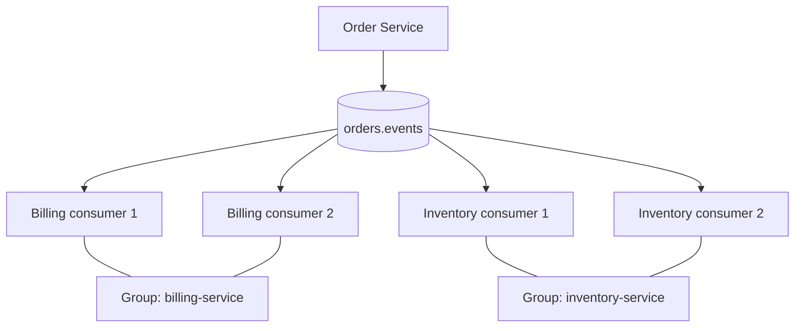
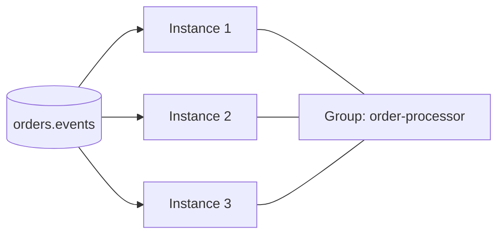
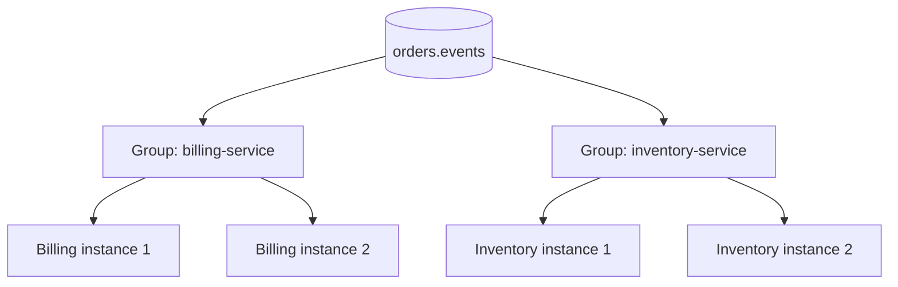
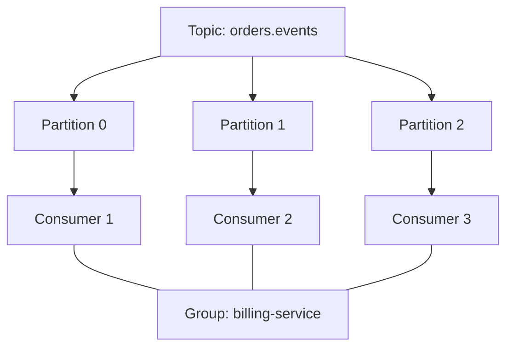
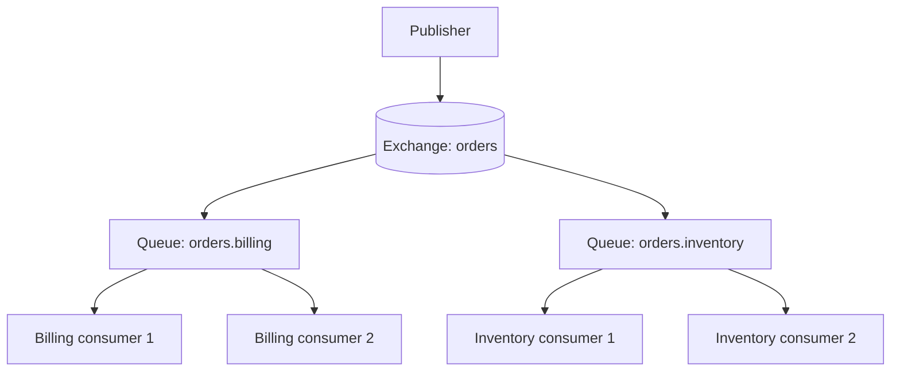

# Same Group for Load Sharing, Different Groups for Independent Delivery

## 1. The problem: one event, multiple consumers

In an event-driven system, a single event may need to be processed by multiple components. When an order is created, the billing service needs to prepare a transaction, the inventory service needs to reserve stock, and the analytics service needs to update metrics. At the same time, a single service may run multiple instances to increase processing capacity and maintain availability if one instance fails.

These two needs are different:

- **Load sharing:** multiple instances jointly perform one logical job; each message is delivered to only one instance in the group at a time according to the broker's mechanism.
- **Independent delivery:** multiple applications or distinct processing groups each need to receive the same event to perform their own separate work.

A consumer group is the concept used to define the scope of consumers coordinating to share work. Consumers in the same group share the load. Different groups maintain separate consumption progress and receive independent event streams.

For example, with the `OrderCreated` event:

- Two instances of `billing-service` in the same `billing-service` group share the work of processing orders.
- Two instances of `inventory-service` in the same `inventory-service` group share the work of processing inventory events.
- Both the `billing-service` group and the `inventory-service` group receive the `OrderCreated` event, because the two business domains need to process it independently.



The diagram illustrates two independent business groups. Within each group, instances coordinate to receive messages; across the two groups, each group can receive the same event.

## 2. Same group for load sharing

Suppose an order-processing application runs three instances. All three instances use the same destination and the same consumer group `order-processor`. The broker distributes work within the group so the instances jointly process a single data stream.



Instances in the same group are not three independent copies of the same event stream. They are members jointly executing a single workload. When one instance receives a message, other instances in the same group do not normally receive a duplicate of that message during regular distribution.

Set a stable group name based on the processing function, such as `order-processor`, `billing-service`, or `inventory-projection`. Do not assign a separate group name per instance if the goal is for instances to share load with one another.

### When an instance stops

If a member leaves the group, the broker or binder coordination mechanism can redistribute its share of work to the remaining members. With Kafka, this process is a consumer group rebalance and partitions may be reassigned. With RabbitMQ, remaining active consumers continue receiving messages from the shared queue. With Pulsar, consumers in the same subscription continue receiving according to the chosen subscription type.

Unacknowledged messages may be redelivered. Therefore, being in the same group does not guarantee each message is processed strictly once. Consumers still need idempotent processing and properly timed acknowledgments or offset commits.

## 3. Different groups for independent delivery

Suppose both billing and inventory need to process `OrderCreated`. If both share the `order-service` group, the broker will distribute each message to one of the consumers in that group. Some orders might go to billing and others to inventory; not every order will be processed by both services.

To ensure both services receive independently, two different groups must be used:



Each group has its own consumption progress. Billing may be at one position in the stream while inventory is at another. One group slowing down or pausing does not necessarily stop the other group, provided the broker and resources remain operational.

This is a common way to structure pub/sub: one destination emits events, and multiple independent consumer groups subscribe to process them according to their own needs. Creating separate deliveries per group is handled by each broker/binder through its own mechanism, such as per-group offsets in Kafka or per-group queues/subscriptions in RabbitMQ and Pulsar.

## 4. Configuring a consumer group in Spring Cloud Stream

In Spring Cloud Stream, a group is declared on an input binding via the `group` property. For example, a `processOrder` function that receives order events:

```java
import java.util.function.Consumer;
import org.springframework.context.annotation.Bean;
import org.springframework.context.annotation.Configuration;

record OrderCreated(String orderId, long totalCents) {}

@Configuration
class OrderFunctions {

    @Bean
    Consumer<OrderCreated> processOrder() {
        return event -> handleOrder(event);
    }

    private void handleOrder(OrderCreated event) {
        // Execute order processing business logic.
    }
}
```

Binding configuration:

```yaml
spring:
  cloud:
    function:
      definition: processOrder
    stream:
      bindings:
        processOrder-in-0:
          destination: orders.events
          group: billing-service
          content-type: application/json
```

In this configuration:

- `processOrder-in-0` is the input binding derived from the function bean name.
- `destination: orders.events` identifies the event stream to consume.
- `group: billing-service` identifies the logical processing group.
- Instances of the application running with the same destination and group configuration join the same consuming group, according to the binder's semantics.

If another application needs to receive the same event independently, it declares a different group, for example:

```yaml
spring:
  cloud:
    function:
      definition: updateInventory
    stream:
      bindings:
        updateInventory-in-0:
          destination: orders.events
          group: inventory-service
          content-type: application/json
```

Both applications read from the `orders.events` destination, yet because they have separate groups, each business domain receives an independent event stream.

## 5. What does omitting a group mean?

When `group` is not set, Spring Cloud Stream typically creates a consumer belonging to an anonymous group (anonymous consumer group) according to the binder's mechanism. Exact behavior depends on the broker:

- With Kafka, a consumer without a group is attached to its own anonymous group; instances generally do not share a stable group as they do when a group name is declared.
- With RabbitMQ, the binder may use an anonymous/non-durable queue for a consumer without a group.
- With Pulsar, the binder uses an anonymous subscription according to its configuration and mechanism.

Anonymous groups are suitable for some temporary or test streams where stable consumption progress does not need to persist across deployments. For production applications that require multiple instances to share load and preserve consumer identity across restarts, an explicit group should be declared.

Do not omit `group` and expect replicas to automatically share load like a durable group. Verify how your binder creates anonymous groups, queues, or subscriptions in the version you are using.

## 6. Consumer groups in Kafka

Kafka stores messages in topics divided into partitions. A consumer group is a collection of consumers coordinating to read those partitions. Within a group, at any given time, one partition is assigned to at most one consumer in the standard consumer model. Consequently, the partition count bounds the useful read parallelism of a group.



With three partitions and three consumers in the group, each consumer can be assigned one partition. If six consumers run when there are only three partitions, at most three consumers have partitions to read at the same time; the remaining consumers receive no partitions in that assignment.

### Separate offsets per group

Kafka stores consumption offsets per consumer group. `billing-service` and `inventory-service` maintain independent offsets for the same topic. Billing might have read up to offset 500 in a partition while inventory has only reached offset 420. This allows each group to move at its own pace and recover progress independently.

If a new group starts reading a topic that already contains data, the starting position depends on `auto.offset.reset` and whether the group already has committed offsets. Common choices are `earliest` to read from the oldest retained data and `latest` to start from new data. The topic's retention policy still limits how far back data can be re-read.

### Rebalancing when membership changes

When consumers join or leave a group, or when partitions change, Kafka performs a rebalance to redistribute partitions. During a rebalance, processing may pause or be impacted depending on protocol and configuration. Applications must handle graceful shutdown, commit offsets at the right time, and avoid duplicate side effects when partitions are reassigned.

### Keys and ordering

Kafka only guarantees record order within a single partition. If events for the same order must be processed in sequence, the producer should use `orderId` as the record key so they are routed to the same partition according to the partitioner strategy. The consumer group divides partitions among members, while global ordering across partitions is not guaranteed.

## 7. Consumer groups in RabbitMQ

RabbitMQ typically implements load sharing by having multiple consumers read from a single queue. Consumers on the same queue compete for messages; a message is delivered to one consumer at a time according to dispatch and acknowledgment mechanics.

In Spring Cloud Stream's Rabbit binder, `group` is tied to the consumer group's durable queue. Instances with the same destination and group share that queue to divide the load. Different groups usually have separate queues bound to the corresponding exchange/destination, allowing each group to receive an independent message delivery.



The diagram illustrates a pub/sub topology: each group has its own queue; instances in the same group compete to consume from their group's queue. Actual queue names and exchange/queue declarations depend on the Rabbit binder configuration.

### Acknowledgments and redelivery

RabbitMQ uses acknowledgments to know whether a consumer has processed a message. If a consumer closes before acknowledging, unacknowledged messages may be requeued and redelivered. When multiple consumers share a queue, completion order can differ from the order messages entered the queue, especially with a large prefetch or uneven processing times.

If stricter ordering is needed, consider consumer count, prefetch, single active consumer, and retry strategy. These choices affect throughput and fault tolerance. A group name by itself does not guarantee completion order.

## 8. Consumer groups in Apache Pulsar

In Pulsar, the closest equivalent to a consumer group is a **subscription**. A named subscription maintains its own consumption progress on a topic. Multiple consumers sharing a subscription coordinate to receive messages according to the chosen subscription type. Different subscriptions on the same topic receive independent message streams.

For example:

- Subscription `billing-service` for the billing domain.
- Subscription `inventory-service` for the inventory domain.
- Multiple billing instances share subscription `billing-service` to split the load.

Pulsar has key subscription types:

| Subscription type | High-level distribution | Meaning for the group |
|---|---|---|
| Exclusive | One active consumer on the subscription | Suitable for sequential processing within the subscription |
| Failover | One primary consumer, other consumers on standby | Supports takeover when the primary consumer is lost |
| Shared | Distributes messages across multiple consumers | Increases load-sharing capacity; completion order is not guaranteed |
| Key_Shared | Distributes by key to the appropriate consumer | Enables parallelism across keys while preserving per-key affinity/ordering per configuration |

The subscription type governs how members of the same group receive messages. Therefore, simply setting the same group name is not enough to understand concurrency; you must examine the subscription type, partitions, message keys, and binder configuration.

## 9. Comparing same-group and cross-group behavior across brokers

| Broker | Same group | Different groups | Consumption progress |
|---|---|---|---|
| Kafka | Consumers in the same group divide the topic's partitions | Each group reads the topic independently | Separate offset per group and partition |
| RabbitMQ | Consumers in the same group typically share a queue and compete for messages | Each group has a separate queue bound to receive deliveries | Message/ack state lives on the queue; group queues are independent |
| Pulsar | Consumers in the same subscription share delivery per subscription type | Each subscription has an independent receiving stream | Separate cursor/acknowledgments per subscription |

The common thread is that a group represents a logical workload. However, how brokers create deliveries, store progress, acknowledge, and handle redelivery differs. Do not mechanically apply Kafka consumer group settings to RabbitMQ or Pulsar.

## 10. Naming groups and organizing workloads

A group name should reflect the business purpose or processing application name, not the host running the instance. For example:

| Group name | Purpose |
|---|---|
| `billing-service` | Calculating charges and creating payment transactions |
| `inventory-service` | Updating stock levels and reserving items |
| `notification-service` | Sending emails or notifications |
| `analytics-projection` | Building data for analytics |

Instances of the same workload must use the same group name. Workloads that need to receive all messages independently must use separate group names.

Do not arbitrarily rename a group on every deployment. With Kafka, a new group has no committed offsets and may re-read data according to `auto.offset.reset`; with RabbitMQ and Pulsar, a new group/subscription name can create a new queue or subscription with its own retention behavior. Renaming a group can cause backlogs, re-reading of data, or creation of new broker resources.

When you need to rename a group, plan the migration: determine whether data needs to be replayed, how much retention time remains, how to handle duplicate messages, and when to remove the old queue/subscription.

## 11. Scaling instances and parallelism limits

Adding instances only increases throughput when the broker has enough units of work to distribute and the application is not bottlenecked by other resources.

### With Kafka

Suppose a topic has 8 partitions:

| Consumers in group | Distribution capacity |
|---:|---|
| 1 | One consumer reads all 8 partitions |
| 4 | Partitions can be divided across 4 consumers |
| 8 | One partition can be assigned to each consumer |
| 12 | At most 8 consumers are assigned partitions; remaining consumers wait idle |

These numbers assume a stable group and no other bottlenecks. Actual consumer concurrency also depends on per-instance concurrency settings, partition count, and the assignment strategy.

### With RabbitMQ

You can increase the number of consumers reading from the same queue to process in parallel. However, throughput also depends on prefetch, processing duration, queue count, broker resources, and downstream dependencies. Multiple consumers can cause completion order to differ from arrival order.

### With Pulsar

Parallelism depends on subscription type and topic partition count. Shared or Key_Shared lets multiple consumers receive concurrently; Exclusive limits activity to one active consumer; Failover uses standby consumers. Choose the type based on ordering and load requirements.

## 12. Groups, partitions, and processing order

Consumer groups and partitions are closely tied in Kafka. The group defines the load-sharing scope; the partition is the unit assigned to a consumer. The partition count determines how many consumers can work concurrently in the group at a given time.

If messages for the same aggregate must be processed in order, choose the aggregate ID as the key. For example, use `orderId` for orders. If the producer uses different keys for events of the same order, they may land in different partitions and lack global ordering.

Even when the broker delivers in order, the application can still invert completion order if it dispatches messages into an unbounded thread pool or processes asynchronously without per-key sequencing. When business ordering is required, keep processing sequential within the partition/key scope or check sequence/version before applying changes.

## 13. Groups and delivery guarantees

A group helps organize distribution, but does not by itself determine the delivery guarantee level. Messages can still be redelivered if a consumer fails before an acknowledgment or offset commit is recorded.

- With Kafka, offsets are committed per group. If side effects have completed before the offset commits, the message may be read again.
- With RabbitMQ, unacknowledged messages can be requeued when a consumer or channel closes.
- With Pulsar, unacknowledged messages can be redelivered according to the subscription and acknowledgment timeout.

Therefore, consumers should be idempotent. You can use a unique event ID, an inbox table, a business key, or a unique database constraint to detect already-processed messages. Do not use the group name as an event ID; a single group processes many messages and multiple retries.

When a new group begins receiving data, establish the starting position and retention policy. During replays or group changes, a consumer may encounter old events again. Business logic must handle duplicate or late-arriving data according to designed rules.

## 14. Testing group behavior

Tests should prove both properties: same group shares load, and different groups receive independently.

1. Publish a set of events with distinct IDs to the destination.
2. Start two instances with the same destination and the same group.
3. Verify that both instances receive a portion of the workload and together process all events.
4. Start another consumer with a separate group name.
5. Verify that the consumer in the second group also receives the full set of events according to broker semantics.
6. Stop one instance mid-processing and verify redelivery, acknowledgment/offset handling, and idempotency.
7. Scale instances beyond the partition count (for Kafka) or adjust subscription/queue concurrency to observe parallelism limits.
8. Test behavior after changing the group name and verify replay/retention policies.

Spring Cloud Stream's test binder can help test function and binding logic at the application level. It does not fully simulate partition assignment, Kafka rebalances, RabbitMQ queue dispatch, or Pulsar subscription types. Those behaviors require integration testing against the corresponding broker.

## 15. Observing groups in operations

Monitoring groups helps detect slow consumers, disconnections, or unbalanced distribution. Useful metrics include:

- Kafka: group member count, partition assignment, rebalances, committed offsets, and consumer lag.
- RabbitMQ: queue depth, active consumer count, unacked messages, redeliveries, and ack rate.
- Pulsar: subscription backlog, consumer count, unacked messages, redeliveries, and partition distribution.
- Application: throughput, processing duration, error rate, retries, DLQ, and duplicate event count.

Logs should record the group name, destination, event ID, and correlation ID. Do not log sensitive payloads. If one group lags while another is healthy, investigate the consumers and resources of the lagging workload rather than scaling every service.

## 16. Process for choosing groups for an event stream

1. List the business capabilities that need to receive events from the destination.
2. Group instances performing the same workload into one stable group.
3. Create a separate group for each workload that needs independent delivery.
4. Choose meaningful group names and keep them stable across deployments.
5. Determine the appropriate partition/key or queue/subscription type for the broker.
6. Define acknowledgment, offset commit, retry, and idempotency policies.
7. Test scale-out, scale-in, redelivery, and group changes.
8. Monitor lag/backlog and load distribution after deployment.

Same group enables multiple instances to share a workload; different groups enable multiple workloads to receive events independently. Spring Cloud Stream exposes this concept in binding configuration via the `group` property, and the binder maps it to a Kafka consumer group, a RabbitMQ queue, or a Pulsar subscription. Understanding the broker's exact semantics helps you design for scalability while ensuring every business capability receives the data it needs.
