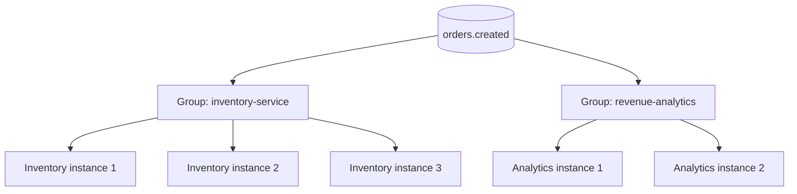

# Named Groups and Anonymous Groups

## Objectives

When multiple instances of an application receive events concurrently, the system needs to know whether they share a single stream of work or each instance needs to receive an independent copy. Spring Cloud Stream models this relationship with a **consumer group**. An input binding can join a named group or use an anonymous group when no group is declared.

A named group typically represents a stable logical subscriber: multiple instances in the same group share message processing and can resume using the group's consumption state. An anonymous group has its name automatically generated by the framework, making it suitable for a temporary subscription or receiving an independent copy; it does not provide a stable subscription identity to rely on across restarts.

This lesson explains both types of groups, how to configure a group on a binding, how brokers map a group to a Kafka consumer group, RabbitMQ queue, or Pulsar subscription, and the implications for scaling, replay, durability, and testing.

After this lesson, you will be able to:

- Distinguish between named groups and anonymous groups.
- Configure a group for each Spring Cloud Stream input binding.
- Explain how instances in the same group share messages.
- Determine why different groups receive independent copies of the same event stream.
- Understand differences in groups/subscriptions across Kafka, RabbitMQ, and Pulsar.
- Choose stable group names and test behavior during scaling or restarts.

## 1. What problem do consumer groups solve?

Suppose the `orders.created` topic or destination receives order events. The inventory service has three instances to increase processing capacity. If all three instances belong to the same consumer group, the broker distributes work among them: each message is received for processing by one consumer in the group at a time according to the broker's mechanism.

Another service, such as revenue analytics, also needs to read all order events. This service must have its own group. If it uses the same group as the inventory service, the two services will compete for messages and each will only see part of the stream.



There are two rules to remember:

- **Instances in the same group share work.** They are members of the same logical subscriber.
- **Different groups receive independent copies.** Each logical subscriber has its own consumption progress or subscription.

A group is not the name of a function, topic, or instance. It identifies the logical consumer for an input destination.

## 2. Named consumer groups

A named group is explicitly declared in the binding's `group` property:

```yaml
spring:
  cloud:
    function:
      definition: processOrders
    stream:
      bindings:
        processOrders-in-0:
          destination: orders.created
          group: inventory-service
          content-type: application/json
```

Event-handling function:

```java
@Bean
Consumer<OrderCreated> processOrders(InventoryService inventory) {
    return event -> inventory.reserve(event.orderId(), event.lines());
}
```

The default input binding name is `processOrders-in-0`: `processOrders` is the function bean name, `in` indicates the input direction, and `0` is the input index. The `group` property binds the logical subscriber `inventory-service` to the `orders.created` destination.

When deploying multiple replicas of the inventory service, the replicas need to use the same destination and the same group. The broker coordinates message delivery across members. If the group name changes per replica, they are no longer in the same group; each group may receive the entire stream independently, causing duplicate processing at the business level.

### Characteristics of a named group

- Group identity remains stable across restarts if configuration stays the same.
- Multiple instances in the same group share the load.
- A different group can receive the full stream independently.
- The broker typically stores consumption progress or subscription state by group identity.
- The group can be scaled by adding instances, within partition limits or subscription capabilities.
- Messages can still be redelivered after failures; a named group does not mean exactly-once.

Having a stable name is a prerequisite for resuming the right group state, yet actual durability still depends on binder and broker configuration: offset commits, queue durability, subscription durability, retention, and message storage policies.

## 3. Anonymous consumer groups

If `group` is not declared on an input binding, Spring Cloud Stream creates an anonymous group with an auto-generated name.

For example:

```yaml
spring:
  cloud:
    function:
      definition: observeOrders
    stream:
      bindings:
        observeOrders-in-0:
          destination: orders.created
          content-type: application/json
```

Here there is no `group` property. The framework creates a dedicated group/subscription identity for the binding according to the binder's mechanism. Anonymous groups are typically temporary and do not have a stable name for the application to reuse after a restart.

### Behavior to anticipate

- An anonymous group does not share an identity with a named group like `inventory-service`.
- Independent consumers using anonymous groups can receive their own copies of the stream instead of competing for messages with a named business group.
- When the application restarts and an anonymous group is created with a new name, previous consumption state may not be resumed.
- Whether temporary queues/subscriptions are deleted, persisted, or support replay depends on the binder and broker.
- Do not rely on an anonymous group for a business consumer that must resume from committed progress across deployments.

Anonymous groups are useful for testing, temporary observation, or secondary consumers that do not need a stable subscription identity. For order processing, billing, inventory, or tasks requiring long-term progress tracking, declare a group explicitly.

**Note:** "Anonymous" does not mean the broker creates no group or subscription. The framework/binder still needs a technical identity to register the consumer; that name is simply not specified by the application and should not be treated as stable.

## 4. Comparing named groups and anonymous groups

| Criterion | Named group | Anonymous group |
|---|---|---|
| How it is declared | Has `group` in the binding | Omits the `group` property |
| Identity | Defined by the application, stable with configuration | Generated by the framework/binder |
| Purpose | Long-lived logical subscriber, load sharing across replicas | Temporary consumer or independent subscription |
| Multiple instances | Same group shares work | Depends on how the binder creates the anonymous identity; does not share durable state by default |
| Progress after restart | Can resume via offset/subscription if the broker persists state | Should not rely on resuming because the name may change |
| Receiving independent copies | Use a different group name | Anonymous identity is isolated from other groups |
| Typical usage | Production business services | Temporary observation, testing, consumers not needing a stable identity |

Do not choose an anonymous group merely to avoid naming one. If an application has clear operational requirements, the group name is part of the configuration that must be managed.

## 5. How groups are represented in each broker

Spring Cloud Stream provides a common abstraction, but Kafka, RabbitMQ, and Pulsar do not use the same native construct. The binder maps the group to the broker's corresponding concept.

### Kafka: consumer group and group ID

Kafka uses `group.id` to identify a consumer group. Consumers with the same group ID share the assignment of partitions in a topic. Each partition is assigned to at most one consumer in the group at a time.

- A Spring Cloud Stream named group maps to a stable Kafka consumer group.
- Different group IDs have independent offsets; each group can read the entire topic at its own pace.
- Kafka stores committed offsets per group, allowing the group to resume from its committed position after a consumer restarts.
- An anonymous group receives a binder-generated name; if a new name is generated on the next startup, the group has no prior committed offsets under the new identity. The starting position then depends on `auto.offset.reset` and binder configuration.
- A rebalance occurs when group membership changes or partition topology changes.

Example Kafka consumer group configuration at the Spring Cloud Stream level:

```yaml
spring:
  cloud:
    stream:
      bindings:
        processOrders-in-0:
          destination: orders.created
          group: inventory-service
      kafka:
        bindings:
          processOrders-in-0:
            consumer:
              start-offset: earliest
```

`group` is where the logical consumer identity is declared. Do not manually override the Kafka client's `group.id` with a different value from the group managed by the binder; if special behavior is needed, follow the documentation for your binder version. `start-offset` only applies to the starting position when the group has no matching committed offsets yet; it does not automatically rewind a group that already has progress.

### RabbitMQ: queue tied to a group

The RabbitMQ binder typically maps a named group to a dedicated queue bound to the destination/exchange. Instances in the same group consume from the same queue and share messages via competing consumers.

- A named group typically creates a stably named queue based on the destination and group.
- Different groups create separate queues bound to the exchange, so each logical subscriber receives copies of messages.
- An anonymous group typically uses a temporary/anonymous queue, often with exclusive or auto-delete characteristics depending on binder configuration.
- Durability, auto-delete, dead-lettering, and binding topology must be checked against the Rabbit binder configuration.

A shared queue does not guarantee each message is processed strictly once: a consumer may crash before acking, causing the message to be requeued and redelivered.

### Pulsar: subscription name

Pulsar uses subscriptions to track consumer progress. A subscription name corresponds to a logical subscriber identity; multiple consumers can join the same subscription depending on the subscription type.

- A named group maps to a stable subscription name according to binder configuration.
- Consumers in the same subscription coordinate message delivery based on the subscription type, such as Shared, Failover, or Key_Shared.
- Different subscriptions have independent cursors/progress and can receive copies of the stream.
- An anonymous group has an auto-generated subscription name; do not rely on that name to resume state after a restart.
- Durability, retention, acknowledgment, and redelivery also depend on subscription and cluster configuration.

With Pulsar, choosing the subscription type is an additional decision. The same group name does not by itself determine whether messages are shared, failed over, or distributed by key; the subscription type defines how consumers coordinate.

| Broker | Named group typically maps to | Anonymous group typically maps to | Multiple instances in same named group |
|---|---|---|---|
| Kafka | Kafka `group.id` | Auto-generated group ID | Share partition assignment |
| RabbitMQ | Queue tied to destination/group | Temporary/anonymous queue per binder | Competing consumers on the queue |
| Pulsar | Subscription name | Auto-generated subscription name | Coordinate per subscription type |

## 6. Choosing group names and managing lifecycles

A group name should represent the logical subscriber, not the host or instance name. For example:

- `inventory-service`
- `billing-service`
- `revenue-analytics`
- `fraud-detection`

If multiple environments share a broker, you can include the environment in the group name to isolate progress:

- `inventory-service-dev`
- `inventory-service-staging`
- `inventory-service-prod`

Replicas of the same service in the same environment must share the same name. Do not append a pod ID, hostname, UUID, or timestamp to the group name if the goal is to scale multiple replicas within one logical group.

Renaming a group can create a new logical subscriber. With Kafka, a new group has no committed offsets and will follow its offset reset policy. With RabbitMQ, the binder may create a new queue and receive messages from the time the queue is bound; older messages do not appear automatically if the queue did not exist and no replay mechanism is present. With Pulsar, a new subscription has its own cursor and starting position based on subscription initial position/retention. Therefore, renaming a group should be treated as a data and operational change.

When retiring a consumer group, have a plan for the old queue/subscription/offsets: keep them for auditing, delete them per policy, or migrate progress as supported by the broker. Do not delete a group solely due to a service rename without evaluating the impact on replay and pending messages.

## 7. Scaling instances within the same group

Adding instances increases parallel processing capacity, though effective scaling depends on the broker.

### Kafka partitions limit active consumers

Within a Kafka consumer group, each partition is assigned to at most one consumer at a time. If a topic has four partitions:

- One consumer can process all four partitions.
- Two consumers can split the partitions between them.
- Four consumers can process up to four partitions in parallel.
- Eight consumers in the same group will leave at least four consumers without any assigned partitions in steady state.

Thus, the maximum number of active consumers in a group is bounded by the number of assigned partitions. Adding replicas beyond the partition count may not increase throughput and increases rebalance/connection overhead.

### RabbitMQ and Pulsar

RabbitMQ can distribute messages in a queue across multiple consumers; throughput also depends on prefetch, processing speed, queue type, and broker resources. Multiple consumers on the same queue can increase parallelism but can also affect observed ordering.

Pulsar supports multiple subscription types. Shared lets multiple consumers split messages; Key_Shared distributes by key to support per-key processing; Failover provides active/standby consumer behavior. Choose the subscription type based on ordering and throughput requirements, not just replica count.

Regardless of the broker, consumers must be idempotent because failures, timeouts, or redeliveries can cause the same event to be processed again. A group only defines how a subscription is shared; it does not replace duplicate-handling mechanisms.

## 8. Example of two services needing the same event

Suppose the system has two logical subscribers:

- `inventory-service` updates inventory.
- `revenue-analytics` aggregates revenue.

Both need to receive all of `orders.created`, so separate groups are configured:

```yaml
# inventory-service
spring:
  cloud:
    function:
      definition: processOrders
    stream:
      bindings:
        processOrders-in-0:
          destination: orders.created
          group: inventory-service
```

```yaml
# revenue-analytics
spring:
  cloud:
    function:
      definition: aggregateOrders
    stream:
      bindings:
        aggregateOrders-in-0:
          destination: orders.created
          group: revenue-analytics
```

Within each service, multiple replicas can run, and all replicas of that service must keep the same group name. As a result, each logical subscriber receives an independent copy, while replicas within a subscriber share the work.

If the two services accidentally share the `orders-consumers` group, they will compete for messages. Some orders might reach only inventory and others only analytics; neither service receives the full stream anymore. This is a common configuration mistake when copying YAML between services.

## 9. Testing named groups and anonymous groups

Both framework behavior and broker semantics should be tested.

### Unit/configuration tests

Verify that bindings have the right destination and group:

- Business bindings have stable group names.
- Replicas in the same deployment receive the same group configuration.
- Different logical subscribers have different groups.
- Anonymous bindings are not accidentally used for consumers requiring durable subscriptions.

You can assert bound properties in the Spring application context, though that alone does not prove the broker created the right group/queue/subscription.

### Test Binder

The Spring Cloud Stream Test Binder is useful for testing functions, bindings, and message flows at the framework level. You can verify that the function bean is wired and messages reach the expected output/input channels. The Test Binder does not fully simulate consumer group coordination, Kafka rebalances, Rabbit queue durability, or Pulsar subscription cursors.

### Broker integration tests

Use a real broker in a test environment to verify:

1. Two instances in the same named group share messages rather than creating two independent copies for each instance.
2. Two different named groups both receive the same event.
3. Restarting a named group resumes progress according to configured broker semantics.
4. An anonymous group is created with its own identity and behaves as expected after restart.
5. Kafka rebalances when adding/removing consumers; Rabbit redelivers when a consumer stops before ack; Pulsar redelivers/fails over according to subscription type.
6. Reprocessed messages do not produce duplicate business side effects.

Do not test anonymous group restarts using a single assumption across all three brokers. Verify how queues/subscriptions are created and deleted, how the starting position is chosen, and whether older data is still retained by the broker.

## 10. Common mistakes

| Symptom | Possible cause | Resolution |
|---|---|---|
| Two services split orders, each seeing only a subset | Both services share the same group name | Assign a separate group to each logical subscriber |
| Every replica processes all messages | Replicas use different group names or separate anonymous identities | Use the same named group across replicas |
| After restart, consumer re-reads from the beginning or misses old data | New group, offset reset, or temporary queue/subscription | Keep the group name stable and check retention/initial position |
| Adding replicas does not increase Kafka throughput | Consumer count exceeds partition count or another step is the bottleneck | Measure lag, inspect partition assignments, and profile processing capacity |
| Rabbit queue disappears after app stops | Anonymous/auto-delete queue or unexpected durability settings | Use a named group and configure appropriate queue durability |
| Pulsar consumers split messages out of expected order | Inappropriate subscription type | Choose Exclusive, Failover, Shared, or Key_Shared per requirements |
| Messages are processed twice | Redelivery, retry, or crash before ack/commit | Use event IDs and idempotent consumers |

## Conclusion

A named group establishes a stable identity for a logical subscriber; instances in the same group share processing, while different groups receive independent copies. An anonymous group has its name auto-generated by the framework/binder, making it suitable for temporary consumers or cases that do not need persistent subscription state.

In Spring Cloud Stream, declare `group` on input bindings for production business consumers. Keep the group name identical across replicas and distinct across logical subscribers that need the full stream. Verify how Kafka, RabbitMQ, or Pulsar maps the group to a group ID, queue, or subscription; durability, replay, and scaling also depend on broker configuration. Consumers still require idempotency because groups do not eliminate redelivery.
