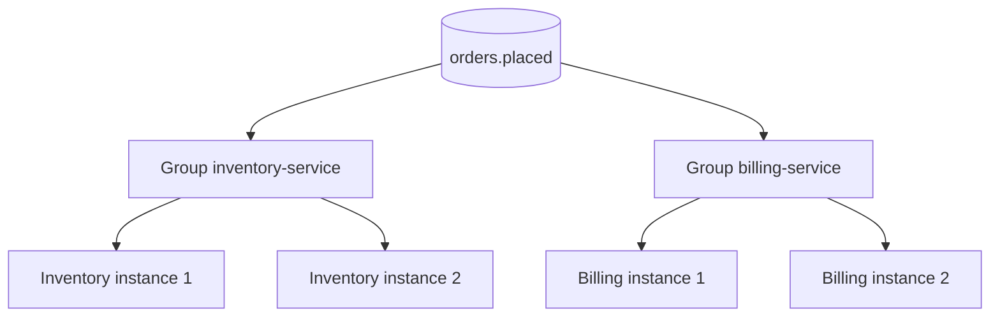

# Durable Subscriptions and Behavior When Applications Pause

In Spring Cloud Stream, a consumer binding can be attached to a consumer group via the `group` property. A group identifies a consuming group sharing the same responsibility for processing a destination. Instances in the same group typically share message processing; different groups can receive independent copies of the same event stream.

A durable subscription helps the broker or binder preserve consumption state while the consumer application is inactive. When the application restarts with the same group/subscription identity, it can resume from the recorded position or receive pending messages. The implementation differs across Kafka, RabbitMQ, and Pulsar: Kafka stores consumer group offsets while the topic retains records per its retention policy; RabbitMQ retains messages in a queue; Pulsar stores a subscription cursor. Therefore, you must understand both group configuration and broker storage policies.

## 1. Consumer groups in Spring Cloud Stream

A message-consuming function can be declared as follows:

```java
@Bean
Consumer<OrderPlaced> reserveInventory(InventoryService inventory) {
    return event -> inventory.reserve(event.orderId(), event.items());
}
```

The input binding is configured with a destination and group:

```yaml
spring:
  cloud:
    function:
      definition: reserveInventory
    stream:
      bindings:
        reserveInventory-in-0:
          destination: orders.placed
          group: inventory-service
          content-type: application/json
```

In this example, `inventory-service` is the stable group name for the inventory reservation service. When multiple instances of the application use this same destination and group, they join the same consuming group according to binder semantics. The broker distributes work according to its own mechanism.

If another service needs to receive all order events for invoicing, that service uses a separate group, such as `billing-service`. The two groups have independent responsibilities, so each group receives its own event stream:



Groups serve two important purposes:

- **Load sharing within a service**: multiple instances share a group to process a single message stream.
- **Independent delivery across services**: each service uses a separate group to receive and process the same events for its own goals.

Do not share the same group between two services that each need to receive all events. When they share a group, they act as competing consumers; each message is typically delivered to one consumer in the group per broker rules rather than copied to all.

## 2. Named groups and anonymous subscriptions

In Spring Cloud Stream, a named group establishes a stable consumer identity. This is the usual choice for production services that need to resume processing after restarts.

If `group` is not declared, the framework/binder typically creates an anonymous group or subscription. Anonymous consumers can receive separate streams rather than sharing load with a named group. Auto-generated identities are not a stable contract for an application to rely on across restarts.

| Subscription type | Characteristics | Use case |
|---|---|---|
| Named group | Has a stable identity; instances in the same group share load | Consumer services that must resume processing after a restart |
| Anonymous group | Identity generated by framework/binder; lifecycle and state storage depend on binder | Testing, temporary consumers, or per-instance independent streams |

With Kafka, a named group is tied to offsets committed under a `group.id`. If every restart creates a new group ID, the consumer cannot resume from the previous group's offsets. With RabbitMQ, a named group typically maps to a shared queue; an anonymous subscription typically creates a temporary queue. With Pulsar, a group typically maps to a subscription name; an anonymous or auto-generated subscription is not a stable identity for subsequent startups.

Do not assume that cleanup behavior for anonymous groups is the same across all binders. Check how your specific binder creates and deletes queues/subscriptions and stores state when a binding is closed.

## 3. What does a durable subscription mean?

A durable subscription preserves message consumption state across periods when the consumer is disconnected. When the application pauses or shuts down, the broker retains unprocessed data according to its retention policies and configured limits.

However, "durable" does not mean data is kept indefinitely or automatically guarantees exactly-once processing. You must distinguish between:

- **Subscription identity**: whether the group or subscription name remains stable across restarts.
- **Read/acknowledgment position**: where the broker records consumer progress.
- **Message storage**: how long records or messages remain in the broker.
- **Delivery guarantees**: whether messages can be redelivered when a consumer fails.
- **Physical durability**: whether data is persisted per the broker's durability/replication policy.

A named group on a topic/queue without an appropriate storage policy can still lose data when retention or TTL expires. Conversely, a broker may retain messages while a consumer uses a new group and therefore fails to resume at the old position.

## 4. Kafka: group offsets and topic retention

Kafka does not create a separate queue for each consumer group. Records are stored in topic partitions as a log. A named consumer group stores committed offsets for each partition. When all instances of a group stop, the topic can still continue accepting records from producers; when the group restarts with the same `group.id`, consumers resume from the committed offset provided the corresponding records are still in the log.

Three factors must be considered:

1. **Stable group ID**: keep the group name unchanged across deployments so Kafka recognizes the same consumer group.
2. **Offset commits**: determine the position the consumer has recorded. Records processed before offsets are committed may be re-read after a restart.
3. **Topic retention**: governs how long or up to what size limit records are kept in the log. A consumer offline longer than retention may no longer be able to read all missed data.

Example binder configuration:

```yaml
spring:
  cloud:
    function:
      definition: reserveInventory
    stream:
      bindings:
        reserveInventory-in-0:
          destination: orders.placed
          group: inventory-service
      kafka:
        bindings:
          reserveInventory-in-0:
            consumer:
              startOffset: earliest
```

Binder property names and how offsets apply when a group has no existing offsets depend on the Spring Cloud Stream Kafka binder version. `startOffset: earliest` does not mean every restart re-reads from the beginning; it typically specifies the starting position when the group has no valid offsets yet, per binder and Kafka client rules. Once the group has committed offsets, the consumer resumes from those offsets.

If a group stays offline too long and its offsets or records have expired per broker configuration, a restart may trigger an offset reset policy such as `earliest` or `latest`. Monitor logs and consumer lag metrics to detect this condition. Do not treat committed offsets as a lock that pins records permanently in a topic.

### Stopping and restarting Kafka consumers

When a consumer stops gracefully, it leaves the group; Kafka may perform a rebalance to redistribute partitions to the remaining members. If all members stop, no consumer processes the group during that interval. Producers can still write new records to the topic if the broker is healthy.

When the application restarts with the same group ID, Kafka assigns partitions and resumes reading from committed offsets. If an application processes a record and stops before committing its offset, the record may be redelivered. If it commits the offset before business work finishes, the record may be skipped on restart. Therefore, commit timing must be designed to match business processing and transactions.

## 5. RabbitMQ: durable queues and pending messages

With the RabbitMQ binder, a named group typically maps to a queue dedicated to the consumer group. The queue can continue to exist when the consumer application is not running so messages remain held by the broker. Instances in the same group read from that queue.

Queue durability must be distinguished from message durability:

- **Durable queue**: the queue definition persists across broker restarts depending on queue type and broker configuration.
- **Persistent message**: the message is published with the appropriate delivery mode so the broker can persist it durably.
- **Publisher confirms**: the producer receives publish confirmations from the broker via RabbitMQ's confirm mechanism.
- **Consumer acknowledgments**: the consumer confirms a message has been processed according to the acknowledgment mode.

For real resilience, these factors must work together. A durable queue with non-persistent messages does not provide the same durability as a durable queue with persistent messages. Publisher confirms also do not replace consumer acknowledgments.

Example binding with a group:

```yaml
spring:
  cloud:
    function:
      definition: reserveInventory
    stream:
      bindings:
        reserveInventory-in-0:
          destination: orders
          group: inventory-service
          content-type: application/json
```

The Rabbit binder maps destination and group into RabbitMQ's exchange/queue model. For named groups, the binder typically creates a durable queue according to its defaults and rules; verify `durableSubscription`, queue type, auto-delete, TTL, and dead-letter properties in your version. An inactive consumer does not imply the queue is deleted automatically if the queue is declared durable and no other deletion policy applies.

### When a RabbitMQ consumer pauses

If a consumer stops receiving messages, new messages can accumulate in the queue. If a consumer connection/channel closes while unacknowledged messages remain, RabbitMQ can return the unacked messages to a deliverable state for other consumers. When the application restarts, backlogged and redelivered messages are processed according to queue and acknowledgment configuration.

Queues are still subject to limits such as message TTL, queue TTL, max length, max bytes, overflow policy, and dead-letter routing. When a backlog exceeds limits, the broker may drop or dead-letter messages per policy. Therefore, monitor queue depth, oldest message age, unacknowledged count, and consumption rate.

## 6. Pulsar: subscription name, cursor, and backlog

In Apache Pulsar, a named subscription stores consumption state, typically represented by a cursor and acknowledgments. When a consumer disconnects, a durable subscription can retain the backlog for the consumer to read after reconnecting.

In the Spring Cloud Stream Pulsar binder, `group` typically maps to the subscription name. Instances with the same subscription name join the same subscription; the subscription type determines how messages are distributed across consumers.

Key subscription types:

| Subscription type | High-level distribution | Use case |
|---|---|---|
| Exclusive | One active consumer on the subscription | Single-consumer processing stream |
| Failover | One active consumer, others on standby | Prioritized failover needed |
| Shared | Messages distributed across multiple consumers | Load sharing without global ordering guarantees |
| Key_Shared | Messages with the same key kept on the same consumer per key-shared rules | Load sharing while preserving per-key ordering |

A durable subscription preserves its cursor and backlog according to Pulsar retention/policies. When the application restarts with the same subscription name, it resumes from the saved acknowledgment state. If the subscription is deleted or recreated under a different name, the old consumption position is no longer used to resume.

Pulsar also provides settings for subscription mode, initial position, acknowledgment timeout, negative acknowledgments, retries, and backlog quotas. A durable subscription does not mean an unbounded backlog: retention, backlog quotas, message TTL, and broker policies still affect how long data remains available.

When using the Pulsar binder, verify exactly how your binder version maps `group` to the subscription name, selects the subscription type, and handles the subscription when a binding stops. Do not assume property names or defaults of the Pulsar binder match the Kafka or Rabbit binders.

## 7. Comparing durable subscriptions across the three brokers

| Aspect | Kafka | RabbitMQ | Pulsar |
|---|---|---|---|
| Consumer identity | `group.id` | Queue tied to group | Subscription name |
| Progress state | Committed offsets per partition | Acked/unacked messages and queue state | Subscription cursor/acknowledgments |
| While consumer is offline | Records retained per topic retention | Messages accumulate in the queue | Backlog accumulates in the subscription |
| Resuming after restart | Same group ID with still-valid offsets | Reconnect to the surviving durable queue | Reconnect to the durable subscription of the same name |
| Main storage limits | Topic retention, segment/disk policy, offset retention | TTL, queue limits, overflow, broker storage | Retention, backlog quota, message TTL |
| Load sharing | Partitions assigned across group members | Multiple consumers reading the shared queue | Subscription type governs distribution |
| Re-read risk | Processed before offset commit | Processed before ack | Processed before ack |

All three models allow consumers to resume after an application pauses, though they do not share the same internal mechanism. When switching binders, redesign group identity, retention, acknowledgments, and redelivery handling for the target broker.

## 8. Pausing bindings, stopping the application, and losing connections

The following three situations are not identical:

**Pausing consumption (pause)**: the application or container stops requesting new messages for a period of time. Connections and consumer state may remain intact. How pause/resume works and its impact on assignments, prefetch, or subscriptions depend on the binder and version.

**Stopping a binding or graceful shutdown**: the listener/consumer is closed in a controlled way. The framework can finish or wait for in-flight messages up to the shutdown timeout, then close resources. Unacknowledged messages may be redelivered depending on the broker.

**Process killed or sudden disconnection**: the broker detects the lost connection/member after a timeout. Partitions may be rebalanced, unacked queue messages may be requeued, or the Pulsar consumer disconnects while backlog continues to grow. Messages already processed without recorded ack/offset commits may be redelivered.

Do not treat pausing as a message storage mechanism. Pausing only controls consumption; the broker is responsible for retaining data per its storage policy. Also do not leave consumers paused for too long without monitoring backlog, because messages may expire past retention or exceed capacity limits.

## 9. Designing safe shutdowns and restarts

A controlled consumer shutdown procedure should consider:

1. Stop accepting new work or pause the binding via binder-supported APIs.
2. Wait for in-flight messages to complete within an allowed timeout.
3. Persist business results and acknowledgments/offsets per configuration.
4. Close the binding and broker connections.
5. On restart, use the same destination and group/subscription name.
6. Monitor rebalances, redeliveries, backlog, and consumer lag once active again.

Not every application can finish all in-flight messages before shutdown. Set a reasonable shutdown timeout and accept that some messages may be redelivered. Consequently, handlers should be idempotent.

Example of a consumer preventing duplicate processing using an event ID:

```java
@Service
public class OrderEventHandler {

    private final ProcessedEventRepository processedEvents;
    private final OrderService orderService;

    public OrderEventHandler(
            ProcessedEventRepository processedEvents,
            OrderService orderService) {
        this.processedEvents = processedEvents;
        this.orderService = orderService;
    }

    @Transactional
    public void handle(OrderPlaced event) {
        if (processedEvents.existsById(event.eventId())) {
            return;
        }

        orderService.apply(event);
        processedEvents.save(new ProcessedEvent(event.eventId()));
    }
}
```

The example assumes `ProcessedEventRepository` and the business update share the same database transaction. Place a unique constraint on the event ID to prevent two instances processing the same event concurrently from creating duplicate records. If business state and deduplication storage live in different systems, design idempotency around the actual boundaries.

## 10. Scenarios to anticipate when an application pauses

| Scenario | Possible behavior | How to prepare |
|---|---|---|
| Consumer stops for a few minutes, broker still has data | Backlog grows; consumer resumes when back | Use a stable group, monitor lag/queue depth |
| Consumer stops longer than retention/TTL | Some older messages may expire or be evicted | Set retention for expected outage duration, alert on backlog |
| Process crashes mid-processing | Message may be redelivered | Idempotency, event ID, appropriate transactions |
| Group/subscription name changes | Consumer may start as a brand-new subscription | Keep names stable across deployments |
| Two applications share a group unintentionally | They split load instead of each receiving all events | Use separate groups for distinct business responsibilities |
| Consumer restarts with a large backlog | Load spike while catching up | Limit concurrency/prefetch and scale in a controlled manner |
| Queue/subscription is deleted | Prior consumption state may be lost | Protect broker resources and control deletion operations |

## 11. Testing durable subscription behavior

The Test Binder is useful for verifying functions, bindings, and application logic in memory, but it does not fully simulate broker state retention when a consumer stops. To verify durability, run integration tests against a real broker or equivalent environment.

A test scenario can include:

1. Start the broker and consumer application with a fixed named group.
2. Publish a set of messages and verify the consumer processes them.
3. Stop the consumer in a controlled manner.
4. Publish additional messages while the consumer is offline.
5. Restart the consumer with the same group/subscription name.
6. Verify messages still within retention/queue/backlog are processed.
7. Simulate a failure after processing but before ack/offset commit to verify redelivery and idempotency.
8. Test scenarios where data exceeds TTL/retention or backlog limits if that is an operational risk.

Specific items to verify:

- Kafka: committed offsets, topic retention, rebalances, and `auto.offset.reset` when no valid offsets exist.
- RabbitMQ: durable queues, persistent delivery, publisher confirms, consumer acks, TTL, and dead-lettering.
- Pulsar: subscription name/type, cursor, acknowledgments, backlog quotas, and retention.
- Spring Cloud Stream: group mapping, binder lifecycle, concurrency, and error handling for your version.

## 12. Production checklist

- Every service needing all events has its own dedicated, stable group/subscription name.
- Replicas that need to share load use the same group according to binder semantics.
- Verify anonymous groups and queue/subscription lifecycles before using them in production.
- Configure retention, TTL, queue limits, and backlog quotas for expected outage durations.
- Define offset/ack policies and when successful processing is recorded.
- Design idempotent handlers to tolerate redelivery.
- Implement graceful shutdown, timeouts, and restart procedures.
- Monitor Kafka consumer lag, Rabbit queue depth/unacked counts, or Pulsar backlog.
- Alert when backlog grows rapidly, messages approach expiration, or subscriptions are deleted.
- Test offline periods, restarts, redeliveries, and retention expiration against a real broker.

## 13. References

- [Spring Cloud Stream Reference — Consumer Groups](https://docs.spring.io/spring-cloud-stream/reference/spring-cloud-stream/consumer-groups.html).
- [Apache Kafka Documentation — Consumer Configs](https://kafka.apache.org/documentation/#consumerconfigs), especially group, offset, and offset reset configurations.
- [RabbitMQ Documentation — Queues](https://www.rabbitmq.com/docs/queues), covering durable queues, message TTL, and queue lifecycles.
- [Apache Pulsar Documentation — Messaging](https://pulsar.apache.org/docs/), covering subscriptions, acknowledgments, and retention.

Durable subscriptions let consumers resume from saved consumption state when applications pause, though effectiveness depends on group/subscription identity, offset or acknowledgment mechanisms, and broker retention policies. Keeping subscription names stable, setting appropriate retention, implementing idempotent processing, and testing restarts against a real broker are essential conditions for reliable event-processing continuity.
