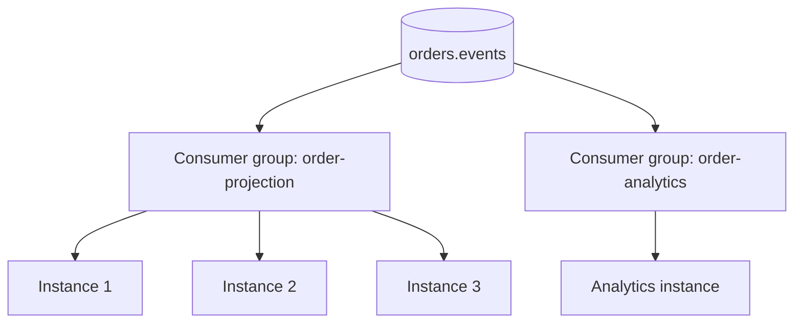
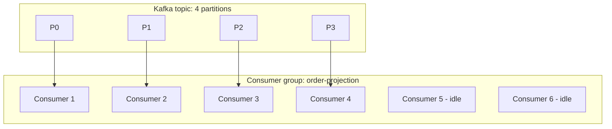

# Scaling Multiple Instances and Configuring Concurrency

When message volume grows, a single consumer may not keep up with the incoming data rate. Spring Cloud Stream lets you scale a consuming stream along two dimensions: running multiple instances of the application and increasing the number of concurrent consumers/processing threads within each instance via the `concurrency` property.

These two scaling dimensions are related but not identical. Multiple instances distribute load across processes or machines/containers. `concurrency` increases the number of active consumers inside a single instance. The broker determines how messages are distributed across consumers based on the mechanics of Kafka, RabbitMQ, or Pulsar. Scaling effectiveness also depends on partitions, queues/subscriptions, consumer groups, message ordering, and the capacity of downstream systems.

## 1. How do consumer groups share work?

A consumer group is a group of consumers collaborating to process a logical data stream. Members in the same group share messages or partitions according to the broker's rules. When you increase the number of instances in the same group, the broker can distribute work across more members.

For example, the `order-projection` service consumes events from the `orders.events` destination:

```yaml
spring:
  cloud:
    function:
      definition: updateOrderProjection
    stream:
      bindings:
        updateOrderProjection-in-0:
          destination: orders.events
          group: order-projection
          content-type: application/json
```

If you run three replicas of the application with the same destination and the same `order-projection` group, they join the same processing group. The broker distributes messages so the replicas share the load. If you run an independent analytics service that needs to receive all events, that service must use a separate group/subscription, such as `order-analytics`, instead of sharing the `order-projection` group.



Independent groups receive the data stream via the broker's fan-out behavior. Instances in the same group share processing; each instance does not receive a full copy of every message.

## 2. Two scaling dimensions: instances and concurrency

Suppose a service runs three instances, each with `concurrency=2`:

Total consumer slots = number of instances multiplied by concurrency per instance.

Under this simple model, the system has up to six consumer slots. That is the number of consumers available to take work, not a guarantee that all six are always active. The broker may cap the number of useful consumers by partitions, queues, subscriptions, or subscription type.

| Scaling approach | What changes | Impact |
|---|---|---|
| Horizontal scaling | Increases the number of application instances/containers. | Adds processes, CPU/RAM resources, and group members. |
| Consumer concurrency | Increases `consumer.concurrency` in each instance. | Creates additional concurrent consumers/listeners within a process. |
| Increasing partitions or distribution capacity | Adjusts destination structure on the broker. | Can raise maximum parallelism, depending on the broker and ordering rules. |

For example, one instance with concurrency 4 and four instances with concurrency 1 yield the same product of consumer slots. However, resource allocation, fault isolation, connection overhead, and broker assignment differ. Do not look solely at total slot count to conclude that two configurations have equivalent performance.

## 3. Configuring concurrency in Spring Cloud Stream

The `consumer.concurrency` property is placed under an input binding. Its default value is typically 1. Example configuring two concurrent consumers for the `updateOrderProjection-in-0` binding:

```yaml
spring:
  cloud:
    function:
      definition: updateOrderProjection
    stream:
      bindings:
        updateOrderProjection-in-0:
          destination: orders.events
          group: order-projection
          consumer:
            concurrency: 2
```

With this configuration, each instance of the application is instructed to use concurrency 2 for the corresponding binding, if the binder supports that mechanism. When deploying three instances, the total number of created consumers can reach six.

Concurrency is a property of a consumer binding. Setting it under the output binding of a `Supplier` or `Function` does not increase the number of consumers receiving data. For a function that has both input and output, concurrency applies to the input-consuming side of the function.

Different values can be set for each binding:

```yaml
spring:
  cloud:
    function:
      definition: updateOrderProjection;updateInventory
    stream:
      bindings:
        updateOrderProjection-in-0:
          destination: orders.events
          group: order-projection
          consumer:
            concurrency: 3
        updateInventory-in-0:
          destination: orders.events
          group: inventory-service
          consumer:
            concurrency: 1
```

The two processing flows use separate groups and have different concurrency levels. This configuration is useful when projections require more resources than inventory updates, or when the two streams have different load characteristics.

## 4. Multiple instances in deployment

Horizontal scaling is usually controlled by a deployment platform such as Kubernetes, Docker Compose, or a container orchestration system. Each instance must receive the same destination and group configuration to join the same consumer group.

Conceptual example running three replicas:

```yaml
apiVersion: apps/v1
kind: Deployment
metadata:
  name: order-projection
spec:
  replicas: 3
  selector:
    matchLabels:
      app: order-projection
  template:
    metadata:
      labels:
        app: order-projection
    spec:
      containers:
        - name: application
          image: example/order-projection:1.0.0
          env:
            - name: SPRING_CLOUD_STREAM_BINDINGS_UPDATEORDERPROJECTION_IN_0_GROUP
              value: order-projection
```

This illustrates deployment structure; environment variable names must match the actual property names and how the platform loads configuration. Do not assign a different group to each replica if the goal is for them to share work in the same group.

When adding replicas, the broker needs time to recognize new members and redistribute work. With Kafka, this process is a consumer group rebalance. With RabbitMQ, new consumers subscribe to the queue and begin receiving messages according to prefetch/ACK. With Pulsar, consumers join the subscription and the broker distributes messages according to the subscription type.

## 5. Kafka: concurrency is bounded by partitions

In Kafka, a consumer group reads a topic's partitions. Each partition at any given time is assigned to at most one consumer in the same group. Therefore, the partition count is an upper bound on how many consumers can actively read in parallel within the group.

For example, a topic has four partitions:

| Total consumers in group | Assigned partitions | Result |
|---:|---|---|
| 1 | Consumer 1 gets P0, P1, P2, P3 | One consumer reads all four partitions. |
| 2 | Consumer 1 gets P0, P1; Consumer 2 gets P2, P3 | Two consumers process together. |
| 4 | Each consumer gets one partition | Every partition has a dedicated consumer. |
| 6 | Four consumers get partitions; two consumers have no partitions | Two extra consumers do not increase group read throughput. |



Suppose the application has three instances and `concurrency=2`, potentially creating six Kafka consumers in total. If the topic only has four partitions, at most four consumers in the group are assigned partitions at a time. Raising concurrency to 3 per instance will not let a four-partition topic process six partitions in parallel.

When scaling Kafka is required, consider the partition count, per-partition throughput, key distribution, instance count, and concurrency. Increasing partitions can alter how keys map to partitions when using a partitioner based on the current partition count; evaluate the impact on per-key ordering and running consumers.

### 5.1. Preserving per-partition order

Kafka guarantees read order within a single partition. If events with the same `orderId` must be processed sequentially, the producer should use `orderId` as the key so they are consistently routed to the same partition.

However, receive order does not always mean business completion order. If the application dispatches messages from the same partition into parallel asynchronous processing in code, a later event may finish before an earlier one. When ordering is a business requirement, preserve sequential processing within the key/partition scope or use an appropriate coordination mechanism.

### 5.2. Rebalancing when adding or removing instances

When a consumer joins or leaves a group, Kafka may reassign partitions. During a rebalance, reading may pause temporarily; messages whose offsets were not committed may be re-read. Consumers must process idempotently and commit offsets at a point aligned with business side effects.

Avoid rapidly scaling replicas up and down in short windows. Proper health checks, shutdown grace periods, and clean consumer shutdown help reduce unnecessary rebalances.

## 6. RabbitMQ: multiple consumers reading from a queue

With RabbitMQ, a Spring Cloud Stream consumer group typically maps to a queue attached to the destination/exchange per binder configuration. Multiple consumers subscribing to the same queue can share messages. There is no fixed partition concept equivalent to Kafka for a standard queue.

Concurrency increases the number of consumers pulling messages from the queue. The Rabbit binder also provides specific properties such as `maxConcurrency` and `prefetch`, depending on the binder version. `concurrency` sets the initial number of consumers; `maxConcurrency` can allow the container to scale up the consumer count within configured bounds. `prefetch` controls how many unacknowledged messages can be delivered in advance to each consumer, affecting in-flight message volume and distribution fairness.

Example consumer binding configuration:

```yaml
spring:
  cloud:
    function:
      definition: updateOrderProjection
    stream:
      bindings:
        updateOrderProjection-in-0:
          destination: orders.events
          group: order-projection
          consumer:
            concurrency: 2
      rabbit:
        bindings:
          updateOrderProjection-in-0:
            consumer:
              maxConcurrency: 5
              prefetch: 20
```

In this example, the binder can start two consumers and scale up to five consumers according to container capacity. Each consumer can prefetch up to the configured number of messages before ACKing. Consult the documentation for your exact Rabbit binder version because scaling options and units/limits can vary.

Multiple consumers on the same queue can alter processing completion order. A slow message may be handled by consumer A while a subsequent message is finished first by consumer B. If ordering by business key is needed, route to separate queues, serialize by key, or design processing to tolerate out-of-order arrivals.

## 7. Pulsar: concurrency depends on subscription type

In Pulsar, multiple consumers can join the same subscription. How the broker distributes messages depends on the subscription type:

| Subscription type | High-level behavior | Scalability |
|---|---|---|
| Exclusive | Only one active consumer on the subscription. | Does not scale by adding consumers to the same subscription. |
| Failover | One active consumer; others on standby. | Increases availability, does not share concurrent load like Shared. |
| Shared | Multiple consumers receive messages round-robin/distributed via subscription. | Suitable for parallel scaling; global ordering is not guaranteed. |
| Key_Shared | Multiple consumers active simultaneously; messages with the same key stick to a consumer per key-shared rules. | Scales in parallel while preserving key affinity within policy limits. |

With `Exclusive` or `Failover` subscriptions, increasing instances/concurrency does not increase the number of concurrently processing consumers. With `Shared`, multiple consumers can receive in parallel, though messages may finish out of their original order. `Key_Shared` is useful when parallel distribution is needed while still delivering messages with the same key to the same consumer per Pulsar's mechanism.

Subscription type configuration for the Pulsar binder can be set under the binder-specific consumer properties. Property names and declarations depend on the Pulsar binder/client version, so consult the documentation for the version you deploy. Do not copy Kafka `group` settings or Rabbit `prefetch` verbatim to Pulsar and expect identical semantics.

## 8. Choosing concurrency based on processing capacity

Increasing concurrency only helps when there is enough independent work and downstream resources have spare capacity. If a consumer handles each message with a heavy database query, raising concurrency can exhaust the connection pool and increase response times instead of increasing throughput.

When choosing a value, consider:

- Kafka partition count or the number of consumers supported by the queue/subscription.
- CPU cores and memory per instance.
- Database connection pool size.
- Rate limits of external APIs or services.
- Average processing time and distribution of large vs. small messages.
- Pending message count, consumer lag, and producer publish rate.
- Requirements around ordering, idempotency, and delivery guarantees.

Do not mechanically set concurrency equal to CPU count. A consumer may be bound by I/O, databases, or the broker; a lower concurrency may still achieve optimal throughput. Increase step by step and measure results.

## 9. Thread safety of functions and services

In Spring, function beans are usually singletons. When a binding runs multiple concurrent consumers, the same function instance or dependency can be invoked from multiple threads. Therefore, processing code must be thread-safe under concurrent execution.

Example of a consumer without shared mutable state:

```java
import java.util.function.Consumer;

import org.springframework.context.annotation.Bean;
import org.springframework.context.annotation.Configuration;

@Configuration
class OrderProjectionFunctions {

    @Bean
    Consumer<OrderCreated> updateOrderProjection(
            OrderProjectionService service) {
        return event -> service.apply(event);
    }
}

record OrderCreated(String eventId, String orderId) {}
```

This snippet forwards each event to the service. `OrderProjectionService` and underlying repositories must support concurrent calls; transactions and idempotency must be designed at the data layer.

Avoid storing the current payload in mutable fields of a singleton bean, such as `currentOrder`, `lastEvent`, or an unsynchronized shared `ArrayList`. Per-message data should stay in local variables or an execution-scoped context. If shared state must be updated, use atomic operations, proper locking, or database-level synchronization.

## 10. Concurrency, batching, and prefetch are distinct concepts

These properties are often confused:

| Concept | Controls | Does not mean |
|---|---|---|
| `consumer.concurrency` | Number of concurrent consumers/listeners inside one instance per binder. | Number of messages in a batch. |
| Instance/replica count | Number of application processes joining the group/subscription. | Number of partitions in a topic. |
| Kafka partitions | Number of independently assignable log streams in a topic. | Number of threads automatically spawned inside the application. |
| RabbitMQ prefetch | Number of unacked messages pre-delivered by the broker to a consumer. | Number of consumers or completed messages. |
| Batch mode | How a consumer receives a group of messages in one invocation. | Number of instances in the group. |

Increasing concurrency does not automatically enable batch mode. Increasing prefetch does not create more consumers. Increasing partition count does not automatically scale application replicas. Configure each dimension for its specific goal.

## 11. Consumer sizing calculation example

Suppose a service processing `orders.events` needs to run across three instances, each with concurrency 2. The Kafka topic has four partitions.

| Parameter | Value |
|---|---:|
| Instances | 3 |
| Concurrency per instance | 2 |
| Total consumer slots | 6 |
| Kafka partitions | 4 |
| Maximum consumers assigned partitions | 4 |
| Potentially idle consumer slots | 2 |

If throughput is still insufficient, consider increasing partitions before or alongside increasing consumers, while evaluating key distribution, ordering, and broker cost. If there are already plenty of partitions but consumers are slow due to the database, enlarging the connection pool or optimizing data operations may be more effective than adding threads.

With RabbitMQ, there is no analogous partition limit; monitor queue depth, active consumer count, unacked messages, and queue/broker capacity. With Pulsar, choose a subscription type that allows load sharing if multiple consumers must be active simultaneously.

## 12. Observing scaling effectiveness

Do not evaluate concurrency solely by the configured thread count. Observe metrics on both the application and the broker:

- Consumer lag or pending message count.
- Throughput: messages received and successfully processed per second.
- Average processing time, p95/p99 latency, and timed-out messages.
- Active consumer count, assigned partitions, and rebalances (Kafka).
- Queue depth, unacked messages, consumer utilization, and redeliveries (RabbitMQ).
- Subscription backlog, connected consumers, and redeliveries (Pulsar).
- CPU, heap, GC, thread pools, and database connection pools.
- Error rate, retries, DLQ volume, and duplicate messages.

A well-tuned concurrency configuration typically raises throughput and reduces lag without causing uncontrolled spikes in latency, errors, or downstream resource usage. If raising concurrency does not raise throughput, locate the bottleneck in partitions, databases, external APIs, locks, or the broker.

## 13. Safe instance scale-up and scale-down

When scaling up, new instances join the group/subscription and the broker redistributes work. When scaling down, consumers leave the group and unacknowledged messages may be redelivered. Prepare for both cases:

1. Use the same destination and group across all replicas belonging to the same processing service.
2. Configure a shutdown grace period sufficient for consumers to finish or stop processing cleanly.
3. Choose ACK/offset commit timing aligned with when business side effects are durable.
4. Design idempotent consumers to tolerate redelivered messages.
5. Avoid scaling too rapidly, which causes frequent Kafka rebalances or bursts of consumer churn in Rabbit/Pulsar.
6. Set readiness/liveness probes that reflect application health and required connections.
7. Monitor lag/backlog after every replica or concurrency change.

When autoscaling on consumer lag or queue depth, configure thresholds and stabilization windows to avoid continuous replica oscillation. Also cap maximum replicas according to partition count or broker capacity, along with downstream database/API limits.

## 14. Common mistakes

1. **Scaling instances while accidentally changing the group.** Instances with different groups may receive full copies instead of sharing load.
2. **Scaling Kafka consumers beyond the partition count.** Excess consumers get no partitions and do not increase throughput.
3. **Sharing a group across two independent services.** The two services split messages instead of each receiving all events.
4. **Setting concurrency too high.** Database pools, CPU, or dependent APIs can become bottlenecks.
5. **Assuming all binders distribute identically.** Kafka uses partition assignment; RabbitMQ uses queue consumers; Pulsar depends on subscription type.
6. **Ignoring thread safety.** Multiple threads can invoke the same singleton bean and cause race conditions on mutable state.
7. **Confusing concurrency with batch/prefetch.** These properties govern different layers of the message consumption pipeline.
8. **Overlooking redeliveries during rebalance/restart.** Consumers need idempotency and properly timed ACK/offset handling.
9. **Increasing concurrency without measuring.** More threads do not automatically equal higher throughput.

## 15. Procedure for choosing a scaling configuration

Before increasing instances or concurrency for a binding, answer:

1. Is the current consumer group/subscription the right processing group to share load?
2. How many partitions does the Kafka topic have, or how many active consumers does the RabbitMQ/Pulsar queue/subscription support?
3. How many concurrent consumers should each instance run based on CPU, I/O, and connection pools?
4. Does total consumers multiplied by replicas exceed the broker's useful limit?
5. Do messages need ordering preserved by key or entity?
6. Are function beans, services, and repositories safe when called concurrently by multiple threads?
7. Is the consumer idempotent when messages are redelivered after restarts/rebalances?
8. Which metrics prove throughput increased and backlog dropped while latency remained acceptable?
9. Does scale-down allow enough time for consumers to stop and confirm work safely?

Start with low concurrency, measure throughput and latency, and then increase incrementally within partition/queue/subscription limits and downstream capacity. Combining horizontal scaling with right-sized concurrency enables Spring Cloud Stream to handle higher loads while preserving delivery semantics, ordering, and application stability.
