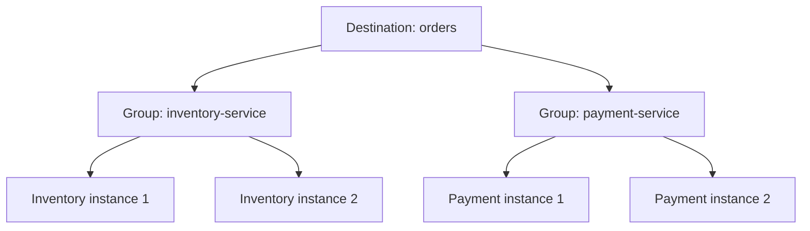

# Renaming Groups, Restarts, and Reprocessing Risks

In Spring Cloud Stream, the `group` property identifies a consumer group on the broker. Instances sharing the same destination and the same group typically coordinate to share load for one processing stream. When an application restarts with the same group, the broker can resume from the saved delivery state or position. When the group name is changed, the application typically creates an independent consuming group with its own state. That can cause older messages to be re-read, new messages to be received an additional time, or the old group's backlog to be left behind.

Therefore, distinguish three operations: restarting a single instance, redeploying the entire group with the same identity, and creating a new group to replay or run in parallel. These three operations affect offsets, queues, subscriptions, and business data differently. Without a clear intent, a small change in the `group` configuration can trigger duplicate processing at scale.

## 1. A group represents one logical processing stream

Suppose the `orders` topic contains order-creation events. Two instances of the inventory service sharing the `inventory-service` group coordinate to consume the topic's partitions. When adding instances, the broker reassigns partitions to share load. A payment service needs to receive all of the same events, so it uses a separate group, such as `payment-service`.



In this model:

- Instances in the same group are deployment replicas of the same logical processing stream; they share the work.
- Different groups are independent processing streams; each group can receive copies of the events according to the broker's mechanism.
- If two services should not divide messages between them—instead each service must process all events—they must not share a group.
- Group names must stay stable across restarts and be configured consistently across every replica of the same application.

Spring Cloud Stream configuration example:

```yaml
spring:
  cloud:
    function:
      definition: processOrder
    stream:
      bindings:
        processOrder-in-0:
          destination: orders
          group: inventory-service
```

Pods or processes of the inventory service using the configuration above join the same logical group. Do not set the group to a hostname, pod name, request ID, or random value if you want the broker to remember consumption progress across deployments.

## 2. Restarting with the same group

When restarting consumers with the same destination and group, the normal goal is to resume processing from saved progress. The broker retains state according to its own mechanism; recovering does not mean the last processed message is guaranteed never to be redelivered.

A common scenario:

1. A consumer receives message `evt-101`.
2. The application updates the database successfully.
3. The process stops before the broker records the acknowledgment or offset commit.
4. After restart, the broker redelivers `evt-101`.

If the consumer is not idempotent, inventory might be deducted twice for an order or an email might be sent twice. This is why safe duplicate handling must be designed even when the group name does not change.

### 2.1. Kafka: group ID and committed offsets

With Kafka, the binding's `group` maps to the consumer group ID. Kafka stores committed offsets per group and partition. When a consumer restarts with the same group ID, it resumes from the latest committed offset, provided that offset is still valid and the topic still retains the corresponding records.

Several points to remember:

- Offsets are managed separately for each partition in the group.
- A consumer that processes a record without committing the offset before stopping may receive that record again after restart.
- If an offset is committed before business side effects complete, a process crash can prevent the record from being reprocessed even though the business work did not finish. Choose an appropriate acknowledgment/transaction strategy.
- When no valid committed offset exists, the starting policy such as the Kafka binder's `startOffset` or the client's `auto.offset.reset` can determine the initial read position, depending on configuration and version.
- Topic retention and the broker's offset retention policy limit how long data can be resumed or replayed.

To declare the starting position when a group has no offsets yet, the Kafka binder supports per-binding `startOffset` configuration:

```yaml
spring:
  cloud:
    function:
      definition: processOrder
    stream:
      bindings:
        processOrder-in-0:
          destination: orders
          group: inventory-service
      kafka:
        bindings:
          processOrder-in-0:
            consumer:
              startOffset: earliest
```

`earliest` requests starting from the earliest retained record when an initial read position is needed. `latest` starts from new records per the corresponding policy. This setting does not mean every restart automatically re-reads from the beginning once the group already has committed offsets. Check your binder configuration and version before changing the starting position.

### 2.2. RabbitMQ: groups mapped to queues

With the Rabbit binder, a destination typically maps to an exchange and a group maps to a queue dedicated to the consumer group. Instances using the same group compete for messages from that queue. When restarting with the same group, they resume reading from the existing queue; unacknowledged messages can be redelivered.

If the queue is configured as durable and messages are published with the appropriate delivery mode, the backlog can survive broker restarts. This depends on queue configuration, message persistence, TTL policies, dead-lettering, and provisioning settings. Do not infer that every queue or message is persisted durably merely because the application sets `group`.

### 2.3. Pulsar: groups mapped to subscriptions

With the Pulsar binder, `group` is typically used as the subscription name. A subscription keeps its own cursor and acknowledgment state. Restarting a consumer with the same subscription lets it resume from the saved cursor; unacknowledged messages can be redelivered depending on subscription type and acknowledgment policy.

Subscription types such as Exclusive, Failover, Shared, or Key_Shared determine how consumers in the same subscription receive messages and can affect ordering. The initial position of a new subscription is controlled by the binder/client initial position configuration and topic retention policies. Verify these settings before changing a subscription name or replaying data.

## 3. Renaming a group actually creates a new consumer identity

Do not treat renaming a group as relabeling the same consumer. With Kafka, a new group ID lacks the committed offsets of the old group. With RabbitMQ, a new group usually leads to a new queue. With Pulsar, a new group usually leads to a new subscription with its own cursor.

| Broker | Meaning of group | Consequence of renaming |
|---|---|---|
| Kafka | Consumer group ID and committed offsets per partition | New group has separate offset state; initial read position depends on start/reset policy and retained records |
| RabbitMQ | Queue dedicated to the consumer group, bound to destination/exchange | New queue receives messages routed after queue creation; old queue backlog stays in the old queue |
| Pulsar | Subscription name and separate cursor | New subscription has an independent read position; initial position and retention govern readable data |

For example, original configuration:

```yaml
spring:
  cloud:
    stream:
      bindings:
        processOrder-in-0:
          destination: orders
          group: inventory-service
```

Changed to:

```yaml
spring:
  cloud:
    stream:
      bindings:
        processOrder-in-0:
          destination: orders
          group: inventory-service-v2
```

This is a brand-new group. If Kafka is configured to start from `earliest`, the new group can re-read all records still within retention. If configured to start from `latest`, the new group may receive only new records produced after creation. With RabbitMQ, the new queue typically receives only messages routed by the exchange after the queue exists; it does not automatically pull the old queue's backlog. With Pulsar, the new subscription reads according to its configured initial position.

### 3.1. Avoiding unintentional mixed deployment of old and new groups

During a rolling deployment, if some pods use `inventory-service` and others use `inventory-service-v2`, both groups can consume independently in parallel. In that case, each event can be processed once by the old group and once by the new group. That is normal behavior for independent groups, not the broker duplicating messages on its own.

Before rolling out, determine:

- Whether all replicas update their group at the same time.
- Whether running two groups in parallel is intentional for testing or migration.
- Whether the new group executes real business side effects or runs in shadow/read-only mode.
- Who owns the old group's backlog and when the old queue/subscription/group will be stopped or deleted.

Do not change the group via environment variables on a subset of replicas while remaining replicas still run the old group, unless running two groups is explicitly designed and controlled.

## 4. Distinguishing restarts, rebalances, and replays

These three concepts are often conflated, yet they mean different things:

| Operation | Goal | Primary impact |
|---|---|---|
| Restart | Restart a process or pod | Preserves group identity; broker resumes from existing offsets, queue, or subscription |
| Rebalance | Reassign partitions/consumers when membership changes | May briefly pause delivery and move partitions to another consumer; does not request re-reading the whole topic |
| Replay | Intentionally reprocess part or all data | Alters read position/cursor or republishes messages; may repeat business side effects |

With Kafka, when a member stops or a new member joins, the group may rebalance. Uncommitted records may be reprocessed after a partition moves to another consumer. A rebalance by itself does not reset all offsets back to the beginning of the topic.

With RabbitMQ, a consumer disconnecting returns unacknowledged messages to a ready state in the queue. Another consumer on the same queue can pick them up. That is redelivery, not creating a new queue or re-reading the entire history.

With Pulsar, unacknowledged messages can be redelivered based on subscription type and acknowledgment timeout/negative acknowledgments. Committed cursors still preserve the subscription's own progress.

## 5. Intentionally replaying data on Kafka

Kafka allows adjusting a consumer group's committed offsets to re-read data. This is an operational action with direct business impact. Before executing it, stop all consumers in the target group so they do not keep committing offsets during the reset.

Example checking target positions to re-read from the earliest retained data in the `orders` topic:

```bash
kafka-consumer-groups.sh \
  --bootstrap-server localhost:9092 \
  --group inventory-service-v2 \
  --topic orders \
  --reset-offsets \
  --to-earliest \
  --dry-run
```

Inspect the `dry-run` output carefully, confirming the exact cluster, group, topic, and partitions. Only after stopping consumers, verifying business impact, and obtaining proper operational approval should `--dry-run` be replaced with `--execute`. Never run an offset reset command on a group with active consumers.

Principles for replaying:

- `--to-earliest` only moves offsets to the earliest records still within retention; it cannot recover expired data.
- You can reset by topic/partition or specific offsets, but you must account for data scope and event ordering.
- Resetting offsets neither deletes old data nor creates new copies in the topic; it makes consumers re-read existing records.
- If multiple services use separate groups, reset only the group that needs replay; do not accidentally alter another service's group.
- Monitor consumer lag, replay speed, and load on databases/downstream systems to avoid overloading them.

With RabbitMQ, queues do not have offsets to reset like Kafka. Replays typically require pulling messages from a DLQ, republishing from an archive store, or using a separate event store. With Pulsar, replaying can use cursor seek/reset operations or a new subscription per client/binder capabilities and permissions. Do not apply Kafka commands to RabbitMQ or Pulsar.

## 6. Reprocessing risks and duplicate business side effects

A message can be redelivered because a consumer stopped before acknowledgment, a network glitch lost an acknowledgment, an offset was not committed, or an operator triggered a replay. Therefore, consumers should be idempotent: processing the same event multiple times produces the same business outcome as processing it once.

For example, if receiving `OrderCreated` always deducts inventory, a replay can deduct stock twice. Use a stable `eventId` and a tracking table with a unique constraint:

```java
@Service
public class InventoryService {
    private final ProcessedEventRepository processedEvents;
    private final InventoryRepository inventory;

    public InventoryService(
            ProcessedEventRepository processedEvents,
            InventoryRepository inventory) {
        this.processedEvents = processedEvents;
        this.inventory = inventory;
    }

    @Transactional
    public void reserveOnce(OrderCreated event) {
        if (processedEvents.existsById(event.eventId())) {
            return;
        }

        int updated = inventory.reserveIfAvailable(
                event.productId(), event.quantity());
        if (updated != 1) {
            throw new InsufficientInventoryException(event.productId());
        }

        processedEvents.save(new ProcessedEvent(event.eventId()));
    }
}
```

This is an illustrative structure. In production implementations, the `event_id` column needs a unique constraint and recording the marker must share the same transaction as the inventory update. Merely checking `existsById` and saving later without a unique constraint can still hit a race condition when two consumers process the same event concurrently. Inventory updates also need conditional statements, locks, or appropriate optimistic locking.

If a consumer calls an external system outside the database, consider target API idempotency keys, a dispatch status table, or the outbox pattern. A database transaction alone cannot make an external HTTP call and a broker acknowledgment a single atomic transaction.

Do not rely on "exactly once" as a universal Spring Cloud Stream property. Some binders/brokers support transactions or strong guarantees within specific boundaries, yet side effects on databases, email, payments, and external services still require idempotency design or separate transaction coordination.

## 7. Safe procedure for changing a group

Before changing a group, document the exact reason: splitting out a new logical service, running shadow traffic, recovering data, or fixing a configuration bug. Then follow this sequence:

1. **Identify broker and bindings.** Record the destination, current group, replica count, partitions/queues/subscriptions, and retention settings.
2. **Determine the new group's starting position.** For Kafka choose the initial offset policy; for RabbitMQ determine when the new queue begins receiving messages; for Pulsar determine the initial subscription position.
3. **Evaluate business impact.** Identify messages that may be reprocessed and downstream side effects requiring idempotency.
4. **Choose a rollout strategy.** Stop the old group first, run the new group in parallel in shadow mode, or perform a controlled cutover under a clear plan.
5. **Verify schemas and permissions.** Ensure the new group can deserialize payload versions still within retention and has permissions to access the destination.
6. **Deploy and observe.** Monitor lag/backlog, processing rate, redeliveries, errors, DLQ, and created business records.
7. **Reconcile outcomes.** Compare event counts, business outcomes, and errors between old and new groups before shutting down the old group.
8. **Clean up resources after verification.** Delete old queues, subscriptions, or groups only after confirming no backlog remains and rollback is no longer needed.

If the goal is simply restarting or deploying a new code version of the same service, keeping the same group name is usually the right choice. If the goal is replaying data, use a dedicated replay procedure and prepare idempotency rather than changing the group name as an implicit reset.

## 8. Testing restarts and group changes

Tests should reproduce scenarios that can cause duplicate or lost messages:

- Restarting a consumer mid-processing before acknowledgment/offset commit.
- Restarting after the database commit succeeds but before the broker records the acknowledgment.
- Changing the group name with `earliest` and `latest` start policies on Kafka.
- Running the old group and new group concurrently to verify each group receives data independently.
- Adding/removing replicas within the same group to observe rebalancing and partition assignment.
- With RabbitMQ, verifying the old queue retains its backlog and the new queue receives only messages routed after binding.
- With Pulsar, verifying the same subscription after restart and a new subscription with the chosen initial position.
- Replaying an already-processed event and verifying idempotency prevents duplicate side effects.
- Checking backlog, DLQ, and recovery time after the consumer returns.

A useful test checks business outcomes in the database or target system, not merely "message received" log lines. Logs can appear multiple times while business logic must be applied only once.

## 9. Observing groups in operations

Each broker exposes different metrics, yet operations teams should monitor at a minimum:

| Broker | Metrics/signals | Questions to answer |
|---|---|---|
| Kafka | Consumer lag, committed offsets, member count, rebalances, and partition status | Is the group keeping up with the topic? Are offsets resetting or rebalances happening continuously? |
| RabbitMQ | Queue depth, ready messages, unacknowledged messages, redeliveries, and consumer count | Which queue has backlog? Are messages being redelivered repeatedly? |
| Pulsar | Subscription backlog, cursor, unacknowledged messages, and redeliveries | Is the subscription advancing? Is the cursor stuck or are unexpected subscriptions being created? |

Logs should include group name, destination, `eventId`, correlation ID, and instance identifier. When changing a group, record the exact change timestamp and configuration version so real load-driven backlog growth can be distinguished from a new group re-reading data.

Do not delete groups/queues/subscriptions just to tidy up dashboards. Before cleaning up, confirm backlog status, retention, DLQ, and audit requirements. Old resources may still hold unprocessed data.

## 10. Checklist before restarting or changing a group

- [ ] Group name is stable and identical across all replicas of the same processing stream.
- [ ] It is clear which instances share a group and which need independent groups.
- [ ] Restarts preserve the same group if the goal is continuing current progress.
- [ ] Changing a group is treated as creating a new consuming identity, not relabeling.
- [ ] Kafka: committed offsets, retention, and initial offset for the new group are verified.
- [ ] RabbitMQ: old queue, new queue, durability, backlog, and acknowledgments are verified.
- [ ] Pulsar: subscription name, cursor, initial position, and subscription type are verified.
- [ ] Replays have a plan to stop consumers, verify read positions, and monitor load.
- [ ] Consumers are idempotent by `eventId` or a stable business key.
- [ ] Result reconciliation, lag/backlog monitoring, and a rollback plan exist before deleting old resources.

Keeping the group name unchanged when restarting the same processing stream lets the broker resume from saved state. Changing the group creates an independent consuming stream with its own offsets, queue, or subscription, and can cause messages to be reprocessed. When intentionally replaying or running two versions side by side, control starting positions, backlogs, idempotency, and business impact to avoid duplicating transactions or dropping data.
