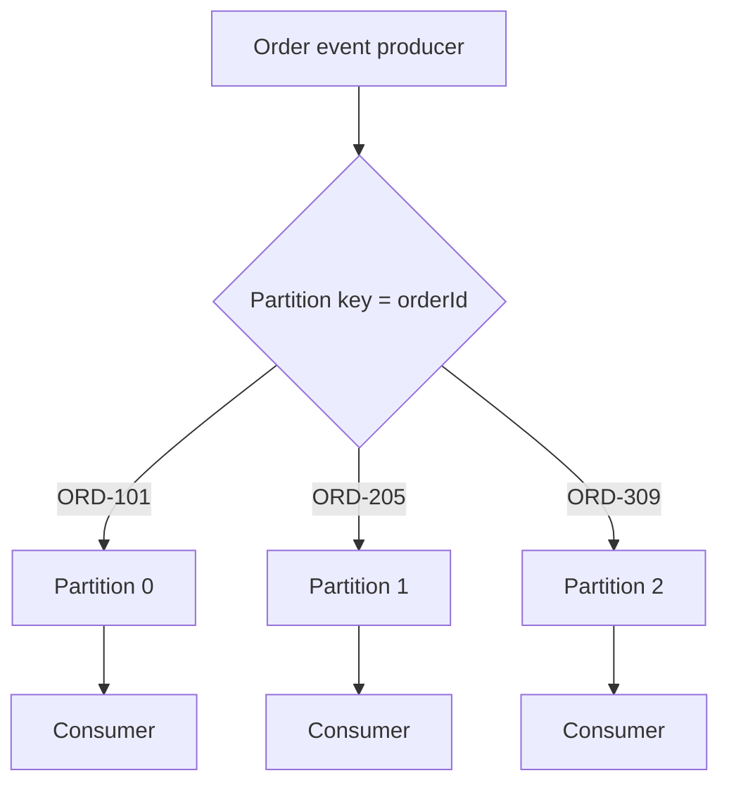
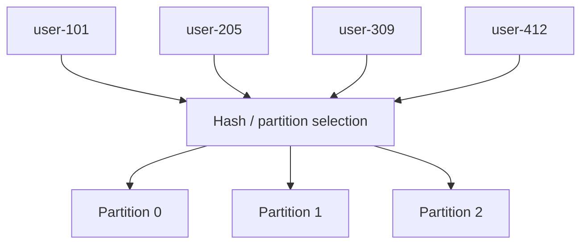

# Choosing Keys by User, Order, or Device

## 1. What Does a Partition Key Determine?

When a destination is split into multiple partitions, the broker can process parts of the data in parallel. The producer needs a rule to decide which message goes into which partition. A **partition key** is the value representing the group of messages that need to be routed together, typically the ID of a business entity such as `userId`, `orderId`, or `deviceId`.

Choosing the right key helps achieve two goals:

- Messages related to the same entity are placed into the same partition according to the configured partitioning strategy. This helps preserve ordering within the scope of that entity.
- Different entities can be distributed across multiple partitions to increase parallel processing capacity.

For example, an e-commerce system emits `OrderCreated`, `PaymentAuthorized`, and `OrderShipped` events. If the business logic requires sequential processing of changes for a single order, `orderId` is the natural key. Different orders can still be processed concurrently.



A partition key is not a distributed locking mechanism, nor does it automatically guarantee that a business operation runs only once. It is a routing rule. To preserve completion order, the consumer must still avoid uncontrolled asynchronous processing within the same partition/key. To avoid duplicate side effects, the consumer still needs idempotency.

## 2. Choosing a Key by the Scope Requiring Ordering

Start with the question: **Which messages must be processed in order relative to one another?** The key should represent the smallest entity that satisfies that business requirement.

| Key | Suitable When | Event Examples | Trade-off |
|---|---|---|---|
| `userId` | Changes for the same user must be ordered | `ProfileUpdated`, `PreferenceChanged`, `AccountStatusChanged` | A highly active user can create a hot partition |
| `orderId` | The lifecycle of each order needs to be serialized | `OrderCreated`, `PaymentAuthorized`, `OrderShipped` | Orders belonging to the same user may land in different partitions |
| `deviceId` | Sensor data or device state must stay in order | `TemperatureMeasured`, `DeviceOnline`, `DeviceOffline` | A device emitting data too frequently can cause skewed load |
| `accountId` | Transactions for the same account must be applied sequentially | `MoneyDeposited`, `MoneyWithdrawn` | A large account can become a hot key |
| `tenantId` | An entire tenant's stream must be serialized | `TenantConfigChanged`, `TenantEvent` | A large tenant can consume most of a partition's capacity |

There is no single key that fits every problem. If ordering is only needed within one order, using `userId` can serialize many unrelated orders and reduce parallelism. Conversely, if business rules require all operations on a user's account to be ordered, `orderId` will be too narrow.

### Example of Choosing Between userId and orderId

Suppose a user has three orders. If the key is `userId`, all events for all three orders are routed to the same partition according to the key strategy, serializing by user while creating a hotspot for active users. If the key is `orderId`, each order can reside in a different partition, allowing all three orders to be processed in parallel; ordering among events of the same order is still preserved at the partition level.

Choose according to business invariants, not according to whichever ID field is easiest to grab from the payload.

## 3. Keys Must Be Stable and Present on Every Producer

A key is useful only when every producer sending the same data stream computes the key using the same rule. If producer A uses `orderId` while producer B uses `userId`, two events for the same order may be routed to two different partitions.

Key rules should be treated as part of the event contract:

- Choose a field that is meaningful to the business and stable throughout the entity's lifecycle.
- Use the same data type and normalization across all producers.
- Do not use random values for events when entity-level ordering is required.
- Do not use timestamps as keys when events for the same entity must travel together.
- Define how missing or null keys are handled.
- If a composite key is needed, standardize the format and delimiter to avoid string collisions.

For example, if `orderId` can collide across tenants, the key should include both tenant and order:

```java
String partitionKey = tenantId + ":" + orderId;
```

Use an unambiguous encoding rule. If IDs can contain delimiters, use an escaped format or a stable serialization structure instead of ad-hoc string concatenation.

## 4. Configuring a Partition Key in Spring Cloud Stream

Spring Cloud Stream supports declaring a key-extraction expression on a producer binding using `partition-key-expression`. You can specify the expected partition count with `partition-count`.

Example of a producer emitting order events and using `orderId` as the key:

```java
import java.util.function.Function;
import org.springframework.context.annotation.Bean;
import org.springframework.context.annotation.Configuration;

record OrderEvent(String orderId, String eventType, long occurredAt) {}

@Configuration
class OrderEventFunctions {

    @Bean
    Function<OrderEvent, OrderEvent> publishOrderEvent() {
        return event -> event;
    }
}
```

Example output binding configuration with the Kafka binder:

```yaml
spring:
  cloud:
    function:
      definition: publishOrderEvent
    stream:
      bindings:
        publishOrderEvent-out-0:
          destination: orders.events
          producer:
            partition-key-expression: payload.orderId
            partition-count: 12
      kafka:
        binder:
          brokers: localhost:9092
```

`payload.orderId` is a SpEL expression accessing the `orderId` field of the payload. Spring Cloud Stream uses that value as the partition key according to the binder's partitioning mechanism. `partition-count` specifies the number of partitions used by producer partitioning; with Kafka, the actual topic must be provisioned with a compatible number of partitions. Do not arbitrarily set this value higher than the number of partitions able to receive records.

The example above uses the Kafka binder. With RabbitMQ or Pulsar, you must check how the corresponding binder maps partitioning and keys to exchanges/queues or topics/subscriptions; do not assume every binder shares Kafka's semantics.

## 5. Extracting the Key from a Header

Sometimes the key is not directly inside the payload, or multiple different payload types share a common header. You can attach the key to a header when building the message and then reference that header in the producer expression.

```java
import org.springframework.messaging.Message;
import org.springframework.messaging.support.MessageBuilder;

Message<OrderEvent> message = MessageBuilder
    .withPayload(event)
    .setHeader("partitionKey", event.orderId())
    .build();
```

Binding configuration:

```yaml
spring:
  cloud:
    stream:
      bindings:
        publishOrderEvent-out-0:
          destination: orders.events
          producer:
            partition-key-expression: headers['partitionKey']
            partition-count: 12
```

The header must be present before the message is sent through the output binding. If the header can be missing, validate it or provide a clear fallback policy. Do not let messages missing a key accidentally pile into the same partition or be distributed inconsistently.

For untrusted data, do not let external callers arbitrarily specify the partition key if doing so could skew load or break ordering boundaries. Derive the key from validated business data.

## 6. Using Keys by Business Domain

### By User: userId

Choose `userId` when events related to the profile, permissions, account status, or settings of the same user must be applied sequentially.

```yaml
producer:
  partition-key-expression: payload.userId
  partition-count: 12
```

For example, `UserRegistered`, `UserProfileUpdated`, and `UserSuspended` events for the same user will be routed under the same key if producers share the same partitioning rule. This allows the consumer to process user state sequentially within the partition.

Avoid using `userId` if business logic only requires per-order ordering. A user can create multiple concurrent orders; grouping all of them under one key can increase latency for unrelated orders.

### By Order: orderId

Choose `orderId` when preserving the state transition sequence of each individual order:

```yaml
producer:
  partition-key-expression: payload.orderId
  partition-count: 12
```

For example:

```text
ORD-101: OrderCreated -> PaymentAuthorized -> OrderShipped
ORD-205: OrderCreated -> PaymentFailed
```

Events for `ORD-101` share the same key and are placed into the same partition. Events for `ORD-205` can be processed in parallel on another partition.

### By Device: deviceId

Choose `deviceId` when the data stream from the same device must stay ordered, such as telemetry data, connection state, or control commands.

```yaml
producer:
  partition-key-expression: payload.deviceId
  partition-count: 24
```

A single device can emit thousands of events, so load distribution must be checked. If one device or a group of devices accounts for most of the traffic, keying by device can create a hot partition.

### By Account: accountId

In financial systems, transactions for the same account typically need to be applied in order to avoid computing balances against stale state. `accountId` can be a suitable key, but it must be combined with transaction control, sequence/versioning, and consumer-side idempotency. A partition key does not replace database locks or transactions.

## 7. Composite Keys When Multiple Scopes Are Needed

Some business domains need to distinguish entities within a tenant or data region. In such cases, the key can be a combination:

```java
String key = tenantId + ":" + deviceId;
```

Or define a dedicated function to generate keys consistently:

```java
record DeviceEvent(String tenantId, String deviceId, String status) {}

String partitionKey(DeviceEvent event) {
    return event.tenantId() + ":" + event.deviceId();
}
```

A composite key is useful when `deviceId` is only unique within a tenant's scope. Without including the tenant, two devices from different tenants with the same ID could be routed under the same key. That does not necessarily corrupt data, but it mixes serialization scopes and causes unnecessary contention.

Define the composite key as part of a shared schema or library. If producers concatenate strings differently on their own, the same entity may end up in different partitions.

## 8. How Keys Distribute Load

With the default hash-based strategy, a key is converted into a value used to select a partition within the configured partition count range. Messages with the same key are typically mapped to the same partition as long as the partition count and algorithm remain unchanged.

Each key does not need its own dedicated partition. Many different keys can fall into the same partition because the number of keys is usually much larger than the number of partitions. The goal is to distribute load evenly enough while keeping messages with the same key together.



The diagram only illustrates that multiple keys map to a finite set of partitions; you cannot deduce which partition a specific key will enter without knowing the algorithm, partition count, and binder configuration.

With Kafka, a partition is the ordered unit of storage and consumption. A consumer group distributes partitions across consumers. Therefore, the number of partitions sets the upper bound on useful parallelism within a group. Increasing consumers beyond the number of partitions does not increase the number of partitions that can be processed concurrently.

## 9. Hot Keys and Skewed Distribution

A key with significantly higher message volume than the rest is called a **hot key**. Because the same key must go to the same partition under an ordering strategy, adding more consumers or instances cannot automatically split that key's stream.

For example:

- An enterprise account emits far more transactions than many other accounts.
- A gateway device sends telemetry for thousands of child devices, yet all events share the same `gatewayId`.
- A large tenant generates the majority of traffic across the entire system.

The result can be high lag on one partition and an overloaded consumer on that partition while other partitions sit idle.

### Ways to Mitigate Hot Key Impact

1. Choose a key at a finer entity granularity if business rules allow, such as `deviceId` instead of `gatewayId`.
2. Isolate large tenants or customers into dedicated destinations/streams.
3. Use an intentional sharding key, such as `accountId + shardNumber`, if global per-account ordering requirements can be relaxed.
4. Optimize consumer processing time and I/O operations.
5. Monitor record distribution and lag per partition to detect load skew.

Sharding a key can break ordering for the entire entity. Only do this when the business accepts splitting an entity into multiple independent streams or when there is a downstream aggregation/serialization mechanism.

## 10. Missing, Null, or Invalid Keys

A partition key must be determined before sending. If `userId`, `orderId`, or `deviceId` is null, the expression may evaluate to null or raise an error depending on how the framework/binder handles it. With Kafka, records without a key may be distributed by the default partitioner and are no longer guaranteed to keep events of the same entity together.

Choose an explicit policy:

- Reject the event if a mandatory identifier is missing.
- Route the event to an error-handling flow or DLQ if the data is invalid.
- Use a substitute key only when that key has business meaning and does not mix unrelated entities.

Do not assign a random UUID as a fallback when ordering is required; every event will have a different key and may go to a different partition. Likewise, do not use a fixed string like `unknown` for all keyless messages because that creates a hot key.

## 11. Changing the Partition Count and Its Impact on Keys

The partition count affects how keys map to partitions. When the partition count changes, many keys may map to different partitions under the partitioning algorithm. This is especially important with Kafka because older events for a key may still remain in the old partition while newer events are written to the new partition.

If strict ordering is required, increasing partitions must be planned carefully:

1. Identify which keys require ordering and the processing window still remaining in old partitions.
2. Consider pausing producers or draining old streams during the transition window.
3. Use a versioned topic or a new routing scheme if the two phases need to be cleanly separated.
4. Verify whether consumers can read both old and new data without applying events out of order.
5. Maintain a business sequence/version to detect late or missing events.

Do not change `partition-count` in producer configuration without checking the actual partition count on the broker. With Kafka, topics do not automatically shrink their partition count; increasing partitions is a one-way operation in many common configurations and can affect your key strategy.

## 12. Partitioning Across Kafka, RabbitMQ, and Pulsar

The concept of a partition key appears across multiple brokers, but the semantics and configuration are not identical.

| Broker | How Keys Are Typically Used | What to Verify |
|---|---|---|
| Kafka | The record key helps select the partition; records with the same key typically go to the same partition per the partitioner | Partition count, partitioner, consumer group, and offset commit behavior |
| RabbitMQ | Routing keys route through exchanges; the binder may provide its own partitioning mechanism | Exchange type, binding key, queue topology, consumer concurrency, and binder partition support |
| Pulsar | Message key/ordering key combined with partitioned topics and subscription types | Key-based routing, `Key_Shared`, batching, partition count, and ordering semantics |

With RabbitMQ, an exchange routing key is not automatically synonymous with Spring Cloud Stream's partition key. Check how the Rabbit binder implements partitioned producers/consumers and queue topology in the version you use.

With Pulsar, if multiple consumers need to process in parallel while messages with the same key go to the appropriate consumer to preserve per-key ordering, evaluate `Key_Shared` subscriptions and the corresponding key/batching settings. Simply setting a header named `partitionKey` is not enough if the producer/binder does not map it to the message key that Pulsar uses.

## 13. Testing Partition Key Selection

Testing should verify both key correctness and load distribution:

1. Emit multiple events for the same `orderId` and confirm they are routed to the same partition per configuration.
2. Emit events for many different `orderId` values and observe distribution across partitions.
3. Send events from multiple producers and confirm all apply the same key rule.
4. Test payloads with missing keys, null keys, empty keys, and invalid keys.
5. Generate high traffic for one key to observe hot partitions and consumer lag.
6. Verify completion ordering at the consumer, especially if processing uses a thread pool or async execution.
7. Test behavior when changing the partition count or number of consumer instances.
8. For RabbitMQ/Pulsar, test actual binder topology, routing/subscription, and semantics.

The Test Binder can assist in testing function logic and messaging inside the application, but it does not replace broker integration tests when verifying actual partition assignment or message keys.

## 14. Observing Partitions in Production

Monitoring data at the partition level helps uncover load skew that aggregate metrics can hide. Useful metrics include:

- Message and byte counts written to each partition.
- Consumer lag per partition.
- p95/p99 processing time by event type or key group.
- Rate of null or invalid keys.
- Retry, redelivery, and DLQ rates.
- Key count distribution and traffic volume of the top keys.

Do not log full user IDs or personal data solely to observe partitions. Use hashes or statistical buckets consistent with security policies. When you see a hot partition, inspect key distribution before increasing consumer count.

## 15. Partition Key Selection Process

1. Identify the business invariant: which events must be applied in order?
2. Choose the ID representing that exact scope: `userId`, `orderId`, `deviceId`, `accountId`, or a composite key.
3. Ensure the key is stable, non-null, and computed identically by every producer.
4. Choose the partition count based on expected throughput, parallelism, and operational limits.
5. Configure `partition-key-expression` and `partition-count` on the producer binding.
6. Verify how the binder maps the key to a partition, routing key, or message key.
7. Test same-key, different-key, hot-key, missing-key, and partition-count-change scenarios.
8. Monitor lag and load distribution to tune based on real data.

Choosing a key by user, order, or device is a decision about ordering scope and system parallelism. The broader the key, the more messages are serialized together; the narrower the key, the greater the opportunity for parallel processing, though it may fail to preserve required business invariants. Start from ordering requirements, pick a stable ID at the right entity level, and verify distribution and semantics on the real broker.
