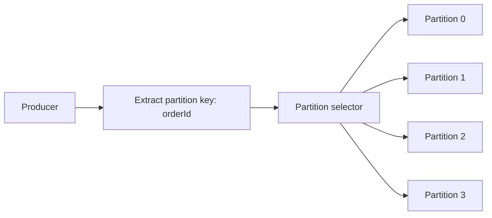

# Configuring partitionKeyExpression and partitionCount

## Objectives

When processing events, certain messages must be routed to the same partition to preserve ordering by a business key or to process data in parallel. For example, all events for the same order should go through the same partition; different orders can be processed across multiple partitions. Spring Cloud Stream supports selecting a partition key on the producer using `partitionKeyExpression` or a custom key extractor, and then determining the partition within the range of `partitionCount`.

These two properties serve different roles:

- `partitionKeyExpression` defines the **logical key** extracted from the message, such as `orderId` or `customerId`.
- `partitionCount` declares the **expected number of partitions** that the partitioning mechanism uses to compute selection and that the binder may use when provisioning the destination.

This lesson covers how to configure both properties, how they work with a partition selector, how to use stable keys, limitations across Kafka, RabbitMQ, and Pulsar, and testing strategies.

After this lesson, you will be able to:

- Configure `partitionKeyExpression` for an output binding.
- Choose a `partitionCount` suited to the topology and processing load.
- Distinguish between partition key, partition selector, and actual partitions on the broker.
- Write a custom `PartitionKeyExtractorStrategy` or `PartitionSelectorStrategy`.
- Understand the impact of increasing partitions on ordering and data distribution.
- Test consistent routing for the same key and verify binder behavior.

## 1. What Problem Does Partitioning Solve?

Partitioning splits a data stream into multiple independent parts so the broker and consumers can process them in parallel. A partition is an ordered storage/read unit according to the broker's capabilities. With Kafka, ordering is guaranteed within a single partition, not across the entire topic.

Suppose a system emits the following events:

- `OrderCreated(orderId="A-10")`
- `OrderPaid(orderId="A-10")`
- `OrderShipped(orderId="A-10")`
- `OrderCreated(orderId="B-20")`

If `orderId` is used as the partition key, the three events for order A-10 are routed under the same key and typically enter the same partition within the same topology. The consumer can process events for one order sequentially within that partition, while other orders are processed in parallel.



Partitioning is useful when:

- Relative ordering must be preserved for the same business entity.
- Consumer load needs to be split across multiple partitions.
- All messages should not pile onto a single consumer.
- A natural key exists such as order ID, account ID, or customer ID.

Partitioning does not automatically guarantee exactly-once delivery, does not guarantee ordering across partitions, and does not replace idempotency. Retries, redeliveries, and consumer restarts can still cause a message to be reprocessed.

## 2. Distinguishing Partition Key, Selector, and Partition Count

Three components need to be understood separately:

| Component | Question | Example |
|---|---|---|
| Partition key | Which entity/group does the message belong to? | `orderId = A-10` |
| Partition selector | Given the key, which partition number is chosen? | Hash function or custom algorithm |
| Partition count | How many partitions exist in the topology the producer is targeting? | 6 |

In Spring Cloud Stream:

- `partitionKeyExpression` is a SpEL expression to extract the key from the message.
- `partitionKeyExtractorName` points to a `PartitionKeyExtractorStrategy` bean if Java key-extraction logic is needed.
- `partitionSelectorExpression` lets you customize how a key is converted into a partition choice.
- `partitionSelectorName` points to a `PartitionSelectorStrategy` bean.
- `partitionCount` provides the number of partitions to the partitioning mechanism and to the binder when provisioning the destination according to binder capabilities.

If no custom selector is declared, the framework uses a default strategy based on the key's hash. Do not rely on a specific partition number for a message unless the algorithm and topology are fixed; what usually matters is that the same key is handled consistently within the same configuration.

## 3. Configuring partitionKeyExpression and partitionCount

Example producer emitting order events:

```java
public record OrderEvent(
        String eventId,
        String region,
        String orderId,
        String eventType,
        Instant occurredAt
) {}

@Bean
Supplier<OrderEvent> orderEvents(OrderEventSource source) {
    return source::next;
}
```

Output binding configuration:

```yaml
spring:
  cloud:
    function:
      definition: orderEvents
    stream:
      bindings:
        orderEvents-out-0:
          destination: orders.events
          content-type: application/json
          producer:
            partition-key-expression: payload.orderId
            partition-count: 6
```

Here:

- `orderEvents-out-0` is the output binding.
- `orders.events` is the destination.
- `payload.orderId` extracts the order ID from the message payload.
- `partition-count: 6` declares six expected partitions for the partitioning mechanism.

The SpEL expression is evaluated against the message; `payload` accesses the payload and `headers` accesses headers. To use tenant as the key:

```yaml
producer:
  partition-key-expression: headers['tenantId']
  partition-count: 6
```

Only use a header that is validated and follows a stable rule. If the tenant ID can change or the producer omits that header, the key can be null or inconsistent. Prefer a payload field with stable business meaning if it is the primary partition key.

### Per-Binding Configuration

Each output binding can use its own key and partition count:

```yaml
spring:
  cloud:
    stream:
      bindings:
        orders-out-0:
          destination: orders.events
          producer:
            partition-key-expression: payload.orderId
            partition-count: 12
        payments-out-0:
          destination: payments.events
          producer:
            partition-key-expression: payload.accountId
            partition-count: 6
```

This allows tuning the topology to the load profile and ordering requirements of each stream. Ensure the declared partition count matches the actual partition count and the binder's provisioning behavior.

## 4. How partitionKeyExpression Works

`partitionKeyExpression` is a SpEL expression evaluated on a Spring `Message`. Some examples:

| Expression | Meaning | When Appropriate |
|---|---|---|
| `payload.orderId` | Extracts the key from order ID | All events for the same order must go to the same partition |
| `payload.customerId` | Extracts customer key | Processing needs to be grouped by customer |
| `payload.accountId` | Extracts account key | Operations on the same account must stay ordered |
| `headers['tenantId']` | Extracts tenant ID from header | When tenant is a validated partition key |
| `payload.region + ':' + payload.orderId` | Combines region and order | When the key must distinguish identical IDs across regions |

Choose the key based on **the unit that requires ordering**, not merely the most convenient field to access. If the requirement is that operations on the same account must be ordered, using `customerId` may be too coarse because multiple accounts belonging to one customer could be grouped into the same partition; this can reduce parallelism without providing a corresponding business benefit.

A key should:

- Have a value for every message on the binding.
- Remain stable across events of the same entity.
- Have consistent types and normalization rules.
- Distribute evenly enough to avoid overheating one partition.
- Exclude secrets or unnecessary personal data.

If the expression can return null, define a clear policy: reject the message, use a valid fallback, or intentionally choose a default key. Do not allow a large volume of keyless messages to land unexpectedly in the same partition.

## 5. Using PartitionKeyExtractorStrategy When Expressions Are Not Enough

For complex key-extraction logic, you can create a bean implementing `PartitionKeyExtractorStrategy` and reference it with `partition-key-extractor-name`.

Example:

```java
import org.springframework.cloud.stream.binder.PartitionKeyExtractorStrategy;
import org.springframework.messaging.Message;
import org.springframework.context.annotation.Bean;
import org.springframework.context.annotation.Configuration;

@Configuration
class PartitioningConfiguration {

    @Bean
    PartitionKeyExtractorStrategy orderKeyExtractor() {
        return (Message<?> message) -> {
            OrderEvent event = (OrderEvent) message.getPayload();
            return event.region() + ":" + event.orderId();
        };
    }
}
```

Binding configuration:

```yaml
spring:
  cloud:
    stream:
      bindings:
        orderEvents-out-0:
          destination: orders.events
          producer:
            partition-key-extractor-name: orderKeyExtractor
            partition-count: 6
```

When using an extractor bean, do not also declare `partition-key-expression` for the same binding. Choose one key-extraction approach to avoid two competing configuration sources or making it unclear to readers which mechanism is active.

An extractor should only determine the key. Do not call databases, remote APIs, or run business logic inside an extractor; doing so increases send latency and couples partitioning to external services.

## 6. Customizing the Partition Selector

Once the key is obtained, the selector decides the partition index. By default, the framework uses hash-based selection. If a custom rule is required, you can provide a `PartitionSelectorStrategy`:

```java
import org.springframework.cloud.stream.binder.PartitionSelectorStrategy;
import org.springframework.context.annotation.Bean;
import org.springframework.context.annotation.Configuration;

@Configuration
class PartitionSelectorConfiguration {

    @Bean
    PartitionSelectorStrategy stablePartitionSelector() {
        return (key, partitionCount) ->
                Math.floorMod(key.hashCode(), partitionCount);
    }
}
```

Configuration:

```yaml
spring:
  cloud:
    stream:
      bindings:
        orderEvents-out-0:
          destination: orders.events
          producer:
            partition-key-expression: payload.orderId
            partition-selector-name: stablePartitionSelector
            partition-count: 6
```

The example uses `Math.floorMod` so the result is non-negative even when `hashCode()` is negative. This is an illustrative strategy; if multiple languages or independent producers must compute the same partition, do not use Java's `hashCode()` as a wire contract because hashing for data types in other languages may differ. Define a stable algorithm, normalize keys, and run cross-language tests if partition mapping must match across producers.

The selector must return a valid index per the framework/binder contract and the active partition count. Check the API of your specific Spring Cloud Stream version and test against the real binder before replacing the default selector.

## 7. partitionCount and Actual Partitions on the Broker

`partitionCount` is not a command guaranteeing that the broker will always succeed in creating or increasing partitions. It is a producer configuration setting that the binder may use when provisioning the destination. The actual partition count also depends on:

- Whether the destination already exists.
- Whether the binder has auto-provisioning or auto-add partitions enabled.
- Whether the application account has permission to create or alter destinations.
- Whether the broker permits increasing partitions and what operational limits exist.
- Whether binder-specific settings define minimum values or special rules.

With Kafka, a topic's partition count is managed on the broker. If a topic already exists with fewer partitions than producer partitioning can select, sending to a nonexistent partition index can fail. Kafka allows increasing partitions, not decreasing a topic's partition count. The binder may expose options like auto-create or auto-add partitions; configure and verify them according to the Kafka binder version in use.

Example Kafka binder with controlled provisioning:

```yaml
spring:
  cloud:
    stream:
      bindings:
        orderEvents-out-0:
          destination: orders.events
          producer:
            partition-key-expression: payload.orderId
            partition-count: 6
      kafka:
        binder:
          auto-create-topics: true
          auto-add-partitions: true
          min-partition-count: 1
```

Provisioning options must be checked against the binder version and broker permissions. In production, many organizations manage topics via IaC or platform workflows and do not grant topic creation permissions to runtime applications. In that case, topics must be pre-created with the appropriate partition count.

With RabbitMQ, the binder can use a partitioned queue mechanism and dedicated exchange/queue topology; with Pulsar, the topic can be a partitioned topic. Provisioning and distribution behave differently from Kafka. Do not assume `partition-count` has the same physical effect across all three binders.

## 8. How Does Partitioning Affect Ordering and Scaling?

In Kafka, ordering is guaranteed within a single partition. If all events for the same `orderId` are always routed to the same partition and the producer sends them in the required order, the consumer can observe record order within that partition. However:

- There is no global ordering across partitions.
- Multiple concurrent producers can emit events for the same key; actual order depends on timing and send mechanics.
- Retries, asynchronous processing, or consumer logic can cause business effect order to differ from read order.
- If the key is unstable, the same entity may be sent to different partitions.

### Increasing Partition Count Can Change Mapping

Suppose partitions are selected based on the key's hash and the partition count. When increasing from 6 to 12, the mapping results for many keys can change. Older events for an order may sit in an old partition while newer events are written to a different partition. Two partitions have no shared ordering, so per-order ordering requirements can be affected during the transition period.

Before increasing partitions:

1. Determine whether per-key ordering is a strict business guarantee.
2. Check that producers, consumers, and all replay streams use the same partition strategy.
3. Evaluate how increasing partitions affects key mapping and in-flight data.
4. Choose a migration plan, such as creating a new topic version or using controlled routing/versioning.
5. Test both old and new events during the transition phase.

A larger partition count is not always better. More partitions increase parallelism, but also increase metadata, file handles, replication overhead, consumer tasks, and operational complexity. Choose the count based on throughput, message size, retention, consumer count, and broker capacity.

## 9. Relationship Between Partitions and Consumer Groups

Producer-side partitioning decides which part of a destination a message is written to. A consumer group decides how instances share reading those parts.

With Kafka:

- Each partition in a consumer group is assigned to at most one consumer at a time.
- The number of active consumers can be bounded by the number of partitions.
- Increasing partitions can unlock more parallelism for a group, but only when consumers and downstream systems have sufficient capacity.
- Different groups have independent assignments and offsets.

With RabbitMQ, partitioned queue topology and consumer concurrency are managed by the binder's own mechanism. With Pulsar, partitioned topics and subscription types work together to determine message distribution. Consult the specific binder documentation rather than applying Kafka assignment rules to every broker.

A well-distributed key helps balance load, but if one customer or account generates most of the traffic, the partition holding that key can become a hot partition. Adding more consumers cannot split a single key across multiple partitions while keeping the same routing key.

## 10. Testing partitionKeyExpression and partitionCount

Do not merely check that the application starts up. You must verify that keys are extracted accurately, mappings are stable, and the broker has the proper topology.

### Unit Tests for Key Extractors

If using a custom extractor, test these cases:

- Valid payloads return the expected key.
- Missing order ID or tenant ID is handled according to policy.
- Two events for the same entity return the same key.
- Two different entities can be distributed across different partitions.
- Keys are normalized consistently, such as trimming/casing if required by the contract.

### Tests for Selectors

For custom selectors, verify:

- Results fall within the valid partition range.
- The same key and same partition count yield the same result.
- Different keys achieve acceptable distribution across a representative dataset.
- Negative hashes do not produce negative indices.
- Partition count changes are evaluated explicitly rather than inadvertently altering mappings.

### Binder/Broker Integration Tests

Use the Test Binder for framework-level testing where needed, though the Test Binder does not prove that a real broker has the right physical partition count. With Kafka Testcontainers or a test Kafka environment, verify:

1. The topic has the expected number of partitions.
2. Records with the same key enter the same partition when the topology is unchanged.
3. Record keys and payloads are serialized properly.
4. The consumer group receives per-partition assignments.
5. Scaling consumers up/down behaves as expected.
6. Changing the partition count affects mapping as analyzed.

For RabbitMQ and Pulsar, test the queue/topic partition topology and distribution behavior against the actual binder. Do not extrapolate results from Kafka integration tests.

## 11. Common Pitfalls

| Symptom | Possible Cause | Resolution |
|---|---|---|
| The same order appears in multiple partitions | Key expression reads the wrong field or the value mutates | Use a stable business key and test the extractor |
| One partition receives too many messages | Low key cardinality or one hot key | Analyze key distribution and revisit the ordering unit |
| Sending fails because the partition does not exist | `partitionCount` mismatches the topic or provisioning is incomplete | Check the actual topic and auto-add permissions/config |
| Consumer throughput does not scale when adding replicas | Fewer partitions than consumers or downstream bottleneck | Inspect assignment, lag, and processing time |
| Per-key ordering breaks after increasing partitions | Hash-to-partition mapping changed | Plan migration/versioning |
| Null key or selector failure | Payload/header missing data | Validate messages before publishing and define a fallback |
| Different languages pick different partitions | Using hash code without a shared contract | Define a deterministic algorithm and use shared test vectors |
| Rabbit/Pulsar behaves differently from Kafka | Binder uses a different native partitioning mechanism | Read binder docs and test against the corresponding broker |

## Conclusion

`partitionKeyExpression` defines the logical key from a message; `partitionCount` provides the number of partitions that producer partitioning and the binder use for calculation or destination provisioning. The key must represent the unit requiring ordering and have a stable value; the selector turns the key into a partition choice.

In Spring Cloud Stream, configure partitioning on the output binding, verify the actual partition count on the broker, and understand how the binder handles provisioning. Kafka guarantees ordering within each partition; RabbitMQ and Pulsar have their own partition topologies. Increasing partitions can alter key mappings, so evaluate the impact on ordering, consumer groups, and existing backlog before deploying.
