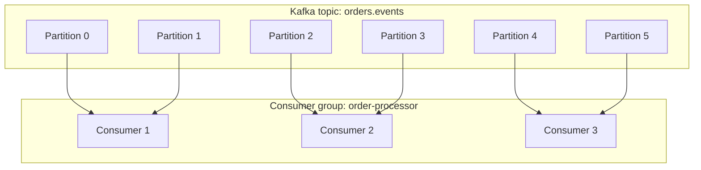
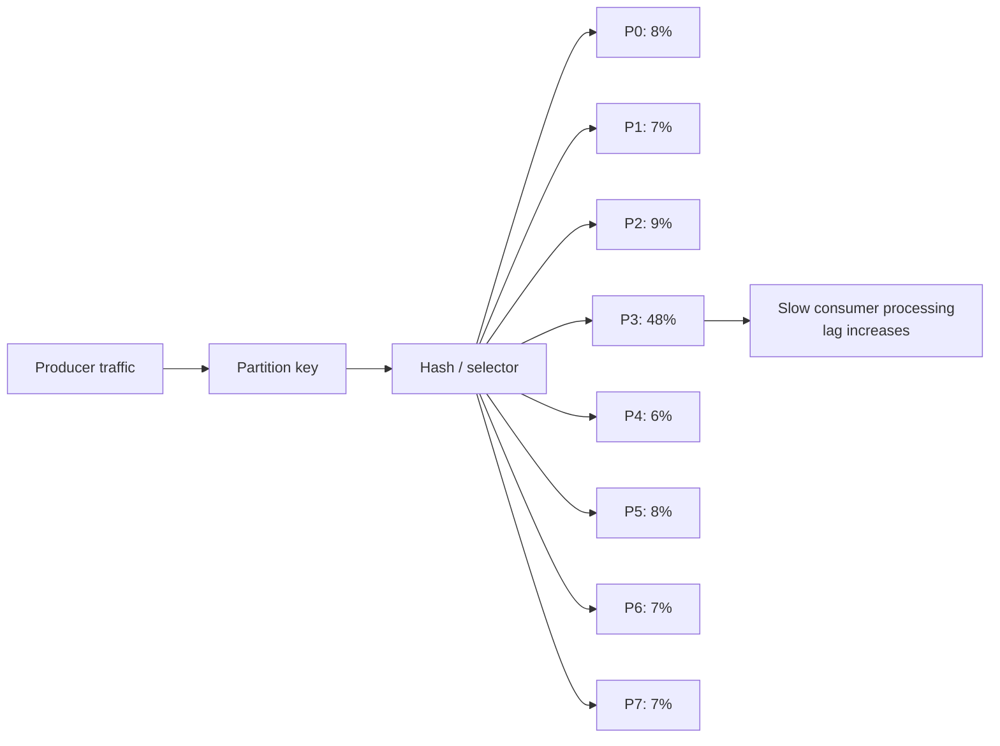
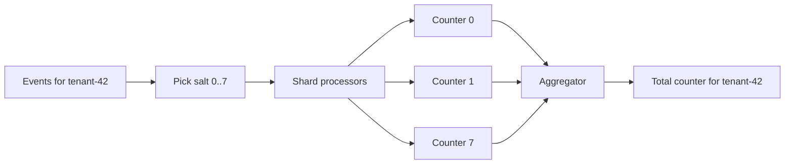

# Skewed Keys, Hot Partitions, and Distribution Strategies

Partitioning enables an event stream to be processed in parallel. However, having multiple partitions does not mean load will be divided evenly. If producers repeatedly use the same key, or a few keys have far higher volume than the rest, many messages pile onto one partition. That partition becomes a **hot partition**: the consumer handling it falls behind, lag grows, while other consumers sit with idle capacity.

In Spring Cloud Stream, partition key selection and how the binder maps keys to partitions directly impact ordering, parallelism, and scalability. This lesson explains the causes of load skew, how to identify hot partitions, how to choose keys, and distribution strategies tailored to Kafka, RabbitMQ, and Pulsar.

## 1. What Problem Does Partitioning Solve?

A destination may carry higher message volume than a single consumer can handle. Partitioning splits the data stream into multiple parts so multiple consumers process concurrently.

With Kafka, a topic consists of multiple partitions. Each partition is an independently ordered log. Within the same consumer group, a partition is assigned to at most one consumer member at a time. Therefore, the partition count bounds the group's read parallelism.

For example, topic `orders.events` has 6 partitions and group `order-processor` has 3 consumers:



Each consumer reads two partitions in the example. In practice, assignment is determined by the Kafka coordinator and partition assignor. When the consumer count scales up or down, Kafka can rebalance to reassign partitions.

Partitioning typically serves three goals:

- **Throughput:** multiple consumers process different partitions simultaneously.
- **Per-key ordering:** events with the same key are routed to the same partition to preserve ordering within the key's scope.
- **Load isolation:** a stream can be split into independent processing units, making it easy to measure lag and scale.

These three goals can conflict. If all events for an order stay in the same partition, we get per-order ordering, but we cannot spread that single order's load across multiple partitions concurrently.

## 2. Partition Keys and How Partitions Are Selected

A partition key is the value the producer uses to decide which partition a message belongs to. For order events, the key is typically `orderId`; for account data, the key might be `accountId`.

A common mapping approach hashes the key and takes the remainder modulo the partition count:

\[
partition = positiveHash(key) \bmod partitionCount
\]

This is a general model. How hashes are computed, how empty keys are handled, and the exact partition chosen depend on the producer client, binder, and configured partitioner.

If all messages carry key `order-42`, they will go to the same partition under a consistent mapping configuration. This lets the consumer read `order-42` events in offset order. Yet if `order-42` emits 30% of total traffic, the partition holding that key can run far hotter than the remaining partitions.

### Choosing Keys by Ordering Boundary

Start with the question: which messages must be processed in order?

| Data Type | Usually Suitable Key | Reason |
|---|---|---|
| Single order lifecycle | `orderId` | Preserve ordering of `OrderCreated`, `OrderPaid`, `OrderShipped` |
| Account balance | `accountId` | Avoid concurrent updates to the same account across multiple partitions |
| Customer profile | `customerId` | Preserve ordering of changes for the same customer |
| Device state | `deviceId` | Preserve ordering of telemetry/commands per device |
| Independent logs without per-entity ordering | High-cardinality or randomly distributed key | Leverage parallelism when no aggregate requires serialization |

Do not pick a key solely because that field happens to be in the payload. The key must reflect the business consistency boundary. If `customerId` is used for all events even though a customer has many independent orders, all of that customer's orders are funneled into the same partition even though no serialization between them is needed.

Conversely, if balance updates for the same account can be written concurrently across multiple partitions, the system can encounter race conditions or require another synchronization mechanism. Picking a narrower key helps preserve ordering, though it can reduce load-splitting flexibility.

### Key Cardinality and Distribution

Cardinality is the number of distinct keys in the data. Keys with too-low cardinality create too few load buckets. For example, using only `country` with three values forces all data for an entire country into a single partition under typical key hashing.

Keys with high cardinality create more buckets, yet still do not guarantee even distribution. A few high-volume keys can account for most of the traffic even when the total number of keys is huge.

Examine both distributions:

- **Key cardinality:** how many distinct keys exist.
- **Key frequency:** how many messages or bytes each key emits over a time window.

A system with millions of customer IDs can still have a hot key if one large customer emits more events than hundreds of thousands of small customers combined.

## 3. How Load Skew and Hot Partitions Form

Load skew occurs when message counts, bytes, or processing cost are not distributed evenly across partitions. A hot partition can arise from:

1. **Hot key:** one key has a high emission rate, sending all of that key's messages to the same partition.
2. **Low key cardinality:** only a handful of distinct key values exist, leaving only a subset of partitions used.
3. **Uneven hash or selector:** hashing/routing produces skewed distribution, especially when keys follow patterns or a custom selector has bugs.
4. **Varying message sizes:** message counts look even, yet one partition holds much larger payloads.
5. **Uneven processing cost:** equal message counts, yet certain event types call slow APIs, run heavy queries, or trigger more side effects.
6. **Unsuitable partition count or assignment:** too few partitions, too many consumers, or uneven assignment when partition counts do not divide evenly.
7. **Faulty producer routing:** some producers send missing keys, use a constant key, or write directly to a hardcoded partition.

For example, a topic has 8 partitions. Most keys spread fairly evenly, but one large tenant emits 40% of all messages and every message for that tenant uses the tenant ID as its key. The partition holding that tenant receives nearly half the traffic; the other partitions share the rest.



A single hot partition caps throughput for the entire stream. The consumer group cannot shift part of a hot partition's messages to another consumer while still preserving that partition's log order.

### Hot Keys and Hot Partitions Are Different

- A **hot key** is a single key value with disproportionately high volume or processing cost.
- A **hot partition** is a partition receiving heavy load or accumulating a large backlog.
- Multiple hot keys can happen to collide on the same partition, creating a hot partition.
- A partition can become hot even without a single hot key if several moderate keys map to it or if payloads/processing costs in that partition are high.

The remedy depends on the cause. Increasing the partition count can spread multiple keys out, but cannot split a single hot key if that key must stay on one partition for ordering.

## 4. Measuring Skew Before Changing Configuration

Do not diagnose a hot partition from total consumer lag alone. Observe per-partition and per-key metrics.

### Kafka Metrics

Monitor at least:

- Message rate and byte rate per topic-partition.
- Consumer lag per partition, not just total group lag.
- Record processing rate and mean/p95/p99 processing time.
- Records fetched per poll, poll duration, and rebalances.
- Record size, deserialization errors, retries, and DLQ counts.
- Key distribution: top keys by message count, bytes, and processing cost.

A couple of useful summary indicators:

\[
skewRatio = \frac{max(partitionLoad)}{average(partitionLoad)}
\]

\[
loadShare_i = \frac{partitionLoad_i}{\sum_j partitionLoad_j}
\]

If `skewRatio` is high and one partition sustains a disproportionate share over time, investigate that partition's keys and routing. Alert thresholds depend on the workload; no single number fits every system.

Also separate **ingress skew** from **processing skew**. Ingress skew means a partition receives more messages. Processing skew means a partition incurs higher processing duration or cost. A partition receiving fewer messages can still build lag if messages there invoke slow APIs.

### Do Not Look Only at Message Counts

Suppose P0 receives 10,000 tiny messages while P1 receives 2,000 messages each carrying a 2 MB payload. P1 may consume far more network and memory. Likewise, one event type may call a payment gateway while another merely updates a cache. Comparing raw message counts hides cost differences.

Measure all of:

- Records per second.
- Bytes per second.
- Processing time per event type.
- Retry/redelivery rate.
- Backlog age, i.e., the age of the oldest unprocessed message.
- CPU, heap, GC, network, and downstream latency per consumer.

### Analyzing Top Keys

You can sample keys at the producer or consumer and build windowed histograms. There is no need to log full keys if keys contain sensitive data or have high cardinality. Use salted hashes for telemetry or emit only obfuscated top-N keys.

A good dashboard shows which partition carries heavy load, which keys contribute the most, which event types take the longest, and which consumer currently holds that partition.

## 5. Configuring Partitioning in Spring Cloud Stream

Spring Cloud Stream provides common partitioning properties for producer bindings. A simple example:

```java
@Bean
Supplier<OrderEvent> publishOrder(OrderEventSource source) {
    return source::next;
}
```

```yaml
spring:
  cloud:
    function:
      definition: publishOrder
    stream:
      bindings:
        publishOrder-out-0:
          destination: orders.events
          producer:
            partition-key-expression: "payload.orderId"
            partition-count: 12
```

`partition-key-expression` determines the key from the message, while `partition-count` supplies the number of partitions used by producer partitioning to compute the target partition. The expression can reference `payload` or `headers`. Property names and how the binder applies them must be verified against your binder version.

If the key is in a header:

```yaml
spring:
  cloud:
    stream:
      bindings:
        publishOrder-out-0:
          destination: orders.events
          producer:
            partition-key-expression: "headers['orderId']"
            partition-count: 12
```

A custom selector can be used when a different distribution strategy is needed:

```yaml
spring:
  cloud:
    stream:
      bindings:
        publishOrder-out-0:
          destination: orders.events
          producer:
            partition-key-expression: "payload.orderId"
            partition-selector-expression: "headers['targetPartition']"
            partition-count: 12
```

In this example, a producer or gateway sets a numeric `targetPartition` header; the value must lie in the range 0 to 11 and be validated before sending. This is explicit routing, not automatic even distribution. If many messages carry the same header value, that partition will overheat. The selector must return a valid partition value per the binder contract. Avoid hand-rolling modulo math without handling negative hashes, null keys, and partition count changes. If a custom partition selector class/bean is required, use the selector mechanism supported by your Spring Cloud Stream version and check the corresponding configuration metadata.

### Kafka Native Message Key

The Kafka binder also provides extension properties to specify the Kafka record key, such as `message-key-expression` on the producer binding. When using a native Kafka key, the Kafka producer partitioner decides the partition based on the key and configured partitioner.

```yaml
spring:
  cloud:
    stream:
      bindings:
        publishOrder-out-0:
          destination: orders.events
      kafka:
        bindings:
          publishOrder-out-0:
            producer:
              message-key-expression: "payload.orderId"
```

Distinguish the two approaches:

- Spring Cloud Stream's core partitioning properties calculate the partition under the framework's shared partitioning model.
- Kafka's message key sets the key on the Kafka record so the Kafka partitioner handles distribution under Kafka semantics.

Do not configure both assuming they always complement each other. Choose the mechanism required by your binder and application, then verify the actual partition in integration tests. If another consumer needs to read that same key, ensure the wire-level message key is preserved properly.

### Partition Count and Consumer Parallelism

With Kafka, the topic must have a partition count matching `partition-count` and provisioner settings. If the topic already exists, the binder will not necessarily increase partitions automatically just because the producer declares a higher number. Auto-creation or auto-adding partitions depends on `auto-create-topics`, `auto-add-partitions`, broker permissions, and binder properties.

Within the same consumer group, the number of consumers able to process in parallel cannot exceed the number of assigned partitions. If a topic has 12 partitions and the group has 4 consumers, each consumer can receive roughly 3 partitions. If the group has 16 consumers, some consumers will have no partitions to read.

Increasing the partition count can raise overall parallelism across many keys. However, it can change modulo hash outcomes for keys, routing new events for an entity to a different partition than older events. If continuous ordering is needed across partition expansion, you need a migration strategy or a stable partition mapping.

## 6. Key Selection and Distribution Strategies

No single distribution strategy fits every event stream. Choose based on ordering and business characteristics.

### Strategy 1: Key by Aggregate

Use `orderId`, `accountId`, or `deviceId` when events for the same aggregate must remain ordered. This is usually the safe choice for event sourcing and state updates.

Advantages:

- Preserves per-key ordering on a Kafka partition.
- Simplifies stateful per-entity consumer processing.
- Simplifies deduplication and state version checks.

Trade-offs:

- A very hot aggregate creates a hot key.
- Load for a single key cannot be split across multiple partitions while relying on single-partition ordering.
- If cardinality is low, overall load easily skews.

### Strategy 2: Higher-Cardinality Key

If business logic only requires per-order ordering, using `orderId` instead of `customerId` distributes load much better when one customer places many orders. If business logic requires per-account ordering, you cannot switch to transaction ID solely for dispersion without redesigning consistency.

This is often the least invasive way to reduce skew: choose the narrowest key that still preserves the required ordering boundary.

### Strategy 3: Salting or Adding a Shard Suffix

For a hot key that can be processed in parallel, you can append a suffix to create multiple sub-keys:

- Original key: `tenant-42`.
- Salted keys: `tenant-42:0`, `tenant-42:1`, ..., `tenant-42:7`.

The producer distributes messages across salt buckets. A hot tenant can then spread its load across multiple partitions.

However, salting breaks global ordering for the original key. If `tenant-42` events depend on one another, a consumer may process a later event before an earlier one. Only use salting when:

- Messages are independent or processing is commutative.
- Results can be aggregated in a downstream step.
- Version/sequence numbers exist to detect ordering if needed.
- A merge or aggregation layer is responsible for producing the final result.

For example, view counts can be sharded and summed later. Account balance updates cannot be arbitrarily salted if transactions must be applied sequentially.

### Strategy 4: Isolating Hot Keys into Dedicated Streams

If a tenant or aggregate generates overwhelming traffic and requires separate policies, route it to a dedicated topic/destination or queue. Standard keys continue using the shared stream.

Advantages:

- Isolates backlogs and bounds resource usage for the hot tenant.
- Allows separate partition counts, retention, consumer groups, and autoscaling.
- Simplifies setting dedicated SLAs or quotas.

Costs:

- Increases the number of destinations and operational configurations.
- Requires routing logic in producers or gateways.
- Requires handling cutovers, replays, and preventing events from entering both streams or neither.

### Strategy 5: Virtual Shards

Instead of mapping keys directly to physical partitions, map keys to a larger fixed number of virtual shards, then map virtual shards to physical partitions. A mapping table gives more controlled physical redistribution.

For example, use 256 virtual shards across 16 partitions. When scaling to 24 partitions, you can migrate a subset of virtual shards instead of changing the modulo for every key. Even then, migrations still require managing cutover timing, ordering, ownership, and in-flight messages.

Virtual shards are helpful when controlled key rebalancing across partitions is required. They add complexity and require a consistent mapping understood by both producers and consumers.

## 7. Does Increasing Partitions Fix a Hot Partition?

The answer depends on the root cause:

| Cause | Does Increasing Partitions Help? | Direction to Address |
|---|---|---|
| Many evenly distributed keys, high overall throughput | Usually yes | Increase partitions and parallel consumers |
| One key dominates traffic | Does not split that key automatically | Controlled salting, stream isolation, or aggregate redesign |
| Low key cardinality | May only help partially | Pick a higher-cardinality key if semantics allow |
| One partition gets heavy bytes due to large payloads | Possible if keys can be redistributed | Shrink payloads, compress, split messages, or rebalance keys |
| Consumers are slow due to downstream latency | Not necessarily | Optimize downstream, bounded concurrency, backpressure |
| Buggy selector or custom partitioner | Does not fix root cause | Fix algorithm and test distribution |

When increasing a Kafka topic's partition count, modulo hashing usually changes outputs for many keys. A key may move to a different partition for new messages while old messages stay in the previous partition. If consumers process in parallel, two messages for the same entity in two different partitions can complete out of order.

Therefore, increasing partitions is an architectural change affecting ordering and consumer assignment. Before applying it, verify:

- Which keys will map to which partitions after the change.
- Whether any aggregate requires continuous ordering across the change.
- Whether consumers have existing backlog on old partitions.
- Whether draining, pausing, dual-writing, or mapping migration is needed.
- Whether brokers have enough capacity and replicas to host additional partitions.

## 8. Distribution Strategies by Broker

The concept of a partition means different things across Kafka, RabbitMQ, and Pulsar. Spring Cloud Stream provides a binding abstraction, yet does not give all three brokers identical semantics.

### Kafka

A Kafka partition is an ordered log. The producer key typically determines the partition; a consumer group divides partitions among its members. To reduce skew:

- Use a key matching the aggregate with sufficiently high cardinality.
- Avoid constant keys or low-cardinality keys.
- Use custom partitioners or selectors only when there is a clear reason.
- Isolate hot tenants or salt keys when parallel processing is valid.
- Monitor lag and traffic per partition.
- Exercise caution when increasing partition count because key mappings can shift.

Kafka is the natural choice when durable logs, replay, and per-partition ordering are needed. If a key requires sequential processing, one consumer at a time handles that partition; increasing consumer count cannot split the same partition across multiple consumers in the group.

### RabbitMQ

Traditional RabbitMQ routes messages through exchanges to queues. A queue is the storage unit, and multiple consumers can compete for messages from the same queue. RabbitMQ does not by default turn a regular queue into multiple Kafka-style partitions.

To distribute load, you can:

- Use multiple queues by shard or routing key.
- Use the consistent-hash exchange plugin when infrastructure supports it, routing the same key to one queue shard.
- Use RabbitMQ Streams or a partitioned stream topology if requirements and deployment versions support it.
- Separate queues for hot tenants or high-volume event types.
- Tune prefetch and consumer concurrency to prevent one consumer from hoarding too many unacked messages.

If per-key ordering is required, ensure the same key always routes to the same queue shard and recognize that multiple consumers reading one queue can still finish messages out of order. Acknowledgments, redeliveries, and prefetch influence observed order.

The Rabbit binder exposes partitioning properties according to binder capabilities; do not assume they automatically build an arbitrary shard topology. Verify the actual exchanges, queues, bindings, and plugins on the broker.

### Pulsar

Pulsar supports partitioned topics. Producers can use a message key or routing mode to pick a partition. Subscription type governs how multiple consumers coordinate; `Key_Shared` delivers messages with the same key to the same consumer under Pulsar semantics while allowing multiple consumers to receive different keys.

To reduce skew:

- Use a key with cardinality aligned to ordering boundaries.
- Use `Key_Shared` when distributing multiple keys in parallel while keeping per-key affinity.
- Check batching and key-based batching; unsuitable batching can reduce key distribution effectiveness.
- Monitor backlog per partition and subscription.
- Isolate hot keys or salt when business rules permit.

A Pulsar partitioned topic still cannot automatically split a single hot key across multiple partitions if key affinity is required. `Shared` distributes messages more flexibly, yet does not preserve per-key ordering in the way `Key_Shared` is designed for.

## 9. Handling Hot Keys While Preserving Business Correctness

A distribution strategy is only good if it does not break correctness. Before salting or changing keys, classify your events:

| Processing Type | Can the Same Key Be Split Across Shards? | Recommendation |
|---|---|---|
| Summing view counts | Usually yes | Salt then aggregate |
| Counting clicks | Usually yes | Shard counters, aggregate per window |
| Updating order status | Usually no | Keep `orderId` as the key |
| Account ledger posting | No if transaction ordering is required | Keep `accountId` and serialize |
| Sending independent emails | Usually yes | Key by `eventId` or recipient depending on requirements |
| Rebuildable projection | Possible if aggregation is valid | Partition by dimension and merge state |

### Two-Stage Aggregation

For associative and commutative additions, a hot key can be split into shards, computed per shard, and summed afterward:



Aggregated results may exhibit latency or eventual consistency. If consumers read values immediately, clearly define whether interim results are acceptable and how late-arriving events are handled.

### Sequence Numbers and Reorder Buffers

If splitting load is mandatory yet ordering must be restored, producers can attach a monotonically increasing sequence number per aggregate. Consumers process shards in parallel and a merge stage sorts by sequence. This is complex: it requires storing state, detecting gaps, handling timeouts, deduplicating, and deciding what happens when an event is lost or arrives late.

Do not use sequence numbers as an excuse to skip idempotency. Events may be redelivered or reprocessed after consumer restarts; sequence numbers and event IDs must work together to avoid applying the same change twice.

## 10. Avoiding Skew Causes in the Producer

The producer is the first line of key control. Some common mistakes:

**Using one default key for all messages.** For example, giving every event the key `orders`. All messages pile onto a single partition. Derive the key from an aggregate ID or omit the key if per-key ordering is not needed.

**Using a low-cardinality field.** `country`, `eventType`, or `status` usually have few distinct values. They work well as filters or metadata, but rarely make good load-splitting keys on large topics.

**Using an unstable key.** If key normalization changes between old and new producer versions, the same entity can go to different partitions. Normalize before hashing and keep rules stable.

**Leaving null keys unhandled.** Null keys can cause producers to use round-robin or sticky partitioning depending on the client and configuration. If per-entity ordering is required, null keys must be rejected or routed to an error flow.

**Using inconsistent hashing across producers.** If multiple languages or clients compute partitions with different algorithms, the same key can land in different partitions. Let the broker client/binder perform partitioning under a shared standard or use a tested shared mapping library.

**Writing directly to a hardcoded partition ID.** A producer sending every message to partition 0 creates a hot partition even when the topic has many partitions. Only specify an explicit partition when required and when distribution is deliberately managed.

## 11. Consumer Scaling, Backpressure, and Hot Partitions

When a partition is hot, adding consumers to the same group only helps if unassigned partitions remain. Once every partition has a consumer, adding pods will not parallelize the hot partition further.

Consumer-side mitigation options:

- Increase concurrency within partition count and resource bounds.
- Optimize per-record processing, reduce synchronous I/O, or batch operations where appropriate.
- Offload slow work to a separate pipeline so the main partition is not blocked.
- Use bounded worker pools and backpressure to avoid exhausting heap memory.
- Set timeouts, bounded retries, and circuit breakers for downstream dependencies.
- Track lag per partition and processing time per event type.

Never hand messages off to an unbounded thread pool and commit offsets immediately on task submission. If the application acks/commits before work finishes, a process crash can lose side effects even though records were marked processed. When processing concurrently within one partition, control completion order and commit offsets so commits never advance past unprocessed records.

### Batching Does Not Replace Key Distribution

Batching reduces overhead and boosts throughput, yet it does not spread a hot key across multiple partitions. With Kafka, batches are grouped per partition. With Pulsar, key-based batching needs compatible configuration to preserve affinity. With RabbitMQ, prefetch tunes how many messages the broker delivers ahead of time rather than changing exchange routing keys.

## 12. Changing Partition Count and Migration

Increasing partitions is a change with long-term impact. Before increasing:

1. Measure skew per partition and per key over a representative window.
2. Identify whether the cause is a hot key, key cardinality, payload size, or consumer processing.
3. Predict the new partition mapping and which keys will be remapped.
4. Check whether entities require continuous ordering across the change.
5. Verify replication, retention, broker capacity, and operational limits.
6. Plan consumer rebalancing and recovery duration.
7. Test producers/consumers with the new partition count.
8. Monitor lag, error rates, and key distribution after rollout.

If ordering must be preserved across a partition-mapping change, use one of these approaches:

- Stop or pause producers, drain old backlogs, update the mapping, and resume publishing.
- Introduce a new versioned topic and perform a controlled cutover.
- Use stable virtual shard mappings, migrating shards one by one after old data finishes processing.
- Use event sequences and a merge mechanism if business logic accepts the complexity.

No partition expansion operation automatically moves existing records into new partitions. Old messages remain in their original partitions while new messages may use the new mapping. This is critical when consumers need per-aggregate ordering.

## 13. Testing Distribution and Skew

Partitioning tests should verify both correctness and distribution.

### Unit Tests for Key Extraction

Verify:

- The same aggregate ID always yields the same key.
- Two independent aggregates can yield different keys.
- Null or malformed keys are handled per policy.
- Keys are normalized identically across producers.
- Custom selectors always return a valid partition.

### Distribution Tests

Generate a representative set of keys and pass messages through the selector. Measure message/byte counts per partition, compute the skew ratio, and check that no partition is unexpectedly starved. Use realistic distributions or synthetic data containing hot keys; uniform random data is insufficient to uncover skew from a large tenant.

### Integration Tests with the Broker

With Kafka, create a multi-partition topic, send messages with the same key to verify they enter the same partition, and send many keys to check distribution. Expand partitions in a dedicated test to verify remapping effects.

With RabbitMQ, verify actual exchanges, routing keys, and queue shards. If using the consistent-hash exchange plugin, run tests against a broker with that plugin enabled.

With Pulsar, create a partitioned topic and verify key routing, subscription type, per-partition backlog, and `Key_Shared` behavior.

Tests should not assume every partition receives the exact same number of messages in a small sample. Use sensible statistical thresholds and sufficiently large datasets, while also verifying correctness of same-key ordering.

## 14. Playbook for Handling a Hot Partition in Production

When dashboards show lag spiking on a single partition, proceed in order:

1. **Confirm:** compare ingress rate, bytes, lag, and processing time of that partition against the others.
2. **Identify keys:** extract the top keys or key groups contributing most to that partition.
3. **Find root cause:** hot key, large payloads, slow event type, buggy selector, or downstream bottleneck.
4. **Assess ordering:** determine whether the key requires ordering or consistency guarantees.
5. **Choose remediation:** change key, salt, isolate destination, optimize handler, increase partitions, or tune consumers.
6. **Experiment:** use sample traffic or staging to verify distribution and side effects.
7. **Roll out gradually:** monitor rebalances, lag, DLQ, and business errors.
8. **Reconcile:** verify no lost events, no duplicate side effects, and ordering remains intact within committed boundaries.

If a hot partition stems from a strictly ordered key, the practical choice is usually optimizing sequential processing, isolating the key, or redesigning the business model. You cannot arbitrarily split a single ordered event chain across multiple partitions and still expect simple, natural ordering as before.

## 15. Partitioning Design Checklist

Before deploying producers or changing partition counts, verify:

- The key reflects the exact aggregate requiring ordering.
- Both key cardinality and key frequency have been measured, not just key count.
- Null keys, constant keys, and patterned keys are controlled.
- Hash/selector behavior is stable across producers and versions.
- Partition count suffices for throughput and consumer parallelism.
- Consumer concurrency does not exceed needs or resources.
- Per-partition and top-key metrics are in place.
- A plan exists for hot tenants/hot aggregates.
- Salting is used only when results can be merged or global ordering is unnecessary.
- Partition expansion has been assessed for key remapping and ordering impact.
- Retries, DLQs, idempotency, and offsets/acks remain safe under concurrent consumer processing.
- Integration tests verify actual key routing on the deployed broker.

Good partitioning balances three requirements: preserving business ordering, distributing load evenly enough, and enabling consumer scaling. Pick keys along consistency boundaries first, measure per-partition and per-key skew next, and only then decide whether to add partitions, salt keys, or isolate streams. With Spring Cloud Stream, core partitioning properties and binder-specific settings are tools to implement that strategy; they do not replace understanding the semantics of Kafka, RabbitMQ, or Pulsar.

## References

- [Spring Cloud Stream — Partitioning](https://docs.spring.io/spring-cloud-stream/reference/spring-cloud-stream/overview-partitioning.html)
- [Spring Cloud Stream — Binding Properties](https://docs.spring.io/spring-cloud-stream/reference/spring-cloud-stream/binding-properties.html)
- [Apache Kafka — Documentation](https://kafka.apache.org/documentation/)
- [Apache Pulsar — Concepts: Messaging](https://pulsar.apache.org/docs/concepts-messaging/)
- [RabbitMQ — Exchanges and Routing](https://www.rabbitmq.com/docs/exchanges)
