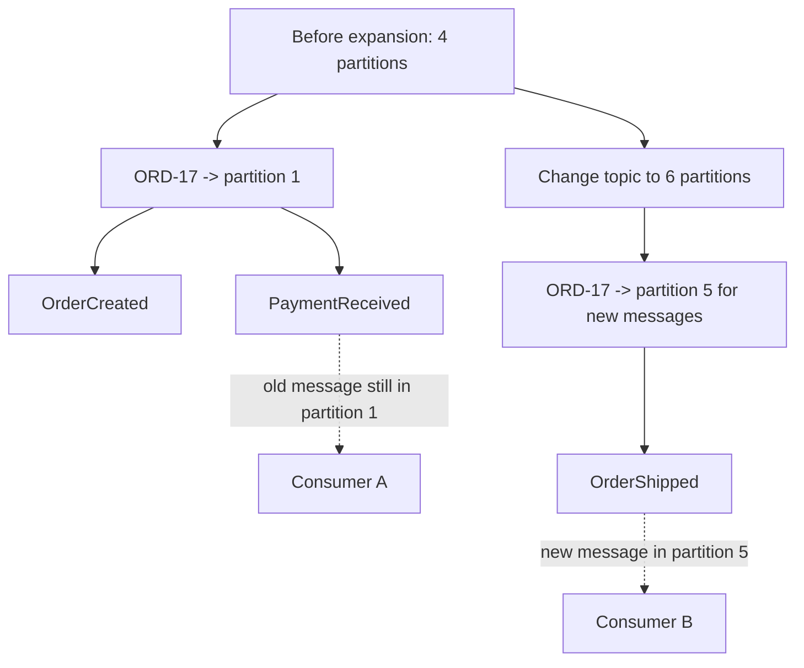

# Changing Partition Count and Assessing Impact on Key Mapping

Partitions split an event stream into multiple parts to increase storage and parallel processing capacity. When message volume or throughput demand grows, operations teams may need to increase a topic's partition count. However, changing the partition count can alter how a business key maps to a partition. If the application relies on processing order by `orderId`, `customerId`, or another key, this change directly affects business behavior.

In Spring Cloud Stream, producers can extract a partition key with `partitionKeyExpression` or `PartitionKeyExtractorStrategy`, and select a partition with `partitionSelectorExpression` or `PartitionSelectorStrategy`. With the default strategy, the partition index is calculated from the key's hash and `partitionCount`. When the modulus changes, many keys can shift to different partitions. With Kafka, a topic's partition count can be increased, not decreased in place; older data remains in the old partitions.

## 1. Distinguishing Application partitionCount from Actual Topic Partition Count

In Spring Cloud Stream, two values are often confused:

- `producer.partitionCount` is the target partition count used by producer configuration when performing partitioning. This value must be greater than `1` for producer-side partitioning to take effect.
- The destination's actual partition count is the structure created on the broker. With Kafka, this is the topic's partition count.

For example, the producer declares `partitionCount: 6`, yet the Kafka topic already has 8 partitions. The Kafka binder treats `partitionCount` as a hint and uses the greater of the producer configuration and the topic's actual partition count. Therefore, producer configuration cannot shrink an existing 8-partition topic back to 6 partitions.

With the Kafka binder, `minPartitionCount` at the binder level also participates in determining the partition count when topics are auto-created. The greater of `minPartitionCount` and `producer.partitionCount` is used as the target partition count during topic creation. If the topic already exists, the topic's actual partition count must also be accounted for.

## 2. How Spring Cloud Stream Selects a Partition from a Key

For producer-side partitioning to work, a stable key must be derived from the message. For example, all events belonging to the same order use `orderId` as the key:

```yaml
spring:
  cloud:
    function:
      definition: publishOrder
    stream:
      bindings:
        publishOrder-out-0:
          destination: orders.events
          producer:
            partition-key-expression: payload.orderId
            partition-count: 6
```

`partition-key-expression` is a SpEL expression evaluated on the outbound message. In this example, `payload.orderId` serves as the partition key. `partition-count` declares the target number of partitions for the partitioning mechanism.

If no custom selector is configured, Spring Cloud Stream uses the key's hash modulo the partition count to select an index in the range `0` to `partitionCount - 1`:

\[
partition = hash(key) \bmod partitionCount
\]

Illustrative example with non-negative hash values:

| Key Hash | 4 Partitions | 6 Partitions |
| ---: | ---: | ---: |
| 17 | 1 | 5 |
| 24 | 0 | 0 |
| 11 | 3 | 5 |
| 30 | 2 | 0 |

The results show that some keys stay in the same partition, yet many other keys move to a new partition when the partition count changes. You cannot assume any key stays in the same position after expanding a topic.

### Choosing a Stable Key

The partition key should represent the entity for which the application needs to preserve ordering, such as:

- `orderId` if events for an order must be processed in sequence.
- `customerId` if events for the same customer must be grouped into the same partition.
- `accountId` if balance operations on an account must be processed sequentially.

Avoid using random values, the current timestamp, or Java objects whose `hashCode()` depends on identity as keys when related messages must land in the same partition. Across multiple languages or multiple producer types, standardize key normalization and the partitioning algorithm; the same key string across clients using different partitioners can still pick different partitions.

## 3. Why Increasing Partitions Can Alter Per-Key Ordering?

Kafka guarantees ordering within a single partition. Kafka does not guarantee global ordering across multiple partitions. When increasing the partition count, new messages for a key can be routed to a different partition from the one holding older messages for that key.

Suppose topic `orders.events` initially has 4 partitions. The events `OrderCreated`, `PaymentReceived`, and `OrderShipped` for `ORD-17` are all sent to partition 1. Consumers can read them in write order within that partition.

After expanding the topic to 6 partitions, the hash of `ORD-17` may map to partition 5. New messages for this order will go to partition 5 while older messages remain in partition 1. Two partitions can be processed concurrently by two different consumers. Consequently, a consumer may complete a newer event before finishing an older one.



Kafka does not automatically move old records to new partitions when partitions are added. Expansion only adds partitions; it does not reorganize message history by key. This is why changing the partition count must be evaluated as a distribution contract change, especially when business logic depends on ordering.

## 4. What Does Changing the Partition Count Affect?

| Aspect | Potential Impact | What to Evaluate |
| --- | --- | --- |
| Key mapping | Many keys map to different partitions | Which keys can switch partitions and when the new mapping takes effect |
| Per-key ordering | Old and new messages for the same key may sit in different partitions | Whether producers must pause and drain old data |
| Consumer group | Kafka reassigns partitions when the topic expands | Rebalance, consumer count, lag, and stabilization time after the change |
| Throughput | Increased parallel processing capacity | Whether consumers, brokers, network, and downstream can keep up |
| Storage and replication | More partition logs and replicas to store | Disk, replication factor, network, and broker overhead |
| Operations | Changes to producer configuration and topic topology | Config synchronization, admin permissions, rollback plan |
| Integrated systems | Other producers may use different partitioning algorithms | Key and partitioner consistency across clients |

Increasing partitions does not automatically increase throughput proportionally. If the consumer-side database is the bottleneck or producers lack load, extra partitions may yield little improvement. Conversely, more partitions increase file handles, metadata, leader elections, and replica distribution overhead on brokers.

## 5. Configuring Partitioning in Spring Cloud Stream

A more complete producer configuration example:

```yaml
spring:
  cloud:
    function:
      definition: publishOrder
    stream:
      bindings:
        publishOrder-out-0:
          destination: orders.events
          producer:
            partition-key-expression: payload.orderId
            partition-count: 6
```

In this example, the producer uses Spring Cloud Stream's default selector. If custom rules are needed, you can configure `partition-selector-expression` or a `PartitionSelectorStrategy` bean. A custom selector must always return a valid index within the active partition range. If the selector expression contains constants or lookup tables tied to partition count, review and update them when the partition count changes; avoid letting a selector inadvertently restrict messages to old partitions.

You can replace expressions with beans implementing `PartitionKeyExtractorStrategy` or `PartitionSelectorStrategy` when business rules are complex. Do not configure both alternatives for the same responsibility simultaneously: `partitionKeyExpression` and `partitionKeyExtractorName` are mutually exclusive alternatives, as are `partitionSelectorExpression` and `partitionSelectorName`.

### Kafka Binder Partition Count

The Kafka binder uses `producer.partitionCount` as a hint when creating topics. `minPartitionCount` can set a minimum at the binder level. The `autoAddPartitions` property controls whether the binder automatically increases partitions on an existing topic:

```yaml
spring:
  cloud:
    stream:
      bindings:
        publishOrder-out-0:
          destination: orders.events
          producer:
            partition-key-expression: payload.orderId
            partition-count: 6
      kafka:
        binder:
          min-partition-count: 3
          auto-add-partitions: false
```

In this configuration, `partition-count: 6` is greater than `min-partition-count: 3`, so the target partition count when the binder creates the topic is 6. If the topic already exists with fewer partitions and `auto-add-partitions` is `false` (the default), the binder may refuse to start because the topology does not meet the expected partition count. If `auto-add-partitions` is enabled, the binder can add partitions when needed and permitted by broker authorization. If the topic already has more partitions than the target value, the existing count is used.

In production environments, clearly decide who owns topic mutations: the operations team via Kafka administration workflows, or the binder during application startup. Avoid letting multiple services mutate topology concurrently without coordination.

If a topic's partition count changes while the application is running, the binder's ability to detect the new topology depends on version. Current Kafka binder documentation notes runtime partition-count change support starting in Spring Cloud Stream 4.0.3; the Kafka producer's metadata refresh interval can be tuned with `spring.kafka.producer.properties.metadata.max.age.ms`. On older versions or when controlled changes are required, use an appropriate rollout process and verify the application has picked up the new topology before resuming writes.

## 6. Kafka Topic Partitions Cannot Be Reduced In Place

Kafka supports increasing partitions on regular topics, but does not support reducing partitions directly in place. Therefore, if you scale from 6 to 12 and later realize 6 was better, setting `partition-count: 6` back in the application will not shrink the topic to 6.

If you need fewer partitions, you typically must create a new topic with the desired partition count and migrate data or cut over producers/consumers on a schedule. Define retention, offsets, consumer groups, schemas, and when to retire the old topic. Never delete the old topic until you have verified that data and consumers have migrated completely.

This also affects rollbacks. Once a topic's partition count has been increased, rolling back application configuration alone does not restore the old topology. If you must restore old key mappings, have an explicit plan such as a temporary compatibility selector or migrating to a new topic; carefully verify the actual selector and partition count used by the binder.

## 7. Safe Scaling Strategies When Ordering Matters

Before increasing partitions, define the required level of ordering guarantee:

- If ordering is only needed going forward and processing old/new data concurrently during transition is acceptable, you can expand the topic on schedule and ensure consumers are idempotent.
- If strict per-key ordering must hold across the transition boundary, coordinate producers, consumers, and topology so the same key is never written concurrently to two partitions.

### Approach 1: Pause Writes and Drain Existing Data

This is easier to control when a brief write pause is acceptable:

1. Pause or temporarily block producers for the topic.
2. Wait until already-written messages are processed and committed by all relevant consumer groups.
3. Verify lag reaches 0 or an agreed checkpoint.
4. Increase topic partitions and update required producer/consumer configurations.
5. Restart producers with the new mapping.
6. Monitor initial messages after the change and verify per-key ordering.

When all older messages have completed processing before new messages are emitted, the risk of a consumer finishing a newer message before an older one for the same key drops significantly. Define clear drain criteria; stopping producers without waiting for consumers to finish is not enough.

### Approach 2: Migrate to a New Versioned Topic

When the stream cannot pause for long, create a new topic with the new partition count, such as `orders.events.v2`. Then execute a controlled cutover:

1. Create the new topic with approved partition count, replication factor, and retention.
2. Deploy consumers compatible with the new topic and current schema.
3. Establish a checkpoint or event boundary so each key has only one authoritative write stream at a time.
4. Switch producers by key group or at a clear cutover point.
5. Wait for consumers to drain remaining data on the old topic.
6. Reconcile event counts, offsets/checkpoints, and business outcomes before retiring the old topic.

Do not dual-write the same key to both topics without coordination. Two streams may be processed at different speeds, causing out-of-order updates or duplicate processing. If dual-writing is required, enforce event IDs, checkpoints, deduplication, and authoritative source rules.

### Approach 3: Use Virtual Shards to Decouple Logical Identity from Physical Partitions

For systems with periodic scaling needs, map keys into a fixed number of virtual shards, then map each shard to a physical partition via a configuration table. For example, use 256 virtual shards even though the topic initially has only 8 partitions.


When adding physical partitions, the application can move selected virtual shards to new partitions. Moving a shard still requires a handoff procedure: pause or lock writes to that shard, drain old data, update the routing table consistently across producers and consumers, and then resume writing to the new target. Virtual shards do not guarantee ordering by themselves; they provide a stable logical layer so migrations can be controlled across smaller key subsets.

## 8. Updating Consumers and Consumer Groups

With Kafka, consumer groups automatically discover topic partition counts and the broker assigns partitions to consumer members. When partitions increase, the group can rebalance to distribute new partitions. You do not need to declare `instanceCount` and `instanceIndex` for Kafka under Spring Cloud Stream's generic partitioning model; Kafka assigns partitions to the group itself.

With other binders, consumer partitioning may rely on application instance settings. Spring Cloud Stream provides `spring.cloud.stream.instanceCount` and `spring.cloud.stream.instanceIndex` for certain partitioned consumer scenarios. When using binders that require these properties, update the total instance count and each instance's index consistently. Do not mechanically apply those settings to Kafka consumer groups.

After scaling, the number of usefully active consumers in a Kafka group remains capped by the number of assignable partitions. With 12 partitions and 4 consumers, each consumer can receive multiple partitions. With 20 consumers, some consumers will receive no partition assignments. Scale consumers according to partition count, processing duration, and downstream capacity.

## 9. Impact on Systems Sharing the Same Key

A single topic may be read by multiple applications using different consumer groups. When the partition count changes:

- Each group must rebalance to the new topology.
- Consumers may pick up new partitions or receive reassigned existing partitions.
- Other services using the same key may observe different ordering if they process concurrently or maintain separate checkpoints.
- An application writing directly to Kafka may pick a different partition than a Spring Cloud Stream application if the two use different partitioners.
- Kafka Streams or stateful processors may need to re-evaluate topologies, changelogs, and state distribution; never manually alter partitions on internal topics managed by Kafka Streams.

Note that the Spring Cloud Stream Kafka binder's default partition selector uses `key.hashCode() % partitionCount`; this algorithm differs from a standalone Kafka producer's default partitioner and Kafka Streams' default partitioning. If multiple client types write to the same topic and a key must always hit the same partition, configure a compatible algorithm across all clients or enforce a clearly agreed partitioning rule.

If multiple applications publish messages to the same topic, publish a shared partitioning contract: key field, key normalization rules, hash/selector algorithm, partition count, and topology change procedure. Do not update one producer and assume all other producers automatically adapt.

## 10. Example Evaluation: Expanding from 4 to 8 Partitions

Suppose topic `orders.events` has 4 partitions and the producer uses key `orderId` with the default selector. Operations wants to expand to 8 partitions to increase processing capacity.

| Item | Before Change | After Change |
| --- | --- | --- |
| Topic partition count | 4 | 8 |
| Key mapping | `hash(key) % 4` | `hash(key) % 8` |
| Assignable partitions per group | Up to 4 consumers can hold dedicated partitions for this topic | Up to 8 consumers can hold dedicated partitions for this topic |
| Old messages | Located in partitions 0–3 | Still located in partitions 0–3 |
| New messages | Located in partitions 0–3 | Can land in partitions 0–7 |
| Per-key ordering during transition | Within old partition | May split across old and new partitions |

The change plan should include these steps:

1. Measure throughput, consumer lag, processing time, and broker utilization to confirm partitions are the bottleneck.
2. Verify all producers use the same key and selector.
3. Determine `orderId` ordering requirements; if strict, choose pause/drain or a new topic.
4. Add new partitions via admin workflow or enable `auto-add-partitions` per approved policy.
5. Align producer configuration and verify the actual partition count.
6. Re-enable writes and verify keys map as expected, consumer groups stabilize, and lag drops.
7. Verify independent readers, reporting pipelines, and replay jobs also understand the new topology.

## 11. Testing Before and After the Change

Test at both the algorithm level and the broker level:

### Testing the Partition Selector

For a representative set of keys, record partitions before and after changing the partition count. Count how many keys change partitions, confirm every partition ID lies within valid bounds, and verify identical key values behave consistently under a given configuration.

If using a custom `PartitionSelectorStrategy`, write unit tests for null keys, empty keys, Unicode keys, keys with negative hashes, and skewed key distributions. The selector must return valid indices without unintentionally crowding keys into one partition.

### Kafka Integration Testing

- Create a topic with the old partition count.
- Send multiple messages with the same key and with different keys.
- Expand the topic using the production deployment method.
- Send new messages and inspect partition metadata.
- Observe consumer group rebalancing, assignments, and lag.
- Verify old messages did not move and new messages can utilize new partitions.
- Verify idempotent consumer handling under redeliveries or restarts.

### Load Testing

Run load resembling real key distributions. Measure throughput, p95/p99 latency, broker CPU, disk I/O, network, consumer lag, and rebalance duration. If keys are skewed, increasing the partition count will not necessarily fix hot partitions; revisit the key and partitioning strategy.

## 12. Common Pitfalls When Changing Partition Count

| Symptom | Possible Cause | Resolution |
| --- | --- | --- |
| Producer fails to start after raising `partition-count` | Topic already exists with fewer partitions than required and `auto-add-partitions` is off | Create partitions via admin tooling or enable auto-add per approved workflow. |
| Config lowers partitions yet topic stays the same | Kafka does not support reducing partitions in place | Create a new topic and migrate data/streams in a controlled manner. |
| Same key appears on two partitions after expansion | Modulo hash mapping changed | Pause writes and drain before expanding if ordering is mandatory; or design migration with handoff. |
| Some new partitions receive little data | Uneven key distribution or skewed key traffic | Analyze hash distribution and hot keys; adjust key/selector if needed. |
| Consumer lag increases after change | Rebalancing, unscaled consumers, or overloaded downstream | Monitor assignments, scale intentionally, and inspect bottlenecks. |
| Other producers pick different partitions | Clients use different partitioners or key normalization | Standardize the key contract and algorithm across all producers. |
| Config rollback fails to restore old mapping | Topic retains the higher partition count and binder uses the greater of config vs. topic | Use a temporary compatibility selector or a new topic; do not expect old config to shrink the topic. |

## 13. Production Partition-Count Change Checklist

Before making the change:

- Confirm current and target partition counts for each topic.
- Identify the active key expression, extractor, and selector.
- Evaluate keys requiring ordering guarantees and affected consumer groups.
- Check all producers, including producers outside Spring Cloud Stream.
- Evaluate broker capacity, replication, disk, network, and admin limits.
- Select a transition approach: in-place expansion, pause/drain, or migrating to a new topic.
- Confirm who is authorized to provision partitions and required permissions.
- Prepare dashboards, alerts, and completion/rollback criteria.

After making the change:

- Verify the actual partition count on the broker.
- Verify producers use the expected mapping and emit no out-of-range partition IDs.
- Monitor rebalancing, consumer lag, throughput, and latency.
- Check per-key ordering, duplicates, and business outcomes.
- Reconcile data across producers, brokers, and consumers before closing the change.
- Update operational documentation and partitioning contracts for other producers.

## References

- [Spring Cloud Stream — Partitioning](https://docs.spring.io/spring-cloud-stream/reference/spring-cloud-stream/overview-partitioning.html)
- [Spring Cloud Stream — Binding Properties: Producer Properties](https://docs.spring.io/spring-cloud-stream/reference/spring-cloud-stream/binding-properties.html)
- [Spring Cloud Stream Kafka Binder — Partitioning](https://docs.spring.io/spring-cloud-stream/reference/kafka/kafka-binder/partitions.html)
- [Spring Cloud Stream Kafka Binder — Configuration Options](https://docs.spring.io/spring-cloud-stream/reference/kafka/kafka-binder/config-options.html)
- [Apache Kafka — Basic Operations: Modifying Topics](https://kafka.apache.org/44/operations/basic-kafka-operations/)

## Conclusion

Changing the partition count directly affects how keys are mapped and how consumers process data in parallel. With Spring Cloud Stream's default selector, partitions are calculated from the key's hash modulo `partitionCount`; changing the partition count can route the same key to a different partition. Kafka keeps old records in old partitions, does not automatically redistribute existing data, and does not support reducing partitions in place. Therefore, evaluate per-key ordering requirements, synchronize all producers, plan consumer rebalancing, and select a controlled transition strategy before expanding the topology.
