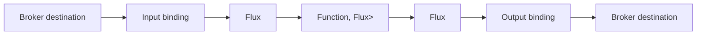

# Building `Function<Flux<T>, Flux<R>>`

Spring Cloud Stream supports a reactive function model based on Project Reactor. With the `Function<Flux<T>, Flux<R>>` signature, a function receives an input stream of messages and returns an output stream of results. The framework connects the input stream to the input binding, subscribes to process results from the output stream to the output binding, and manages the connection lifecycle according to the binder.

Unlike `Function<T, R>`, which is invoked per message, `Function<Flux<T>, Flux<R>>` is applied to the publisher of the entire stream. This allows using Reactor operators to filter, transform, group, combine, or asynchronously process data. To use this model properly, you need to understand publishers/subscribers, subscription lifecycles, backpressure, stream-terminating errors, and binder limitations when translating reactive signals to broker delivery mechanics.

## 1. Input and Output Stream Model

`Flux<T>` is a publisher that can emit zero, one, or many elements over time. In Spring Cloud Stream, `T` is typically the payload type after message conversion. `R` is the payload type emitted by the function to the output binding.



For example, a service receives order events, validates the data, and emits validated events:

```java
@Bean
Function<Flux<OrderCreated>, Flux<OrderValidated>> validateOrders(
        OrderValidator validator) {
    return orders -> orders
            .map(validator::validate);
}
```

The framework connects the function to bindings based on the bean name. For the `validateOrders` bean, the default names are `validateOrders-in-0` for the first input and `validateOrders-out-0` for the first output.

```yaml
spring:
  cloud:
    function:
      definition: validateOrders
    stream:
      bindings:
        validateOrders-in-0:
          destination: orders.created
          group: order-validation
          content-type: application/json
        validateOrders-out-0:
          destination: orders.validated
          content-type: application/json
```

`destination` defines the logical destination that the binder maps to a broker topic, exchange/queue, or topic/subscription. `group` on the input binding defines the consumer group. The content type must match the payload and the configured converter/serializer.

## 2. Differences from Per-Message Functions

The following two signatures represent two different ways of organizing processing:

```java
@Bean
Function<OrderCreated, OrderValidated> validateOne(OrderValidator validator) {
    return validator::validate;
}

@Bean
Function<Flux<OrderCreated>, Flux<OrderValidated>> validateStream(
        OrderValidator validator) {
    return orders -> orders.map(validator::validate);
}
```

| Aspect | `Function<T, R>` | `Function<Flux<T>, Flux<R>>` |
|---|---|---|
| Invocation | Framework invokes the function per message | Framework provides a publisher representing the stream |
| Function perspective | One payload per invocation | A sequence of payloads over time |
| Batch/group processing | Must build a separate mechanism if needed | Can use `buffer`, `window`, `groupBy`, and related operators |
| Asynchronous processing | Can return supported asynchronous types per the function model | Can compose publishers using `flatMap`, `concatMap`, and Reactor operators |
| Lifecycle | Tied to individual message processing | Longer-lived pipeline and subscription managed by the framework |

Do not wrap a per-message function inside `Flux` merely to make the application look reactive. Choose the signature based on actual requirements: if you only need independent per-message transformations, a regular function is usually easier to understand. Use a reactive function when you need stream processing, publisher coordination, demand regulation, or group-based transformations.

## 3. Common Reactor Operators

Operators form a declarative pipeline. They only describe how data will be processed when the publisher is subscribed to.

| Operator | Effect | Scenario |
|---|---|---|
| `map` | Transforms one element into one element | Normalize or convert a DTO |
| `filter` | Keeps or drops an element | Discard events not meeting a condition |
| `flatMap` | Maps each element to a publisher and merges results | Call an asynchronous service per event |
| `concatMap` | Processes inner publishers sequentially, preserving emission order | Need sequential processing along the stream |
| `flatMapSequential` | Runs inner publishers concurrently but emits results in source order | Need concurrency and output ordering |
| `buffer(n)` | Collects up to `n` elements into a list | Batch writes or batch API calls |
| `window(...)` | Splits the stream into sub-publishers by size or time | Windowed calculations |
| `distinct` | Removes duplicate elements within the operator's scope | Temporary deduplication within a stream, not a replacement for durable idempotency |
| `take` | Limits the number of elements | Tests or finite streams |
| `doOnNext` | Observes an element without transforming it | Controlled metrics or logging |

### 3.1. Transforming and Filtering

Example normalizing customer IDs and emitting only orders with a positive total:

```java
@Bean
Function<Flux<OrderCreated>, Flux<OrderAccepted>> acceptOrders() {
    return orders -> orders
            .filter(order -> order.total().signum() > 0)
            .map(order -> new OrderAccepted(
                    order.eventId(),
                    order.orderId(),
                    order.customerId().trim().toUpperCase(Locale.ROOT),
                    order.total()));
}
```

`filter` removes elements that fail the condition from the output stream. If rejection carries business meaning, do not silently drop messages: record metrics, emit a rejection event, or route to a quarantine stream according to system requirements.

Reactor does not allow emitting `null` as an `onNext` element. Therefore, do not use `filter(Objects::nonNull)` to handle null payloads in a `Flux`; check required fields and object validity in a validator. If an external data source can produce null values, filter or convert those values before putting them into the publisher.

### 3.2. Calling Asynchronous Services with flatMap

When each order requires looking up customer information via a reactive API, `flatMap` allows multiple requests to run concurrently:

```java
@Bean
Function<Flux<OrderCreated>, Flux<OrderEnriched>> enrichOrders(
        CustomerClient customerClient) {
    return orders -> orders.flatMap(
            order -> customerClient.findCustomer(order.customerId())
                    .map(customer -> new OrderEnriched(order, customer)),
            16);
}
```

The `16` parameter limits how many inner publishers are processed concurrently inside this operator. It is not the number of broker consumers, partitions, or application-wide concurrency. Choose the value based on connection limits, dependent service quotas, latency, and downstream capacity.

`flatMap` can emit results in the completion order of inner publishers. If events sharing the same business key must preserve order, consider `concatMap` or `flatMapSequential`, while also checking how broker partitions and consumers distribute data. Simply changing an operator in the application cannot establish global ordering across partitions.

### 3.3. Grouping into Batches

If downstream supports batch writes, you can use `buffer`:

```java
@Bean
Function<Flux<OrderCreated>, Flux<BatchResult>> writeBatches(
        OrderBatchRepository repository) {
    return orders -> orders
            .buffer(100)
            .filter(batch -> !batch.isEmpty())
            .concatMap(repository::saveBatch);
}
```

Each output element in the example is the result of a batch. `buffer(100)` emits a batch when 100 elements accumulate; if the source completes, the final partial batch is also emitted. With an unbounded source, if traffic is low and there is no time limit, the last batch may wait a long time. You can use `bufferTimeout` when you need both a count threshold and a time limit, though you must account for latency and keeping data in memory.

## 4. Framework-Managed Subscriptions

A common mistake when getting started with Reactor is calling `subscribe()` inside a reactive function:

```java
// Do not do this: the pipeline is detached from the framework-managed output binding.
@Bean
Function<Flux<OrderCreated>, Flux<OrderValidated>> wrong(OrderValidator validator) {
    return orders -> {
        orders.map(validator::validate).subscribe();
        return Flux.empty();
    };
}
```

The snippet above creates its own subscription and then returns an empty publisher to the framework. Results may never reach the output binding, errors may not be tied to the binding lifecycle, and the application loses control over pipeline backpressure.

Return the pipeline so the framework subscribes to it:

```java
@Bean
Function<Flux<OrderCreated>, Flux<OrderValidated>> validateOrders(
        OrderValidator validator) {
    return orders -> orders.map(validator::validate);
}
```

Do not call `.block()`, `.toIterable()`, or convert the stream into a synchronous collection inside the reactive chain. These operations can block threads, consume unbounded memory, or break demand regulation. If you must integrate a blocking API, isolate it on an appropriate scheduler as described in the next section.

## 5. Backpressure and Binder Limitations

Reactive Streams uses demand: a subscriber requests the number of elements it is ready to receive, and the publisher emits according to that demand. Reactor uses this mechanism to regulate flow within the pipeline and prevent a fast step from pushing unbounded data to a slow step.

However, backpressure inside `Flux` does not mean the broker always receives demand signals in the same way. The binder must adapt the broker's consumption mechanism into a publisher and the output publisher into producer sends. Kafka uses poll, fetch, and its own consumer mechanics; RabbitMQ has prefetch and acknowledgements; Pulsar has receiver queues and flow control. These layers have their own buffers and limits.

Therefore:

- Do not assume Reactor's `request(n)` always causes the broker to send strictly `n` messages.
- Do not use `onBackpressureBuffer()` with an unbounded queue on a stream that can grow faster than it is processed.
- Measure consumer lag, queue depth, subscription backlog, heap memory, and processing time.
- Configure concurrency, prefetch, poll/fetch, and buffer limits according to the binder in use.
- Load test with peak traffic and slow downstream scenarios, not just a few messages.

Several backpressure operators can change data behavior:

| Operator | Behavior | Risks to understand |
|---|---|---|
| `onBackpressureBuffer` | Holds elements when downstream cannot keep up | Buffer increases memory usage; requires capacity limits and overflow policy |
| `onBackpressureDrop` | Drops elements when demand is lacking | Can lose events; use only when business logic permits dropping |
| `onBackpressureLatest` | Keeps the latest element | Discards intermediate values; fits some state streams, not all events |
| `limitRate` | Splits demand sent upstream into smaller chunks | Regulates demand within the pipeline; does not replace broker configuration |

For business events that must be delivered, do not casually pick drop/latest to handle overload. Clarify whether the system must retain all events, can reject producers, must store backlog, or can sample data.

## 6. Integrating Blocking Calls

A reactive chain does not automatically turn a blocking library into a non-blocking one. Calling synchronous JDBC, a legacy SDK, or a blocking HTTP client inside `map` can hold the pipeline execution thread for the entire wait duration.

You can wrap a blocking call with `Mono.fromCallable` and offload it to `Schedulers.boundedElastic()`:

```java
@Bean
Function<Flux<OrderCreated>, Flux<OrderEnriched>> enrichWithLegacyApi(
        LegacyCustomerClient client) {
    return orders -> orders.flatMap(
            order -> Mono.fromCallable(() -> client.loadCustomer(order.customerId()))
                    .subscribeOn(Schedulers.boundedElastic())
                    .map(customer -> new OrderEnriched(order, customer)),
            8);
}
```

`boundedElastic` is intended for blocking tasks and has resource bounds. Concurrency `8` limits concurrent calls inside the operator; choose a value aligned with the connection pool and API limits. Whenever possible, prefer a genuinely reactive client to avoid thread switching and unnecessary conversion overhead.

Do not use `Schedulers.parallel()` for blocking I/O tasks. That scheduler is meant for short, CPU-bound computations. Also do not create `newCachedThreadPool()` or spawn an unbounded new thread per message.

## 7. Error Handling in a Reactive Function

In Reactor, an error is a terminal signal (`onError`) of a publisher. If a `map` throws an exception, the pipeline can terminate and stop emitting subsequent elements. This differs from an independent message error in an imperative consumer, which the framework handles individually per invocation.

For example:

```java
return orders.map(validator::validate);
```

If `validate` throws an exception for one order, the output publisher emits an error. The binder and Spring Cloud Stream handle errors according to the binding/binder mechanism, but you should not assume subsequent messages in the publisher will continue or that every error automatically goes to a DLQ.

If you want to isolate errors per record, turn each record into an inner publisher and handle errors directly inside that inner publisher:

```java
@Bean
Function<Flux<OrderCreated>, Flux<ValidationOutcome>> validateIndividually(
        OrderValidator validator) {
    return orders -> orders.flatMap(order ->
            Mono.fromCallable(() -> ValidationOutcome.accepted(validator.validate(order)))
                    .onErrorResume(InvalidOrderException.class,
                            error -> Mono.just(ValidationOutcome.rejected(
                                    order.eventId(), error.getMessage()))));
}
```

`ValidationOutcome` is an application-defined result type that can represent either an accepted or rejected event. This keeps the pipeline running when encountering explicitly handled business errors. For infrastructure errors such as database timeouts or failures calling a dependent service, do not turn them into rejection results; propagate the error to retry or route to an appropriate error flow.

Several principles:

- `onErrorResume` replaces a failing publisher with another publisher; if used too broadly, errors may be masked.
- `onErrorContinue` has operator-dependent semantics and can make processing unpredictable; avoid using it as a general solution.
- `retry`/`retryWhen` resubscribes to the source or inner publisher; determine whether the operation is idempotent and whether the source can replay.
- DLQ, retry, acknowledgement, and offset commits depend on the binder; check documentation for your exact version and test against a real broker.
- When publishing errors to a quarantine stream, errors from the quarantine operation itself must also be handled; never silently drop the original message.

## 8. Stateful Operations and Ordering

A reactive function can use `scan`, `reduce`, `buffer`, `window`, or `groupBy` to compute across multiple elements. However, state inside a pipeline exists only for the lifetime of the subscription and instance. When the application restarts, in-memory state can be lost; when running multiple instances, each instance holds separate state.

Example using `scan` to compute a running total within a subscription:

```java
Flux<Long> runningTotals = amounts.scan(0L, Long::sum);
```

This is a stateful computation within the current stream, not a durable data store. If you need aggregations recoverable across restarts, multiple partitions, or multiple instances, use an appropriate state store or database. With Kafka, Kafka Streams provides state stores and changelogs for partitioned stateful processing; do not replace it with a `Map` in a field of a reactive bean.

`groupBy` creates multiple inner publishers and can retain resources if the number of keys grows unbounded or groups are not consumed. `window` and `buffer` also hold elements in memory. Set bounds on size, time, group count, and concurrency according to data characteristics.

Output ordering also must be chosen deliberately:

- `map` preserves element order.
- `concatMap` processes inner publishers sequentially and preserves emission order.
- `flatMap` can emit in completion order without guaranteeing source order.
- `flatMapSequential` allows concurrent inner publishers while preserving source emission order, at the cost of buffering early completions.

Even when the pipeline preserves order, multiple partitions or multiple consumers can process in parallel. If ordering by `orderId` is a business requirement, use a consistent partition key and verify broker guarantees.

## 9. Binder Configuration and Delivery

A reactive function is an application-layer processing model; Kafka, RabbitMQ, and Pulsar still have their own delivery models. The binder must connect the publisher/subscriber to the broker client and manage acknowledgements, offsets, queues, subscriptions, and associated buffers.

| Broker | What to watch when using reactive functions |
|---|---|
| Kafka | Consumer poll, partition assignment, offset commit, lag, producer send, and intra-partition order |
| RabbitMQ | Prefetch, acknowledgement, redelivery, queue depth, and consumer concurrency |
| Pulsar | Subscription type, receiver queue, acknowledgement, backlog, and redelivery |

Do not assume that using `Flux` means the application uses an end-to-end reactive broker client. A binder may use an imperative client and adapt it to Reactor at the integration layer. Throughput, backpressure, and error handling must be measured on the exact binder/version.

For critical events, reactive pipelines also require idempotency, bounded retries, and DLQs according to broker policies. Returning a `Flux<R>` does not automatically guarantee exactly-once delivery or transactions between the broker and a database. If a consumer updates a database, design transactions and idempotency keys at the data layer.

## 10. Testing with StepVerifier and Binders

Reactor Test's `StepVerifier` is well suited for testing pure pipelines. For example:

```java
@Test
void validatesEachOrder() {
    record TestOrder(String eventId, String orderId, int quantity) {}
    record TestValidated(String eventId, String orderId, int quantity) {}

    Function<Flux<TestOrder>, Flux<TestValidated>> function = orders ->
            orders.map(order -> new TestValidated(
                    order.eventId(), order.orderId(), order.quantity()));

    StepVerifier.create(function.apply(Flux.just(
                    new TestOrder("evt-1", "ord-1", 2),
                    new TestOrder("evt-2", "ord-2", 1))))
            .expectNextMatches(result -> result.orderId().equals("ord-1"))
            .expectNextMatches(result -> result.orderId().equals("ord-2"))
            .verifyComplete();
}
```

Unit tests should verify:

- Proper payload transformation and filtering.
- Empty streams and single-element streams.
- Normal publisher completion.
- Exceptions thrown on an element and the expected error-handling policy.
- `flatMap` concurrency, output ordering, and buffer bounds where applicable.
- Subscription cancellation and resource cleanup when the pipeline is cancelled.

Then run integration tests with the Spring Cloud Stream Test Binder or a real broker:

- Confirm input/output bindings are created with the right names and destinations.
- Send messages with valid content types/schemas and inspect output payloads.
- Verify conversion errors, retries, DLQ, and acknowledgements according to the binder.
- Generate load faster than processing speed to observe lag, queue depth, and memory.
- Stop a consumer or broker mid-processing to verify redelivery and idempotency.
- Test shutdown and restart to confirm subscriptions/publishers are closed and initialized properly.

The Test Binder is useful for in-application integration flows, but it does not simulate every characteristic of Kafka, RabbitMQ, or Pulsar. Requirements around partitions, offsets, prefetch, subscription types, durability, and broker-level flow control must be tested against the corresponding broker.

## 11. Common Pitfalls

| Symptom | Possible cause | Resolution |
|---|---|---|
| No messages on output binding | Function returns an empty publisher or manually called `subscribe()` | Return the pipeline directly for framework management |
| Stream stops after one failing message | Exception escapes the pipeline and emits `onError` | Handle errors per record or let the binder handle them per configured policy |
| Heap grows continuously | Unbounded buffer, `groupBy` with too many keys, or slow downstream | Bound buffers/concurrency and monitor demand/backlog |
| Result order changes | Using `flatMap` with inner publishers completing unevenly | Use `concatMap` or `flatMapSequential` if ordering is required |
| Threads get blocked | Calling blocking APIs directly inside `map` or `flatMap` | Use a reactive client or isolate calls with `boundedElastic` |
| Retries cause duplicate side effects | Inner publisher has non-idempotent side effects | Use stable event IDs, idempotency, and appropriate transactions |
| Backpressure does not stop broker backlog growth | Binder/client has its own buffers or flow control | Check binder config, poll/prefetch/receiver queue, and broker metrics |
| Pipeline does not stop on app shutdown | Manually created subscriptions or resources outside framework lifecycle | Let the framework manage subscriptions; use explicit lifecycle cleanup hooks for custom resources |

## 12. Pre-Deployment Checklist

- [ ] Choose `Function<Flux<T>, Flux<R>>` when stream operations are needed, not simply to use Reactor.
- [ ] Set `spring.cloud.function.definition` and exact input/output binding names.
- [ ] Ensure Reactor is on the classpath and its version is compatible with Spring Boot/Spring Cloud.
- [ ] Return the pipeline from the function; do not manually `subscribe()`, `block()`, or collect the entire stream into a collection.
- [ ] Choose operators according to ordering, concurrency, and batch size requirements.
- [ ] Isolate blocking calls on an appropriate scheduler or replace them with a reactive client.
- [ ] Have policies for backpressure, buffering, overflow, and resource limits.
- [ ] Separate per-record errors from pipeline-breaking errors; configure retry/DLQ per binder.
- [ ] Do not store long-lived business state in pipeline memory or singleton beans.
- [ ] Test with StepVerifier, Test Binder, and a real broker for required delivery guarantees.
- [ ] Monitor lag/backlog, processing time, errors, retries, DLQ, threads, and heap.

`Function<Flux<T>, Flux<R>>` helps build a reactive pipeline over a message stream rather than processing each payload in isolation. This model shines when you need to compose publishers, group events, process asynchronously, or regulate demand. To operate it reliably, let the framework manage subscriptions, bound buffers/concurrency, handle per-record errors when needed, and verify backpressure and delivery limits against the real binder and broker.
