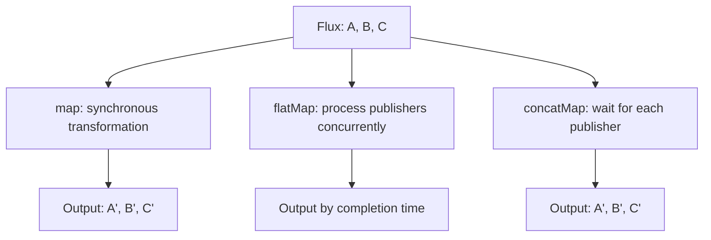
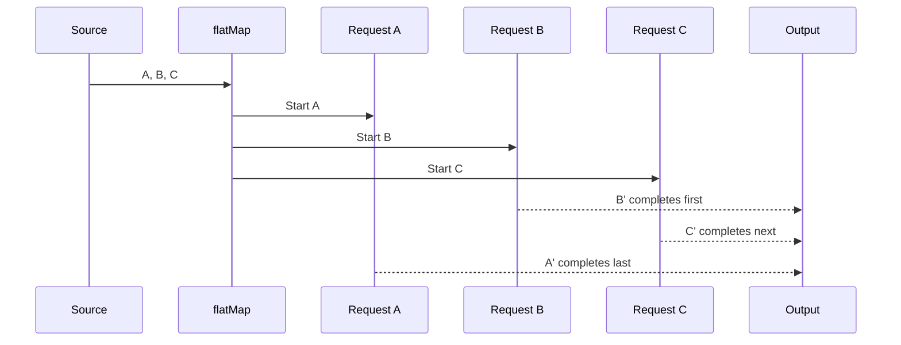
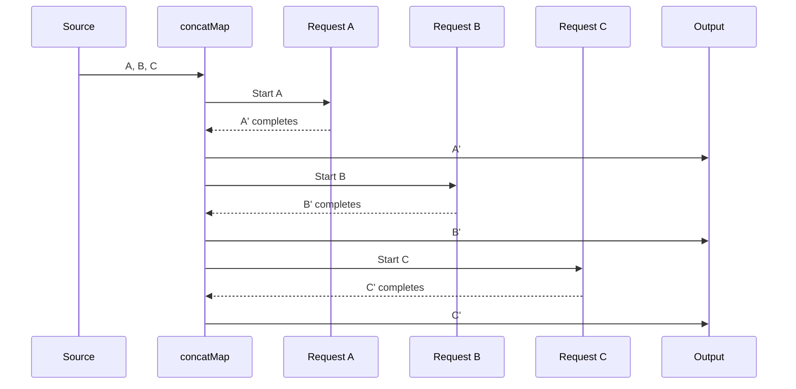

# map, flatMap, and concatMap for Preserving Order

## 1. Why Does Order Change in Reactive Processing?

In a Spring Cloud Stream application, a consumer can receive a continuous stream of messages. With Reactor, that stream is typically represented as `Flux<T>`. Each message may need data transformation, calls to other services, or state persistence before emitting results through an output binding.

The three operators `map`, `flatMap`, and `concatMap` all transform elements of a stream, but they execute differently:

- `map` synchronously transforms each element and preserves the order of the input stream.
- `flatMap` turns each element into a publisher and merges the results; inner tasks can run concurrently and emit results according to completion time.
- `concatMap` turns each element into a publisher but processes the next publisher only after the current publisher completes; output order matching input order is preserved.

The most important difference appears when a processing step performs asynchronous I/O with varying completion times. If message A arrives before B, but A's operation is slower than B's, `flatMap` can emit B's result before A's. `concatMap` preserves sequence by waiting for A to finish before processing B.



Ordering here is element ordering within a single Reactor subscription. It does not by itself create global ordering across multiple Kafka partitions, multiple consumer instances, or multiple broker destinations. To preserve business ordering, you must also design partition keys, consumer concurrency, and how side effects are executed.

## 2. map: Synchronous Transformation and Order Preservation

`map` takes a synchronous function, receives one element, and returns one new element. Every input element corresponds to exactly one output element. Reactor processes the transformation in the source's emission order.

For example, normalizing a name and creating a view object from an order event:

```java
import reactor.core.publisher.Flux;

record OrderEvent(String orderId, String customerId, String customerName, long totalCents) {}
record OrderView(String orderId, String customerName, long totalCents) {}

Flux<OrderEvent> orderEvents = Flux.just(
    new OrderEvent("ORD-1", "CUS-1", " An ", 10000),
    new OrderEvent("ORD-2", "CUS-2", " Binh ", 20000)
);

Flux<OrderView> views = orderEvents.map(event -> new OrderView(
    event.orderId(),
    event.customerName().trim(),
    event.totalCents()
));
```

If the source emits A, B, C, then `map` emits A', B', C' in the same order. This is the right choice for fast transformations that do not wait on another publisher, such as field normalization, calculations, DTO mapping, or simple condition checks.

### map Is Not an Operator for Asynchronous I/O

If the function inside `map` returns `Mono<R>`, the result becomes `Flux<Mono<R>>`—a stream containing publishers that have not been flattened into the pipeline:

```java
Flux<Mono<Customer>> nested = orderEvents.map(
    event -> customerClient.findById(event.customerId())
);
```

When you want to execute and receive the result of an asynchronous call, use `flatMap`, `concatMap`, or an equivalent operator. Do not call `block()` inside `map` to wait for results because doing so turns an asynchronous stream into thread-blocking execution and can exhaust resources.

### Keep map Pure and Easy to Test

Prefer using `map` for side-effect-free transformations. Database writes, HTTP requests, or external system updates should be represented by publishers returned from reactive APIs so Reactor can track completion time, errors, and task cancellation.

## 3. flatMap: Processing Publishers Concurrently

`flatMap` takes a function that converts each element into a publisher such as `Mono<R>` or `Flux<R>`, then merges the results of those inner publishers into one output stream.

For example, each order event needs to look up customer details over HTTP:

```java
import reactor.core.publisher.Flux;
import reactor.core.publisher.Mono;

record Customer(String displayName) {}
interface CustomerClient {
    Mono<Customer> findById(String customerId);
}

Flux<OrderView> enriched = orderEvents.flatMap(
    event -> customerClient.findById(event.customerId())
        .map(customer -> new OrderView(
            event.orderId(),
            customer.displayName(),
            event.totalCents()
        ))
);
```

Each call to `findById` returns a `Mono<Customer>`. `flatMap` subscribes to the inner publishers and merges results as they emit. If A takes 300 ms, B takes 50 ms, and C takes 100 ms, results may be emitted as B', C', A' even though the input was A, B, C.



This is expected behavior when prioritizing throughput and elements can be processed independently. When ordering is unimportant, `flatMap` leverages I/O wait time to process multiple messages concurrently.

### Limiting Concurrency

You can limit the number of concurrently subscribed inner publishers:

```java
Flux<OrderView> enriched = orderEvents.flatMap(
    event -> customerClient.findById(event.customerId())
        .map(customer -> new OrderView(
            event.orderId(), customer.displayName(), event.totalCents()
        )),
    8
);
```

The `8` parameter limits active concurrent inner publishers in the Reactor API. This limit prevents spawning too many simultaneous requests, protects dependent services, and bounds pending work.

Do not default to raising concurrency as high as possible. If a database or HTTP service can only sustain a certain load, excessive concurrency can increase timeouts, retries, and backlog. Measure latency, throughput, and error rates to choose a suitable value.

## 4. concatMap: Sequential Processing and Output Order Preservation

`concatMap` also converts each element into a publisher, but subscribes to and waits for the current publisher to complete before moving to the next publisher. Results are emitted in source order.

```java
Flux<OrderView> enrichedInOrder = orderEvents.concatMap(
    event -> customerClient.findById(event.customerId())
        .map(customer -> new OrderView(
            event.orderId(), customer.displayName(), event.totalCents()
        ))
);
```

If the input is A, B, C, then `concatMap` starts processing A, waits for A's publisher to complete, and only then processes B followed by C. If A is slow, B and C must wait even if the service could process them faster.



`concatMap` fits when operations have dependencies or must be applied sequentially, such as sequenced state updates, writing changes to the same entity in order, or calling an external system that cannot tolerate concurrent requests.

### Trade-Off: Lower Throughput

Because only one inner publisher runs at a time, a single slow task can stall the entire stream behind it. This is the trade-off for preserving sequence. If data arrives faster than sequential processing speed, waiting queues can grow and end-to-end latency increases.

Do not use `concatMap` across the entire stream just because a few event types require ordering. Identify the scope that needs serialization and consider key-based partitioning so different entities can still process in parallel.

## 5. Comparing map, flatMap, and concatMap

| Operator | Mapping function | Execution | Output order | Suitable cases |
|---|---|---|---|---|
| `map` | `T -> R` | Synchronous one-to-one transformation | Preserves source order | Calculations, normalization, DTO mapping |
| `flatMap` | `T -> Publisher<R>` | Inner publishers can run concurrently | Source order not guaranteed | Independent I/O, throughput priority |
| `concatMap` | `T -> Publisher<R>` | Inner publishers one by one, waiting for completion | Preserves source order | Operations requiring serialization |
| `flatMapSequential` | `T -> Publisher<R>` | Subscribes to inner publishers concurrently | Emits results in source order | Needs concurrency while wanting ordered emission |

Choose operators based on business requirements and the nature of inner operations. Do not use `map` to hold an unexecuted publisher; do not use `flatMap` when output emission order is an invariant; and do not apply `concatMap` globally if ordering is only needed per key.

## 6. flatMapSequential: Concurrent Execution, Source-Order Emission

Reactor also provides `flatMapSequential`. This operator subscribes to inner publishers with concurrency, while keeping result emission in the order of source elements. Results of early-completing publishers may have to wait in a buffer until preceding publishers finish emitting.

```java
Flux<OrderView> orderedResults = orderEvents.flatMapSequential(
    event -> customerClient.findById(event.customerId())
        .map(customer -> new OrderView(
            event.orderId(), customer.displayName(), event.totalCents()
        )),
    8
);
```

For example, A, B, and C start nearly concurrently. B and C may finish before A, yet `flatMapSequential` holds B' and C' and then emits A', B', C' in source order.

This differs from `concatMap`: `flatMapSequential` lets inner operations run concurrently, whereas `concatMap` starts the next operation only after the current one completes.

### Emission Order Does Not Equal Side-Effect Order

This requires special attention. If an inner publisher performs a database write and commits before emitting its result, `flatMapSequential` cannot reverse the commit order that already occurred. It only orders downstream result emissions.

If external update ordering is mandatory, serialize the update operation itself with `concatMap`, or use versioning/sequencing, transactions, and database concurrency control. Never rely solely on emission order to infer side-effect order.

## 7. Choosing an Operator by Business Use Case

### Pure Data Transformation

For example, normalizing events, renaming fields, or computing derived values without I/O. Use `map` because the operation is synchronous and one-to-one.

### Calling Independent Services, No Ordering Needed

For example, each event updates an independent metric or looks up information that can finish in any order. Use `flatMap` with bounded concurrency.

### Writing Changes That Must Follow Order

For example, events with sequences 1, 2, 3 updating the state of the same order. Use `concatMap` within the order scope or an equivalent serialization mechanism.

### Need Concurrent I/O While Downstream Needs Source Order

For example, generating independent results in parallel, yet a subsequent step requires receiving results in exact input order. Consider `flatMapSequential`, while checking buffer cost and side-effect ordering.

## 8. Combining Per-Key Ordering with Parallel Processing

In event-driven systems, you rarely need to serialize every message. A common need is preserving order for the same entity while letting different entities process concurrently.

For example:

- Events for `orderId=ORD-1` must be processed in sequence.
- Events for `orderId=ORD-2` can be processed in parallel with ORD-1.

At the broker layer, producers use `orderId` as the partition key so events for the same order enter the same Kafka partition. At the Reactor layer, you can serialize processing per key while letting different keys run concurrently. An advanced pattern groups by key and uses `concatMap` inside each group:

```java
Flux<OrderResult> results = events
    .groupBy(OrderEvent::orderId)
    .flatMap(group -> group.concatMap(orderService::process));
```

In this example, each group corresponds to an `orderId`; events in the same group are processed sequentially, while different groups can be processed concurrently by the outer `flatMap`.

`groupBy` must be used carefully. If the key count is very large or groups never close, the application can retain many open groups and buffers for a long time. Measure cardinality, bound outer concurrency, control ingress rate, and evaluate partitioning at the broker. For many applications, key-based partitioning in Kafka combined with a sequential consumer pipeline per partition is simpler.

## 9. Using in Spring Cloud Stream Reactive Functions

Spring Cloud Stream can connect a reactive function to input and output bindings. A function receives `Flux<OrderEvent>` and returns `Flux<OrderResult>` so the framework/binder manages the message flow.

```java
import java.util.function.Function;
import org.springframework.context.annotation.Bean;
import org.springframework.context.annotation.Configuration;
import reactor.core.publisher.Flux;

record OrderEvent(String orderId, long totalCents) {}
record OrderResult(String orderId, String status) {}

interface OrderService {
    reactor.core.publisher.Mono<OrderResult> process(OrderEvent event);
}

@Configuration
class ReactiveOrderFunctions {

    @Bean
    Function<Flux<OrderEvent>, Flux<OrderResult>> processOrders(OrderService service) {
        return events -> events.concatMap(service::process);
    }
}
```

With `concatMap`, the function processes each event in the order of the input Flux. If business rules do not require ordering and higher throughput is needed, you can switch to:

```java
return events -> events.flatMap(service::process, 8);
```

Or if inner publishers need to run concurrently while emitting results downstream in source order:

```java
return events -> events.flatMapSequential(service::process, 8);
```

These are alternative implementations for the same function, not three pipelines to run simultaneously on the same binding. Choose based on business requirements and test actual ordering.

### Binding Configuration

```yaml
spring:
  cloud:
    function:
      definition: processOrders
    stream:
      bindings:
        processOrders-in-0:
          destination: orders.events
          group: order-processor
          content-type: application/json
        processOrders-out-0:
          destination: orders.results
          content-type: application/json
      kafka:
        binder:
          brokers: localhost:9092
```

The input binding delivers messages from `orders.events` to the reactive function; returned values are sent via `orders.results`. Consumer groups and partition keys are still governed by broker/binder configuration. Reactor operators only control processing of elements that have entered the subscription.

### Do Not Subscribe Manually Inside the Function

In a reactive function, return a `Flux` or `Mono` so the framework manages the subscription lifecycle. Do not call `.subscribe()` inside the function and return an empty or unrelated stream. Doing so prevents the framework from tracking tasks, errors, backpressure, and message completion timing.

Similarly, avoid `block()` in a reactive pipeline. Use reactive APIs for HTTP clients, database drivers, or dependent services. If calling a blocking API is unavoidable, isolate it on an appropriate scheduler and evaluate resource limits; never block the event loop.

## 10. Reactor Ordering vs. Broker Ordering

A pipeline may preserve input order without guaranteeing system-wide ordering. Distinguish the scopes:

1. **Order within a Flux:** `map`, `concatMap`, and `flatMapSequential` preserve emission order according to the rules described; `flatMap` does not.
2. **Order within a Kafka partition:** Kafka stores records by offset within each partition. Producer keys route events for the same entity into the same partition via the partitioner.
3. **Order across multiple partitions:** there is no global order. One consumer can receive data from multiple partitions and streams may be merged.
4. **Order across multiple instances:** a consumer group distributes partitions across instances; instances can process in parallel.
5. **Order of side effects:** depends on whether the pipeline waits for publishers to complete, transactions, databases, and external systems.

If business logic requires sequencing per `orderId`, use the same partition key at the producer, ensure the order's events land in the same partition, and process sequentially in the consumer pipeline. Picking `concatMap` alone without designing keys and partitions cannot preserve ordering across instances or multiple partitions.

With RabbitMQ and Pulsar, ordering also depends on queues, consumer concurrency, prefetch, subscription types, and message keys. Check the semantics of the respective binder rather than extrapolating from Kafka behavior.

## 11. Backpressure and Resource Limits

Reactive Streams provides backpressure so consumers/downstream can throttle the amount of data emitted. However, backpressure works effectively only when pipeline components follow the protocol and do not create unbounded internal queues.

Factors to control:

- Concurrency of `flatMap` and `flatMapSequential`.
- Number of elements prefetched and buffered in operators.
- Message intake rate from the binder/broker.
- Response times of databases or HTTP services.
- Number of open groups when using `groupBy`.
- Memory capacity for early-completing results waiting in order.

`concatMap` limits active inner publishers, but can build backlog if input is faster than output. `flatMap` increases concurrency, but can overload dependent services. `flatMapSequential` preserves emission order, but may buffer results of early-completing publishers when an earlier publisher is slow.

No single operator solves all load problems. Measure throughput, latency, queue depth, consumer lag, and memory usage under load testing.

## 12. Error Handling and Retries in the Pipeline

In Reactor, an error is normally a terminal signal of a publisher. When an inner publisher inside `flatMap` or `concatMap` errors, the error can terminate the pipeline if unhandled. You can use `onErrorResume` to switch to a fallback stream or `retryWhen` to retry transient failures.

Example of bounded retry for a processing operation:

```java
import java.time.Duration;
import reactor.util.retry.Retry;

Mono<OrderResult> processWithRetry(OrderEvent event) {
    return orderService.process(event)
        .retryWhen(Retry.backoff(3, Duration.ofMillis(200))
            .filter(this::isTransientFailure));
}
```

With `concatMap`, a failing event can stall subsequent events in the same pipeline until the error is handled or the pipeline terminates. With `flatMap`, other inner publishers may already be running when one inner publisher fails; cancellation and error-handling behavior must be explicitly designed.

Retries can re-execute side effects. If an operation wrote to a database but the response was lost, a retry may write duplicates. Use event IDs, idempotency keys, inbox tables, or unique constraints to protect business state. Do not infinitely retry unrecoverable data or schema errors.

With Spring Cloud Stream, retries and DLQs at the binder/container layer can interact with Reactor retries. Avoid stacking unbounded retry layers. Clearly define which layer owns retries, total attempt counts, backoff, and message acknowledgement/commit conditions.

## 13. Testing Ordering with StepVerifier

Reactor provides `StepVerifier` to verify emission order of a publisher.

Example verifying `map` preserves order:

```java
import org.junit.jupiter.api.Test;
import reactor.core.publisher.Flux;
import reactor.test.StepVerifier;

class OrderingOperatorsTest {

    @Test
    void mapPreservesSourceOrder() {
        Flux<String> result = Flux.just("A", "B", "C")
            .map(value -> value + "'");

        StepVerifier.create(result)
            .expectNext("A'", "B'", "C'")
            .verifyComplete();
    }
}
```

You can use differently delayed publishers to observe the difference between `flatMap` and `concatMap`:

```java
import java.time.Duration;
import org.junit.jupiter.api.Test;
import reactor.core.publisher.Flux;
import reactor.core.publisher.Mono;
import reactor.test.StepVerifier;

class AsyncOrderingOperatorsTest {

    @Test
    void concatMapEmitsInSourceOrder() {
        StepVerifier.withVirtualTime(() -> Flux.just("A", "B", "C")
                .concatMap(this::delayed))
            .thenAwait(Duration.ofSeconds(1))
            .expectNext("A", "B", "C")
            .verifyComplete();
    }

    @Test
    void flatMapEmitsAsInnerPublishersComplete() {
        StepVerifier.withVirtualTime(() -> Flux.just("A", "B", "C")
                .flatMap(this::delayed))
            .thenAwait(Duration.ofSeconds(1))
            .expectNext("B", "C", "A")
            .verifyComplete();
    }

    private Mono<String> delayed(String value) {
        Duration delay = switch (value) {
            case "A" -> Duration.ofMillis(300);
            case "B" -> Duration.ofMillis(50);
            default -> Duration.ofMillis(100);
        };
        return Mono.delay(delay).thenReturn(value);
    }
}
```

Tests construct the publisher inside the `withVirtualTime` supplier so the virtual scheduler is applied in time. With the illustrative delays, `flatMap` emits B, C, A according to completion times, whereas `concatMap` emits A, B, C in source order.

Testing at the Reactor level only proves pipeline emission order. Integration testing with the binder/broker is what confirms receipt order, partition assignment, acknowledgements, and behavior upon consumer restarts.

## 14. Common Pitfalls

| Symptom | Cause | Resolution |
|---|---|---|
| Results emitted out of order | Using `flatMap` with inner publishers having different completion times | Use `concatMap` or `flatMapSequential` if emission order is needed |
| Pipeline has type `Flux<Mono<T>>` | Using `map` with a function returning a publisher | Use `flatMap`, `concatMap`, or `flatMapSequential` |
| Throughput drops sharply | Using `concatMap` for the entire stream even when events are independent | Serialize only at the right key scope; set bounded concurrency |
| Memory increases | Excessive concurrency, large buffers, or `flatMapSequential` holding waiting results | Reduce concurrency/prefetch, measure latency, and control ingress |
| Side effects still occur out of order | Only ordering emission while external writes ran concurrently | Serialize side-effect operations or use sequencing/transactions |
| Messages reprocessed after retry | Side effects occurred before acknowledgement/commit | Design idempotency and acknowledgement boundaries |
| Ordering wrong across partitions | Expecting global order across multiple partitions | Use aggregate keys and explicitly define ordering scope |

## 15. Operator Selection Workflow

1. Determine whether the transformation is synchronous or returns a `Mono`/`Flux`.
2. If synchronous one-to-one, use `map`.
3. If asynchronous I/O is needed and elements are independent, use `flatMap` with bounded concurrency.
4. If waiting for each operation in source order is required, use `concatMap`.
5. If inner publishers should run concurrently while emitting results in source order, consider `flatMapSequential`.
6. If serialization is needed only per entity, design partition keys and consider per-key serialization rather than whole-stream serialization.
7. Define retries, timeouts, cancellation, idempotency, and message acknowledgement timing.
8. Test ordering with StepVerifier and run integration tests against a real broker.

`map`, `flatMap`, and `concatMap` are not just different syntactic ways to transform data. They govern how asynchronous tasks are composed and the order in which results are emitted. In Spring Cloud Stream reactive functions, use `map` for synchronous transformations, `flatMap` for independent work needing parallelism, and `concatMap` when serialization is needed. Combine that choice with partition keys, consumer groups, backpressure, and idempotency to preserve business ordering while still taking advantage of parallel processing.

