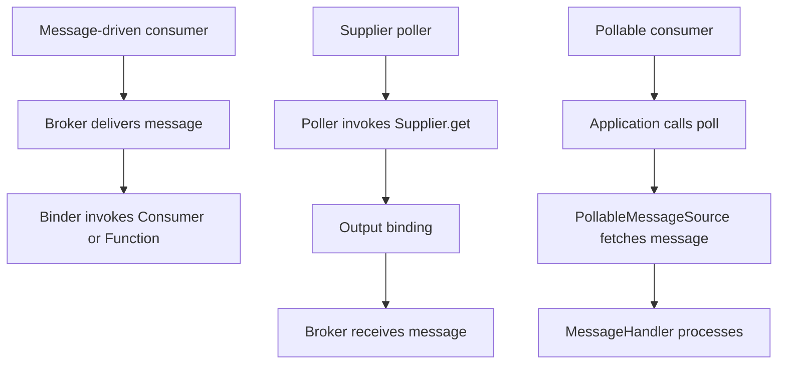

# Distinguishing Event-Driven Consumers, Supplier Pollers, and Pollable Consumers

Spring Cloud Stream supports multiple ways to trigger message processing. With an event-driven (message-driven) consumer, the binder pushes a message to a function when the message is ready. With a `Supplier`, the framework proactively invokes the producer source on a schedule to generate output messages. With a pollable consumer, the application proactively calls `PollableMessageSource.poll()` to retrieve an input message when it chooses to.

All three mechanisms can appear in an event-driven system, but they control different directions. A `Supplier` produces data to send out; a message-driven consumer receives data delivered by the broker; a pollable consumer reads data from an input binding at a pace managed by the application. Clearly distinguishing these three mechanisms helps you choose the right model for your latency, throughput, control, and message lifecycle requirements.

## 1. Three Distinct Trigger Mechanisms

| Mechanism | Data Direction | Who Triggers Processing? | Typical API | When to Use? |
| --- | --- | --- | --- | --- |
| Message-driven consumer | Broker → application | Binder/broker delivers the message when data is available and the listener is ready | `Consumer<T>`, `Function<T, R>` | Reacting quickly to incoming messages, continuous processing, and letting the framework manage the listener |
| Supplier poller | Application → broker | Framework poller calls `Supplier.get()` periodically | `Supplier<T>` | Reading state or generating events on a schedule, where each invocation produces output data |
| Pollable consumer | Broker → application | Application code, scheduler, or worker calls `PollableMessageSource.poll()` | `PollableMessageSource` | Wanting explicit control over timing, read count, loop behavior, or message retrieval pace |

You can remember them by three questions:

- Message-driven consumer: *When the broker has a message, who calls the handler function?* The binder invokes the function when the message is delivered.
- Supplier poller: *Who calls the data-producing function and when?* The poller invokes the supplier on a schedule.
- Pollable consumer: *When does the application want to retrieve a message?* Application code itself decides when to call `poll()`.



The easiest point of confusion is the word "poll". A `Supplier` poller invokes a data-generating function to emit messages outward. `PollableMessageSource` fetches messages from an input binding. One mechanism is a producer source; the other is a consumer source.

## 2. Message-Driven Consumer: Receiving Messages on Events

This is the most common consumption model in Spring Cloud Stream. The application declares a `Consumer<T>` or `Function<T, R>` bean. The binder connects the input binding to a destination and invokes the function when a message is delivered.

Order processing service example:

```java
import java.util.function.Consumer;

import org.springframework.context.annotation.Bean;
import org.springframework.context.annotation.Configuration;

public record OrderCreated(String orderId, String customerId) {}

@Configuration
public class OrderEventHandlers {

    @Bean
    public Consumer<OrderCreated> processOrder() {
        return event -> {
            System.out.println("Processing order " + event.orderId());
        };
    }
}
```

Binding configuration:

```yaml
spring:
  cloud:
    function:
      definition: processOrder
    stream:
      bindings:
        processOrder-in-0:
          destination: orders.created
          group: order-service
          content-type: application/json
```

When the broker delivers a message, the binder converts the payload into `OrderCreated` and invokes `processOrder`. Application code does not need to write a `while` loop to continuously check whether the broker has data.

### Characteristics

- The listener is triggered when a message arrives, making it suitable for low-latency event-driven processing.
- The binder and broker manage message retrieval, the consumer lifecycle, and many delivery details.
- Consumption rate depends on listener concurrency, prefetch, partition assignment, acknowledgment, and downstream processing capacity.
- The application must still design retry, idempotency, dead-letter handling, and error monitoring according to business requirements.

Message-driven does not mean the system always processes immediately or has no load limits. If a consumer processes slowly, backlog can build up on the broker. You need to tune concurrency and binder configuration appropriately while protecting downstream databases or APIs from overload.

## 3. Supplier Poller: Poller Invokes the Producer to Create Messages

`Supplier<T>` has no input. The framework needs another mechanism to know when to invoke `get()`. Spring Cloud Stream provides a default poller, typically invoking the supplier every second and fetching one message per invocation under default settings.

Service status producer example:

```java
import java.time.Instant;
import java.util.function.Supplier;

import org.springframework.context.annotation.Bean;
import org.springframework.context.annotation.Configuration;

public record ServiceSnapshot(String service, Instant capturedAt) {}

@Configuration
public class SnapshotSource {

    @Bean
    public Supplier<ServiceSnapshot> serviceSnapshot() {
        return () -> new ServiceSnapshot("order-service", Instant.now());
    }
}
```

The supplier has a default output binding `serviceSnapshot-out-0`. Configuration can adjust the destination and polling interval:

```yaml
spring:
  cloud:
    function:
      definition: serviceSnapshot
    stream:
      bindings:
        serviceSnapshot-out-0:
          destination: service.snapshots
          content-type: application/json
  integration:
    poller:
      fixed-delay: 5000
      initial-delay: 1000
      max-messages-per-poll: 1
```

With the configuration above, the poller starts after one second and then invokes the supplier on a five-second fixed delay. Each invocation creates a `ServiceSnapshot` and sends it to `service.snapshots`.

In current Spring Cloud Stream versions, default poller properties use the `spring.integration.poller` prefix. Some older versions used `spring.cloud.stream.poller`; the legacy prefix has been marked deprecated since Spring Cloud Stream 3.2. Check your project's release train version before applying the configuration.

### The Poller Controls the Producer, Not a Consumer

A supplier's poller is responsible for invoking the data-generating function. It does not fetch messages from an input destination. If you need to read messages from the broker on an application-managed schedule, use a pollable consumer.

### Supplier Returning a Flux

With `Supplier<Flux<T>>`, the supplier is typically invoked once to create a continuous publisher; subsequent elements are emitted by that publisher. The default poller does not re-invoke the supplier for each element in a continuous Flux.

If you want a reactive supplier to produce a finite Flux and be invoked again periodically, you can use `@PollableBean`:

```java
import java.util.function.Supplier;

import reactor.core.publisher.Flux;

import org.springframework.cloud.function.context.PollableBean;
import org.springframework.context.annotation.Configuration;

@Configuration
public class FiniteBatchSource {

    @PollableBean
    public Supplier<Flux<String>> dailyBatch() {
        return () -> Flux.just("REPORT_READY", "REPORT_ARCHIVED");
    }
}
```

`@PollableBean` tells the framework that this reactive supplier needs to be polled periodically. The `splittable` attribute defaults to `true`, meaning the elements of the Flux are split and sent as separate messages. If `splittable = false` is set, the Flux is handled as a single result according to the framework's mechanism. Choose based on the payload contract expected by the consumer.

## 4. Pollable Consumer: Application Proactively Fetches Input Messages

A pollable consumer gives application code more direct control. Instead of the binder automatically calling a `Consumer<T>` when a message arrives, Spring Cloud Stream provides `PollableMessageSource`. The application calls `poll()` to attempt to retrieve a message and passes a `MessageHandler` to process it.

To create a pollable input binding in the functional model, declare `spring.cloud.stream.pollable-source`. For example:

```yaml
spring:
  cloud:
    stream:
      pollable-source: orders
      bindings:
        orders-in-0:
          destination: orders.created
          group: order-poller
          content-type: application/json
```

The `pollable-source` name is `orders`, so the input binding is named `orders-in-0`. The application can inject `PollableMessageSource` and decide when to read.

### Example Using a Scheduled Task

```java
import org.springframework.scheduling.annotation.EnableScheduling;
import org.springframework.scheduling.annotation.Scheduled;
import org.springframework.stereotype.Component;
import org.springframework.cloud.stream.binder.PollableMessageSource;
import org.springframework.core.ParameterizedTypeReference;

@Component
@EnableScheduling
public class OrderPoller {

    private final PollableMessageSource source;

    public OrderPoller(PollableMessageSource source) {
        this.source = source;
    }

    @Scheduled(fixedDelayString = "${orders.poll-delay:1000}")
    public void pollOneOrder() {
        try {
            boolean received = source.poll(message -> {
                OrderCreated event = (OrderCreated) message.getPayload();
                System.out.println("Polled order " + event.orderId());
                process(event);
            }, new ParameterizedTypeReference<OrderCreated>() {});

            if (!received) {
                // No message available at this poll.
            }
        }
        catch (Exception ex) {
            // Log and handle the error according to application policy.
        }
    }

    private void process(OrderCreated event) {
        // Business processing.
    }
}
```

`PollableMessageSource.poll()` takes a `MessageHandler`. The overload accepting `ParameterizedTypeReference` provides a type hint so the framework can convert the payload, which is useful for DTOs or generic types. The method returns `true` when a message was received and processed successfully; it returns `false` when no message was retrieved in that poll.

The example uses `@Scheduled` to periodically attempt reading a message. You can replace the scheduler with an `ApplicationRunner`, a worker thread, or another orchestration mechanism. Crucially, the application itself is responsible for the interval, poll count, thread count, and stopping workers during application shutdown.

## 5. Pollable Consumer Controlling the Message Count per Cycle

A single `poll()` call fetches at most one message. If you want to retrieve a batch of messages in each cycle, the application can call `poll()` multiple times and stop when no more messages are available or a limit is reached.

Algorithm example:

```java
int maxMessages = 20;

for (int i = 0; i < maxMessages; i++) {
    boolean received = source.poll(message -> handle(message));
    if (!received) {
        break;
    }
}
```

The limit of 20 prevents a single run from occupying the worker indefinitely when the queue always has data. In production systems, configure this limit based on processing time, target latency, and downstream capacity. If multiple workers need to poll concurrently, evaluate binder concurrency and semantics to avoid duplicate processing or overwhelming dependent systems.

## 6. Deeper Comparison of the Three Mechanisms

| Criterion | Message-driven consumer | Supplier poller | Pollable consumer |
| --- | --- | --- | --- |
| Role | Receive messages | Generate and emit messages | Receive messages |
| Binding | Input | Output | Input |
| Starting trigger | Message is delivered | Poller reaches schedule | Code calls `poll()` |
| Rate control | Via listener concurrency, prefetch, broker, and downstream | Via poller delay and messages per poll | Via poll schedule, loop, message limit, and worker count |
| When no message | Listener is not called | Not applicable; supplier is still invoked to generate a message | `poll()` returns `false` |
| Autonomy | Framework manages message delivery | Framework manages supplier invocation schedule | Application manages schedule and poll loop |
| Complexity | Usually lowest | Low to medium | Higher because you must manage workers, schedules, and errors |
| Use case | Continuous event processing | Snapshots, heartbeats, scheduled batch emission | Pace-limited reading, coordinating with resources or processing windows |

A Supplier poller is not a type of consumer. It produces output messages. Message-driven consumers and pollable consumers both receive input messages, but differ in who decides when to invoke the handler.

## 7. Handling Acknowledgment and Errors in Pollable Consumers

Normally, `poll()` acknowledges the message when `MessageHandler` completes normally. If the handler throws an exception, the message is rejected by default and is not requeued. Exact behavior also depends on the binder and broker configuration.

Spring Cloud Stream configures an error channel for a pollable source. When the callback throws an exception, an `ErrorMessage` is sent to an error channel named after the destination and group, and is also bridged to the global Spring Integration `errorChannel`. If no subscriber handles the error channel, the error may simply be logged and the message acknowledged as successful by default. If a service activator handling the error channel throws an exception as well, the message is rejected by default.

If you want to ask the broker to redeliver the message, you can use `RequeueCurrentMessageException` as described in the Spring Cloud Stream documentation. In cases where you need to manage acknowledgment manually, retrieve `AcknowledgmentCallback` from the message headers, call `noAutoAck()`, and then explicitly `ack` or `nack/requeue` after processing. Once auto-ack is disabled, you must acknowledge or reject the message in every execution branch; forgetting to do so can leak or hold broker resources.

The ability to disable auto-ack depends on the `MessageSource` implementation; not all sources support it. Some Kafka sources require commit operations on the same thread and do not allow deferring acknowledgment to another thread. Check your specific binder and version before using manual acknowledgment or offloading processing to another executor.

Illustrative example of manual acknowledgment management:

```java
import org.springframework.integration.StaticMessageHeaderAccessor;
import org.springframework.integration.acks.AcknowledgmentCallback;

source.poll(message -> {
    AcknowledgmentCallback callback =
            StaticMessageHeaderAccessor.getAcknowledgmentCallback(message);
    callback.noAutoAck();

    try {
        process((OrderCreated) message.getPayload());
        callback.acknowledge(AcknowledgmentCallback.Status.ACCEPT);
    }
    catch (Exception ex) {
        callback.acknowledge(AcknowledgmentCallback.Status.REQUEUE);
    }
});
```

This is an illustrative skeleton; you need to add logging, retry limits, and an appropriate error policy. Do not requeue a poison or persistently failing message indefinitely, as it can create a redelivery loop and block processing progress.

An important note for Kafka: when an offset is requested to be requeued or reprocessed, subsequent messages that were already acknowledged may be redelivered depending on how the binder manages offsets. Therefore, do not assume `REQUEUE` means only a single record will be replayed. Consumers should be idempotent and tested against a real broker.

## 8. Choosing a Model Based on Business Requirements

### Use a Message-Driven Consumer When

- You need to react immediately when messages arrive.
- The application does not need to write its own data-fetching loop.
- You want the binder to manage the listener lifecycle and message retrieval mechanism.
- Load can be controlled via consumer concurrency, prefetch, partitions, and downstream capacity.

Example: a payment service receives `PaymentRequested` and starts processing immediately when the broker delivers the message.

### Use a Supplier Poller When

- The application proactively generates events on a schedule.
- Each poll can read a snapshot, state, or a slice of data from an internal source.
- There is no input destination to read from.

Example: every five minutes a service emits `InventorySnapshot` for the analytics system to ingest.

### Use a Pollable Consumer When

- The application needs an explicit cap on the number of messages read in one pass.
- Fetching messages needs to coordinate with a custom scheduler or dedicated worker.
- Read timing needs to be controlled based on resource state or business windows.
- You want to integrate polling into a synchronous workflow or an internal orchestration mechanism.

Example: a worker pulls at most 50 tasks per cycle only when the batch processing system still has available capacity.

Do not choose a pollable consumer just to "have more control" if a message-driven consumer already meets your requirements. Self-managed polling increases responsibility for scheduling, concurrency, shutdown, retry, acknowledgment, and monitoring.

## 9. Consumer Groups and Multiple Poller Instances

Pollable consumers still use an input binding and a consumer group. When multiple instances poll the same destination with the same group, the binder/broker coordinates message distribution according to the broker's mechanism. If instances use different groups, each group can receive an independent stream.

This means a pollable consumer does not automatically guarantee a single system-wide worker. If multiple instances run concurrently, you must configure the group and understand how the broker distributes messages. With Kafka, consumer groups and partition assignment determine which consumer receives which partition. With RabbitMQ, queues and competing consumers determine distribution. With Pulsar, the subscription type affects how messages are delivered to consumers.

Do not use `@Scheduled` across multiple replicas without evaluating groups, concurrency, and idempotency. If the business requirement needs strictly one task running cluster-wide at a time, you need an appropriate coordination mechanism or distributed lock; a consumer group alone is not a general-purpose distributed scheduler.

## 10. Resource Control and Worker Lifecycle

A pollable consumer makes the application responsible for managing schedules and threads. Operational principles:

1. Set a clear fixed delay or cron; avoid continuous busy loops when no messages are present.
2. Limit the number of messages per poll pass so a worker does not consume resources indefinitely.
3. Use a properly sized executor if multiple workers are needed; do not spawn a new thread per message.
4. Avoid calling slow APIs or databases on the scheduler thread if it delays other scheduled tasks; consider offloading processing to a bounded executor.
5. Ensure shutdown cancels schedulers/workers and handles in-flight messages according to a clear policy.
6. Monitor poll counts, empty poll counts, throughput, processing latency, errors, requeues, and backlog.
7. Check binder limitations: not all brokers share the same polling semantics or performance characteristics.

If `poll()` frequently returns `false`, the polling interval may be too tight relative to the message or source rate. If backlog grows, increasing frequency or worker count only helps if the broker and downstream still have capacity. Measure processing time before increasing concurrency.

## 11. Testing the Three Mechanisms

### Testing a Message-Driven Consumer

Use the Spring Integration Test Binder to send a message to `InputDestination`, then verify that the handler processed the payload or side effects correctly. The test binder is suitable for checking function logic and bindings without a real broker.

### Testing a Supplier Poller

Invoke the supplier directly to verify the generated values are correct. If you need to test the poll schedule, use Spring context tests with a controllable clock or scheduler, avoiding reliance on long sleeps in unit tests.

### Testing a Pollable Consumer

The test binder supports `PollableMessageSource`. You can configure `spring.cloud.stream.pollable-source` in tests, create a mock `MessageSource` as the data source, and call `poll()` to verify messages are received and processed. The test binder does not fully simulate acknowledgment, requeue, offset, and prefetch behavior of a real broker; these behaviors require integration tests with Kafka, RabbitMQ, or Pulsar respectively.

Scenarios to cover:

- A message is present and the handler succeeds.
- No message is present and `poll()` returns `false`.
- The handler throws an exception.
- The handler requests requeue or manual acknowledgment.
- Multiple workers read from the same group concurrently.
- The application shuts down while processing a message.
- Slow downstream causes backlog growth.

## 12. Common Issues and Fixes

| Symptom | Possible Cause | Resolution |
| --- | --- | --- |
| `Consumer<T>` is not invoked | Wrong function definition, binding, or destination; binder not connected | Check bean name, input binding, group, and binder logs. |
| Supplier does not emit messages | Supplier not selected or poller misconfigured | Check `spring.cloud.function.definition`, output binding, and poller configuration. |
| Reactive supplier runs only once | `Supplier<Flux<T>>` is treated as a continuous publisher and invoked once | If a finite Flux needs periodic repetition, use `@PollableBean` as appropriate. |
| Pollable consumer has no binding | Missing `spring.cloud.stream.pollable-source` or misnamed configuration | Check the property and binding name `<source>-in-0`. |
| `poll()` always returns `false` | No messages available, wrong destination/group, or binder disconnected | Check broker, destination, group, and backlog status. |
| Messages lost after handler error | Handler throws an exception and by default the message is rejected, not requeued | Configure appropriate error handling, requeue, or acknowledgment. |
| Messages redelivered multiple times | Requeue/offset semantics or non-idempotent processing | Use event IDs, idempotent handlers, and test with a real broker. |
| Worker uses high CPU when queue is empty | Continuous poll loop without delay | Break the loop when `poll()` returns false or add backoff/fixed delay. |
| Adding workers slows the system down | Downstream overloaded or concurrency exceeds broker capacity | Measure latency, cap workers, and adjust batch size. |

## 13. Selection and Implementation Checklist

Before writing a consumer, determine:

1. Is the data generated by the application or already available on the broker?
2. Does the message need to be received immediately upon arrival or only fetched periodically?
3. Who is responsible for controlling the pace: the binder/broker, the Supplier poller, or the application's scheduler?
4. Do you need to control the number of messages per pass?
5. Which group will share work across instances?
6. When the handler fails, should the message be rejected, requeued, retried, or sent to a DLQ?
7. What level of idempotency and ordering must be guaranteed?
8. Is the test binder sufficient for application logic, or are integration tests with a real broker required?

Choose a message-driven consumer for standard event-reactive flows. Choose a Supplier poller when emitting data on a schedule. Choose a pollable consumer when the application genuinely needs control over the message-fetching operation and is ready to manage additional scheduling, workers, and acknowledgment.

## References

- [Spring Cloud Stream — Producing and Consuming Messages](https://docs.spring.io/spring-cloud-stream/reference/spring-cloud-stream/producing-and-consuming-messages.html)
- [Spring Cloud Stream — Using Polled Consumers](https://docs.spring.io/spring-cloud-stream/docs/current/reference/html/spring-cloud-stream.html#_using_polled_consumers)
- [Spring Cloud Stream — Testing, including PollableMessageSource](https://docs.spring.io/spring-cloud-stream/docs/current/reference/html/spring-cloud-stream.html#_test_binder_and_pollablemessagesource)

Cross-check the documentation for your release train, as poller configuration prefixes and polling support details can vary by version and binder.

## Conclusion

A message-driven consumer receives messages when the binder delivers events; a Supplier poller is invoked by the framework on a schedule to produce output messages; a pollable consumer lets the application call `PollableMessageSource.poll()` and proactively decide when to fetch input messages. The three mechanisms differ in data direction and who controls the trigger timing. Choosing the right mechanism balances latency, throughput, control, and operational complexity; when using a pollable consumer, pay close attention to scheduling, groups, acknowledgment, requeue, idempotency, and shutdown.
