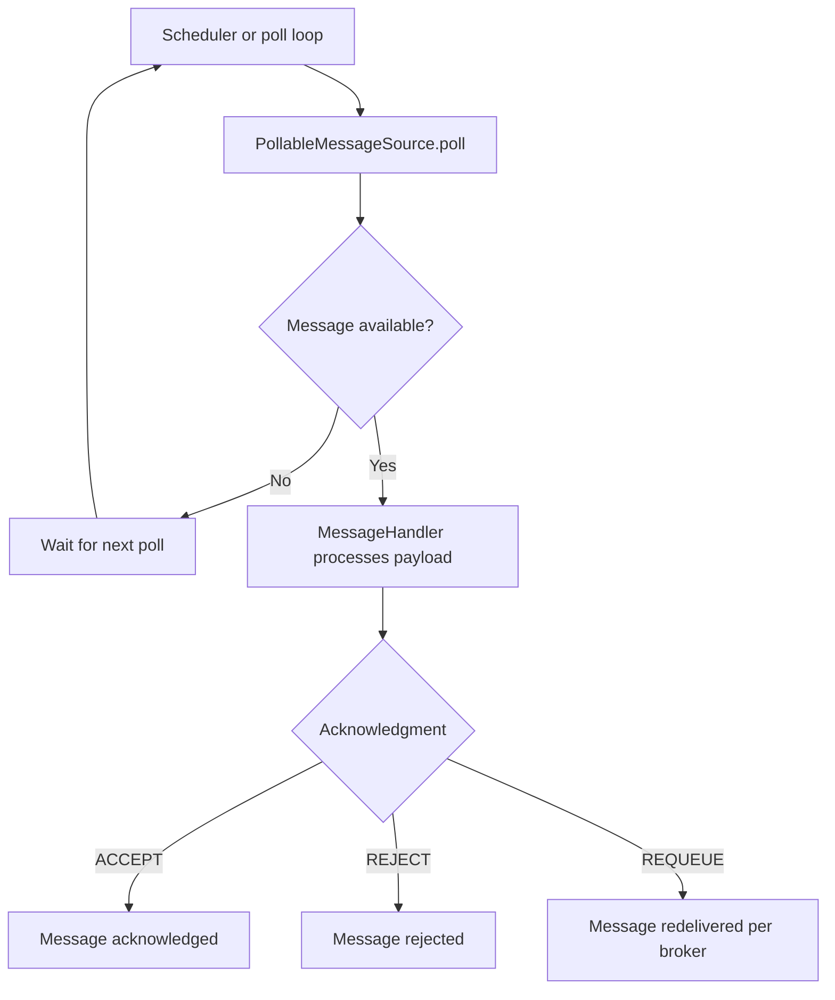

# Automatic Acknowledgment and Managing AcknowledgmentCallback

With a pollable consumer, the application proactively calls `PollableMessageSource.poll()` to retrieve messages rather than waiting for the framework to invoke a `Consumer<T>` for each message. After processing, the message must be acknowledged so the broker or message source knows the application has finished receiving it. By default, Spring Cloud Stream automatically acknowledges when the processing callback completes normally. When the application needs to explicitly decide whether a message is accepted, rejected, or returned to the queue, it can obtain `AcknowledgmentCallback` from the message headers and manage acknowledgment manually.

Acknowledgment decisions directly affect message redelivery. Acknowledging too early can lose the chance to reprocess when a business transaction fails. Acknowledging too late or requeuing without limits can cause repeated deliveries, error loops, or growing backlogs. Therefore, schedule acknowledgment after business side effects complete and design idempotent consumers to tolerate redelivery.

## 1. Pollable Consumers and Message Lifecycle

`PollableMessageSource` is the abstraction allowing an application to pull messages on demand. The application can call `poll()` inside a `@Scheduled` task, an `ApplicationRunner`, or a self-managed loop. Each poll can receive one message; the return value indicates whether a message was received and successfully processed according to the method contract.



Example configuration of a pollable input binding:

```yaml
spring:
  cloud:
    stream:
      pollable-source: orders
      bindings:
        orders-in-0:
          destination: orders.created
          group: inventory-service
          content-type: application/json
```

With `pollable-source: orders`, the input binding is named `orders-in-0`. `destination` is the logical destination mapped by the binder to the broker; `group` identifies the consumer group according to the binder's model. Exact binding names and properties must match your project's Spring Cloud Stream and binder versions.

Not all binders provide identical polling and deferred acknowledgment capabilities. `AcknowledgmentCallback` is a Spring Integration abstraction, but that does not mean every broker binder supplies the callback or supports all statuses. Spring Integration 6.1.x documentation describes message sources with deferred acknowledgment in supported modules, including AMQP and Kafka; do not infer that the Pulsar binder supports `PollableMessageSource` or manual ack identically. Verify your exact binder and version capabilities before selecting a pollable consumer architecture.

A poller can be implemented with a scheduled task:

```java
@Component
public class OrderPoller {
    private final PollableMessageSource source;
    private final OrderHandler orderHandler;

    public OrderPoller(PollableMessageSource source, OrderHandler orderHandler) {
        this.source = source;
        this.orderHandler = orderHandler;
    }

    @Scheduled(fixedDelayString = "${orders.poll-delay:500}")
    public void poll() {
        source.poll(message -> orderHandler.handle(message),
                new ParameterizedTypeReference<OrderCreated>() {});
    }
}
```

`ParameterizedTypeReference` is a type hint for the framework to convert the payload into `OrderCreated`. If no type hint is needed, you can use the `poll(MessageHandler)` overload corresponding to your version. `@Scheduled` requires `@EnableScheduling`. For high-traffic sources, measure processing time, poll frequency, and backlog; do not increase poll speed beyond what the database or dependent services can handle.

## 2. Automatic Acknowledgment Mechanism

By default, `PollableMessageSource.poll()` acknowledges the message when `MessageHandler` completes normally. This is convenient when all processing happens directly inside the callback and the application does not need to choose an ack status itself.

```java
source.poll(message -> {
    OrderCreated event = (OrderCreated) message.getPayload();
    orderHandler.process(event);
});
```

If `process` finishes normally, the message is acknowledged automatically. If the callback ends abnormally, the message goes through the pollable source's error handling mechanism. Specific behaviors to understand carefully:

- A pollable source has a dedicated default error channel by destination and group, formatted as `<destination>.<group>.errors`, which is also bridged to the global Spring Integration `errorChannel`.
- If the callback throws an exception, an `ErrorMessage` is sent to the error channel.
- If no handler is subscribed to the error channel, the error is logged and the message is acknowledged as successful by default. The message will not automatically be redelivered just because an exception appeared in the logs.
- If an error-channel service activator throws an exception, the message is rejected by default and not redelivered.
- If the handler throws `RequeueCurrentMessageException`, the message is returned to the queue as supported by the broker and picked up on a later poll; this case bypasses the standard error channel flow.

Consequently, do not assume "callback throws an exception" always means "the message will be retried." If you need explicit control over retries, rejection, or requeuing, establish an intentional error-handling policy or use `AcknowledgmentCallback`.

## 3. Obtaining AcknowledgmentCallback from the Message

`AcknowledgmentCallback` is provided via the message headers. Use `StaticMessageHeaderAccessor.getAcknowledgmentCallback(message)` to retrieve it:

```java
AcknowledgmentCallback callback =
        StaticMessageHeaderAccessor.getAcknowledgmentCallback(message);
```

This interface belongs to Spring Integration and defines three primary statuses:

| Status | Meaning | Common Purpose |
|---|---|---|
| `ACCEPT` | Confirm the message is accepted | Business processing completed |
| `REJECT` | Reject the message | Message cannot or must not be processed; may be discarded depending on broker |
| `REQUEUE` | Reject and request returning the message for redelivery | Transient error, can be reprocessed later |

You can acknowledge with:

```java
callback.acknowledge(AcknowledgmentCallback.Status.ACCEPT);
```

`AcknowledgmentCallback` also provides `noAutoAck()` to disable automatic acknowledgment and `isAcknowledged()` to check whether the callback has already been acknowledged. Once `noAutoAck()` is called, the application must invoke `acknowledge(...)` in every terminal processing branch. Leaving a message unacknowledged indefinitely can exhaust broker resources or leave deliveries/offsets unfinished.

## 4. Switching to Manual Acknowledgment Mode

Call `noAutoAck()` before performing work that requires explicit control. Afterward, choose an ack status only when the processing outcome is known:

```java
private void handle(Message<?> message) {
    AcknowledgmentCallback callback =
            StaticMessageHeaderAccessor.getAcknowledgmentCallback(message);

    callback.noAutoAck();

    try {
        OrderCreated event = (OrderCreated) message.getPayload();
        inventoryService.reserveOnce(event);
        callback.acknowledge(AcknowledgmentCallback.Status.ACCEPT);
    }
    catch (TransientInventoryException ex) {
        callback.acknowledge(AcknowledgmentCallback.Status.REQUEUE);
    }
    catch (InvalidOrderException ex) {
        try {
            deadLetterPublisher.publishAndConfirm(message, ex);
            callback.acknowledge(AcknowledgmentCallback.Status.ACCEPT);
        }
        catch (Exception publishFailure) {
            callback.acknowledge(AcknowledgmentCallback.Status.REQUEUE);
        }
    }
    catch (Exception ex) {
        callback.acknowledge(AcknowledgmentCallback.Status.REQUEUE);
    }
}
```

The example above illustrates policy; `InventoryService`, `TransientInventoryException`, `InvalidOrderException`, and `deadLetterPublisher` are application components. `publishAndConfirm` must return only after the quarantined message has been successfully sent using the publisher's confirmation mechanism; if that operation fails, do not acknowledge the original message as if processing succeeded.

In the example, `inventoryService.reserveOnce` should finish its database transaction before returning. Only when the transaction commits successfully does the callback send `ACCEPT`. If the database encounters a transient error, the application requests `REQUEUE`. If the payload is permanently invalid, the application routes the message to a quarantine/DLQ flow before acknowledging the original message. A real implementation must handle exceptions thrown while publishing to the DLQ and ensure every branch terminates with an appropriate ack decision.

### 4.1. Do Not Ack Before Business Work Completes

Suppose a consumer performs two operations:

1. Acknowledge the message with the broker.
2. Update inventory in the database.

If the application stops after step 1 but before step 2, the broker already considers the message complete and will not redeliver it; inventory data may remain un-updated. Therefore, for synchronous processing, the normal order is to commit the business transaction first and only then send `ACCEPT`.

The reverse failure window still exists: the database commit succeeds, but the process stops before the broker receives the ack. The message may be redelivered. Consumers need idempotency using `eventId` or a stable business key so a second execution does not create duplicate side effects.

Acknowledgment does not create an atomic transaction between the broker and the database. If tight coordination between database changes and event emission is required, consider the transactional outbox pattern, inbox/deduplication, or broker-supported transactions within their exact scope.

## 5. Asynchronous Processing After Polling

One use case requiring manual ack is when the poller receives a message and offloads work to an executor or worker thread. If the callback auto-acks when the handler returns, the message can be acknowledged right after the task is submitted to the executor, before the task actually completes.

To keep the message unacknowledged during background processing, call `noAutoAck()` before handing off the callback:

```java
private void dispatch(Message<?> message) {
    AcknowledgmentCallback callback =
            StaticMessageHeaderAccessor.getAcknowledgmentCallback(message);
    callback.noAutoAck();

    try {
        processingExecutor.execute(() -> {
            try {
                orderHandler.process((OrderCreated) message.getPayload());
                callback.acknowledge(AcknowledgmentCallback.Status.ACCEPT);
            }
            catch (TransientInventoryException ex) {
                callback.acknowledge(AcknowledgmentCallback.Status.REQUEUE);
            }
            catch (Exception ex) {
                errorReporter.report(message, ex);
                callback.acknowledge(AcknowledgmentCallback.Status.REJECT);
            }
        });
    }
    catch (RejectedExecutionException ex) {
        callback.acknowledge(AcknowledgmentCallback.Status.REQUEUE);
    }
}
```

This is a conceptual example; the executor must have a bounded queue and a clear shutdown policy. If the executor rejects the task, the message must be handled according to the error policy instead of being dropped. Workers must ack/nack upon completion, and timeouts/monitoring are required for stuck tasks. Do not retain a callback inside a task that could be lost on process shutdown without recovery.

Acknowledging from another thread must be tested with your specific binder. Not all message sources share the same delivery retention window or thread affinity requirements. If work takes a long time, the broker may enforce visibility timeouts, acknowledgment timeouts, or its own redelivery mechanisms; configure those limits according to actual processing duration.

**Note for Kafka:** some `KafkaMessageSource` implementations do not support disabling auto-ack and committing offsets from a different thread, because offset commits must run on the polling thread. Do not use the handoff pattern above for Kafka if your binder/client does not support it. With Kafka, finish processing and acknowledgment on the appropriate polling thread, or design worker/partition/offset coordination around Kafka's mechanics instead of arbitrarily offloading callbacks to an executor. With RabbitMQ or Pulsar, also verify binder capabilities and acknowledgment timeouts before adopting this pattern.

## 6. Correctly Understanding ACCEPT, REJECT, and REQUEUE per Broker

`AcknowledgmentCallback.Status` is a common abstraction, but brokers do not share identical delivery semantics. Binders map callback statuses to broker APIs and may restrict which statuses are supported.

| Broker | Interpretation for Pollable Messages | What to Verify |
|---|---|---|
| Kafka | Consumption progress ties to per-partition offsets; requeue is not like returning a record to a physical queue | Offset commits, in-partition ack ordering, and whether later records may be re-read |
| RabbitMQ | Ack confirms delivery; reject/nack can discard or requeue depending on flags and binder config | Whether requeue creates a hot loop, dead-letter exchanges, and redelivery count |
| Pulsar | Ack updates subscription state; negative acknowledgment or timeout can trigger redelivery | Subscription type, acknowledgment timeout, redelivery delay, and dead-letter policy |

Not every message source supports `REJECT`. With some sources such as Kafka, this status may be handled similarly to `ACCEPT`; therefore, do not rely on `REJECT` as a universal permanent-discard command across all binders. Check binder documentation and test on a real broker before choosing a policy.

### 6.1. Specific Note on Kafka Offsets

Kafka stores data as a log and consumer groups commit offsets per partition. When a record is marked `REQUEUE`, it is not placed at the tail of a queue as in typical RabbitMQ semantics. Because of sequential offset tracking, if an earlier record remains unacknowledged while later records are acked, those later records may be re-read when the group recovers or offsets commit accordingly.

For example, suppose a partition has records 10, 11, and 12. If record 10 is requeued while 11 and 12 were already acknowledged, offset commits cannot represent arbitrary per-record gaps the way queue acknowledgments do. When the consumer restarts, 11 and 12 may be redelivered. Thus, Kafka consumers must be idempotent across the entire stream, not only for records marked requeue.

### 6.2. Avoiding Infinite REQUEUE Loops

If a message has an invalid schema or violates business rules yet is always `REQUEUE`d, the poller can repeatedly receive the same message. This wastes CPU, floods logs, blocks other messages, and puts pressure on the broker.

A common policy:

1. Classify transient errors vs. permanent errors.
2. Retry transient errors with bounded attempts and appropriate backoff.
3. After the retry threshold, move the message to a DLQ or quarantine store.
4. `ACCEPT` the original message only after quarantine delivery is confirmed.
5. Monitor redelivery counts, DLQ depth, and message age.

With RabbitMQ and Pulsar, dead-lettering and redelivery can be configured via broker/binder settings. With Kafka, a DLQ is typically another topic and forwarding messages must be designed with matching offset/transaction handling. Specific configuration varies across binders.

## 7. How Error Channels and AcknowledgmentCallback Work Together

A pollable source's error channel and manual acknowledgment are related mechanisms, not identical ones:

- The error channel receives an `ErrorMessage` when a poll callback throws an exception under default behavior.
- `AcknowledgmentCallback` lets the application explicitly choose `ACCEPT`, `REJECT`, or `REQUEUE`.
- `noAutoAck()` transfers acknowledgment responsibility to the application; once called, do not expect the callback to auto-ack merely because the handler returned.
- `RequeueCurrentMessageException` is a way to request requeue within the default error handling flow; it does not replace bounded retry or DLQ policies.

When using manual ack, catch and classify exceptions right at the processing site so each branch makes an explicit decision. Avoid calling `noAutoAck()` and letting an exception escape without ack/nack; the message may remain unacknowledged and hold resources. If an error occurs before obtaining the callback, handle it via the default error channel mechanism and verify binder behavior.

## 8. Idempotency When Messages Are Redelivered

Even when the application acks at the right time, redelivery can still occur due to process crashes, connection drops, or timeouts. Therefore, any consumer performing significant business side effects should implement idempotency.

For example, `eventId` is generated at the producer and kept stable across retries. The consumer records processed status in the same transaction as the business update:

```java
@Transactional
public void reserveOnce(OrderCreated event) {
    if (processedEventRepository.existsById(event.eventId())) {
        return;
    }

    inventoryRepository.reserveIfAvailable(
            event.productId(), event.quantity());
    processedEventRepository.save(new ProcessedEvent(event.eventId()));
}
```

The `processed_event` table needs a unique constraint on `event_id`; inventory updates need conditional clauses or appropriate locks to handle contention. Checking `existsById` alone without a unique constraint still has a race condition when two workers receive the same event nearly simultaneously.

If the consumer calls an external service, use the target API's idempotency key or record outbound request state in a database/outbox. Do not assume callback acknowledgment and an HTTP call can commit atomically.

## 9. Testing Acknowledgment Behavior

Tests must verify broker state and business outcomes, not just that the callback was invoked. They can be divided into layers:

| Scenario | Expected Outcome |
|---|---|
| Handler finishes normally with auto-ack | Message is acknowledged |
| Handler throws exception with no error-channel handler | Verify the version's exact default behavior; do not assume automatic requeue |
| Manual ack with `ACCEPT` after transaction commit | Message is acknowledged after business work completes |
| Manual ack with `REQUEUE` on transient error | Message is redelivered per broker mechanics |
| Manual ack with `REJECT` | Verify whether the broker supports reject and how the message is discarded/handled |
| `noAutoAck()` without ack/nack | Test detects held delivery and alerts on resource leak |
| Executor rejects task | Message is requeued or handled per chosen policy |
| Process stops after DB commit but before ack | Message may redeliver, but idempotency prevents duplicate effect |
| Poison or schema-invalid message | Routed to DLQ/quarantine after bounded retries |

Unit tests can mock `AcknowledgmentCallback` to verify `noAutoAck()` calls and selected statuses. Integration tests should use the Test Binder or a real broker to verify actual mapping. The Test Binder does not fully simulate offsets, queue durability, subscription cursors, and redelivery of every broker.

## 10. Observability and Operations

To troubleshoot acknowledgments, record the following metadata while avoiding logging full payloads:

- Binding, destination, group/subscription, and broker.
- `eventId`, `correlationId`, and message key if present.
- Poll timestamp, processing start, transaction completion, and ack timestamp.
- Chosen ack status: `ACCEPT`, `REJECT`, or `REQUEUE`.
- Redelivery/retry count and failure cause.
- Kafka partition/offset, RabbitMQ delivery tag/redelivered flag, or Pulsar message ID/subscription if provided by the binder.
- Message in-flight duration, pending background task count, and DLQ depth.

Do not log tokens, credentials, or personal data. Configure alerts when requeued messages rise continuously, in-flight duration exceeds thresholds, new messages land in the DLQ, or the poller receives no messages while backlog keeps growing.

## 11. Pre-Deployment Checklist

- [ ] Clearly identify pollable source, binding, destination, and group.
- [ ] Understand default auto-ack when the handler finishes normally.
- [ ] Check the error channel, since exceptions do not automatically requeue messages.
- [ ] Call `noAutoAck()` only when the application has an ack/nack path for every branch.
- [ ] Choose `ACCEPT`, `REJECT`, or `REQUEUE` based on error type and binder capability.
- [ ] Ack after the business transaction completes; do not ack immediately after submitting to an executor.
- [ ] Bound retries and avoid infinite requeue loops.
- [ ] Move permanent failures to a DLQ/quarantine before acknowledging the original message.
- [ ] Ensure consumers are idempotent by event ID or a stable business key.
- [ ] Test restarts, redelivery, executor failures, DLQ routing, and real broker behavior.
- [ ] Monitor ack statuses, in-flight duration, redeliveries, backlog, and DLQ depth.

Auto-acknowledgment suits simple poll handlers whose work finishes before the callback returns. `AcknowledgmentCallback` is needed when the application must decide delivery status, hand off work to another thread, or distinguish transient from permanent errors. Whichever approach you choose, send ack only after business work completes; idempotency and testing with the real binder keep the system safe when messages are redelivered.

## References

- [Spring Cloud Stream — Producing and Consuming Messages, Using Polled Consumers and Handling Errors](https://docs.spring.io/spring-cloud-stream/reference/spring-cloud-stream/producing-and-consuming-messages.html)
- [Spring Integration — Core Messaging: Deferred Acknowledgment Pollable Message Source](https://docs.spring.io/spring-integration/docs/6.1.x/reference/html/core.html)
