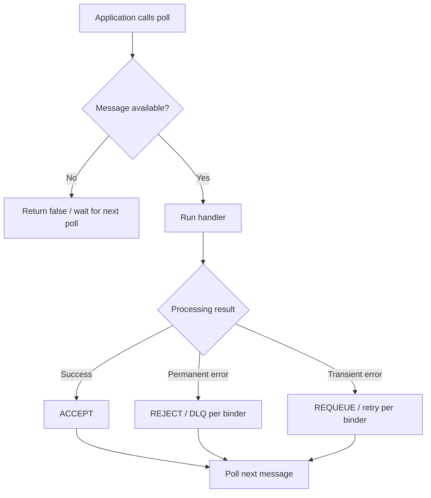

# Accepting, Rejecting, or Requeuing Messages Based on Binder Capabilities

## Objectives

With a proactive consumer (pollable consumer), the application decides when to fetch messages from the broker and performs processing inside an application-supplied callback. After receiving a message, the application needs a clear policy: **accept** a successfully processed message, **reject** an unprocessable message, or **requeue** a message for retry.

Spring Cloud Stream provides the `PollableMessageSource` abstraction to read messages on demand and `AcknowledgmentCallback` to control delivery status when supported by the binder. These statuses have a common meaning at the framework level, but concrete execution depends on the Kafka, RabbitMQ, or Pulsar binder and broker configuration.

This lesson explains the polling lifecycle, ACCEPT/REJECT/REQUEUE options, how to disable automatic acknowledgment when manual acknowledgment is needed, how to avoid poison-message loops, and how to test per binder.

After this lesson, you will be able to:

- Use `PollableMessageSource` to proactively fetch messages.
- Distinguish a no-message result from a message-processing failure.
- Use `AcknowledgmentCallback` to accept, reject, or request redelivery.
- Choose the acknowledgment timing after business side effects complete.
- Design retries, DLQs, and poison-message handling according to binder capabilities.
- Test acknowledgment and redelivery on the target broker.

## 1. How Does a Pollable Consumer Work?

Consumers in the message-driven model are typically invoked by the binder when a message arrives. With a pollable consumer, the application calls `poll()` to request a message. If a message is present, the framework passes it to the handler; if no message is present, the method returns `false`.

A basic polling cycle:



`PollableMessageSource` is an abstraction provided by the binder for an input binding. Example configuration for an input:

```yaml
spring:
  cloud:
    stream:
      bindings:
        input:
          destination: orders.created
          group: inventory-service
          content-type: application/json
```

The application can receive `PollableMessageSource` and call `poll` in a loop or a periodic task. The example below uses a loop with a sleep interval when no message is available:

```java
@Bean
ApplicationRunner orderPoller(
        PollableMessageSource source,
        OrderService orderService) {

    return args -> {
        while (!Thread.currentThread().isInterrupted()) {
            try {
                boolean received = source.poll(message -> {
                    OrderCreated event =
                            (OrderCreated) message.getPayload();
                    orderService.process(event);
                });

                if (!received) {
                    Thread.sleep(200);
                }
            }
            catch (InterruptedException ex) {
                Thread.currentThread().interrupt();
                return;
            }
            catch (Exception ex) {
                log.error("Polling or message handling failed", ex);
            }
        }
    };
}
```

This is a minimal imperative example. Production applications must clearly define how to stop the poller on shutdown, bound processing time, handle exceptions, and avoid busy loops when the queue is empty. You can use an application-managed scheduler or executor instead of spawning unbounded polling threads yourself.

### Distinguishing Outcomes

- `poll()` returns `false`: the poll received no message. This is not a processing error.
- `poll()` returns `true`: a message was received and the callback was invoked; this alone does not prove business logic succeeded.
- Handler throws an exception: rejection, acknowledgment, or redelivery depends on acknowledgment mode and binder.
- Error connecting to or reading from the broker: this is a polling/infrastructure error and must be handled separately from business errors inside the handler.

Avoid running `while (true)` calling poll continuously without limits or wait intervals if the binder returns immediately when no messages exist. A busy loop can burn CPU even when there is no data.

## 2. Automatic Acknowledgment and Manual Acknowledgment

When the binder supports acknowledgment callbacks, received messages may carry a callback in their headers. You can retrieve it using the Spring Integration accessor:

```java
AcknowledgmentCallback callback =
        StaticMessageHeaderAccessor.getAcknowledgmentCallback(message);
```

The callback lets the application choose one of these statuses:

- `ACCEPT`: accept the processed message.
- `REJECT`: reject the message.
- `REQUEUE`: request returning the message for redelivery according to binder capabilities.

Under automatic mode, the binder/framework may acknowledge the message when the handler finishes normally or apply an error policy when the handler throws an exception. Details depend on the binder and acknowledgment configuration. If you want to decide the acknowledgment timing yourself, disable auto-ack on the callback before performing processing:

```java
AcknowledgmentCallback callback =
        StaticMessageHeaderAccessor.getAcknowledgmentCallback(message);

if (callback != null) {
    callback.noAutoAck();
}
```

Then, the application calls `acknowledge(status)` exactly once when the processing outcome is known. Do not both acknowledge manually and let another branch acknowledge the same delivery again.

If the callback is `null`, the current binder or receive path may not provide this mechanism. Do not assume manual ACCEPT/REJECT/REQUEUE control is available on every binder. Check your binder's support and use either the default mechanism or the documented binder-specific API.

## 3. ACCEPT: Accepting After Successful Processing

`ACCEPT` indicates the consumer has completed the required work for the message. The acceptance timing should come after guaranteed side effects, such as after the database transaction commits.

Example:

```java
private void handle(Message<?> message) {
    AcknowledgmentCallback callback =
            StaticMessageHeaderAccessor.getAcknowledgmentCallback(message);

    if (callback != null) {
        callback.noAutoAck();
    }

    try {
        OrderCreated event = (OrderCreated) message.getPayload();
        orderService.processAndCommit(event);

        if (callback != null) {
            callback.acknowledge(AcknowledgmentCallback.Status.ACCEPT);
        }
    }
    catch (RuntimeException ex) {
        if (callback != null) {
            callback.acknowledge(AcknowledgmentCallback.Status.REQUEUE);
            return;
        }
        throw ex;
    }
}
```

In the example, `processAndCommit` represents a business operation that finishes only after the required transaction commits. If the application acknowledges before the database commits, a crash in between could prevent redelivery even though business data was never persisted.

`ACCEPT` does not mean exactly-once. If the broker already redelivered the message after a failure before the acknowledgment was recorded, the consumer can still receive the same event again. Use stable event IDs and idempotent processing to avoid duplicate side effects.

For workflows that update a database and then emit a downstream event, consider the transactional outbox pattern. Write business state and the outbox record in the same transaction; a relay emits the event afterward. This handles the gap between database and broker much better than assuming one acknowledgment spans both systems.

## 4. REJECT: Rejecting an Unprocessable Message

`REJECT` indicates the consumer does not wish to reprocess the message on the current delivery path. It is typically appropriate for permanent errors such as:

- Payload fails schema validation and cannot be converted.
- Message violates a mandatory contract.
- Event type is unsupported by the consumer.
- Data is invalid and requires investigation or manual remediation.

Example:

```java
private void rejectInvalid(
        AcknowledgmentCallback callback,
        String reason) {

    log.warn("Rejecting message: {}", reason);

    if (callback != null) {
        callback.noAutoAck();
        callback.acknowledge(AcknowledgmentCallback.Status.REJECT);
    }
}
```

REJECT does not automatically mean the message is routed to a DLQ. Depending on the binder and broker configuration, the message may be discarded, dead-lettered, or handled by another policy. If you need to retain messages for investigation, explicitly configure the DLQ/dead-letter destination, access permissions, retention, and alerts.

Do not use REJECT for every error merely to avoid retries. Transient infrastructure errors such as database timeouts or temporarily unavailable broker dependencies usually need retry/requeue or another recovery mechanism. Classify errors before deciding on a status.

## 5. REQUEUE: Requesting Message Redelivery

`REQUEUE` asks the binder/broker to put the message back into the delivery flow or make it readable again according to its semantics. It is typically appropriate for transient, recoverable errors:

- Database temporarily unreachable.
- Dependent service overloaded.
- Lock or resource temporarily unavailable.
- A dependency encounters a bounded timeout.

Example:

```java
private void requeue(
        AcknowledgmentCallback callback,
        Throwable failure) {

    log.warn("Requesting message redelivery", failure);

    if (callback != null) {
        callback.noAutoAck();
        callback.acknowledge(AcknowledgmentCallback.Status.REQUEUE);
    }
}
```

REQUEUE may cause the same message to return immediately or be redelivered according to broker timeout/policy. If the error always recurs, the message can create a hot loop, burn resources, and block other messages from progressing. Combine it with backoff, attempt limits, delayed retries, or a DLQ depending on binder capabilities.

Not every broker implements requeue the same way. RabbitMQ has delivery-level requeue semantics; Kafka is an offset-based log, so redelivery relates to read/commit position or binder retry mechanisms rather than simply pushing a record to the tail of a queue; Pulsar uses negative acknowledgment or acknowledgment timeouts to trigger redelivery per subscription policy. Verify how your binder maps the REQUEUE status before relying on ordering or redelivery timing.

## 6. Example of Error Classification and Status Selection

A handler can split errors into transient and permanent categories:

```java
private void handleOrder(Message<?> message) {
    AcknowledgmentCallback callback =
            StaticMessageHeaderAccessor.getAcknowledgmentCallback(message);

    if (callback != null) {
        callback.noAutoAck();
    }

    try {
        OrderCreated event = (OrderCreated) message.getPayload();
        orderService.processAndCommit(event);

        acknowledge(callback, AcknowledgmentCallback.Status.ACCEPT);
    }
    catch (InvalidOrderException | UnsupportedSchemaException ex) {
        log.error("Permanent message error", ex);
        acknowledge(callback, AcknowledgmentCallback.Status.REJECT);
    }
    catch (TransientDependencyException ex) {
        log.warn("Temporary dependency failure", ex);
        acknowledge(callback, AcknowledgmentCallback.Status.REQUEUE);
    }
}

private void acknowledge(
        AcknowledgmentCallback callback,
        AcknowledgmentCallback.Status status) {

    if (callback != null) {
        callback.acknowledge(status);
    }
}
```

This is an illustrative structure. In real code, handle the case where the binder does not supply a callback: either let the exception propagate under the default auto-ack/retry policy, or use a documented binder-specific error mechanism. Do not silently swallow exceptions when no callback exists, as the handler might be treated as successful.

If you want to distinguish parse errors before a Java payload exists, handle them at the appropriate conversion/error-channel layer. When deserialization fails before the handler is invoked, code inside `handleOrder` cannot inspect the payload itself to classify the error.

## 7. Differences Across Binders

Statuses in the Spring abstraction do not guarantee identical behavior across all brokers. The table below describes conceptual interpretations; exact details must be verified against the running binder version and configuration.

| Binder | ACCEPT | REJECT | REQUEUE / Redelivery |
|---|---|---|---|
| Kafka | Consumption progress is confirmed via the binder's offset/ack mechanism | May skip the record per error-handling config or route to a DLQ if configured | Typically involves uncommitted/re-read offsets or binder retry; not appending the record to the tail of the log |
| RabbitMQ | Ack delivery | Reject/nack without requeue; may dead-letter if queue/exchange is configured | Nack/reject with requeue or matching redelivery mechanism |
| Pulsar | Ack message on subscription | Reject/negative ack depending on binder capability and policy | Negative ack or ack timeout can trigger redelivery per subscription |

Important notes:

- Kafka is a partitioned log; offset commits affect consumer group progress. Do not infer that REQUEUE preserves the same ordering behavior as RabbitMQ.
- RabbitMQ queues can requeue messages, but requeue does not guarantee immediate processing or strict ordering in every configuration.
- Pulsar redelivery depends on subscription type, negative acknowledgment delay, acknowledgment timeout, and dead-letter policy.
- Some binders or consumption modes may not expose the callback or support every status. Check the documentation for your exact binder version.

## 8. Retry, Backoff, and DLQ

REQUEUE should not be the sole policy for transient errors. Control retry counts and wait times:

- **Application-level retry:** the handler retries the dependency within bounded limits before deciding the message status.
- **Broker redelivery:** the broker redelivers the message when no ack arrives or when the consumer requests requeue/negative ack.
- **DLQ:** messages exceeding the retry policy or that cannot be processed are routed to an error destination for investigation.

Two retry layers can multiply. For example, if the application retries three times per delivery and the broker redelivers five times, total dependency calls can be much higher than expected. Map out a retry budget and test actual attempt counts.

A common policy:

| Error Type | Decision | Next Action |
|---|---|---|
| Malformed payload schema, permanently invalid data | REJECT | DLQ or persist failure for investigation |
| Brief dependency timeout | Retry with backoff, then REQUEUE if budget remains | Redeliver or delayed retry |
| Retry budget exhausted | REJECT or route to DLQ per policy | Alert and handle manually |
| Unclassified programming bug | Do not automatically treat as success | Log with event ID, cap retries, and alert |
| Processing succeeded, transaction committed | ACCEPT | Proceed to next message |

A DLQ must preserve enough information for safe replay: payload, event ID, timestamp, source, error, delivery count, and correlation ID. Do not log secrets or full sensitive metadata.

## 9. Polling Loop and Operations

A pollable consumer shifts message fetching control to the application, so the application must manage load and lifecycle:

- Cap the number of messages per loop iteration or batch so shutdown can occur promptly.
- Wait when no messages are available to prevent busy loops.
- Do not spawn unbounded pollers reading the same binding simultaneously.
- Tune concurrency to broker and downstream capacity.
- Track poll rate, empty poll count, handler duration, ACCEPT/REJECT/REQUEUE counts, and DLQ depth.
- Stop pollers gracefully on application shutdown; avoid interrupting mid-business-transaction if avoidable.
- If the handler calls external services, set timeouts and concurrency limits.

One way to organize code is separating message processing logic from the poll loop:

```java
@Component
public class OrderMessageHandler {

    public void handle(Message<?> message) {
        // Validate payload, execute use case, then decide disposition.
    }
}

@Component
public class OrderPollingTask {

    private final PollableMessageSource source;
    private final OrderMessageHandler handler;

    public OrderPollingTask(
            PollableMessageSource source,
            OrderMessageHandler handler) {
        this.source = source;
        this.handler = handler;
    }

    @Scheduled(fixedDelayString = "${app.poll.delay-ms:200}")
    public void pollOnce() {
        try {
            source.poll(handler::handle);
        }
        catch (Exception ex) {
            log.error("Poll failed", ex);
        }
    }
}
```

Enable scheduling and configure an appropriate scheduler. If multiple pollable input bindings exist, inject each specific source by binding name/qualifier as provided by your framework version. Do not rely on an ambiguous default bean when the application has multiple sources.

## 10. Idempotency and Handling Redelivered Messages

A REQUEUEd message can be delivered multiple times. Consumers must tolerate the same event ID appearing more than once.

A common approach is an inbox table with a unique constraint:

```sql
CREATE TABLE processed_event (
    event_id VARCHAR(100) PRIMARY KEY,
    processed_at TIMESTAMP NOT NULL
);
```

Within the same transaction as the business update:

1. Attempt to insert `eventId` into the inbox table.
2. If it already exists, skip duplicate side effects and finish handling as a known duplicate.
3. If it is the first time, execute the business logic.
4. Commit the transaction and only then ACCEPT the message.

If business logic calls an external API, pass the event ID as an idempotency key if the API supports it. Otherwise, implement reconciliation or compensation. Broker ack/requeue cannot make an external API idempotent.

## 11. Testing ACCEPT, REJECT, and REQUEUE

Unit tests can verify handler decisions by supplying a message with a test-double acknowledgment callback. Verify:

- Successful processing calls ACCEPT after the service finishes.
- Permanent failures call REJECT.
- Transient failures call REQUEUE.
- Callback is switched to manual mode before side effects when required.
- Each delivery is acknowledged only once.
- When no callback is present, errors are not swallowed as success.
- Duplicate events do not cause a second side effect.

Integration tests with the binder/broker must verify real semantics:

### Kafka

- Commit offsets after successful processing as configured.
- Failures before commit allow records to be re-read after restart/rebalance.
- REJECT/DLQ follows configured behavior.
- Retries do not permanently wedge the consumer group on a poison record.

### RabbitMQ

- ACCEPT acks the message and the queue unacked count drops.
- REJECT has requeue=false or dead-letters per topology.
- REQUEUE triggers redelivery per policy.
- Consumer stopping before ack causes message redelivery.

### Pulsar

- ACCEPT acks the message on the subscription.
- Negative ack or timeout triggers redelivery per policy.
- DLQ is used when redelivery limits are reached if supported by configuration.
- Subscription type does not break ordering assumptions unexpectedly.

The Test Binder is useful for verifying Spring Cloud Stream wiring, but does not replace broker integration tests for acks, offsets, queue redelivery, subscription cursors, or DLQs.

## 12. Pre-Deployment Checklist

Before enabling a pollable consumer in production, confirm:

1. Does the chosen binder support pollable sources and the required acknowledgment callbacks?
2. Is `poll()` invoked on a bounded scheduler/executor with a clear shutdown lifecycle?
3. When no messages exist, does the application avoid busy loops?
4. Which side effects must complete before ACCEPT?
5. Which errors are permanent (REJECT) vs. transient (retry/REQUEUE)?
6. Are there a retry budget, backoff, and a DLQ for poison messages?
7. Is the consumer idempotent when the broker redelivers?
8. Do metrics/logs distinguish empty polls, polling errors, processing errors, and redeliveries?
9. Have integration tests run against the actual Kafka, RabbitMQ, or Pulsar binder?
10. Does the DLQ replay procedure preserve event IDs and avoid duplicating side effects?

## Conclusion

Pollable consumers let the application proactively pull messages via `PollableMessageSource`. When the binder provides `AcknowledgmentCallback`, the application can choose ACCEPT after successful processing, REJECT for unrecoverable errors, or REQUEUE for transient errors needing redelivery. Call `noAutoAck()` before processing if you want to control acknowledgment timing yourself, and then acknowledge exactly once based on the actual outcome.

The exact semantics of each status depend on the binder: RabbitMQ has queue delivery-level requeue, Kafka is based on offsets/logs, and Pulsar uses subscription acknowledgment/redelivery. Combine bounded retries, backoff, DLQs, and idempotency; then test against the target broker to prove delivery behavior matches what your application expects.
