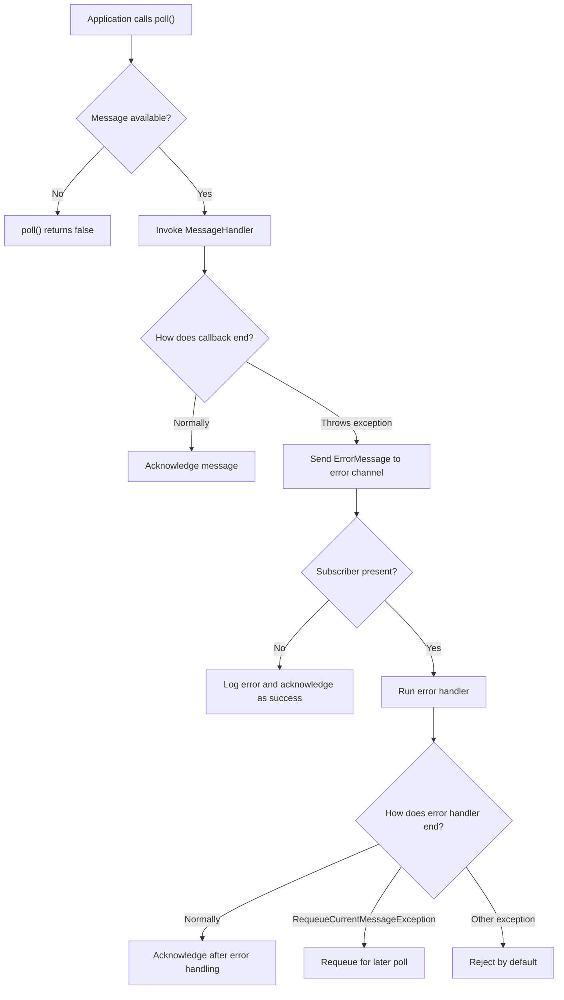

# Error Handling and Error Channels for Pollable Sources

PollableMessageSource lets the application proactively fetch messages from an input binding. The application decides when to read, the polling cadence, and how to coordinate with processing workflows. In return, poller code must clearly understand when a message is acknowledged, when it is rejected or requeued, and where errors are routed.

Spring Cloud Stream creates a dedicated error channel for a pollable source. When the callback throws an exception, the framework sends an ErrorMessage to a channel matching the pattern `<destination>.<group>.errors`, and bridges that channel to the Spring Integration `errorChannel`. If no subscriber is registered, the error is simply logged and the message is acknowledged as processed successfully. This is a critical behavior to address explicitly before putting a poller into production.

## 1. How Does PollableMessageSource Work?

With a message-driven consumer, the binder receives a message and invokes the handler when the message arrives. With `PollableMessageSource`, the application calls `poll()` to request a message. The method returns `true` when a message was received and processed successfully; it returns `false` when no message was available during that poll.

A pollable source configuration:

```yaml
spring:
  cloud:
    stream:
      pollable-source: orders
      bindings:
        orders-in-0:
          destination: orders
          group: order-poller
          content-type: application/json
```

The `spring.cloud.stream.pollable-source` property declares the pollable source. With the name `orders`, the conventional input binding is `orders-in-0`. The group should be declared explicitly to establish consumer identity and the error channel name. Physical resources and how groups map still depend on the binder.

A scheduled task can be used to drive the reading pace:

```java
@Component
public class OrderPoller {

    private final PollableMessageSource source;
    private final OrderService orderService;

    public OrderPoller(PollableMessageSource source,
                       OrderService orderService) {
        this.source = source;
        this.orderService = orderService;
    }

    @Scheduled(fixedDelay = 1000)
    public void poll() {
        source.poll(message -> {
            OrderCreated event = (OrderCreated) message.getPayload();
            orderService.handle(event);
        });
    }
}
```

Scheduling must be enabled with `@EnableScheduling` in the application configuration. The example above reads at most one message per `poll()` invocation. If there is no message, the next call still occurs on schedule. You can use the `poll(MessageHandler, ParameterizedTypeReference<?>)` overload when a type hint is needed to convert complex payloads, such as `Map<String, OrderCreated>`.

### Polling Is Different from Retry

Polling decides **when the application requests the next message**. Retry decides **what happens when processing a message fails**. These two concepts do not replace each other.

A one-second polling schedule does not mean a failed message will be retried after one second. The message may already have been rejected, requeued, acknowledged, or sent to an error channel depending on how the callback exited and the error-handling policy. Design polling pace, retries, and redelivery as separate decisions.

## 2. Default Acknowledgment Behavior of poll()

Normally, `poll()` acknowledges the message when the `MessageHandler` callback finishes. If the callback ends abnormally, the message is rejected according to the pollable source's default behavior; rejection does not equate to requeue.



The critical point is that the error channel can alter the delivery outcome. A callback throwing an exception does not automatically guarantee the message is retained for retry. If the error channel has no subscriber, the framework logs the error and acknowledges the message as successful. If a subscriber handles the error and returns normally, the message is also acknowledged. If the subscriber throws a regular exception, the message is rejected by default and not redelivered. To requeue, you must request it explicitly.

## 3. Error Channel of a Pollable Source

Spring Cloud Stream creates an error channel matching the pattern:

```text
<destination>.<group>.errors
```

For destination `orders` and group `order-poller`, the channel name is:

```text
orders.order-poller.errors
```

This error channel receives an `ErrorMessage`. The payload of `ErrorMessage` is the exception; the original message that caused the failure is attached so the handler can log, store, notify, or route the message to another processing flow.

Example of a binding-level subscriber:

```java
@ServiceActivator(inputChannel = "orders.order-poller.errors")
public void handlePollError(ErrorMessage errorMessage) {
    Throwable cause = errorMessage.getPayload();
    Message<?> original = errorMessage.getOriginalMessage();

    log.error(
            "Pollable source failed; original message id={}",
            original == null ? null : original.getHeaders().getId(),
            cause
    );

    // Record the error or store the original message in a quarantine store.
}
```

The channel name must match the binding's destination and group. If you change the group or destination, re-check the channel name. Do not assume the error channel name is derived from the Java class name or poller bean name.

### Global Error Channel

The pollable source's dedicated error channel is bridged to the Spring Integration `errorChannel`. You can use a global subscriber if multiple pollable sources share the same handling policy:

```java
@ServiceActivator(inputChannel = "errorChannel")
public void handleAnyPollError(ErrorMessage errorMessage) {
    Throwable cause = errorMessage.getPayload();
    Message<?> original = errorMessage.getOriginalMessage();

    log.error("Pollable source error: messageId={}",
            original == null ? null : original.getHeaders().getId(),
            cause);
}
```

Choose either the dedicated channel or the global channel depending on handling scope. Because the dedicated channel is bridged to the global channel, registering the same business handling logic in both places can cause the same error to be processed twice. When using the global channel, the handler must identify the source binding/destination from metadata to classify errors.

### What Happens When There Is No Subscriber?

This is the first behavior to verify in operations. If there is no subscriber on the error channel, the error is logged and the message is acknowledged as successful. The broker may never send that message again. Therefore:

- Register an error handler before deploying the poller to production.
- Verify the handler is actually subscribed to the exact channel name.
- Write an integration test that intentionally triggers an error and verifies the acknowledge/requeue result.
- Monitor the count of errors sent to the error channel and errors handled successfully.
- Do not treat log output as proof that the message was retained.

## 4. Classifying Errors Before Deciding Delivery Disposition

Not every exception should be retried. A poller typically needs to distinguish at least three categories:

| Error Category | Examples | Typical Appropriate Action |
|---|---|---|
| Transient | Database timeout, target service temporarily unreachable, network glitch | Bounded retry or requeue with backoff |
| Permanent data/logic | Schema-invalid payload, missing required field, invalid business state | Reject or route to quarantine/DLQ for investigation |
| Infrastructure/application | Expired credentials, misconfigured destination, client initialization error | Stop poller or alert operations; do not loop endlessly per message |

A message failing due to invalid data will usually fail the exact same way on every attempt. Requeuing repeatedly only increases load, holds backlog, and delays other messages. Conversely, transient network errors can resolve after a brief interval.

Define retry policies by exception type and business impact. If an error handler catches all exceptions and returns normally, the framework considers the error handled and acknowledges the message. Do so only when the handler has recorded or transferred the message to durable storage.

## 5. Requeuing with RequeueCurrentMessageException

For a pollable source, `RequeueCurrentMessageException` is the explicit signal to ask the broker to return the current message to the delivery stream so it can be fetched again on a subsequent poll.

There are two places where this exception can be thrown:

1. Thrown directly inside the `poll()` callback: the message is requeued and is not sent to the error channel.
2. Thrown inside an error channel subscriber: the message is requeued and retrieved again on a later poll.

Example of requeuing on a transient processing error:

```java
source.poll(message -> {
    try {
        orderService.handle((OrderCreated) message.getPayload());
    }
    catch (TemporaryDependencyException ex) {
        throw new RequeueCurrentMessageException(
                "Dependency is temporarily unavailable", ex);
    }
});
```

Example of deciding to requeue inside an error handler:

```java
@ServiceActivator(inputChannel = "orders.order-poller.errors")
public void handlePollError(ErrorMessage errorMessage) {
    Throwable cause = errorMessage.getPayload();

    if (isTemporary(cause)) {
        throw new RequeueCurrentMessageException(
                "Retry after transient failure", cause);
    }

    quarantine(errorMessage.getOriginalMessage(), cause);
}
```

If the error handler handles a permanent error by saving the original message to a quarantine store and returning normally, the input message is acknowledged. If saving fails and the handler throws a regular exception, the pollable source rejects the message by default; do not assume it automatically requeues.

### Avoiding Infinite Requeue Loops

`RequeueCurrentMessageException` requests redelivery on the next poll; it does not automatically create a bounded retry policy or exponential backoff. If a downstream system stays disconnected for a long time, the exact same message can keep coming back continuously.

To avoid a poison-message loop:

- Requeue only errors that are genuinely recoverable.
- Record delivery counts if the binder/broker provides matching metadata.
- Enforce an attempt limit or durable counter at the application layer when needed.
- Once the threshold is exceeded, move the message to quarantine/DLQ and acknowledge the original after the transfer succeeds.
- If a delay is needed, use a retry destination, delayed exchange, scheduler, or retry store with a next-attempt timestamp; do not rely on rapid polling as implicit backoff.
- Alert when a message or group of messages is repeatedly redelivered.

## 6. Managing Acknowledgment Manually with AcknowledgmentCallback

By default, the framework decides acknowledgment when the callback ends. In some scenarios, the application needs to retain acknowledgment control, such as handing a message to a worker thread or acknowledging only after durable persistence.

Retrieve the callback from the message using `StaticMessageHeaderAccessor.getAcknowledgmentCallback(message)`, then call `noAutoAck()` to disable automatic acknowledgment. From that point on, the application must invoke acknowledge or negative acknowledge exactly once per execution branch.

```java
import org.springframework.integration.acks.AcknowledgmentCallback;
import org.springframework.messaging.Message;
import org.springframework.messaging.support.StaticMessageHeaderAccessor;

source.poll(message -> {
    AcknowledgmentCallback callback =
            StaticMessageHeaderAccessor.getAcknowledgmentCallback(message);

    callback.noAutoAck();

    try {
        orderService.handle((OrderCreated) message.getPayload());
        callback.acknowledge(AcknowledgmentCallback.Status.ACCEPT);
    }
    catch (TemporaryDependencyException ex) {
        callback.acknowledge(AcknowledgmentCallback.Status.REQUEUE);
    }
    catch (InvalidOrderEventException ex) {
        quarantineService.store(message, ex);
        callback.acknowledge(AcknowledgmentCallback.Status.REJECT);
    }
});
```

Status meanings:

- `ACCEPT`: confirm the message has been processed.
- `REQUEUE`: request redelivery of the message.
- `REJECT`: reject the message; whether the message is discarded or routed to a dead-letter destination depends on the binder and broker.

Once `noAutoAck()` is called, never forget to acknowledge/nack. If the message is handed off to another thread, the callback must be retained and invoked when work finishes. If the worker pool rejects the task, the thread stops, or the application shuts down before the callback is called, the message may remain unacknowledged until the broker/client handles connection closure.

Do not acknowledge before critical side effects are durably persisted. If you acknowledge first and write to the database afterward, a process crash between the two steps can lose work. If you write to the database first and crash before acknowledging, the message may be redelivered; hence handlers still need idempotency.

## 7. Error Channel, Reject, Requeue, and DLQ Are Distinct Mechanisms

These terms are often used interchangeably, but each has a distinct responsibility:

| Mechanism | Where It Operates | Role |
|---|---|---|
| Error channel | Inside Spring Integration application | Receives ErrorMessage and lets the application handle the exception/original message |
| Acknowledge callback | Application/binder boundary | Application selects ACCEPT, REQUEUE, or REJECT |
| Requeue | Broker/client delivery semantics | Returns the message to the delivery flow to be polled again |
| DLQ | Broker resource or dedicated destination | Stores failed messages for investigation, data repair, or replay |
| Retry destination | Dedicated destination or retry infrastructure | Holds messages to be retried after a delay |

An error channel is not a DLQ. An error channel can be used by a subscriber to forward a message to a DLQ, but emitting an ErrorMessage by itself does not mean the original message is durably stored on the broker. If there is no subscriber, the message is acknowledged as successful under the pollable source's default behavior.

If the application manually sends the original message to an output binding acting as quarantine/DLQ, verify the send result before letting the error handler return normally. If publishing fails, do not acknowledge the original message as if quarantine succeeded.

### Binder-specific behavior

Kafka, RabbitMQ, and Pulsar have different delivery semantics. A REQUEUE or REJECT operation does not necessarily produce the same outcome across every broker:

- **Kafka:** stores records in a log and tracks progress via offsets. Requeue is not like placing a record back at the head of a queue; when an offset needs to be re-read, subsequent records that were already acknowledged may also be redelivered depending on the commit/acknowledgment mechanism.
- **RabbitMQ:** uses queues and acknowledgments. Requeue can cause the message to be redelivered on a subsequent poll; reject without requeue can discard the message or route it to a DLX if the queue is configured for dead-lettering.
- **Pulsar:** uses acknowledgments, negative acknowledgments, redelivery, and subscription cursors. Redelivery timing and dead-letter policies depend on subscription, client, and binder settings.

Pollable sources provide a shared abstraction without erasing these differences. Check binder documentation, real configuration, and integration tests before relying on a specific delivery outcome.

## 8. Designing an Operable Error Handler

A production error handler must accomplish four things:

1. **Identify the source:** binding, destination, group, and failing event type.
2. **Preserve evidence:** event ID, payload or safe reference, exception type, relevant stack trace, and timestamp.
3. **Decide:** complete handling, requeue, reject, or move to quarantine.
4. **Observe:** record metrics, log with correlation ID, and alert when errors cross thresholds.

Example handler persisting permanent failures:

```java
@ServiceActivator(inputChannel = "orders.order-poller.errors")
public void handlePollError(ErrorMessage errorMessage) {
    Message<?> original = errorMessage.getOriginalMessage();
    Throwable cause = errorMessage.getPayload();

    if (isTemporary(cause)) {
        throw new RequeueCurrentMessageException(
                "Temporary order dependency failure", cause);
    }

    quarantineService.store(
            original,
            cause,
            "orders.order-poller"
    );

    // Return normally only after the quarantine record is persisted.
}
```

If `quarantineService.store` writes successfully, the handler completes normally and the input message is acknowledged. If writing to quarantine fails, clearly decide how to preserve the message. Since a regular exception from an error channel activator results in default rejection, check whether the binder/broker has a DLQ or another storage mechanism; do not assume the message will automatically come back.

### What to Store in Quarantine

A quarantine record should contain at minimum:

- Event ID and event type.
- Destination, group, and binding.
- Original payload or a reference to securely stored payload.
- Headers needed for tracing and replay.
- Exception class, message, and stack trace scrubbed of sensitive information.
- Received timestamp, failure timestamp, and attempt count if available.
- Investigation status: new, in progress, fixed, ready for replay, replayed.

Do not log tokens, passwords, or unnecessary personal data. If payloads are sensitive, use encrypted storage and restrict access.

## 9. Bounded Retries and Backoff

Immediate requeue may suit very brief glitches, but bounded retries help control load and prevent infinite loops. A retry policy should define:

- Maximum attempt count.
- Initial wait interval.
- Backoff multiplier.
- Maximum wait interval.
- Jitter so multiple messages do not retry simultaneously.
- Which exceptions are retryable and which are not.
- Target destination after attempts are exhausted.

With a pollable source, verify how the binder implements retry, requeue, and ack for your exact version. Do not assume message-driven consumer retry properties apply identically to pollable callbacks. If exact backoff or retry scheduling is needed, write failed messages to a retry store/destination with a next-attempt timestamp and let another poller read them when due.

An example retry schedule:

| Attempt | Example Wait Time | Action |
|---|---:|---|
| 1 | 1 second | Retry transient error |
| 2 | 2 seconds | Retry if dependency still fails |
| 3 | 4 seconds | Final retry per policy |
| Limit reached | — | Move to quarantine/DLQ and alert |

This is only an illustrative schedule. Actual timings must be based on SLAs, downstream capacity, and backlog size.

### Do Not Equate the Error Channel with RetryTemplate

Spring Cloud Stream has retry properties for imperative message handlers, but a pollable source has its own error channel and acknowledgment flow as described above. Check the documentation and behavior of your deployed binder/version before assuming `maxAttempts`, `backOffInitialInterval`, or `retryableExceptions` automatically govern every `poll()` call. If deterministic policy enforcement is needed, implement it in the error handler or retry store and test with a real broker.

## 10. Idempotency and Duplicate Delivery

Requeues, retries, and redeliveries can all cause the same message to be processed multiple times. This is especially critical when a poller performs side effects such as charging payments, generating invoices, or sending notifications.

A common approach uses an event ID as an idempotency key:

```java
@Transactional
public void handle(OrderCreated event) {
    if (processedEventRepository.existsById(event.eventId())) {
        return;
    }

    orderRepository.create(event.orderId());
    processedEventRepository.save(event.eventId());
}
```

For stronger guarantees, updating business state and marking the event processed should occur in the same transaction if they share a database. If side effects reside in an external system, use an idempotency key supported by that system or an outbox/inbox pattern with reconciliation.

Do not treat message acknowledgment as proof that a side effect ran only once. Acknowledgment and business transactions are typically not a single atomic distributed transaction.

## 11. Routing Failed Messages to a DLQ or Retry Destination

If the application wants to manage quarantine itself, it can use a dedicated output binding to publish error records. The flow should be:

1. Extract the original message from ErrorMessage.
2. Build an error envelope containing event ID, payload, exception metadata, and timestamp.
3. Send to the quarantine/DLQ destination.
4. Confirm publish success according to binder semantics.
5. Only then let the handler finish normally so the pollable message is acknowledged.
6. If publishing fails, apply the defined message-preservation policy.

Binder DLQs can automatically create and route failed messages in certain consumer models, though support and configuration vary by binder. With a pollable source, do not assume that merely setting a DLQ property makes the entire error-channel behavior match a message-driven consumer. Check your Kafka/Rabbit/Pulsar binder documentation for your version and test with a real broker.

Replaying from a DLQ requires control:

- Verify the root cause has been fixed.
- Select messages by event ID, error type, or time range.
- Preserve the original event ID so idempotency works.
- Replay at a rate-limited pace.
- Monitor succeeded, still-failing, and duplicate counts.
- Do not delete originals until replay and reconciliation evidence are complete.

## 12. Delivery Differences to Verify per Broker

### Kafka

Kafka uses per-partition offsets. When a pollable source requests requeue via the acknowledgment callback, the binder must map that behavior onto the corresponding offset/consumer mechanism. If a failed record is re-read, subsequent records whose offsets were already acknowledged may also be re-read. Handlers must be idempotent and never assume requeue affects only a single record.

Verify:

- Commit/ack mode used by the binder.
- Consumer group and partition assignment.
- Partition offset after an error.
- Behavior when a record is requeued after later records were processed.
- DLQ topic, partitions, and publish permissions if applicable.
- Pause/resume capability and impact on the poll loop.

### RabbitMQ

RabbitMQ uses delivery acknowledgments. Requeue can cause the message to be redelivered on a subsequent poll. If a failing message is requeued continuously, it can create a loop and make the queue hot. Reject without requeue can discard the message or route it to a dead-letter exchange if the queue is configured appropriately.

Verify:

- Acknowledge mode and callback mapping.
- Binder's requeue/reject behavior.
- Dead-letter exchange, queue, and routing key.
- Redelivery flag and delivery count if metadata is available.
- Prefetch and unacked message count.
- Broker account configure/write/read permissions.

### Pulsar

Pulsar tracks progress via subscription cursors. Acknowledge and negative acknowledge affect redelivery according to subscription and client semantics. Dead-letter policies may be supported by the client/binder, but must be verified for the exact version and configuration.

Verify:

- Subscription name and subscription type.
- Ack timeout, negative ack delay, and redelivery behavior.
- Dead-letter policy and maximum redelivery count.
- Backlog quota, retention, and subscription status.
- How the binder maps manual acknowledgment callbacks.

Do not port Kafka or RabbitMQ retry/DLQ configurations verbatim to Pulsar. Use only properties documented for the corresponding binder.

## 13. Polling Loop, Shutdown, and Backpressure

Because the poller controls its own reading pace, it needs resource bounds:

- Use a scheduler or a loop with a delay when no messages exist; avoid busy-spin loops.
- Increase poll frequency only when downstream has processing capacity.
- Use a bounded executor if offloading work to worker threads.
- Do not submit unbounded messages into an in-memory queue and acknowledge early.
- Stop the poll schedule on application shutdown and wait for in-flight tasks to complete.
- When using manual ack, ensure all callbacks complete before closing binder connections.
- Set downstream timeouts and bounded retries.

If a poller reads faster than processing capacity, backlog moves from the broker into the application's in-memory queues. This does not solve overload; it merely increases heap usage and makes shutdown harder to control. Apply application-level backpressure: slow down poll frequency, cap concurrent in-flight work, or pause reading when the worker pool is full.

## 14. Testing Error Channels and Acknowledgment

Unit tests for the handler are insufficient to verify delivery semantics. Both error channels and binder behavior must be tested.

### Unit Tests

Cover these cases:

- Handler processes successfully and exits normally.
- Handler throws a transient error.
- Handler throws an invalid-data error.
- Error handler receives the expected ErrorMessage and original message.
- Error handler requeues the right error category.
- Quarantine is written successfully before the handler exits.
- Quarantine failure is not treated as saved successfully.
- Manual acknowledgment calls ACCEPT, REQUEUE, or REJECT on the proper branches.

### Testing with the Spring Cloud Stream Test Binder

The Test Binder can verify function/binding wiring and framework-level processing logic. However, it does not fully simulate Kafka offsets, RabbitMQ queue redelivery, or Pulsar subscription cursors. Use it to test application logic, not as final proof of broker delivery semantics.

### Integration Tests with a Real Broker

For each deployed binder, create scenarios for:

1. Polling when the destination is empty: poll returns false and the scheduler continues on schedule.
2. Polling a valid message: callback finishes and the message is acknowledged.
3. Callback throws an exception: ErrorMessage arrives at the exact `<destination>.<group>.errors`.
4. No subscriber registered: verify default logging and acknowledgment behavior to prevent unintended message loss.
5. Error handler exits normally: verify the message is acknowledged after error handling.
6. Error handler throws RequeueCurrentMessageException: verify the message reappears in a later poll.
7. Error handler throws another exception: verify reject/redelivery per default and broker behavior.
8. Manual ack: verify each ACCEPT/REQUEUE/REJECT status maps properly.
9. Application restarts mid-processing: verify duplicate delivery and idempotency.
10. Quarantine/DLQ publish fails: verify the original message is not acknowledged as if saved successfully.

Use unique event IDs per test, bounded timeouts, and clean up destinations afterward. For Kafka, inspect per-partition offsets; for RabbitMQ, inspect ready/unacked/redelivered counts; for Pulsar, inspect subscription backlog and redeliveries.

## 15. Observability and Troubleshooting

Useful metrics and logs:

- Poll count, empty poll count, and received message count.
- Poll duration and callback processing duration.
- ErrorMessage count by binding, exception type, and event type.
- Requeue, reject, acknowledge, and DLQ publish counts.
- Queue depth, consumer lag, or subscription backlog.
- Age of the oldest unprocessed message.
- Quarantined message count and time waiting for investigation.
- Retry success rate and rate of persistently failing messages.

Logs should include event ID, destination, group, binding, correlation ID, and exception class. Avoid logging sensitive payloads or using event IDs as high-cardinality metric labels.

When messages are not processed as expected, check in order:

1. Is the poller actually calling the right PollableMessageSource?
2. Does the binding point to the expected destination and group?
3. Did the callback throw an exception, or did the error happen before the callback was invoked?
4. Which channel name was the ErrorMessage sent to?
5. Is there a subscriber on that exact channel?
6. Did the subscriber finish normally, throw RequeueCurrentMessageException, or throw another exception?
7. Was the acknowledgment callback switched to manual mode and then forgotten?
8. What offset/queue/subscription state is the broker currently in?
9. Were there duplicate deliveries or side effects already committed before the failure?

## 16. Pollable Error Handling Design Checklist

Before deploying a pollable source, confirm:

- Destination, group, and binding name are clearly defined.
- Poll cadence has an appropriate delay or scheduler without busy-spinning.
- An error channel subscriber exists for the dedicated or global channel.
- Default behavior without a subscriber is understood: log and acknowledge.
- Transient, data, and infrastructure errors are classified.
- Requeue is applied only to recoverable errors and is bounded.
- Error channel is not confused with DLQ.
- If using manual ack, every branch invokes ACCEPT/REQUEUE/REJECT appropriately.
- Quarantine/DLQ publish must succeed before acknowledging the original message.
- Handlers implement idempotency to withstand duplicate deliveries.
- Integration tests verify semantics on the real broker.
- Metrics track polls, error channels, redeliveries, lag/backlog, and DLQs.
- Shutdown does not abandon acknowledgment callbacks or in-flight work.

`PollableMessageSource` gives the application control over when messages are fetched, while also placing clearer delivery responsibility on poller and error-handler code. Register a subscriber for the error channel, classify errors, make explicit acknowledge/requeue/reject decisions, and verify behavior on the real binder. When a message fails processing, the goal is not merely logging the exception, but preserving recoverability, preventing message loss, and avoiding unintended duplicate side effects.

## References

- [Spring Cloud Stream — Producing and Consuming Messages: Using Polled Consumers](https://docs.spring.io/spring-cloud-stream/reference/spring-cloud-stream/producing-and-consuming-messages.html)
- [Spring Cloud Stream — Error Handling](https://docs.spring.io/spring-cloud-stream/reference/spring-cloud-stream/overview-error-handling.html)
- [Spring Cloud Stream — Binding Properties](https://docs.spring.io/spring-cloud-stream/reference/spring-cloud-stream/binding-properties.html)
- [RequeueCurrentMessageException — API Documentation](https://docs.spring.io/spring-cloud-stream/docs/current/api/org/springframework/cloud/stream/binder/RequeueCurrentMessageException.html)


