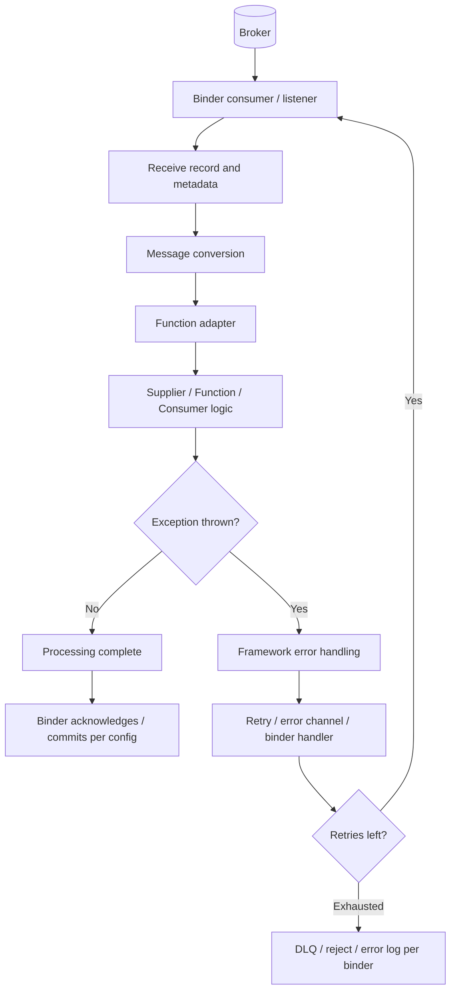

# Exception Path from Function to Binder

## 1. Why Understand the Exception Path?

In Spring Cloud Stream, `Supplier`, `Function`, and `Consumer` focus on application logic. The binder connects bindings to Kafka, RabbitMQ, or Pulsar. When a function throws an exception, the error passes through several layers before the broker decides whether the message is redelivered, acknowledged, routed to a dead-letter queue (DLQ), or discarded.

Without understanding this path, an application can retry at the wrong layer, acknowledge messages too early, or log errors while still losing data. An exception can originate from multiple places:

- The message cannot be converted into the input Java type.
- Logic inside a `Consumer` or `Function` throws an exception.
- The function returns data, but output conversion or serialization fails.
- The binder fails to send the message to the target broker.
- The broker connection, acknowledgment, or offset commit operation fails.

Each error type has a different context and recovery mechanism. Identify whether the error happened before, during, or after the function call to pick the right place to handle it.

## 2. General Path of an Inbound Message

For an input binding, the basic path is as follows:



This is a conceptual diagram. The exact order of acknowledgment, offset commit, retry, and error channel depends on the binder, function style, configuration, and Spring Cloud Stream version. The key point is that exceptions from function logic are normally propagated back to the message-handling infrastructure; only the binder and container have sufficient context to apply broker delivery policies.

For imperative consumers, the function invocation typically occurs during listener message processing. If the function throws an exception and it is not handled, it propagates back up to the adapter/container. The container or binder then applies retry, error handler, DLQ, or message rejection policies.

## 3. Exceptions in a Consumer

`Consumer<T>` receives a payload and performs side effects. If the logic throws a runtime exception, the exception escapes the function and is observed by the framework as a message-processing failure.

```java
import java.util.function.Consumer;
import org.springframework.context.annotation.Bean;
import org.springframework.context.annotation.Configuration;

record OrderCreated(String orderId, long totalCents) {}

@Configuration
class OrderConsumers {

    @Bean
    Consumer<OrderCreated> processOrder() {
        return event -> {
            if (event.totalCents() <= 0) {
                throw new IllegalArgumentException(
                    "totalCents must be positive: " + event.orderId()
                );
            }

            reserveOrder(event);
        };
    }

    private void reserveOrder(OrderCreated event) {
        // Call business logic to reserve the order.
    }
}
```

If `reserveOrder` fails due to a database or dependent service error, the exception can also escape the `Consumer`. At that point, the binder/container cannot assume the message was processed successfully.

### Do Not Swallow Exceptions If You Want the Binder to Retry

The following code logs and then returns normally:

```java
@Bean
Consumer<OrderCreated> processOrder() {
    return event -> {
        try {
            reserveOrder(event);
        } catch (RuntimeException ex) {
            log.error("Cannot reserve order {}", event.orderId(), ex);
        }
    };
}
```

Because the exception was caught and not rethrown, the framework sees the function call complete normally. The binder may acknowledge or commit the message per configuration as a successful processing attempt. Logging alone does not trigger retries.

If you want the error to propagate to the binder, rethrow the exception:

```java
try {
    reserveOrder(event);
} catch (RuntimeException ex) {
    log.error("Cannot reserve order {}", event.orderId(), ex);
    throw ex;
}
```

Handle errors inside the function only when the application can genuinely recover or has an explicit business decision. For unrecoverable data errors, route to an error flow/DLQ according to policy; do not pretend processing succeeded.

## 4. Exceptions in a Function

`Function<T, R>` takes one value and returns a new value. Exceptions can occur during validation, transformation, or service calls:

```java
import java.util.function.Function;
import org.springframework.context.annotation.Bean;
import org.springframework.context.annotation.Configuration;

record OrderAccepted(String orderId, String authorizationId) {}

interface PaymentService {
    OrderAccepted authorize(OrderCreated order);
}

@Configuration
class OrderFunctions {

    @Bean
    Function<OrderCreated, OrderAccepted> acceptOrder(PaymentService paymentService) {
        return order -> {
            validateOrder(order);
            return paymentService.authorize(order);
        };
    }

    private void validateOrder(OrderCreated order) {
        if (order.totalCents() <= 0) {
            throw new IllegalArgumentException("Invalid order total");
        }
    }
}
```

If `validateOrder` or `paymentService.authorize` throws an exception, the function does not produce a normal result. The framework routes the error back along the input binding's message-processing path. For a function with both input and output bindings, producing the output only completes after the function returns a value and the framework sends the outbound message.

This means errors in function logic can be handled like input consumer errors, whereas output send failures must be distinguished by timing and the binder's confirmation mechanism. If an output send fails synchronously on the same processing thread, the exception may return to the handler processing the input; asynchronous producer errors may be reported through a separate producer mechanism and do not necessarily cause the input to be redelivered.

## 5. Exceptions in a Supplier

`Supplier<T>` produces data without receiving an inbound message from a broker. Spring Cloud Stream typically invokes a Supplier via polling or a configured schedule. If the Supplier throws an exception, the error occurs during a data-source polling cycle; there is no specific input record for a consumer to retry or send to a DLQ.

```java
import java.util.function.Supplier;
import org.springframework.context.annotation.Bean;
import org.springframework.context.annotation.Configuration;

record DailySnapshot(String reportDate, long orderCount) {}

interface SnapshotService {
    DailySnapshot loadCurrent();
}

@Configuration
class SnapshotFunctions {

    @Bean
    Supplier<DailySnapshot> dailySnapshot(SnapshotService snapshotService) {
        return () -> {
            DailySnapshot snapshot = snapshotService.loadCurrent();
            if (snapshot == null) {
                throw new IllegalStateException("Snapshot is not available");
            }
            return snapshot;
        };
    }
}
```

Supplier errors must be handled according to the polling, scheduler, or publisher lifecycle. Input-binding retry policies do not automatically apply to a Supplier. If the data source can be re-read, determine whether the next cycle may retry, how to avoid duplicate emissions, and how to record source failures.

With `Supplier<Flux<T>>`, errors can occur while constructing the `Flux` or later as an `onError` signal while the `Flux` is emitting. These two moments are different, so check how the function adapter/binder manages subscriptions in your application's version.

## 6. Classes That Can Wrap Exceptions

The root exception may be wrapped by classes from Spring Messaging, Spring Integration, or binder libraries. Common types include:

| Exception Type | Typical Location | Meaning |
|---|---|---|
| `IllegalArgumentException` or business exception | Inside function code | Data or state fails business conditions |
| `MessageHandlingException` | Message handler/adapter | Message processing failed; usually holds the associated message |
| `MessagingException` | Spring Messaging | Message-bound exception, may contain the failed message |
| `MessageConversionException` | Before calling function or during output conversion | Cannot convert payload per content type/target type |
| Jackson `JsonProcessingException` or serializer error | Data conversion | Incompatible JSON/schema/data type |
| Broker client exception | Binder or producer/consumer client | Connection, publish, fetch, ack, or commit failure |

Do not read only the outermost exception line. Inspect the cause chain, failed message, binding name, and broker metadata to find the root error. A `MessageHandlingException` may simply be a wrapper around an `IllegalArgumentException` thrown by application code.

## 7. Errors Occurring Before the Function Is Invoked

The binder receives a record and the message converter must produce a Java payload before invoking the function. If the JSON is invalid, the content type is wrong, or the input type is incompatible, the function may never run.

Example binding declaring JSON and a function accepting a DTO:

```yaml
spring:
  cloud:
    function:
      definition: processOrder
    stream:
      bindings:
        processOrder-in-0:
          destination: orders.events
          group: order-processor
          content-type: application/json
```

```java
import java.util.function.Consumer;
import org.springframework.context.annotation.Bean;

// Inside a class with logger `log` and method reserveOrder(...).
@Bean
Consumer<OrderCreated> processOrder() {
    return order -> reserveOrder(order);
}
```

If a record contains JSON that cannot be decoded into `OrderCreated`, a conversion error occurs at the message conversion layer. No logs appear inside `processOrder` because the function code was never invoked. Nevertheless, the error still belongs to the binding's message-processing path and needs an appropriate retry/DLQ policy.

Retrying a permanently malformed payload usually does not help. If the failure is due to schema-invalid data, limit retries and send the message to a DLQ for inspection or data repair. If the failure is due to a temporarily unavailable schema registry or decoding service, retry with backoff can be useful.

## 8. Errors Occurring After the Function Returns

For a `Function` with an output, the framework also has to convert the output payload and send it through the output binding. Errors that can appear after function code has returned a result include:

1. The output converter cannot serialize the object.
2. Headers or content type are incompatible.
3. The target broker is unavailable.
4. The producer is rejected or times out.
5. Publish confirmation failures occur asynchronously.

Synchronous conversion/serialization errors can appear on the same function processing path. Asynchronous producer errors may go through a producer error channel or binder-specific callback. Do not assume every output error automatically triggers the input binding's retry.

With `StreamBridge`, the `send` method returns a boolean indicating whether the send operation was accepted by the outbound path at the API level. A `true` value does not prove the consumer received or finished processing the message. When broker confirmation tracking is required, use producer confirm/acknowledgment mechanisms or callbacks supported by the binder.

## 9. `ErrorMessage` and Error Channels

Spring Messaging represents errors sent over an error channel with `ErrorMessage`. The payload of an `ErrorMessage` is a `Throwable`; the original message may be attached so the handler knows which data caused the error.

An error channel can be used to observe or handle errors:

```java
import org.springframework.integration.annotation.ServiceActivator;
import org.springframework.messaging.Message;
import org.springframework.messaging.MessagingException;
import org.springframework.messaging.support.ErrorMessage;
import org.slf4j.Logger;
import org.slf4j.LoggerFactory;
import org.springframework.stereotype.Component;

@Component
class OrderErrorHandler {

    private static final Logger log = LoggerFactory.getLogger(OrderErrorHandler.class);

    // Illustrative channel name for an input binding with destination=orders, group=billing.
    @ServiceActivator(inputChannel = "orders.billing.errors")
    public void handle(ErrorMessage errorMessage) {
        Throwable cause = errorMessage.getPayload();
        Message<?> original = errorMessage.getOriginalMessage();

        if (cause instanceof MessagingException messagingException
                && messagingException.getFailedMessage() != null) {
            original = messagingException.getFailedMessage();
        }

        log.error("Order input failed; originalMessage={}", original, cause);
    }
}
```

In the example, `orders.billing.errors` illustrates an error channel name derived from destination and group. The actual name depends on the binding, anonymous/named group, binder, and Spring Cloud Stream version; verify the exact channel name created for your application's binding before registering a handler.

`ErrorMessage` helps extract the exception and related message for logging, metrics, or alerting. Registering a handler does not automatically turn every error into a DLQ route nor does it determine acknowledgment by itself. Understand whether the error channel handler participates in a synchronous path or receives errors from an asynchronous flow, and how the binder treats the message after the handler completes.

### Binding Error Channels vs. the Global `errorChannel`

Spring Integration provides a global `errorChannel` for certain errors raised from message-driven/asynchronous components. Spring Cloud Stream also has binding-specific error channels. They are not always the same channel, and not every broker exception is automatically routed to the global channel.

When handling errors for an input binding, prefer identifying the error channel attached to that binding. Use the global channel for errors not tied to a specific binding when your application structure and configuration permit. Do not register a handler and assume all producer, consumer, and scheduler errors will flow through a single channel.

## 10. Consumer Binding Retry

For imperative consumers, Spring Cloud Stream can configure retries for errors raised during message processing. Common properties live under `spring.cloud.stream.bindings.<bindingName>.consumer`:

```yaml
spring:
  cloud:
    function:
      definition: processOrder
    stream:
      bindings:
        processOrder-in-0:
          destination: orders.events
          group: billing-service
          consumer:
            max-attempts: 4
            back-off-initial-interval: 1000
            back-off-max-interval: 10000
            back-off-multiplier: 2.0
```

In the example, `max-attempts: 4` counts total invocations, including the initial attempt and retries. Backoff starts at 1 second, scales by a factor of 2, and is capped at 10 seconds. Verify defaults and binder capabilities for your project version; explicit declarations make policies easier to read and control.

Retry is appropriate for transient failures such as brief timeouts or a restarting downstream service. For invalid data, fixed schema errors, or business rule violations, retrying multiple times only prolongs processing and increases load. You can set `max-attempts: 1` when you want to disable retry at the consumer binding layer and move straight to the next error policy.

### Retries Can Cause Duplicate Processing

Suppose a consumer successfully writes an order to the database, but the application loses connection before acknowledgment/offset commit is recorded. The broker may redeliver the message. The subsequent processing attempt could write the same order again.

Therefore, retries must be paired with idempotency:

- Each event has a stable `eventId`.
- The database enforces a unique constraint or uses an inbox table to detect already-processed events.
- Side effects execute within an appropriate transaction.
- Retries do not create extra transactions or send unintended duplicate notifications.

## 11. Binder-Specific Dead-Letter Queues

When a message still fails after retries, a DLQ holds the failed message for investigation or reprocessing. DLQ configuration is binder-specific and not identical across binders.

### Kafka Binder

The Kafka binder can enable dead-letter publishing for consumer bindings that have a group:

```yaml
spring:
  cloud:
    stream:
      bindings:
        processOrder-in-0:
          destination: orders.events
          group: billing-service
          consumer:
            max-attempts: 3
      kafka:
        bindings:
          processOrder-in-0:
            consumer:
              enable-dlq: true
```

Once failed processing attempts are exhausted, the binder can send the record to a dead-letter topic per configuration. Topic naming, partitioning, write permissions, and topic auto-creation depend on Kafka binder properties and the broker environment. Ensure the application principal has the required permissions.

### Rabbit Binder

The Rabbit binder provides dedicated properties to auto-bind a DLQ and configure exception republishing:

```yaml
spring:
  cloud:
    stream:
      bindings:
        processOrder-in-0:
          destination: orders.events
          group: billing-service
          consumer:
            max-attempts: 3
      rabbit:
        bindings:
          processOrder-in-0:
            consumer:
              auto-bind-dlq: true
              republish-to-dlq: true
```

Properties and exchange/queue topology must be cross-checked with your Rabbit binder version. The DLQ can include exception details when republishing is enabled. Verify exchange/queue declaration permissions as well as TTL and dead-letter routing policies on the broker.

### Pulsar Binder

Pulsar supports dead-letter policies at the subscription/consumer level depending on binder capabilities and version. Configuration may include the dead-letter topic name, retry topic, and maximum redelivery count. Do not apply Kafka or Rabbit properties to Pulsar; configure under the corresponding Pulsar binder namespace and check how the binder routes messages after reaching the redelivery threshold.

A DLQ does not fix data by itself. You need a process for monitoring, classification, remediation, and controlled replay. When replaying messages, preserve the original event ID so idempotent consumers still recognize already-processed messages.

## 12. Distinguishing Reactor Retry from Binder Retry

With reactive functions, errors are typically represented as `onError` signals in a `Mono` or `Flux`. Errors can be handled inside the pipeline using Reactor operators:

```java
import java.time.Duration;
import java.util.function.Function;
import org.springframework.context.annotation.Bean;
import org.springframework.context.annotation.Configuration;
import reactor.core.publisher.Flux;
import reactor.core.publisher.Mono;
import reactor.util.retry.Retry;

interface ReactiveOrderService {
    Mono<OrderAccepted> processReactive(OrderCreated order);
}

@Configuration
class ReactiveOrderFunctions {

    @Bean
    Function<Flux<OrderCreated>, Flux<OrderAccepted>> processOrdersReactive(
            ReactiveOrderService orderService) {
        return orders -> orders.concatMap(order ->
            orderService.processReactive(order)
                .retryWhen(Retry.backoff(2, Duration.ofMillis(250))
                    .filter(ReactiveOrderFunctions::isTransientFailure))
        );
    }

    private static boolean isTransientFailure(Throwable error) {
        return error instanceof java.util.concurrent.TimeoutException;
    }
}
```

Here, `retryWhen` resubscribes to the processing operation's publisher according to the Reactor policy. It does not mean the broker redelivered the inbound record. Binder/container retry operates at the message delivery layer and may have different semantics.

For reactive functions, do not assume imperative consumer retry/DLQ properties apply per item in a `Flux`. A terminal error can terminate the publisher processing the entire stream; verify how per-message error isolation, error message emission, and resubscription behave in your version of Spring Cloud Stream and binder.

Operators to distinguish:

| Operator | Effect | Does the Exception Continue Propagating? |
|---|---|---|
| `doOnError` | Observe/log error | Yes; only adds a side effect |
| `onErrorMap` | Transform exception to another type | Yes; emits the new exception |
| `onErrorResume` | Switch to a fallback publisher | Usually no, if the fallback publisher completes normally |
| `retryWhen` | Resubscribe per retry policy | Yes, if errors persist after retries are exhausted |
| `onErrorComplete` | Turn error into completion | No; the error terminates here |

If you use `onErrorResume` to log and return `Mono.empty()`, the pipeline can complete normally and the framework will no longer see the original exception to apply binder retry. Only convert an error into a fallback outcome when the business explicitly accepts skipping or substituting the message.

### Do Not Blindly Retry the Entire Stream

With `Flux`, a retry can resubscribe to the entire upstream source. If the source has side effects or is not replayable, retrying may create duplicate messages or fail to recover lost items. Prefer retrying the smallest operation that can be safely repeated, use event IDs, and understand whether the source publisher can replay data.

## 13. Producer-Side Errors Differ from Consumer-Side Errors

Consumer errors occur when the application fails to process an inbound message. Producer errors occur when the application fails to send an outbound message. These two errors follow different paths:

| Error Type | Example | Where to Inspect |
|---|---|---|
| Consumer function | `processOrder` logic throws exception | Function adapter, input binding, consumer retry/error channel |
| Input conversion | JSON cannot produce DTO | Message converter, content type, input binding, and binder |
| Output conversion | Returned object cannot be serialized | Output converter, schema, content type |
| Producer send | Target broker rejects or times out | Output binding, producer client, producer error channel/callback |
| StreamBridge send | Sending to dynamic or static binding fails | Binding name, binder, destination, and `send` result |

For producer errors, check the error-reporting mechanism supported by the binder. Some binders allow enabling a producer error channel or send-confirmation callback. Property names and semantics depend on the binder. Do not assume consumer retry will automatically re-run an asynchronous publish that failed after the input was already acknowledged.

If you need to guarantee database updates and event emission stay atomic, consider the transactional outbox pattern. If sending to multiple brokers, have a recovery strategy when one broker succeeds and another fails; separate `send` calls do not form an atomic distributed transaction.

## 14. How Acknowledgment and Offset Commit Relate

The binder coordinates delivery according to broker semantics:

- Kafka tracks committed offsets per consumer group and partition.
- RabbitMQ uses acknowledgments to determine that a message was processed by the consumer.
- Pulsar uses acknowledgments and subscription cursors to track progress.

If an exception propagates up and the container decides to retry, the message has typically not been acknowledged as complete at the time of retry. Once retries are exhausted, the binder applies the next policy such as DLQ, reject, or error handler. However, exact ack/commit details can vary by binder, transaction mode, batch listeners, and concurrency settings.

Do not rely on a blanket rule like "if the function throws an exception, the broker will definitely redeliver exactly once." Redelivery can occur, duplicates can occur, and exception propagation alone provides no end-to-end exactly-once guarantee. Design idempotent consumers and test against a real broker.

## 15. Classifying Exceptions to Choose a Policy

An application should classify errors before deciding to retry:

| Error Group | Example | Generally Appropriate Policy |
|---|---|---|
| Transient | Timeout, brief disconnect, recoverable rate limit | Retry with backoff and limit |
| Invalid data | Missing required field, malformed JSON, schema mismatch | DLQ/quarantine and investigate; avoid long retries |
| Business violation | Canceled order, disallowed state | Handle as business outcome or dedicated rejection flow |
| Prolonged infrastructure outage | Broker/database unavailable | Bounded retry, circuit breaker, or controlled pause of consumption |
| Programming bug | Unexpected null, broken invariant | Alert, preserve stack trace, and fix code; avoid infinite retry |

Do not classify solely by exception name. The same `RuntimeException` can wrap either a transient failure or permanent bad data. Use explicit domain exceptions or inspect the cause chain to decide.

## 16. Observing the Error Path

Logs and metrics should make it clear where in the pipeline an error occurred. A useful error record should include:

- Function name and associated input/output bindings.
- Destination, group, and binder if available.
- Event ID and correlation ID.
- Root exception type and cause chain.
- Attempt count, retry timestamps, and DLQ status.
- Partition/offset or delivery metadata when provided by the binder.

Do not log credentials or entire sensitive payloads. Use metrics to track error counts per binding, retry counts, DLQ counts, producer send failures, consumer lag, and processing duration. Alert when the DLQ spikes or prolonged retries drive up backlog.

## 17. Procedure for Diagnosing an Exception

1. Determine whether the message came from an input binding, Supplier polling, or producer output.
2. Check whether the function was actually invoked or if the error occurred earlier during conversion.
3. Read the root exception and failed message, not just the outermost wrapper exception.
4. Determine whether the error occurred inside function logic, output conversion, or broker send.
5. Check whether the exception is being caught and swallowed in code.
6. Inspect the consumer binding's retry/backoff configuration and corresponding error channel.
7. Check binder-specific DLQ, acknowledgment, offset, or redelivery policies.
8. Evaluate duplicate handling and idempotency before enabling retry/replay.
9. Retest against the corresponding broker and verify the message follows the intended recovery path.

An exception from a function does not travel straight to the broker as a business payload. It is processed by the framework and binder through message handling, error channels, or error handlers before retry, acknowledgment, and DLQ policies are applied per configuration. Understanding the exact failure point and acknowledgment boundary helps a Spring Cloud Stream application avoid swallowing exceptions, avoid retrying at the wrong layer, and recover messages in a controlled manner.
