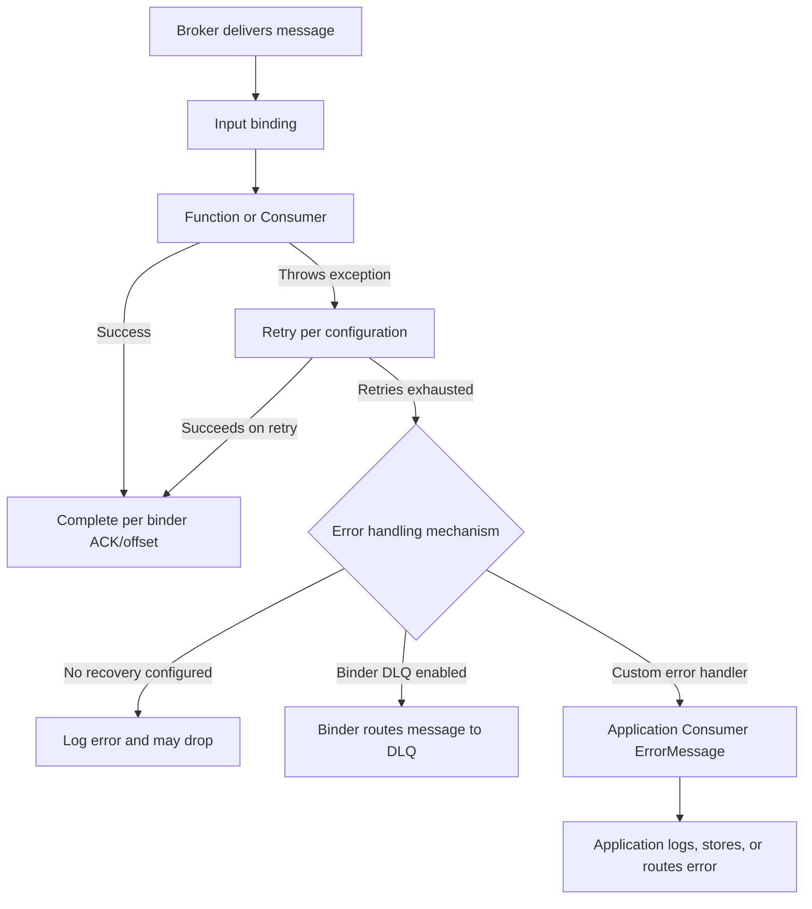

# Impact of Custom Error Handlers on the Default DLQ Mechanism

Spring Cloud Stream provides multiple layers of error handling for consumers: retry when a business function throws an exception, the framework's default error handler, binder-specific recovery mechanisms, and dead-letter queues/topics (DLQs). An application can also declare a custom error handler to log errors, send alerts, or persist failed messages.

A critical point to note is that **a custom error handler declared via `error-handler-definition` replaces the framework-provided error handlers, including the binder-specific error handler used to send messages to the DLQ**. Therefore, once a binding has a custom handler attached, enabling Kafka's `enable-dlq` or RabbitMQ's `auto-bind-dlq` does not mean the binder will still automatically route failed messages to the DLQ. If the custom handler needs to store failed messages, the handler itself must perform the routing or persistence under an application-managed recovery mechanism.

## 1. Error Path in a Consumer

With an imperative function such as `Function<T, R>` or `Consumer<T>`, each message is passed to a message handler. If the function throws an exception, the error propagates back to Spring Cloud Stream and binder infrastructure. Typically, the framework performs a number of retries before deciding how to handle the failed message.



Exact steps depend on the binder and programming model. For imperative message handlers, processing errors go back to the binder; if retries do not succeed, the binder may drop, requeue, or send to a DLQ depending on broker capabilities and configuration. If no recovery is configured, the error may only be logged and the message dropped. Do not treat an error log entry as proof that the message was preserved for reprocessing.

Current Spring Cloud Stream documentation describes two default error handlers: a logging handler and a binder-specific handler. The second handler can route messages to a DLQ when DLQ is configured. When a custom handler is declared via `error-handler-definition`, the custom handler excludes these two default handlers to prevent multiple components from handling the same error.

## 2. Retry and DLQ Are Two Separate Stages

Retry allows re-attempting message processing when the failure may be transient, such as a temporarily unreachable dependency. A DLQ stores messages after attempts fail so operations teams can inspect, fix data, or perform controlled replay.

Common retry properties on a consumer binding:

| Property | Meaning |
|---|---|
| `max-attempts` | Total processing attempts under the binding's retry mechanism, including the initial attempt. |
| `back-off-initial-interval` | Initial wait time between attempts. |
| `back-off-multiplier` | Multiplier for wait time after each attempt. |
| `back-off-max-interval` | Maximum wait time cap. |
| `default-retryable` / `retryable-exceptions` | Controls which exception groups are retried, depending on version and configuration. |

Example retry configuration for binding `processOrder-in-0`:

```yaml
spring:
  cloud:
    function:
      definition: processOrder
    stream:
      bindings:
        processOrder-in-0:
          destination: orders.commands
          group: order-command-handler
          consumer:
            max-attempts: 3
            back-off-initial-interval: 1000
            back-off-multiplier: 2.0
            back-off-max-interval: 10000
```

With this illustrative configuration, the handler gets up to three attempts with wait times scaling by a factor of 2, capped at 10 seconds. Defaults and how retries apply can differ by binder, version, and whether DLQ is enabled. Consult your deployed binder's documentation before relying on a specific number.

Retry fits transient failures. For permanent data errors such as a schema-invalid payload or a missing required field, retrying the same message usually will not make the error disappear. In those cases, classify errors to route them to a DLQ or parking-lot destination.

## 3. The Binder's Default DLQ Mechanism

A DLQ is a dedicated destination to retain messages that fail processing. It can be used for inspection, reconciliation, data repair, or replay. Spring Cloud Stream does not automatically enable DLQ for every binding; it must be configured per binder.

### Kafka Binder

The Kafka binder requires an explicit consumer group to use DLQ. Enable DLQ on a binding via `enable-dlq`:

```yaml
spring:
  cloud:
    function:
      definition: processOrder
    stream:
      bindings:
        processOrder-in-0:
          destination: orders.commands
          group: order-command-handler
          consumer:
            max-attempts: 3
      kafka:
        bindings:
          processOrder-in-0:
            consumer:
              enable-dlq: true
              dlq-name: orders.commands.order-command-handler.dlq
```

When enabled and processing attempts fail, the Kafka binder can publish the failed record to the DLQ topic. If `dlq-name` is omitted, the default name typically follows `error.<destination>.<group>`. Anonymous consumers without a group cannot use this DLQ feature. By default, the DLQ record is sent to the same partition number as the original record; therefore, the DLQ topic must have enough partitions or use a custom partition selection strategy.

In some current Kafka binder versions, when DLQ is not enabled, binding `max-attempts` does not control retries the way many people expect; retries may follow the listener container's defaults instead. Check the documentation for your exact version and configure `ListenerContainerCustomizer`/`ListenerContainerWithDlqAndRetryCustomizer` if deep customization of container behavior is needed.

### RabbitMQ Binder

With RabbitMQ, you can instruct the binder to declare the dead-letter exchange and queue via `auto-bind-dlq`:

```yaml
spring:
  cloud:
    stream:
      bindings:
        processOrder-in-0:
          destination: orders.commands
          group: order-command-handler
          consumer:
            max-attempts: 3
      rabbit:
        bindings:
          processOrder-in-0:
            consumer:
              auto-bind-dlq: true
              republish-to-dlq: true
```

The default DLQ queue is typically named from destination and group, such as `orders.commands.order-command-handler.dlq`. `republish-to-dlq: true` tells the binder to republish the failed message and append error metadata such as the exception message or stack trace in headers. Without republishing, the broker may dead-letter rejected messages according to exchange/queue configuration.

Avoid setting `requeue-rejected: true` without an appropriate retry/limit strategy. Failing messages can be returned to the queue continuously, creating a redelivery loop and stalling consumer progress.

### Pulsar and Other Binders

Dead-letter capabilities depend on the binder and broker subscription mechanism. Pulsar has consumer/subscription-level dead-letter policies; how they are declared, redelivery counts, and dead-letter topic names depend on the Pulsar client and Pulsar binder version. Do not copy Kafka's `enable-dlq` or Rabbit's `auto-bind-dlq` properties to Pulsar. Check the specific binder documentation and confirm whether message handler errors are routed to the dead-letter topic per configuration.

## 4. What Is a Custom Error Handler?

Spring Cloud Stream allows declaring a functional bean that accepts `ErrorMessage`. `ErrorMessage` holds the exception in its payload along with details about the original failing message. Spring Cloud Stream recognizes this bean as a custom error handler when a binding references the bean name via `error-handler-definition`.

Example error-recording handler:

```java
import java.util.function.Consumer;

import org.slf4j.Logger;
import org.slf4j.LoggerFactory;
import org.springframework.context.annotation.Bean;
import org.springframework.context.annotation.Configuration;
import org.springframework.messaging.support.ErrorMessage;

@Configuration
class OrderErrorHandlerConfiguration {

    private static final Logger log =
        LoggerFactory.getLogger(OrderErrorHandlerConfiguration.class);

    @Bean
    Consumer<ErrorMessage> orderErrorHandler() {
        return errorMessage -> {
            Throwable cause = errorMessage.getPayload();
            log.error("Order consumer failed; originalMessagePresent={}",
                errorMessage.getOriginalMessage() != null, cause);
        };
    }
}
```

Binding configuration using the handler:

```yaml
spring:
  cloud:
    stream:
      bindings:
        processOrder-in-0:
          destination: orders.commands
          group: order-command-handler
          error-handler-definition: orderErrorHandler
```

`error-handler-definition` sits directly under the binding configuration, not inside `consumer`. The declared value must match the functional bean name. To use one default handler for all function beans, set `spring.cloud.stream.default.error-handler-definition`.

Example selecting an application-wide default handler:

```yaml
spring:
  cloud:
    stream:
      default:
        error-handler-definition: applicationErrorHandler
```

When a specific binding needs an exception to the default, declare `error-handler-definition` directly on that binding to specify the handler it should use.

A custom handler can send alerts, write errors to a database, create tickets, or forward messages to a dedicated destination. Because it replaces the default error handler, the handler must actively carry out all required work such as logging, preserving the original message, emitting metrics, and persisting errors.

## 5. Crucial Impact: Custom Handler Disables the Default DLQ Path

This behavior can easily lead to message loss if configuration is misunderstood:

1. A binding enables binder DLQ, such as Kafka `enable-dlq: true` or Rabbit `auto-bind-dlq: true`.
2. The application also attaches `error-handler-definition` pointing to a `Consumer<ErrorMessage>`.
3. When the message handler fails and reaches error handling, the custom handler is used instead of the framework's logging and binder-specific error handlers.
4. The binder-specific error handler no longer routes messages to the default DLQ.

Consequently, **messages do not automatically appear in the binder's DLQ merely because the DLQ property remains enabled**. Even if the queue/topic already exists (was provisioned) on the broker, that does not mean messages will be sent there. The custom handler needs its own storage/routing path if failed messages must be retained.

You can choose one of two approaches:

- Use binder-managed retry and DLQ: do not attach a custom `error-handler-definition` to that binding; configure DLQ and retry per the binder.
- Use a custom error handler: the handler takes responsibility for logging, persisting, or publishing failed messages to a recovery destination; design acknowledgment, retries, and error handling for the recovery path itself.

Do not enable both expecting the framework to run them in parallel. Mutual exclusion is intentional to prevent two handlers from simultaneously ACKing, publishing, or handling one failure in conflicting ways.

## 6. Sending Failed Messages to a Recovery Destination from a Custom Handler

If custom logic is needed while still preserving messages for reprocessing, a custom handler can use `StreamBridge` to send the original message to an error-dedicated output binding. This is an application-managed recovery flow, not the binder's default DLQ mechanism.

Example declaring an output binding:

```yaml
spring:
  cloud:
    stream:
      output-bindings: orderFailures-out-0
      bindings:
        processOrder-in-0:
          destination: orders.commands
          group: order-command-handler
          error-handler-definition: orderErrorHandler
        orderFailures-out-0:
          destination: orders.commands.failures
          content-type: application/json
```

Replace the log-only implementation from the previous example with one that routes the original message:

```java
import java.util.function.Consumer;

import org.springframework.cloud.stream.function.StreamBridge;
import org.springframework.context.annotation.Bean;
import org.springframework.messaging.Message;
import org.springframework.messaging.support.ErrorMessage;
import org.springframework.messaging.support.MessageBuilder;

@Bean
Consumer<ErrorMessage> orderErrorHandler(StreamBridge streamBridge) {
    return errorMessage -> {
        Message<?> original = errorMessage.getOriginalMessage();
        Throwable cause = errorMessage.getPayload();

        if (original == null) {
            throw new IllegalStateException(
                "Cannot route failure because the original message is missing",
                cause
            );
        }

        Message<?> failure = MessageBuilder.fromMessage(original)
            .setHeader("x-failure-type", cause.getClass().getName())
            .setHeader("x-failure-stage", "order-command-handler")
            .build();

        if (!streamBridge.send("orderFailures-out-0", failure)) {
            throw new IllegalStateException("Could not publish failed order message", cause);
        }
    };
}
```

This example only illustrates the outbound path. In production, verify `send` success at the channel/binder level per your version's contract; a `true` return value does not prove a consumer on the recovery destination has processed the message. If durable storage is required, design publish confirmations, transactions, or an outbox suited to your broker and business domain.

Forward only necessary headers. Do not put full stack traces, access tokens, personal data, or internal broker headers into the error destination without explicit requirements and security policies. Exception messages sometimes contain SQL, URLs, or sensitive data; filter them before storing.

The recovery path must be separate from the failing input binding. If the handler publishes back to the exact destination the consumer is reading from, the message may hit the same logic and create an error loop. Use a dedicated error topic/queue with restricted access and an explicit retention policy.

## 7. What Responsibilities Does a Custom Handler Have?

When choosing a custom handler, define its responsibilities clearly. A handler that only logs does not automatically retain messages. A handler that sends an email does not automatically create a DLQ. At a minimum, decide on:

- **Recording:** log the exception, binding, destination, group, and message identifier.
- **Preservation:** retrieve the original message if available and retain the payload needed for investigation or replay.
- **Classification:** transient error, data error, schema error, configuration error, or unrecoverable error.
- **Recovery:** write to a database, publish to a recovery destination, or route to a ticketing/alerting system.
- **Confirmation:** handle storage/publish failures; do not silently ignore send results.
- **Deduplication:** attach an event ID or idempotency key so the same failure does not create unintended duplicate recovery records.
- **Security:** redact sensitive details from payloads, headers, exceptions, and stack traces.
- **Operations:** provide metrics, alerts, retention, and a controlled redrive process.

A handler should be concise and avoid heavy blocking I/O on the error callback path. If it must write to a database or call a remote service, enforce timeouts, bounded retries, and durable persistence. Avoid letting failures inside the handler itself create a hard-to-observe error loop.

## 8. Distinguishing a Custom Error Handler from an Error Channel Subscriber

Spring Integration and Spring Cloud Stream provide error channels to emit `ErrorMessage`s. A component can subscribe to an error channel to observe or handle errors. However, distinguish registering a subscriber from selecting a `Consumer<ErrorMessage>` as a binding's error handler via `error-handler-definition`.

For the `error-handler-definition` mechanism covered in this lesson, Spring Cloud Stream documentation defines the custom handler as replacing the logging handler and binder-specific handler. Do not generalize that rule to every error channel listener/subscriber without checking how the channel is configured and which framework version is used. When an application has both an error channel subscriber and a binder DLQ, test in practice which subscribers receive messages and who is responsible for ACK/republishing.

If the goal is purely error observation, consider logging/metrics/observation mechanisms that do not replace binder recovery. If the goal is controlling where failed messages are stored yourself, use a custom handler explicitly and manage the full recovery path.

## 9. Do Reactive Functions Share the Same DLQ Mechanism?

Do not mechanically apply imperative message handler retry/DLQ rules to reactive functions. A function with signature `Function<Flux<T>, Flux<R>>` is not treated as a per-message imperative handler in the same way; the framework connects the binding's publisher to the publisher returned by the function. In the reactive model, use Reactor operators such as `retryWhen`, `onErrorResume`, or `onErrorMap` according to pipeline needs.

Example:

```java
import java.time.Duration;
import java.util.function.Function;

import org.springframework.context.annotation.Bean;
import reactor.core.publisher.Flux;
import reactor.util.retry.Retry;

@Bean
Function<Flux<OrderCreated>, Flux<OrderProcessed>> processOrders(
        OrderService orderService) {
    return orders -> orders
        .flatMap(orderService::process)
        .retryWhen(Retry.backoff(3, Duration.ofSeconds(1)));
}
```

This is a Reactor retry on the publisher, not `RetryTemplate` retrying individual messages in an imperative handler. Determine whether an error corrupts a single item or terminates the entire publisher, as well as how the binder and broker handle ACK/offsets when the pipeline errors. If failed elements must be routed to a recovery flow, design per-item `onErrorResume` or branching explicitly; do not assume binder `enable-dlq` automatically catches every error inside a reactive pipeline.

## 10. Testing the Impact of a Custom Handler on DLQ

Because a custom handler replaces the binder error handler, write tests proving actual behavior rather than just inspecting YAML files.

| Case | Setup | Expected Behavior to Verify |
|---|---|---|
| Pure binder DLQ | Enable DLQ, no custom error handler declared | Failed message moves to DLQ after retries exhaust per binder config. |
| Log-only custom handler | Declare `error-handler-definition` | Handler receives `ErrorMessage`; default binder DLQ does not process that message. |
| Custom handler + DLQ property | Declare custom handler while also enabling `enable-dlq`/`auto-bind-dlq` | Do not assume binder DLQ still runs; verify message does not appear in default DLQ. |
| Custom handler self-publishes | Handler sends original message to recovery binding | Message arrives at recovery destination with expected error metadata. |
| Missing original message | Handler receives `ErrorMessage` without original message | Logs/metrics and fallback path exist; no silent error loss. |
| Recovery publish fails | Recovery destination/broker unavailable | Handler logs failure and has a fallback plan, never silently drops message. |
| Repeated failing message | Broker redelivers or handler is called multiple times | Recovery storage enforces idempotency or detects duplicate records. |

Spring Cloud Stream Test Binder helps test functions and handler logic inside the JVM, but it does not fully simulate retries, dead-letter routing, ACK, offsets, queues/exchanges, or native broker behavior. Integration tests against a real Kafka/RabbitMQ/Pulsar binder are required to verify DLQ and redelivery.

## 11. Procedure for Choosing a Mechanism

Before adding a custom error handler, answer the following questions:

1. Does the error occur in an imperative handler or a reactive pipeline?
2. Is custom logic needed, such as database persistence, alerting, or error classification?
3. If custom logic is not needed, does the current binder's DLQ/requeue support already suffice?
4. If declaring `error-handler-definition`, does the application accept replacing the binder error handler and managing recovery itself?
5. Is the original message preserved, and which headers need to be carried to the recovery destination?
6. If publishing or database writing fails, what will the handler do so the message trace is not lost?
7. Are idempotency, bounded retries, and a parking-lot/redrive policy in place?
8. Are there integration tests proving the exact behavior against a running broker?

If the primary goal is routing failed messages to a DLQ, prefer the binder's DLQ configuration and avoid attaching an unnecessary custom error handler. If custom recovery logic is required, declare a custom handler and actively implement message persistence/routing. Treat `error-handler-definition` as a decision that alters the binding's error-handling pipeline, not just an extra callback.

## 12. References

- [Spring Cloud Stream – Error Handling](https://docs.spring.io/spring-cloud-stream/reference/spring-cloud-stream/overview-error-handling.html)
- [Spring Cloud Stream – Kafka Dead-Letter Topic Processing](https://docs.spring.io/spring-cloud-stream/reference/kafka/kafka-binder/dlq.html)
- [Spring Cloud Stream – Kafka Binder Retry and Dead Letter Processing](https://docs.spring.io/spring-cloud-stream/docs/current/reference/html/spring-cloud-stream-binder-kafka.html)
- [Spring Cloud Stream RabbitMQ Binder – Usage and DLQ configuration](https://docs.spring.io/spring-cloud-stream-binder-rabbit/docs/current/reference/html/README.html)
