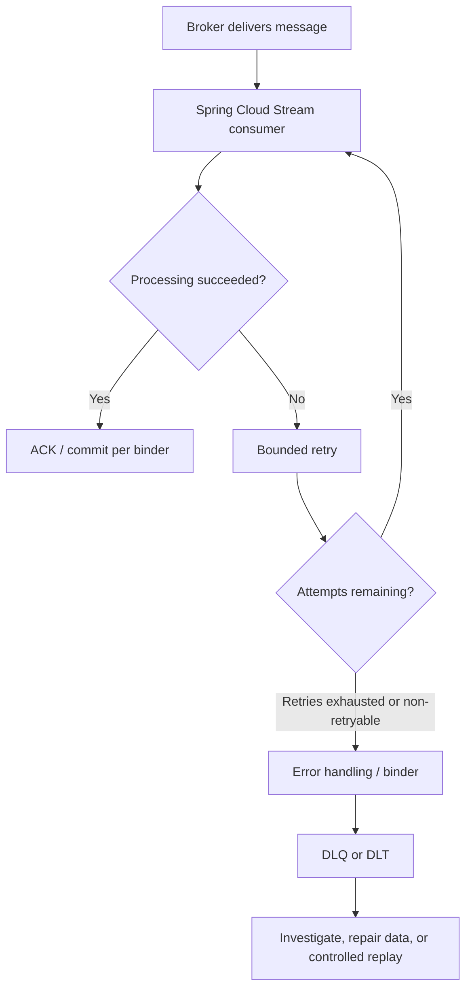

# DLQ, DLT, and Binder-Specific Configuration Conditions

## Objectives

In an event-processing stream, some failures are short-lived, such as a database timeout or an overloaded dependent service. Other failures cannot self-recover by retrying, such as a schema-invalid payload, a missing required field, or a message that consistently makes the consumer throw an exception. Retrying endlessly causes failing messages to consume resources, slow down other messages, or keep failing the consumer.

A **Dead Letter Queue (DLQ)** and **Dead Letter Topic (DLT)** isolate messages that cannot be processed along the normal path after the retry/error policy has been applied. DLQ usually refers to the error-queue concept; DLT emphasizes a topic-based implementation, common with Kafka and Pulsar. This is the destination that stores failing messages for investigation, data repair, or controlled replay.

Spring Cloud Stream does not automatically give every binder the same dead-letter mechanism. The Kafka binder, RabbitMQ binder, and Pulsar binder have their own namespaces, activation conditions, and semantics. This lesson explains how retries lead to a DLQ/DLT, how to configure each binder, and how to operate failing messages safely.

After this lesson, you will be able to:

- Distinguish DLQ, DLT, error channel, and retry.
- Identify when a message is routed to a dead-letter destination.
- Configure DLQ/DLT for the Kafka, RabbitMQ, and Pulsar binders.
- Distinguish framework retry from broker redelivery.
- Retain sufficient metadata to investigate and replay failing messages.
- Avoid retry/DLQ loops and test behavior against real brokers.

## 1. What Problem Do DLQ and DLT Solve?

Suppose consumer `processOrders` receives `OrderCreated` messages. A message can fail because:

- JSON is invalid or incompatible with the schema.
- The `orderId` field is missing.
- The database is temporarily unreachable.
- A business rule rejects the order.
- Consumer code hits an unexpected bug.

If every error is retried the same way, a poison message can be delivered repeatedly without ever succeeding. If every error is dropped, operations teams lose the ability to investigate and recover.

A DLQ/DLT creates a dedicated path for messages that failed under policy. Typical flow:



A DLQ/DLT is not a substitute business-processing path. It is a quarantine area so messages are not lost when the main flow cannot finish. Every message there needs an owner, retention policy, alert, and follow-up workflow.

## 2. Distinguishing Retry, Error Channel, DLQ, and DLT

The following mechanisms are related but do not replace one another:

| Mechanism | Role | Scope |
|---|---|---|
| Retry | Re-attempt processing a message after an error | Can be at framework or broker |
| Redelivery | Broker redelivers a message not yet acknowledged or requested for redelivery | Broker/binder |
| Error channel | Route errors to an error-handling component inside the Spring application | Application context |
| DLQ | Isolate failed messages in a dedicated queue or destination | Broker topology |
| DLT | Isolate failed messages in a dedicated topic | Broker topic |

A Spring Cloud Stream consumer can use binding-level retry. Example:

```yaml
spring:
  cloud:
    stream:
      bindings:
        processOrders-in-0:
          destination: orders.created
          group: order-processor
          consumer:
            max-attempts: 3
            back-off-initial-interval: 1000
            back-off-multiplier: 2.0
            back-off-max-interval: 10000
```

This configuration instructs the framework to try processing up to three times under the consumer's retry policy, with exponential backoff. This is Spring Cloud Stream layer retry. After retries fail, whether the message goes to a DLQ/DLT, is rejected, or is redelivered depends on the binder and its specific configuration.

Distinguish framework retry from broker redelivery. If the framework tries three times during one delivery and then the binder tells the broker to redeliver five more times, total processing attempts can exceed eight depending on how the layers coordinate. Define a system-wide retry budget and verify actual invocation counts with integration tests.

### An Error Channel Is Not a DLQ

An error channel can be used to receive exceptions and handle them in-process, such as logging, emitting metrics, or forwarding an error to a separate handler. However, an error channel is not by default a durable message store. If the process stops or the handler does not persist the message, data may no longer be available for replay.

A DLQ/DLT is a broker destination capable of storing failed messages according to configured retention/durability. An application can use an error channel to observe errors and a DLQ to quarantine messages, while avoiding handling the same failure twice or looping the failed message back into the main flow.

## 3. Classifying Errors Before Routing to DLQ

Not every error should be retried or dead-lettered immediately.

| Error Type | Example | Handling Direction |
|---|---|---|
| Transient error | Database timeout, HTTP 503, temporary lock | Retry with backoff; once budget is exhausted, redeliver/DLQ per policy |
| Permanent data error | Malformed JSON, missing required field, unsupported schema | Do not retry indefinitely; quarantine in DLQ/DLT |
| Business error | Order already canceled, disallowed state | Return explicit business outcome; DLQ only if investigating contract violations |
| Config/infra error | Expired credentials, missing destination | Alert and restore infrastructure; infinite retries can mask incidents |
| Programming bug | Null pointer, mapper bug | Limit retries, retain message and error info to fix code then replay |

A business error can be a valid outcome rather than a broken message. For example, an already-canceled order may need to emit an `OrderRejected` event rather than necessarily sending the message to a DLQ. Reserve the DLQ for messages that cannot complete under the contract or operational policy.

Do not catch an exception and return normally just to avoid retries. The framework/binder may treat the handler as having completed successfully and acknowledge the message even though side effects did not occur. If an error was handled intentionally, record the business outcome and emit the corresponding event.

## 4. Kafka Binder: Dead Letter Topic

Kafka stores records in topics/partitions; therefore, the dead-letter destination is typically a **topic**, even though the Spring Cloud Stream Kafka binder names the property `enableDlq`. Consumers need a stable group so the binder can manage progress and dead-letter routing per group.

Example input binding configuration:

```yaml
spring:
  cloud:
    function:
      definition: processOrders
    stream:
      bindings:
        processOrders-in-0:
          destination: orders.created
          group: order-processor
          consumer:
            max-attempts: 3
            back-off-initial-interval: 1000
            back-off-multiplier: 2.0
            back-off-max-interval: 10000
      kafka:
        bindings:
          processOrders-in-0:
            consumer:
              enable-dlq: true
              dlq-name: orders.created.order-processor.dlt
```

Key points:

- `group` identifies the consumer group. Do not use an anonymous group for a business stream requiring progress tracking and a stable dead-letter destination.
- `enable-dlq: true` enables Kafka binder DLQ support for the consumer binding.
- `dlq-name` specifies the error topic name; if omitted, the binder may use a default name derived from destination and group for your version.
- `max-attempts` configures Spring Cloud Stream-level retries; after failures, the binder applies dead-letter behavior if enabled and conditions are met.
- The DLT topic must have partitions compatible with how the binder sends failed records. Partition counts, partition mapping, and provisioning must be checked against your binder version and actual topic configuration.

The Kafka binder includes related extended properties such as `dlqPartitions`, `dlqProducerProperties`, and the ability to customize the partition function when needed. Partition selection for the DLT must match the source record's partition and the DLT's partition count. Never assume a single-partition DLT suits every consumer partitioning strategy.

### Kafka Conditions and Notes

1. Use a stably named consumer group for any stream needing DLQ and offset tracking.
2. Enable DLQ under the Kafka binder namespace of the exact input binding.
3. Confirm the application principal has permission to publish to the DLT; if the binder auto-creates topics, provisioning permissions are required.
4. If managing topics via IaC with auto-provisioning disabled, pre-create the DLT with appropriate partition count and replication.
5. Verify record keys, headers, original topic/partition/offset, and exception details are preserved or mapped as expected.
6. Test behavior when the consumer handles errors, rebalances, or restarts before/after offset commit.

A Kafka DLT is not like RabbitMQ requeuing. Kafka is an immutable log; failed records are normally published to another topic. Consumer group offset advancement and DLT publishing must be tested to understand the failure window. If publishing to the DLT fails, verify how the binder handles that failure and avoid treating the source message as safely quarantined without evidence.

## 5. RabbitMQ Binder: Dead Letter Exchange and Dead Letter Queue

RabbitMQ uses exchanges to route messages to queues. A dead-letter flow typically comprises:

- **Dead Letter Exchange (DLX):** the exchange receiving dead-lettered messages.
- **Dead Letter Queue (DLQ):** the queue bound to the DLX to store failed messages.
- **Dead-letter routing key:** the routing key directing messages from the DLX to the error queue.

The Rabbit binder can automatically create the DLX/DLQ when `autoBindDlq` is enabled. Example:

```yaml
spring:
  cloud:
    function:
      definition: processOrders
    stream:
      bindings:
        processOrders-in-0:
          destination: orders.created
          group: order-processor
          consumer:
            max-attempts: 3
      rabbit:
        bindings:
          processOrders-in-0:
            consumer:
              auto-bind-dlq: true
              republish-to-dlq: true
              requeue-rejected: false
              dead-letter-exchange: orders.dlx
              dead-letter-queue-name: orders.order-processor.dlq
              dead-letter-routing-key: orders.failed
```

Illustrative properties:

- `auto-bind-dlq`: instructs the binder to configure dead-letter topology for the consumer queue.
- `dead-letter-exchange`: name of the exchange receiving dead-lettered messages.
- `dead-letter-queue-name`: name of the queue storing failed messages if supported by your binder version.
- `dead-letter-routing-key`: routing key used to deliver messages into the DLQ.
- `republish-to-dlq`: tells the binder to republish failed messages, typically adding exception details to headers.
- `requeue-rejected`: controls whether rejected messages are returned to the queue per Rabbit binder behavior.

Names and capabilities of some Rabbit binder properties can vary by version. Cross-check the reference docs for your exact version, especially for queue arguments, quorum queues, TTL, and dead-letter routing. Do not copy Rabbit settings verbatim to Kafka or Pulsar.

### RabbitMQ Conditions and Notes

- A consumer group is typically used so the binder creates a durable queue for a logical subscriber. Queue names and durability depend on destination, group, and binder configuration.
- `auto-bind-dlq` requires permissions to declare exchanges, queues, and bindings if the binder performs provisioning.
- Both DLX and DLQ must exist or be created properly by the binder; the routing key must deliver messages to the expected queue.
- `requeue-rejected: true` can return messages to the queue and create a hot loop if the failure is unrecoverable.
- When `republish-to-dlq` is enabled, inspect exception headers and message size; large stack traces can bloat message size.
- For pre-existing queues, queue arguments must match. RabbitMQ will not allow redeclaring a queue of the same name with different arguments without reconciling the old topology.

RabbitMQ has native dead-lettering when messages are rejected without requeuing, expire due to TTL, or exceed queue limits depending on settings. The Rabbit binder can also republish messages into the DLQ to enrich error details. The two approaches have different semantics and trade-offs; pick one based on metadata needs, reliability, and existing topology.

## 6. Pulsar Binder: Dead Letter Topic and Retry Letter Topic

Pulsar uses subscriptions to track consumption progress. Unacknowledged or negative-acked messages can be redelivered. Pulsar supports dead-letter policies to cap redeliveries and move messages to a dead-letter topic; a retry-letter topic may also be used to manage delayed retries per client/binder settings.

Conceptually, consumer configuration needs to specify:

- Subscription name and subscription type.
- Maximum redeliveries before dead-lettering.
- Dead-letter topic name.
- Retry-letter topic if using retry topics.
- Acknowledgment timeout and negative-ack redelivery policy.
- Publish/consume permissions on the relevant topics.

The example below illustrates configuration placement under the Pulsar binder namespace; property names and how `DeadLetterPolicy` binds must be verified against your Spring Cloud Stream Pulsar binder and Pulsar client versions:

```yaml
spring:
  cloud:
    function:
      definition: processOrders
    stream:
      bindings:
        processOrders-in-0:
          destination: orders.created
          group: order-processor
      pulsar:
        bindings:
          processOrders-in-0:
            consumer:
              subscription-type: shared
              dead-letter-policy:
                max-redeliver-count: 5
                dead-letter-topic: persistent://public/default/orders.created.dlt
                retry-letter-topic: persistent://public/default/orders.created.retry
```

If a binder version does not expose a native `DeadLetterPolicy` field in YAML as illustrated, configure it via a customizer/client configuration supported by that version. Do not assume every Pulsar client property binds automatically just because it exists in the native API.

### Pulsar Conditions and Notes

- A dead-letter policy requires an appropriate subscription and a stable subscription name to preserve processing state.
- The broker/client must support the redelivery and dead-letter policy mechanisms for your version.
- The principal needs publish permissions on retry/DLQ topics and consume permissions on the source topic.
- Redelivery counts and wait intervals must be controlled to prevent poison messages from looping endlessly.
- Subscription type (`Shared`, `Failover`, `Key_Shared`, or `Exclusive`) affects how multiple consumers coordinate; pick based on ordering and concurrency requirements.
- Verify how message IDs, keys, properties, and redelivery metadata are preserved when moved to the DLT.

Pulsar retry topics and dead-letter topics serve two different purposes: retry topics delay or organize re-attempts; dead-letter topics hold messages that exceeded the redelivery policy or cannot be processed further. Do not route failing messages back to the main topic endlessly without a retry budget.

## 7. Comparing Binder-Specific Configuration Conditions

| Aspect | Kafka Binder | RabbitMQ Binder | Pulsar Binder |
|---|---|---|---|
| Dead-letter destination | Topic (DLT/DLQ) | Queue bound to DLX | Topic |
| Enable property | `enable-dlq` | `auto-bind-dlq` | Dead-letter policy |
| Namespace | `spring.cloud.stream.kafka.bindings.<binding>.consumer` | `spring.cloud.stream.rabbit.bindings.<binding>.consumer` | `spring.cloud.stream.pulsar.bindings.<binding>.consumer` |
| Consumer identity | Consumer group | Queue/subscriber tied to group | Subscription name |
| Retry/redelivery | Framework retry, offset/commit, and binder error handling | Framework retry, reject/nack/requeue, and broker redelivery | Framework retry, negative ack/timeout, and subscription redelivery |
| Key conditions | Stable group, DLT partition/provisioning, publish permissions | DLX/DLQ topology, routing key, declare/publish permissions | Subscription and dead-letter policy, topic access permissions |
| What to test | Offsets, DLT topic, partition mapping | Ack/requeue, DLX routing, and queue durability | Redelivery count, subscription type, and DLT |

The configuration properties in the table are a starting point for lookup. Use the exact binder version you run and test on a real broker. Spring Cloud Stream abstractions standardize functions/bindings, but they do not make the DLQ topologies of the three brokers identical.

## 8. Metadata to Retain in DLQ/DLT

A failed message needs enough information for operations teams to identify its origin and decide on replay. Retain or attach appropriate metadata:

- Stable event ID and event type.
- Source destination/topic/queue.
- Consumer group or subscription.
- Receive timestamp and dead-letter timestamp.
- Attempt count or redelivery count if supplied by the binder.
- Exception class and sanitized error message.
- Correlation ID and trace context if permitted.
- Kafka partition/offset, Rabbit delivery metadata, or Pulsar message ID in investigative logs/metadata.
- Schema version/content type.

Not every binder automatically provides all the fields above. Inspect actual headers and native metadata. Do not embed unbounded stack traces or secrets into headers; cap sizes and mask sensitive data.

Keep the original payload whenever possible to support replay. If a message is converted or republished, clarify whether the payload in the DLQ is raw original bytes or a re-serialized object. This difference affects readability by tooling consumers and signature/schema verification.

## 9. Replaying Messages from DLQ/DLT

Replay means re-emitting quarantined messages after the root cause is fixed. The replay workflow must be controlled:

1. Identify why the message entered the DLQ/DLT and the owning team.
2. Verify the root cause is fixed, such as deploying a consumer supporting the new schema or restoring the database.
3. Select messages to replay by event ID, time range, error type, or batch.
4. Inspect payloads and headers before re-sending.
5. Pick an explicit replay destination; do not blindly publish straight back to the main topic/queue without assessing impact.
6. Preserve the original event ID so idempotent consumers recognize replayed deliveries.
7. Record the operator/process, timestamp, and count of replayed messages.
8. Monitor results and re-quarantine messages that continue failing.

Do not delete the DLQ immediately after replay. Keep an audit trail per retention policy for reconciliation. For large volumes, replay in small batches with rate limits to avoid overloading consumers or databases.

### Avoiding Dead-Letter Loops

If a DLQ consumer reads failed messages and sends them straight back to the same DLQ upon failure, messages can loop endlessly. Use one of these strategies:

- Replay to the main destination only after confirming the fix.
- Route unrecoverable messages to a separate parking-lot destination.
- Cap replay attempts and attach replay-attempt metadata.
- Separate manual-investigation consumers from business consumers.
- Use event IDs to deduplicate and log replay outcomes.

A DLQ consumer should not automatically replay every message the instant it arrives. That turns the DLQ into an uncontrolled retry loop.

## 10. Security and Access Control

A DLQ often contains malformed payloads, customer details, or sensitive data. Apply least-privilege access control:

- Business consumers only have read access to the destinations they require.
- Producers/consumers only have publish/consume access to DLQ/DLT as needed.
- Separate topic/queue creation permissions from runtime publish permissions when infrastructure is centrally managed.
- Restrict who can read, export, or replay failed messages.
- Apply retention, encryption, and auditing according to data policies.
- Never write access tokens, passwords, or card details into exception headers/logs.
- Alert when the DLQ grows rapidly or exceeds message age thresholds.

With RabbitMQ, permissions on exchanges and queues must match the DLX topology. With Kafka, ACLs must allow publishing to the DLT and may require describe/create permissions depending on provisioning. With Pulsar, roles need permissions on the source topic, retry topic, and dead-letter topic.

## 11. Testing Retry and DLQ by Binder

Unit tests on a service do not prove the binder routed messages to a DLQ. Separate logic tests, framework tests, and broker integration tests.

### Unit Tests

- Transient errors are classified accurately.
- Permanent errors are not retried endlessly.
- Event ID and correlation ID are preserved in the error context.
- Replay logic does not accidentally generate new event IDs.
- Handlers do not swallow exceptions when business logic has not completed.

### Test Binder / Application Context

- Bindings have the right names and groups.
- Consumer-level retry configuration binds properly.
- Error handlers are invoked when functions throw exceptions.
- Critical application headers survive the error-handling path if supported by the framework.
- Binder-specific configurations load under the proper profile.

Test Binder helps check wiring at the framework level, but it does not verify a broker's native DLQ topology.

### Broker Integration Tests

**Kafka:**

- Enable `enable-dlq` and send a message that causes the consumer to fail.
- Verify retry counts and that the record is published to the DLT after retries are exhausted.
- Inspect keys, headers, source partition/offset, and partition mapping.
- Check consumer group offsets when DLT publishing succeeds or fails.
- Verify publish permissions and topic provisioning.

**RabbitMQ:**

- Enable `auto-bind-dlq`, send a failing message, and verify it reaches the DLQ via the DLX.
- Verify `requeue-rejected`, `republish-to-dlq`, and routing keys.
- Stop the consumer before ack to observe redelivery.
- Verify queue durability, TTL, and topology upon redeploy.

**Pulsar:**

- Configure dead-letter policy and subscription name.
- Negative-ack a message multiple times and verify redelivery counts.
- Verify messages exceeding the limit move to the dead-letter topic.
- Check retry topic, subscription type, and publish/consume permissions.
- Inspect message ID/key/properties metadata when dead-lettered.

Tests should run against the binder and broker versions matching production. Do not infer that Kafka DLT works simply because Rabbit DLQ tests passed.

## 12. Common Mistakes

| Symptom | Possible Cause | How to Fix |
|---|---|---|
| Message fails but does not enter DLQ | Binder property not enabled or group/conditions unmet | Check binder namespace and DLQ preconditions |
| Kafka consumer advances, DLT stays empty | DLT publish failure, partition mapping, or topic permissions | Check binder logs, ACLs, topic partitions, and producer |
| Rabbit message keeps returning to queue | Requeue enabled or exception always treated as retryable | Classify errors, bound retries, and configure DLX |
| Pulsar message redelivers endlessly | Missing dead-letter policy or max redelivery not applied | Inspect subscription and binder/client settings |
| DLQ has messages but lacks error details | Native dead-letter mechanism does not republish exception headers | Add error metadata or logs with correlation ID |
| Replay creates duplicate orders/side effects | Consumer not idempotent or event ID mutated | Preserve original event ID and use inbox/unique constraint |
| DLQ consumer sends message back to DLQ | Replay destination or error route creates a loop | Use a parking lot and bound replays |
| Topic/queue is not created | Missing provisioning permissions or auto-provisioning disabled | Manage topology via IaC or grant appropriate permissions |

## 13. Procedure for Designing DLQ/DLT for a Binding

Before enabling dead-lettering for an input binding:

1. Identify which error types are retryable and which are permanent.
2. Set the retry budget, backoff, and overall timeout.
3. Choose the dead-letter destination and a stable name tied to destination/group.
4. Identify binder-specific conditions: Kafka `enable-dlq`, Rabbit `auto-bind-dlq`, Pulsar dead-letter policy.
5. Verify group/subscription, partitions, queue topology, and access permissions.
6. Decide which metadata must be kept in dead-letter messages.
7. Design alerting, retention, ownership, and a replay workflow.
8. Write unit tests, Test Binder tests, and integration tests on real brokers.
9. Test failure windows when dead-letter publishing fails and when consumers restart.
10. Monitor DLQ depth, message age, retry counts, and replay rates in production.

## Conclusion

DLQ/DLT serves as a quarantine zone for messages that cannot be processed after retries or per error policy. Kafka typically uses a dead-letter topic with `enable-dlq`; RabbitMQ uses a DLX/DLQ with `auto-bind-dlq`; Pulsar uses a dead-letter policy bound to a subscription. Binders differ in configuration conditions, redelivery, provisioning, partitioning, and metadata.

Classify errors, bound retries, retain event IDs and source context, protect DLQ access, and run controlled replays after fixing the root cause. A configuration is only complete once tested on the target binder/broker, including scenarios where dead-letter publishing fails and consumers restart.
