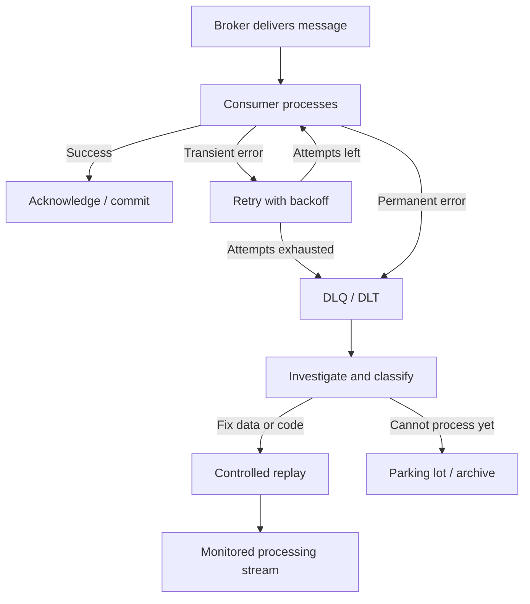

# Preventing Retry Loops and Isolating Repeatedly Failing Messages

In an event-processing system, a message can fail because a dependent service is temporarily unavailable, the data is invalid, or a programming bug occurs. Retrying helps recover from transient failures, yet if a message always fails and keeps getting redelivered, it can create a retry loop, consume resources, and slow down other messages. A toxic message or one that cannot be processed under the current contract is commonly called a *poison message*.

Spring Cloud Stream provides retries and integrates with binder dead-letter mechanisms to cap attempts and isolate failing messages. Good design classifies errors, bounds retries, sets backoff, moves unprocessable messages to a DLQ/DLT or parking lot, and provides a controlled workflow for investigation and replay. Specific configurations differ across Kafka, RabbitMQ, and Pulsar; no single setting guarantees identical semantics across every broker.

## 1. Why Do Retry Loops Appear?

Suppose a consumer receives an `OrderPlaced` event and calls an inventory service to reserve stock. If the inventory service temporarily loses connectivity, retrying after a pause may succeed. However, if the message lacks `orderId` or contains an unsupported schema, every attempt fails the same way.

A loop can form when:

1. The broker delivers the message to the consumer.
2. The consumer processes it and throws an exception.
3. The framework retries per its retry policy.
4. Once retries are exhausted, the message is rejected or redelivered by broker mechanics.
5. The broker continues delivering the same message.
6. The consumer runs the same operation again and fails.

If the broker requeues or redelivers indefinitely with no cap, the same message can monopolize the consumer continuously. Valid messages behind it can be delayed, backlogs grow, and logs repeat.

Distinguish two retry layers:

- **In-application/framework retry**: a single delivery can re-invoke the handler multiple times before deciding the final result.
- **Broker redelivery**: the broker redelivers the message after the consumer rejects, disconnects, or fails to record acknowledgment/offset.

If both layers retry without accounting for total deliveries, actual processing attempts can exceed expectations. Policies must clarify which layer owns retries and when a message moves to error storage.

## 2. Classifying Errors Before Configuring Retry

Not every error should be retried. Classify by recoverability:

| Error Type | Example | Handling Direction |
|---|---|---|
| Transient error | Inventory service timeout, brief DB disconnect, short-term rate limit | Bounded retry with backoff |
| Permanent data error | Missing required field, invalid format, unsupported event version | Do not retry repeatedly; route to DLQ/DLT |
| Unrecoverable business error | Order already canceled, state disallows transition | Per contract: controlled rejection or isolate for investigation |
| Prolonged config/infra error | Invalid credentials, missing topic/queue, revoked permissions | Stop or minimize retries, alert operations, and fix config |
| Programming bug | Null pointer, mapping error, handler bug | Bound retries, isolate message, and fix application |

Retry only helps when external state is likely to change over time. If a message cannot be processed due to an invalid schema, waiting a few extra seconds will not make the data valid.

Exceptions can be defined meaningfully:

```java
public class TransientInventoryException extends RuntimeException {
    public TransientInventoryException(String message, Throwable cause) {
        super(message, cause);
    }
}

public class InvalidOrderEventException extends RuntimeException {
    public InvalidOrderEventException(String message) {
        super(message);
    }
}
```

The handler should throw the appropriate exception instead of catching all errors and ignoring them:

```java
@Bean
Consumer<OrderPlaced> reserveInventory(InventoryService inventory) {
    return event -> {
        if (event.orderId() == null || event.orderId().isBlank()) {
            throw new InvalidOrderEventException("orderId is required");
        }

        inventory.reserve(event);
    };
}
```

Data errors are clearly classified so the retry policy avoids pointless repetition. Errors from the inventory service should be translated into transient exceptions if they can genuinely recover on a subsequent attempt.

## 3. Limiting Attempt Counts in Spring Cloud Stream

Consumer bindings support common retry properties. Example:

```yaml
spring:
  cloud:
    function:
      definition: reserveInventory
    stream:
      bindings:
        reserveInventory-in-0:
          destination: orders.placed
          group: inventory-service
          consumer:
            max-attempts: 4
            back-off-initial-interval: 1000
            back-off-max-interval: 10000
            back-off-multiplier: 2.0
```

Meaning:

- `max-attempts`: maximum processing attempts for a message in the framework's retry mechanism, including the first attempt.
- `back-off-initial-interval`: initial wait interval between attempts.
- `back-off-max-interval`: upper bound on the wait interval.
- `back-off-multiplier`: multiplier applied to the wait interval after each failure.

With the example settings, a message is tried at most four times in this retry layer. Wait intervals grow via backoff and are capped at the maximum value. Choose actual values based on downstream service timeouts and how long a message can wait.

Do not set `max-attempts` excessively high merely to avoid sending messages to the DLQ. Long retries hold failing messages for a long time, occupy consumer resources, and prolong processing for other messages. Some binders also have their own redelivery mechanisms; evaluate the total possible deliveries rather than looking only at `max-attempts`.

### Choosing Backoff

Back-to-back retries without waiting can create a *retry storm*: multiple consumers simultaneously calling an overloaded service again, making recovery even harder.

Increasing backoff helps relieve pressure:

```text
Attempt 1: failed
       |
       +-- wait 1 second
Attempt 2: failed
       |
       +-- wait 2 seconds
Attempt 3: failed
       |
       +-- wait 4 seconds
Attempt 4: failed
       |
       +-- attempts exhausted -> route to error handling / DLQ
```

In a system with multiple consumers, jitter can be added at the appropriate retry layer to keep instances from retrying in lockstep. Verify whether the retry mechanism in use supports jitter; do not assume Spring Cloud Stream's common properties provide a single shared jitter key across all binders.

## 4. Retry Only Recoverable Exceptions

If every exception is retried, data errors generate unnecessary load. You can configure a list of retryable exceptions using Spring Cloud Stream consumer properties. The example below illustrates the intent: retry only transient service failures while sending data errors straight down the error path.

```yaml
spring:
  cloud:
    stream:
      bindings:
        reserveInventory-in-0:
          consumer:
            max-attempts: 4
            default-retryable: false
            retryable-exceptions:
              com.example.TransientInventoryException: true
              com.example.InvalidOrderEventException: false
```

Exception map configuration requires fully qualified class names and must be verified against your project's Spring Cloud Stream version. When `default-retryable` is `false`, unlisted exceptions are not automatically retried under this policy.

A useful rule is avoiding overly generic exceptions for every failure. If a client throws `RuntimeException` for both timeouts and data errors, the adapter should classify or wrap the exception so the retry policy has enough information. Do not retry authentication failures, authorization errors, or malformed payloads as if they were temporary network blips.

## 5. Dead-Letter Queues and Dead-Letter Topics

Once a message exhausts retries or cannot be processed, it can be moved to a dedicated error destination:

- **DLQ (Dead-Letter Queue)** is commonly used in queue-based models such as RabbitMQ.
- **DLT (Dead-Letter Topic)** is commonly used in topic-based systems such as Kafka.
- In some documentation or binders, the term DLQ is used generically for a dead-letter destination even when the broker calls the resource a topic.

The purpose of a DLQ/DLT is to isolate failing messages from the main stream so consumers can keep processing valid messages. Failing messages must retain enough information to investigate and decide whether to replay.

A dead-letter record typically needs to retain or append:

- Original payload and content type/schema version.
- Event ID and correlation ID.
- Source destination and associated group/subscription.
- Timestamp of ingestion or dead-lettering.
- Exception class and useful error details.
- Delivery/retry attempt count if supplied by the binder.
- Metadata needed to recover or replay the message.

Do not place secrets, access tokens, or sensitive data into error headers. If payloads contain personal data or sensitive fields, the DLQ must enforce appropriate access control, retention periods, and auditing.

A DLQ does not fix messages automatically. It simply provides an isolated holding place so operations can investigate, repair data or applications, and perform controlled replay.

## 6. Configuring Dead-Lettering with the Kafka Binder

With the Kafka binder, a dead-letter topic is typically enabled on a consumer binding that has a group. Example configuration:

```yaml
spring:
  cloud:
    function:
      definition: reserveInventory
    stream:
      bindings:
        reserveInventory-in-0:
          destination: orders.placed
          group: inventory-service
          consumer:
            max-attempts: 3
      kafka:
        bindings:
          reserveInventory-in-0:
            consumer:
              enable-dlq: true
              dlq-name: orders.placed.inventory-service.dlq
```

The Kafka binder uses the consumer group to manage topic reads and route failing messages to the dead-letter topic when DLQ is enabled. Settings such as DLT partition count, producer properties for the DLT, and topic creation permissions depend on the binder version and deployment environment. If the DLT needs multiple partitions or is managed manually, configure/provision it per the binder docs.

When a message fails, the binder records the failure per the retry policy and sends the record to the DLT. Verify the producer's write permissions to the DLT; if writing to the dead-letter topic fails, the message may keep failing on the consumer path. Never merely enable `enable-dlq` and assume resources are ready in every environment.

## 7. Configuring Dead-Lettering with the Rabbit Binder

RabbitMQ uses exchanges and queues. The Rabbit binder can automatically declare a dead-letter exchange and queue for a consumer group. Example:

```yaml
spring:
  cloud:
    function:
      definition: reserveInventory
    stream:
      bindings:
        reserveInventory-in-0:
          destination: orders
          group: inventory-service
          consumer:
            max-attempts: 3
      rabbit:
        bindings:
          reserveInventory-in-0:
            consumer:
              auto-bind-dlq: true
              republish-to-dlq: true
```

`auto-bind-dlq` tells the binder to create/bind the dead-letter structure according to its rules. `republish-to-dlq` lets the binder republish failing messages along with exception details to the dead-letter destination as supported by the binder. Exchange names, queues, routing keys, TTLs, and queue arguments can be configured individually.

Distinguish broker dead-lettering from binder republishing:

- RabbitMQ can dead-letter a message when it is rejected/nacked without requeue, expires due to TTL, or exceeds queue limits per configuration.
- The binder can catch processing errors and republish the message with error metadata to the DLQ.
- Consumer acknowledgment and requeue policies determine whether the original message is acknowledged, returned to the queue, or dead-lettered.

Do not enable infinite requeuing for permanently failing messages. Verify `requeueRejected`, acknowledgment mode, and how the binder applies retries in your version. If the binder republishes to the DLQ, verify the application has publish permissions and the DLQ is properly declared.

## 8. Pulsar and Dead-Letter Policies

Pulsar manages subscriptions, acknowledgments, and redelivery. Consumers can configure negative acknowledgments or acknowledgment timeouts; subscriptions can use a dead-letter policy to move messages to a dead-letter topic after a bounded number of redeliveries.

Key concepts:

- **Negative acknowledgment**: consumer reports the message was not processed successfully and asks the broker to redeliver per policy.
- **Acknowledgment timeout**: messages not acked within a configured window can be redelivered.
- **Dead-letter policy**: sets redelivery limits and the target dead-letter topic.
- **Retry letter topic**: some designs use a separate topic to delay and manage retries before moving to dead-letter.

With the Spring Cloud Stream Pulsar binder, property names and configuration capabilities depend on the binder and Pulsar client versions. Verify how the binder maps `group` to a subscription, how the dead-letter policy is configured, and whether the binder auto-creates topics or requires pre-provisioning. Do not copy Kafka `enable-dlq` or Rabbit `auto-bind-dlq` settings to Pulsar.

Even with a broker redelivery policy, consumers should remain idempotent. A message can be redelivered if processing succeeded but the acknowledgment was lost or timed out.

## 9. Poison Messages and Parking Lots

A poison message is one that repeatedly fails and cannot be processed via ordinary retries. A DLQ isolates the message so the main stream does not stall. For systems requiring strict operational workflows, a **parking lot** can be added after the DLQ.

Suggested flow:



A parking lot can be a separate topic/queue or an operational archive store. It fits when messages must be kept longer than a typical DLQ retention window or await a business decision. Never continuously replay messages from a parking lot back into the main stream before the root cause is fixed.

A poison-message handling workflow should include:

1. Alerts when the DLQ grows or an event ID appears multiple times.
2. Lookup of payload, schema version, exception, and origin.
3. Identification of data error, compatibility error, business error, or code bug.
4. Data repair or deployment of a consumer version capable of handling it.
5. Choice between replaying all messages or only approved messages.
6. Replay rate limiting to avoid sudden load spikes.
7. Monitoring replay results and retaining an audit trail.

## 10. Avoid Adding Extra Retry Loops at the Application Layer

A common cause of retry storms is retrying the same operation across multiple layers:

- HTTP client self-retries.
- Business service has its own retry loop.
- Spring Cloud Stream retry handler.
- Broker redelivery.
- Operational DLQ replay job.

For example, if the HTTP client tries three times, the framework tries four times, and the broker redelivers five times, one message can trigger far more downstream calls than expected. Map all retry layers and establish an overall budget.

Design principles:

- Retry only at the layer that has enough context to distinguish transient from permanent errors.
- Set per-call timeouts and an overall per-message deadline.
- Avoid unbounded nested retries.
- Use backoff and jitter when multiple instances may retry simultaneously.
- Keep the event ID stable across retries.
- Ensure business operations are idempotent.
- Route messages exceeding the retry budget to a DLQ or parking lot.

Do not catch exceptions in a function and return normally when the message was not processed. Doing so can make the framework/binder treat the message as successful and skip intended retries or DLQ routing.

## 11. Idempotency When Messages Are Redelivered

Retries and redelivery mean the same message may be processed multiple times. Consumers must ensure repeated processing does not create duplicate side effects.

A common approach is storing the processed event ID in the same transaction as the business change:

```java
@Service
public class OrderEventHandler {

    private final ProcessedEventRepository processedEvents;
    private final OrderRepository orders;

    public OrderEventHandler(
            ProcessedEventRepository processedEvents,
            OrderRepository orders) {
        this.processedEvents = processedEvents;
        this.orders = orders;
    }

    @Transactional
    public void handle(OrderPlaced event) {
        if (processedEvents.existsById(event.eventId())) {
            return;
        }

        orders.apply(event);
        processedEvents.save(
            new ProcessedEvent(event.eventId())
        );
    }
}
```

The example assumes updating the order and recording the event ID share one database transaction, with a unique constraint on the event ID. If two consumers might process the same event concurrently, handle unique-constraint conflicts explicitly. Checking existence before writing does not prevent race conditions on its own.

If calling an external service outside the database transaction, use an idempotency key supported by that service or record processing state in a recoverable workflow. Local transactions cannot guarantee exactly-once across brokers and external services.

## 12. Safe DLQ Replay

Replaying a DLQ is an operational action, not an unbounded automated loop. Before replaying:

- Confirm the root cause has been fixed.
- Verify the updated consumer supports the message's schema version.
- Preserve the original event ID and provenance info so deduplication works.
- Scope messages to replay by event ID, time window, or error type.
- Run a small test batch with rate limiting.
- Monitor for new errors, duplicates, and business impact.
- Record operator, timestamp, reason, and outcome.

If a message failed due to bad data, fix it through an audited process or route it to manual handling. Never silently edit payloads inside the DLQ without recording the change. If a message was partially processed, inspect business state before replaying to avoid repeating side effects.

## 13. Testing Retry, DLQ, and Poison Messages

Test the following cases:

1. Transient failure on the first attempt, success on a subsequent attempt.
2. Persistent failure until `max-attempts` is exhausted.
3. Permanent data errors are not retried multiple times.
4. Messages route to the right DLQ/DLT.
5. DLQ unavailable or producer lacks write permission.
6. Consumer restarts mid-processing.
7. Broker redelivery with the same event ID.
8. DLQ replay after fixing the root cause.
9. Multiple retry layers do not multiply attempts beyond budget.
10. Oversized messages or unsupported schemas are properly isolated and observed.

Unit tests can verify exception classification and idempotency logic. Spring Cloud Stream Test Binder helps check application-level wiring/error handling, though it does not replace a real broker. Use Testcontainers or a dedicated integration environment to verify Kafka DLT, Rabbit dead-letter exchange/queue, or Pulsar dead-letter policies.

When testing attempt counts, verify how many times the handler was actually invoked and distinguish framework retries from broker redeliveries. Do not rely solely on checking a single log line, as logs may be emitted across multiple layers.

## 14. Production Checklist

- Classify exceptions into transient, permanent, and configuration/programming errors.
- Set finite `max-attempts` and bounded backoff.
- Do not retry unrecoverable data or business errors.
- Audit retry layers across HTTP clients, services, framework, and broker to avoid multiplicative retries.
- Enable and provision a binder-appropriate DLQ/DLT.
- Ensure stable consumer groups/subscriptions with write permissions to the dead-letter destination.
- Preserve event ID, content type, schema version, and essential diagnostic metadata.
- Configure retention, TTL, access control, and alerts for the DLQ.
- Design idempotent consumers to withstand redelivery and replay.
- Establish workflows for investigation, remediation, replay, and auditing.
- Test against real brokers for retry exhaustion, DLQ failure, and poison messages.

## 15. References

- [Spring Cloud Stream Reference — Consumer Properties](https://docs.spring.io/spring-cloud-stream/reference/spring-cloud-stream/binding-properties.html), retry and consumer binding properties section.
- [Spring Cloud Stream Kafka Binder](https://docs.spring.io/spring-cloud-stream/reference/kafka/kafka-binder/index.html), dead-letter topic and consumer error handling section.
- [Spring Cloud Stream Rabbit Binder](https://docs.spring.io/spring-cloud-stream/reference/rabbit/rabbit_overview.html), dead-letter exchange/queue and retry section.
- [Apache Pulsar Documentation — Messaging](https://pulsar.apache.org/docs/), negative acknowledgment, redelivery, and dead-letter policy section.

Bounded retries handle transient failures; DLQ/DLT isolates unprocessable messages so the main stream keeps advancing. Preventing retry loops requires coordinating exception classification, retry budgets, backoff, broker redelivery policies, and idempotency. With alerting, replay procedures, and real-broker tests in place, poison messages can be investigated and recovered without trapping the system in an infinite loop.
