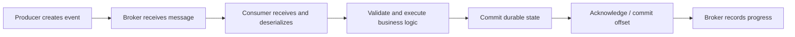
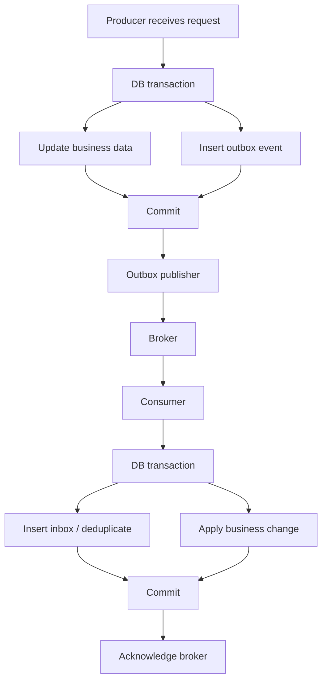

# Defining the Business Completion Point and Acknowledgement Timing

In a Spring Cloud Stream application, receiving a message does not mean the business operation is complete. A consumer may have read and deserialized the message without writing data yet; it may have written to the database without acknowledging to the broker yet; or it may have called an external service without knowing the final outcome. To achieve reliable delivery, the team must define precisely what counts as "processing completed" and only acknowledge the message after reaching that completion point.

The business completion point depends on the effect the message represents. For an `OrderCreated` event, it might be when the inventory reservation state and the processed marker are committed in the same database transaction. For an email-sending command, it might be when the email provider accepts the request and the request ID is durably stored. For a multi-service workflow, there is no single local transaction covering the entire flow; each step must record its state and be able to continue or compensate.

An acknowledgement is a signal to the broker or message source indicating that the consumer has processed up to a certain point. It does not automatically create a distributed transaction with the database, does not prove an external service has finished, and does not automatically guarantee exactly-once processing. Therefore, a sound design needs to combine a clear completion point, appropriate ack timing, idempotency, and recovery mechanisms.

## 1. Distinguishing Milestones in the Message Lifecycle

A message typically passes through several distinct milestones:



These milestones are not interchangeable:

| Milestone | Meaning | What does it not prove yet? |
|---|---|---|
| Producer calls `send` | The application requests sending a message | That the broker persisted it or the consumer received it |
| Producer receives send result/confirm | The broker or client confirms according to the producer's configured mechanism | That the consumer has processed the business logic |
| Consumer receives message | Bytes have arrived at the consumer | That the payload is valid or business logic is complete |
| Deserialization succeeds | A Java object of the target type can be constructed | That the data is valid in business terms |
| Handler returns normally | Handler code finished in the application flow | That database/external side effects committed if they run asynchronously |
| Database transaction commits | State within the transaction boundary is durable according to the database | That the broker has recorded the acknowledgement |
| Consumer ack/offset commit | The broker records progress according to its semantics | That side effects outside that transaction have completed |

In particular, `StreamBridge.send(...)` returning `true` only indicates that the send operation was accepted according to the channel contract. That result is not a consumer acknowledgement. Similarly, a "message received" log is not proof that the business state has been updated.

## 2. Defining the Business Completion Point

Before choosing an ack mode, write a single sentence describing the condition under which a message is considered processed. That sentence must specify which data was written, which side effect was performed, and which condition must hold.

Examples:

| Message | Candidate completion point | Evidence to store |
|---|---|---|
| `OrderCreated` | Inventory reservation succeeds or the order transitions to rejected with a reason | Order state, inventory change, and processed `eventId` |
| `PaymentRequested` | Payment provider accepted the request or the transaction is recorded as needing reconciliation | Provider reference, idempotency key, and payment state |
| `InvoiceGenerated` | Invoice file is durably stored and invoice metadata is committed | File reference, checksum, and invoice record |
| `NotificationRequested` | Notification provider accepted the send request | Provider message ID and send status |
| `InventorySnapshot` | Valid snapshot is written to the target data store | Snapshot version, timestamp, and checksum |

Not every outcome is "success". A message can validly complete by business rejection, quarantining invalid data, or recording a state that requires manual intervention. The important point is that the outcome must be durably stored and verifiable before acknowledging the original message.

A useful definition should answer four questions:

1. Which business effect must occur?
2. Where is that effect stored, and when does the transaction commit?
3. If the same `eventId` is redelivered, how do we know it is already complete?
4. If it cannot be completed, will the message be retried, requeued, sent to a DLQ, or handed off to a compensation flow?

## 3. Basic Rule: Commit Business State First, Ack Afterward

For a synchronous consumer updating a database, the typical order is:

1. Receive the message and validate the schema/data.
2. Start the database transaction.
3. Apply the business changes and record the processed `eventId` marker.
4. Commit the transaction.
5. Let the binder acknowledge the message or perform ack according to the configured mechanism.

Example of a function consumer calling a transactional service:

```java
@Bean
Consumer<OrderCreated> handleOrder(InventoryService inventoryService) {
    return event -> inventoryService.reserveOnce(event);
}

@Service
public class InventoryService {
    private final ProcessedEventRepository processedEvents;
    private final InventoryRepository inventory;

    public InventoryService(
            ProcessedEventRepository processedEvents,
            InventoryRepository inventory) {
        this.processedEvents = processedEvents;
        this.inventory = inventory;
    }

    @Transactional
    public void reserveOnce(OrderCreated event) {
        if (processedEvents.existsById(event.eventId())) {
            return;
        }

        int updated = inventory.reserveIfAvailable(
                event.productId(), event.quantity());
        if (updated != 1) {
            throw new InsufficientInventoryException(event.productId());
        }

        processedEvents.save(new ProcessedEvent(event.eventId()));
    }
}
```

The example assumes `reserveIfAvailable` performs a conditional update in the database and returns the number of updated rows. The `processed_event` table needs a unique constraint on `event_id`; checking `existsById` alone does not prevent two concurrent transactions from processing the same event. Conditional inserts, catching unique constraint violations, or an equivalent inbox mechanism can be used to handle race conditions.

The transaction must commit before the business method returns normally. Ensure `@Transactional` is applied properly through a Spring proxy, avoid self-invocation that bypasses the proxy, and avoid offloading work to another thread inside the transaction while assuming the new thread shares the same transaction.

With a standard message-driven consumer, the binder manages acknowledgement based on the binding and broker mechanisms. Do not add manual ack calls if the binder is already managing commit/ack, unless the binder's configuration and API require it. Check the actual acknowledgement mode and verify it with integration tests.

## 4. What Happens If You Ack Too Early?

If the consumer acknowledges a message before the business state is committed, lost processing can occur:

1. Consumer receives `OrderCreated`.
2. Consumer acks the message.
3. The process stops before writing inventory.
4. The broker considers the message complete and does not redeliver it according to the acknowledged progress.
5. The order exists, but the inventory was never reserved.

This is the gap between acknowledgement and business effect. Early ack is only appropriate when the message has been safely handed off to another durable storage layer that takes responsibility for subsequent processing. For example, if the consumer writes the message to an inbox table and commits the transaction, it can ack the broker after the inbox record is saved; another worker then processes the inbox according to its status. Merely placing the message onto an in-memory executor or queue is not a durable handoff.

For asynchronous processing, do not ack immediately after submitting the task:

```java
// Unsafe: the task is only queued in the executor, business logic has not completed.
processingExecutor.execute(() -> inventoryService.reserveOnce(event));
// If the callback/binder acks here, a process crash can lose tasks sitting in RAM.
```

If you need to decouple message reception from long-running processing, write the payload and metadata to an inbox/durable work table inside a transaction, then ack. A worker reads unprocessed records from the database and updates the completion state in its own transaction.

## 5. What Happens If You Ack Too Late?

If the business state has committed but the consumer stops before the broker receives the acknowledgement, the broker may redeliver the message. This is the common duplicate window in an at-least-once model.

Example:

1. Consumer receives `evt-101`.
2. Database commits the inventory change and records `evt-101` in the processed table.
3. Process stops before acking the broker.
4. After restart, the broker redelivers `evt-101`.
5. Consumer checks the inbox/processed event, sees the event is already complete, and does not apply the change again.
6. Consumer acknowledges the redelivered message.

Therefore, the practical goal is usually **at-least-once delivery combined with idempotent processing**, rather than assuming a message is only ever delivered once. Redelivery is not necessarily a broker bug; it is a normal consequence when the broker cannot be certain how far the consumer got after a network or process failure.

## 6. Idempotency and the Inbox Pattern

Idempotency means processing the same request or event multiple times produces no additional business effects beyond the intended outcome. To achieve this, the producer must emit a stable `eventId` and the consumer must store a durable processing marker.

A simple inbox table might include:

| Column | Purpose |
|---|---|
| `event_id` | Unique key identifying the event |
| `event_type` | Event type |
| `received_at` | Timestamp when the consumer recorded it |
| `status` | `RECEIVED`, `PROCESSING`, `COMPLETED`, or `FAILED` by design |
| `payload_ref` | Reference to the payload if stored separately |
| `processed_at` | Timestamp when business processing completed |
| `failure_reason` | Categorized failure reason |

When the effect lives in the same database, the inbox record and the business changes should be updated in the same transaction. A unique constraint on `event_id` prevents two consumers from creating two records for the same event.

```java
@Transactional
public ProcessingResult processOnce(OrderCreated event) {
    if (inboxRepository.existsByEventId(event.eventId())) {
        return ProcessingResult.ALREADY_COMPLETED;
    }

    inboxRepository.insertReceived(event.eventId(), "OrderCreated");
    inventoryRepository.reserveIfAvailable(event.productId(), event.quantity());
    inboxRepository.markCompleted(event.eventId(), Instant.now());
    return ProcessingResult.COMPLETED;
}
```

This is a simplified example. In a concurrent system, `insertReceived` must rely on a unique constraint and handle duplicate conflicts deterministically. If the transaction rolls back, both the inbox marker and the inventory change roll back together. If the transaction commits, a redelivery can recognize that the event has already completed.

Do not use an in-memory cache or `ConcurrentHashMap` as a business inbox. A cache can be lost on restart, is not shared across multiple instances, and is not synchronized with database transactions.

## 7. Producer Confirms and Consumer Acknowledgements Are Different Directions

A system has at least two confirmation directions:

| Mechanism | Who confirms to whom? | Question answered |
|---|---|---|
| Producer confirm/send result | Broker/client responds to producer | Did the broker receive or confirm the publish under the configured mechanism? |
| Consumer acknowledgement/offset commit | Consumer reports to broker | Up to which position has the consumer processed according to broker semantics? |

A producer confirm does not prove the consumer processed the message. Likewise, a consumer ack does not prove the producer saved the original business change atomically with publishing.

For example, a service updates an order in the database and then sends `OrderCreated`. If the process stops after the database commit but before publishing, the database has the order while the broker has no event. If it publishes first and then the database rolls back, the consumer may process an event that has no corresponding state in the source system.

This is the dual-write problem. For critical events, a transactional outbox solves this by writing the business change and the outbox record in the same database transaction. A publisher reads the outbox, sends the message, and marks it published after receiving the appropriate send result. If the publisher stops after the broker receives the message but before marking the outbox, the message may be sent again; the consumer still needs idempotency.

## 8. How Outbox and Inbox Work Together

Outbox solves reliability on the publishing side; inbox/idempotency solves duplicate processing on the receiving side.



In the diagram:

- The producer commits business data and the outbox record together.
- The outbox publisher can retry when the broker has not confirmed sending.
- The consumer stores the event marker and business effect inside a transaction.
- The consumer acks after the transaction commits.
- If the message is redelivered, the inbox recognizes the processed event and the consumer can ack without repeating side effects.

Outbox does not by itself guarantee a message is published only once. It guarantees the event is not separated from the transaction that created it; the publisher can still publish duplicates when the send result is indeterminate after a network error. Inbox/idempotency completes the receiving side.

## 9. When Business Logic Calls Services Outside the Database

A database transaction cannot automatically roll back a sent email, an accepted payment request, or a file written to object storage. An appropriate completion point must be defined for each side effect.

Example with payments:

1. Consumer receives `PaymentRequested`.
2. Call the payment provider with an idempotency key derived from `eventId`.
3. Provider returns a reference or an indeterminate status due to a timeout.
4. Persist the result/reference and request status in the database.
5. Only ack once the application has stored enough state to continue or reconcile.

If a timeout occurs after the provider accepted the payment but before the consumer received the response, do not send a new request with a different key. Query the status using the idempotency key/reference or retry with the same key according to the provider's contract.

For multi-step processes, use a Saga or workflow state machine to record each step's state and define compensating actions. For example, if inventory reservation succeeds but payment fails, the system can emit `ReleaseInventory`. Acking `PaymentRequested` should only occur once the request state is durably saved so the workflow can continue; there is no need to wait for the entire saga to finish if that message is only responsible for initiating a step that has been durably recorded.

## 10. Completion Points and Acknowledgements by Broker

Spring Cloud Stream provides a common abstraction, but Kafka, RabbitMQ, and Pulsar record progress differently. Do not apply a single identical mental model of "ack message" to all three.

| Broker | How progress is recorded | Consequence of acknowledgement |
|---|---|---|
| Kafka | Commit offset per consumer group and partition | Offset represents the next position to read; commit tracks partition progress, not an independent per-record queue ack for arbitrary records |
| RabbitMQ | Acknowledge delivery tag on channel | Broker removes the message from unacknowledged state; if the channel/connection is lost before ack, unacknowledged messages may be redelivered |
| Pulsar | Acknowledge message per subscription; some subscriptions support cumulative ack with specific limits | Cursor/subscription advances based on acknowledgement type and subscription type |

### 10.1. Kafka: Commit Offset After Processing the Right Scope

Kafka stores logs per partition. A consumer group commits offsets for each partition. When an application commits an offset too early, records can be skipped after a restart even though business logic did not complete. When it commits too late, already-processed records may be read again.

With concurrent processing within the same partition, extra care is required: if record offset 12 finishes before offset 11, you cannot simply commit up to 13 and assume 11 is done. Offset commit tracks sequential progress of the partition. Use the Kafka binder or Kafka client acknowledgement/commit mechanisms suited for your concurrency and ordering guarantees, and test out-of-order completion cases.

### 10.2. RabbitMQ: Ack Delivery After Transaction

RabbitMQ keeps messages in an unacknowledged state after delivering them to a consumer. When the consumer acks the delivery, the broker can remove the message from the queue. If the consumer or channel is lost before ack, the broker can redeliver it. `prefetch` limits the number of unacknowledged messages delivered to a consumer; setting it too high can hold many messages in memory at once and increase recovery time when a consumer dies.

For long-running messages, consider acknowledgement timeout, prefetch, consumer count, and dead-lettering capabilities. Ack after the database transaction commits; for transient errors, use bounded retry/requeue to avoid tight hot loops.

### 10.3. Pulsar: Ack by Subscription

Pulsar maintains cursors per subscription. Consumer acknowledgements update the processed state of messages. Subscription type and acknowledgement type affect how consumers coordinate and maintain ordering. With a Shared subscription, individual ack is typically more appropriate when multiple consumers process concurrently; cumulative ack may not fit the subscription type or may acknowledge earlier messages as well. Check the client/binder documentation for the deployed version.

Across all three brokers, ack should only follow the completion point defined by the application. Broker-specific settings must be tested individually rather than relying on similar-sounding configuration names.

## 11. Reactive Consumers and Completion Points

With a reactive function `Function<Flux<T>, Flux<R>>`, the framework manages the pipeline subscription. Do not manually call `subscribe()` and treat creating the subscription as completion. A pipeline can emit results before side effects inside a publisher finish if code splits work into an unchained task.

For example, if a service returns `Mono<Void>`, compose it into the pipeline:

```java
@Bean
Function<Flux<OrderCreated>, Flux<OrderAccepted>> processOrders(
        ReactiveOrderService service) {
    return orders -> orders.concatMap(event ->
            service.processTransactionally(event)
                    .thenReturn(new OrderAccepted(event.eventId(), event.orderId())));
}
```

`concatMap` waits for the inner publisher to complete before emitting the corresponding result and preserves output order. Using `doOnNext` to trigger a fire-and-forget call or calling `subscribe()` inside can allow the outer pipeline to finish before the side effect. With a reactive database, the transaction must cover the publisher properly and only complete when the publisher commits successfully.

You still need to verify how the binder ties lifecycle, acknowledgement, and output sends to reactive functions. Returning a `Flux<R>` does not automatically make the transaction between broker and database atomic. The consumer still needs idempotency because the broker can redeliver when downstream completes but the acknowledgement was not recorded.

## 12. Retry, Reject, and DLQ Based on Completion Point

When processing fails, the retry decision should be based on whether the error is transient and the current business state:

| Scenario | Business state | Handling approach |
|---|---|---|
| Database timeout before commit | Transaction incomplete | Bounded retry; do not ack success |
| Database commit succeeds, ack is lost | Business logic complete | Accept redelivery and deduplicate by event ID |
| Payload fails schema validation | Cannot be processed with current version | Quarantine/DLQ, do not retry infinitely |
| Business rule rejection | Rejection may be the final outcome | Persist rejection status and reason, then ack if that is the defined completion point |
| External API timeout, unknown result | Side effect state indeterminate | Query status or retry with the same idempotency key; do not ack until durable state exists to continue |
| DLQ publish succeeds but original message ack fails | Message may be redelivered and enter DLQ again | Use event ID to prevent duplicate quarantine records; check publisher confirms |

DLQ is not an automatic completion point. If the workflow defines quarantine as the final outcome, ensure the DLQ record/message has been successfully saved before acking the original message. If DLQ publishing fails, preserve the ability to retry or recover the original message.

## 13. Observing Completion Timing

To tell whether consumers are acking at the right time, logs and metrics should distinguish these milestones:

- Time the message was received and processing started.
- Time the transaction started and time it committed/rolled back.
- Time external side effects were confirmed or moved to a reconciliation state.
- Time the acknowledgement/offset commit was sent.
- Redelivery count, retry count, and DLQ status.
- Latency from publish to receive, from receive to business commit, and from commit to ack.

Context fields should include `eventId`, `correlationId`, destination, group/subscription, and partition/offset or message ID when available. Do not log full sensitive payloads. Set alerts when the gap between business commit and ack spikes abnormally, duplicate counts rise, messages remain in-flight too long, or DLQ rates surge.

## 14. Testing Failure Windows

A test that only verifies a consumer received a message is not enough. Test the critical crash points:

1. Stop the process after receiving a message but before the transaction.
2. Force the transaction to roll back and verify the message can be retried.
3. Stop the process after DB commit but before ack; verify the message is redelivered and idempotency prevents duplicate side effects.
4. Disconnect the broker right at ack/offset commit; verify the outcome when the consumer restarts.
5. Send the same event ID twice concurrently; verify unique constraints and transactions protect the data.
6. Make an external service time out after accepting a request; verify the same idempotency key is used on retry/reconciliation.
7. Force DLQ publishing to fail; verify the original message is not acked as successfully quarantined.
8. Test restart, rebalance, redelivery, and shutdown under the actual binder configuration.

Test Binder is suitable for verifying certain in-application integration flows, but it does not replace a real broker for offsets, acknowledgements, durability, transactions, and redelivery. Required delivery guarantees must have integration tests against Kafka, RabbitMQ, or Pulsar accordingly.

## 15. Pre-Deployment Checklist

- [ ] Define the business completion point with a verifiable condition.
- [ ] Identify which data must commit before a message is acknowledged.
- [ ] Do not ack merely because a message was received, deserialized, or submitted to an in-memory executor.
- [ ] Commit the database before acking when business effects live in the database.
- [ ] Have a stable `eventId` and an inbox/unique-constraint mechanism to handle redelivery.
- [ ] Use an outbox when database changes and event publishing must stay consistent.
- [ ] For external side effects, use idempotency keys, durable state, or a Saga/workflow.
- [ ] Understand that producer confirms differ from consumer acknowledgements.
- [ ] Configure ack/offset according to the semantics of the binder and broker.
- [ ] Classify retry, reject, and DLQ actions based on business state.
- [ ] Test crash-after-commit-before-ack, duplicates, timeouts, and DLQ failures.
- [ ] Monitor business commits, ack latency, redeliveries, backlog, and DLQs.

The business completion point is the milestone where the application has sufficient durable evidence to assert that a message has been processed or handed off to an accountable recovery process. For a consumer updating a database, that milestone is typically the transaction commit; acknowledgement should occur after this milestone. Because the broker and database do not automatically form an atomic transaction, the design must tolerate redelivery, use idempotency, and test failure windows so business effects are neither lost nor duplicated.
