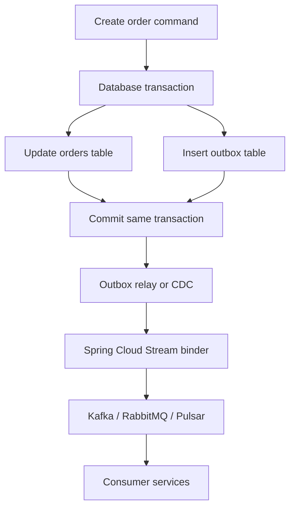

# The Gap Between Database Writes and Event Publishing

A Spring Cloud Stream service often updates business data in a database while also publishing events to Kafka, RabbitMQ, or Pulsar. For example, when creating an order, the application writes the order to the database and emits `OrderCreated` so payment, inventory, and notification services can continue processing.

These two operations typically span two independent storage systems. A database transaction does not automatically cover sending a message to a broker. If the application writes to the database successfully and stops before sending the message, the business state has changed but other services are unaware. If it sends the message first and then the database rolls back, consumers may receive an event describing a change that was never committed.

The window of time and failure modes between those two writes is known as the *dual-write problem*. This lesson analyzes those failure windows and explains how to use transactional outbox, CDC, idempotency, and retry mechanisms to keep data and event streams consistent.

## 1. Why Do Two Write Operations Create a Gap?

A naive processing flow might look like this:

```java
@Transactional
public Order createOrder(CreateOrderCommand command) {
    Order order = orderRepository.save(Order.create(command));
    streamBridge.send("orders.created", toEvent(order));
    return order;
}
```

`@Transactional` typically manages the database transaction configured for the repository. `streamBridge.send` sends a message through the binder to the broker. Unless the database and broker participate in a properly configured distributed transaction, the two operations have no shared atomic commit point.

Possible failure scenarios:

| Ordering | Failure | Outcome |
| --- | --- | --- |
| Write database then send message | Database commits, process stops before sending | Data exists, but no event was published |
| Write database then send message | Broker is temporarily unavailable and send fails | Data is committed, but the event has not been emitted |
| Send message then write database | Broker receives message, then database rolls back | Consumer processes an event with no corresponding change in the database |
| Send message then write database | Broker receives message, but application disconnects before receiving send result | Application does not know whether the message was received; retry may create duplicates |
| Send message inside database transaction | Database rolls back after broker already received message | Database transaction cannot automatically retract the already-published message |

Placing both calls side by side in the same `@Transactional` method does not make them one atomic transaction. The database transaction manager and broker transactions have separate lifecycles unless the system implements an appropriate distributed transaction coordination mechanism.

## 2. Why Does Sending After Commit Still Carry Risk?

A common improvement is to send events only after the database transaction commits, such as via transaction synchronization or `@TransactionalEventListener(phase = AFTER_COMMIT)`.

```java
@Transactional
public Order createOrder(CreateOrderCommand command) {
    Order order = orderRepository.save(Order.create(command));
    applicationEventPublisher.publishEvent(new OrderSaved(order.getId()));
    return order;
}

@TransactionalEventListener(phase = TransactionPhase.AFTER_COMMIT)
public void publishOrderCreated(OrderSaved event) {
    Order order = orderRepository.findById(event.orderId()).orElseThrow();
    streamBridge.send("orders.created", toEvent(order));
}
```

This avoids publishing events before the database transaction commits successfully. However, it still does not guarantee the event is reliably emitted:

1. Database commits successfully.
2. The process stops or the host loses power before the `AFTER_COMMIT` listener runs.
3. The database change persists, but there is no message in the broker.

Post-commit listeners are useful when best-effort delivery is acceptable or when another recovery mechanism exists. For critical events, a record of the event must be persisted in the same database transaction so it can be replayed after a process crash.

## 3. How Does the Transactional Outbox Close the Gap?

Transactional outbox is a pattern that persists events to be published in an outbox table within the same database holding the business data. The business change and the outbox record are written in the same database transaction.

A separate relay process reads unpublished outbox records, sends them to the broker, and marks them as published. If the application process stops before the relay sends, the outbox record remains available for later processing. If the database transaction rolls back, both the business change and the outbox record roll back together.



Outbox makes *the business change and the intent to publish the event* atomic in the database. Delivering the outbox record to the broker remains a separate step and typically has at-least-once semantics; consumers must therefore tolerate duplicate messages.

## 4. Designing the Outbox Table

An outbox table must store enough information for the relay to emit the message without reconstructing the event from the current state of the aggregate.

Example conceptual schema:

```sql
CREATE TABLE outbox_event (
    event_id           VARCHAR(36) PRIMARY KEY,
    aggregate_type     VARCHAR(100) NOT NULL,
    aggregate_id       VARCHAR(100) NOT NULL,
    aggregate_sequence BIGINT NOT NULL,
    event_type         VARCHAR(150) NOT NULL,
    payload            TEXT NOT NULL,
    content_type       VARCHAR(100) NOT NULL,
    created_at         TIMESTAMP NOT NULL,
    published_at       TIMESTAMP NULL,
    attempts           INTEGER NOT NULL DEFAULT 0,
    next_attempt_at    TIMESTAMP NULL,
    lock_owner         VARCHAR(100) NULL,
    locked_until       TIMESTAMP NULL
);

CREATE INDEX idx_outbox_pending
    ON outbox_event (published_at, next_attempt_at, created_at);

CREATE UNIQUE INDEX uq_outbox_aggregate_sequence
    ON outbox_event (aggregate_type, aggregate_id, aggregate_sequence);
```

This is an illustrative schema; data types, index syntax, and locking strategy must be adapted to the actual database. Key fields include:

- `event_id`: unique identifier, stable across all retries; consumers use it to detect duplicate messages.
- `aggregate_type` and `aggregate_id`: identify the business entity described by the event.
- `aggregate_sequence`: sequence number of events for an aggregate, useful when preserving order.
- `event_type`: event type such as `OrderCreated` or `OrderCancelled`.
- `payload`: event payload captured at transaction commit time.
- `content_type`: payload format, such as `application/json`.
- `published_at`: timestamp when the relay confirmed successful sending per application criteria.
- `attempts` and `next_attempt_at`: support backoff retries.
- `lock_owner` and `locked_until`: allow multiple relay workers to process concurrently without actively claiming the same record.

Not every implementation needs all of these columns. What matters is having a stable event ID, a deterministic payload, recoverable processing state, and suitable worker coordination.

## 5. Writing Business Data and the Outbox in the Same Transaction

The business service updates the aggregate and inserts the outbox event inside the same transaction. Example using Spring Data JPA:

```java
import java.time.Instant;
import java.util.UUID;

import org.springframework.stereotype.Service;
import org.springframework.transaction.annotation.Transactional;

@Service
public class OrderApplicationService {

    private final OrderRepository orderRepository;
    private final OutboxRepository outboxRepository;
    private final ObjectMapper objectMapper;

    public OrderApplicationService(
            OrderRepository orderRepository,
            OutboxRepository outboxRepository,
            ObjectMapper objectMapper) {
        this.orderRepository = orderRepository;
        this.outboxRepository = outboxRepository;
        this.objectMapper = objectMapper;
    }

    @Transactional
    public Order create(CreateOrderCommand command) {
        Order order = orderRepository.save(Order.create(command));
        OrderCreated event = new OrderCreated(
                order.getId(), order.getCustomerId(), order.getTotal());

        outboxRepository.save(new OutboxEvent(
                UUID.randomUUID(),
                "Order",
                order.getId(),
                order.getVersion(),
                "OrderCreated",
                serialize(event),
                "application/json",
                Instant.now()));

        return order;
    }

    private String serialize(Object event) {
        try {
            return objectMapper.writeValueAsString(event);
        }
        catch (JsonProcessingException ex) {
            throw new IllegalStateException("Cannot serialize outbox event", ex);
        }
    }
}
```

The types `Order`, `OrderCreated`, `OutboxEvent`, repositories, and `ObjectMapper` are illustrative models/beans defined in the project. If serialization fails, the exception must roll back the transaction so business changes are not persisted without an outbox event.

Crucially, both `save` calls must use the same transaction manager and database transaction. If the outbox resides in a separate database, atomicity is no longer guaranteed by standard `@Transactional`.

## 6. Relay Reading Outbox and Sending with Spring Cloud Stream

The relay fetches unpublished records, turns the payload into a message, and sends it via `StreamBridge`. The relay can run on a schedule or as a continuous worker.

Conceptual processing flow:

1. Claim a batch of unprocessed outbox events, acquiring a lease so other workers do not claim them simultaneously.
2. Commit the claim so a database transaction is not held open while calling the broker.
3. Send each event to the appropriate destination using `StreamBridge`.
4. Once the send is confirmed per the binder's criteria, mark the event as published.
5. If sending fails, increment `attempts` and set `next_attempt_at` with backoff; after a configured threshold, move the event to a state requiring intervention.

Example of sending a single event:

```java
import org.springframework.cloud.stream.function.StreamBridge;
import org.springframework.messaging.Message;
import org.springframework.messaging.MessageHeaders;
import org.springframework.messaging.support.MessageBuilder;
import org.springframework.stereotype.Component;
import org.springframework.util.MimeTypeUtils;

@Component
public class OutboxPublisher {

    private final StreamBridge streamBridge;

    public OutboxPublisher(StreamBridge streamBridge) {
        this.streamBridge = streamBridge;
    }

    public boolean publish(OutboxEvent event) {
        Message<String> message = MessageBuilder
                .withPayload(event.payload())
                .setHeader("eventId", event.eventId().toString())
                .setHeader("eventType", event.eventType())
                .setHeader("aggregateId", event.aggregateId())
                .setHeader(MessageHeaders.CONTENT_TYPE,
                        MimeTypeUtils.parseMimeType(event.contentType()))
                .build();

        return streamBridge.send("orders-out-0", message);
    }
}
```

This illustrative snippet assumes binding `orders-out-0` is configured and the payload is stored as a JSON string. In systems with multiple event types, the relay can map event type or aggregate type to a controlled set of destinations. Do not take arbitrary destination names directly from untrusted external data.

Returning `true` from `StreamBridge.send` indicates the send operation was accepted according to the API/binder contract; do not interpret it as meaning the target consumer finished business processing. For a relay that must mark the outbox only after an appropriate send confirmation, inspect the producer semantics of the binder and broker (such as Kafka producer acknowledgements, Rabbit publisher confirms, or Pulsar send acknowledgements). If you mark it right after placing the message onto an internal channel, and an asynchronous send failure occurs afterward, the relay could falsely mark the event as published. Choose confirmation APIs/callbacks suited to your binder and test actual send failures.

## 7. Why Can an Outbox Still Publish Duplicates?

Suppose the relay sends a message successfully, but the process stops before updating `published_at`:

1. Relay reads event `E-123` from the outbox.
2. Broker receives message `E-123`.
3. Relay stops before marking the event as published.
4. Lease expires; another relay reads `E-123` again.
5. Broker receives another copy of `E-123`.

If `published_at` were marked before sending, a failure could lose the message: the database records it as published while the broker never received it. Because there is no shared atomic transaction between the database and the broker in a standard relay model, safe designs prioritize not losing events and accept possible duplicate publishes.

This is why transactional outbox typically provides *at-least-once* semantics at the relay stage. For the system to process events accurately, consumers need idempotency based on `eventId` or a stable business key.

## 8. Consumer Idempotency

Consumers should record processed event IDs in the same transaction as the business changes they perform. Example inbox/deduplication table:

```sql
CREATE TABLE processed_event (
    consumer_name VARCHAR(100) NOT NULL,
    event_id       VARCHAR(36) NOT NULL,
    processed_at   TIMESTAMP NOT NULL,
    PRIMARY KEY (consumer_name, event_id)
);
```

Processing flow:

1. Start the database transaction.
2. Attempt to insert `(consumer_name, event_id)` into `processed_event`.
3. If the key already exists, the message was already processed; skip the duplicate side effect.
4. If the insert succeeds, apply the business changes.
5. Commit both the deduplication record and the business changes in the same transaction.
6. Only afterward let the binder acknowledge the message using the appropriate mechanism.

Conceptual code example:

```java
@Transactional
public void handle(OrderCreated event, String eventId) {
    boolean firstDelivery = processedEventRepository.insertIfAbsent(
            "billing-service", eventId);

    if (!firstDelivery) {
        return;
    }

    billingService.createInvoice(event.orderId());
}
```

`insertIfAbsent` should be implemented using a unique constraint or database-appropriate upsert statement; do not check existence and then insert in two separate statements, as two concurrent consumers can both pass the check. If the side effect lies outside the database transaction (for example, calling a payment API), a target-system idempotency key or a dedicated compensation flow is required.

## 9. Preserving Event Order for the Same Aggregate

An outbox may contain multiple events for the same aggregate. If multiple relay workers send in parallel, sequence 12 could reach the broker before sequence 11. Partition keys route messages for the same aggregate to the same partition, but only if the producer sends them in the right order.

Measures to take:

- Record a monotonically increasing `aggregate_sequence` in the same transaction as the aggregate.
- Claim events by `aggregate_id` and do not send the next event until the prior event is confirmed per relay policy.
- Use a single worker or distributed lock per aggregate group when strict ordering is required.
- Set `aggregateId` as the partition key when sending to brokers supporting key-based partitioning.
- Have consumers check the sequence to detect missing or out-of-order events.

Example output binding:

```yaml
spring:
  cloud:
    stream:
      bindings:
        orders-out-0:
          destination: orders.events
          producer:
            partition-key-expression: headers['aggregateId']
            partition-count: 6
```

A partition key only guarantees the same key routes to the same partition under the configured strategy. It does not fix ordering if the relay already sent events out of order, nor does it guarantee global order across multiple partitions.

## 10. Retries, Backoff, and Unpublishable Events

The relay must distinguish transient failures from data or configuration failures:

| Error type | Example | Appropriate behavior |
| --- | --- | --- |
| Transient | Broker disconnect, timeout, leader change | Retry with exponential backoff and jitter |
| Configuration | Wrong destination, missing ACL, unreachable schema registry | Alert, bounded retry, and require configuration fix |
| Data | Unserializable payload or missing required fields | Move event to failed state for investigation, do not loop infinitely |
| Overload | Broker throttling or high downstream backlog | Throttle relay rate, limit batch/concurrency, and retry with backoff |

Do not delete an outbox event merely because it exceeded retry limits. Move the event to a `FAILED` status or error table, preserving payload and error details for operational investigation. Replay procedures must keep the same `eventId` if consumers need to recognize the replayed message as a duplicate of the original event.

## 11. Polling Relay vs. CDC Relay

There are two common ways to forward outbox events to a broker:

### Polling relay

A worker queries the outbox table periodically, claims a batch, sends messages, and updates state. This is straightforward and can be implemented with Spring Scheduler, a `Supplier`, or a dedicated worker service.

Pros:

- Easy to get started with Spring Boot and Spring Cloud Stream.
- Does not require reading the database transaction log.
- Batch size, retries, polling schedule, and claim logic are controlled within the application.

Trade-offs:

- Introduces latency of at least part of the polling interval plus batch processing time.
- Adds periodic read load on the database.
- Requires managing leases, locks, multiple workers, and cleanup.

With multiple workers, `SELECT ... FOR UPDATE SKIP LOCKED` can be used if the database supports it to claim distinct rows. This syntax is database-specific rather than portable SQL. Another option is atomically updating `lock_owner` and `locked_until` conditioned on state. Do not keep database transactions open across broker network waits longer than necessary.

### CDC relay

Change Data Capture reads the database transaction log to detect new outbox records and forward them to the broker. A popular implementation is Debezium with its Outbox Event Router.

Pros:

- Eliminates continuous table polling.
- Can reduce latency and leverage commit order in the transaction log.
- Decouples the relay process from the business application.

Trade-offs:

- Requires operating connectors, transaction log permissions, schemas, and connector offsets.
- Requires managing transaction log retention and connector recovery.
- Still requires handling replays, duplicates, schema evolution, and consumer idempotency.

CDC does not turn the database and broker into a single atomic transaction. A connector may replay records after a restart or when offsets were not committed; consumers still need to tolerate duplicates.

## 12. Choosing Between Outbox, CDC, and Distributed Transactions

| Solution | Primary guarantee | Costs/limitations |
| --- | --- | --- |
| Direct send in service | Simple, few components | Dual-write gap; prone to lost or spurious events on failure |
| Send after commit | Does not publish before database commits | Process can stop after commit before sending; can still lose events |
| Transactional outbox + polling | Business data and publish intent commit in same DB transaction | Relay polling, retries, duplicates, cleanup, and added latency |
| Transactional outbox + CDC | Same DB outbox guarantee, relay driven by transaction log | Connector and log operations; still requires idempotency |
| Distributed transaction/XA | Can coordinate commit/rollback across compatible resource managers | Complex setup and operations, depends on broker/database/driver, impacts availability and performance |

Kafka transactions can coordinate consuming and producing within Kafka, but do not automatically make a relational database JPA transaction part of the same Kafka transaction. If atomic commits across multiple resource managers are genuinely required, thoroughly evaluate XA/distributed transaction support for every component and its operational impact. In many microservice architectures, outbox paired with idempotent consumers is easier to control.

## 13. Observing and Operating the Outbox

An outbox is a durable queue inside the database, so it must be monitored as an operational component:

- Number of pending records awaiting publish.
- Age of the oldest pending record.
- Event creation rate vs. relay publish rate.
- Send success/failure ratio.
- Retry counts and count of events moved to failed status.
- Time elapsed from `created_at` to publish.
- Number of currently leased records and expired leases.
- Table size, growth rate, and cleanup duration.

If the backlog grows continuously, adding more workers will not necessarily fix it. Check whether the broker is slow, the database is bottlenecked, a destination is failing, or a poison event is blocking the batch. Separate batches by destination or failure type so one failing target does not block all other events.

Cleanup should only remove published records after an agreed retention window and when appropriate reconciliation/replay capabilities exist. For systems requiring auditing, archive published events to cold storage or keep metadata longer. Never delete pending events, leased events, or events under investigation.

## 14. Testing the Gap and Recovery Capabilities

Unit tests for the business service should verify that updating the aggregate and saving the outbox occur in the same transaction. Integration tests with a real database or Testcontainers verify rollback: if the outbox insert fails, the aggregate change must also roll back; if the aggregate update fails, no outbox event may exist.

The relay needs tests for critical failure windows:

1. Database commits successfully while the relay has not run yet.
2. Relay claims an event and stops before sending; lease expires and another worker picks it up.
3. Broker receives the message while the relay stops before marking published; message is resent and the consumer ignores the duplicate.
4. Broker is unavailable for an extended period; retries use backoff and the backlog is preserved.
5. An unserializable event fails; it stays in a failed state while other events continue progressing.
6. Two workers run concurrently; they do not claim the same event or violate committed aggregate ordering.
7. Consumer processes successfully but acknowledgement is lost; redelivery produces no duplicate side effects.

End-to-end tests should use the actual broker to verify binder configuration, producer acknowledgements, keys/partitions, schemas, and consumer groups. Test Binder is helpful for testing Spring Cloud Stream application logic but does not fully simulate crashes, durability, transaction logs, provisioning, or real broker delivery semantics.

## 15. Implementation Checklist

Before releasing a transactional outbox:

- Identify which database changes must emit events.
- Ensure the aggregate and outbox row share the same database transaction.
- Define stable event IDs, event types, schema versions, and aggregate sequences.
- Choose polling relay or CDC based on throughput, latency, and operational readiness.
- Design claim/lease logic so multiple workers do not contend on the same record.
- Define broker send success criteria and when to mark events as published.
- Design retries, backoff, failed states, and replay procedures.
- Make consumers idempotent with unique event IDs or idempotency keys.
- If per-aggregate ordering is needed, ensure the relay sends sequentially per key and uses an appropriate partition key.
- Set up metrics and alerts for backlog, pending event age, and relay errors.
- Define safe retention and cleanup policies for the outbox.
- Test crashes between database commit, broker send, and relay state updates.

## References

- [Spring Cloud Stream — Producing and Consuming Messages](https://docs.spring.io/spring-cloud-stream/reference/spring-cloud-stream/producing-and-consuming-messages.html)
- [Spring Framework — Transaction-bound Events](https://docs.spring.io/spring-framework/reference/data-access/transaction/event.html)
- [Debezium — Outbox Event Router](https://debezium.io/documentation/reference/stable/transformations/outbox-event-router.html)
- [microservices.io — Transactional Outbox pattern](https://microservices.io/patterns/data/transactional-outbox.html)

## Conclusion

Writing to a database and publishing a message are two independent operations without a fully configured distributed transaction. Sending after commit avoids emitting events for rolled-back transactions but still leaves a window for lost messages if the process stops right after commit. Transactional outbox bridges that gap by storing business changes and publish intent in the same database transaction; a polling relay or CDC forwards events to the broker afterward. A relay may still publish duplicates if it crashes between sending and marking completion, so consumers require idempotency, and the system must manage ordering, retries, backlog, replay, and cleanup as part of the delivery contract.
