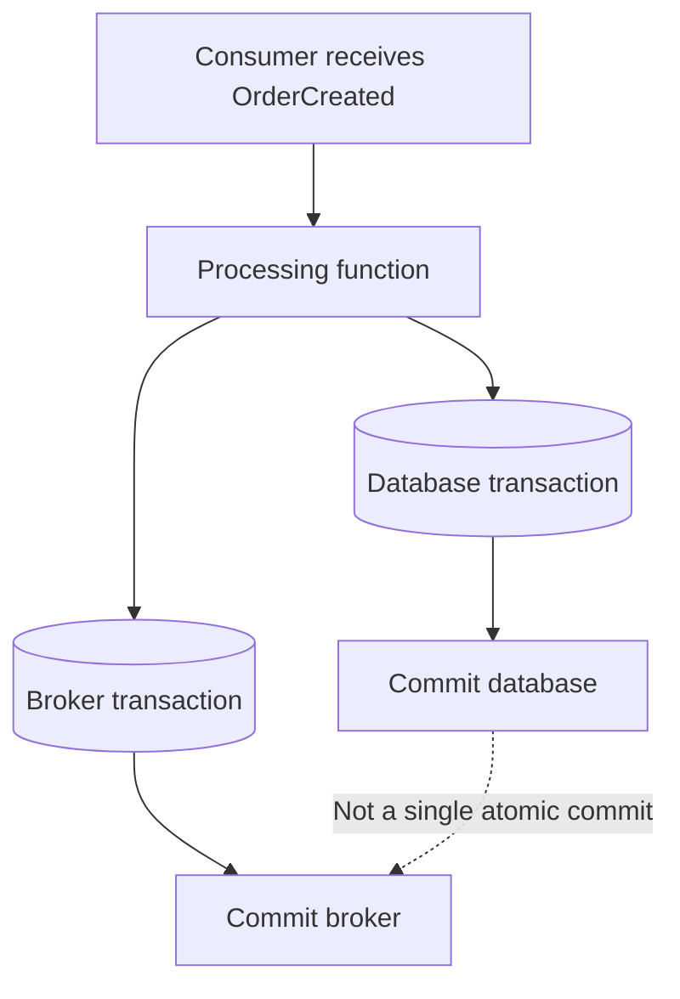
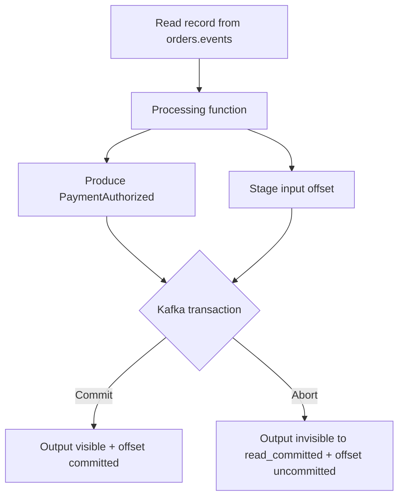
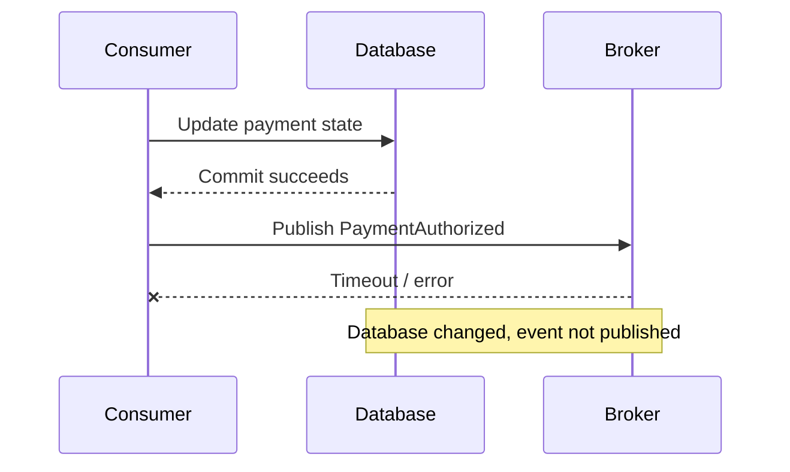
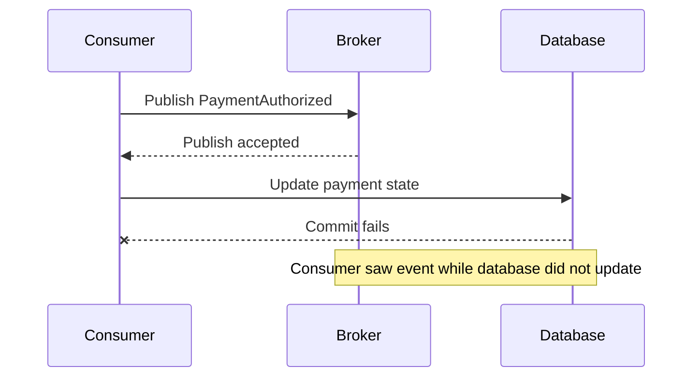
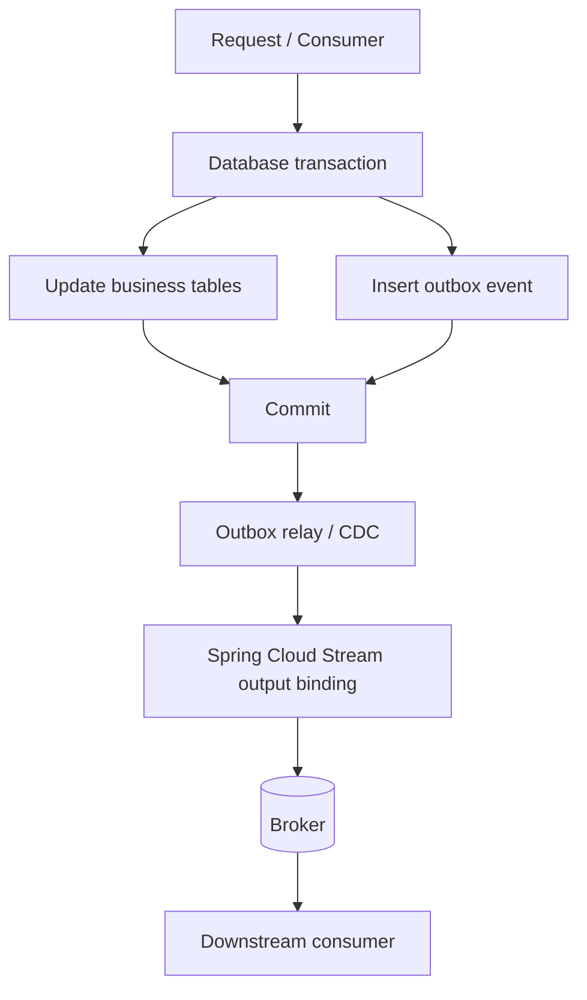

# Broker Transaction Scopes and End-to-End Exactly-Once Limits

## 1. Why Are Broker Transactions Not Enough for Full Business Operations?

A Spring Cloud Stream application typically reads a message from a broker, updates data in a database, and then emits a subsequent event. For example, upon receiving `OrderCreated`, a payment service writes the transaction to PostgreSQL and emits `PaymentAuthorized` to Kafka. At least two storage systems participate: the database and the message broker.

If the database commits while publishing fails, the business state has changed without the event being emitted. If publishing succeeds while the database rolls back, consumers may receive an event describing a change that does not exist. If the application stops between processing and acknowledging the input message, the broker may redeliver the message and side effects may run again.

Broker transactions solve atomicity within the scope supported by the broker. They do not automatically bundle a database, HTTP service, email provider, or another broker into the same transaction. Therefore, clearly distinguish:

- **Broker transaction:** a group of message/offset operations that the broker supports committing or aborting together.
- **Database transaction:** a group of data operations committed or rolled back together by the database.
- **End-to-end business operation:** all business side effects across systems; requires an explicit coordination design.



Two independent commits create a window in which failures can occur. Understanding transaction boundaries accurately is the foundation for choosing Kafka transactions, RabbitMQ transactions, Pulsar transactions, transactional outbox, or inbox/idempotency.

## 2. At-Most-Once, At-Least-Once, and Exactly-Once

Delivery semantics describe what can happen when a message is sent, received, and processed:

| Semantics | High-level behavior | Primary risk |
|---|---|---|
| At-most-once | Ack/commit early or do not retry on error | Messages can be lost if the application stops before finishing |
| At-least-once | Only ack after processing; redeliver when unacknowledged | The same message can be processed multiple times |
| Broker-scoped exactly-once | Broker coordinates message writes and consumption progress in a supported transaction | Applies only within the transaction scope and participating components |
| Effectively-once at the business layer | Duplicate deliveries may occur, but side effects are deduplicated | Requires event IDs, data constraints, and idempotent processing |

In distributed systems, the term "exactly-once" must always be qualified by scope. A broker can guarantee a record is committed once within its transaction, but that does not prove an email was sent only once or an external database was updated only once.

### Why Is At-Least-Once Usually Chosen?

For business processing, losing an event is usually harder to recover from than receiving a duplicate event. At-least-once lets the broker redeliver when a consumer fails before acknowledgement or offset commit. In return, consumers must accept redelivery and protect side effects with idempotency.

### Producer Idempotence Is Not Business Exactly-Once

An idempotent producer can prevent duplicate records caused by certain producer-protocol retries, such as when a publish response is lost even though the broker already recorded the earlier request. It does not automatically detect two separate send calls initiated intentionally by the application, two executions of the same event, or two creations of a business transaction.

## 3. Kafka Transaction Scope

Kafka supports producer transactions. A transaction can write multiple records across multiple topics/partitions and commit or abort them as one unit. With a properly configured consume-transform-produce flow, a transaction can also include input record offsets in the same transaction as output records.

For example, a function reads `orders.events`, produces `payments.events`, and processes input offsets. When the Kafka binder is configured with transactions, output records and consumed offsets can be committed atomically in one Kafka transaction, provided they belong to the supported cluster and transaction mechanism scope.



Consumers read with appropriate isolation, typically `read_committed`, so they do not see records from aborted transactions. Consumers in `read_uncommitted` mode can see uncommitted or aborted records under Kafka semantics, making it unsuitable when observing only committed transaction results.

### Configuring Kafka Binder Transactions

With the Spring Cloud Stream Kafka binder, transactions can be enabled using `transactionIdPrefix` in the binder configuration. Illustrative example:

```yaml
spring:
  cloud:
    function:
      definition: authorizePayment
    stream:
      kafka:
        binder:
          transaction:
            transactionIdPrefix: ${INSTANCE_ID}-orders-
      bindings:
        authorizePayment-in-0:
          destination: orders.events
          group: payment-service
        authorizePayment-out-0:
          destination: payments.events
```

`INSTANCE_ID` must be supplied with a value suited to the deployment so transaction IDs do not collide across concurrent instances. Prefix placement, transaction timeouts, producer properties, and listener container behavior must be verified against the exact version of the Spring Cloud Stream Kafka binder in use.

When binder transactions are enabled, producer bindings use a transactional producer per binder configuration. In supported consumer-initiated transaction flows, the listener container can start the transaction and output sends within that processing scope join the transaction alongside input offsets. Do not assume all asynchronous sends, `StreamBridge` calls from another thread, or tasks detached from the listener thread automatically join that transaction.

### Transaction ID and Fencing

Kafka uses a transactional ID to identify a transactional producer. If multiple producers operate concurrently with the same transactional ID, the broker can fence the older producer to prevent two producers from writing in the same role. Therefore, the prefix must be designed for your instance count and application lifecycle. When running multiple replicas, use the binder's supported transaction ID generation mechanism and verify there are no collisions across instances.

### What Do Kafka Transactions Protect?

- Multiple output records in a transaction commit or abort together.
- Input offsets can commit alongside outputs when the binder/container flow supports consume-transform-produce transactions.
- `read_committed` consumers only read records from committed transactions.
- Producer idempotence is built into the transactional producer mechanism.

A Kafka transaction does not automatically include a PostgreSQL commit, REST call, email send, or publish to RabbitMQ/Pulsar. If those operations execute inside the function, they can still finish before or after the Kafka transaction and create separate failure windows.

## 4. RabbitMQ Transaction Scope

RabbitMQ supports transactions at the AMQP channel level. On a transacted channel, publishes and acknowledgements can be committed or rolled back within the broker's transaction scope. This is a messaging transaction mechanism within RabbitMQ; it is not an automatic distributed transaction between RabbitMQ and a database.

Publisher confirms are a different mechanism. Confirms indicate the broker handled a publish according to its confirmation semantics. Confirms are neither equivalent to grouping multiple operations into one transaction nor inclusive of a database.

In the Spring Cloud Stream Rabbit binder, there are binder/consumer/producer properties to configure transacted channels, acknowledgements, and republish/DLQ behavior. Specific property names depend on the binder version. Verify `transacted`, `acknowledgeMode`, publisher confirms/returns, and queue/exchange topology for the deployed version.

A consumer flow receiving a message and publishing to another exchange can be configured to use channel transactions per binder capabilities. However, if the function also updates a database, the RabbitMQ transaction does not commit/roll back the database at the same time. If it publishes to Kafka or Pulsar, RabbitMQ cannot include the other broker in the same AMQP transaction either.

### Acknowledgements and Redelivery

If the consumer has not acked and the channel/connection closes, RabbitMQ can redeliver the message. Once an ack has been sent and processed by the broker, the application cannot rely on the input message to automatically recover a subsequent failed database operation. Thus, the order of database updates and acknowledgements must be designed alongside idempotency or outbox/inbox.

## 5. Pulsar Transaction Scope

Apache Pulsar supports broker-level transactions for message operations supported by its transaction API. A Pulsar transaction can coordinate publishing and acknowledging messages across multiple topics/partitions within a broker-managed transaction scope.

Conceptual example:

1. Consumer receives `OrderCreated` within a transaction.
2. Application publishes `PaymentAuthorized` to an output topic in the same transaction.
3. Application acknowledges the input message within the transaction.
4. Commit the transaction so both output and acknowledgement take effect together, or abort so neither operation commits.

This capability depends on the Pulsar broker version, client, transaction coordinator, and Pulsar binder integration. Not every binder API or Spring Cloud Stream configuration automatically exposes Pulsar's full transaction API. Check the deployed version and binder-supported features before designing around atomic consume-and-produce.

Pulsar transactions still do not automatically include an external database commit, HTTP operations, or a Kafka cluster. If there are side effects outside Pulsar, coordinate them using outbox/inbox or a purpose-built distributed transaction protocol.

## 6. Spring Cloud Stream Does Not Create a Universal Transaction Across Binders

Spring Cloud Stream provides a unified abstraction for bindings and functions, but transaction semantics remain specific to each binder and broker. Transaction configuration for the Kafka binder cannot be applied verbatim to the Rabbit binder or Pulsar binder.

| Component | Scope a transaction can protect | Outside automatic scope |
|---|---|---|
| Kafka transaction | Kafka records and offsets participating in the same transaction | Databases, HTTP, email, other brokers |
| RabbitMQ channel transaction | AMQP operations on a transacted channel | Databases and other brokers |
| Pulsar transaction | Publish/ack operations supported by the Pulsar transaction API | External databases and other systems |
| Spring database transaction | Operations within the database transaction manager | Brokers unless a dedicated coordination mechanism is used |

If an application uses multiple binders, there is no single Spring Cloud Stream property that automatically turns multiple brokers into one atomic transaction. You must determine which transaction manager controls which operations, whether calls share the same thread/transaction context, and what happens if one system commits while another fails.

## 7. Two Failure Windows When Combining Database and Broker

Suppose a function receives `OrderCreated`, updates the database, and emits `PaymentAuthorized`.

### Database Commit First, Publish Afterward



If the application retries the entire message, the database could be updated again. If it does not retry, the output event may be lost. Neither a Kafka transaction nor a Rabbit transaction can roll back a database that already committed earlier.

### Publish First, Database Commit Afterward



Downstream consumers may process the event based on uncommitted state. If retried, the event may be emitted again. This is why a coordination pattern between database and broker is needed rather than merely reordering the two statements.

## 8. Transactional Outbox

Transactional outbox closes the failure gap by writing business changes and the record to emit within the same database transaction. A separate relay reads the outbox and publishes messages to the broker.



If the database transaction rolls back, neither the business change nor the outbox event exists. If the commit succeeds, the outbox event remains available for the relay to resend after a failure.

### Example Writing the Outbox in the Same Database Transaction

```java
import java.time.Instant;
import java.util.UUID;
import org.springframework.stereotype.Service;
import org.springframework.transaction.annotation.Transactional;

record OrderCreated(String eventId, String orderId, Instant occurredAt) {}

@Service
class OrderApplicationService {

    private final OrderRepository orders;
    private final OutboxRepository outbox;

    OrderApplicationService(OrderRepository orders, OutboxRepository outbox) {
        this.orders = orders;
        this.outbox = outbox;
    }

    @Transactional
    OrderCreated createOrder(CreateOrderCommand command) {
        Order order = orders.save(Order.from(command));
        OrderCreated event = new OrderCreated(
            UUID.randomUUID().toString(),
            order.getId(),
            Instant.now()
        );

        outbox.save(OutboxEvent.pending(
            event.eventId(),
            "OrderCreated",
            event.orderId(),
            event
        ));

        return event;
    }
}
```

The repositories and entities in this example are illustrative components. Crucially, `orders.save` and `outbox.save` participate in the same transaction manager of one database. If the two repositories use two independent databases, simply sharing `@Transactional` does not automatically create an atomic transaction between them.

### Relay Publishing with StreamBridge

```java
import org.springframework.cloud.stream.function.StreamBridge;
import org.springframework.stereotype.Component;

@Component
class OutboxPublisher {

    private final StreamBridge streamBridge;

    OutboxPublisher(StreamBridge streamBridge) {
        this.streamBridge = streamBridge;
    }

    void publish(OutboxEvent event) {
        boolean accepted = streamBridge.send("orders-out-0", event.payload());
        if (!accepted) {
            throw new IllegalStateException("Broker send was not accepted");
        }
        // Only mark PUBLISHED after the binder's appropriate confirmation
        // mechanism confirms publishing; send() returning true is not broker confirmation.
    }
}
```

This condensed snippet illustrates the relay using `StreamBridge`. In real implementations, marking published must be designed carefully: do not hold a database transaction open across long broker waits; use record leases/claims, backoff retries, bounded batches, and status tracking. `send` returning `true` only indicates the outbound path accepted the operation per the API, not proof that consumers processed the message.

### Why Can an Outbox Still Send Duplicates?

Suppose the relay publishes successfully, but the process stops before marking the outbox record as sent. Upon restart, the relay sees the unfinished record and publishes it again. Thus, outbox typically provides at-least-once publishing. Consumers must deduplicate using event IDs or an inbox.

Either a polling relay or Change Data Capture (CDC) reading the transaction log can be used. Both approaches must manage read positions, retries, schemas, and publish states. CDC reduces table polling but does not eliminate the need for duplicate handling at the consumer.

## 9. Inbox and Idempotent Consumers

Inbox is a pattern for recording processed events on the consumer side. The consumer saves `eventId` into an inbox table in the same transaction as the business changes. If the event is redelivered, a unique constraint on the event ID detects the already-processed message.

```java
import org.springframework.stereotype.Service;
import org.springframework.transaction.annotation.Transactional;

@Service
class PaymentEventHandler {

    private final InboxRepository inbox;
    private final PaymentRepository payments;

    PaymentEventHandler(InboxRepository inbox, PaymentRepository payments) {
        this.inbox = inbox;
        this.payments = payments;
    }

    @Transactional
    void handle(PaymentAuthorized event) {
        // insertIfAbsent must be an atomic operation protected by a unique constraint.
        if (!inbox.insertIfAbsent(event.eventId())) {
            return;
        }

        payments.applyAuthorization(event);
    }
}
```

This code expresses the concept. In environments with competing consumers, separate `exists` followed by `insert` calls can hit race conditions. A database unique constraint is the final safeguard. Handle duplicate-key outcomes in a way compatible with your transaction manager and ensure the inbox insert and payment update share one transaction.

If the transaction rolls back, both the inbox record and payment changes roll back; the message can be retried. If commit succeeds, subsequent redeliveries are recognized as duplicates and do not repeat side effects.

### Idempotency Key and Event ID

An event ID should be generated once at the source and kept constant across retries, relays, and replays. Do not generate a new UUID each time the same event is resent, or consumers will treat it as a new event. For APIs outside the broker, an idempotency key can be derived from the request ID or a uniquely defined business key.

## 10. Sagas When Business Flows Span Multiple Services

A workflow such as creating an order, reserving inventory, collecting payment, and shipping typically spans multiple databases and brokers. Do not try to hold open a long distributed transaction across all services. A Saga splits the workflow into local transactions; each step emits an event or command to trigger the next step. If a step fails, the Saga executes defined compensating actions.

Example:

1. Order service creates the order and emits `OrderCreated`.
2. Inventory service reserves stock and emits `InventoryReserved` or `InventoryRejected`.
3. Payment service collects payment and emits `PaymentAuthorized` or `PaymentFailed`.
4. If payment fails after stock was reserved, inventory service receives the compensating command `ReleaseInventory`.

Each service uses a local database transaction and an outbox to emit events. Consumers use inbox/idempotency to handle repeated messages. Sagas provide eventual consistency through forward and compensating steps; they are not a single ACID transaction.

## 11. Transactional Messaging Does Not Replace Idempotency

Even when a broker supports transactions, the application still needs idempotency in many cases:

- A producer resends a business event due to client request retries.
- An outbox relay republishes after failing to persist the sent status.
- A consumer finishes database work but stops before offset/ack commits.
- DLQ replays or data recovery after an incident.
- A stream is replicated to another broker via two separate publishes.

Transactions protect a group of operations within one scope. Idempotency protects side effects when the same business intent is retried. The two mechanisms complement each other.

## 12. Claims You Should Not Call Exactly-Once

| Claim | Why it is insufficient |
|---|---|
| "Producer idempotence is enabled so orders are only created once" | Producer idempotence does not deduplicate two independent business requests or two distinct event IDs |
| "Kafka transactions are enabled so database and Kafka stay in sync" | Kafka transactions do not automatically commit an external database |
| "Consumer acks after processing so there are no duplicates" | The application can stop after side effects but before ack/offset commit takes effect |
| "StreamBridge returned true so the consumer processed it" | Return value does not confirm downstream side effects |
| "Outbox guarantees publishing exactly once" | Relay can publish and stop before marking; consumers still need to deduplicate |
| "Multiple binders share the same transaction" | Spring Cloud Stream does not automatically create a shared distributed transaction across Kafka, RabbitMQ, and Pulsar |

State the scope accurately, for example: "Kafka consume-transform-produce is committed in one Kafka transaction and consumers read in `read_committed` mode," or "database updates are protected by inbox deduplication in the same transaction." Avoid claiming end-to-end exactly-once without demonstrating that every system and side effect participates in one atomic mechanism.

## 13. Testing Transactions and Failure Windows

Standard tests only verify the happy path. To evaluate reliability, simulate failures at different moments:

1. Stop the application before the database commits.
2. Stop after database commit but before publishing.
3. Stop after publishing but before marking the outbox as sent.
4. Stop the consumer after updating the database but before ack/offset commit.
5. Abort a Kafka transaction and verify a `read_committed` consumer does not see aborted outputs.
6. Disconnect the target broker mid-publish.
7. Replay the same event ID multiple times and verify business side effects apply only once.
8. Test recovery after restarts, rebalances, and DLQ replays.

Test Binder is helpful for function logic, but does not fully simulate transaction coordinators, offset commits, Rabbit channel transactions, or Pulsar transactions. Integration tests with real brokers or appropriate test container environments are needed for each binder.

## 14. Observability and Operations

To operate transactional flows, monitor:

- Transaction commit/abort rates and producer errors.
- Kafka transaction timeouts, fencing, and consumer lag.
- RabbitMQ publisher confirms, channel exceptions, unacked messages, and redeliveries.
- Pulsar transaction timeouts, aborts, pending acknowledgements, and subscription backlogs.
- Pending outbox record count, oldest record age, and relay throughput.
- Duplicates filtered by the inbox and unique constraint errors.
- Events sitting in DLQs and replay outcomes.

Logs should include event ID, correlation ID, observable transaction context, binding name, and destination. Do not log secrets or sensitive payloads. Set alerts when the outbox backlog grows continuously, transaction aborts increase, or consumer lag exceeds business thresholds.

## 15. End-to-End Reliability Design Workflow

1. Diagram the storage systems and brokers participating in the business flow.
2. Mark the transaction boundaries of each system.
3. Identify which operations can commit independently and the failure windows between them.
4. Use broker transactions when atomic publish/offset is needed within the broker's supported scope.
5. Use transactional outbox to tie database changes to events that must be emitted.
6. Use inbox, event IDs, and unique constraints to deduplicate at the consumer.
7. Use Sagas and compensating actions for multi-service workflows that cannot fit inside one ACID transaction.
8. Test crash points, retries, redeliveries, aborts, and replays against real brokers.
9. Monitor transactions, outboxes, inboxes, lag, and DLQs in production.

Broker transactions can provide strong atomicity within the boundaries supported by Kafka, RabbitMQ, or Pulsar. End-to-end exactly-once is a broader goal, because business logic frequently touches databases and services outside the broker. Define concrete transaction boundaries, use outbox/inbox and idempotency at independent boundaries, and test failure windows. This approach achieves effectively-once processing at the business layer without relying on an overly broad promise from the broker.
