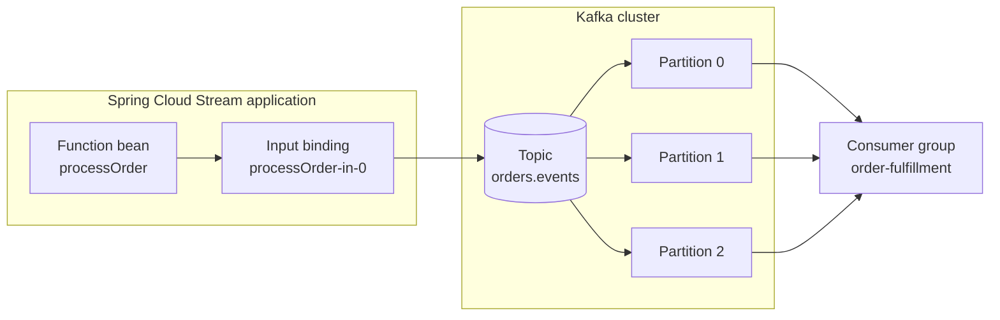
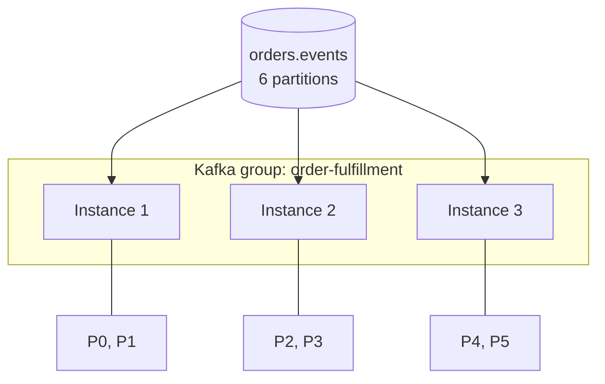
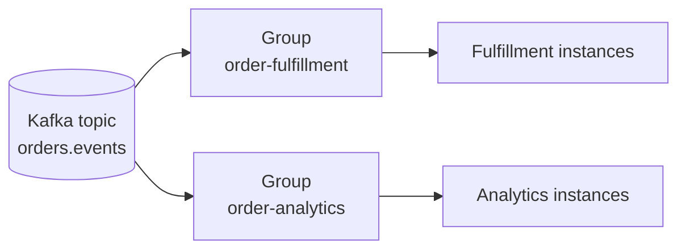
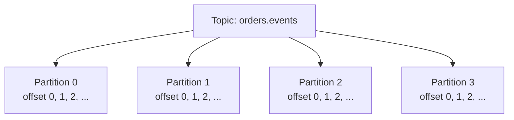

# Mapping Destinations, Groups, and Partitions to the Kafka Model

Spring Cloud Stream uses a binder to connect the application model to a message broker. When using the Kafka binder, three core concepts map directly to Kafka: **destination to topic, consumer group to Kafka consumer group, and partition to topic partition**. Understanding this mapping helps you design producers, consumers, parallelism, and processing order without confusing a binding name with a topic or an application group with instance count.

This lesson focuses on the functional programming model of Spring Cloud Stream and the Kafka binder. You will trace a message from a function bean, through a binding, to a topic, key, and partition; then see how Kafka distributes partitions across consumers in the same group. The examples also explain how to create topics, choose groups, configure concurrency, read offsets, and handle common mapping mistakes.

## 1. Mapping Between Spring Cloud Stream and Kafka

The Kafka binder translates Spring Cloud Stream concepts into Kafka resources:

| Spring Cloud Stream | Kafka | Role |
|---|---|---|
| Binding destination | Topic | Where producers write and consumers read records |
| Binding group (input) | Consumer group ID | Consumer group identity and offset namespace |
| Partition | Topic partition | Ordered log, the unit Kafka distributes to consumers |
| Message key | Record key | Commonly used to select a partition and preserve ordering by key |
| Consumer concurrency/instances | Consumer members in a group | Members sharing partitions together |
| Binding name | Logical port name in the application | Used to configure the binding, not necessarily the topic name |

Overview diagram:



A binding is the connection point between a function and the binder. The destination determines the topic that the binding uses. For an input binding, the group identifies the consumer group reading the topic. A topic has partitions; the Kafka coordinator assigns those partitions to members within each group.

One thing to keep in mind: a binding name is only a logical name inside the application. A topic is a resource on Kafka. A group is a consumer identity on Kafka. A partition is a log segment managed by Kafka. Their names may look similar in small examples, but they are not the same concept.

## 2. From Function Bean to Binding Name

In the functional model, Spring Cloud Stream generates binding names based on the bean name and function signature.

Example:

```java
@Bean
Consumer<OrderCreated> processOrder(OrderService service) {
    return event -> service.handle(event);
}

@Bean
Supplier<OrderCreated> publishOrder(OrderSource source) {
    return source::next;
}
```

The default bindings are:

- Input of `processOrder`: `processOrder-in-0`.
- Output of `publishOrder`: `publishOrder-out-0`.

For a function with multiple inputs, the ports are numbered by parameter order, such as `enrichOrder-in-0` and `enrichOrder-in-1`. The output of a function with a single output port typically carries the `-out-0` suffix.

Configuration can use these binding names:

```yaml
spring:
  cloud:
    function:
      definition: processOrder;publishOrder
    stream:
      bindings:
        processOrder-in-0:
          destination: orders.events
          group: order-fulfillment
        publishOrder-out-0:
          destination: orders.events
```

In this example, `processOrder-in-0` and `publishOrder-out-0` are binding names. Both point to the destination `orders.events`. The Kafka binder will use the `orders.events` topic for both the producer and the consumer.

If `destination` is not declared, Spring Cloud Stream typically uses the binding name as the default destination. Therefore, when you see a topic named something like `processOrder-in-0`, it may be the result of omitting `destination`; there is no rule requiring a binding name to match the topic name.

### Can Binding Names Be Changed?

Spring Cloud Stream allows mapping default binding names to friendlier names via the `spring.cloud.stream.function.bindings` property. Example:

```yaml
spring:
  cloud:
    function:
      definition: processOrder
      bindings:
        processOrder-in-0: ordersInput
    stream:
      bindings:
        ordersInput:
          destination: orders.events
          group: order-fulfillment
```

After renaming a binding, binding configuration properties must reference the new name. This is an additional naming layer for organizing configuration; it does not change the topic on Kafka if the destination remains the same.

For most applications, keeping binding names according to the function convention makes it easier to trace from a bean to its configuration. Only create aliases when there is a clear benefit for configuration readability or when integrating with system conventions.

## 3. Destination Maps to a Kafka Topic

In the Kafka binder, a binding's destination maps directly to a topic name. Example:

```yaml
spring:
  cloud:
    stream:
      bindings:
        processOrder-in-0:
          destination: orders.events
          group: order-fulfillment
```

The input binding `processOrder-in-0` reads from the `orders.events` topic. A producer binding with `destination: orders.events` writes records to that same topic.

A topic can have multiple producers and multiple consumer groups. Spring Cloud Stream does not create a separate topic for each function if the bindings are configured with the same destination.

### Default Destination

If no destination is specified, the binding name is used as the destination name. Example:

```yaml
spring:
  cloud:
    stream:
      bindings:
        processOrder-in-0:
          group: order-fulfillment
```

In this case, the default destination is `processOrder-in-0`. If you want to read an existing topic named `orders.events`, you must declare the destination explicitly.

### A Single Binding Can Read Multiple Topics

Core binding properties support declaring multiple destinations for an input binding using a comma-separated list of names. Example:

```yaml
spring:
  cloud:
    stream:
      bindings:
        processOrder-in-0:
          destination: orders.created,orders.imported
          group: order-fulfillment
```

This approach requires careful consideration because the two topics may have different schemas, keys, retention, and throughput rates. If both enter the same function, the processing code must recognize the event type or have compatible payload contracts. For pattern-based topic discovery, the Kafka binder has a dedicated property to treat the destination as a regular expression; when using a pattern, the binder does not provision topics, and some features such as DLQ are unavailable because the binder does not know all target topics upfront.

### Selecting a Kafka Cluster

The destination only identifies the topic name. The Kafka binder instance identifies which cluster that topic belongs to. Configure brokers at the binder level:

```yaml
spring:
  cloud:
    stream:
      kafka:
        binder:
          brokers: kafka-1.internal:9092,kafka-2.internal:9092
```

`brokers` is the list of brokers the binder connects to. It is neither a destination nor a topic name. If the application connects to multiple Kafka clusters, you must configure multiple binder instances and assign the appropriate binder to each binding; the same destination name across two clusters refers to two independent topics.

## 4. Group Maps to a Kafka Consumer Group ID

The `group` property only applies to input bindings. With the Kafka binder, this value is used as the Kafka consumer group ID. Example:

```yaml
spring:
  cloud:
    stream:
      bindings:
        processOrder-in-0:
          destination: orders.events
          group: order-fulfillment
```

Kafka tracks consumption progress using offsets per topic partition and consumer group. Therefore, a group ID is not just a descriptive label for the application; it defines an independent set of offsets on Kafka.

### Multiple Instances in the Same Group

Suppose you deploy three instances of the fulfillment service with the same configuration:

```yaml
spring:
  cloud:
    stream:
      bindings:
        processOrder-in-0:
          destination: orders.events
          group: order-fulfillment
```

All three instances join the `order-fulfillment` group. Kafka distributes the topic's partitions among the consumer members in the group. Each partition at any given time is assigned to at most one member of the group. When a record is read in the group, one member processes that record; the remaining members do not receive a copy of that same record within that group.

Diagram:



The actual assignment is decided by the Kafka coordinator and partition assignor. When instances are added, stopped, or disconnected, Kafka may rebalance to reassign partitions.

### Multiple Groups Reading the Same Topic

Suppose the `orders.events` topic has two independent logical consumers:

- `order-fulfillment` updates delivery status.
- `order-analytics` builds analytics data.

Configuration:

```yaml
spring:
  cloud:
    function:
      definition: processOrder;updateAnalytics
    stream:
      bindings:
        processOrder-in-0:
          destination: orders.events
          group: order-fulfillment
        updateAnalytics-in-0:
          destination: orders.events
          group: order-analytics
```

The two groups have separate offsets, and each group reads the entire topic stream at its own pace. Within each group, instances compete to share partitions; between the two groups, each group has an independent consumption stream.



This is the difference between **scaling out within the same group** and **fan-out across multiple groups**:

| Configuration | Result |
|---|---|
| Multiple instances, same destination and same group | Share partitions for parallel processing; each record belongs to one member in the group |
| Multiple different groups, same destination | Each group can read the entire topic independently |
| Same destination but different groups | Creates two logical processing streams without sharing offsets |
| Same group with binding running on multiple instances | Instances are members of a single consumer group |

### Omitting the Group

If `group` is omitted, Spring Cloud Stream uses an anonymous consumer group. An anonymous group is independent of other groups, but it is not suitable if you need a stable consumption identity across deployments. With the Kafka binder, an anonymous consumer typically starts at the latest offset when no committed offset exists; an explicit group defaults to starting from earliest for a new group, unless a different start offset is configured. Existing committed offsets still take precedence.

In production applications, declare the group explicitly so that offsets are tied to a stable logical consumer. Changing a group name can create a new consumer group and alter the starting read position if that group does not yet have committed offsets. Therefore, renaming a group is not a harmless rename operation.

## 5. Partition Maps to a Kafka Topic Partition

A Kafka topic is divided into one or more partitions. Each partition is an independent ordered log consisting of records with monotonically increasing offsets. Kafka guarantees read ordering within a single partition, not a global ordering across multiple partitions.

Example of an `orders.events` topic with four partitions:



A partition is the unit Kafka uses to distribute work to consumer members in a group. If a topic has four partitions, a group cannot have more than four consumer members actively receiving partitions at the same time. You can run more instances, but some instances will not be assigned any partitions.

### Partition Assignment Belongs to Kafka

With Kafka, consumers do not need to manually configure individual partitions in normal scenarios. The Kafka coordinator performs assignment based on the members in the group. The binder creates consumers and joins the group; Kafka manages rebalancing and partition assignment.

This differs from Spring Cloud Stream's generic partitioning abstraction on some other middleware, where the framework may require partition count and selector information on both producer and consumer sides. Kafka has native partitions, so the binder leverages that mechanism directly.

### Concurrency and Partition Count

Two factors determine the number of consumer members:

- The number of application instances.
- The `consumer.concurrency` property, which is the number of consumer threads/containers for a binding within each instance.

For example, if a topic has 12 partitions and you deploy 3 instances, each with concurrency 2, the total number of potential consumer members is 6. Kafka can assign roughly two partitions to each member if the assignment is balanced.

Configuration:

```yaml
spring:
  cloud:
    stream:
      bindings:
        processOrder-in-0:
          destination: orders.events
          group: order-fulfillment
          consumer:
            concurrency: 2
```

If you run 8 instances with concurrency 2, the total number of members is 16 while the topic only has 12 partitions. At least 4 members will not be assigned a partition. Adding instances does not automatically increase throughput once partition count is the bottleneck.

| Partition count | Instance count | Concurrency | Max consumer members by config | Result |
|---:|---:|---:|---:|---|
| 12 | 3 | 1 | 3 | Each member can receive about 4 partitions |
| 12 | 3 | 2 | 6 | Each member can receive about 2 partitions |
| 12 | 6 | 2 | 12 | All 12 partitions can be utilized |
| 12 | 8 | 2 | 16 | Some members have no partitions |
| 4 | 6 | 1 | 6 | Two members have no partitions |

Exact distribution numbers depend on the partition assignor and group state; the table illustrates parallelism limits.

## 6. Message Keys Determine Partitions on the Producer Side

A Kafka producer can send a record with a key. The key is commonly used to route records to a partition and keep records with the same key on the same partition. For example, if every event for an order uses `orderId` as its key, events for that order are typically written to the same partition given the same partitioner and partition count.

In the Spring Cloud Stream Kafka binder, you can set the key using the `KafkaHeaders.MESSAGE_KEY` header or the extended `message-key-expression` property.

Producer example:

```java
@Bean
Supplier<Message<OrderCreated>> publishOrder(OrderSource source) {
    return () -> {
        OrderCreated event = source.next();

        return MessageBuilder.withPayload(event)
                .setHeader(KafkaHeaders.MESSAGE_KEY, event.orderId())
                .build();
    };
}
```

Alternatively, declare the key expression per binding:

```yaml
spring:
  cloud:
    function:
      definition: publishOrder
    stream:
      bindings:
        publishOrder-out-0:
          destination: orders.events
      kafka:
        bindings:
          publishOrder-out-0:
            producer:
              message-key-expression: payload.orderId
```

`message-key-expression` is evaluated against the outgoing message to generate the Kafka record key. When the key is set, the Kafka producer partitioner decides the target partition according to its configuration and active algorithm.

### Same Key Does Not Mean Same Consumer Instance Forever

Records with the same key are typically routed to the same partition when partition count and partitioner do not change. Kafka then assigns that partition to a member of the group. When the group rebalances, the partition may move to another member, but record ordering within the partition is still preserved.

A key preserves ordering per entity within a partition; a key does not pin a partition to a fixed pod or instance.

### When There Is No Key

If a record has no key, the Kafka producer uses the default partitioner to choose a partition. The exact distribution behavior depends on the Kafka client version and configured partitioner. You should not assume keyless messages will always round-robin or preserve ordering by entity.

If business requirements demand ordering per order, account, or device, set a stable key that accurately reflects that aggregate. If ordering by key is not required, you can let Kafka distribute records according to the default partitioner.

## 7. Native Kafka Key vs. Spring Cloud Stream Generic Partitioning

Spring Cloud Stream provides generic partitioning properties such as `partition-key-expression` and `partition-count`. These are useful for middleware that relies on the framework to compute partitions. Kafka already supports native partitioning, so generic partitioning is usually unnecessary when you only want to route by Kafka record key.

Generic partitioning example:

```yaml
spring:
  cloud:
    stream:
      bindings:
        publishOrder-out-0:
          destination: orders.events
          producer:
            partition-key-expression: payload.orderId
            partition-count: 12
```

Spring Cloud Stream's generic mechanism can calculate the partition based on key hashing and partition count. This calculation does not necessarily match the Kafka producer's default partitioning algorithm. Therefore, you should not mix both mechanisms without understanding the resulting behavior on the wire.

For native Kafka partitioning, prefer setting the Kafka record key with `KafkaHeaders.MESSAGE_KEY` or `message-key-expression`. The Kafka producer then uses its own partitioner. If a special selector is needed, configure it explicitly and test the resulting partition placement.

A simple rule of thumb:

- To set a Kafka record key: use the Kafka message key.
- To use Spring Cloud Stream generic partitioning: use `partition-key-expression` and `partition-count` according to the binder's exact semantics.
- To have consumers read partitions: let Kafka coordinator assignment handle it in a normal consumer group.

## 8. Topic Provisioning and Partition Count

The Kafka binder can provision topics when bindings are initialized, depending on configuration and broker permissions. Key properties include:

| Property | Scope | Meaning |
|---|---|---|
| `spring.cloud.stream.kafka.binder.auto-create-topics` | Binder | Allows the binder to automatically create topics when needed |
| `spring.cloud.stream.kafka.binder.auto-add-partitions` | Binder | Allows the binder to add partitions to existing topics when needed |
| `spring.cloud.stream.kafka.binder.min-partition-count` | Binder | Minimum number of partitions the binder requires when provisioning |
| `spring.cloud.stream.bindings.<binding>.producer.partition-count` | Producer binding | Suggested partition count for the provisioned topic |
| `spring.cloud.stream.kafka.binder.replication-factor` | Binder | Default replication factor for topics created by the binder |
| `spring.cloud.stream.kafka.bindings.<binding>.producer.topic.replication-factor` | Producer binding | Overrides the replication factor for the corresponding topic |

Example:

```yaml
spring:
  cloud:
    stream:
      kafka:
        binder:
          brokers: localhost:9092
          auto-create-topics: true
          auto-add-partitions: false
          min-partition-count: 6
          replication-factor: 1
      bindings:
        publishOrder-out-0:
          destination: orders.events
          producer:
            partition-count: 12
```

When the binder provisions a topic, the requested partition count can be based on the greater value between `min-partition-count` and the producer's `partition-count`. If the topic already exists with fewer partitions than required and `auto-add-partitions` is disabled, the binder may fail to start the binding. If auto-add is enabled, the binder can add partitions when it has sufficient permissions.

`min-partition-count` only takes effect when `auto-create-topics` or `auto-add-partitions` is enabled. `replication-factor` only applies when the binder creates the topic; it does not automatically alter the replication factor of an existing topic.

### When Infrastructure Pre-Creates Topics

In production, platform teams may manage topics using Terraform, Ansible, or Kafka administration tools. In that case, automatic topic creation can be disabled:

```yaml
spring:
  cloud:
    stream:
      kafka:
        binder:
          auto-create-topics: false
          auto-add-partitions: false
```

The topic must exist before the application starts, and the partition count must match the expected concurrency and throughput. Grant describe, read, write, or create permissions according to each role; do not grant topic creation permissions to applications if infrastructure policy forbids it.

### Increasing Partitions Can Affect Ordering

When increasing the partition count, old records remain in their old partitions. New records with the same key may be mapped to a different partition because the partition count has changed. Therefore, increasing partitions should not be treated as a pure performance tweak that has no impact on key-based ordering.

If strict cross-time ordering per aggregate is mandatory, plan a migration: define a cutover point, drain the old backlog, verify the new mapping, and avoid processing events for the same aggregate concurrently across two partitions.

## 9. Offsets Are Tied to Group and Partition

Kafka stores consumed offsets per consumer group and topic partition pair. For example, group `order-fulfillment` might have committed offset 120 on partition 0 and offset 87 on partition 1. Group `order-analytics` has independent offsets, and might be at partition 0 offset 95 and partition 1 offset 40.

This allows groups to process the same topic at different speeds. Analytics can lag behind fulfillment without altering the offsets of the fulfillment group.

### Start Offset for a New Group

The Kafka binder provides `start-offset` to choose the starting position for a new group that has no committed offsets yet:

- `earliest`: start from the oldest record still present in the log.
- `latest`: start from the newest record, meaning only records written after startup are received.

By default in the Kafka binder, a binding with an explicit group uses `earliest` for a new group; an anonymous group uses `latest`. Existing committed offsets still take precedence. This property is not an instruction to reset offsets on every application restart.

Example:

```yaml
spring:
  cloud:
    stream:
      bindings:
        processOrder-in-0:
          destination: orders.events
          group: order-fulfillment
      kafka:
        bindings:
          processOrder-in-0:
            consumer:
              start-offset: earliest
```

If you want to reset already committed offsets, the Kafka binder has a separate `reset-offsets` property with specific usage rules. This operation can cause messages to be re-read or skipped; only use it when you understand its impact on side effects and data.

### Changing a Group Name Can Cause Data Re-Reads

When changing a group from `order-fulfillment` to `order-fulfillment-v2`, Kafka treats this as a different group ID. The new group does not automatically inherit offsets from the old group. If the new group's start offset is `earliest`, it can re-read all records remaining within retention.

Therefore, changing a group can be an intentional way to create an independent consumer or trigger a replay, but it is not a safe way to simply rename a service. Check offsets and retention before changing a group.

## 10. Combining Destination, Group, and Partition in One Application

The example below has one producer and two logical consumers. The producer writes events to the `orders.events` topic. Both the fulfillment and analytics consumers read the same topic, but use different groups.

Java functions:

```java
@Bean
Supplier<Message<OrderCreated>> publishOrder(OrderSource source) {
    return () -> {
        OrderCreated event = source.next();
        return MessageBuilder.withPayload(event)
                .setHeader(KafkaHeaders.MESSAGE_KEY, event.orderId())
                .build();
    };
}

@Bean
Consumer<OrderCreated> processOrder(OrderFulfillment service) {
    return service::handle;
}

@Bean
Consumer<OrderCreated> updateAnalytics(OrderAnalytics service) {
    return service::record;
}
```

Configuration:

```yaml
spring:
  cloud:
    function:
      definition: publishOrder;processOrder;updateAnalytics
    stream:
      bindings:
        publishOrder-out-0:
          destination: orders.events
        processOrder-in-0:
          destination: orders.events
          group: order-fulfillment
          consumer:
            concurrency: 3
        updateAnalytics-in-0:
          destination: orders.events
          group: order-analytics
          consumer:
            concurrency: 2
      kafka:
        binder:
          brokers: localhost:9092
          auto-create-topics: true
          min-partition-count: 6
```

How to read this configuration:

1. `publishOrder-out-0` is an output binding whose destination `orders.events` maps to a Kafka topic.
2. The producer sets the record key to `orderId`. The Kafka partitioner uses the key to select the partition.
3. `processOrder-in-0` reads the same topic in the `order-fulfillment` group.
4. `updateAnalytics-in-0` reads the same topic in the `order-analytics` group.
5. Each group has its own partition assignment and committed offsets.
6. `concurrency` controls the number of consumer threads per input binding in each application instance; total member count is still bounded by the partition count.

In the Java example, the record key is already set via the `KafkaHeaders.MESSAGE_KEY` header, so there is no need to also declare `message-key-expression` for the same binding. If you choose to configure the key using an expression, remove the header assignment in Java and use a single approach to avoid redundant configuration.

If the topic has 6 partitions, the fulfillment group with concurrency 3 on one instance can use up to three consumer members from that binding; the analytics group with concurrency 2 can use up to two. When scaling up instances, total members per group increase according to instance count and concurrency. The two groups do not share partition assignments with each other.

## 11. Multiple Input Bindings and Multiple Topics

A function can receive multiple input bindings. For example, a function combining order data with account data:

```java
@Bean
BiFunction<OrderCreated, AccountSnapshot, EnrichedOrder> enrichOrder() {
    return (order, account) -> EnrichedOrder.from(order, account);
}
```

Default binding names:

- `enrichOrder-in-0` for the first input.
- `enrichOrder-in-1` for the second input.
- `enrichOrder-out-0` for the output.

Configuration:

```yaml
spring:
  cloud:
    function:
      definition: enrichOrder
    stream:
      bindings:
        enrichOrder-in-0:
          destination: orders.events
          group: order-enrichment
        enrichOrder-in-1:
          destination: accounts.snapshots
          group: account-enrichment
        enrichOrder-out-0:
          destination: orders.enriched
```

Each input binding has its own destination and group. The two bindings can point to two topics and have separate consumer groups. The Kafka binder creates a corresponding consumer for each binding.

Do not confuse multiple input bindings with a single consumer group reading multiple topics. If a function needs to synchronize or join data from multiple topics, you must clearly understand processing semantics and data arrival timing. The Kafka Streams binder has its own KStream/KTable model and stateful joins; this lesson focuses on the standard Kafka message binder.

## 12. Common Misconceptions

### Confusing Binding Name with Topic Name

`processOrder-in-0` is a binding name, while `orders.events` is the topic specified by the destination. When a topic is created with the binding name, it is because of the default destination, not because the two concepts are identical.

### Confusing Group with Instance Count

A group is a logical consumer identity on Kafka. An instance is an application process. Multiple instances with the same group ID share partitions; they do not create multiple independent groups.

### Using Different Groups When Trying to Scale One Service

If each instance uses a different group ID, each instance will read the entire topic instead of sharing load. To scale a single logical service, all instances must use the same group ID.

### Using the Same Group When Two Applications Both Need Every Event

If fulfillment and analytics use the same group ID, they will compete for partitions. One record may be received by fulfillment and another by analytics; neither application receives the full topic. If each application needs a complete copy, use different groups.

### Increasing Concurrency Beyond Partition Count

Kafka cannot assign a single partition to multiple consumer members in the same group at the same time. If total concurrency multiplied by instance count exceeds the partition count, some members will remain idle. Increase partitions when greater parallelism is needed and when the broker and ordering model allow it.

### Setting partition-key-expression While Forgetting the Kafka Record Key

Spring Cloud Stream generic partitioning and native Kafka keys are two different mechanisms. If you need the Kafka partitioner to use a record key, set the Kafka message key. Do not assume every generic partition setting automatically becomes a Kafka record key.

### Assuming a New Group Always Starts from the Beginning of the Topic

A new group may use the default start offset or a specific configuration. An explicit group in the Kafka binder typically starts from `earliest` and an anonymous group from `latest`, but committed offsets and reset settings can alter the result. Verify offsets before running in production.

### Assuming Increasing Partitions Does Not Affect Ordering

Increasing partitions can change the key-to-partition mapping for new records. Old messages are not moved to new partitions. If an entity has events across two partitions, consumers can process them in parallel and finish out of order.

## 13. Verifying Mapping and Operational Monitoring

When the application is running, verify the three distinct mapping layers.

### Inspecting Topics

Use a Kafka admin tool or broker UI to check:

- Whether the topic name matches the destination.
- Whether the partition count is sufficient for expected concurrency.
- Whether replication factor and ISR meet infrastructure policy.
- Whether topic properties such as retention and cleanup policy match requirements.

### Inspecting Consumer Groups

Inspect the consumer group ID, member count, partition assignment, and committed offsets. If a group has more members than partitions, some members will not receive any partitions. If an application accidentally uses different group IDs, each group may read the entire topic and increase processing volume.

### Inspecting Partitions and Keys

Record the topic, partition, offset, and record key of sample messages. You can use the Kafka metadata headers that the binder attaches to messages to observe the received partition. With Spring Kafka, commonly used headers include the received partition and received key; check the exact header names for your dependency version.

Metrics to monitor:

- Consumer lag by group and partition.
- Message rate and byte rate per partition.
- Member count and assigned partition count.
- Rebalance count and rebalance duration.
- Processing latency and deserialization errors.
- Percentage of records without keys or skewed key distribution.

Do not log full sensitive payloads just to observe keys. You can log event ID, topic, partition, offset, and a masked or hashed key according to data policy.

## 14. Process for Designing Destinations, Groups, and Partitions

When creating a new Kafka binding, answer these questions in order:

1. **Which function reads or writes?** Identify the bean name and default binding names.
2. **Which topic holds the data?** Declare the destination explicitly to avoid accidentally creating a topic named after the binding.
3. **Who is the logical consumer?** Choose a stable group ID for each independent application or pipeline.
4. **How many partitions?** Estimate throughput, instance count, and required concurrency.
5. **Which key preserves ordering?** Choose a record key matching the aggregate that requires sequential processing.
6. **Where is the topic provisioned?** Choose binder auto-creation or infrastructure pre-creation; align on partition count and replication factor.
7. **Where do offsets start?** Define `startOffset` for new groups and establish a replay/reset procedure.
8. **How will it scale?** Ensure total consumer members per group align with the partition count.
9. **How will it be observed?** Monitor group ID, topic, partition, offset, lag, and rebalances.

### Pre-Deployment Checklist

- Destination points to the right Kafka topic.
- Binding names are used accurately in all core and Kafka extended properties.
- Group ID is explicitly declared for production consumers.
- Instances of the same logical service share the same group ID.
- Applications needing independent copies use different group IDs.
- Topic has enough partitions for expected concurrency and instance count.
- Record key accurately reflects the aggregate requiring ordering.
- Generic partitioning is not mixed with native Kafka keys without testing.
- Auto-create/auto-add topic settings comply with infrastructure policy.
- Start offset and committed offsets have been reviewed.
- Consumer lag and partition assignment have dashboards and alerts.
- Partition expansion scenarios have been evaluated for impact on ordering.

Destination, group, and partition are the three primary mapping points between Spring Cloud Stream and Kafka. Destination selects the topic; group selects the offset namespace and consumer competition relationship; partition splits the topic into ordered logs and bounds parallelism within each group. Record keys connect business data to partitions. When designed along these exact boundaries, you can scale consumers, create multiple independent pipelines, and maintain per-key ordering without confusing logical framework names with actual Kafka resources.

## References

- [Spring Cloud Stream Kafka Binder Reference Guide](https://docs.spring.io/spring-cloud-stream/docs/current/reference/html/spring-cloud-stream-binder-kafka.html)
- [Spring Cloud Stream — Binding Properties](https://docs.spring.io/spring-cloud-stream/reference/spring-cloud-stream/binding-properties.html)
- [Spring Cloud Stream — Consumer Groups](https://docs.spring.io/spring-cloud-stream/reference/spring-cloud-stream/consumer-groups.html)
- [Apache Kafka — Documentation](https://kafka.apache.org/documentation/)
