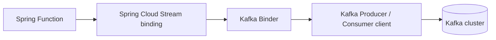

# Broker Connectivity and Kafka Binder Configuration Hierarchy

The Kafka Binder connects Spring Cloud Stream bindings to Apache Kafka. When an application produces or consumes messages, the binder manages producers, consumers, destinations, and the mapping of common Spring Cloud Stream configuration to Kafka-specific properties. For stable configuration, you need to distinguish broker connection configuration, application binding configuration, Kafka Binder extended configuration, and Kafka client configuration.

These configuration layers answer different questions: which cluster to connect to, which topic and consumer group a binding uses, what Kafka-specific behavior a consumer/producer needs, and what security or performance settings the Kafka client uses. Placing the right property in the right layer prevents properties from being ignored, avoids two bindings accidentally sharing the same group, and makes it easier to deploy the same application across local, staging, and production environments.

## 1. Where Does the Kafka Binder Sit in an Application?

A Spring Cloud Stream application typically declares functions and bindings. The function describes processing logic; the binding describes an input or output; the Kafka Binder connects the binding to a Kafka topic.

Example function receiving order events:

```java
@Bean
Consumer<OrderCreated> recordOrder(OrderService service) {
    return service::record;
}
```

Spring Cloud Stream creates an input binding named `recordOrder-in-0` based on the function name. The Kafka Binder connects that binding to the topic declared in configuration.

Overview diagram:



The binder is responsible for message integration with Kafka. Business code does not need to manually instantiate `KafkaConsumer` or `KafkaProducer` when using Spring Cloud Stream's functional model.

To use the Kafka Binder, a project typically adds the starter:

```xml
<dependency>
    <groupId>org.springframework.cloud</groupId>
    <artifactId>spring-cloud-starter-stream-kafka</artifactId>
</dependency>
```

The starter version should be managed by a Spring Cloud BOM compatible with the application's Spring Boot version. Avoid manually mixing versions of Spring Cloud Stream, Kafka Binder, and Spring Kafka from incompatible release trains.

## 2. Four Configuration Layers to Distinguish

The Kafka Binder has multiple property groups. You can organize them by responsibility:

| Layer | Typical Prefix | Responsibility |
|---|---|---|
| Binder-level | `spring.cloud.stream.kafka.binder.*` | Brokers, security, provisioning, and general binder settings |
| Common binding | `spring.cloud.stream.bindings.<bindingName>.*` | Destination, group, content type, concurrency, and common retries |
| Kafka extended binding | `spring.cloud.stream.kafka.bindings.<bindingName>.*` | Kafka-specific behavior for a binding's consumer or producer |
| Kafka client properties | `configuration`, `consumer-properties`, `producer-properties` | Kafka client properties such as security, compression, or fetch settings |

Do not put all properties under `spring.cloud.stream.kafka.binder`. For example, topic name and consumer group belong to binding configuration; `startOffset` is an extended Kafka consumer property; `security.protocol` is a Kafka client property.

The binding name must match the name generated by Spring Cloud Function. For the function `recordOrder`, the input is `recordOrder-in-0`; if the function had an output, the corresponding binding would be `recordOrder-out-0`. With multiple inputs or outputs, the trailing index reflects the position of the input/output in the function signature.

## 3. Configuring Connectivity to Kafka Brokers

The binder-level `brokers` property specifies the bootstrap broker addresses. Example for running locally:

```yaml
spring:
  cloud:
    stream:
      kafka:
        binder:
          brokers:
            - localhost:9092
```

You can declare one or more bootstrap addresses. The client uses this list to discover the cluster; after connecting, Kafka supplies metadata about the relevant brokers and partitions.

A string-based configuration is also commonly used:

```yaml
spring:
  cloud:
    stream:
      kafka:
        binder:
          brokers: localhost:9092,localhost:9093
```

Bootstrap addresses are not a static list of every broker in the cluster. You only need to provide a few reachable brokers so the client can fetch metadata; the addresses Kafka returns afterward must also be reachable from the application's runtime environment.

In containers or Kubernetes, `localhost` usually points to the container/pod itself, not the host machine or a broker in another container. Use a DNS/service name or advertised listener appropriate for the deployment network.

## 4. Configuring a Complete Consumer Binding

Example of a consumer receiving events from the `orders.created` topic:

```yaml
spring:
  cloud:
    function:
      definition: recordOrder
    stream:
      bindings:
        recordOrder-in-0:
          destination: orders.created
          group: order-service
          content-type: application/json
          consumer:
            concurrency: 3
            max-attempts: 4
      kafka:
        binder:
          brokers:
            - kafka-1.internal:9092
            - kafka-2.internal:9092
```

Meaning:

- `definition` selects the function bean to be bound.
- `destination` specifies the Kafka topic.
- `group` identifies the consumer group.
- `content-type` describes the payload format at the Spring Cloud Stream layer.
- `concurrency` controls the number of consumer instances/threads created by the binder within a single application, according to the binder's configuration capabilities.
- `max-attempts` sets the common retry count for the consumer binding.
- `brokers` identifies the Kafka cluster.

The group name must remain stable across deployments if the application wants to resume from existing committed offsets. Instances in the same group share partitions via Kafka's mechanism. If two independent services both need to receive all events, they need separate groups.

The actual number of consumers running in parallel also depends on the number of partitions assigned to the group. Increasing `concurrency` beyond the partition count does not automatically create more partitions or increase the number of independent record processing threads.

## 5. Configuring a Producer Binding

A producer binding declares a destination and content type. You can add Kafka-specific properties such as record key or compression:

```yaml
spring:
  cloud:
    function:
      definition: publishOrder
    stream:
      bindings:
        publishOrder-out-0:
          destination: orders.created
          content-type: application/json
      kafka:
        bindings:
          publishOrder-out-0:
            producer:
              message-key-expression: payload.customerId
```

In this example, `message-key-expression` extracts `customerId` as the Kafka record key. The Kafka producer uses the key with its configured partitioner if the binder does not specify an explicit partition. The record key is also stored in the record for consumers or log compaction.

You can configure producer client properties such as compression at the binder or binding level depending on the desired scope. Example of a shared configuration for all producer clients of a binder:

```yaml
spring:
  cloud:
    stream:
      kafka:
        binder:
          producer-properties:
            compression.type: zstd
```

When choosing compression, check the Kafka client version, broker version, and compatibility requirements. Compression reduces network and storage size at the cost of CPU; benchmark with real data before rolling it out widely.

## 6. Binder-Level Provisioning: Creating Topics and Partitions

The Kafka Binder can assist with topic provisioning and adding partitions according to configuration. Common properties include:

| Property | Role |
|---|---|
| `auto-create-topics` | Allows the binder to auto-create a topic when the destination does not exist, if permitted by the broker |
| `auto-add-partitions` | Allows the binder to add partitions when the required partition count exceeds the existing count |
| `min-partition-count` | Minimum number of partitions the binder uses when provisioning |
| `replication-factor` | Replication factor used when the binder creates a topic |

Example:

```yaml
spring:
  cloud:
    stream:
      kafka:
        binder:
          auto-create-topics: false
          auto-add-partitions: false
          min-partition-count: 6
          replication-factor: 3
```

The configuration above shows how an application expects topics to be provisioned externally while still declaring provisioning values in case the binder creates topics. When auto-creating topics and auto-adding partitions are disabled, topics must be pre-created using administration tools or infrastructure pipelines.

Provisioning defaults can vary across binder versions and broker environments. Do not rely on defaults for production. Clearly define who owns the topic lifecycle, partition count, replication factor, retention, cleanup policy, and ACLs. If brokers do not allow applications to create topics, admin permissions should be separated from runtime producer/consumer permissions.

## 7. Shared Kafka Client Configuration

The Kafka Binder allows passing Kafka client properties through the `configuration` map. These properties apply at the binder scope according to the rules of the version in use.

Example enabling TLS/SASL:

```yaml
spring:
  cloud:
    stream:
      kafka:
        binder:
          brokers:
            - kafka-prod.internal:9093
          configuration:
            security.protocol: SASL_SSL
            sasl.mechanism: PLAIN
            sasl.jaas.config: ${KAFKA_SASL_JAAS_CONFIG}
```

`KAFKA_SASL_JAAS_CONFIG` is an environment variable or secret provided at runtime. Never hardcode usernames, passwords, JAAS strings, truststore passwords, or private keys directly in committed configuration files.

Other security properties may include truststore/keystore locations, endpoint identification algorithms, or specific SASL mechanisms. Their names and requirements depend on the Kafka cluster configuration. Use the exact mechanism provided by the Kafka operations team and verify connectivity from the actual application runtime environment.

`configuration` is a map of Kafka client properties, not a place for `destination`, `group`, or `content-type`. Binder-level values may be shared across producer, consumer, and related clients; use specialized maps if you only want to apply a property to one client type.

## 8. Separating Producer and Consumer Client Configuration

There are cases where producers and consumers need different settings. The Kafka Binder provides `producer-properties` and `consumer-properties` maps at the binder level to configure each client type separately.

Example:

```yaml
spring:
  cloud:
    stream:
      kafka:
        binder:
          consumer-properties:
            max.poll.records: 200
            isolation.level: read_committed
          producer-properties:
            compression.type: lz4
            acks: all
```

This example caps the number of records per consumer poll, selects committed transaction reads, and configures compression and acknowledgements for the producer client. Kafka client properties must have the right types and be supported by the Kafka client version bundled with the binder.

Consider the impacts:

- `max.poll.records` affects how many records are returned in one poll; a large value can raise throughput but increases batch processing time and the risk of exceeding `max.poll.interval.ms`.
- `isolation.level=read_committed` only reads records from committed transactions when producers use Kafka transactions.
- `compression.type` affects CPU usage and record batch size.
- `acks=all` requires stronger acknowledgement from the Kafka leader/ISR, though you still need appropriate replication factor and `min.insync.replicas` settings.

Do not use a property solely because its name is familiar from the Kafka client. Verify whether it belongs to the producer or consumer and place it in the corresponding map.

## 9. Extended Configuration Per Binding

One binder can serve multiple bindings where each binding needs different Kafka behavior. In that case, use the `spring.cloud.stream.kafka.bindings.<bindingName>` prefix.

Example of a consumer binding that needs to read from the beginning when the group has no valid offset yet:

```yaml
spring:
  cloud:
    stream:
      bindings:
        auditEvents-in-0:
          destination: audit.events
          group: audit-reader
      kafka:
        bindings:
          auditEvents-in-0:
            consumer:
              start-offset: earliest
```

`start-offset` is an extended property of a Kafka consumer binding. It applies to the starting position when no valid committed offset exists; it does not mean reading from the beginning on every restart if the group already has a valid offset.

Example of a producer binding using a Kafka-specific expression to extract the record key:

```yaml
spring:
  cloud:
    stream:
      bindings:
        publishAudit-out-0:
          destination: audit.events
      kafka:
        bindings:
          publishAudit-out-0:
            producer:
              message-key-expression: payload.aggregateId
```

Other extended properties can relate to dead-letter topics, auto-commit/acknowledgement, transactions, topic properties, header mapping, or consumer offsets. The exact list depends on the Kafka Binder version. Read the reference documentation for the exact release train before introducing a new property to production configuration.

Do not confuse extended binding properties with Kafka client properties. For example, `start-offset` is how the binder configures the starting position; `max.poll.records` is a consumer client property. Both can affect the consumer, yet they are declared in different property groups.

## 10. Multiple Kafka Binders in the Same Application

An application may need to connect to two Kafka clusters, such as an operational cluster and an archival cluster. In that case, declare multiple named binder instances, each with its own environment.

Example:

```yaml
spring:
  cloud:
    stream:
      binders:
        kafkaPrimary:
          type: kafka
          environment:
            spring:
              cloud:
                stream:
                  kafka:
                    binder:
                      brokers:
                        - kafka-primary.internal:9092
          default-candidate: false
        kafkaArchive:
          type: kafka
          environment:
            spring:
              cloud:
                stream:
                  kafka:
                    binder:
                      brokers:
                        - kafka-archive.internal:9092
          default-candidate: false
      bindings:
        publishOrders-out-0:
          destination: orders
          binder: kafkaPrimary
        archiveOrders-out-0:
          destination: orders.archive
          binder: kafkaArchive
```

Each binder has its own connection configuration. The binding's `binder` property selects the corresponding binder instance. `default-candidate: false` excludes the binder from default selection when the framework needs to pick a binder automatically; default binder selection still needs to be configured explicitly if multiple binder types are on the classpath.

When multiple binders have the same type but connect to different clusters, do not use a global broker setting expecting each binding to choose a cluster on its own. Place brokers inside each binder's `environment` to isolate connections, credentials, and client properties.

Verify access permissions on each cluster, compatible serializers, topic existence, and separate retry/DLQ policies. A message published successfully to the primary cluster does not guarantee the message was copied to the archive cluster; those are two independent publish operations and can yield different outcomes.

## 11. Selecting a Default Binder and Explicitly Assigning Binders

If an application has only one binder, the framework can usually select it automatically. When multiple binders exist, you can declare a default binder:

```yaml
spring:
  cloud:
    stream:
      default-binder: kafkaPrimary
```

A binding can override the default selection using its own `binder` property. This approach is useful when most bindings go to one cluster while a few need a different cluster.

Explicitly assign a binder when:

- There are multiple Kafka clusters.
- The Kafka Binder and another binder type are both on the classpath.
- Some bindings use different brokers.
- Credentials, networking, and provisioning must be controlled per cluster.

A binder name is an alias in application configuration, not a Kafka topic or group name. Choose meaningful role-based names such as `kafkaPrimary`, `kafkaAnalytics`, or `kafkaArchive`, avoiding vague names like `binder1`.

## 12. Externalizing Configuration by Environment

The same artifact should be able to run in local, staging, and production by changing external configuration. Example:

```yaml
spring:
  cloud:
    stream:
      kafka:
        binder:
          brokers: ${KAFKA_BOOTSTRAP_SERVERS:localhost:9092}
          configuration:
            security.protocol: ${KAFKA_SECURITY_PROTOCOL:PLAINTEXT}
```

Local can use unsecured defaults in a private development environment. Staging and production should supply environment variables or secrets matching the real cluster. Do not use a `PLAINTEXT` fallback configuration in production if the environment requires TLS/SASL.

You can separate configuration by Spring profile:

```yaml
# application-local.yml
spring:
  cloud:
    stream:
      kafka:
        binder:
          brokers: localhost:9092
```

```yaml
# application-prod.yml
spring:
  cloud:
    stream:
      kafka:
        binder:
          brokers: ${KAFKA_BOOTSTRAP_SERVERS}
          configuration:
            security.protocol: SASL_SSL
            sasl.mechanism: PLAIN
            sasl.jaas.config: ${KAFKA_SASL_JAAS_CONFIG}
```

Profiles separate environment configuration, while secrets should be supplied through a secret manager or the deployment platform's secret management mechanism. Never commit production files containing real credentials.

## 13. Distinguishing Kafka Binder Configuration from spring.kafka

Spring Boot provides the `spring.kafka.*` property group for components using Spring Boot's Kafka auto-configuration. The Spring Cloud Stream Kafka Binder has its own property group under `spring.cloud.stream.kafka.*`.

Do not assume a property placed under `spring.kafka.*` is automatically used by every Kafka Binder client. The binder creates and manages binding clients according to its own configuration. For connection, security, or client properties meant for the binder, prefer documented Kafka Binder properties such as `brokers`, `configuration`, `consumer-properties`, `producer-properties`, or extended binding configuration.

If an application uses `KafkaTemplate` directly alongside the Kafka Binder, the two configuration groups can serve two different client paths. Configure and test both paths explicitly; do not rely on them automatically sharing all bootstrap servers, serializers, or credentials.

## 14. Precedence Order and Resolving Conflicts

Spring configuration is assembled from multiple property sources such as YAML files, profiles, environment variables, system properties, and command-line arguments. A higher-priority source overrides values in lower-priority sources. Additionally, the Kafka Binder has configuration at both the binder level and the binding level.

A systematic way to check:

1. Identify the actual binding name from the function name.
2. Check common binding properties: destination, group, content type.
3. Check Kafka extended properties for that exact binding.
4. Check binder-level broker and client configuration.
5. Check property sources overriding via profiles, environment variables, or deployment manifests.
6. Inspect startup logs and the effective configuration safely exposed via Actuator/config diagnostics if enabled.

Do not assume a universal precedence rule across every property unless the binder documentation specifies it. Some properties can be configured at multiple levels; merge or override semantics may differ. For critical properties such as security, serializers, offsets, or acknowledgements, check the reference docs for the running version and verify in integration tests.

Avoid declaring the same setting at multiple levels unnecessarily. For example, if `brokers` is already configured inside a binder instance's `environment`, do not add a different broker globally without intent. Duplicate settings make it harder to tell which cluster a client is actually connecting to.

## 15. Checking Configuration at Application Startup

When an application fails to connect to Kafka, check from the outside in:

- DNS/hostname and port are reachable from the container or machine running the application.
- Kafka advertised listeners return addresses reachable by the application.
- TLS truststore/certificates and hostname verification match.
- SASL mechanism, username/password, or JAAS config are correct.
- ACLs for topics, groups, and transactional IDs if transactions are used.
- Destination topic already exists or the binder has permission to provision it.
- Binding name and binder alias are declared accurately.
- Serializer/deserializer and content type are compatible with the payload.
- Consumer group has assigned partitions and an appropriate offset policy.

Common errors:

| Symptom | Possible Cause | Where to Check |
|---|---|---|
| Connection timeout | Wrong hostname/port, network policy, or advertised listener | `brokers`, network, and Kafka listeners |
| Authentication failed | Wrong SASL/SSL or secret | `binder.configuration` |
| Topic authorization failed | ACL disallows read/write or topic creation | Topic ACLs and group ACLs |
| Topic does not exist | Provisioning disabled or wrong destination name | Binding `destination`, `auto-create-topics` |
| Consumer receives no messages | Wrong group, offset already at end, empty topic, or unassigned partitions | Binding, offsets, and consumer group |
| Producer writes to wrong partition | Record key, binder partitioning, or unexpected partition count | Kafka extended producer properties |
| Property has no effect | Wrong prefix or property unsupported by binder version | Effective configuration and version-specific docs |

Do not log passwords, JAAS configs, tokens, or private keys when enabling debug logging. If logs must be shared, redact credentials first.

## 16. Testing Binder Configuration

Verify across multiple layers:

**Unit tests** check functions and data mapping. Unit tests do not need to start a broker if they only verify business logic.

**Test Binder** checks function definitions, binding names, payload conversion, and in-memory message flow. It does not verify bootstrap servers, TLS, SASL, topic ACLs, Kafka partitioners, or broker provisioning.

**Integration tests with real Kafka** check Kafka-dependent behavior: topics, groups, offsets, record keys, partitions, serializers, transactions, retry/DLT, and security. Testcontainers can spin up isolated Kafka for tests; staging environments should additionally verify TLS/SASL and ACLs close to production.

An integration test checklist:

1. Application connects to the right bootstrap servers.
2. Bindings point to the right topic and group.
3. Producers write payloads with the expected serializer/content type.
4. Consumers read records and commit according to configuration.
5. Record keys and partitions match requirements.
6. Topic provisioning or manual topic setup works.
7. Retry/DLT works when a handler fails.
8. Security/ACLs are verified using an actual runtime principal.

## 17. Production Configuration Checklist

- Use compatible Spring Boot and Spring Cloud release trains; manage versions via BOM.
- Declare brokers on the right binder instance.
- Use DNS/service names and advertised listeners reachable from the runtime environment.
- Place destination and group under common binding properties.
- Place Kafka-specific consumer/producer behavior under extended binding properties.
- Place Kafka client security and performance properties in the proper client maps.
- Decide clearly who provisions topics, partitions, replication, and retention.
- Externalize bootstrap servers, credentials, truststores, and secrets.
- Assign binders explicitly when there are multiple clusters or multiple binder types.
- Do not assume `spring.kafka.*` automatically configures every client managed by the binder.
- Check property precedence and effective configuration for your exact version.
- Test offset, partition, serialization, security, and DLQ behavior against real Kafka.
- Never write secrets or sensitive data into logs.

## 18. References

- [Spring Cloud Stream Reference — Kafka Binder](https://docs.spring.io/spring-cloud-stream/reference/kafka/kafka-binder/index.html), overview and binder configuration properties.
- [Spring Cloud Stream Reference — Binding Properties](https://docs.spring.io/spring-cloud-stream/reference/spring-cloud-stream/binding-properties.html), common binding and producer/consumer properties.
- [Spring Cloud Stream Reference — Multiple Binders](https://docs.spring.io/spring-cloud-stream/reference/spring-cloud-stream/multiple-binders.html), configuring multiple binder instances and selecting binders for bindings.
- [Apache Kafka Documentation — Configuration](https://kafka.apache.org/documentation/#configuration), producer, consumer, and broker properties.

The Kafka Binder is the connection layer between Spring Cloud Stream bindings and Kafka clients. Broker configuration, common bindings, extended Kafka properties, and client properties must be placed in their proper scopes. When using clear binder aliases, externalizing environment details, intentionally managing topics, and testing against real Kafka, applications become easier to deploy across environments and less prone to misconfigured property levels.
