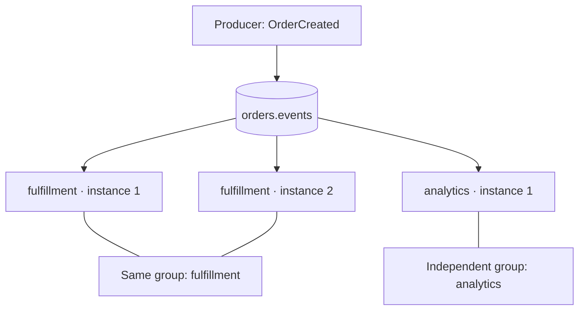
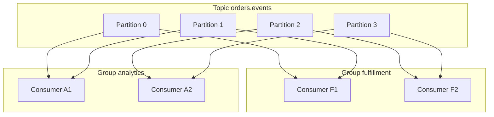

# Competing Consumers Within a Group and Independent Consumption Across Groups

In an event-driven system, an event may need to be processed by multiple replicas of the same service to increase throughput, while also needing to be delivered to several different services for independent purposes. Spring Cloud Stream expresses both needs using the **consumer group** (`group`) property on each input binding.

Imagine a producer emits an `OrderCreated` event to the `orders.events` topic. The fulfillment service needs to distribute the work of preparing orders across multiple instances. The analytics service also needs to receive every event to update reports. The fulfillment instances must compete for work within the same group; analytics must have a separate group to receive the entire event stream independently. Misconfiguring these two cases can cause the system to miss business operations or process events repeatedly in unexpected ways.

After this lesson, you will be able to:

- Distinguish between competing consumption within a single consumer group and independent consumption across groups.
- Configure `group` for Spring Cloud Stream functional bindings.
- Explain how Kafka, RabbitMQ, and Pulsar implement groups or subscriptions.
- Predict the impact of partitions, consumer counts, retries, offsets, and Kafka Streams state.
- Design tests and operational checks to catch incorrect load sharing or event delivery.

## 1. Two Distinct Delivery Needs

Suppose a producer emits a single `OrderCreated` event. There are two ways to organize consumers:

**Competing consumers within the same group.** Multiple instances subscribe with the same group. The broker distributes work within the group so that a message is processed by one consumer member at a time under the broker's normal delivery mechanism. This scales a single processing capability: adding instances shares the load and improves resilience if one instance stops.

**Independent consumption across groups (independent subscriptions).** Each group has its own subscription or read position. Every group receives the entire event stream, independent of any other group's progress. This applies when multiple business capabilities care about the same event: fulfillment creates shipment requests, analytics updates metrics, and notification sends alerts.

The diagram below illustrates both cases. Instances A1 and A2 in the same `fulfillment` group split the messages between them. The `analytics` group receives an independent delivery of each message.



For an event with `eventId=evt-100`, the `fulfillment` group processes that event once in its normal processing flow, regardless of which instance receives it. The `analytics` group also processes `evt-100` at its own pace. If a `notification` group is added, that group receives the event as well. The number of groups determines how many independent business processing streams exist; the number of consumers within a group determines how load is shared within that stream.

| Configuration | Expected Outcome | Purpose |
|---|---|---|
| Multiple instances, same `group=fulfillment` | Load is shared among instances in the group | Scaling a single service |
| One or more instances, `group=fulfillment` and `group=analytics` | Each group receives the entire event stream | Multiple services reacting to the same event |
| Each instance has a separate group | Each instance has an independent receiving stream | Use only when per-instance fan-out is truly intended |
| Omitting `group` | Binder creates an anonymous group per broker rules | Experiments or temporary tasks; understand persistence limits |

A consumer group is not the name of a machine or a pod. It is the identity of a **logical consumption stream**. Therefore, replicas of the same business capability must share one stable group. Business capabilities that need independent delivery must use different groups.

## 2. Declaring Groups in Spring Cloud Stream

Spring Cloud Stream derives bindings from function bean names. For a `Consumer<OrderCreated>` bean named `fulfillOrder`, the default input binding is `fulfillOrder-in-0`. The `destination` property specifies where to receive data from; `group` specifies the binding's consumer group.

In Spring Cloud Stream's functional model, a `Consumer` has only an input; a `Function` has both input and output; a `Supplier` produces data at its output. Therefore, `group` applies to an input binding that consumes messages. It is not a load-sharing property of an output binding produced by a `Supplier` or the output side of a `Function`.

For example, if a `Function<OrderCreated, OrderEnriched>` named `enrichOrder` reads events and emits enriched data, the input binding `enrichOrder-in-0` can have `group: order-enrichment`, while the output binding `enrichOrder-out-0` only needs the target destination. Multiple instances of the function share the same group to divide input load; every result produced by the function flows through the output binding.

Example of a consumer:

```java
public record OrderCreated(
        String eventId,
        String orderId,
        Instant occurredAt
) {}

@Configuration
public class OrderConsumers {

    @Bean
    Consumer<OrderCreated> fulfillOrder(OrderService orderService) {
        return event -> orderService.fulfill(event);
    }
}
```

YAML configuration:

```yaml
spring:
  cloud:
    function:
      definition: fulfillOrder
    stream:
      bindings:
        fulfillOrder-in-0:
          destination: orders.events
          group: fulfillment
          content-type: application/json
      kafka:
        binder:
          brokers: localhost:9092
```

In this configuration:

- `fulfillOrder` is the function bean name selected by Spring Cloud Function to create bindings.
- `fulfillOrder-in-0` is the input binding name generated from that bean.
- `destination: orders.events` is the Kafka topic the binding subscribes to.
- `group: fulfillment` is the stable consumer group for the fulfillment capability.

When running two or more application replicas with the same configuration, all replicas join the `fulfillment` group. The broker divides the work among the members. When a new replica is deployed, the broker may reassign partitions or consumer assignments to bring the new member into the group.

When a single application has two capabilities that need to consume the same topic independently, declare two beans and two groups:

```java
@Configuration
public class OrderEventConsumers {

    @Bean
    Consumer<OrderCreated> fulfillOrder(OrderService orderService) {
        return event -> orderService.fulfill(event);
    }

    @Bean
    Consumer<OrderCreated> updateAnalytics(OrderAnalytics analytics) {
        return event -> analytics.recordCreatedOrder(event);
    }
}
```

```yaml
spring:
  cloud:
    function:
      definition: fulfillOrder;updateAnalytics
    stream:
      bindings:
        fulfillOrder-in-0:
          destination: orders.events
          group: fulfillment
          content-type: application/json
        updateAnalytics-in-0:
          destination: orders.events
          group: analytics
          content-type: application/json
      kafka:
        binder:
          brokers: localhost:9092
```

Both bindings point to `orders.events`, but they have different groups. As a result, analytics does not steal events from fulfillment. Each binding has its own consumption progress. If analytics pauses or lags behind, fulfillment can still keep processing according to the `fulfillment` group's progress.

In a system deployed across multiple separate applications, each application can declare one binding to the same destination with its own group. The logical delivery outcome remains the same as in the example above.

### Choosing a Group Name

A group name should describe the capability or consumption purpose, such as `fulfillment`, `billing`, `fraud-detection`, or `order-analytics`. This name must stay stable across restarts and deployments.

Do not append a pod ID, hostname, or startup UUID to the group of a service that needs to share load. If every pod has a separate group, the broker treats every pod as an independent subscriber and sends all events to every pod. As a result, the same order could have shipping requests created by multiple pods.

Conversely, do not share one group across two capabilities that must process independently. If `fulfillment` and `analytics` share the `orders` group, an event may be delivered to either fulfillment or analytics. One of the two capabilities will then miss the event.

When `group` is omitted, Spring Cloud Stream creates an anonymous consumer group according to the binder's mechanism. Anonymous groups are usually not durable and are unsuitable for a business consumer that needs to resume from saved progress after a restart. Exact behavior depends on the broker and binder. For production consumers, declare `group` intentionally.

## 3. Kafka: Groups Divide Partitions and Track Independent Offsets

In Kafka, a consumer group is a set of consumers reading a topic together and coordinating partition assignment. **A partition is Kafka's unit of work division and ordering.** At any given time, a partition is assigned to at most one consumer member within the same group. A single consumer can receive multiple partitions.

Suppose topic `orders.events` has 4 partitions:

- Group `fulfillment` has 2 consumers. The two consumers can split the 4 partitions, with each consumer handling 2 partitions.
- When the group scales to 4 consumers, each consumer can receive one partition.
- When the group scales to 6 consumers, at least 2 consumers have no partitions to read. Adding consumers beyond the partition count does not increase the group's parallel reading threads.
- Group `analytics` has its own assignment and reads all 4 partitions, regardless of whether group `fulfillment` has 2 or 4 consumers.



The diagram illustrates independent assignments between two groups. Kafka does not duplicate a partition into two new partitions for each group; each group maintains its own read position over the same log.

### Offsets Belong to the Group

Kafka records consumed offsets per topic-partition and consumer group pair. Therefore:

- Consumers in the same group coordinate on the group's shared read progress.
- Different groups have separate offsets. The `analytics` group can read slower than `fulfillment` without altering fulfillment's offsets.
- When a member leaves the group or a new member joins, Kafka runs a rebalance to reassign partitions. Committed offsets remain tied to the group, not to a specific pod.

An offset is a read position, not proof that external business work succeeded. For example, a consumer reads an event, writes data to the database, and crashes before the offset is committed. After restarting, the event may be read again and the write operation may repeat. Consumers therefore need safe duplicate handling.

### Partition Keys and Processing Order

Kafka guarantees ordering within a single partition. Kafka does not guarantee global ordering across multiple partitions. If all events for the same order must be processed in sequence, the producer should use `orderId` as the partition key so that events for that order land in the same partition.

For example, `OrderCreated`, `OrderPaid`, and `OrderShipped` for `order-42` need a consistent sequence. When the same key `order-42` is consistently routed to one partition, a single consumer member in the group reads that partition in offset order. Using a random key or round-robin distribution can spread events of the same order across multiple partitions and process them concurrently.

Choosing a partition key is a balance between ordering and load. A key with excessive traffic can create a hot partition. Adding more consumers will not fix a hot partition if all events for that key still go into the same partition.

### Consumer Count and Concurrency

With Kafka, the actual number of consumer members in a group can include both multiple application instances and multiple consumer threads per instance, depending on binder configuration. A binding's `concurrency` property can spawn multiple consumers inside one instance. When sizing capacity, count total consumer members against partition count rather than counting pods alone.

Increasing concurrency can utilize partitions better, but it also increases broker connections, memory, threads, and load on downstream databases. Measure processing time and lag before increasing it. If total consumers exceed the partition count, extra consumers will sit idle.

When changing a topic's partition count, assignments and key distribution can change. For systems that depend on key-based ordering, evaluate the impact of changing the partition count before applying it.

## 4. RabbitMQ: Groups Correspond to Subscriber Queues

RabbitMQ organizes delivery through exchanges and queues. An exchange receives messages and routes them to queues based on exchange type, routing keys, and bindings. In Spring Cloud Stream's Rabbit binder, a consumer group gets its own queue attached to the destination. Consumers in the same group compete to pull messages from that queue. Another group gets its own queue bound to receive an independent delivery.

Suppose the destination is `orders.events`:

- Group `fulfillment` uses a fulfillment queue. Multiple fulfillment instances consume from that queue together.
- Group `analytics` uses a separate analytics queue. The analytics queue also receives events routed by the exchange.
- When a message is routed by the exchange to both queues, each group receives a delivery to process independently.

Unlike Kafka, RabbitMQ does not use topic partitions as the unit for dividing consumers in the same way. Multiple consumers can read from the same queue concurrently. The broker delivers each message to an available consumer based on consumer state, prefetch, and current load. When a consumer acknowledges (`ack`) a message, the broker can remove the message from the queue. If the consumer disconnects before acking, the message can be redelivered.

Prefetch limits how many unacknowledged messages the broker delivers ahead of time to a consumer. A prefetch that is too low can reduce throughput; one that is too high can let one consumer hold many messages while other consumers have little work. Balance prefetch against processing time, message size, and downstream capacity.

### Configuration and Notes

Spring Cloud Stream bindings still declare `destination` and `group` using the same model:

```yaml
spring:
  cloud:
    function:
      definition: fulfillOrder
    stream:
      bindings:
        fulfillOrder-in-0:
          destination: orders.events
          group: fulfillment
          content-type: application/json
      rabbit:
        binder:
          # RabbitMQ connection properties are declared here
```

The Rabbit binder creates and binds queues based on `destination`, `group`, and binder options. The actual queue name may be affected by prefixes and binder configuration. In operations, inspect the actual queues created on the broker instead of guessing queue names from a single config string.

One queue with multiple consumers is the competing-consumers pattern. A slow or failing consumer can affect the backlog in that queue, but another group's separate queue keeps its own progress and backlog. Configure durable queues, message persistence, acknowledgements, retries, and dead-letter queues according to business requirements.

When multiple consumers read from the same queue concurrently, the order messages are fetched and the order business processing completes can differ. For instance, consumer A receives `OrderPaid` first but takes longer to process it; consumer B receives `OrderShipped` later and finishes sooner. If per-order ordering is mandatory, design routing, concurrency limits, or key-based serialization appropriate for RabbitMQ.

## 5. Pulsar: Groups Are Subscriptions, and Subscription Type Controls Load Sharing

Apache Pulsar tracks consumption progress using subscriptions. With the Spring Cloud Stream Pulsar binder, the binding's `group` acts as the subscription name. Multiple consumers using the same subscription participate in the same consumption stream; a different subscription has its own cursor and progress and receives messages independently.

Pulsar supports multiple subscription types, and the type determines how multiple consumers within the same subscription coordinate:

| Subscription Type | How It Works | When It Fits |
|---|---|---|
| `Exclusive` | One active consumer on the subscription | A single consumer |
| `Failover` | One active consumer; another takes over if the primary drops | Need standby and failover |
| `Shared` | Multiple consumers receive messages from the subscription together | General load sharing |
| `Key_Shared` | Multiple consumers receive together; messages with the same key go to the same consumer under key-shared rules | Load sharing while keeping key affinity |

If you want to scale concurrent consumers within the same group, choose a subscription type that supports multiple active consumers, such as `Shared` or `Key_Shared`. `Exclusive` is not a multi-consumer load-sharing configuration. `Shared` can break global ordering; `Key_Shared` is useful when key-based processing is needed, provided producers and consumers use keys and matching routing configuration.

Conceptual example with two capabilities:

- Subscription `fulfillment` has multiple `Shared` consumers to share the load of creating shipment requests.
- Subscription `analytics` has its own progress and receives an independent event stream.

Properties for subscription type, acknowledgement, retry, and dead-letter handling are configured according to the Pulsar binder's capabilities and version. Do not copy Kafka or Rabbit consumer properties directly to Pulsar because property names and broker semantics differ.

## 6. Choosing the Right Model for Each Business Requirement

A useful design question is: **if I add another instance, do I want to share work or create another full event receiver?**

If the answer is to share work, the instances must use the same group. For example, 5 instances of fulfillment process orders together. When one instance stops, the remaining instances continue receiving the work assigned by the broker.

If the answer is to add another full event receiver, create a new group. For example, when adding fraud detection, create a `fraud-detection` group so that service receives all `OrderCreated` and `OrderPaid` events while fulfillment and analytics continue running.

| Scenario | Design |
|---|---|
| Increase throughput for one business consumer | Add instances with the same group |
| Add a new downstream service | Create a new group on the same destination |
| Run two application versions during a rolling deployment | Keep the same group; ensure both versions are schema- and logic-compatible |
| Want every pod to receive all events to update its own local cache | Separate group per pod only when per-pod fan-out is intentional |
| Run an experimental stream without saving progress | Can use an anonymous group, after understanding binder behavior |
| Rebuild data for an independent projection | Use a separate group or application identity and plan the replay |

### Do Not Confuse Group with Partition

Groups and partitions solve two related but distinct problems:

- A group defines **who shares a single consumption progress**.
- A partition defines **how data is split into parallel units of reading** in Kafka.

A group can have one or many consumers. A topic can have one or many partitions. Partition count caps the parallelism of a single Kafka consumer group; group count determines how many independent consumption streams exist.

For example, a topic has 8 partitions, group `fulfillment` has 4 consumers, and group `analytics` has 2 consumers. Each group utilizes the partitions under its own assignment. You do not need to create a new topic just so analytics can have independent offsets.

### Do Not Confuse Group with Retry

Retry handles a single failed message delivery; group defines a logical consumption boundary. A failure in a fulfillment consumer should not force analytics to wait for fulfillment's retries. Two groups have independent progress, though they still share the underlying broker, schemas, network, and shared infrastructure.

Excessive retries can keep a partition or queue occupied with a failing message, depending on the broker and binder configuration. Define which errors are retryable, retry counts, backoff, processing timeouts, and how messages move to a dead-letter queue/topic. A DLQ should allow tracing the original message, group/binding, error, timestamp, and attempt count.

## 7. Delivery, Deduplication, and Durability

Consumer groups enable load sharing and broker-managed progress; they do not guarantee that business operations happen strictly once. Several situations can cause a message to be redelivered:

1. The consumer receives the message and executes a side effect.
2. The consumer stops before the broker records the acknowledgement or offset commit.
3. The broker redelivers the message after the consumer recovers or reconnects.
4. The side effect could execute again if the application does not detect duplicate messages.

Therefore, business consumers should be **idempotent**: processing the same event multiple times still yields the correct final result. A common pattern is for the producer to provide a unique `eventId`; the consumer inserts `eventId` into an inbox table with a unique constraint in the same transaction as the business change. If the event already exists, the consumer skips the duplicate side effect and completes the acknowledgement normally.

Example:

```java
@Transactional
public void fulfill(OrderCreated event) {
    boolean firstDelivery = inboxRepository.insertIfAbsent(
            event.eventId(),
            "fulfillment"
    );

    if (!firstDelivery) {
        return; // This event has already been processed successfully
    }

    orderRepository.markReadyForFulfillment(event.orderId());
}
```

`insertIfAbsent` must be implemented using a unique constraint and an atomic database operation. If writing to the inbox and updating the order happen in two separate transactions, deduplication still leaves a gap. For side effects outside the database, design an outbox, API idempotency keys, or an appropriate compensating process.

Kafka can provide transactions and exactly-once mechanisms within compatibly configured Kafka processing boundaries. That does not automatically turn an external HTTP call or external database transaction into exactly-once. RabbitMQ and Pulsar also have their own acknowledgement, transaction, or delivery guarantees; read the exact semantics of the binder and broker in use. Do not infer an exactly-once guarantee merely from declaring a `group`.

### Per-Consumer Retry and DLQ

Each group can have different downstream capabilities and error policies. Fulfillment might retry transient errors when calling an inventory system; analytics might retry projection write errors. When configuring retries and DLQs, specify which binding applies, which messages are retried, which errors route to the DLQ, and how replay works.

With Spring Cloud Stream, some generic retry properties live under `bindings.<binding>.consumer`, while DLQ and dead-letter routing often have binder-specific properties. For example, the Kafka binder has options to enable DLQ for a consumer binding; the Rabbit binder has options to auto-bind a dead-letter queue. Exact property names and behavior depend on the version. Check the corresponding binder documentation before deploying settings to production.

Do not share a single DLQ without storing group/binding information. If the same event fails in both fulfillment and analytics, the two groups need independent investigation and replay. Replaying a failed message for analytics should not accidentally re-trigger shipment creation in fulfillment.

## 8. Schemas and Rolling Deployments

An event may be received by different groups at different times. Fulfillment may process near real time, while analytics may lag by several hours. When a producer changes a schema, new consumers, old consumers still running during a rolling deployment, and consumers catching up on backlog can all encounter different payload versions.

Design compatible schemas:

- Add new fields in ways older consumers can ignore or fill with default values.
- Avoid changing the meaning, changing the type, or removing fields currently used by consumers without a migration plan.
- Use explicit versions or event types when making meaningful structural changes.
- Retain `eventId`, aggregate identifier, timestamp, and data needed for consumers to process independently.
- If using a schema registry, enforce appropriate compatibility rules and validate schemas before releasing producers.

During a rolling deployment, old and new versions usually belong to the same group. The broker can deliver messages to any active member. Thus, newly published messages during rollout can still reach the older version. Backward-compatible schemas are a practical necessity, not an optional detail.

Creating a new group for a new version just to avoid schema compatibility will cause that version to receive the entire stream independently. That can produce duplicate side effects. Only create a new group when the intent is genuinely to add an independent subscriber, such as rebuilding a projection or running a controlled parallel pipeline.

## 9. Kafka Streams State and `application.id`

For regular Kafka binder consumers, `group` identifies the consumer group. For the Kafka Streams binder, also pay attention to the Kafka Streams application identity: `application.id`. This is the processing topology's identifier, used by Kafka Streams to manage internal consumer groups, processing progress, and associated state resources.

Instances of the same Kafka Streams application must use the same `application.id` to share topology tasks. If each instance sets a different `application.id`, each instance becomes an independent processing application and may read the entire input, build separate state, and emit duplicate output.

Conversely, two topologies that must run independently must have different `application.id` values. Each application has its own progress and state stores. For changelog-backed state stores, Kafka Streams can restore local state from the changelog when a task moves to another instance. Therefore, a task's local state should not be treated as a shared file across pods.

Example application identity configuration:

```yaml
spring:
  cloud:
    stream:
      kafka:
        streams:
          binder:
            application-id: order-risk-projection
            brokers: localhost:9092
```

Conceptual example of a stateful topology:

```java
@Bean
Function<KStream<String, OrderCreated>,
         KStream<String, OrderCount>> countOrders() {
    return input -> input
            .groupByKey()
            .count()
            .toStream()
            .mapValues((orderId, count) ->
                    new OrderCount(orderId, count));
}
```

The topology above aggregates data by key and maintains counts. In a real implementation, choose the right key, appropriate state store names, key/value serdes, and output binding configuration. When running multiple instances with the same `application.id`, Kafka Streams distributes tasks and corresponding state. When running a second projection application with a different `application.id`, the second application maintains separate state and consumes input independently.

Operational rules:

- Use the same `application.id` for instances scaling the same topology.
- Use a separate `application.id` for an independent topology, an independent environment, or an intentional projection rebuild.
- Do not change `application.id` arbitrarily on every deploy; changing the ID can create a new application with fresh progress and state.
- Plan for changelogs, restore times, local state storage capacity, and rebalance duration when scaling or changing topologies.
- Do not confuse Kafka Streams' `application.id` with the `group` of a standard consumer binding.

## 10. Testing Group Behavior

Tests must prove both properties: consumers in the same group share load; different groups all receive the full event stream. Merely checking that a `Consumer` function executes successfully does not prove the broker distributes messages properly.

### Unit Tests for Business Logic

Test the consumer function or service directly to verify that valid events produce the expected changes, already-processed events do not cause duplicate side effects, and errors are classified properly. Unit tests are fast and isolated, but they do not test assignments, offsets, or queues.

### Test Binder for Bindings

Spring Cloud Stream provides a test binder to send messages into input bindings and inspect output bindings in tests. The test binder is useful for verifying binding names, payload conversion, and function logic. It does not fully simulate rebalances, partition assignments, prefetch, subscription types, or real broker acknowledgements.

### Integration Tests with a Real Broker

Use Testcontainers or a test broker environment to verify group semantics. A Kafka scenario can work as follows:

1. Create a test topic with at least two partitions and use a unique group ID per test run.
2. Start two consumer instances in group `fulfillment-test`.
3. Start one consumer in group `analytics-test`.
4. Publish a batch of messages with unique `eventId` values.
5. Wait until the analytics group receives all events.
6. Combine the events received by the two fulfillment instances; verify each event was processed by the group as expected once in the no-error scenario.
7. Stop one fulfillment instance, publish more events, and verify the remaining member continues processing after assignment stabilizes.

When writing assertions, use eventual assertions with explicit timeouts because delivery is asynchronous. Do not rely on completion ordering between two consumers. If testing ordering, create an appropriate key and partition setup, and assert within a single partition or a single key.

With RabbitMQ, verify two consumers in the same group reading a shared queue and another group with its own queue receiving independent deliveries. With Pulsar, verify the exact subscription name and subscription type. These tests catch configuration errors that the test binder cannot detect.

### Suggested Test Matrix

| Change | What to Verify |
|---|---|
| Add an instance in the same group | Total event count for the group stays accurate; load is shared across instances |
| Create a new group | The new group receives events according to retention/subscription policy |
| One consumer stops abruptly | Remaining members continue; incomplete messages are handled per broker mechanics |
| Consumer encounters an error | Retry, backoff, and DLQ apply to the right binding |
| Replay the same `eventId` | No duplicate business side effects occur |
| Rolling deployment | Both old and new versions can read published schemas |
| Kafka Streams instance restarts | Tasks are reassigned and state restores properly |

## 11. Monitoring and Operations

Groups track independent progress, so observe per group rather than per topic alone. A topic might look healthy for fulfillment while analytics is lagging significantly.

For Kafka, monitor consumer group lag per topic-partition, assignments, member count, consumption rate, commit errors, and rebalances. Steadily rising lag can indicate slow consumers, downstream bottlenecks, hot partitions, or insufficient partitions. Do not just add more pods when partition count is already the concurrency ceiling.

For RabbitMQ, monitor queue depth, publish/ack rates, unacked message counts, consumer counts, redeliveries, and DLQs. Increasing queue depth while consumers remain active can signal that prefetch, processing time, or downstream systems are limiting throughput.

For Pulsar, monitor backlog per subscription, acknowledgement rates, redeliveries, consumer counts, and subscription status. A large backlog on one subscription does not necessarily stall another subscription; inspect metrics per subscription.

Metrics should include binding name and group so on-call engineers can answer: which group is lagging, which group is retrying, which messages went to the DLQ, and which groups have already processed an event. Logs should carry `eventId`, `destination`, `group`, `consumer instance`, correlation ID, and processing outcome. Avoid logging full sensitive payloads.

## 12. Common Design Mistakes

**Sharing one group across independent services.** Putting fulfillment and analytics in the same group means an event may reach only one of the two services. Separate groups by capability needing independent delivery.

**Giving every pod a separate group in a load-sharing service.** Every pod receives the entire stream and can duplicate side effects. Use one stable shared group across replicas.

**Scaling Kafka consumers without checking partition count.** Extra consumers get no partitions to read. Measure lag and evaluate partition count and key distribution before scaling.

**Assuming all brokers share identical semantics.** Kafka assigns partitions and manages offsets; RabbitMQ routes via exchanges/queues and acknowledgements; Pulsar uses subscription types. Configuration must match the target binder.

**Treating acknowledgement or offset commit as exactly-once.** Side effects can repeat if a consumer stops at an unfortunate moment. Use event IDs and idempotency at business boundaries.

**Changing `group` or `application.id` without a plan.** The broker may create a new consumption stream, new queue or subscription, or initialize independent state. Decide beforehand whether to replay, preserve the old backlog, or migrate progress.

**Skipping schema checks during rolling deployments.** Messages may reach older running versions or sit in long-lived backlogs. Verify compatibility before releasing producers.

## 13. Decision Workflow

When adding a consumer binding, answer these questions in order:

1. Is this consumer an independent business capability that needs to receive every event? If yes, choose a separate group.
2. Do replicas of this consumer need to share load? If yes, keep the same group across all replicas.
3. What parallelism mechanism does the broker use? Kafka needs enough partitions; RabbitMQ needs appropriate queues and concurrency; Pulsar needs the right subscription type.
4. Is ordering required per aggregate/key? Choose a partition key, routing, or subscription type to preserve the right ordering scope.
5. On processing errors, how are messages retried, moved to a DLQ, and replayed? Design idempotency to tolerate redelivery.
6. Will the group or application identity remain stable across deploys? If changing it, determine the impact on offsets, queues, subscriptions, and state upfront.
7. Which tests prove load sharing and fan-out? Use a real broker when verifying broker semantics.

The core principle is choosing groups by **business processing boundaries**. Replicas doing the same job share a group to compete for messages. Capabilities that need to observe the same event independently use separate groups so each keeps its own progress. From there, Kafka partitions, RabbitMQ queues, or Pulsar subscription types govern how the broker distributes work inside each group.
