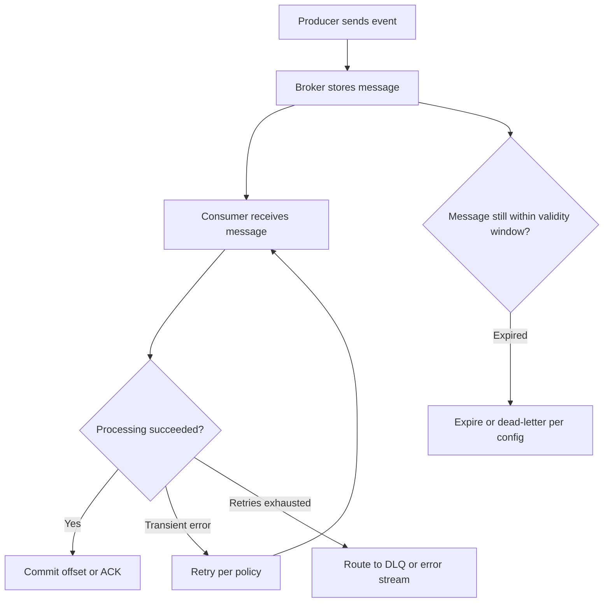

# Message Retention, Durable Subscriptions, and Time-to-Live

In an event-processing system, simply sending a message is only the first step. The system must also determine how long the broker retains messages, how each receiving group's consumption state is stored, and when a message expires. These decisions directly affect crash recovery, data replay, behavior when consumers go offline temporarily, and storage capacity planning.

Spring Cloud Stream provides a unified programming model for `Supplier`, `Function`, and `Consumer`, along with bindings connecting applications to Kafka, RabbitMQ, or Pulsar. However, bindings do not give all three brokers the same retention mechanism. Applications need to understand the semantics of the broker in use, configure consumer group identities properly, and test actual behavior before deployment.

## 1. Distinguishing Retention, Durable Subscriptions, and TTL

These three concepts relate to the message lifecycle but solve different problems.

| Concept | Question to Answer | Example |
|---|---|---|
| Message retention | How long or up to what size limit does the broker keep received data? | Kafka retains records by topic time or size limits. |
| Durable subscription | How does the broker preserve consumption state when a consumer disconnects or restarts? | Kafka stores consumer group offsets; Pulsar stores subscription cursors; RabbitMQ keeps unacknowledged messages in durable queues. |
| Time-to-live (TTL) | How long is a message allowed to remain valid or be processed? | RabbitMQ offers queue-level or per-message TTL; Pulsar offers TTL policies for unacknowledged messages. |

Do not treat these three concepts as one. A durable queue does not automatically mean messages are kept forever. A durable subscription cannot replay data that the broker has already deleted. TTL can expire a message even while a consumer is running. Conversely, a message still within Kafka's retention window does not mean a consumer has processed it.

Separate the lifecycle into three layers:

1. **Data:** the broker stores payloads and metadata according to the retention policy.
2. **Progress:** the broker stores offsets, cursors, or acknowledgement state to track how far a consumer has progressed.
3. **Validity window:** TTL policies or application-defined deadline fields indicate whether a message still has business value.

When designing, specify separately how long data must be kept, the maximum outage a consumer can tolerate, and the business deadline for each event type.

## 2. Consumer Group Identity Determines Resumability

A consumer group usually represents a business processing capability, such as **billing-v1** receiving order events to generate invoices. Replicas of the same application share a group identity to divide load. Another group, such as **analytics-v1**, can receive the same events independently to build reports.

In Spring Cloud Stream, a binding's **group** property represents the consumer group identity. For example, with an order-event processing function:

```java
@Bean
Consumer<OrderCreated> orderProcessor() {
    return event -> {
        // Validate and process the order event.
        processOrder(event);
    };
}
```

```yaml
spring:
  cloud:
    function:
      definition: orderProcessor
    stream:
      bindings:
        orderProcessor-in-0:
          destination: orders
          group: billing-v1
```

The function's input binding name is **orderProcessor-in-0**. **destination** identifies the logical target the binding connects to; **group** identifies the receiving group. For consumers with a stable group, the binder can create or reuse corresponding durable consumption resources according to the broker's rules.

Do not change the group name arbitrarily on each deployment. In Kafka, a new group name gets its own offsets and usually starts according to the configured offset initialization policy. In RabbitMQ, a new group can map to a separate queue, causing that group to receive an independent stream of copies. In Pulsar, the subscription name identifies consumption state. Changing group identity can start fresh progress and cause events to be re-read or missed unexpectedly.

Replicas of the same group must share the identity to split load. If replicas accidentally use different groups, each replica may receive all events instead of sharing the work. Conversely, if two applications with independent business purposes share one group, they compete for messages and neither application receives every event.

## 3. Kafka: Log Retention and Consumer Group Offsets

Kafka stores messages in a topic's log. Consumers read the log by offset; each partition has its own offset sequence. Kafka stores committed progress for each consumer group so consumers can resume reading after a restart.

These two mechanisms are independent:

- **Topic retention** determines how long or up to what size records remain in the log.
- **Committed offsets** indicate how far a consumer group has processed from its own perspective.

For example, the **orders** topic might retain data for seven days. Group **billing-v1** committed up to offset 1200 and then stopped for two days. When the group comes back online, it can resume from its committed offset if the records to read are still in the log. If retention has already deleted those records, old offsets cannot recover lost payloads.

Retention settings are typically managed at the topic level or via cluster policy. Two common properties are:

- **retention.ms:** retention time in milliseconds.
- **retention.bytes:** log size limit per partition.

With **cleanup.policy=delete**, Kafka removes old segments based on time or size policies. With **cleanup.policy=compact**, Kafka retains the latest record per key during compaction; tombstones can mark keys for deletion and tombstones themselves are retained only for a configured duration. A topic can use both **compact** and **delete**.

Compaction is not a general replacement for time-based retention. It fits topics representing the latest state per key, whereas event topics usually need history for replay. Choose the policy based on data semantics:

| Data Type | Typically Suitable Policy | Reason |
|---|---|---|
| Business events needing history | **delete** | Keeps events within the chosen time or size window. |
| Latest state snapshot per key | **compact** | Retains the most recent value for each key. |
| State needing both latest updates and age limits | **compact,delete** | Combines compaction with retention limits. |

During replay, a consumer can be reset to an older offset if records still exist in the topic and operational permissions allow it. This is an impactful operation: the application may reprocess events, call external services, or apply business side effects again. Ensure handlers are idempotent, using event keys or unique constraints to prevent duplicate invoices, payments, or notifications.

Do not set retention based solely on available disk space. Factor in maximum acceptable downtime, incident resolution time, replay windows, and audit requirements. Also monitor consumer lag: steadily growing lag can push a consumer group close to the retention boundary.

## 4. RabbitMQ: Durable Queues, Acknowledgements, and TTL

In RabbitMQ, messages are routed through exchanges to one or more queues. A queue declared as durable can survive a broker restart. For message data to be recoverable, producers also need to publish messages as persistent, and the system needs appropriate queue storage and replication configuration.

Durable queues and persistent messages are two separate properties. Durable describes the lifecycle of the queue; persistent describes the durability requested for the message. Publisher confirms tell the producer that the broker acknowledged receiving the message under its confirmation mechanism. Consumer acknowledgements tell the broker a message has been processed. If a consumer disconnects before acknowledging, unacknowledged messages can be returned to the queue for redelivery.

Once a consumer acknowledges successfully, RabbitMQ normally removes the message from the queue. Therefore, a durable queue is not a historical archive for replaying already-consumed messages. If multiple systems need to receive the same event independently, each processing group needs its own queue bound to the appropriate exchange.

In the Spring Cloud Stream Rabbit binder, a binding with a group usually maps to a queue dedicated to that group. Replicas in the same group compete for messages from that queue. A binding without a group usually uses a temporary queue or private identifier per binder configuration; that queue type is unsuitable if progress must survive restarts.

### Queue and Message TTL

RabbitMQ supports TTL at two levels:

- Queue TTL applies to messages sitting in that queue.
- Per-message TTL is set by the producer when sending a message.

Upon expiration, a message is no longer eligible for delivery to consumers. Depending on configuration, expired messages may be discarded or routed to a dead-letter exchange. Actual expiration timing can depend on message position in the queue and broker activity; do not rely on TTL as a millisecond-accurate timer.

For example, a login verification code notification is only valid for a few minutes. An order needs a longer processing window. Do not apply the same TTL to both event types. Nor should you set a very short TTL on an order-processing queue if the system can experience temporary overload or need recovery time.

TTL and dead-letter options in the Rabbit binder depend on binder version and how queues are declared. Configure policies in broker management or use the exact properties supported by your binder version; then inspect actual queues and policies on RabbitMQ. Do not assume that merely setting **group** on a binding enables TTL or dead-letter routing.

## 5. Pulsar: Subscriptions, Cursors, and Retention

Apache Pulsar separates the concept of a topic from a subscription. Producers write messages to a topic; consumers receive messages through a named subscription. A subscription maintains a cursor representing consumption position and acknowledgement state. When a consumer reconnects with the same subscription, it can resume from saved progress.

The subscription name is therefore part of the processing identity. Consumers sharing a subscription coordinate according to the selected subscription type:

| Subscription Type | General Distribution Behavior | Use Case |
|---|---|---|
| Exclusive | One active consumer on the subscription at a time. | Simple sequential processing. |
| Failover | One primary active consumer; another can take over when needed. | Need a primary consumer with standby failover. |
| Shared | Multiple consumers receive messages from the subscription together. | Load sharing among independent consumers. |
| Key_Shared | Multiple consumers share load while messages with the same key stay on the same consumer per distribution rules. | Need parallelism while preserving relative key ordering. |

Acknowledged messages generally become eligible for deletion when no remaining subscriptions or policies require keeping them. Pulsar supports namespace-level retention to keep already-consumed messages for a configured duration or size, enabling new subscriptions or data replay within the retention window. This serves a different purpose from retaining unacknowledged backlogs for active subscriptions.

Message TTL in Pulsar is typically used to limit how long unacknowledged messages remain pending. When TTL expires, messages can be removed from the backlog per broker policy. Distinguish TTL from retention: retention preserves already-consumed data for re-reading, whereas TTL bounds the age of messages waiting to be processed. Exact property names and scopes can vary by Pulsar version and namespace policy.

The Spring Cloud Stream Pulsar binder maps bindings and consumer groups to topic and subscription resources per binder configuration. Keep group names stable across deployments and inspect actual subscriptions on Pulsar. When changing subscription types, consumer counts, or retention policies, assess the impact on ordering, backlog, and replayability.

## 6. TTL, Retry, and Dead-Letter Solve Different Problems

TTL is not a retry mechanism. TTL answers how long a message remains valid; retry answers how the application re-attempts processing after an error; a dead-letter queue (DLQ) stores messages that cannot be processed on the main path for investigation or separate handling.

A processing flow can work like this:



Not every broker expresses retry and DLQ the same way. Kafka typically relies on application logic or binder configuration to retry, route to an error topic, or apply appropriate error handlers. RabbitMQ provides dead-letter exchanges and queue TTL to support forwarding flows. Pulsar provides retry letter topics and dead-letter topics depending on consumer implementation. Verify the exact behavior of your binder, including retry counts, backoff delays, acknowledgements, and recovery after routing to a DLQ.

For events that have expired from a business standpoint, retrying can be harmful. For instance, a reservation request valid for five minutes should not be executed an hour later simply because a consumer came back online. Applications should carry the occurrence timestamp or business deadline, check expiration before applying irreversible effects, and record expiration outcomes according to business rules.

## 7. Designing Retention Windows and Replay Capability

Retention policies should come from operational requirements. For each event type, answer:

1. How long can a consumer be offline at most without losing the ability to resume?
2. How much time does the operations team need to detect, fix a bug, and restart the consumer?
3. Is data replay needed to fix logic bugs or rebuild read models?
4. Does the data have business expiration limits, audit requirements, or specific deletion regulations?
5. Do the broker's storage capacity and replication factor support that window?

An initial estimate for storage capacity is:

```text
raw_storage ≈ data_rate_per_second
               × retention_seconds
               × replication_factor
```

This only estimates payload volume. Actual disk usage also includes metadata, indexes, segments, broker overhead, compression format, key distribution, and storage engines. Use real load figures for planning and leave headroom for growth.

Several practices help avoid operational incidents:

- Use stable group or subscription names for the same business capability.
- Create a new group only when an independent consumption progress is truly desired.
- Choose retention long enough for expected outages, remediation, and replay windows.
- Check whether data still exists on the broker before resetting offsets or recreating subscriptions.
- Design idempotent consumers because redelivery and replay can cause duplicate processing.
- Include event ID, occurrence timestamp, schema version, and business key in the message envelope when appropriate.
- Monitor consumer lag, oldest message age, unacknowledged counts, backlog size, retry counts, and DLQ rates.
- Establish a process for inspecting, triaging, and replaying DLQ messages; do not automatically feed failing messages back into the main stream forever.

If the system must delete data per individual customer request or regulation, design identifiers and deletion workflows appropriately from the start. Topic- or namespace-level retention typically operates at resource scope and may not satisfy per-record deletion requirements.

## 8. Testing Retention and Subscription Behavior

Testing `Consumer` functions with the test binder is useful for verifying transformation and application logic. However, the test binder does not prove that a real broker will persist queues, commit offsets, expire messages, or recover subscriptions as intended. Those behaviors require integration tests with the target broker and configuration close to production.

A practical test suite should cover:

| Scenario | How to Test | Expected Result |
|---|---|---|
| Consumer stops and restarts | Send several events, stop the consumer before finishing all, then restart with the same group. | The consumer resumes from saved progress; unprocessed messages can still be received. |
| Two replicas in the same group | Run two instances with the same **group** or subscription. | Both instances share load per broker semantics without unintentionally creating two independent streams. |
| Two independent groups | Run two differently identified groups on the same destination. | Each group receives an independent event stream per configuration. |
| Message expiration | Send messages with a short TTL while keeping the consumer stopped. | Messages expire per broker policy; if a DLQ is configured, they route appropriately. |
| Replay | Replay a slice of data still within retention. | The consumer reads old data without creating duplicate business effects. |
| Persistent processing error | Intentionally fail a message. | Retries are bounded; the message is recorded or routed to the error stream per configuration. |
| Broker restart | Send messages, confirm durability settings, restart the broker in the test environment. | Queues, data, and progress recover according to configured guarantees. |

TTL tests should use wide enough intervals to avoid flakiness tied to exact broker sweep schedules. When testing replay, use test data with distinct business keys and assert both delivery counts and final state in the database or mock downstream service.

Before releasing, verify actual broker settings. Application-level configuration can be overridden by cluster policies, namespace settings, binder defaults, or infrastructure managed by the operations team.

## 9. Choosing Mechanisms by Broker

| Need | Kafka | RabbitMQ | Pulsar |
|---|---|---|---|
| Keep history for replay | Topic retention keeps the log for the configured window. | Queues typically remove messages after ACK; design another store or stream if history is required. | Namespace retention can preserve consumed messages for replay. |
| Track consumer progress | Offsets per partition and consumer group. | Un-ACKed message state stays in the queue; ACK completes delivery. | Cursors and ACK state per subscription. |
| Share load within a group | Consumer group divides partitions. | Multiple consumers compete on the same queue. | `Shared` or `Key_Shared` distributes across multiple consumers. |
| Limit message age | Retention usually applies at topic level; per-message business deadlines must be checked by the app. | Queue-level or per-message TTL. | Broker-policy Message TTL, usually applied to un-ACKed backlogs. |
| Retain consumed data | Records remain within retention even after a group reads them. | Not kept after ACK by default. | Retention must be configured to retain ACKed data. |

No single **group**, retention, or TTL configuration works identically across all three brokers. Choose based on application requirements, then verify how the binder maps settings to real broker resources.

## 10. Pre-Deployment Checklist

- [ ] Every consuming binding has an explicit **destination** and **group** identity.
- [ ] Instances of the same business capability share a group; independent capabilities use separate groups.
- [ ] Retention covers committed outage tolerances and replay windows.
- [ ] TTL reflects business expiration and does not accidentally drop valid messages.
- [ ] Queues, message persistence, publisher confirms, and acknowledgements are properly configured for RabbitMQ.
- [ ] Offsets, cleanup policies, and partition counts are reviewed for Kafka.
- [ ] Subscription types, cursors, namespace retention, and TTL are reviewed for Pulsar.
- [ ] Retries are bounded, and DLQs have clear ownership and handling procedures.
- [ ] Consumers are idempotent and schemas are compatible across producer versions.
- [ ] Dashboards or alerts exist for lag, backlog, expired messages, and DLQs.
- [ ] Integration tests confirm restart, redelivery, expiration, and replay on a real broker.

When data retention, consumption progress, and business deadlines are designed separately yet cohesively, Spring Cloud Stream helps event-driven applications recover cleanly from failures and support controlled replay. The key is keeping group identities stable, sizing retention windows to real needs, and verifying binder and broker behavior in a production-like environment.
