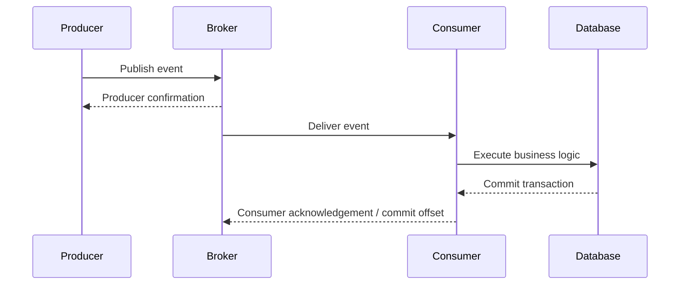

# Delivery Confirmation, Consumer Acknowledgement, and Business Completion

In an event-processing system, the answer "sent successfully" can refer to several different things. The application may have handed the message to a channel, the broker may have received and stored the message, the consumer may have acknowledged the offset or message, and the business operation may have committed to the database. These are distinct milestones. Treating them as one concept makes it easy to lose events or process duplicates during network errors, application restarts, or consumer rebalances.

Spring Cloud Stream provides the `Supplier`, `Function`, and `Consumer` programming model, bindings, and binders to connect application logic to Kafka, RabbitMQ, or Pulsar. The binder translates application send and receive calls into the corresponding broker mechanisms. Because each broker has its own acknowledgement and storage model, you must understand which milestone has completed before deciding to retry, record success, or reply to a caller.

## Four Milestones to Distinguish

An event flow typically involves at least four milestones:

| Milestone | Meaning | What This Milestone Does Not Guarantee |
|---|---|---|
| Application sends to binding | The message was accepted by the in-app channel/binding | The broker has durably stored the message |
| Broker confirms to producer | The broker confirmed the publish operation per broker configuration | A consumer has received or processed the message |
| Consumer acknowledges message/offset | The broker or offset store recorded that the consumer moved past the message | External business transactions have committed, if the consumer acknowledged too early |
| Business completion | Data changes and required business side effects have committed | Other external systems have also completed if they are outside the same transaction |

Typical processing flow:



The order between business commit and consumer acknowledgement is critical. With normal synchronous processing, the application should let the consumer function return only after the business transaction commits; the binder can then apply the configured acknowledgement mechanism. If the function returns immediately after submitting work to an executor or launching a background task, the binder may treat the invocation as successful while the real work has not yet finished.

## Producer Delivery Confirmation

### Sending Through a Spring Cloud Stream Binding

With `Supplier` or `Function`, Spring Cloud Stream manages bindings by function name. When another application component needs to emit an event, `StreamBridge` can send to an output binding:

```java
@Service
public class OrderEventPublisher {
    private final StreamBridge streamBridge;

    public OrderEventPublisher(StreamBridge streamBridge) {
        this.streamBridge = streamBridge;
    }

    public void publish(OrderCreated event) {
        Message<OrderCreated> message = MessageBuilder
            .withPayload(event)
            .setHeader("eventId", event.eventId())
            .setHeader("schemaVersion", "1")
            .build();

        boolean accepted = streamBridge.send("orders-out-0", message);
        if (!accepted) {
            throw new IllegalStateException("Failed to send event to output binding");
        }
    }
}
```

The boolean return value of `StreamBridge.send` indicates the result of sending through the in-application channel. Do not interpret this value alone as proof that the broker durably persisted the message. To verify publish outcomes on the broker side, use the binder and broker's confirmation mechanisms, and handle asynchronous failures if sending relies on callbacks or futures.

### Kafka

Kafka producers use the `acks` setting to specify what level of confirmation to wait for:

- `acks=0`: the producer does not wait for broker confirmation; low latency, but hard to detect if the broker never received the record.
- `acks=1`: the leader confirms after receiving the record. If the leader fails before other replicas copy the record, data loss is still possible.
- `acks=all`: the producer waits for in-sync replicas to confirm. Actual protection also depends on replication factor, `min.insync.replicas`, and idempotence settings.

For critical events, typically consider `acks=all`, enabling idempotence, and configuring an appropriate replication factor. Producer idempotence helps prevent duplicate records caused by retries within Kafka's supported scope; it does not replace business-layer idempotency keys and does not make an external database operation atomic with publishing.

### RabbitMQ

RabbitMQ provides publisher confirms so producers know when the broker has confirmed a publish. Distinguish publisher confirm from publisher return: confirms reflect the broker's handling of the publish under its confirmation mechanism, while returns detect unroutable messages when published with appropriate flags. A confirmed publish can still fail to reach the intended queue if the routing key or binding is wrong; applications must therefore pay attention to both confirmation and routing outcomes.

Durability also depends on exchange, queue, queue type, message persistence, and replication policies. For important data, verify the entire path from exchange to queue rather than just enabling confirms and assuming events are stored in the right place.

### Pulsar

Pulsar returns a send receipt when the broker confirms a publish. Synchronous send APIs wait for the receipt; asynchronous send APIs typically provide callbacks or futures for the result. Producers must monitor errors on async operations, because creating a future or enqueuing work in the client's internal queue does not mean the broker has confirmed it.

Durability and recoverability also depend on topic, subscription, storage, and replication settings in the Pulsar cluster. When using the binder, check documentation for your exact binder version to see how send receipts are configured and observed.

## Consumer Receipt Acknowledgement

Consumer acknowledgement tells the broker how far the consumer has processed. Spring Cloud Stream receives the message, invokes the application function, and uses the binder to translate the result into the broker's corresponding operation. Exact mechanics differ across Kafka, RabbitMQ, and Pulsar.

### Kafka: Offset Commit

Kafka does not delete individual messages when a consumer acknowledges them. Consumers in a consumer group read partitions and commit offsets to record their processed position. Committed offsets serve as the recovery point when a consumer restarts or a partition is reassigned to another consumer.

Important points:

- Offsets are committed per partition. When a consumer processes multiple records concurrently, understand completion order and how the binder/container commits offsets so it does not commit past an unfinished record.
- Within a single consumer group, a partition is assigned to at most one consumer at a time. Partition count therefore caps the group's practical parallelism.
- If a consumer crashes after committing business work but before committing the offset, the record can be redelivered. This is normal and must be handled with idempotency.
- Automatic, batch, record-level, or manual commit modes have different behaviors and costs. Use manual acknowledgement only when the application truly needs direct control over commit timing and you understand how the binder exposes acknowledgements.

### RabbitMQ: Ack, Nack, and Reject

For Spring-managed consumers, automatic container acknowledgement usually acks the message after the listener completes successfully. If the listener throws an exception, the container and retry settings determine whether the message is retried, requeued, or routed to a dead-letter exchange. In manual mode, the application explicitly acks, nacks, or rejects messages.

Do not ack immediately upon receiving a message while business logic is still running. Acking too early can remove the message from the queue even if the database update fails. Conversely, if business work commits but the ack is lost, RabbitMQ may redeliver the message; the consumer must still tolerate duplicate processing.

### Pulsar: Acknowledgement and Redelivery

Pulsar tracks acknowledgements per subscription. When processing fails, the application or client can negative-acknowledge to request redelivery; acknowledgement timeouts and redelivery policies also govern redelivery timing. Cumulative versus individual acknowledgement behavior also depends on the subscription type and processing mode. With concurrent processing, choose a mode that prevents acknowledging one message from inadvertently marking earlier still-processing messages as complete.

## Consumer Acknowledgement Does Not Replace Business Commit

Suppose a consumer receives `OrderCreated`, writes the order to the database, and then acknowledges the message. There are two common orderings:

1. **Commit business work first, then ack:** if the application stops after commit but before ack, the broker redelivers the message. The consumer sees the event again and must recognize that the business operation already ran.
2. **Ack first, then commit business work:** if the application stops after ack but before commit, the broker may not redeliver the message even though business work never finished. This risks lost processing.

For synchronous consumers, let the service call complete its transaction before the consumer function returns:

```java
@Bean
Consumer<Message<OrderCreated>> updateOrder(OrderService orderService) {
    return message -> {
        OrderCreated event = message.getPayload();
        orderService.applyOnce(event.eventId(), event);
    };
}
```

`applyOnce` should run inside a transaction and record `eventId` in an inbox or processed-events table with a unique constraint. Within the same transaction, the service checks whether the event was already processed, updates business data, and stores the `eventId` marker. If the event already exists, the service exits safely as an idempotent repeat. Thus, if a crash happens after commit but before ack, redelivery is handled without triggering business side effects a second time.

The example assumes synchronous execution where the transaction has committed by the time the service method returns. If work is offloaded to background processing, tie acknowledgement to actual completion. Do not call `submit`, `subscribe`, or launch background tasks and return immediately if the binder will treat that return as processing success.

## Retry, Dead-Letter Queues, and Duplicate Handling

Retries fit transient failures such as timeouts, brief connection drops, or temporarily unavailable downstream services. Bound the number of attempts, use exponential backoff, and cap the maximum wait to avoid overloading an already struggling system. Invalid data or incompatible schemas rarely heal on their own; route them quickly to an error flow for investigation.

Spring Cloud Stream offers generic retry settings on consumer bindings. The following example illustrates a Kafka consumer with three attempts and DLQ enabled via Kafka binder configuration:

```yaml
spring:
  cloud:
    function:
      definition: updateOrder
    stream:
      bindings:
        updateOrder-in-0:
          destination: orders.created
          group: order-projection
          consumer:
            max-attempts: 3
            back-off-initial-interval: 1000
            back-off-max-interval: 10000
            back-off-multiplier: 2.0
      kafka:
        bindings:
          updateOrder-in-0:
            consumer:
              enable-dlq: true
```

This is an illustrative configuration for the Kafka binder; extended property names and DLQ capabilities vary by binder and version. With RabbitMQ, DLQs are usually configured via dead-letter exchanges/queues. With Pulsar, configure the subscription's dead-letter policy. Verify settings against your deployed binder version and ensure groups/subscriptions have stable identities.

A DLQ is only useful when paired with an operational process. Preserve source details such as topic/queue, partition or message key, event ID, failure timestamp, and cause; monitor DLQ depth; and define who triages and replays messages after fixes. When replaying, maintain idempotency because the same event may appear across the main stream, retry stream, and DLQ.

## Message Schemas and Version Compatibility

Producers and consumers must agree on serialization, content type, and event structure. An event commonly includes an envelope with `eventId`, `eventType`, `schemaVersion`, `occurredAt`, `aggregateId` or message key, correlation ID, and the business payload. Identifier fields aid tracing and idempotency; schema version tells consumers how to interpret the payload. Metadata can live in headers or inside the payload, but keep conventions consistent across services and ensure required metadata survives retries and DLQ routing.

When evolving schemas, prefer compatible changes: add optional fields with sensible defaults, let older consumers ignore unknown fields, and avoid changing types or removing required fields while older producers/consumers remain active. Deploy in a compatible order so new producers do not emit data that running consumers cannot read. If using a schema registry, enforce compatibility policies and validate new schemas before releasing. Unparseable messages or schema violations should be classified clearly and routed to an error path rather than retried indefinitely.

## Consumer Groups, Partitions, and Processing Order

Consumer groups scale processing by dividing partitions across multiple instances. In Kafka, messages with the same key generally go to the same partition, preserving order within that partition. If an application must update an order in strict event order, use a stable partition key such as `orderId` and avoid uncontrolled concurrent processing of events for the same aggregate.

Increasing concurrency does not automatically increase throughput if partition count stays unchanged. During a rebalance, partitions shift between instances; consumers may reprocess uncommitted records. In RabbitMQ and Pulsar, distribution, ordering, and concurrency depend on queue/subscription types and respective consumer settings. Do not assume binders share identical distribution rules simply because they share Spring Cloud Stream abstractions.

## Kafka Streams and Processing State

When using the Kafka Streams binder, an application can maintain state stores to aggregate or update stream state. Local state is restored from changelog topics when an instance restarts or a task migrates. With properly configured exactly-once processing, Kafka Streams can coordinate offset commits, output records, and state store updates within Kafka's transactional boundary.

That boundary does not automatically cover external SQL databases, HTTP calls, or emails. If a processor updates a state store and also calls an external service, design idempotency or an outbox for the external effect. Also monitor task status, consumer lag, processing latency, and state restoration errors to catch consumers that are receiving data without making progress.

## Delivery Guarantees: Choosing by Business Risk

| Model | Characteristics | Consequences to Handle |
|---|---|---|
| At-most-once | Ack/commit before processing or accept skipping on failure | Processing can be lost; suitable only when drops are acceptable |
| At-least-once | Ack only after processing; failures in between can trigger redelivery | Duplicate processing possible; idempotency required |
| Broker-scoped exactly-once | Broker coordinates read, write, and commit within a supported transaction scope | Does not automatically cover side effects outside the broker |
| Business-level exactly-once | Combines transactions, inbox/outbox, idempotency keys, and replay procedures | Must be designed across system boundaries; not just a single config flag |

In practice, at-least-once paired with idempotent consumers is usually the easiest option to operate. When a producer emits events after a database update, the transactional outbox pattern avoids database-commit-without-publish failures: the application writes business changes and an outbox record in the same transaction, and a separate publisher relays outbox records to the broker. The publisher can still send duplicates if it stops after broker confirmation but before marking the outbox row sent, so consumers still need idempotency.

## Testing and Observability

Test each confirmation boundary using reproducible failure scenarios:

- Unit test `applyOnce` by invoking it multiple times with the same `eventId` and verifying business state changes only once.
- Integration test the producer when the broker rejects a publish, drops the connection, or cannot route a message; verify the application observes the corresponding error.
- Stop the consumer after database commit but before the broker receives the ack/offset commit; restart and verify the message is redelivered without duplicate side effects.
- Send a message with an invalid schema or non-retryable error; verify the message reaches the DLQ with enough metadata for investigation.
- Test rebalances, multiple partitions, and concurrent processing to confirm key-based ordering and offset commit behavior.
- With Kafka Streams, test state store recovery and behavior after an instance stops mid-batch.

Spring Cloud Stream's test binder is useful for testing functions and bindings inside the application. It does not replace testing against a real broker when verifying publisher confirms, Kafka offset commits, Pulsar redelivery, DLQs, durability, or rebalance behavior. Add integration tests using the broker matching your deployment environment.

In production, monitor producer send failures, retry counts, consumer lag, age of unprocessed messages, processing time, redelivery counts, DLQ size, and duplicate rates blocked by idempotency. These metrics help distinguish publish failures, slow consumers, and stuck business logic. Logs should include `eventId`, correlation ID, message key, and binding name to trace an event across services.

## Practical Rules

1. Clarify whether the application needs to know "entered channel," "broker received," or "business committed."
2. Choose producer confirmation and durability settings matching the event's criticality.
3. Acknowledge on the consumer only after the work that consumer owns has finished as designed.
4. Use stable event IDs and idempotent handling to tolerate redelivery.
5. Bound retries, classify errors, and operate DLQs as part of the product.
6. Test failure windows between publish, business commit, and acknowledgement using the actual binder/broker in use.

When delivery, receipt, and business commit milestones are clearly separated, a Spring Cloud Stream system can recover predictably from failures and provide delivery guarantees suited to each event stream.
