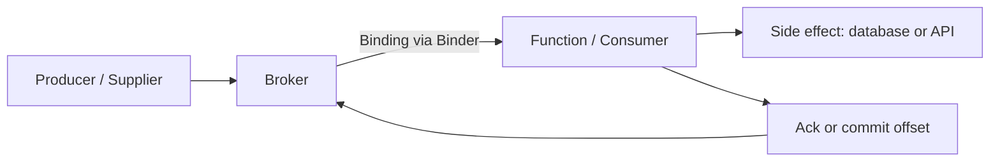

# At-Most-Once, At-Least-Once, and Exactly-Once Delivery Semantics

## Objectives

In an event-processing system, a message can be sent, stored at the broker, delivered to a consumer, processed by an application function, and then acknowledged as complete. Failures can happen at any point in that chain: a producer loses connection after the broker receives the data, a consumer crashes mid-database-update, or an acknowledgement gets lost in transit. As a result, a message can be lost, redelivered, or produce business side effects multiple times.

The three terms **at-most-once**, **at-least-once**, and **exactly-once** describe how a system handles these situations. They are delivery semantics, not an automatic property gained simply because an application uses Kafka, RabbitMQ, Pulsar, or Spring Cloud Stream.

After this lesson, you will be able to:

- Distinguish among message loss, duplicate delivery, and duplicate processing.
- Explain the roles of acknowledgement, offset commit, retry, and dead-letter queues (DLQs).
- Choose an appropriate guarantee level for a Spring Cloud Stream event flow.
- Design idempotent consumers and identify the exact scope of exactly-once semantics.

## 1. Where Do Delivery Semantics Sit in the Processing Flow?

A typical event flow follows these steps:

1. The producer creates an event and sends it to a destination.
2. The broker receives, stores, or routes the message.
3. The binder connects the Spring Cloud Stream application to the broker.
4. The binding delivers the message to a `Function` or `Consumer`.
5. The application function executes processing, possibly updating a database or emitting a new event.
6. The consumer acknowledges processing; the broker or consumer group updates delivery state accordingly.



The crucial point is that **delivery acknowledgement and business side effects can live in two different systems**. For example, a consumer writes an order to PostgreSQL and then commits its Kafka offset. If the application stops after PostgreSQL commits but before Kafka receives the offset commit, Kafka can redeliver the event. The database already holds the change from the prior attempt.

Brokers represent delivery state differently:

- **Kafka** tracks each consumer group's read position per partition using offsets. Committing an offset means the consumer group confirms progress up to a position; it is not an independent per-record acknowledgement like in a traditional queue.
- **RabbitMQ** uses per-delivery acknowledgements. A consumer can ack upon completion, or nack/reject so the broker retries or routes the message to a dead-letter exchange depending on configuration.
- **Pulsar** uses subscription-level acknowledgements. A consumer can ack, negative-ack, or let the acknowledgement timeout expire so the broker redelivers according to subscription policy.

Spring Cloud Stream provides a unified function and binding model, while the binder translates those operations into the broker's mechanisms. Therefore, check the configuration and behavior of your specific binder when a particular guarantee is required.

## 2. At-Most-Once: Deliver at Most Once

With **at-most-once**, a message is delivered or processed at most once. The system avoids duplicate delivery by accepting the possibility that a message is never processed at all.

One scenario that produces this semantic is when a consumer acknowledges or commits offsets before finishing business work:

1. The consumer receives a `PaymentRequested` event.
2. The consumer commits the offset or acknowledges delivery.
3. The process crashes before recording the payment in the database.
4. The broker considers the message acknowledged and does not redeliver it.

The outcome is an acknowledged event whose business effect never happened. There is no redelivery to create duplicates, but the message can be lost from the application's perspective.

At-most-once fits when losing occasional events is acceptable, such as certain telemetry samples or regenerable statistics. Do not choose it for financial transactions, orders, or critical control commands without a separate compensation or reconciliation mechanism.

**Remember:** "at most once" does not mean guaranteed to process successfully once. The outcome can be zero times.

## 3. At-Least-Once: Deliver at Least Once

With **at-least-once**, the system keeps redelivering when it has not received a success acknowledgement. The goal is to prevent message loss within the system's operational conditions. In exchange, the same message can reach a consumer multiple times.

A common sequence:

1. The consumer receives an `OrderCreated` event.
2. The consumer writes data to the database successfully.
3. The application stops before acknowledgement or offset commit completes.
4. The broker redelivers `OrderCreated`.
5. The consumer runs the logic again and risks recording the side effect a second time.

This is why **at-least-once must be paired with idempotent processing**. An idempotent operation can be invoked multiple times with the same input while the final business outcome remains equivalent to a single invocation.

Achieving at-least-once in a specific flow requires coordinating multiple conditions:

- The producer knows whether sending succeeded and has an appropriate retry policy when send outcomes are unclear.
- The broker is configured with storage, replication, and retention matching data requirements.
- The consumer acknowledges only after the work requiring protection has succeeded.
- Transient failures have a retry policy; unrecoverable failures are routed to a DLQ or an investigable holding area.
- The consumer can receive the same `eventId` again without creating duplicate side effects.

At-least-once still has limits. If the producer fails to send, data exceeds retention, a queue is deleted, or the system discards messages after exhausting retries without a DLQ, the application cannot claim it processed everything at least once. When a DLQ is used, failed messages are preserved for separate handling; that does not mean the original business operation succeeded.

### Idempotency Using Event IDs

Each business event should carry a stable identifier, such as `eventId`. Consumers can record processed IDs in an inbox table with a unique constraint:

```java
public record OrderCreated(String eventId, String orderId) {}

@Bean
Consumer<OrderCreated> reserveInventory(InventoryService service) {
    return event -> service.reserve(event.eventId(), event.orderId());
}
```

The business logic can be implemented around this idea:

```java
@Transactional
public void reserve(String eventId, String orderId) {
    // insertIfAbsent uses UNIQUE(event_id) in the database.
    // Returns false if eventId was already recorded previously.
    boolean firstDelivery = inboxRepository.insertIfAbsent(eventId);
    if (!firstDelivery) {
        return;
    }

    inventoryRepository.reserve(orderId);
}
```

Writing to the inbox and updating inventory must share **the same database transaction**. If the inventory update fails, the transaction rolls back the inbox record too so redelivery can retry. The `UNIQUE(event_id)` constraint protects against two concurrent deliveries; checking `exists` first and then inserting without a unique constraint risks race conditions.

If business logic calls an external API, pass `eventId` as an idempotency key if the API supports it. If the API does not support one, design reconciliation or appropriate compensating logic; broker acknowledgement cannot make an HTTP call idempotent.

## 4. Exactly-Once: Single Effect Within a Defined Scope

**Exactly-once** aims to have each event produce its effect counted strictly once, even across retries, redeliveries, or restarts. Distinguish three concepts:

- **Exactly-once delivery:** the broker delivers strictly once. This is not a universal guarantee across brokers.
- **Exactly-once processing:** application logic runs only once. In environments with retries and failures, this is very hard to guarantee literally.
- **Exactly-once effect:** the observable business state is equivalent to applying the event only once. This is usually the practical goal.

Merely committing offsets after processing does not create exactly-once. If business side effects complete but the commit fails, the consumer can still reprocess. Conversely, committing before side effects risks losing the event. Coordinating multiple steps requires an atomic mechanism spanning those exact steps or an idempotent design at the state store.

### Kafka Transactions for Kafka-to-Kafka Flows

Kafka supports transactions to write multiple records and commit consumer offsets within the same Kafka transaction. When an application processes a record from Kafka and emits results to another Kafka topic inside a transaction supported by the Kafka binder, the output records and consumption progress can commit or abort together.

Example transaction configuration for the Kafka binder:

```yaml
spring:
  cloud:
    stream:
      kafka:
        binder:
          transaction:
            transactionIdPrefix: ${INSTANCE_ID}-tx-
```

`INSTANCE_ID` must produce a unique prefix across running instances to avoid transactional producer conflicts. Consumers reading topics with transactional data should use `read_committed` if they must only see committed transactions. You can configure Kafka consumer properties on the corresponding binding:

```yaml
spring:
  cloud:
    stream:
      kafka:
        bindings:
          process-in-0:
            consumer:
              configuration:
                isolation.level: read_committed
```

The binding name must match the function's actual input binding. Exact transaction configuration depends on your Spring Cloud Stream Kafka binder version and how the application declares producers/consumers; verify with integration tests on your deployed version.

A Kafka transaction covers only operations participating in that Kafka transaction. If the function also updates PostgreSQL, calls a REST API, or sends an email, those operations do not automatically join the Kafka transaction. For instance, a database commit succeeding while the Kafka transaction aborts can still leave the database change behind. Do not claim an entire workflow is exactly-once solely because `transactionIdPrefix` is set.

### When External Databases or Systems Are Involved

Two common design patterns for achieving a single business effect are:

- **Inbox/deduplication:** the consumer records the processed `eventId` in the same transaction as the business update. When the broker redelivers, the consumer detects the duplicate event and skips repeating side effects.
- **Transactional outbox:** the application writes business state and an outbox record in the same database transaction. A relay process reads the outbox and publishes events to the broker. The relay can send duplicates on failure, so downstream consumers should still be idempotent.

These patterns do not make the network or broker deliver strictly once. They ensure business effects are not duplicated within the designed transaction and identity boundaries.

## 5. Comparing the Three Semantics

| Criterion | At-Most-Once | At-Least-Once | Exactly-Once Effect |
|---|---|---|---|
| Delivery/processing count | 0 or 1 | 1 or more under guaranteed conditions | Observable effect strictly once within a defined scope |
| Risk of losing events | Yes | Minimized if producer, broker, retry, and retention are configured properly | Handled within transaction or state-storage boundaries |
| Risk of duplicates | Low per delivery semantics | Yes | Must be prevented via transactions or idempotency |
| Common mechanisms | Early ack, no retries | Post-processing ack, retries, redelivery | Atomic transactions, inbox, outbox, idempotency keys |
| Suitable use cases | Droppable or regenerable data | Reliable business events where consumers tolerate duplicates | Flows requiring a single effect within a clear technical boundary |

In many real-world systems, **at-least-once paired with idempotency** is the balanced and operationally straightforward choice. Exactly-once should be used when transaction boundaries are well defined and failure behavior can be verified.

## 6. Applying in Spring Cloud Stream

Spring Cloud Stream uses the functional model to describe application roles:

- `Supplier<T>` produces output messages.
- `Function<I, O>` receives messages, processes them, and produces output messages.
- `Consumer<T>` receives and processes messages without producing output from its function signature.

Bindings map function inputs and outputs to destinations. Binders connect those bindings to Kafka, RabbitMQ, or Pulsar. The function type does not itself determine the delivery guarantee; how the binding/binder handles sending, acknowledgement, retries, and transactions dictates failure behavior.

Example consumer handling order-created events:

```java
@Bean
Consumer<OrderCreated> reserveInventory(InventoryService service) {
    return event -> service.reserve(event.eventId(), event.orderId());
}
```

Binding and consumer group configuration:

```yaml
spring:
  cloud:
    function:
      definition: reserveInventory
    stream:
      bindings:
        reserveInventory-in-0:
          destination: orders.created
          group: inventory-service
```

The name `reserveInventory-in-0` is the input binding derived from the function name and input index. `destination` specifies where events come from; `group` identifies the consumer group sharing progress or subscriptions per binder rules. When multiple instances belong to the same group, the broker distributes work among them. If `group` is omitted, subscription behavior and recovery can differ significantly across binders; configure `group` explicitly for business consumers requiring durable subscriptions.

### Retry and DLQ

For imperative consumers, retries can be declared at the binding level. The example below allows up to three total attempts with exponential backoff:

```yaml
spring:
  cloud:
    stream:
      bindings:
        reserveInventory-in-0:
          consumer:
            max-attempts: 3
            back-off-initial-interval: 1000
            back-off-multiplier: 2.0
            back-off-max-interval: 10000
```

In-application retry and broker redelivery are two distinct mechanisms. In-app retry may re-invoke the handler within the same processing attempt; broker redelivery typically occurs after the broker receives a nack, misses an ack, or a consumer restarts with uncommitted offsets. Check the binder's actual attempt ordering and counts to avoid accidentally multiplying retries.

When attempts are exhausted, configure a DLQ per binder to preserve failing messages. The Kafka binder, Rabbit binder, and Pulsar binder have separate DLQ configurations; queue/topic names, routing conditions, permissions, and replay procedures differ. DLQs need alerts, ownership, and a replay process. If replaying without preserving `eventId` or without idempotency, business side effects can repeat.

### Key Differences Across Binders

| Broker | How Delivery Is Tracked | Failure Modes to Test | Configuration/Design Direction |
|---|---|---|---|
| Kafka | Offsets per partition and consumer group | Consumer finishes side effects before offset commit; rebalance causes record replay | Choose appropriate ack/commit, manage groups and partitions, use idempotent consumers; use Kafka transactions for Kafka-to-Kafka flows when conditions are met |
| RabbitMQ | Ack/nack per delivery | Consumer dies before ack causing requeue; nack can trigger redelivery | Ack after processing, set sensible prefetch, configure durable queues, persistent messages, dead-letter exchanges, and idempotent consumers |
| Pulsar | Ack/nack per subscription | Ack timeout or negative ack triggers redelivery; behavior depends on subscription type | Pick the right subscription type, configure ack timeout/redelivery/DLQ, and verify binder behavior |

Do not assume the same Spring Cloud Stream property yields identical semantics across all three brokers. A binding-level retry setting may run in the framework layer, whereas acks, offsets, transactions, and DLQs depend on the binder. Read documentation for your exact binder version and test against a real broker before committing to delivery SLAs.

## 7. How to Choose Semantics for an Event Stream

Before selecting settings, answer these questions:

1. **Is losing an event acceptable?** If not, avoid acknowledging before processing and verify producer/broker durability.
2. **Can an event be redelivered?** If yes, all business updates need idempotency or deduplication keys.
3. **Are side effects confined to one system or multiple systems?** Broker transactions do not automatically cover external databases and APIs.
4. **Where do messages go on permanent failures?** Define the DLQ, alerts, retention period, and replay workflow.
5. **Does event ordering matter?** Kafka guarantees ordering only within one partition; retries and concurrent processing can also affect business-level observed order.
6. **Can you verify behavior by injecting faults?** Try stopping the consumer between side effects and ack/commit, then observe the outcome.

Common choices:

- Regenerable telemetry events: at-most-once may fit if minimizing cost matters and occasional loss is acceptable.
- Orders, inventory, or payments: typically choose at-least-once, store `eventId`, use an inbox/unique constraint, and reconcile.
- Kafka reading one topic, processing, and writing to another Kafka topic: consider Kafka transactions to coordinate output with input offsets.
- Updating a database alongside emitting an event: consider the transactional outbox; receiving consumers use an inbox or idempotency key.

## 8. Testing and Operations

Unit tests for a `Function` or `Consumer` verify business logic, but they are insufficient to prove broker delivery guarantees. You need integration tests with the real binder and broker to test acknowledgements, offsets, retries, redelivery, transactions, and DLQs.

Scenarios to test:

- Send the same `eventId` twice and verify the business effect occurs only once.
- Crash or stop the consumer after database commit but before ack/offset commit; verify redelivery does not create duplicate side effects.
- Cause consecutive handler failures; verify attempt counts, backoff, and where the message lands once retries are exhausted.
- Restart or trigger a consumer group rebalance mid-processing; inspect offsets and recovery behavior.
- With Kafka transactions, abort a transaction and verify `read_committed` consumers do not see uncommitted records.
- Replay a message from the DLQ and verify idempotency still holds.

In production, monitor retry counts, redeliveries, DLQ counts, consumer lag, oldest message age, and commit/ack errors. Alert when DLQ depth spikes abnormally or messages age past business deadlines. Log `eventId`, correlation ID, and partition/offset or message ID so an event can be traced across producer, broker, and consumer.

## Conclusion

At-most-once prioritizes avoiding duplicate delivery and accepts the risk of event loss. At-least-once prioritizes redelivery when success is unconfirmed and requires consumers to tolerate duplicates. Exactly-once is meaningful only when you state clearly which effect is guaranteed and which components fall inside the transaction boundary.

When building event-processing applications with Spring Cloud Stream, treat `Supplier`, `Function`, `Consumer`, bindings, and binders as parts of one end-to-end flow. Design acks/offsets, retries, DLQs, and idempotency around the real failure modes of Kafka, RabbitMQ, or Pulsar, and verify them with integration tests that intentionally inject faults.
