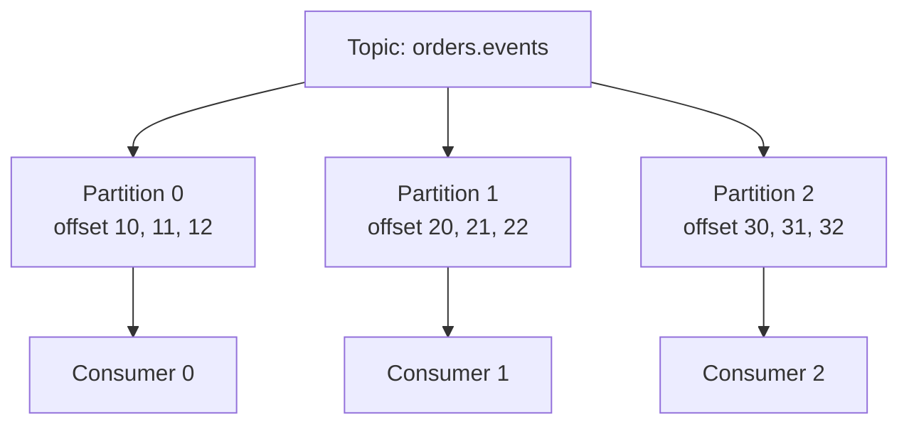
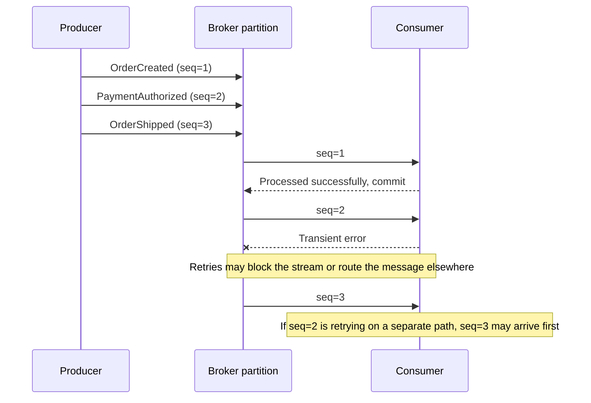

# Message Ordering, Concurrent Processing, and Guarantee Scopes

## 1. Why Ordering and Concurrency Must Be Designed Together

In an event-processing system, multiple messages may relate to the same business entity. For example, an order sequentially produces `OrderCreated`, `PaymentAuthorized`, and `OrderShipped`. If a consumer processes `OrderShipped` before `OrderCreated`, the order state can become invalid. Yet if the entire system processes only one message at a time, throughput will be low and one slow task can block unrelated work.

Message stream design must therefore answer two questions:

- **Within what scope must ordering be preserved?** System-wide, per partition, per key, per order, or within a specific group of messages?
- **Where can processing happen concurrently?** Across partitions, across business keys, across consumers, or inside a single consumer?

There is no natural global order once data is split into multiple independent streams. Typically, a system only needs to preserve order for events belonging to the same entity—such as the same `orderId` or `accountId`—while allowing different entities to be processed concurrently.

### Distinguishing Types of Ordering

When saying a message is processed in order, clarify which order is meant:

1. **Publish order:** the order in which the producer creates or sends messages.
2. **Storage/write order:** the order in which the broker records messages into a queue, log, or partition.
3. **Delivery order:** the order in which the consumer receives messages.
4. **Completion order:** the order in which consumer processing logic finishes.
5. **Side-effect order:** the order in which changes commit to a database or external system.

These orders can diverge. A consumer may receive message A before B yet hand both to two asynchronous tasks; B may update the database before A. Therefore, guaranteeing delivery order does not automatically guarantee completion order or business mutation order.

## 2. Ordering Scope by Broker

### Apache Kafka: Order Within One Partition

Kafka stores records in offset order within each partition. A consumer reads a partition in offset order, and within the same consumer group, a partition is assigned to at most one consumer at a time. Multiple partitions allow multiple consumers to process in parallel.



Kafka does not provide global ordering across partitions. The consumer for partition 0 may process offset 12 before the consumer for partition 1 finishes offset 20. If events for the same order must follow a sequence, the producer should use `orderId` as the key so records with the same key go to the same partition.

Ordering within a partition can still break at the application layer if the consumer receives records in order but dispatches them to multiple async tasks that complete out of order. When order must be preserved, process sequentially per partition or per key before applying side effects.

### RabbitMQ: Queue Ordering and Consumer Effects

A RabbitMQ queue generally delivers messages in the order they were enqueued. However, consumer completion order is not guaranteed when there are multiple consumers, large prefetch counts, async processing, prioritized messages, or rejected and requeued messages. A consumer that receives an earlier message may take longer to process, while another consumer finishes a later message first.

If strict ordering within a queue is required, limit active consumers, control prefetch, and avoid retry paths that reorder messages. RabbitMQ offers a single active consumer feature so one consumer is active at a time while others act as standbys. This reduces parallelism on that queue, so use it only when ordering outweighs throughput.

Publisher confirms and consumer acknowledgements address two separate hops: confirming the broker received a publish and confirming the consumer processed a message. Never treat one type of confirmation as proof of the other.

### Apache Pulsar: Ordering Depends on Subscription Type

Pulsar provides multiple subscription types with different parallelism and ordering characteristics:

| Subscription Type | General Distribution Behavior | Ordering and Concurrency Characteristics |
|---|---|---|
| Exclusive | One consumer attached to the subscription | Easy to organize sequential processing; low concurrency within that subscription |
| Failover | Multiple consumers with primary and standby roles | One active primary consumer at a time per subscription/partition scope; standby takes over when needed |
| Shared | Messages distributed across multiple consumers | Increases concurrency; completion order is not guaranteed |
| Key_Shared | Messages distributed to consumers by key | Allows concurrency across keys while keeping per-key affinity/ordering under matching configuration |

With `Key_Shared`, producers and consumers must agree on key assignment. Batching configuration and ordering key usage must also match the application's ordering requirements. Check your binder documentation and Pulsar version before choosing a subscription type.

### Quick Comparison

| Broker | Primary Ordering Unit | Where Concurrency Is Possible | Common Causes of Reordering |
|---|---|---|---|
| Kafka | Single partition by offset | Multiple partitions and multiple consumers in a group | Async handling inside consumers, separate-stream retries, changing partition keys |
| RabbitMQ | Queue insertion order | Multiple consumers or multiple queues | Prefetch, varying processing times, requeues, priorities |
| Pulsar | Depends on subscription and key | `Shared`/`Key_Shared`, multiple partitions | Subscription type, batching, redelivery, and async processing |

These descriptions reflect architectural principles. Specific delivery, acknowledgement, retry, and ordering details also depend on broker, binder, and deployed version settings.

## 3. Concurrent Processing in Spring Cloud Stream

Spring Cloud Stream connects application functions to brokers via bindings and binders. Effective concurrency is shaped by multiple layers: partition or queue count, application instance count, consumers per instance, subscription capabilities, and how code handles messages.

### Consumer Concurrency

The `consumer.concurrency` property configures the number of concurrent consumers/listeners for a binding within the binder's capabilities. For example:

```yaml
spring:
  cloud:
    function:
      definition: projectOrder
    stream:
      bindings:
        projectOrder-in-0:
          destination: orders.events
          group: order-projection
          consumer:
            concurrency: 3
```

With the Kafka binder, concurrency creates multiple consumers in the same group per application instance. The number of consumers that actually get partitions to read is bounded by the partitions assigned to the group. If total consumers exceed partition count, extra consumers receive no partitions and do not increase throughput.

With the RabbitMQ binder, concurrency controls the number of consumers/listeners for the binding and can affect completion order when multiple consumers read the same queue. For other binders, consult their documentation to see how concurrency is mapped.

### Instance Count and Partitions

Suppose a Kafka topic has 12 partitions, the application runs 3 instances, and each instance sets concurrency to 2. Total consumers in the group are at most 6, so 6 partitions can be read concurrently. Raising concurrency to 5 per instance yields 15 consumers, but there are still only 12 partitions to assign; some consumers will sit idle.

Conversely, if there are only 2 partitions and 10 instances running, at most 2 consumers in the group can read partitions simultaneously. Scaling instances beyond partition count does not increase the group's parallel read capacity. Plan partition counts when designing topics, while accounting for resource overhead, metadata, rebalances, and operational cost if too many partitions are created.

### Partitioning by Business Key

In Spring Cloud Stream's partitioning model, producers can use `partition-key-expression` to extract a key from the payload or headers and `partition-count` to indicate the expected partition count. For example:

```yaml
spring:
  cloud:
    stream:
      bindings:
        publishOrder-out-0:
          destination: orders.events
          producer:
            partition-key-expression: payload.orderId
            partition-count: 12
```

Events with the same `orderId` are routed using the same key so they can be processed in the same partition under the configured partitioning strategy. The actual broker topic must have a compatible partition count. If another producer also writes to the topic, it must apply a consistent key strategy.

Choose a well-distributed key. If one key accounts for most traffic, its partition can become a hot spot while other partitions sit underutilized. Do not choose a random key when ordering must be preserved for a business entity.

### Example Function Processing by Order Key

The following function receives order events and produces state projection records. `sequence` is a domain-assigned sequence number for changes to an order:

```java
import java.util.function.Function;
import org.springframework.context.annotation.Bean;
import org.springframework.context.annotation.Configuration;

record OrderEvent(String orderId, long sequence, String status) {}
record OrderView(String orderId, long sequence, String status) {}

@Configuration
class OrderProjectionFunctions {

    @Bean
    Function<OrderEvent, OrderView> projectOrder() {
        return event -> new OrderView(
            event.orderId(),
            event.sequence(),
            event.status()
        );
    }
}
```

The binding configuration can set concurrency on the input and a partition key on the output:

```yaml
spring:
  cloud:
    function:
      definition: projectOrder
    stream:
      bindings:
        projectOrder-in-0:
          destination: orders.events
          group: order-projection
          consumer:
            concurrency: 3
        projectOrder-out-0:
          destination: orders.projections
          producer:
            partition-key-expression: payload.orderId
            partition-count: 12
      kafka:
        binder:
          brokers: localhost:9092
```

In this example, the producer of `orders.events` must also partition by `orderId` if events for a single order are expected to land in the same input partition. The output configuration keeps projection records for the same order on the same key. A concurrency of 3 allows multiple partitions to be processed in parallel per instance, but does not preserve order if code goes on to dispatch async work to another executor.

## 4. Choosing the Right Level of Concurrency

Higher concurrency is not automatically better. Identify bottlenecks and ordering boundaries before tuning.

| Ways to Increase Concurrency | Benefit | Cost or Risk |
|---|---|---|
| Increase partition count | Increases Kafka units that can be read in parallel | Consumes resources; alters key distribution and can break ordering assumptions |
| Increase instance count | Increases processing capacity and redundancy | Requires enough partitions/queues; increases connections and operational overhead |
| Increase consumer concurrency | Uses multiple threads per instance | Can complete same-queue messages out of order; increases resource contention |
| Async processing inside functions | Allows independent I/O or tasks to run concurrently | Requires managing queue bounds, errors, backpressure, and commit order |
| Split destinations by workload type | Isolates load and processing policies | Increases routing and operational complexity |

A design that often works well is parallelizing across aggregate keys while serializing within each aggregate. For instance, different orders can be processed concurrently, while changes for the same `orderId` are processed sequentially.

### Backpressure and Uneven Load

A consumer may receive messages faster than it can process them. Backlogs grow, latency increases, and memory can become exhausted if the application buffers too many messages in internal queues. Tune prefetch, max poll records, concurrency, executor bounds, and processing timeouts to match downstream system capacity.

Monitor consumer lag or queue depth, processing latency, error rates, and CPU/memory utilization. If one partition consistently shows high lag, inspect key distribution and processing duration before raising application-wide concurrency. A hot key cannot be solved merely by adding consumers if all events for that key must still pass through one sequential stream.

## 5. How to Preserve Business Order

### Choose the Right Key

Choose a key representing the scope to serialize: `orderId` for orders, `accountId` for accounts, or `deviceId` for devices. Every producer writing to the same stream must follow the same rule. If related events scatter across different partitions, consumers cannot reliably reconstruct the original order without extra business metadata.

### Serialize Processing Within a Key Scope

You can process records one by one within a partition or use key-partitioned queues/executors so different keys run concurrently. Avoid dumping all messages into a thread pool without per-key ordering if side effects must be serialized.

### Use Business Sequences or Versions

Each aggregate can emit a monotonically increasing version number. Consumers check the sequence before applying changes:

- If sequence equals current version plus one, apply it.
- If sequence is less than or equal to the processed version, the message may be a duplicate or late arrival; handle per idempotency policy.
- If sequence is greater than the expected next version, an intermediate event is missing; wait, query state, or route to an exception flow.

Do not mechanically discard every late message. Rules should reflect business semantics, recoverability, and system wait thresholds.

### Control Retries and Redelivery

Retries can alter order. If a consumer holds a partition and retries a failing message in a blocking fashion, later messages in that partition must wait. If a failing message is moved to a retry topic or another queue for deferred handling, later messages may be processed ahead of the retrying message.

A dead-letter queue/topic isolates messages that remain unprocessable after the retry policy. It does not solve business ordering on its own. When replaying messages from a DLQ back into the main flow, check sequence numbers, current state, and duplicate handling.

### Be Careful When Changing Partition Counts

With hash-based key partitioning, increasing partition count can map keys to different partitions. Older events for a key may sit in an old partition while new events land in a new partition. If strict end-to-end ordering is required, plan a topic migration, drain the old stream, or use a versioned routing strategy instead of altering partition count casually.

## 6. Delivery Guarantee Scopes

Ordering and delivery are two distinct properties. A broker may preserve order within a partition yet still redeliver a message after a consumer crashes. Conversely, a message might be delivered only once yet still be processed out of order by async application logic.

### At-Most-Once

Messages are delivered or processed at most once. If a consumer acknowledges/commits before completing side effects and then stops, the message can be lost from the application's viewpoint. This level avoids duplicate processing at the cost of risking lost messages under certain failure modes.

### At-Least-Once

Messages continue to be redelivered until acknowledged via the broker's mechanism. If a consumer completes side effects but fails before an effective acknowledgement or offset commit, the message can be redelivered. Duplicate processing must therefore be expected.

To support at-least-once safely, consumers should be idempotent. Use a unique event ID, business key, inbox table, or database unique constraint to detect already-applied events. Idempotency must cover the protected side effect; checking IDs only in memory is insufficient across restarts or multiple instances.

### Exactly-Once and Scope Boundaries

Exactly-once usually holds only within a specific technical boundary and when transactional conditions are met. For example, Kafka supports transactions to coordinate writing output records and committing input offsets within a single Kafka transaction when the app/binder is properly configured. This does not automatically include relational database updates, sending emails, or calling APIs outside Kafka.

Kafka producer idempotence helps reduce duplicate records from certain producer-layer retries. It does not replace consumer-side business idempotency. With RabbitMQ and Pulsar, publisher confirms, acknowledgements, redelivery, and deduplication features also have their own scopes; evaluate them under actual configuration.

If business logic must update a database and emit an event as one consistent change, use a transactional outbox to store both the change and the event in the same database transaction, followed by a relay publishing events to the broker. Consumers can use an inbox or event-ID tracking table in their update transaction to prevent duplicate application. These patterns achieve near-exactly-once business effects within controlled boundaries, while still requiring recovery policies and monitoring.

### Acknowledgement and Offset Commit

RabbitMQ/Pulsar acknowledgements and Kafka offset commits are progress signals following each broker's semantics. If acknowledged too early, a post-ack failure can leave side effects incomplete without redelivery. If acknowledged too late, a message can be redelivered after side effects already took place.

Choose acknowledgement timing based on business processing boundaries. When a consumer writes data, ideally the data write and processed-event marker share the same transaction or idempotency guard. With async processing, ensure offsets/acks are never confirmed before the task truly finishes.

## 7. Combining Retries, Ordering, and Delivery Guarantees

Consider a scenario where an order emits three consecutive events:



If sequence 2 retries on a separate stream, the consumer may receive sequence 3 first. Possible strategies:

- Keep the failing message in-stream with bounded blocking retries if strict ordering allows stalling that partition.
- Use sequence numbers to detect gaps and hold subsequent events temporarily within a bounded timeout.
- Route the failing event to a DLQ, alert, and require controlled recovery before advancing that aggregate.
- Design independent tasks that can run concurrently without ordering, shrinking the streams that must be serialized.

No single option fits every system. Blocking retries can increase lag; out-of-band retries can reorder events; skipping failing messages can corrupt business state. Base your decision on the consequences of late events and recoverability.

## 8. Testing and Observability

Tests should verify not only that consumers receive all messages, but also ordering and failure behavior:

1. Emit multiple events for the same key and verify the consumer applies them in expected sequence.
2. Emit events across multiple keys and verify they can be processed concurrently.
3. Inject a transient failure on one event, observe retries, and check whether subsequent events bypass it.
4. Stop consumers before and after side effects and acknowledgement/offset commits to verify redelivery and idempotency.
5. Scale instance counts or restart consumers to test rebalances, recovery, and potential redeliveries.
6. Run integration tests against a real broker for broker-specific behaviors such as partition assignment, prefetch, subscription types, transactions, and DLQs.

Spring Cloud Stream's test binder is useful for testing function logic and binding flows in lightweight unit/integration tests. It does not fully simulate distribution, rebalancing, redelivery, or transactions of Kafka, RabbitMQ, and Pulsar.

In production, track consumer lag, queue depth, in-flight message counts, p50/p95/p99 processing latency, retry counts, DLQ counts, redelivery counts, and sequence errors. Log event IDs, aggregate keys, and sequence numbers for traceability. When lag rises, determine whether the cause is overall traffic, a hot partition, a slow consumer, or a failing message blocking the stream.

## 9. Design Decision Workflow

Before setting concurrency or picking a subscription mode, walk through these steps:

1. Identify the business entity that requires ordering and the minimal ordering scope sufficient for business rules.
2. Pick a stable key, such as `orderId`, and ensure every participating producer follows the same strategy.
3. Choose the partition, queue, or subscription model matching your broker.
4. Estimate partition count, instance count, and concurrency; avoid creating more consumers than can receive useful work.
5. Identify which side effects need idempotency and when acknowledgement/offset commit occurs.
6. Define retry, DLQ, sequence validation, and message replay procedures.
7. Test failures, redelivery, rebalances, and completion ordering against a real broker.
8. Monitor lag, key distribution, processing latency, and failed message counts to tune based on operational data.

Good designs preserve ordering at the smallest scope that is meaningful to the business while exploiting concurrency across independent scopes. Delivery guarantees must be stated clearly at every boundary: producer to broker, broker to consumer, in-app processing, and external side effects. When these boundaries are designed together, Spring Cloud Stream supports event-processing systems that achieve strong throughput while preserving business correctness.
