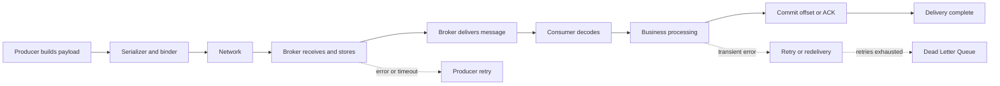

# Eventual Consistency and Delivery Failure Points

Spring Cloud Stream provides a unified programming model for applications to send and receive messages via bindings, while binders connect those bindings to Kafka, RabbitMQ, or Pulsar. This abstraction reduces business code's coupling to the broker, but it does not eliminate distributed system failures: networks can drop, processes can crash, brokers can reject writes, consumers can finish processing before acknowledging, or messages can be redelivered.

When designing event-processing applications, you must understand **eventual consistency** and explicitly map every potential failure point along the delivery path. A practical goal is typically to avoid losing accepted messages, accept the possibility of redelivery, and ensure business effects are never applied twice through idempotency, transactions, and recovery capabilities.

## 1. What Is Eventual Consistency?

In an event-driven architecture, a business change is usually published as a message. Other services receive that message at different times and update their own data. Consequently, immediately after one service records a change, read projections, search indexes, counters, or downstream services may not reflect it yet.

A system achieves **eventual consistency** when, assuming no new errors occur and required messages are processed successfully, the related components converge to a consistent state. During the convergence window, different components may observe different versions of state.

For example, the order service saves `order-9001` and publishes an `OrderCreated` event. The inventory service later receives the event to reserve stock; the reporting service receives it at another time to update metrics. Briefly, the order details page may show the created order while reports have not incremented order counts and inventory has not updated reserved stock. This can be normal asynchronous latency, provided the system has delivery, retry, and error-handling mechanisms so replicas converge.

Eventual consistency does not mean every message will magically arrive on its own, nor that every operation always succeeds. It is a property of the entire process: data is published durably, consumers can resume after crashes, failing messages are managed, and duplicate processing does not corrupt state.

## 2. Tracing a Message's Path

A typical processing flow includes these stages:

1. **Producer application:** constructs the payload, attaches metadata, and serializes data into the transport format.
2. **Network and binder:** transmits data from the application to the broker per binder configuration.
3. **Broker:** validates the request, routes to a topic, queue, or partition, stores data per policy, and returns an acknowledgement.
4. **Broker delivery:** selects a consumer according to subscription or consumer group, then delivers the record/message to the consumer.
5. **Consumer application:** decodes the payload, validates schema, and executes business logic.
6. **Processing acknowledgement:** the consumer or binder acknowledges, commits offsets, or sends an ACK per broker mechanics.



Every arrow is a boundary where failure can occur. For example, a producer may succeed in sending yet lose the ACK response; the broker may have stored the data while the producer assumes failure. Similarly, a consumer may update the database and stop before ACKing, causing the broker to redeliver the same message.

It is important to distinguish three outcomes:

- **Sent:** the application executed the send call or handed data to the binder.
- **Broker-confirmed:** the broker accepted the message under the configured guarantee level.
- **Business-processed:** the consumer completed business side effects and acknowledged under the corresponding mechanism.

These three moments are not equivalent. A broker confirmation does not prove the consumer updated its database; a "sent" log line on the producer does not prove the broker persisted the message durably.

## 3. Producer-Side Failure Points

### 3.1. Payload Creation and Serialization Errors

A payload may be invalid, miss required fields, or fail to serialize to JSON, Avro, Protobuf, or the chosen format. If the error happens before sending, the broker never received the message. The application must log the error on the producer side and decide whether to return an error to the caller, store the request for retry, or route it to another handling flow.

Schemas are also part of the communication contract. A producer deploying a new schema can break older consumers' deserialization. Define required fields, default values, compatibility rules, and a consumer/producer upgrade strategy. When using a schema registry, verify compatibility policies before publishing schemas.

### 3.2. Connection Drops or Send Timeouts

When sending a message, a producer can encounter timeouts, connection drops, broker overload, or rejected requests. Timeouts create ambiguity: the broker may not have received the data, or it may have received and stored it while the response failed to reach the producer.

If the producer retries after a timeout, the message may appear twice. If the producer does not retry, the message may be lost when the broker never received it. Therefore, producer retries usually need to pair with a stable message identifier or idempotency key to handle ambiguous send outcomes.

### 3.3. What Level Does the Broker Confirm?

Not every success response carries the same meaning. Examine broker confirmation settings, replica counts, storage policies, and queue/subscription types. For example:

- With Kafka, producers can configure `acks` to choose how many replica confirmations are required; `acks=all` requires in-sync replicas (ISR) to confirm per Kafka's mechanism. Durability also depends on replication factor, `min.insync.replicas`, and cluster settings.
- With RabbitMQ, publisher confirms indicate the broker processed the publish under its confirmation mechanism; durability also involves durable queues, message persistence, and queue types. Publisher confirms do not prove a consumer processed the message.
- With Pulsar, producers receive confirmation after the broker writes the message according to the topic and cluster storage settings. System replication and persistence policies still govern durability.

These properties are configured at the binder or broker level and have no single shared setting across Kafka, RabbitMQ, and Pulsar. Consult the documentation for your exact binder and deployed version.

### 3.4. Linking Business Data Writes with Event Publishing

A common bug is an application committing to a database successfully yet failing to send the event, or sending the event successfully before the database transaction rolls back. This is the dual-write problem: two independent storage systems do not automatically participate in a single atomic transaction.

**Transactional outbox** is a standard pattern to resolve this:

1. Within a single database transaction, the application updates business data and inserts a record into an outbox table.
2. A relay process or CDC reads unpublished outbox records and sends them to the broker.
3. After send confirmation, the relay marks the record as published or advances a checkpoint as designed.
4. If the relay crashes after sending but before marking, it may resend; consumers still need idempotent handling.

This ensures business data and the intent to publish are persisted atomically in the same database. An outbox does not itself produce system-wide exactly-once semantics; it prevents losing events between database commit and message publication.

## 4. Broker and Transport Failure Points

### 4.1. Routing, Partitions, and Ordering

Messages can route to the wrong destination, queue, or topic due to misconfigured bindings. A Spring Cloud Stream binding maps to a logical destination; the binder and broker settings determine how that destination is created and used.

Partitions scale parallel processing, yet ordering is usually guaranteed only within a single partition or specific routing stream. With Kafka, records sharing a key generally go to the same partition per the active partitioner; order within one partition is maintained by offset. Do not assume global ordering across multiple partitions.

RabbitMQ can distribute messages to multiple consumers concurrently. ACKs, requeues, prefetch, and consumer counts affect the order observed by applications. Pulsar offers multiple subscription types with distinct distribution and ordering traits; choosing `Shared`, `Key_Shared`, `Failover`, or `Exclusive` shapes how consumers receive messages.

If business rules require ordered processing per order or account, pick a stable partition/routing key, bound concurrency appropriately, and decide how to handle an older message that is redelivered. Do not rely on global ordering when broker settings do not provide that guarantee.

### 4.2. Broker Outages or Capacity Exhaustion

A broker may restart, lose connectivity to replicas, run out of disk space, or reject publishes due to quotas/policies. Applications need timeouts, bounded retries, and backoff; brokers need monitoring for disk usage, replication, queue/topic health, and retention policies.

Unbounded tight retries can amplify load on an already struggling broker. Exponential backoff with jitter reduces thundering herds of producers retrying simultaneously. When time or attempt budgets run out, applications must transition to an observable, recoverable state rather than silently dropping messages.

### 4.3. Expired or Discarded Messages

TTL, retention, size caps, compaction policies, queue overflows, or administrative actions can make data unavailable. Size retention windows to cover maximum expected outages, consumption speeds, and replay needs. Messages containing sensitive data also require appropriate storage and access policies.

## 5. Consumer-Side Failure Points

### 5.1. Consumer Crashes Before Processing

If a consumer receives a message and crashes before executing business logic, the broker can usually redeliver the message after detecting the disconnected consumer or after an ACK timeout. Exact mechanisms vary by broker: Kafka tracks read position with offsets; RabbitMQ uses ACK/NACK; Pulsar uses acknowledgements and subscription state.

### 5.2. Consumer Finishes Processing Without Acknowledging

This is the most critical scenario in at-least-once design. A consumer may have updated the database or called an external service, yet crashed before committing its offset or sending an ACK. The broker does not know the business effect completed and redelivers the message.

If reprocessing creates another order, sends another email, or charges money again, the system suffers duplicate side effects. Consumers must be idempotent: processing the same message once or multiple times leaves the final business state correct.

### 5.3. Acknowledging Before Business Effects Are Durable

If a consumer ACKs or commits offsets before persisting business side effects, a failure during the persistence step can mark the message as processed even though business work never finished. This causes application-level data loss.

For operations that write to a database, align acknowledgement timing so business outcomes commit first. Spring Cloud Stream and the binder manage part of the ACK/offset machinery, but acknowledgement, transaction, and error-handling settings must be understood for the specific binder. Do not assume returning from a function triggers the exact same commit timing across every broker and configuration.

### 5.4. Unprocessable Data Errors

A message with a broken schema, missing required fields, or business rule violations can fail repeatedly. This is a poison message. Infinite retries block progress, waste resources, and can delay other messages.

Classify errors clearly:

- **Transient errors:** database timeouts, temporarily down dependencies, network glitches. Can be retried with backoff.
- **Data or contract errors:** undeserializable payloads, incompatible schemas, invalid required fields. Typically need DLQ routing or a data-repair workflow.
- **Intentional business rejections:** for example, an order was already canceled so payment cannot be confirmed. Represent the business outcome explicitly; do not blindly retry like an infrastructure failure.

## 6. At-Most-Once, At-Least-Once, and Exactly-Once

These terms describe how many times a message or processing effect can occur within a defined scope:

| Semantic | Characteristics | Trade-off |
|---|---|---|
| At-most-once | A message is processed at most once under the chosen mechanism; can be lost if failure happens before completion. | Avoids duplicates but risks data loss. |
| At-least-once | System keeps trying delivery until acknowledged; messages can be delivered multiple times. | Reduces loss of broker-accepted messages, but consumers must tolerate duplicates. |
| Exactly-once | An effect is guaranteed strictly once within a specific transaction/mechanism boundary. | Narrow guarantee scope requiring matching settings, transactions, and operational conditions. |

In many Spring Cloud Stream applications, the practical choice is at-least-once combined with idempotent consumers. This approach recovers cleanly: accept redeliveries, while ensuring repeated executions produce no extra business side effects.

Do not advertise "exactly-once" as an automatic guarantee across the whole chain producer → broker → consumer → database → external API. For instance, Kafka supports transactional producers and exactly-once mechanisms for certain read-process-write flows within Kafka's scope, including Kafka Streams flows when configured appropriately. That does not automatically cover sending emails, calling payment APIs, or writing to a database outside the Kafka transaction.

RabbitMQ publisher confirms and consumer acknowledgements track publishing and delivery completion, but do not create an atomic transaction between a message and database side effects. Pulsar supports acknowledgement, deduplication, and transaction mechanisms depending on configuration/version, yet effects outside Pulsar's transaction scope still require idempotency or an appropriate integration pattern.

Therefore, when discussing exactly-once, always state the scope: one write inside Kafka, one update inside a database, or a cross-system business effect. Without stating the scope, the term easily sets false expectations.

## 7. Designing Idempotent Consumers

Idempotency means executing the same request multiple times produces a business outcome equivalent to executing it once. You can use `eventId`, `messageId`, or a business key as the processing identifier.

For example, a consumer updates a read model from `OrderCreated` events. The `processed_message` table stores processed event IDs with a unique constraint on `event_id`. Within the same database transaction, the application attempts to record the message marker; only the first write updates the projection:

```java
import java.util.function.Consumer;

import org.springframework.context.annotation.Bean;
import org.springframework.context.annotation.Configuration;

@Configuration
class OrderProjectionConfiguration {

    @Bean
    Consumer<OrderCreated> updateOrderProjection(
            OrderProjectionService service) {
        return service::apply;
    }
}
```

Business logic can be structured as follows:

```java
import org.springframework.stereotype.Service;
import org.springframework.transaction.annotation.Transactional;

@Service
class OrderProjectionService {

    private final ProcessedMessageRepository processedMessages;
    private final OrderProjectionRepository projections;

    OrderProjectionService(
            ProcessedMessageRepository processedMessages,
            OrderProjectionRepository projections) {
        this.processedMessages = processedMessages;
        this.projections = projections;
    }

    @Transactional
    public void apply(OrderCreated event) {
        // INSERT with a unique constraint on event_id; returns false if already present.
        boolean firstDelivery = processedMessages.insertIfAbsent(event.eventId());
        if (!firstDelivery) {
            return;
        }

        projections.markCreated(event.orderId(), event.occurredAt());
    }
}
```

`insertIfAbsent` represents an atomic database operation backed by a unique constraint or an upsert statement suited to your database engine. Recording the marker and updating the projection must share the same transaction. If the projection update fails, the transaction rolls back the processed marker too so the next delivery can retry. If the transaction commits but the ACK is lost, the next delivery sees `eventId` already exists and skips repeating the business effect.

If the consumer calls an external API or sends an email, a local database transaction cannot roll back side effects already executed in the external system. In that case, use an idempotency key supported by the target system, an outbox for outbound calls, or a compensating/saga workflow per business requirements.

## 8. Retry, Backoff, and Dead Letter Queues

Retries handle transient errors, but they must be bounded. A policy typically defines maximum attempts, initial interval, multiplier, and max interval. Jitter can be added to spread retry timing.

Example generic retry configuration for a consumer binding in Spring Cloud Stream:

```yaml
spring:
  cloud:
    stream:
      bindings:
        updateOrderProjection-in-0:
          destination: orders.events
          group: order-projection
          consumer:
            max-attempts: 4
            back-off-initial-interval: 1000
            back-off-max-interval: 10000
            back-off-multiplier: 2.0
```

The values above are illustrative only. Retries can happen inside the application process or via broker redelivery mechanisms; ACK timing, wait delays, and attempt counting depend on the binder, consumer type, and configuration. Avoid stacking multiple uncontrolled retry layers, as total attempt counts can multiply dramatically.

A **Dead Letter Queue (DLQ)** is where messages go when they cannot be processed after the retry policy. A DLQ keeps failing messages from blocking the main flow and creates an opportunity to investigate, fix data, or replay after remediation. DLQ configuration is binder-specific:

- The Kafka binder has consumer options to enable DLQ and configure the DLQ destination name; configure partitions and permissions accordingly.
- RabbitMQ typically uses a dead-letter exchange and dead-letter queue, with routing keys and TTL/queue policies configured on the broker or via the binder.
- Pulsar provides a dead-letter policy attached to a subscription, along with a DLQ topic name and max redelivery count per configuration.

Do not treat a DLQ as "fire and forget." An operational workflow should store failure cause, attempt count, timestamp, message identifier, and correlation info; assign human or automated triage; and define how to fix and replay. Before replaying, verify consumers can handle duplicates safely.

## 9. Consumer Groups, Partitions, and Crash Recovery

Consumer groups allow multiple instances to share work. When an instance stops, the broker or coordinator reassigns partitions, queues, or messages to remaining active instances. This process can cause brief pauses, message redelivery, or changes in observed order.

In Kafka, offsets track a consumer group's read position in each partition. Committing offsets too early can skip unprocessed messages; committing too late can cause messages to be re-read after a restart. In RabbitMQ, consumer ACK/NACK dictates whether a message was handled or needs requeue/rejection. In Pulsar, acknowledgements and subscription cursors determine whether the broker considers a message confirmed or eligible for redelivery.

Operational guidelines:

- Use stable group/subscription names for a logical processing role; avoid unintentionally generating new groups on every startup.
- Choose partition counts, queue consumers, and concurrency matching real processing capacity.
- Set timeouts and processing limits to detect hung consumers.
- Monitor consumer lag, un-ACKed counts, redeliveries, and rebalance frequency.
- Test stopping an instance abruptly mid-processing, restarting the broker, and scaling instance counts up/down.
- If ordering per business key is needed, ensure messages for the same key route consistently and are not processed concurrently out of order.

## 10. Testing Failure Scenarios

A test that only checks a function receiving the right payload is not enough to evaluate delivery guarantees. Test the failure boundaries that can cause messages to be lost, redelivered, or stuck.

| Scenario | What to Verify |
|---|---|
| Producer timeout after broker may have persisted | Retries do not trigger duplicate business effects. |
| Broker outage or rejected publish | Errors are observed; the application retries/backs off or persists publish intent. |
| Consumer crashes before processing | Messages can be redelivered once the consumer recovers. |
| Consumer crashes after DB write before ACK | Redelivery does not apply the business update a second time. |
| Malformed schema or undeserializable payload | Message is classified and routed to a DLQ or appropriate error handler. |
| Retries exhausted | Message does not vanish silently; DLQ holds sufficient investigation context. |
| Consumer group rebalance | No data is skipped due to mistimed offset commits/ACKs. |
| Replaying messages from DLQ | Replay is controlled and remains idempotent. |

Spring Cloud Stream Test Binder is useful for testing functions and binding flows inside the application. However, it does not fully simulate replication, publisher confirms, offsets, requeues, transactions, or dead-lettering of a real broker. For broker-dependent guarantees, run integration tests using the real binder and a corresponding broker, runnable in automated test suites.

When testing, inject faults at intentional boundaries: make the consumer throw errors before and after database writes; sever the broker connection; send the same `eventId` multiple times; send schema-invalid payloads; then assert database state, processing counts, ACKs/offsets, and DLQ contents.

## 11. Observing and Operating Eventual Consistency

To know whether the system is converging, monitor producer, broker, and consumer sides alike. Useful metrics include:

- Publish success/failure counts, timeouts, and producer retries.
- End-to-end latency from event occurrence to consumer completion.
- Consumer lag or backlog depth in queues/subscriptions.
- Redelivery counts, retry counts, and DLQ inflow.
- Deserialization/schema error rates and business error rates.
- Processing durations, ACK/commit durations, and consumer restart/rebalance counts.

Attach `eventId` or `messageId` along with `correlationId` to logs and traces to stitch steps across services. Avoid logging full sensitive payloads. Base alerts on meaningful trends and thresholds—such as steadily growing DLQs, consumer lag exceeding acceptable SLAs, or sudden spikes in publish failures.

An eventually consistent system requires both technical safeguards and operational workflows: knowing where messages are, knowing why processing failed, being able to recover consumers, repairing broken data, and replaying in a controlled way.

## 12. Delivery-Guarantee Design Workflow

When designing a Spring Cloud Stream binding, step through these questions in order:

1. **What is guaranteed at the producer?** Does the application handle serialization errors, timeouts, broker confirmations, and bounded retries?
2. **When is a message considered durable?** Do broker replication, persistence, retention, and confirmation settings meet requirements?
3. **When does the consumer acknowledge?** Do ACKs or offset commits happen after business effects are persisted?
4. **What if a message is redelivered?** Are there stable identifiers, unique constraints, or idempotency keys?
5. **Which errors are retried?** Do transient errors have backoff, and do data errors have a path to a DLQ or repair process?
6. **Can we recover and replay?** Do retention windows, permissions, and operational procedures support this?
7. **How do we know the system has converged?** Are there metrics, logs, traces, and alerts covering producer, broker, consumer, and DLQ?

State the desired delivery semantic explicitly for each stream—for example, "at-least-once to the consumer, idempotent projection update keyed by `eventId`, transient errors retried up to four times, then routed to DLQ." Being specific lets development and operations teams verify the guarantee, rather than vaguely claiming the system "guarantees exactly-once."
