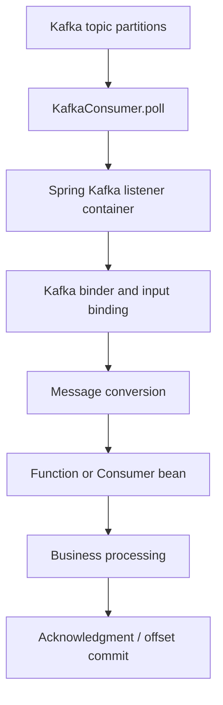
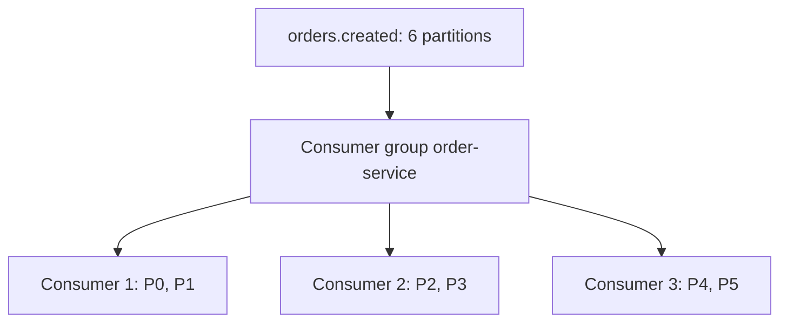

# Poll Loop, Listener Container, and Consumer Functions

When a Spring Cloud Stream application receives events from Kafka, the business code typically only needs to declare a `Consumer<T>` or `Function<T, R>` bean. Underneath, the Kafka consumer still has to continuously call `poll()` to fetch records from the broker, manage heartbeats, join a consumer group, handle rebalances, and commit offsets. The Spring Kafka listener container together with the Kafka binder handles that technical lifecycle and converts records into messages for the application function to process.

Therefore, three layers should be distinguished: the **Kafka poll loop** is the low-level communication mechanism with the broker; the **listener container** manages the poll loop and invokes the listener; the **consumer function** is the business-logic entry point in the Spring Cloud Stream functional model. In a binder-based application, you normally do not write your own `KafkaConsumer.poll()` loop and do not need to manage listener threads manually.

## 1. Three Layers in Message Consumption

| Layer | Responsibility | Common Components |
| --- | --- | --- |
| Kafka consumer | Send poll requests, receive records, send heartbeats, join groups, and work with offsets | `KafkaConsumer` from the Kafka client |
| Listener container | Create and manage consumers, run the poll loop, dispatch records, handle errors, and perform commits/acknowledgments | Spring Kafka `KafkaMessageListenerContainer` or `ConcurrentMessageListenerContainer` |
| Consumer function | Process payloads and metadata according to business logic | `Consumer<OrderCreated>` or `Function<OrderCreated, ...>` bean |

The Spring Cloud Stream Kafka binder integrates with Spring Kafka and creates a listener container for the input binding. The container receives records and passes them into Spring Cloud Stream's messaging infrastructure. The framework selects the function via `spring.cloud.function.definition`, converts the payload, and invokes the corresponding function.



The diagram illustrates the conceptual flow. The exact timing of offset commits and the acknowledgment mechanism depend on the container, binder, and transaction configuration; not every application commits immediately after the function returns.

## 2. How Does the Kafka Poll Loop Work?

A Kafka consumer does not receive messages by having the broker invoke a Java method on the application. The consumer actively sends `poll()` requests to the broker. The poll call fetches available records from the partitions currently assigned to the consumer, while also participating in the group membership management protocol.

A simplified lifecycle:

1. The consumer initializes with broker configuration, group ID, deserializers, and related properties.
2. The consumer subscribes to the topic or pattern to read from.
3. The consumer joins the group and receives partition assignments.
4. The poll loop fetches records from the assigned partitions.
5. The listener container passes records to the listener and tracks processing results.
6. Offsets are acknowledged according to the commit/acknowledgment mode.
7. The consumer continues polling, handles rebalances, or stops when the container shuts down.

`poll(Duration)` may wait up to the passed duration when no data is available, while the consumer is also governed by configurations such as `max.poll.records`, `max.poll.interval.ms`, `session.timeout.ms`, and `heartbeat.interval.ms`.

### Why Should an Application Not Call poll Manually When Using the Binder?

If you create a `KafkaConsumer` manually and call `poll()` alongside the binder's listener container, the application will have two independent reading mechanisms. They may use different group IDs, offsets, assignments, and acknowledgments. This makes it difficult to control the number of consumers, easily causes contention or duplicate reads, and bypasses many built-in Spring Cloud Stream mechanisms.

Use `Consumer<T>` for normal message-driven processing. Only use the Kafka client directly when there is a special requirement that the binder abstraction does not satisfy, and in that case you must take full responsibility for the consumer lifecycle, poll loop, rebalance, commit, error handling, and shutdown.

## 3. Listener Container Manages the Poll Loop

The Spring Kafka listener container creates and manages the Kafka consumer. The container coordinates the poll loop, delivers records to the listener, applies the acknowledgment mode, handles exceptions, and shuts down the consumer cleanly when the application stops.

Two commonly mentioned container types:

- `KafkaMessageListenerContainer`: manages a single consumer and runs the listener on one consumer thread.
- `ConcurrentMessageListenerContainer`: manages multiple child listener containers to increase concurrency. Each child container has its own consumer.

The Spring Cloud Stream Kafka binder uses this listener container infrastructure. When concurrency is configured for a binding, the binder/container can create multiple consumer members in the same group to read in parallel.

### Container and Processing Thread

In the standard listener model, the listener is invoked on the consumer thread managed by the container. If the consumer function performs long synchronous processing, the time before the next poll increases. This directly affects `max.poll.interval.ms` and the consumer's ability to retain its partition assignment.

Do not assume that Spring Cloud Stream automatically offloads every consumer function to a separate thread pool. If asynchronous processing is needed, clearly design the boundary between message receipt, offset acknowledgment, and completion of side effects; offloading work to an executor without managing acknowledgment can cause messages to be committed before the work actually finishes.

## 4. Consumer Function in Spring Cloud Stream

With the functional model, declare a `Consumer<T>` bean. Spring Cloud Stream selects the function using `spring.cloud.function.definition` and creates an input binding following the `<function>-in-0` convention.

```java
import java.util.function.Consumer;

import org.springframework.context.annotation.Bean;
import org.springframework.context.annotation.Configuration;

public record OrderCreated(
        String orderId,
        String customerId,
        long totalCents
) {}

@Configuration
public class OrderConsumers {

    @Bean
    public Consumer<OrderCreated> processOrder() {
        return event -> {
            System.out.printf("Processing order %s for customer %s%n",
                    event.orderId(), event.customerId());
            // Execute the application business logic.
        };
    }
}
```

Configuration:

```yaml
spring:
  cloud:
    function:
      definition: processOrder
    stream:
      bindings:
        processOrder-in-0:
          destination: orders.created
          group: order-service
          content-type: application/json
      kafka:
        bindings:
          processOrder-in-0:
            consumer:
              configuration:
                max.poll.records: 100
                max.poll.interval.ms: 300000
```

In this example, the Kafka binder creates an input binding to the `orders.created` topic. `group` specifies the consumer group. `content-type` guides converting the JSON payload into `OrderCreated`. The `configuration` block passes Kafka consumer properties to the client for this binding.

The `processOrder` function only focuses on the business payload. It does not need to know which partition the record came from, which thread the container is running on, or when the next poll happens, unless the business logic genuinely needs that metadata.

## 5. Consumer Receiving Message<T> When Metadata Is Needed

If you need to read headers or information attached to a message, declare the parameter as `Message<T>`:

```java
import java.util.function.Consumer;

import org.springframework.context.annotation.Bean;
import org.springframework.messaging.Message;

@Bean
public Consumer<Message<OrderCreated>> auditOrder() {
    return message -> {
        OrderCreated event = message.getPayload();
        Object correlationId = message.getHeaders().get("correlationId");

        System.out.printf("Order %s, correlation %s%n",
                event.orderId(), correlationId);
    };
}
```

`Message<T>` gives access to both the payload and headers. With the Kafka binder, broker headers such as topic, partition, offset, key, or timestamp can be mapped into message headers according to binder conventions. Exact header names and data types should be checked against the version of the Spring Cloud Stream Kafka binder you are using.

Only accept `Message<T>` when metadata is needed. If the function only processes the payload, `Consumer<OrderCreated>` is more concise and makes the business contract clearer.

## 6. Consumer Group and Partition Assignment

Kafka distributes partitions across consumers within the same group. At any given time, a partition is assigned to at most one consumer member in a group. One consumer can be assigned multiple partitions; if there are more consumers than partitions, some consumers will remain idle with no partitions to read.

Example of a topic with 6 partitions:



If a binding has concurrency 3 and the topic has at least 3 partitions, the container can create three consumers to process in parallel. If the topic only has two partitions, concurrency 3 will not result in three consumers reading the topic's partitions within the group; the extra consumer receives no assignment.

The group ID must be consistent across replicas that need to share work. If each replica uses a different group ID, each group will independently read the entire topic instead of sharing partition assignments.

## 7. Configuring Concurrency for the Listener Container

Concurrency can be configured at the consumer binding level:

```yaml
spring:
  cloud:
    stream:
      bindings:
        processOrder-in-0:
          destination: orders.created
          group: order-service
          consumer:
            concurrency: 3
```

With the Kafka binder, concurrency is used to create the configured number of consumer/listener workers for the binding. The total number of consumers in the group also depends on the number of application replicas. For example, concurrency 3 across 2 replicas can create a total of 6 consumer members in the same group.

Choose concurrency based on partition count, processing time, database/API capacity, and CPU resources. Setting concurrency too high can overload downstream systems or trigger frequent rebalances without increasing throughput.

## 8. Poll-related Kafka Consumer Properties

Several Kafka consumer properties directly affect the poll loop:

| Property | Meaning | When to Tune |
| --- | --- | --- |
| `max.poll.records` | Maximum number of records returned in a single poll | Reduce the batch size if each record takes a long time to process; increase when processing is fast and you want fewer polls |
| `max.poll.interval.ms` | Maximum time between poll calls before the consumer is considered unresponsive | Increase when processing long batches, though reducing processing time and controlling batch size is preferred |
| `session.timeout.ms` | How long the broker waits for a heartbeat before considering the consumer disconnected | Tune according to network stability and failure detection requirements |
| `heartbeat.interval.ms` | Heartbeat interval when the consumer group uses the corresponding heartbeat mechanism | Typically needs to be smaller than `session.timeout.ms` per Kafka constraints |
| `fetch.min.bytes` | Minimum amount of data the broker tries to accumulate before returning a fetch response | Increasing can improve throughput at the cost of higher latency |
| `fetch.max.wait.ms` | Maximum time the broker waits to accumulate enough data for `fetch.min.bytes` | Balance between throughput and latency |

Binding-specific configuration example:

```yaml
spring:
  cloud:
    stream:
      kafka:
        bindings:
          processOrder-in-0:
            consumer:
              configuration:
                max.poll.records: 50
                max.poll.interval.ms: 240000
                session.timeout.ms: 15000
                heartbeat.interval.ms: 5000
```

The values above are illustrative only. The Kafka client validates constraints between timeouts, heartbeats, and other properties; brokers also have their own limits. Do not increase `max.poll.interval.ms` just to mask an indefinitely hung consumer. Measure actual processing time and address slow I/O calls.

## 9. Why Does max.poll.interval.ms Matter?

Kafka requires consumers to keep calling `poll()` within `max.poll.interval.ms`. If a single processing pass takes too long and prevents the container from polling again before the deadline, the consumer may leave the group and its partitions will be reassigned to another consumer.

Example:

- `max.poll.records = 100`.
- Each record takes 4 seconds on average to process.
- One batch may need around 400 seconds if processed sequentially.
- If `max.poll.interval.ms` is only 300 seconds, the batch can exceed the deadline and trigger a rebalance.

This is a simplified estimate; actual time also depends on fetch, serialization, I/O wait time, concurrency, and how the container processes batches. You can lower `max.poll.records`, optimize the handler, split batches, or adjust timeouts after benchmarking.

Do not offload work to another thread and return immediately from the listener if offsets are acknowledged before the work finishes. When the consumer rebalances or the application stops, side effects may remain incomplete while Kafka already considers the records processed.

## 10. Offset Commit and Acknowledgment

Kafka tracks each consumer group's read position using offsets. Once records have been processed according to the container's policy, offsets are committed so the group can resume from the appropriate position after a restart.

Spring Kafka provides several acknowledgment modes such as `RECORD`, `BATCH`, `TIME`, `COUNT`, `COUNT_TIME`, `MANUAL`, and `MANUAL_IMMEDIATE`. The Kafka binder allows configuring the acknowledgment mode per binding in supported versions. General meanings:

- `RECORD`: acknowledge after each individual record listener finishes processing.
- `BATCH`: acknowledge offsets of all processed records in a poll batch.
- `TIME` or `COUNT`: acknowledge based on a time threshold or record count.
- `MANUAL`: the application explicitly calls acknowledgment; the commit may be performed by the container in a batched manner.
- `MANUAL_IMMEDIATE`: requests an immediate commit when acknowledgment is called on the consumer thread, following container semantics.

Illustrative configuration example:

```yaml
spring:
  cloud:
    stream:
      kafka:
        bindings:
          processOrder-in-0:
            consumer:
              ackMode: RECORD
```

Verify the properties and values supported by the binder version you are using. Avoid simultaneously enabling Kafka auto-commit in a way that conflicts with the commit mechanism managed by the listener container. For typical business processing, letting the binder/container manage acknowledgment with its defaults is usually simpler; only switch to manual when there is a clear reason and redelivery has been thoroughly tested.

Committing an offset does not mean side effects in external systems were executed atomically with Kafka. If a consumer writes to a database and then commits the offset, a crash between the two operations can still cause duplicate processing. The consumer needs idempotency or an appropriate transaction strategy.

## 11. Error Handling in Consumer Functions

If a consumer function throws an exception, Spring Cloud Stream and the Kafka binder can apply retry and error handling according to configuration. Common properties live under the consumer binding:

```yaml
spring:
  cloud:
    stream:
      bindings:
        processOrder-in-0:
          consumer:
            max-attempts: 3
            back-off-initial-interval: 1000
            back-off-max-interval: 10000
            back-off-multiplier: 2.0
```

These values illustrate Spring Cloud Stream retry configuration. After exhausting retries, the message can be routed to an error channel or a dead-letter destination if enabled and properly configured. With the Kafka binder, DLQ typically needs to be enabled per binding, and the DLQ topic must exist with write permissions.

Not every exception should be retried the same way. Transient network errors can be retried; schema or invalid data errors may need a DLQ for investigation. Infinite retries can block partition progress and increase consumer lag.

## 12. Batch Listener vs. Record-by-Record Processing

By default, many Spring Cloud Stream applications process one message at a time via `Consumer<T>`. The Kafka binder also supports batch consumption under corresponding configurations, in which case the listener receives a batch instead of individual records.

Batch processing can reduce overhead when handling many records, but it changes the function contract and error handling approach. If one item in a batch fails, you must determine which items are acknowledged and which are retried or sent to a DLQ. Do not enable batch mode solely to increase throughput without verifying acknowledgment semantics.

With record-by-record processing, handlers are usually easier to isolate failures and apply idempotency by event ID. With batches, you need to design per-record processing results or a batch-wide rollback/retry policy aligned with the container.

## 13. Rebalance and Listener Container Lifecycle

A consumer group can rebalance when:

- A new instance joins the group.
- An instance stops or loses connectivity.
- Topic partitions are added or metadata changes.
- A consumer fails to poll within the deadline.
- A subscription pattern changes or group membership changes.

During a rebalance, partition assignments can move from one consumer to another. The listener container coordinates stopping reads from revoked partitions and handles lifecycle callbacks according to Spring Kafka's mechanism.

Applications should:

1. Complete or safely handle in-flight messages before partitions are revoked.
2. Avoid storing state only in consumer memory if that state must survive a rebalance.
3. Make handlers idempotent because records may be redelivered.
4. Monitor rebalance count, rebalance duration, consumer lag, and poll timeout occurrences.
5. Use graceful shutdown so the container has a chance to stop consumers and commit according to configuration.

## 14. Distinguishing Spring Cloud Stream Consumer from @KafkaListener

Spring Cloud Stream and Spring Kafka can both receive messages from Kafka, but they provide different abstractions:

| Approach | Entry Point | Binding Management |
| --- | --- | --- |
| Spring Cloud Stream functional | `Consumer<T>` or `Function<T, R>` bean | Spring Cloud Stream binder creates bindings from the function definition and binding properties |
| Spring Kafka annotation | `@KafkaListener` method | Spring Kafka listener container is configured via annotation and `KafkaListenerContainerFactory` |
| Direct Kafka client | `KafkaConsumer.poll()` loop | Application manages the consumer and its entire lifecycle manually |

In this module, the primary model is the Spring Cloud Stream functional consumer. Do not add `@KafkaListener` for the same flow when you are already using the binder's input binding, unless there is a clear architecture for two independent listeners. If reading the same topic with two different consumer groups, both will receive independent copies; design deliberately to avoid duplicate side effects.

## 15. Testing Consumer Functions and Listener Behavior

Unit tests should verify business logic independently of Kafka:

```java
import static org.mockito.Mockito.verify;

import java.util.function.Consumer;

import org.junit.jupiter.api.Test;
import org.mockito.Mockito;

interface OrderService {
    void process(OrderCreated event);
}

class OrderConsumersTest {

    @Test
    void processesOrderEvent() {
        OrderService orderService = Mockito.mock(OrderService.class);
        Consumer<OrderCreated> consumer = event -> orderService.process(event);

        OrderCreated event = new OrderCreated("ORD-1", "CUS-1", 12500);
        consumer.accept(event);

        verify(orderService).process(event);
    }
}
```

In a real application, the consumer bean should inject the business service rather than creating dependencies inside the lambda. Unit tests focus on verifying that the payload is passed correctly to the service.

The Spring Cloud Stream Test Binder can test bindings and consumer functions without a real Kafka broker. However, the test binder does not fully simulate partition assignment, group rebalance, Kafka offset commits, broker retention, or network failures.

Integration tests with Kafka (for example using Testcontainers) should verify:

- The binding reads from the expected topic and group.
- Multiple instances in the same group share partitions.
- Two different groups receive independent streams.
- Offsets and redelivery when a handler fails or the application restarts.
- Rebalance behavior when adding or stopping consumers.
- DLQ and retries when configured.
- Behavior when a handler is slower than `max.poll.interval.ms`.

## 16. Observing Consumers in Production

Metrics to monitor:

- Consumer lag by group and partition.
- Number of records polled and number of records processed successfully.
- Processing time per record or per batch.
- Number of rebalances and rebalance completion duration.
- Retry counts, exceptions, DLQ messages, and redeliveries.
- Offset commit rate and commit failures.
- Number of consumer members compared to partition count.
- Poll duration and signs of exceeding `max.poll.interval.ms`.

When lag increases, do not just increase concurrency. Identify producer rate, consumer processing rate, partition assignment, and downstream bottlenecks. If the partition count is smaller than the consumer count, adding replicas will not increase parallel reads. If the handler is slow, optimizing I/O or reducing batch size may be more effective than increasing timeouts.

## 17. Configuration Selection Workflow

When implementing a Kafka consumer with Spring Cloud Stream:

1. Choose a `Consumer<T>` or `Function<T, R>` bean and name it clearly.
2. Declare `spring.cloud.function.definition` to select the function.
3. Configure the `<function>-in-0` input binding, topic, and a stable group.
4. Choose a content type and payload type matching the schema.
5. Set concurrency based on partition count and processing capacity.
6. Measure processing time to choose `max.poll.records` and `max.poll.interval.ms`.
7. Choose acknowledgment/commit semantics suited to delivery guarantees.
8. Design retries, error handling, DLQ, and idempotency.
9. Test rebalances, restarts, slow handlers, and broker errors.
10. Monitor lag, polls, commits, rebalances, and processing latency in production.

## References

- [Spring Cloud Stream — Kafka Binder](https://docs.spring.io/spring-cloud-stream/reference/kafka/kafka-binder/index.html)
- [Spring Cloud Stream — Functional Binding Names](https://docs.spring.io/spring-cloud-stream/reference/spring-cloud-stream/functional-binding-names.html)
- [Spring Kafka — Message Listener Containers](https://docs.spring.io/spring-kafka/reference/kafka/receiving-messages/message-listener-container.html)
- [Apache Kafka — Consumer Configs](https://kafka.apache.org/documentation/#consumerconfigs)

Cross-reference the documentation for the exact release train and Kafka client version your project uses, as binder property names, acknowledgment defaults, and container behavior may vary across versions.

## Conclusion

The Kafka consumer poll loop is the low-level mechanism for fetching records and maintaining group membership. The Spring Kafka listener container manages the consumer, polling, dispatching, rebalancing, and offsets; the Kafka binder connects the container to Spring Cloud Stream input bindings. The `Consumer<T>` function is the business entry point that only needs to handle the payload and required metadata. In production operations, understanding the interplay between concurrency, partitions, `max.poll.records`, `max.poll.interval.ms`, acknowledgment, retries, and idempotency helps prevent unwanted rebalances, duplicate processing, or sustained consumer lag.
