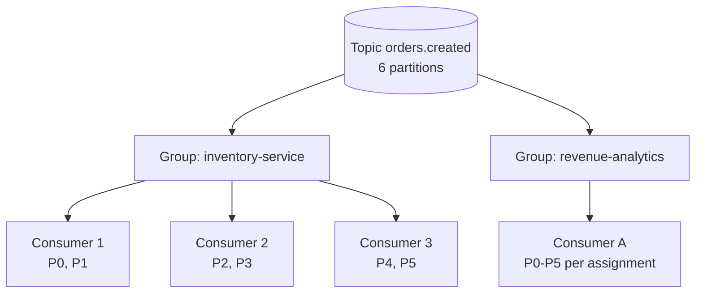
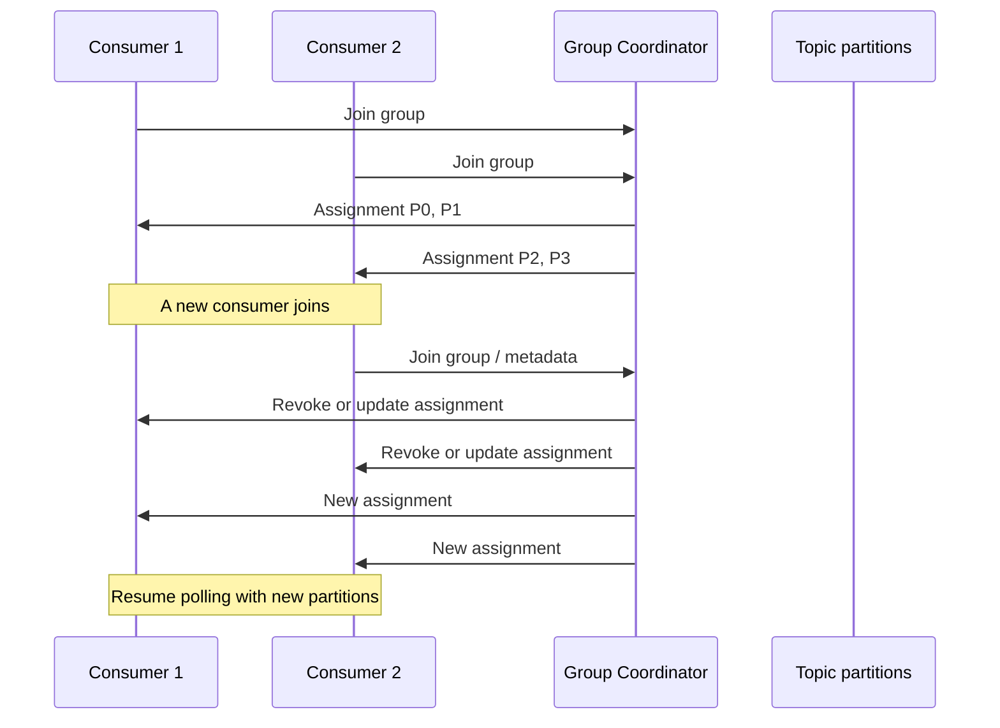

# Consumer Groups, Partition Assignment, and Rebalancing

## Objectives

Kafka allows a topic to be split into multiple partitions for storage and parallel processing. When an application has multiple instances reading from the same topic, Kafka must decide which consumer receives which partitions. A **consumer group** is the mechanism that coordinates consumers to share reading a set of partitions, while **partition assignment** is the process of assigning partitions to each consumer in the group. When membership or topology changes, Kafka performs a **rebalance** to compute a new assignment.

In Spring Cloud Stream, an application typically declares `group` on an input binding. The Kafka binder translates this configuration into Kafka's consumer group identity and manages consumers/containers per binding. Understanding the relationship between groups, partitions, concurrency, and rebalancing helps design scalability, avoid idle unassigned consumers, minimize deployment disruption, and properly handle scenarios where messages may be redelivered.

After this lesson, you will be able to:

- Explain the role of a consumer group and group ID.
- Distinguish multiple instances in the same group from multiple logical subscribers in different groups.
- Calculate concurrency limits based on partition count.
- Understand common partition assignment strategies.
- Identify the causes and lifecycle of a rebalance.
- Tune polling, timeouts, and message handling to reduce unintended rebalances.
- Test assignment, offsets, lag, and recovery behavior when consumers change.

## 1. What Is a Consumer Group?

A consumer group is a set of consumers coordinating to read a topic or set of topics. Consumers in the same group share partitions; at any given time, a partition is assigned to at most one consumer in the group. Each group maintains its own read progress stored as per-partition offsets.

Suppose the `orders.created` topic has six partitions. The inventory service runs three instances sharing the `inventory-service` group. Kafka distributes the six partitions among the group's consumers. If the revenue analytics service also needs to read all events, it uses a separate group `revenue-analytics`; this group has independent assignments and offsets, so it also reads the entire topic.



Two foundational rules:

- **Same group:** consumers compete for/share partition reading. A partition is never assigned simultaneously to two consumers in the same group.
- **Different groups:** each group reads the topic independently with its own offsets. Each logical subscriber can receive the entire stream.

A consumer group is not the name of a pod, host, or function bean. It represents a logical subscriber. Replicas of the same service should generally share the same group name; services that need independent consumption must use different group names.

## 2. Declaring a Group in Spring Cloud Stream

In the functional model, the input binding is derived from the function name and input position. For example, the `processOrders` function has the `processOrders-in-0` binding:

```java
@Bean
Consumer<OrderCreated> processOrders(OrderService service) {
    return event -> service.handle(event);
}
```

Binding configuration:

```yaml
spring:
  cloud:
    function:
      definition: processOrders
    stream:
      bindings:
        processOrders-in-0:
          destination: orders.created
          group: inventory-service
          content-type: application/json
```

The Kafka binder uses the `group` value to determine the binding's consumer group. At the Kafka client level, that identity corresponds to `group.id`. The binder manages the group ID according to the binding configuration; normally you should not set a different `group.id` in client properties, as it may conflict with the binder's group management mechanism.

When deploying three replicas of `inventory-service`, all three must use the same destination and the same group:

```text
inventory-service instance 1 -> group inventory-service
inventory-service instance 2 -> group inventory-service
inventory-service instance 3 -> group inventory-service
```

If each instance uses a distinct group name, Kafka treats them as three independent logical subscribers. Each group can read all partitions, resulting in every order being processed three times at the service level.

### Named Group vs. Anonymous Group

For production business consumers, declare a stable group name. If the `group` property is omitted, Spring Cloud Stream / Kafka binder generates an anonymous identity according to framework rules. This identity is typically unsuitable for a consumer that must retain long-term progress across restarts, since the new group will not have the committed offsets of the previous group.

Example of a consumer without a declared group:

```yaml
spring:
  cloud:
    stream:
      bindings:
        observeOrders-in-0:
          destination: orders.created
```

An anonymous configuration can be useful for observation or isolated testing. For inventory, payment, or flows that must resume from committed progress, set an explicit group name and keep it stable across deployments.

## 3. How Are Partitions Assigned to Consumers?

Kafka stores each record in a partition. The consumer group coordinator coordinates members and uses a partition assignor to decide which partitions belong to which consumer. The result is called an assignment.

For example, suppose a topic has six partitions `P0...P5` and a group has three consumers. A balanced assignment could be:

| Consumer in Group | Assigned Partitions |
|---|---|
| Consumer 1 | P0, P1 |
| Consumer 2 | P2, P3 |
| Consumer 3 | P4, P5 |

This is only an example; the actual assignment depends on the partition assignor, number of topics/partitions, members, subscriptions, and group metadata.

A partition within the same group has only one consumer owner at a time. Therefore, a consumer can read multiple partitions, but two consumers in the same group do not concurrently read the same partition under normal assignment. Different groups can still read the same partitions independently.

### Active Consumer Count Is Limited by Partition Count

If a topic has six partitions:

- One consumer can receive all six partitions.
- Three consumers can receive roughly two partitions each.
- Six consumers can receive one partition each.
- Ten consumers in the same group will leave at least four consumers with no partition assigned when the topology only has six partitions.

Thus, scaling replicas beyond the partition count does not automatically increase read parallelism for the group. If more active consumers are needed, consider increasing partitions or changing the processing architecture; increasing partitions impacts key mapping and ordering and requires separate planning.

## 4. Distinguishing Replicas, Concurrency, and Partition Count

With the Spring Cloud Stream Kafka binder, an application can run multiple replicas; each replica can create multiple consumers based on concurrency configuration. The total number of consumer members in the group can be estimated as:

`Total consumers ≈ number of replicas × concurrency per replica`

Example:

- 3 replicas of the service.
- `concurrency: 2` on the input binding.
- Roughly 6 total consumer members joining the group.

Configuration:

```yaml
spring:
  cloud:
    stream:
      bindings:
        processOrders-in-0:
          destination: orders.created
          group: inventory-service
          consumer:
            concurrency: 2
```

If the topic has six partitions, six consumers can each receive one partition under a balanced assignment. If the topic only has three partitions, at most three consumers are assigned partitions; the remaining consumers remain idle for that binding.

| Replicas | Concurrency per Replica | Expected Total Consumers | Partitions | Utilization |
|---:|---:|---:|---:|---|
| 1 | 1 | 1 | 6 | One consumer reads all six partitions |
| 3 | 1 | 3 | 6 | Three consumers split the partitions |
| 3 | 2 | 6 | 6 | All six consumers can be utilized |
| 4 | 2 | 8 | 6 | At least two consumers have no partitions |
| 2 | 2 | 4 | 12 | Four active consumers, room to scale |

The table assumes all consumers subscribe to the same set of topics with no other assignment constraints. Effective concurrency also depends on container settings, binder version, and resource limits.

Do not confuse `concurrency` with partition count. Concurrency creates additional consumers/threads within the application; it does not automatically create partitions on the broker. Topics must be provisioned with an appropriate partition count to leverage concurrency.

## 5. Common Partition Assignment Strategies

Kafka supports multiple partition assignors. They differ in how they balance partitions and how much assignments move when the group changes.

### RangeAssignor

The range assignor divides partitions per topic and assigns contiguous ranges of partitions to consumers. With multiple topics, dividing per topic can create slightly uneven distributions across consumers.

For example, with one six-partition topic and three consumers, each consumer may get two partitions. With multiple topics whose partition counts are not divisible by the consumer count, some consumers may receive more partitions than others.

### RoundRobinAssignor

The round-robin assignor distributes partitions across subscribed topics in rotation across eligible consumers. It can achieve better balance when a group subscribes to multiple topics with different topologies, though assignment also depends on each consumer's subscription.

### StickyAssignor

The sticky assignor aims to produce a balanced assignment while preserving as many previously assigned partitions as possible. When the group changes, it tries to minimize the number of partitions moved between consumers, thereby reducing state/work reinitialization overhead.

### CooperativeStickyAssignor

Cooperative sticky uses a cooperative rebalance protocol, allowing partitions to be revoked incrementally instead of forcing all consumers to revoke all assignments at once. This can reduce processing pauses during rebalances. All consumers in the group must use compatible assignors/protocols; migrating from an eager assignor must follow the Kafka client migration guide.

An assignor can be configured via Kafka binder consumer configuration:

```yaml
spring:
  cloud:
    stream:
      bindings:
        processOrders-in-0:
          destination: orders.created
          group: inventory-service
      kafka:
        bindings:
          processOrders-in-0:
            consumer:
              configuration:
                partition.assignment.strategy: org.apache.kafka.clients.consumer.CooperativeStickyAssignor
```

Class names and availability depend on the Kafka client version. Before changing an assignor, check compatibility across all group members and plan rolling deployments carefully. Do not arbitrarily mix incompatible assignor configurations.

### Choosing an Assignor by Need

| Strategy | Characteristics | When to Consider |
|---|---|---|
| Range | Splits partition ranges per topic | Simple, predictable topology |
| RoundRobin | Alternates distribution across consumers | Group subscribes to multiple topics and needs even distribution |
| Sticky | Balanced while minimizing partition movement | Want to reduce assignment churn |
| CooperativeSticky | Sticky with incremental partition revocation | Want to reduce rebalance disruption and clients support it |

No assignor solves hot partitions on its own. If one partition receives most of the traffic due to skewed keys, revisit the partition key, data distribution, and partition count.

## 6. What Is a Rebalance?

A rebalance is the process by which Kafka reassigns partitions across consumers in a group. It occurs when group membership or topology changes, or when a consumer no longer meets the conditions to stay in the group.

Common triggers for a rebalance:

- A new consumer joins the group.
- A consumer shuts down cleanly and leaves the group.
- A consumer crashes or loses network connectivity.
- A consumer fails to send heartbeats on time or is considered lost.
- A consumer spends too much time between `poll()` calls and exceeds `max.poll.interval.ms`.
- Partitions are added to or removed from a topic.
- The group's subscription changes.
- Group/assignor configuration or relevant metadata changes.

High-level lifecycle:



This diagram shows the high-level flow. Eager and cooperative rebalances differ in how they revoke/assign; cooperative rebalancing can transfer partitions over multiple rounds instead of revoking everything immediately.

### Revoke and Assign

During a rebalance, a consumer may receive partition revocation callbacks followed by new partition assignments. The application/binder must handle in-progress work, persist any necessary state, and avoid marking uncommitted side effects as complete.

With the Spring Cloud Stream Kafka binder, the container and binder manage the consumer lifecycle. If native callbacks are needed to save/restore state or observe assignments, use the extension points supported by your binder/Spring Kafka version and keep that logic in the adapter layer. Do not leak Kafka consumer APIs into domain services.

## 7. Eager vs. Cooperative Rebalance

With eager rebalancing, when the group changes, consumers typically revoke all partition assignments before receiving new ones. During that window, reading can pause. For high-volume or stateful workloads, stopping and restarting many partitions can be costly.

Cooperative rebalancing allows assignments to transition incrementally. Only partitions that need to move are revoked in a given round; unchanged partitions can continue to be held. This mechanism reduces the blast radius of pauses, though it does not eliminate all pauses or all rebalances.

When using a cooperative assignor:

- The Kafka client and group members must support the cooperative protocol.
- Rolling deployments must preserve assignor compatibility between old and new versions following Kafka's migration path.
- Consumers still need to handle duplicates and commit offsets properly.
- Never assume every partition always continues processing uninterrupted across a rebalance.

If the application uses Kafka Streams, task assignment and state store migration have additional Kafka Streams-specific semantics. Do not apply plain Kafka consumer group details verbatim to a Kafka Streams topology.

## 8. Offsets, Message Processing, and Rebalancing

Kafka stores committed offsets per group and partition. The offset represents the next position the group will read in that partition. Consumers typically poll records, process them, and commit progress according to the binder/container mode.

An important failure window:

1. The consumer reads record at offset 100.
2. The application updates the database successfully.
3. Before the consumer commits offset 101, the process crashes or rebalances.
4. Another consumer receives the partition and reads offset 100 again.
5. The database side effect may occur a second time.

Therefore, groups and offsets do not by themselves provide exactly-once semantics for side effects outside Kafka. If the database and Kafka are not coordinated under an appropriate transaction strategy, design idempotency using event IDs, inbox/unique constraints, or transaction/outbox patterns depending on data direction.

Conversely, if the offset is committed before side effects finish and the process fails, the message may be skipped when the consumer restarts. Commit timing must align with the application's delivery guarantees and the binder's acknowledgment settings.

The Spring Cloud Stream Kafka binder manages commits/acks according to consumer and container settings. Avoid manually setting `enable.auto.commit` or calling native commits outside the binder's mechanism without understanding the interaction; doing so can cause conflicts or break processing guarantees.

### Rebalance While Work Is In Flight

If a consumer's partitions are revoked while messages are being processed:

- Identify which work has completed and can be safely committed.
- Do not advance the offset past incomplete messages.
- Stop accepting new work from revoked partitions according to the container lifecycle.
- Ensure interrupted work can be retried when the partition is assigned to another consumer.
- Use idempotency to tolerate redelivered records.

For asynchronous processing, do not let a consumer keep polling too quickly while an internal task queue grows unbounded. If processing exceeds `max.poll.interval.ms`, Kafka may consider the member unresponsive and trigger a rebalance.

## 9. Timeouts Affecting Membership

Important Kafka consumer settings:

| Property | Role | Impact When Misconfigured |
|---|---|---|
| `session.timeout.ms` | Time the coordinator waits for a heartbeat before considering the consumer dead | Too low can evict consumers during brief network blips |
| `heartbeat.interval.ms` | Interval for sending heartbeats under the consumer group mechanism | Mismatched with session timeout can destabilize membership |
| `max.poll.interval.ms` | Maximum time between polls before the consumer is considered stalled | Long processing can cause the consumer to leave the group and trigger a rebalance |
| `max.poll.records` | Limit on records returned in a single poll | Too large a batch can push processing time past the poll interval |
| `request.timeout.ms` | Timeout for broker requests | Too low can cause unnecessary request failures |

Several Kafka client properties can be set via the Kafka binder:

```yaml
spring:
  cloud:
    stream:
      bindings:
        processOrders-in-0:
          destination: orders.created
          group: inventory-service
          consumer:
            concurrency: 2
      kafka:
        bindings:
          processOrders-in-0:
            consumer:
              configuration:
                max.poll.interval.ms: 300000
                max.poll.records: 100
                session.timeout.ms: 45000
                heartbeat.interval.ms: 15000
```

These values are illustrative only. Calculate worst-case batch processing time, dependency timeouts, pause durations, and network latency to choose appropriate values. Do not increase `max.poll.interval.ms` to hide an infinitely hung handler; enforce dependency timeouts and observability instead.

For long-running work, you can lower `max.poll.records`, split batches, increase concurrency up to the partition count, or offload long jobs to a durable stateful pipeline. Every change should be tested alongside the binder's ack/commit behavior.

## 10. Reducing Unnecessary Rebalances

Ways to reduce unintended rebalances:

- Keep group names stable across deployments.
- Avoid thrashing replicas with overly sensitive autoscaling thresholds.
- Process messages within a timeframe compatible with the poll interval.
- Set explicit timeouts on database/API calls.
- Avoid blocking or unbounded internal queues.
- Choose a cooperative assignor if supported by the client/binder and migration path.
- Use static membership when clearly needed and manage identities properly.
- Keep partition topology stable or plan carefully when adding partitions.

### Static Membership

Kafka supports static membership via `group.instance.id`. When a consumer restarts within a configured timeout window, it can rejoin with a stable identity and avoid certain unnecessary rebalances.

If using static membership, each consumer member needs a unique instance ID within the group. Never use the same ID across multiple simultaneously running replicas; doing so can cause fencing or membership conflicts. Configuring this via the binder must follow Kafka client properties and how your version's container creates consumer instances.

Static membership does not replace health checks, timeouts, or graceful shutdowns. If a member is truly gone for too long, the group still needs to recover and reassign partitions to healthy members.

## 11. Monitoring Consumer Groups in Production

Metrics to monitor:

| Metric | Meaning | How to Use |
|---|---|---|
| Consumer group lag | Distance between the group's current offset and the log end offset | Detect slow processing or backlog |
| Assigned partitions | Number of partitions currently assigned to each consumer | Detect skewed distribution or idle consumers |
| Rebalance count/rate | Number of rebalances over time | Identify unstable membership |
| Rebalance duration | Time taken by the group to transition assignments | Assess processing disruption |
| Records consumed rate | Rate of records read | Compare against producer throughput |
| Processing latency | Time to process a record/batch | Detect slow handlers |
| Commit latency/failures | Delay or errors committing offsets | Assess replay or backlog risk |
| Consumer errors | Exceptions, deserialization errors, and dependency failures | Separate data errors from infrastructure errors |

Rising consumer lag does not necessarily mean a rebalance occurred; producer load may have spiked or the consumer may be processing slowly. More frequent rebalances do not necessarily mean broker failure; they may stem from `max.poll.interval.ms`, autoscaling, or deployments.

Logs should include group ID, client/member ID, topic, partition, offset, and event ID when available. Avoid logging sensitive payloads. When investigating, correlate rebalance timestamps with deployments, autoscaling events, timeouts, and downstream errors.

## 12. Three-Replica Deployment Example

Suppose topic `orders.created` has six partitions. The inventory service runs three replicas, each with concurrency 2:

```yaml
spring:
  cloud:
    function:
      definition: processOrders
    stream:
      bindings:
        processOrders-in-0:
          destination: orders.created
          group: inventory-service
          consumer:
            concurrency: 2
          content-type: application/json
```

All three replicas share the same group configuration. In total there can be six consumer members. With six partitions, Kafka can assign one partition to each member. If scaled to four replicas with concurrency 2, there will be eight members; at least two members will have no partitions when the group stabilizes.

If even higher throughput is needed, you can consider increasing the partition count, after checking:

- Broker capacity and storage.
- Whether partition keys are evenly distributed.
- How key-to-partition mapping will change.
- Consumer count and downstream capacity.
- Retention, replication factor, and operational overhead.
- Impact on ordering and stateful processing.

Do not increase partitions just to make consumer count equal partition count if the actual bottleneck is a downstream database or API.

## 13. Distinguishing Kafka Consumer Group from Kafka Streams application.id

With the standard Kafka binder, Spring Cloud Stream uses the `group` property of an input binding to specify the consumer group.

When using the Kafka Streams binder, the application uses the concept of `application.id`. Kafka Streams uses the application ID as the identifier for the processing application, which ties into consumer groups, internal topics, and state management. It is not merely a group name you can swap arbitrarily in the YAML of the standard Kafka binder.

A typical Kafka Streams configuration looks like:

```yaml
spring:
  cloud:
    stream:
      function:
        definition: aggregateOrders
      kafka:
        streams:
          binder:
            applicationId: order-aggregation
```

Exact property structure depends on the Spring Cloud Stream Kafka Streams binder version. With Kafka Streams, partition assignment is also tied to task topology, state stores, and restoration. During a rebalance, tasks may move between instances and state must be restored. Follow the Kafka Streams binder documentation if your application uses that binder; the standard consumer group examples in this lesson focus on the Kafka message binder.

## 14. Testing Consumer Groups and Rebalancing

Service unit tests cannot prove that Kafka assigns partitions correctly. Test across multiple layers.

### Configuration and Wiring Tests

- Verify the input binding has the right destination and group name.
- Verify replicas share the same group.
- Verify independent logical subscribers use different groups.
- Verify concurrency is bound as configured.
- Verify the binder-managed group ID is not accidentally overridden.

### Integration Tests with Kafka

Use Kafka running in Testcontainers or an appropriate test environment:

1. Create a topic with a known partition count.
2. Start a consumer group with multiple instances.
3. Send keyed records and verify partition assignment.
4. Add a consumer member, then observe the rebalance and new assignment.
5. Stop a member abruptly and verify partitions are reassigned.
6. Check committed offsets and redelivery when processing/committing is interrupted.
7. Check consumer lag and recovery time.
8. Verify the configured assignor works compatibly across all members.

Tests should use broker/client versions close to production when verifying cooperative rebalancing or static membership. The Test Binder is useful for Spring Cloud Stream wiring but does not simulate a real group coordinator, partition assignment, or rebalancing.

### Testing Failure Windows

Create a scenario where a side effect succeeds but the offset has not yet been committed, then stop the consumer. When another consumer takes over the partition, the record may be redelivered. Verify that an inbox/unique constraint or idempotency key prevents duplicate side effects.

Also test when a consumer has its partitions revoked while processing a batch. The expected outcome is that offsets only advance past safely processed work according to the acknowledgment mode; incomplete work may be redelivered.

## 15. Common Pitfalls

| Symptom | Possible Cause | Resolution |
|---|---|---|
| Every replica processes every message | Each replica uses a different group name | Use the same named group across replicas |
| Two services split messages between them | Two logical subscribers accidentally share a group | Give each service its own group |
| Scaling replicas does not increase throughput | Consumers exceed partitions or downstream is bottlenecked | Check assignment, lag, and bottlenecks |
| Frequent rebalances | Slow polling, low timeouts, oscillating autoscaling, or restarts | Measure processing time, adjust timeouts, and stabilize membership |
| Duplicate processing after rebalance | Side effect completed before offset commit | Design idempotency/inbox |
| One consumer receives more partitions | Assignor, partition count, or uneven subscriptions | Check assignment and partition topology |
| One partition has high lag | Hot key or skewed data | Analyze key distribution and partition strategy |
| New consumer does not read historical data | New group has no offset; unexpected offset reset policy | Check group name and start/offset reset policy |
| Cooperative assignor does not work | Incompatible client/members or flawed migration | Check versions and assignor compatibility |

## Conclusion

Consumer groups enable multiple consumers to share reading partitions; distinct groups read streams independently with their own offsets. Spring Cloud Stream declares the group via the `group` property on the input binding, and the Kafka binder maps that identity to Kafka's consumer group. The number of active consumers in a group is bounded by the number of assigned partitions.

The partition assignor governs how partitions are distributed; rebalances occur when membership, subscriptions, or topology change. For stable operations, keep group names consistent, choose concurrency based on partition count, control time between polls, monitor lag/rebalances, and design idempotency for record redeliveries. Test assignment and failure windows against real Kafka before committing to throughput or availability targets.
