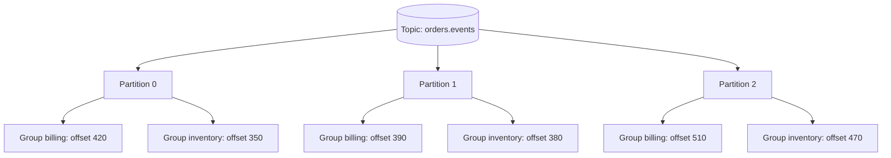

# Resetting Offsets and Controlled Data Replay

## 1. When Is an Offset Reset Needed?

Kafka tracks each consumer group's read progress using per-partition offsets. As a consumer processes records, the application or container commits offsets to record the completed position. On subsequent startups, members of the same group resume from the committed offsets.

In operations, there are times when a group's progress must be moved to another position to re-read data:

- An older consumer version processed logic incorrectly and needs to re-run over data after a bug fix.
- A projection or read model needs to be rebuilt from stored events.
- A time window needs to be replayed to recover data after an incident.
- A new consumer needs to read history to construct initial state.
- Operations needs to inspect a specific set of records without altering production progress.

Resetting offsets changes where a consumer group resumes reading. It does not delete records from the topic, nor does it duplicate records. When the consumer reads again, the application receives the existing records at the chosen offsets.

The first decision to make is **whether to replay using the existing group or create a separate replay group**. Resetting a production group can alter the progress of user-facing workloads. A dedicated replay group is usually safer when the goal is analysis, rebuilding projections, or testing fixed logic.

## 2. Offsets Are Stored by Group and Partition

Each record in a Kafka partition has an increasing offset. A consumer group tracks its own progress per partition of a topic. Two groups reading the same topic can be at different positions:



An offset is not a global sequence number across the topic. Offset `420` on partition 0 and offset `420` on partition 1 are two different positions. When resetting, specify the exact topic, group, and affected partitions.

A committed offset also does not guarantee that the record at that offset succeeded from a business perspective in every design. If an application commits early and then executes side effects, records can be skipped after a failure. If side effects complete before the commit succeeds, records can be redelivered. Resetting offsets adjusts read progress; it does not fix ordering bugs or acknowledgment boundaries.

## 3. Distinguishing Offset Reset from auto.offset.reset

`auto.offset.reset` is the policy a Kafka consumer applies when the group has no valid offset for a partition, or when the committed offset falls outside the data range retained by the broker. Common values:

| Value | Behavior When Choosing an Initial Position |
|---|---|
| `earliest` | Start from the earliest offset currently readable |
| `latest` | Start from the end of the log, receiving new data written afterward |
| `none` | Throw an error if no valid offset is found |

Changing `auto.offset.reset` from `latest` to `earliest` **does not automatically reset a group that already has valid committed offsets**. Once a group has offsets, the consumer continues from those offsets. This is a common misconception when trying to replay older data.

For example, group `billing-service` has committed up to offset 900. Configuring `auto.offset.reset=earliest` leaves the group continuing from its committed offset rather than rewinding to the start of the topic. To re-read, you must reset the committed offsets via administrative tooling or use a new group with no existing offsets.

## 4. Inspecting Consumer Group State Before Changing Anything

Before resetting, verify whether the group exists, what state it is in, whether any members are active, and what the current lag looks like.

```bash
kafka-consumer-groups.sh \
  --bootstrap-server localhost:9092 \
  --describe \
  --group billing-service
```

The output typically includes columns such as topic, partition, current offset, log end offset, lag, and consumer ID/host if members are active. Read the output per partition rather than looking only at total lag.

Some Kafka CLI versions include extra flags to inspect group state and members:

```bash
kafka-consumer-groups.sh --bootstrap-server localhost:9092 --describe --group billing-service --state
kafka-consumer-groups.sh --bootstrap-server localhost:9092 --describe --group billing-service --members
```

Available flags depend on the Kafka version. If the broker requires authentication, pass `--command-config client.properties` to supply security settings; never place passwords directly on the command line or in documentation.

## 5. Safety Rules Before Resetting

Resetting offsets is an operational action that impacts which data consumers will read. For a group serving production traffic, follow a clear procedure:

1. Confirm the exact cluster, topic, and group ID.
2. Record current offsets, log end offsets, and lag for each partition.
3. Define the data range to replay and the business reason.
4. Ensure consumers in the group are completely stopped and the group has no active members.
5. Check retention, compaction, and which offsets still exist.
6. Run `--dry-run` to preview target offsets before executing.
7. Save before/after results, timestamp, and operator identity.
8. Start consumers and monitor read rate, lag, errors, duplicates, and side effects.

Kafka requires the group to be inactive to reset offsets using `kafka-consumer-groups`. If consumers are still active, stop the corresponding instances or workloads and wait for them to leave the group before resetting. Resetting while consumers are running or restarting concurrently can produce unexpected results.

## 6. Using kafka-consumer-groups to Reset Offsets

Kafka provides the `kafka-consumer-groups` tool to inspect and modify committed offsets. The examples below use `kafka-consumer-groups.sh` on Linux/macOS; on Windows, use the corresponding `.bat` script in the `bin\windows` directory of the Kafka distribution.

### Reset to the Earliest Retained Offset

Run a dry-run first:

```bash
kafka-consumer-groups.sh \
  --bootstrap-server localhost:9092 \
  --group billing-service \
  --topic orders.events \
  --reset-offsets \
  --to-earliest \
  --dry-run
```

Review the output and confirm the partitions/offsets match the plan. Only if accurate, execute:

```bash
kafka-consumer-groups.sh \
  --bootstrap-server localhost:9092 \
  --group billing-service \
  --topic orders.events \
  --reset-offsets \
  --to-earliest \
  --execute
```

`--to-earliest` means the earliest offset the broker still retains for the partition at the time of reset. It does not restore data past retention and does not guarantee re-reading every event ever sent to the topic.

### Reset to the End of the Log

To skip the current backlog and start from new data:

```bash
kafka-consumer-groups.sh \
  --bootstrap-server localhost:9092 \
  --group billing-service \
  --topic orders.events \
  --reset-offsets \
  --to-latest \
  --dry-run
```

After verifying, replace `--dry-run` with `--execute`. This operation can cause the group to skip all pending records prior to the latest position. Use it only when the business explicitly permits skipping the backlog.

### Reset to a Specific Offset

When you need to start from a known position:

```bash
kafka-consumer-groups.sh \
  --bootstrap-server localhost:9092 \
  --group billing-service \
  --topic orders.events \
  --reset-offsets \
  --to-offset 2500 \
  --dry-run
```

The offset set is the position where the consumer will resume reading according to Kafka semantics. Verify that the offset still falls within each partition's log range. Across multiple partitions, the same offset number can represent different points in time.

## 7. Replaying by Time or Shifting Offsets

Replaying from the start of a topic is not always necessary. You can pick a point in time or shift offsets relatively when supported by your Kafka CLI version.

### Replay from a Timestamp

```bash
kafka-consumer-groups.sh \
  --bootstrap-server localhost:9092 \
  --group billing-service \
  --topic orders.events \
  --reset-offsets \
  --to-datetime 2026-11-24T00:00:00.000 \
  --dry-run
```

Kafka resolves the offset corresponding to the timestamp on each partition based on record timestamps. Timestamps do not always map cleanly to an exact record; check the dry-run output and verify the timestamp's timezone.

### Replay a Recent Window

Some Kafka versions support `--by-duration`, for example:

```bash
kafka-consumer-groups.sh \
  --bootstrap-server localhost:9092 \
  --group billing-service \
  --topic orders.events \
  --reset-offsets \
  --by-duration PT6H \
  --dry-run
```

This command illustrates setting offsets to roughly six hours ago based on timestamps. Verify CLI version support and actual output before executing.

### Shift Offsets Relatively

`--shift-by` moves the current offset by a number of records:

```bash
kafka-consumer-groups.sh \
  --bootstrap-server localhost:9092 \
  --group billing-service \
  --topic orders.events \
  --reset-offsets \
  --shift-by -100 \
  --dry-run
```

This example steps each partition back 100 offsets from its current position. Stepping backward can cause duplicate processing; stepping forward can skip data. Always inspect results per partition.

## 8. Resetting Only Specific Topics or Partitions

A group may consume multiple topics. If only one stream needs replay, specify the target topic rather than using an option that applies to all topics. Some Kafka CLI versions allow specifying particular partitions in the topic argument, such as `orders.events:0,1`; confirm syntax with your distribution version.

Do not use `--all-topics` if the goal is only to recover a single destination. Accidentally resetting the wrong topic can cause multiple business flows to re-read data and trigger unintended side effects.

When only one partition has an issue, you can reset that partition once the right offset is identified. However, if events for the same aggregate are partitioned by key, replaying only one partition can leave related events in other partitions out of sync in time. Assess business consistency before choosing the scope.

## 9. Replaying with a Separate Consumer Group

If the goal is rebuilding a projection, testing new logic, or analyzing data, creating a separate group is usually less risky than resetting the production group.

Example configuration of a Spring Cloud Stream function:

```yaml
spring:
  cloud:
    function:
      definition: rebuildOrderProjection
    stream:
      bindings:
        rebuildOrderProjection-in-0:
          destination: orders.events
          group: order-projection-replay-20261124
          content-type: application/json
      kafka:
        bindings:
          rebuildOrderProjection-in-0:
            consumer:
              startOffset: earliest
```

The new group has no committed offsets, so `startOffset: earliest` instructs the binder to start from the earliest retained data. The distinct group name tracks progress independently of `order-projection-production`. Once replay finishes, you can stop the replay workload and retain or delete the group per operational policy.

Advantages of a replay group:

- Does not alter the committed offsets of the production group.
- Allows comparing old and new projection results.
- Can run slowly or pause without affecting the main consumer's progress.
- Easy to restrict permissions and output destinations of the replay job.

The trade-off is that the broker serves an extra read pass and the application may produce duplicate side effects if the replay writes to the same database or calls external services. Use a dedicated projection database or idempotency to guard repeatable operations.

## 10. Configuring startOffset and resetOffsets in the Kafka Binder

The Spring Cloud Stream Kafka binder provides consumer properties to control the starting position when a binding initializes. Example:

```yaml
spring:
  cloud:
    stream:
      bindings:
        processOrders-in-0:
          destination: orders.events
          group: billing-service
      kafka:
        bindings:
          processOrders-in-0:
            consumer:
              startOffset: earliest
              resetOffsets: false
```

`startOffset` specifies the starting position when choosing an initial offset. `resetOffsets` is a binder-specific option that can request resetting offsets to `startOffset` when the binding initializes, depending on the binder version. When `resetOffsets` is enabled, every binding startup can affect group progress; do not leave it enabled in permanent production configuration if you only intend a one-off replay.

Before using `resetOffsets`, check the documentation and configuration metadata for your exact Spring Cloud Stream Kafka binder version. Behavior can vary between binder generations. For one-time administrative operations, `kafka-consumer-groups --reset-offsets --dry-run/--execute` makes the scope and outcome explicit before applying changes.

Do not confuse `startOffset` with `auto.offset.reset`: the binder may map its own properties into consumer configuration. Neither is meant to arbitrarily overwrite existing committed offsets unless an explicit reset mechanism is enabled.

## 11. Replay Can Re-Execute Side Effects

Resetting offsets causes the consumer to receive records again. The broker does not know whether the function previously sent an email, charged a card, created an order, or called an API. If the application triggers side effects, replaying can repeat those actions.

For example, a consumer receives `PaymentRequested` and calls a payment gateway. If the event is replayed, calling the API again could create a second transaction. Safeguards:

- Use a stable `eventId` as an idempotency key for side effects.
- Record processed events in an inbox table within the same database transaction as business updates.
- Enforce unique constraints on transaction IDs or business keys.
- Decouple replay consumers from flows that send notifications, process payments, or issue non-idempotent commands.
- Use a dry-run mode or separate output destination to compare results.
- If calling external APIs, verify whether the API supports an idempotency key.

Do not generate new event IDs when replaying existing records. Preserving the original ID helps downstream systems recognize the same business intent.

## 12. Retention and Log Compaction Limit Replayable Data

`--to-earliest` does not mean returning to the very first record ever produced. It only selects the earliest offset the broker still retains in the partition.

For topics using time- or size-based retention, older records may have already been deleted. For compacted topics, Kafka retains the latest value per key according to compaction policy and may remove older versions; compacted topics should not be treated as a complete event history for replaying every change.

Before planning a replay, check:

- `retention.ms` and `retention.bytes` of the topic.
- Whether `cleanup.policy` is `delete`, `compact`, or combined.
- The log start offset and log end offset of each partition.
- Whether tombstones or compacted records exist.
- Whether the required timeframe is still retained on the broker.

If history needs to be retained longer than topic retention, design a separate archive or data lake. Resetting offsets cannot recover deleted records.

## 13. Handling Out-of-Range Offsets

A committed offset can fall below the log start offset after retention deletes data, or exceed the log end offset due to topic modifications, restores, or administrative actions. When that happens, the consumer encounters an out-of-range offset and Kafka must apply a reset policy.

With `auto.offset.reset=earliest`, the consumer jumps to the earliest retained offset; with `latest`, it jumps to the end of the log; with `none`, it raises an error. This choice can cause data to be skipped or re-read. Alert and inspect logs when out-of-range events occur rather than treating them as a normal startup.

## 14. Verifying After a Reset

After `--execute` completes, inspect the group again:

```bash
kafka-consumer-groups.sh \
  --bootstrap-server localhost:9092 \
  --describe \
  --group billing-service
```

Compare per-partition current offsets against the dry-run output and your plan. Once consumers resume running, monitor:

- Offsets advancing at the expected rate.
- Consumer lag increasing or decreasing in line with the replay goal.
- No partition overlooked or mistakenly reset.
- No abnormal spikes in exceptions, retries, or DLQ messages.
- No unexpected duplicate side effects.
- Consumer group not continuously rebalancing or losing members.

Record before/after states along with reason, topic, group, partitions, target offsets, timestamp, and operator. This evidence is essential for investigating if a replay yields unexpected data.

## 15. Controlled Replay Workflow in Production

A practical workflow can follow these steps:

1. Define the replay objective: recover a production group or rebuild an independent projection.
2. When feasible, create a separate replay group named with a version or run date.
3. Verify the required data is still within retention and determine target offsets per partition.
4. Verify consumers are idempotent and side effects are safe to repeat.
5. For an existing group, stop all consumers and confirm the group has no active members.
6. Run the reset with `--dry-run`, review the output, and only then run `--execute`.
7. Start consumers with the prepared configuration.
8. Monitor lag, throughput, errors, DLQ, databases, and downstream dependencies.
9. Validate business state after replay; retain operational logs and close out the job.

## 16. Examples of Choosing an Approach

| Goal | Approach | Rationale |
|---|---|---|
| Rebuild a projection table without affecting current consumers | Separate replay group | Independent progress, easy to compare and roll back results |
| Production consumer processed bad data from a point in time | Stop group, dry-run, then reset existing group | Moves the actual workload back to the selected offset |
| Analyze historical data only | Separate replay group, output to analytics store | Avoids re-triggering business side effects |
| Skip old backlog by business decision | Reset to `latest` after confirmation | Consumer only processes new data from that point forward |
| Re-read select partitions | Reset selected partitions after evaluating keys/ordering | Reduces blast radius, though cross-partition data relationships must be checked |

Resetting offsets modifies the consumption progress of a Kafka consumer group. `auto.offset.reset` only selects a position when no valid offset exists; it does not rewind an active group back to the beginning of a topic. To replay safely, identify the exact group/topic/partitions, stop consumers while resetting, use dry-run, check retention, and protect side effects with idempotency. When the goal allows, a separate replay group preserves production progress while still enabling controlled data replay.
