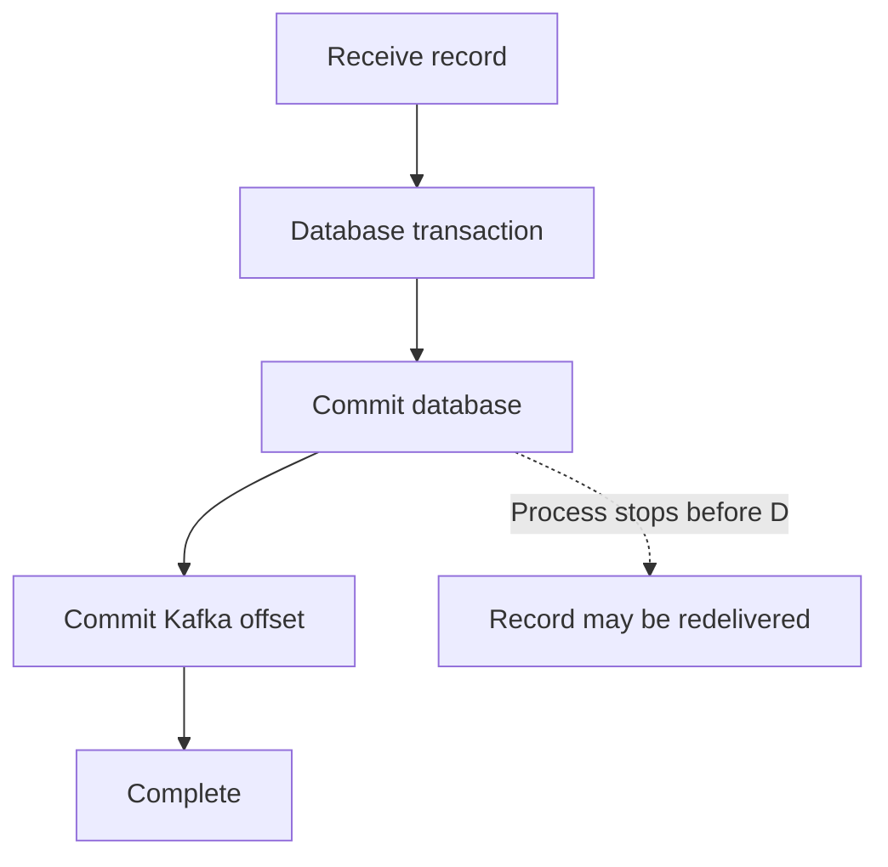

# ackMode and Offset Commit Timing

When Spring Cloud Stream receives messages from Kafka, the consumer must record its processed position so the next startup or poll knows where to read from. Kafka stores this position as a **committed offset** per partition and consumer group. The Spring Cloud Stream Kafka binder uses the Spring for Apache Kafka listener container to manage committing.

The `ackMode` property determines **when offsets are committed** after the listener processes messages. Choosing the wrong timing can cause two kinds of incidents: committing too early causes unprocessed messages to be skipped by the consumer; committing too late can cause already-processed messages to be redelivered after an application shutdown. Therefore, ack modes must be understood alongside transactions, retries, DLQs, and consumer idempotency.

## 1. An Offset Is a Read Position, Not Business State

Each record in a Kafka partition has an increasing offset. A consumer group maintains its own committed offset for each partition it reads. The committed offset represents the next position where the consumer group will resume reading upon restart or rebalance.

For example, partition `orders-0` has records at offsets 40, 41, 42, and 43. If the consumer successfully processes record 42 and commits the next position 43, the next read starts at offset 43. Kafka does not delete records 40–42 when offsets are committed; topic retention still determines how long data is kept.


An offset only describes the group's read progress. It does not prove that a database committed, an external API completed, or business effects were durably persisted. The application must coordinate commit timing with when business effects complete.

## 2. Where Does ackMode Live in the Kafka Binder?

With the standard Spring Cloud Stream Kafka binder (message-channel binder), `ackMode` is a consumer-binding-specific property. Configuration looks like:

```yaml
spring:
  cloud:
    function:
      definition: processOrder
    stream:
      bindings:
        processOrder-in-0:
          destination: orders.events
          group: order-projection
      kafka:
        bindings:
          processOrder-in-0:
            consumer:
              ackMode: RECORD
```

The binding name `processOrder-in-0` must match the input binding generated from the `processOrder` function. `ackMode` is placed under `spring.cloud.stream.kafka.bindings.<binding-name>.consumer`, not under `spring.cloud.stream.bindings.<binding-name>.consumer`, because it is a Kafka-binder-specific property.

The scope of this property is the message-channel Kafka binder. The Reactive Kafka binder uses `ReceiverOffset` in the `KafkaHeaders.ACKNOWLEDGMENT` header and does not commit offsets by default; the application can call `acknowledge()` or `commit()` on `ReceiverOffset`. The Kafka Streams binder lets the Kafka Streams runtime manage progress per topology and transaction. Do not apply message-channel binder `ackMode` to those two binders.

`ackMode` values are based on Spring Kafka's `AckMode` enum. The main options are `RECORD`, `BATCH`, `TIME`, `COUNT`, `COUNT_TIME`, `MANUAL`, and `MANUAL_IMMEDIATE`.

### Defaults to Distinguish

The Spring Kafka listener container defaults to `BATCH`. However, the Kafka binder has its own configuration logic: in current binder documentation, if `ackMode` is not set and `batch-mode` is not enabled, the binder uses `RECORD` for record listeners. When using batch listeners, check the exact binder version and listener configuration. Therefore, do not infer Spring Cloud Stream application defaults solely from a standalone `KafkaMessageListenerContainer`.

To keep configuration easy to review and independent of defaults across versions, explicitly declare `ackMode` for bindings with important delivery requirements.

## 3. Offset Commit Modes

| ackMode | When Commit Happens | Characteristics |
|---|---|---|
| `RECORD` | After the listener finishes processing each individual record. | Reduces the number of records that can be redelivered when an error happens mid-poll; may increase commit frequency. |
| `BATCH` | After all records returned by a single `poll()` have been processed. | Reduces commit count; if the process fails mid-batch, uncommitted records may be re-read. |
| `TIME` | After the poll's records are processed and the elapsed time since the last commit exceeds `ackTime`. | Throttles commits by time, though it does not commit mid-batch while the listener is still processing. |
| `COUNT` | After the poll's records are processed and at least `ackCount` records have been processed since the last commit. | Throttles commits by record count. |
| `COUNT_TIME` | When either the time or count threshold is reached, after the current batch finishes processing. | Combines both thresholds; whichever condition triggers first initiates the commit. |
| `MANUAL` | Listener calls `Acknowledgment.acknowledge()`; semantics similar to `BATCH` then apply. | Application decides when to acknowledge; container still manages batched commits. |
| `MANUAL_IMMEDIATE` | Commits immediately when the listener calls `acknowledge()` on the consumer thread. | Finer control; must be called on the right thread and acknowledgment order managed carefully. |

`RECORD` and `BATCH` are usually the easiest two options to start with. `TIME`, `COUNT`, and `COUNT_TIME` are useful when balancing commit overhead against latency and potential redelivery volume. `MANUAL` and `MANUAL_IMMEDIATE` are for applications that need to decide for themselves when a record is considered processed.

## 4. RECORD: Commit After Each Record

With `RECORD`, the listener container commits offsets after the listener returns successfully for each record. If a single poll returns multiple records, commits occur as each record progresses rather than waiting for the whole poll to finish.

Example:

```yaml
spring:
  cloud:
    stream:
      kafka:
        bindings:
          processOrder-in-0:
            consumer:
              ackMode: RECORD
```

Suppose a poll returns offsets 40, 41, and 42:

1. Listener finishes processing offset 40; container commits the corresponding next position.
2. Listener finishes processing offset 41; container commits again.
3. Listener finishes processing offset 42; container commits the new progress.

If the process stops after processing 41 but before processing 42, the group can resume from the uncommitted record. The number of records requiring reprocessing is usually smaller than committing an entire batch, though commit frequency increases and may affect throughput.

`RECORD` does not mean the record is committed before the listener runs. The listener must return normally for the container to commit under this mode. If the listener throws an exception, the error handler decides whether to retry, recover, send to DLQ, or stop the container; never assume offsets are always committed even on failure.

## 5. BATCH: Commit After All Records in a Poll

With `BATCH`, the container waits until all records returned in a single `poll()` finish processing before committing offsets. This is the Spring Kafka listener container's default when configuring a container directly without overrides.

Example:

```yaml
spring:
  cloud:
    stream:
      kafka:
        bindings:
          processOrder-in-0:
            consumer:
              ackMode: BATCH
```

Suppose a poll returns offsets 40, 41, and 42 and all three succeed. The container commits progress past offset 42. If the application stops after processing 42 but before committing, records in the uncommitted batch may be redelivered when the consumer starts up.

The advantage of `BATCH` is fewer commits compared to `RECORD`, especially when `max.poll.records` is large. In exchange, the redelivery window is wider. Consumers must be idempotent because a record that already updated the database successfully can reappear if the batch offset has not yet been committed.

## 6. TIME, COUNT, and COUNT_TIME

These three modes allow batching progress over multiple polls before committing. They do not mean the listener can skip processing; the container still finishes all records returned by a poll before committing when the corresponding condition is met.

### TIME

`TIME` commits once the poll's records are processed and the time elapsed since the last commit reaches `ackTime`.

```yaml
spring:
  cloud:
    stream:
      kafka:
        bindings:
          processOrder-in-0:
            consumer:
              ackMode: TIME
              ackTime: 5000
```

`ackTime` is measured in milliseconds. With a value of 5000, the container checks to commit once the 5-second threshold is met and the current batch finishes processing. This is not a timer guaranteeing commits every exact 5 seconds regardless of whether the listener is busy.

### COUNT

`COUNT` commits when the number of records processed since the last commit reaches `ackCount`, after the current poll finishes processing.

```yaml
spring:
  cloud:
    stream:
      kafka:
        bindings:
          processOrder-in-0:
            consumer:
              ackMode: COUNT
              ackCount: 100
```

With `ackCount: 100`, the container waits until the record count threshold is met before committing. The binding-level `ackCount` takes precedence over the global `spring.kafka.listener.ackCount` property.

### COUNT_TIME

`COUNT_TIME` combines `ackCount` and `ackTime`. A commit is performed when either condition is met, after the current poll's records finish.

```yaml
spring:
  cloud:
    stream:
      kafka:
        bindings:
          processOrder-in-0:
            consumer:
              ackMode: COUNT_TIME
              ackCount: 100
              ackTime: 5000
```

This configuration can reduce commit frequency under high load while bounding the interval between commits under low load. Measure lag, throughput, and redelivery counts to pick practical thresholds.

## 7. MANUAL and MANUAL_IMMEDIATE

With both manual modes, the Kafka binder places an `Acknowledgment` object into the message's `KafkaHeaders.ACKNOWLEDGMENT` header. The application retrieves this object and calls `acknowledge()` when necessary work is complete.

Example `MANUAL` configuration:

```yaml
spring:
  cloud:
    stream:
      bindings:
        processOrder-in-0:
          destination: orders.events
          group: order-projection
      kafka:
        bindings:
          processOrder-in-0:
            consumer:
              ackMode: MANUAL
```

Consumer receiving both payload and headers:

```java
import java.util.function.Consumer;

import org.springframework.context.annotation.Bean;
import org.springframework.kafka.support.Acknowledgment;
import org.springframework.kafka.support.KafkaHeaders;
import org.springframework.messaging.Message;

@Bean
Consumer<Message<OrderCreated>> processOrder(OrderService orderService) {
    return message -> {
        Acknowledgment acknowledgment = message.getHeaders().get(
            KafkaHeaders.ACKNOWLEDGMENT,
            Acknowledgment.class
        );

        if (acknowledgment == null) {
            throw new IllegalStateException("Kafka acknowledgment header is missing");
        }

        // This method returns after the database transaction has committed.
        orderService.applyTransactionally(message.getPayload());

        acknowledgment.acknowledge();
    };
}
```

In this example, `orderService.applyTransactionally(...)` should be a method managed by a Spring transaction proxy that only returns after the database transaction commits. Only then does the consumer acknowledge the offset. With `MANUAL`, calling `acknowledge()` marks the record as acknowledged; the container applies `BATCH`-like semantics to commit.

If configured with `MANUAL_IMMEDIATE`, the container commits immediately when `acknowledge()` is called on the consumer thread. If called from another thread, it is no longer an immediate commit in that sense; Spring Kafka's thread constraints must be respected. Do not pass the `Acknowledgment` object to an async executor assuming offsets will be committed in order.

### When Is Manual Ack Needed?

Manual ack is useful when the application has an explicit completion condition before committing, such as:

- A database transaction has committed.
- A business batch has been durably written.
- A verification or state-recording workflow has completed.
- The application must defer ACK until a specific processing step succeeds.

If the listener always runs synchronously and simply needs to commit after the method returns, `RECORD` or `BATCH` is usually simpler. Manual ack increases application responsibility: every success, failure, timeout, and cancellation branch must have a clear ACK/NACK policy.

## 8. Committing After a Database Transaction and the Duplicate Window

A consumer commonly performs two independent operations: updating a database and committing a Kafka offset. Without a shared transaction, there is always a failure window between the two operations.



If the database commit succeeds and the process stops before the offset commits, Kafka can redeliver the record. This is a duplicate, not data loss. The standard mitigation is an idempotent consumer: store `eventId` in an inbox table or use a unique constraint so the same event never applies its business effect twice.

Conversely, if the offset is committed before the database commits and the process crashes, Kafka may not redeliver the record while the database change rolled back. This risks losing business effects. Therefore, for reliable processing, never acknowledge an offset before the protected effect is durable.

Example inbox table:

```sql
CREATE TABLE processed_event (
    consumer_name VARCHAR(100) NOT NULL,
    event_id VARCHAR(100) NOT NULL,
    processed_at TIMESTAMP NOT NULL,
    PRIMARY KEY (consumer_name, event_id)
);
```

Inserting the inbox row and applying the business update should happen in the same database transaction. If the event ID already exists, the consumer can skip duplicate side effects and finish message handling according to the ACK policy.

## 9. Interaction Between ackMode, Retry, and DLQ

`ackMode` governs offset commit timing on the normal processing path. When a listener throws an exception, the Spring Kafka / Kafka binder error handler decides whether to retry, seek, recover, or send the record to a DLQ. Therefore, `ackMode` should not be treated as a retry or DLQ configuration.

Key principles:

- If an error is retried and succeeds, the offset only advances according to the ack mode semantics after the listener completes.
- If an error is not recovered, the offset generally does not advance past the failing record in a way that drops it; the error handler may seek to re-read it.
- If a record is recovered successfully, such as publishing to a DLT, the error handler/binder can commit the recovered record's offset according to configuration.
- With a transactional binder, `txCommitRecovered` controls committing the offset of a recovered record in a new transaction; the current default is `true`.
- If a custom error handler replaces the binder's error handler, verify DLQ forwarding and offset committing separately; do not assume DLQ works automatically.

Example enabling DLQ for the Kafka binder:

```yaml
spring:
  cloud:
    stream:
      bindings:
        processOrder-in-0:
          destination: orders.events
          group: order-projection
          consumer:
            max-attempts: 3
      kafka:
        bindings:
          processOrder-in-0:
            consumer:
              ackMode: RECORD
              enableDlq: true
              dlqName: orders.events.order-projection.dlq
```

After retries are exhausted and the record is recovered to the DLQ by the binder, the recovered record's offset can be committed by the error handler/binder mechanism. Test on your exact version to verify the message landed in the DLQ and the group offset advanced properly. Never call `acknowledge()` inside an error branch while expecting the error handler to retry or DLQ the same record.

## 10. Batch Mode Changes the Processing Unit

When `spring.cloud.stream.bindings.<binding>.consumer.batch-mode` is enabled, the Kafka binder passes records fetched from a single `poll()` to the listener as a `List<?>` or `Message<List<?>>`. When batch mode is disabled, the listener receives one record at a time.

```yaml
spring:
  cloud:
    stream:
      bindings:
        processOrder-in-0:
          destination: orders.events
          group: order-projection
          consumer:
            batch-mode: true
      kafka:
        bindings:
          processOrder-in-0:
            consumer:
              ackMode: BATCH
```

Batch size is influenced by Kafka consumer properties such as `max.poll.records`, `fetch.min.bytes`, and `fetch.max.wait.ms`. `ackMode` still decides when offsets commit; batch mode decides that the listener receives data in batches.

When using batch mode:

- `BATCH` fits processing the entire list as a single unit.
- If one record in the batch fails, know how the error handler handles already-succeeded items versus unprocessed items.
- The Kafka binder does not support standard binder retries in batch mode; `maxAttempts` is overridden to 1. You can configure `DefaultErrorHandler` via `ListenerContainerCustomizer` if similar retry behavior is needed.
- With manual ack, Spring Kafka supports `nack(index, sleep)` for batch listeners receiving a `List` to commit records prior to `index` and request redelivery of the failed record and remaining items. This API must be called on the listener thread and has version constraints.
- Batch DLQ handling may route all records from the preceding poll to the DLQ, not necessarily just the single offending record.

Do not enable batch mode solely to increase throughput without redesigning idempotency and per-item error handling.

## 11. How ackMode Differs from autoCommitOffset and enable.auto.commit

These three names are easily confused:

| Property | Configuration Layer | Role |
|---|---|---|
| `ackMode` | Spring Cloud Stream Kafka binder consumer binding | Selects the listener container's commit semantics. |
| `autoCommitOffset` | Legacy Kafka binder property | Configured auto-commit/manual behavior in older versions; deprecated since binder 3.1 in favor of `ackMode`. |
| `enable.auto.commit` | Kafka consumer client property | Enables timer-based auto-commit in the Kafka client; listener containers normally manage commits instead of this mechanism. |

Since Spring Kafka 2.3, `enable.auto.commit=false` is set for listener containers unless explicitly overridden by the application, allowing the container to control offsets via `AckMode`. Avoid arbitrarily enabling `enable.auto.commit=true` while using listener container commits; the two mechanisms can conflict on timing and safety.

When upgrading older configurations with `autoCommitOffset: false`, migrate to `ackMode: MANUAL` or `MANUAL_IMMEDIATE` and add `Acknowledgment.acknowledge()` calls in the consumer. `ackEachRecord` has also been deprecated since binder 3.1; use `ackMode: RECORD` for committing after each record.

## 12. ackMode Does Not Determine the Starting Read Position

Committing offsets and selecting the starting position are two separate concerns:

- `ackMode` controls when processed progress is saved.
- `startOffset` controls the initial position when the group has no committed offset yet.
- `resetOffsets` relates to resetting the read position to `startOffset` when the binding starts.
- The Kafka client's `auto.offset.reset` governs behavior when no valid offset exists and the binder does not override it with a corresponding setting.

For bindings with an explicit group, the Kafka binder typically defaults `startOffset` to `earliest`; anonymous groups typically default to `latest`. Check your actual binder configuration and version. Changing `ackMode` does not rewind a group to the start of the topic, nor does it clear existing committed offsets.

To replay data, use an intentional reset/replay strategy rather than just changing `ackMode`. Resetting offsets can cause the consumer to re-read massive amounts of data and cause side effects if the consumer is not idempotent.

## 13. Kafka Transactions and Offset Commits

When the transactional Kafka binder is enabled, consumer offsets can be sent into the Kafka transaction alongside output records. If the transaction commits, output records and offsets are committed together within Kafka's scope; if the transaction rolls back, both can be rolled back together.

To coordinate consumers and producers under the binder's transaction manager, the participating bindings must share the same `KafkaAwareTransactionManager`. Binder documentation notes that offset semantics inside a transaction correspond to `RECORD` or `BATCH` depending on whether the listener is a record or batch listener.

Kafka transactions can provide exactly-once processing within properly configured Kafka read/write boundaries. They do not automatically bring PostgreSQL, MySQL, or external payment APIs into the same transaction. If a consumer updates a database, you still need outbox/inbox patterns, idempotency, or an appropriate transaction coordination strategy.

Do not confuse producer `acks=all` with consumer `ackMode`. `acks` controls broker acknowledgment durability when a producer sends a record; `ackMode` controls when a consumer commits read offsets.

## 14. Choosing ackMode by Requirement

| Requirement | Recommended Choice | Rationale |
|---|---|---|
| Record-by-record processing, minimize duplicate window | `RECORD` | Commits after each record listener succeeds. |
| Batch processing and optimizing commit count | `BATCH` | Commits after the entire poll batch completes. |
| Variable load, time-based commit cadence | `TIME` | `ackTime` threshold paces commits when eligible. |
| High load, batch commits by count | `COUNT` | `ackCount` threshold avoids overly frequent commits. |
| Threshold by either time or count | `COUNT_TIME` | Commits when whichever condition is reached first. |
| Acknowledge only after a custom business step completes | `MANUAL` | Application calls acknowledge; container uses BATCH semantics. |
| Need immediate commit upon calling acknowledge on consumer thread | `MANUAL_IMMEDIATE` | Offsets are committed immediately on the call. |

There is no single best ack mode for every application. If a database is the primary side effect, prioritize committing the database transaction first and then committing the offset, combined with idempotency. If batch sizes are large, measure how many records could be redelivered if a poll fails. If using manual ack, test every failure branch to prevent records from stalling or committing before work finishes.

## 15. Testing Offset Commit Timing

The Test Binder is helpful for testing functions and binding logic, but it does not fully simulate committed offsets of a real Kafka consumer group. To verify `ackMode`, write integration tests against a real Kafka broker or equivalent test container and inspect the group's committed offsets.

Important scenarios:

| Scenario | What to Verify |
|---|---|
| `RECORD`, record succeeds | Offset advances after the listener returns for each record. |
| `BATCH`, entire poll succeeds | Offset advances after all records in the poll complete. |
| Listener throws an exception | Offset does not advance past the failing record before retry/recovery decides. |
| Process stops after DB commit, before offset commit | Record may be redelivered; inbox/idempotency prevents duplicate effects. |
| Manual ack not called | Offset is not acknowledged under manual mode. |
| Manual ack after DB commit | Offset advances after `acknowledge()` per chosen semantics. |
| Manual immediate from consumer thread | Verify immediate commit after calling `acknowledge()`. |
| Batch fails on a middle item | Verify which records are committed, retried, or redelivered. |
| Record recovered to DLQ | Verify the DLT receives the record and the offset advances per recovery config. |
| Consumer restart/rebalance | Consumer resumes from the group's committed offset. |

Do not merely assert that the function was invoked. Inspect committed offsets, redelivered records, database state, and DLQ contents to verify full end-to-end semantics.

## 16. Observing Commits and Troubleshooting

In production, monitor:

- Consumer lag by topic, partition, and group.
- Processing time per record and time between commits.
- Commit success/failure counts and commit timeout errors.
- Rebalance counts, active consumers, and partition assignments.
- Retry counts, redeliveries, duplicates, and DLQ counts.
- Messages committed to the database yet redelivered.
- Missing manual acknowledgments or handlers exiting without acknowledging.

The Kafka binder exposes offset lag metrics via Micrometer when appropriate dependencies and configurations are present. When investigating rising lag, distinguish a slow consumer from a consumer that finishes processing but fails to advance commits. The two situations have different remedies.

Logs should include `topic`, `partition`, `offset`, `group`, `eventId`, and `correlationId` when available. Do not use high-cardinality event IDs as metric tags; use logs/traces to look up specific records.

## 17. Common Pitfalls

1. **Confusing producer `acks` with consumer `ackMode`.** One acknowledges publishing; the other commits consumption progress.
2. **Assuming committing an offset deletes the record from Kafka.** Records remain according to the topic's retention policy.
3. **Committing before the database transaction completes.** A crash can lose business effects because the group has already moved past the record.
4. **Skipping idempotency with RECORD/BATCH.** A crash after DB commit but before offset commit can cause duplicate processing.
5. **Enabling manual ack and forgetting to call `acknowledge()`.** The consumer fails to advance offsets as expected and may re-read records after restart.
6. **Calling `acknowledge()` before work is durable.** Can cause data loss if the business step fails after commit.
7. **Calling `MANUAL_IMMEDIATE` from an arbitrary thread.** Immediate commit guarantees no longer hold as when called on the consumer thread.
8. **Confusing `batch-mode` with `BATCH` ackMode.** One controls how the listener receives records; the other controls when offsets are committed.
9. **Using `autoCommitOffset` or `ackEachRecord` in new configurations.** Both binder properties have been deprecated since 3.1; prefer `ackMode`.
10. **Testing only with Test Binder.** Test Binder does not prove real Kafka committed offsets or rebalances.
11. **Changing `ackMode` expecting to replay from the start of the topic.** Look at `startOffset`, `resetOffsets`, and current committed offsets instead.

## 18. Process for Choosing and Configuring ackMode

Before deploying a Kafka consumer, follow these steps:

1. Determine whether the function uses a record listener or a batch listener.
2. Choose the commit goal: per record, per poll, by time/count, or application-acknowledged.
3. Explicitly declare `spring.cloud.stream.kafka.bindings.<binding>.consumer.ackMode`.
4. If using `TIME`, `COUNT`, or `COUNT_TIME`, set `ackTime`/`ackCount` grounded in throughput and latency targets.
5. If using manual ack, extract `KafkaHeaders.ACKNOWLEDGMENT` and acknowledge only after business effects are durable.
6. Design inbox/idempotency to tolerate redelivered records.
7. Configure retries, error handler, and DLQ explicitly; verify offset progression after recovery.
8. If using Kafka transactions, ensure consumer/producer bindings share the same transaction manager.
9. Integration-test committed offsets, restarts, rebalances, and failures between database commits and offset commits.
10. Monitor consumer lag, commit latency, retries, redeliveries, and DLQ after release.

`ackMode` is a decision about when Kafka records consumption progress. Choosing the right mode, committing only after protected effects complete, and making consumers idempotent helps balance throughput with resilience during failures and restarts.

## References

- [Spring Cloud Stream Kafka Binder – Configuration Options](https://docs.spring.io/spring-cloud-stream/reference/kafka/kafka-binder/config-options.html)
- [Spring Cloud Stream Kafka Binder – Manual Acknowledgement](https://docs.spring.io/spring-cloud-stream/reference/kafka/kafka-binder/manual-ack.html)
- [Spring Cloud Stream Kafka Binder – Consuming Batches](https://docs.spring.io/spring-cloud-stream/reference/kafka/kafka-binder/consume-batches.html)
- [Spring for Apache Kafka – Message Listener Containers and Committing Offsets](https://docs.spring.io/spring-kafka/reference/kafka/receiving-messages/message-listener-container.html)
