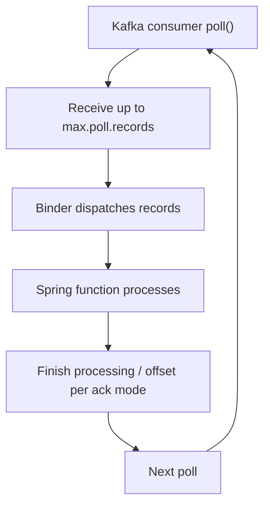
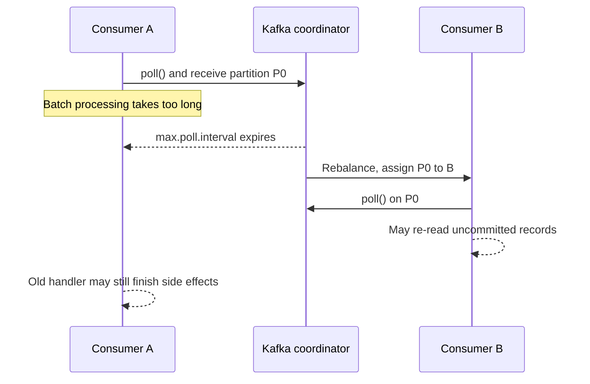

# max.poll.records, max.poll.interval.ms, and Processing Duration

A Kafka consumer must do more than just read records; it must also return to call `poll()` frequently enough to maintain progress within its consumer group. When an application takes a long time to process each record, a single poll can return many records whose combined processing duration exceeds the allowed window. Kafka may then consider the consumer stalled, trigger a rebalance, and reassign partitions to another member.

Two critical properties for controlling this behavior are `max.poll.records` and `max.poll.interval.ms`. The first caps how many records are returned in a single poll; the second caps the maximum elapsed time between two poll calls. In the Spring Cloud Stream Kafka binder, you pass these Kafka consumer properties through the binding's consumer configuration. Choosing the right values requires measuring actual processing time, calculating total duration of a poll cycle, and understanding offsets/acknowledgments.

## 1. Poll Lifecycle and Record Processing

A Kafka consumer fetches data via `poll()`. Each poll returns a set of records that may come from multiple partitions owned by the consumer. The application processes those records, then calls poll again to fetch new data and stay active in the group.

With the Spring Cloud Stream Kafka binder, the application typically declares a function bean. The binder creates a listener container, and the container manages the Kafka consumer—including the poll loop, message dispatch to the function, offset management, and consumer group coordination. In a typical handler, you do not call `KafkaConsumer.poll()` yourself; you configure the client through the binder and write message-processing logic.

Example consumer function:

```java
@Bean
Consumer<OrderCreated> processOrder(OrderService orderService) {
    return event -> orderService.handle(event);
}
```

Binding configuration:

```yaml
spring:
  cloud:
    function:
      definition: processOrder
    stream:
      bindings:
        processOrder-in-0:
          destination: orders.events
          group: order-worker
```

When records are read from the `orders.events` topic, the binder converts the payload to `OrderCreated` and invokes the function. If the handler processes synchronously, its processing duration affects when the listener container can finish the current batch and proceed to the next poll.

Simplified diagram:



What must be controlled is the time elapsed from one `poll()` call to the next `poll()` call. If that interval exceeds `max.poll.interval.ms`, the consumer risks eviction from the group and partition reassignment.

## 2. What Does max.poll.records Limit?

`max.poll.records` is the maximum number of records returned by a single `KafkaConsumer.poll()` call. The Kafka consumer defaults this value to **500**. You can lower it so each poll returns fewer records, reducing the amount of work that must complete before the next poll.

Examples:

- `max.poll.records = 500`: a poll can return up to 500 records.
- `max.poll.records = 100`: a poll can return up to 100 records.
- `max.poll.records = 20`: a poll can return up to 20 records.

This is a cap on the total records returned in one poll of one consumer, across all partitions assigned to that consumer. It is neither a per-partition record limit nor a limit across the entire consumer group.

### Not Equivalent to a Fetch Size Limit

`max.poll.records` does not directly limit how many bytes Kafka fetches from the broker. The consumer can fetch and buffer records in the background, then hand them out in chunks up to the cap on each poll. Properties such as `fetch.max.bytes` and `max.partition.fetch.bytes` govern fetched data sizes.

Therefore:

- Lowering `max.poll.records` reduces how many records the application must process in one poll cycle.
- It does not necessarily make the broker send fewer bytes immediately.
- If records are very large, also inspect fetch sizes, message limits, and memory.
- If handler duration varies widely, fewer records still do not guarantee short processing times.

### When to Lower max.poll.records?

Lower the value when:

- Individual records take a long or highly variable time to process.
- One poll returns enough records to push total handler duration over budget.
- Each record performs multiple synchronous I/O calls.
- Large batches increase memory usage, GC pauses, or shutdown times.
- You want to reduce how many records may be replayed on mid-batch failure, depending on ack mode and commit strategy.

Do not lower it too aggressively without measuring. Polling too frequently increases overhead, lowers throughput, and can make network/dispatch costs outweigh moderate batch processing.

## 3. What Does max.poll.interval.ms Limit?

`max.poll.interval.ms` is the maximum allowed delay between two `poll()` calls while the consumer participates in group management. Kafka's default is **300000 ms**, or **5 minutes**.

If the consumer fails to call `poll()` before this interval expires, Kafka deems the consumer stalled and initiates a group leave/rebalance so its partitions can be assigned to another member.

Example:

- Last poll occurred at 10:00:00.
- `max.poll.interval.ms = 300000`.
- The consumer must call poll again before roughly 5 minutes elapse.
- If a handler or batch runs longer than that window, the consumer can exceed the poll interval.

This value is not a timeout for a single database or HTTP request. It does not cancel a running handler or directly cap a single record's execution time. It monitors the consumer's poll progress within the group.

### When the Poll Interval Is Exceeded

A common scenario:

1. Consumer A receives a batch of records.
2. The handler runs slowly, hangs, or waits too long on a downstream service.
3. Consumer A fails to call poll again within `max.poll.interval.ms`.
4. Kafka decides A is no longer making group progress and triggers a rebalance.
5. Partitions are assigned to Consumer B.
6. B may re-read records whose offsets were not yet committed.

If A finishes side effects after its partitions were already reassigned to B, the same business operation may execute twice. A's offset commit may also fail because the group generation/assignment has changed. That is why idempotency and proper offset commit timing are essential.

With static membership using `group.instance.id`, behavior on poll-interval expiration differs: the consumer stops sending heartbeats and partitions may only be reassigned after `session.timeout.ms` expires rather than immediately. This is an advanced detail; never use static membership as a substitute for controlling processing duration.

## 4. Distinguishing max.poll.interval.ms from session.timeout.ms

Both properties relate to whether a consumer remains an active group member, but they monitor two distinct concerns.

| Property | What Does It Monitor? | Common Triggers |
|---|---|---|
| `max.poll.interval.ms` | Whether the consumer keeps calling `poll()` to make progress | Handler takes too long, batch too large, poll thread blocked |
| `session.timeout.ms` | Whether the broker still receives valid heartbeats | Process died, network partition, heartbeats cannot be sent |
| `heartbeat.interval.ms` | Heartbeat cadence in the classic group protocol | Configures session keepalive frequency |

A Kafka consumer can send background heartbeats while the application processes records, yet that does not waive the requirement to call `poll()` within the allowed window. Heartbeats prove liveness; the poll interval enforces forward progress in the processing loop.

Raising `session.timeout.ms` does not directly fix `max.poll.interval.ms` violations. Raising `max.poll.interval.ms` permits longer work, but also delays detecting a wedged consumer. Choose values aligned with actual processing duration and system recovery goals.

## 5. Calculating the Time Budget for One Poll Cycle

When processing synchronously and sequentially, you can estimate the duration of one poll cycle:

`T_cycle ≈ Σ(i = 1..N) T_process(i) + T_conversion + T_commit + T_overhead`

Where:

- (N) is the number of records returned in the poll, at most `max.poll.records`.
- (T_{process,i}) is the processing time of the (i)-th record.
- (T_{conversion}) is deserialization and payload conversion time.
- (T_{commit}) is offset commit time if commits happen within the processing cycle.
- (T_{overhead}) includes scheduling, GC, logging, and lock contention.

For safety, ensure cycle duration under peak load stays well below `max.poll.interval.ms`. Do not rely solely on mean duration; use p95/p99 or reasonable worst-case estimates and leave headroom for variance.

### Calculation Example

Suppose a consumer processes sequentially:

- `max.poll.records = 40`.
- p95 processing time per record is ~1.2 seconds.
- Conversion, commits, and headroom overhead ~12 seconds.

Estimate:

`T_cycle ≈ 40 × 1.2 + 12 = 60 seconds`

If `max.poll.interval.ms = 180000` (3 minutes), the estimated 60-second cycle leaves 120 seconds of headroom. However, if a downstream dependency can stall for 90 seconds or GC pauses spike, re-measure p99 and test that failure mode.

### Large Batch Example

Suppose `max.poll.records = 500`, and each record averages 0.8 seconds sequentially:

`500 × 0.8 = 400 seconds`

400 seconds exceeds the 300-second default before even counting conversion, commits, or GC. The consumer risks breaching the poll interval even though each individual record takes under a second.

If `max.poll.records` is reduced to 100:

`100 × 0.8 = 80 seconds`

A smaller batch brings the poll cycle back into a safe zone without inflating the poll interval excessively. This is only an estimate; measure real duration on a representative workload.

## 6. Configuring in the Spring Cloud Stream Kafka Binder

The Kafka binder lets you pass binding-level Kafka consumer properties under:

```text
spring.cloud.stream.kafka.bindings.<bindingName>.consumer.configuration
```

Example setting `max.poll.records` and `max.poll.interval.ms` for binding `processOrder-in-0`:

```yaml
spring:
  cloud:
    function:
      definition: processOrder
    stream:
      bindings:
        processOrder-in-0:
          destination: orders.events
          group: order-worker
          consumer:
            concurrency: 3
      kafka:
        bindings:
          processOrder-in-0:
            consumer:
              configuration:
                "max.poll.records": 40
                "max.poll.interval.ms": 180000
                "session.timeout.ms": 45000
                "heartbeat.interval.ms": 15000
```

Explanation:

- `processOrder-in-0` is the input function's binding name.
- `destination` is the Kafka topic.
- `group` is the consumer group ID.
- `consumer.concurrency` is the number of consumer threads/containers for the binding per application instance.
- `configuration` holds Kafka consumer properties forwarded to the Kafka client.
- `max.poll.records` caps records per poll.
- `max.poll.interval.ms` sets the maximum time between two polls.
- `session.timeout.ms` and `heartbeat.interval.ms` govern group-protocol sessions and heartbeats.

Placing properties on the specific binding prevents accidentally applying one slow consumer's limits to other consumers. The Kafka binder also supports binder-level consumer defaults for shared settings; use the exact prefix documented by your binder version.

### Per-Profile Configuration

Different values can be set per environment:

```yaml
# application-dev.yml
spring:
  cloud:
    stream:
      kafka:
        bindings:
          processOrder-in-0:
            consumer:
              configuration:
                "max.poll.records": 20
                "max.poll.interval.ms": 180000
```

```yaml
# application-prod.yml
spring:
  cloud:
    stream:
      kafka:
        bindings:
          processOrder-in-0:
            consumer:
              configuration:
                "max.poll.records": 40
                "max.poll.interval.ms": 240000
```

Do not raise production values merely to mask a stalled handler. Measure real processing duration under production-like load and align settings with SLAs.

## 7. max.poll.records, Batch Mode, and Concurrency

These three concepts are related but do not replace one another:

- `max.poll.records`: maximum records returned in one poll per Kafka consumer.
- Batch mode: how the binder delivers polled records to the function, optionally passing the whole batch in one handler call.
- `concurrency`: number of consumer threads/containers for a binding per application instance.

### Record Mode

In normal mode, the function receives one payload at a time. The Kafka consumer still polls a batch of records; the listener container dispatches them as configured. Under synchronous processing, the total time to process all records in that cycle still governs when the next poll occurs.

### Batch Mode

When batch mode is enabled, the function can receive a list of records in a single call:

```java
@Bean
Consumer<List<OrderCreated>> processOrderBatch(OrderService service) {
    return events -> service.handleBatch(events);
}
```

Batch mode configuration belongs to the core consumer binding:

```yaml
spring:
  cloud:
    stream:
      bindings:
        processOrder-in-0:
          consumer:
            batch-mode: true
```

When batch mode is enabled, verify the function signature and how the binder converts payloads. A batch can contain records from multiple partitions assigned to that consumer. The entire batch's processing time—not just per-record time—must fit within the poll interval budget.

### Concurrency and Partition Count

Each consumer member runs its own poll loop. Increasing concurrency spreads partitions across more consumer members and reduces how many partitions/records each member handles, though total useful consumers in a group remains bounded by partition count.

Example for a 12-partition topic:

- One instance, concurrency 1: one consumer member may receive all 12 partitions.
- Three instances, concurrency 2: up to 6 members in the group, roughly 2 partitions per member.
- Six instances, concurrency 2: up to 12 members, able to utilize all 12 partitions.
- Eight instances, concurrency 2: 16 members, leaving at least 4 members with no partitions.

Increasing concurrency can reduce per-consumer load, but also increases threads, connections, and resource usage. Check CPU, database connection pools, and downstream limits before scaling up.

## 8. Offset Commits and Processing Duration

`max.poll.records` does not determine when offsets are committed. Offset commits are managed by the Kafka consumer and Spring Kafka / Kafka binder acknowledgment mechanisms.

The Spring Cloud Stream Kafka binder provides `ackMode` to choose the commit mode. Modes such as record or batch decide whether offsets are acknowledged after each record or after a processing group. With manual acknowledgment, the application must acknowledge only after reaching its defined completion condition.

A core principle:

**Never commit an offset before the protected side effect has completed.**

If the application commits the offset and then writes to the database, a crash can prevent Kafka from redelivering the record even though the database was never updated. If the database write succeeds and the process crashes before committing, the record may be redelivered; therefore handlers must be idempotent.

### When a Batch Contains a Failing Record

Suppose a poll returns 40 records and the 27th record fails. Depending on `ackMode`, the error handler, and commit strategy, earlier records may already be committed or the entire batch may be replayed. Verify actual configuration rather than inferring behavior from `max.poll.records`.

When using batch mode, clarify:

- Does one failing record fail the entire batch?
- Up to which position are offsets committed?
- Can previously succeeded records be redelivered?
- Are DLQ/retry and recovery mechanisms enabled?
- Can the handler tolerate duplicates safely?

## 9. What Happens When Processing Exceeds the Poll Interval?

A consumer exceeding `max.poll.interval.ms` can trigger a rebalance. A rebalance is not just a warning log; it shifts partition ownership and can impact throughput across the entire group.

Common symptoms:

- Logs reporting the consumer failed to poll within the allowed interval.
- Frequent group rebalances.
- Partitions revoked and reassigned.
- Offset commit failures or group generation errors.
- Consumer lag rising even when CPU is not at 100%.
- Records redelivered and side effects at risk of duplication.

### Example Timeline



If A continues running its handler after losing partition ownership, A and B can execute the same business operation concurrently. Use event IDs, unique constraints, inbox tables, or idempotency keys to protect side effects.

## 10. Strategies When Records Take a Long Time

There is no single fix. Choose a solution based on root cause and ordering needs.

### Lower max.poll.records

This is usually the first step when one poll returns too many records. Shrinking batch size lowers synchronous work between two polls. Measure throughput after reducing to avoid excessive overhead.

### Increase max.poll.interval.ms

Raise the poll interval if the work genuinely requires longer execution within predictable bounds. For example, if a batch can take 6 minutes, setting a 10-minute interval provides headroom. Weigh the trade-off against slower detection of wedged consumers and delayed rebalances.

Do not set an enormous value to hide deadlocks or dependencies lacking timeouts. If a handler hangs indefinitely, a huge poll interval merely delays detection.

### Optimize the Handler

- Eliminate repetitive database queries.
- Use batch inserts/updates where appropriate.
- Avoid sequential HTTP calls when batching or caching is possible.
- Set explicit downstream timeouts.
- Reduce unnecessary serialization/deserialization.
- Eliminate lock contention and GC pressure.
- Measure p95/p99 by event type instead of only average latency.

### Increase Concurrency or Scale Instances

If the topic has enough partitions, increasing concurrency or instance count spreads load across more consumer members. Each consumer handles fewer partitions, subject to partition count limits and downstream capacity.

If the partition count is already below the desired consumer count, adding instances will not increase useful parallelism. If a hot partition is dominated by one key, adding consumers still cannot split one partition across multiple members in the same group.

### Controlled Offloading of Long Work

You can consume a record, persist a durable job into a work queue/database, and let another worker process it. However, never commit the offset immediately after pushing into an in-memory non-durable queue. Hand-offs must have explicit durability and idempotency.

If processing asynchronously:

- Use a bounded executor, never an unbounded queue.
- Acknowledge/commit only after work reaches its committed completion condition.
- Preserve per-key ordering if business logic requires it.
- Monitor worker backlog and queue wait times.
- Handle shutdown gracefully so unacknowledged work is not abandoned.

## 11. Sizing Poll Interval and Batch Size to the Workload

A practical workflow:

1. Measure per-record processing time by event type.
2. Measure the distribution of records returned per poll.
3. Measure full poll-cycle duration under high load.
4. Identify p95/p99 and slow-downstream scenarios.
5. Choose `max.poll.records` so total batch time fits within budget.
6. Set `max.poll.interval.ms` well above a reasonable worst-case cycle time.
7. Run load tests and controlled fault injection to observe rebalances.
8. Monitor consumer lag, rebalances, and duplicates post-deployment.

Hypothetical example:

| Metric | Value |
|---|---:|
| p99 processing time per record | 1.5 seconds |
| `max.poll.records` | 50 |
| Estimated sequential processing | 75 seconds |
| Conversion/commit/GC headroom | 30 seconds |
| Expected total budget | 105 seconds |
| `max.poll.interval.ms` | 240000 (4 minutes) |

In this example, 105 seconds sits well under 240 seconds with headroom. Validate with load tests because per-record p99 does not simply add up linearly for a batch; tail latencies can compound or correlate when downstream slows down.

## 12. Monitoring and Diagnostics

To understand why a consumer approaches or exceeds the poll interval, track:

- Time between polls when observable via listener/container instrumentation.
- Number of records returned per poll.
- Processing time per record and per batch.
- p50, p95, p99, and max latency.
- Consumer lag by topic, partition, and group.
- Rebalance count and rebalance duration.
- Commit latency and commit failures.
- Retry counts, DLQ counts, and redeliveries.
- CPU, heap, GC pauses, and thread pool saturation.
- Database/HTTP latency and connection pool utilization.

Signals that distinguish root causes:

| Symptom | Likely Area to Investigate |
|---|---|
| Poll interval exceeded, high CPU | CPU-bound work, large batch, or heavy serialization |
| Poll interval exceeded, low CPU | Handler blocked waiting on DB/HTTP, locks, or long timeouts |
| Lag growing on only a few partitions | Hot partition or a slow record type |
| Repeated rebalances under rising load | Poll cycle exceeding limits or consumer restarts |
| Commit fails after long processing | Partition ownership / group generation changed |
| Duplicates spike after rebalance | Non-idempotent side effects or improper commit timing |

Do not just raise `max.poll.interval.ms` when you see rebalances. First determine whether time is being spent in the handler, commits, GC, or waiting on dependencies.

## 13. Testing max.poll.records and max.poll.interval.ms

Unit tests can measure handler time and verify logic, but cannot prove group rebalance behavior. Write integration tests against real Kafka or containerized brokers matching your runtime environment.

### Testing Batch Size

- Produce more records than `max.poll.records`.
- Observe how many records are returned in each poll/batch.
- Verify remaining records are fetched on subsequent polls.
- Test varying payload sizes.
- Benchmark throughput across 10, 50, 100, and 500.

### Testing Poll Interval

- Configure a small poll interval in the test environment.
- Introduce a controlled handler delay longer than the interval.
- Run at least two consumers in the same group.
- Observe partition revoke/assign and rebalance events.
- Verify uncommitted records are re-read according to binder semantics.
- Verify side effects are not duplicated thanks to idempotency.

Do not rely on arbitrary `sleep` calls as the sole test mechanism. Use latches or controllable dependencies to create deterministic delays, then inspect group state and processing outcomes.

### Testing Offsets and Acknowledgments

- Verify offsets commit after the handler finishes per `ackMode`.
- Fail the handler before commit and verify redelivery.
- Crash the process after side effects but before commit and verify idempotency.
- Test a batch with a failing record in the middle.
- Test retry/DLQ and offset recovery.

## 14. Common Configuration Pitfalls

**Only raising `max.poll.interval.ms`.** This can mask slow or hung handlers. Measure and shrink batches or optimize handlers first.

**Setting `max.poll.records` too high.** Batches can take longer to process than the poll interval, especially when each record makes synchronous downstream calls.

**Confusing `max.poll.records` with fetch size.** Limiting returned records does not limit fetched bytes or broker/client memory directly.

**Scaling concurrency past partition count.** Excess consumer members receive no partitions and do not improve throughput.

**Using unbounded thread pools.** The poll loop appears to keep running while memory queues grow without bound and offsets may commit before workers finish.

**Committing offsets too early.** If side effects are not yet durable, a crash can lose work.

**Lacking idempotency.** Rebalances or retries can redeliver records and repeat side effects.

**Omitting downstream timeouts.** A single hung request can block a listener thread past the poll interval.

**Neglecting batch mode differences.** Function signatures, records per poll, and offset commit mechanics change between batch and record modes.

## 15. Pre-Deployment Checklist

- Understood that `max.poll.records` limits records returned per poll, not fetched bytes.
- Understood that `max.poll.interval.ms` caps time between two polls.
- Distinguished poll interval from session timeout and heartbeat interval.
- Measured p95/p99 processing time and poll-cycle duration.
- Chosen a batch size suited to reasonable worst-case processing time.
- Poll interval includes headroom for conversion, commits, GC, and downstream jitter.
- Kafka consumer properties placed on the right binding via the Kafka binder.
- Concurrency aligned with partition count and resources.
- Batch mode and function signatures verified.
- Ack mode / offset commits only acknowledge after committed work succeeds.
- Handler is idempotent to tolerate redeliveries.
- Downstream calls have explicit timeouts and bounded retries.
- Worker pools are bounded with backpressure if processing asynchronously.
- Integration tests observe rebalances and offsets under slow handlers.
- Dashboards track poll-cycle latency, consumer lag, rebalances, commit failures, and processing latency.

`max.poll.records` and `max.poll.interval.ms` must be tuned together. Batch size determines how many records a single poll can deliver; poll interval determines how long the consumer has to finish work before polling again. Use p95/p99 measurements, bound work per cycle, manage offsets after successful processing, and test rebalancing. With Spring Cloud Stream, the Kafka binder configures Kafka client properties per binding, while ultimate correctness depends on how your function handles messages, acknowledgments, and idempotency.

## References

- [Apache Kafka — Consumer Configs](https://kafka.apache.org/41/configuration/consumer-configs/)
- [Spring Cloud Stream Kafka Binder — Configuration Options](https://docs.spring.io/spring-cloud-stream/reference/kafka/kafka-binder/config-options.html)
- [Spring Cloud Stream — Binding Properties](https://docs.spring.io/spring-cloud-stream/reference/spring-cloud-stream/binding-properties.html)
- [Spring for Apache Kafka — Message Listener Containers](https://docs.spring.io/spring-kafka/reference/kafka/receiving-messages/message-listener-container.html)
