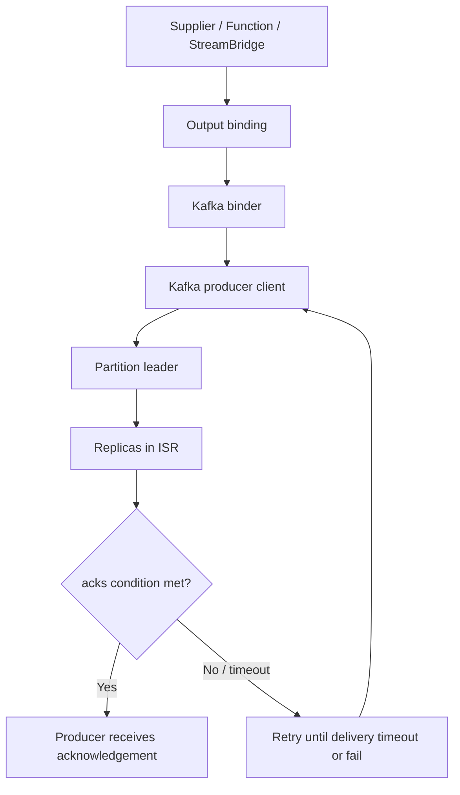
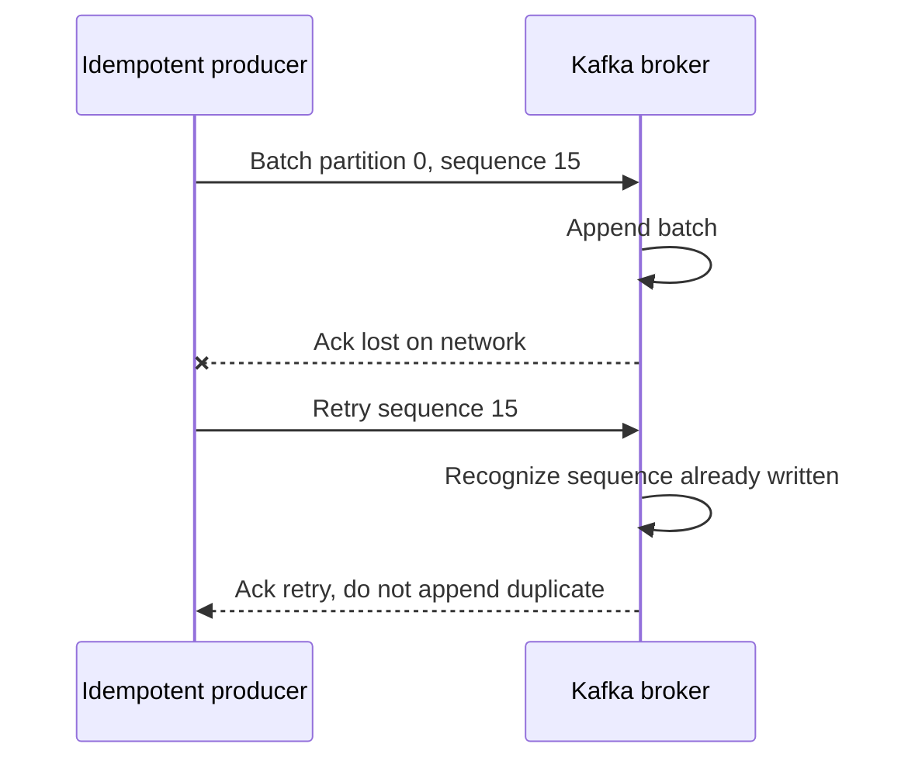

# acks, retries, Idempotence, and Producer Guarantee Limits

## 1. What does the producer need to guarantee?

When an application sends a message to Kafka, the producer does more than push bytes to a broker. It must also handle request timeouts, broker leader changes, slow replicas, or lost acknowledgment responses. A send can succeed on the broker while the producer never receives the response; if the application resends, the record may be written twice unless the producer mechanism recognizes that retry.

A Kafka producer has three key configuration groups:

- **`acks`:** the level of acknowledgment the producer requires from the broker before considering a send confirmed.
- **`retries` and timeouts:** how the producer retries on transient send failures and the time limit for a send attempt.
- **Idempotence:** the broker's ability to recognize and deduplicate retries from the same producer session.

These properties work alongside replication factor, `min.insync.replicas`, leader election settings, and how the application handles errors. They improve publishing reliability, but they do not by themselves guarantee that the entire business operation executes exactly once.

## 2. Kafka producer send flow

With Spring Cloud Stream, application code sends messages through an output binding. The Kafka binder converts the message into a Kafka record, invokes the producer client, and handles the result according to binder configuration.



The producer selects a partition based on the record key or partitioning strategy, sends the record to the partition leader, and waits for the configured acknowledgment level. With `acks=all`, the leader waits for the replicas currently in the ISR (in-sync replicas) to acknowledge according to the replication protocol before returning success.

The binder manages the connection and producer configuration; the `acks`, `retries`, and `enable.idempotence` properties belong to the Kafka producer client. When you need to control them, use the Kafka binder configuration for the output binding rather than confusing them with generic Spring Cloud Stream properties.

## 3. Understanding the three acks levels

`acks` specifies how many acknowledgments the producer requires from the broker:

| Value | Behavior | Trade-off |
|---|---|---|
| `0` | Producer does not wait for broker acknowledgment | Low latency, but no way to know whether the broker received the record; data loss is possible |
| `1` | Leader acknowledges after writing the record to its local log | Faster than `all`, but the leader may fail before other replicas receive the record |
| `all` or `-1` | Leader waits for replicas currently in the ISR to acknowledge per the replication protocol | Higher durability, but can increase latency and reject writes if ISR is insufficient |

`acks=all` does not mean every replica configured for the partition—including offline or out-of-sync replicas—has acknowledged. It means the replicas currently in the ISR participate in acknowledgment. Therefore, pair `acks=all` with an appropriate replication factor and `min.insync.replicas`.

### Replication factor 3 example

Suppose a topic has replication factor 3 and `min.insync.replicas=2`:

- While the leader and at least one follower stay in sync, the ISR has at least two replicas; a producer using `acks=all` can continue writing.
- If the ISR drops to one replica, the broker rejects writes with an error related to insufficient in-sync replicas.
- Once a replica recovers and catches up with the leader, the ISR can grow again and the producer resumes writing.

Rejecting writes when the ISR is too small is part of the durability protection policy: the system chooses to report an error rather than confirm a record with only one copy when the minimum requirement is two.

## 4. Combining acks with min.insync.replicas

`min.insync.replicas` is a broker/topic-side configuration, not a producer property. When a producer sets `acks=all`, the broker requires the number of replicas in the ISR to be at least this value before accepting a write.

Example topic configuration:

```bash
kafka-topics.sh \
  --bootstrap-server localhost:9092 \
  --create \
  --topic orders.events \
  --partitions 12 \
  --replication-factor 3 \
  --config min.insync.replicas=2
```

For an existing topic, you can update the topic configuration using the command appropriate for your Kafka version, such as `kafka-configs.sh --alter`. Check administrative permissions and record the current configuration before making changes.

### Selection matrix

| Producer acks | min.insync.replicas | Behavior and notes |
|---|---:|---|
| `1` | `2` | `min.insync.replicas` does not provide the same guarantee as `acks=all`; the leader ack can return before followers meet confirmation requirements |
| `all` | `1` | Waits for the entire current ISR, but can still write when only one replica remains in the ISR |
| `all` | `2` | Requires at least two replicas in the ISR; suitable when you want to reject writes if replication degrades below the threshold |
| `all` | `3` | Requires all three replicas in the ISR; higher configured durability but write availability drops if any single replica falls out of sync |

No single pair of values fits every system. Choose thresholds based on acceptable data loss tolerance, broker count, rack/zone topology, and application availability requirements.

## 5. Retries: retrying on transient errors

Producers can encounter transient errors such as:

- Recent broker leader transition.
- Request timeout or lost acknowledgment response.
- Intermittent network issues.
- Replicas temporarily lagging behind the leader.
- Temporary broker rejection due to overload or resource limits.

`retries` specifies how many times the producer retries when encountering a retriable error. Without retries, even a brief network blip can cause a publish to fail immediately. If retries run for too long, the application may hold messages in buffers and increase latency.

Modern Kafka producers typically combine retries with `delivery.timeout.ms`. This property bounds the total time the producer allows for a record to be sent successfully, including batch waiting, requests, and retries. Thus, simply increasing `retries` does not mean the producer will retry indefinitely in practice; once the delivery timeout expires, the send fails.

### Related timeouts

| Property | Role |
|---|---|
| `request.timeout.ms` | Time to wait for a response to a single request to the broker |
| `delivery.timeout.ms` | Maximum total time for a record to be sent successfully or fail |
| `linger.ms` | Time the producer waits to accumulate more records into a batch before sending |
| `retry.backoff.ms` | Pause between retry attempts in versions that support this property |

`delivery.timeout.ms` must be compatible with `request.timeout.ms` and `linger.ms` according to Kafka client rules. Check the configuration rules of the Kafka client version pulled in by the binder; avoid setting timeouts overly large without accounting for upstream HTTP request or task timeouts.

## 6. Idempotent producer prevents duplicates from retries

When a producer sends a record, the broker may write the record successfully while the acknowledgment response is lost on the return path. The producer sees a timeout and does not know whether the broker wrote it. If it resends, the broker could append a duplicate copy.

An idempotent producer uses a producer ID and per-partition sequence numbers so the broker can recognize retries of the same batch from the same producer session. If the batch was already written but the response was lost, the retry carrying the same sequence number is recognized as a resend, preventing duplicate appends from that retry.



Idempotence protects against protocol-level retries within the same producer session. It does not automatically deduplicate when the application calls `send` twice for the same business event in two independent sends, when the application restarts and regenerates the event, or when a consumer reprocesses a record.

### Configuring idempotence

The Kafka producer properties are:

```properties
enable.idempotence=true
acks=all
retries=2147483647
max.in.flight.requests.per.connection=5
```

In modern Kafka clients, idempotence is enabled by default in many versions provided related properties do not conflict. However, declaring it explicitly in production configuration makes intent clear and prevents accidentally disabling it when changing other properties. Always verify defaults for your Kafka client version.

When idempotence is enabled, Kafka requires compatible settings: `acks=all`, `retries` greater than 0, and `max.in.flight.requests.per.connection` not exceeding the supported limit (5 in modern Kafka versions). If settings conflict, the client may refuse to initialize or adjust automatically depending on the version; do not rely on implicit behavior.

## 7. Configuring the Kafka producer via Spring Cloud Stream

The Spring Cloud Stream Kafka binder lets you set Kafka producer properties per binding. Example of a function publishing order events:

```java
import java.util.function.Function;
import org.springframework.context.annotation.Bean;
import org.springframework.context.annotation.Configuration;

record OrderCreated(String eventId, String orderId, long totalCents) {}
record OrderAccepted(String eventId, String orderId, String status) {}

@Configuration
class OrderProducerFunctions {

    @Bean
    Function<OrderCreated, OrderAccepted> publishOrder() {
        return event -> new OrderAccepted(
            event.eventId(), event.orderId(), "ACCEPTED"
        );
    }
}
```

Binding and producer configuration:

```yaml
spring:
  cloud:
    function:
      definition: publishOrder
    stream:
      bindings:
        publishOrder-out-0:
          destination: orders.accepted
          content-type: application/json
      kafka:
        binder:
          brokers: localhost:9092
        bindings:
          publishOrder-out-0:
            producer:
              configuration:
                acks: all
                enable.idempotence: true
                retries: 2147483647
                max.in.flight.requests.per.connection: 5
                request.timeout.ms: 30000
                delivery.timeout.ms: 120000
```

Properties under `spring.cloud.stream.kafka.bindings.<bindingName>.producer.configuration` are passed to the Kafka producer client as supported by the binder version. Client property names use exact Kafka format, including keys with dots. If the application configures multiple output bindings, you can set separate policies for each binding.

Do not confuse `spring.cloud.stream.bindings.<name>.producer` with `spring.cloud.stream.kafka.bindings.<name>.producer`: the first group contains generic Spring Cloud Stream producer properties, while the latter contains Kafka binder-specific properties.

## 8. Synchronous and asynchronous send configuration

The Kafka producer client sends asynchronously by default: a send call places the record in a buffer and a callback/future receives the result when the broker responds. This increases throughput and enables batching.

The Kafka binder has the producer `sync` property to request synchronous sending as supported by the binder:

```yaml
spring:
  cloud:
    stream:
      kafka:
        bindings:
          publishOrder-out-0:
            producer:
              sync: true
              configuration:
                acks: all
                enable.idempotence: true
```

With `sync: true`, the sending thread waits for the producer result according to how the binder implements it; send failures can be rethrown on the calling thread instead of appearing only through an asynchronous callback. This increases latency and can reduce throughput. Verify property names, timeouts, and semantics in the Kafka binder version in use.

If using asynchronous sends, ensure you have an appropriate way to observe callback errors or the producer error channel. Do not treat a function returning or `StreamBridge.send` returning `true` as proof that the broker has acknowledged the record, unless synchronous sending is configured and the API in use explicitly defines that guarantee.

## 9. How do acks, retries, and idempotence work together?

The three properties address different questions:

| Property | Question answered |
|---|---|
| `acks` | What level of confirmation must the broker provide before the producer treats it as success? |
| `retries` | How many times does the producer retry transient errors within the delivery timeout? |
| `enable.idempotence` | Can the broker recognize retries of the same batch to avoid duplicate writes? |

A commonly used configuration for critical events:

- `acks=all` to wait for ISR acknowledgment.
- Topic replication factor 3 and `min.insync.replicas=2` to require at least two in-sync replicas.
- `enable.idempotence=true` to guard against duplicates caused by retries within a producer session.
- Sufficiently large `retries` and `delivery.timeout.ms` chosen according to SLOs.
- `max.in.flight.requests.per.connection` within the idempotent producer limit.

This is a starting point, not a mandatory set of values for every workload. The producer can report an error when the ISR is insufficient; the application must decide whether to return an error to the caller, store in an outbox, or retry at a higher layer.

## 10. Limits of an idempotent producer

Kafka producer idempotence does not mean every business event exists only once under all circumstances. The following scenarios can still produce duplicates:

1. A controller receives the same request twice and triggers two independent publish calls.
2. The application restarts, re-reads source data, and re-emits the same event under a new producer session.
3. An outbox relay publishes successfully but stops before marking the record as sent.
4. A consumer updates the database but stops before committing the offset; the broker redelivers the record.
5. Two different services both emit the same logical event because there is no shared idempotency key.

To prevent duplicates at the business layer, use a stable event ID and an idempotency mechanism at the consumer or target API. Producer idempotence and consumer idempotency protect two different boundaries.

## 11. Limits of acks=all and replication

`acks=all` raises the acknowledgment bar, but it is not an unbreakable guarantee against data loss. Several limits must be understood:

- The ISR can shrink when replicas become slow or lose connectivity.
- If `min.insync.replicas` is set too low, `acks=all` can still accept writes with fewer copies than desired.
- If unclean leader election allows an out-of-ISR replica to become leader, records not yet received by that replica can be lost.
- Simultaneous multi-broker failures, disk failures, network partitions, or administrative operations can exceed normal replication assumptions.
- Retention or compaction can remove data according to policy after records were successfully written.

For critical topics, evaluate replication factor, `min.insync.replicas`, rack awareness, `unclean.leader.election.enable`, storage durability, cross-region backup/replication, and recovery procedures. Producer configuration is only one part of durability design.

## 12. Producer acknowledgement is not consumer acknowledgement

When a producer receives an ack from Kafka with `acks=all`, that states the broker accepted the record under the replication policy. It does not state that a consumer has read, processed, or committed the offset.

Different milestones:

| Milestone | Meaning |
|---|---|
| `send()` is called | Application initiates sending the record |
| Record enters producer buffer | Client has accepted the record for send processing |
| Producer receives broker ack | Broker confirms according to `acks` and replication state |
| Consumer reads record | Consumer group has fetched the record |
| Consumer finishes processing | Application logic has completed side effects |
| Consumer commits offset | Group progress is recorded to resume after restart |

Do not infer a later milestone from an earlier one. If business logic needs confirmation that the consumer finished, it requires a separate business response/ack event or an application-level processing state mechanism.

## 13. Producer transactions and end-to-end limits

Kafka transactions can group multiple output records and input offsets into a single Kafka transaction when the application/binder is configured for a supported consume-transform-produce model. Such transactions extend guarantees within Kafka's scope.

They do not automatically include:

- PostgreSQL/MySQL database commits.
- External REST API or payment calls.
- Sending email, SMS, or push notifications.
- Publishing to RabbitMQ or Pulsar.
- Side effects in another service.

If you need to tie database updates to emitted events, consider the transactional outbox pattern. The outbox writes business data and the record to be published within the same database transaction; a relay keeps sending until complete. Because the relay can publish redundantly after a crash, consumers still need idempotency keyed by event ID.

## 14. Handling producer errors in the application

When a producer cannot send within the allowed time, errors can surface in a callback, future, binder error channel, or directly on the calling thread if sending synchronously. The application must distinguish transient errors from configuration/data errors:

| Error | Handling approach |
|---|---|
| Timeout, leader change, transient network issue | Let the producer retry within delivery timeout; then handle the failure at the application layer |
| NotEnoughReplicas | Check ISR, broker health, and `min.insync.replicas`; do not lower thresholds arbitrarily |
| Record too large | Check message size limits on producer, broker, and consumer; do not retry indefinitely as-is |
| Serialization failure | Fix schema/serializer or route malformed data to a separate handling path |
| Authorization failure | Check ACLs/credentials; retrying will not fix missing permissions |

If using `StreamBridge`, the boolean result reflects whether the send was accepted at the API level. To handle specific broker errors, configure and observe the Kafka binder's producer error handling. In HTTP flows, do not return success to the caller if the application has not achieved the acknowledgment level promised by the API.

Do not stack retries across multiple layers without calculating the total attempt count. The producer has internal retries; the service might retry `send`; an HTTP client might retry requests; the caller might also resend. Stacked retries can create traffic spikes and duplicates. Pick one primary retry owner, configure backoff/jitter, and use idempotency keys.

## 15. Testing producer reliability

Testing should cover both happy paths and failure scenarios:

1. Verify the binding uses the intended Kafka cluster and destination.
2. Check record key, payload, headers, and serializer.
3. Stop a broker to observe leader election and retries.
4. Drop ISR below `min.insync.replicas` to confirm the producer receives an error instead of writing with fewer replicas than required.
5. Drop the ack response after the broker writes to test idempotent retries.
6. Resend the same event from the application via two independent calls to confirm producer idempotence does not replace business deduplication.
7. Test delivery timeout, callback/error channel, and how the application responds when sending fails.
8. Test producer restarts, transaction fencing, and ACL permissions.

The Test Binder can verify function logic and bindings at the Spring Cloud Stream level. Tests for ISR, leader election, idempotent sequences, and broker acknowledgments require real Kafka or an appropriate integration environment.

## 16. Observing producers in production

Monitor producer and broker metrics to catch errors before they turn into backlogs:

- Record send rate and byte rate.
- Request latency, record retry rate, and error rate.
- Record queue time and batch size.
- Request timeouts, delivery timeouts, and producer buffer availability.
- Count of NotEnoughReplicas errors or authorization errors.
- ISR shrink/expand events, under-replicated partitions, and offline partitions.
- Error rate on the producer error channel and count of outbox messages pending publish.

Logs should include binding name, topic, partition, event ID, and correlation ID. Do not log sensitive payloads or credentials. Alert when retries remain elevated, buffers deplete, delivery timeouts increase, or ISR degrades.

## 17. Producer configuration selection workflow

1. Determine acceptable data loss and latency SLOs.
2. Choose replication factor and `min.insync.replicas` for the topic.
3. Choose `acks` accordingly; for critical events, `all` is typically considered.
4. Enable idempotent producer and keep compatible properties.
5. Set retries, request timeout, and delivery timeout based on expected recovery times.
6. Configure Kafka producer properties accurately under the Kafka binder's binding section.
7. Decide between synchronous and asynchronous sending and design error observation paths.
8. Use event IDs and consumer idempotency to protect business logic from duplicate sends/deliveries.
9. Test broker failures, ISR shrinks, timeouts, restarts, and duplicates in an integration environment.
10. Monitor producer metrics, ISR, and backlog after deployment.

`acks`, `retries`, and idempotence form the foundation of a reliable Kafka producer: `acks` determines the confirmation level, retries help ride out transient errors, and idempotence prevents duplicates from retries within the same producer session. This guarantee remains within the producer-and-broker boundary. Protecting the entire business workflow still requires proper replication, send error handling, stable event IDs, idempotent consumers, and outbox/inbox patterns at database boundaries.
