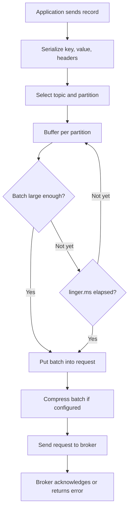

# Batching, Linger, Compression, and Record Size

A Kafka producer does not have to send every record as a separate request. The client groups records belonging to the same partition into a batch, waits until the batch is large enough or the wait time expires, and then sends it to the broker. The `batch.size`, `linger.ms`, and `compression.type` settings determine how records are batched, when they are sent, and how data is compressed. Size limits such as `max.request.size` on the producer and `message.max.bytes`/`max.message.bytes` on the broker determine which requests or record batches are accepted.

In Spring Cloud Stream, the Kafka Binder creates and configures the underlying Kafka producer. You can pass native producer properties through each output binding's configuration. Tuning should be based on actual traffic, partition count, payload size, and latency requirements. Increasing batch size or linger can improve throughput and compression ratio, but it can also make messages wait longer before being sent.

## 1. How does the Kafka producer group records into batches?

The producer serializes key, value, and headers into a record, then places the record into a buffer organized by target partition. Each partition has its own batch. When a batch reaches its target size, or when the wait time expires, the producer sends ready batches in a request to the broker.



Batching is an internal Kafka producer behavior. The application can still call `StreamBridge.send(...)` or emit individual items from a `Supplier`; the producer groups records per partition automatically. This is neither merging multiple payloads into a single business object nor consumer-side `batch-mode`.

Because batches are organized per partition, records with the same key are typically routed to the same partition by the active partitioner. If traffic is spread evenly across many partitions while each partition receives few records, many batches may remain partial and get sent when `linger.ms` expires. If one partition receives most of the traffic, that partition's batch can fill quickly while other partitions remain sparse.

## 2. `batch.size`: target batch size

`batch.size` is the target number of bytes the producer allocates for a single record batch per partition. When a batch nears this limit, the producer can send it without waiting for `linger.ms` to expire.

Example configuration increasing the target batch size to 64 KiB:

```yaml
spring:
  cloud:
    stream:
      bindings:
        orders-out-0:
          destination: orders.created
          content-type: application/json
      kafka:
        bindings:
          orders-out-0:
            producer:
              configuration:
                batch.size: 65536
```

`65536` is in bytes, equivalent to 64 KiB. This is a native Kafka producer configuration applied to the `orders-out-0` output binding. The binding name must match the application's actual binding.

Several points to keep in mind:

- `batch.size` is a target batch capacity, not a requirement that the producer wait until that many bytes accumulate before sending.
- An incomplete batch can still be sent when `linger.ms` expires, when the application calls `flush()`, or when the producer closes during lifecycle shutdown.
- A single record larger than `batch.size` can still be placed in its own batch large enough to hold that record; `batch.size` is not a hard limit on individual record size.
- The producer may need memory for multiple batches simultaneously, especially when many partitions are active.

Increasing `batch.size` can reduce request count and improve compression efficiency when there is sufficient traffic per partition. In return, buffer memory usage can increase and some records may wait longer for a batch to form. Do not raise this value simply assuming "larger batches are always better"; measure actual batch sizes and batch utilization.

## 3. `linger.ms`: wait time to accumulate more records

`linger.ms` sets how long the producer can wait to accumulate additional records into a batch before sending a partial batch. The value is measured in milliseconds.

Example setting a 10 ms linger:

```yaml
spring:
  cloud:
    stream:
      kafka:
        bindings:
          orders-out-0:
            producer:
              configuration:
                linger.ms: 10
```

This value introduces an intentional maximum wait window for partial batches, though it does not mean every record is held for exactly 10 ms. A batch can fill up and be sent earlier. High load usually fills batches quickly; low load can cause the producer to wait nearly the full linger duration before sending a small batch.

### 3.1. Latency vs. throughput trade-offs

| Setting | Typical benefit | Cost or risk |
|---|---|---|
| Low `linger.ms` | Records are sent sooner when traffic is sparse | Batches may be small, more requests, and lower compression efficiency |
| Higher `linger.ms` | More opportunity to group records, lower request rate, and higher compression ratio | Increases wait time before sending, especially on low-traffic partitions |
| Small `batch.size` | Bounds memory per batch, fits certain small/low-latency streams | Batches fill quickly and can increase request count |
| Large `batch.size` | Allows larger batches when traffic is sufficient | Increases memory demand; if traffic is sparse, batches may still send on linger expiry without filling |

Do not add `linger.ms` to every request latency as an exact constant. Actual latency also depends on whether the batch filled, producer buffers, scheduling, network, broker load, and send acknowledgments. Measure end-to-end p50, p95, and p99 under representative load.

## 4. `compression.type`: compressing batches before sending

The Kafka producer compresses record batches before sending them to the broker. Compression can reduce network traffic and storage usage, and is particularly effective when batches contain records with repeated structures or content.

Common codecs:

| Codec | General characteristics | When to consider |
|---|---|---|
| `none` | No compression | Payloads are already compressed, records are tiny, or CPU must be reserved for other work |
| `gzip` | Usually yields high compression ratios at higher CPU cost | Network or storage is the bottleneck and CPU overhead is acceptable |
| `snappy` | Fast compression/decompression, moderate compression ratio | Need bandwidth reduction with relatively low CPU cost |
| `lz4` | Generally prioritizes compression/decompression speed | High-throughput streams needing a balance of CPU and bandwidth |
| `zstd` | Can achieve strong compression ratios across tunable speed levels | Client/broker support it and it is benchmarked on real data |

Example configuration:

```yaml
spring:
  cloud:
    stream:
      kafka:
        bindings:
          orders-out-0:
            producer:
              configuration:
                compression.type: zstd
```

Codec names and availability depend on the Kafka client/broker version and available native libraries. Check the deployed version and test the codec against your actual data types. JSON payloads with repeated field names and structures often compress well; already-compressed images or files may shrink very little.

### 4.1. Compression works better when batches are large enough

Compression is applied at the record batch level, not necessarily per individual message. A batch containing many records generally gives the codec more repetitive data to exploit. Therefore, `batch.size` and `linger.ms` indirectly influence the compression ratio.

Compression is not free. The producer needs CPU to compress, and the broker/consumer need CPU to process compressed data. If the network is not a bottleneck, heavy compression codecs can increase CPU and latency without commensurate benefit. Compare throughput, request size, compression rate, and CPU across codecs.

## 5. Record size, batch size, and request size are different

Size limits are frequently confused:

| Property | Scope | Meaning |
|---|---|---|
| `batch.size` | Kafka producer, per partition | Target size of a single batch in the buffer |
| `max.request.size` | Kafka producer | Maximum outbound request size; limits how many batches fit in one request |
| `message.max.bytes` | Kafka broker | Maximum record batch size accepted by the broker |
| `max.message.bytes` | Topic-level Kafka configuration | Overrides maximum batch limit for a topic |
| `max.partition.fetch.bytes` | Kafka consumer | Maximum data fetched for a single partition in one fetch |
| `fetch.max.bytes` | Kafka consumer | Maximum total data fetched in a single request |

Record size is measured after serialization and includes key, value, headers, and framing overhead. Batch size also includes multiple records and batch overhead. A request can contain multiple batches across multiple partitions. Consequently, a payload that looks small in Java can become much larger after serialization or when carrying many headers.

### 5.1. `max.request.size` on the producer

`max.request.size` limits the size of a request the producer can send. If a request exceeds this limit, the producer can fail before the broker even sees it. This property does not override broker-side batch limits.

Example increasing the request limit to 2 MiB:

```yaml
spring:
  cloud:
    stream:
      kafka:
        bindings:
          orders-out-0:
            producer:
              configuration:
                max.request.size: 2097152
```

Raising the producer limit alone does not guarantee the broker will accept large record batches. Align `message.max.bytes` on the broker and `max.message.bytes` on the topic, as well as fetch limits on consumers. Only raise limits as much as the application genuinely needs; large requests increase memory usage, transmission time, and retry impact.

### 5.2. Broker and topic limits

Brokers use `message.max.bytes` to limit record batch size. You can override this per topic with `max.message.bytes`. Example configuring a topic via Kafka CLI:

```bash
kafka-configs.sh \
  --bootstrap-server kafka-1:9092 \
  --entity-type topics \
  --entity-name orders.created \
  --alter \
  --add-config max.message.bytes=2097152
```

This command alters topic configuration. Perform it only in managed environments after assessing the impact on brokers, replication, consumers, and storage capacity. Values must align with the producer's `max.request.size` and consumers' fetch capabilities. Limits can vary by Kafka version and cluster configuration; inspect actual settings rather than assuming defaults.

### 5.3. Consumers must also be able to read large batches

If a producer sends a record batch larger than the consumer's configured fetch limit, the consumer can encounter errors or stalled reading progress. Check `max.partition.fetch.bytes` and `fetch.max.bytes` on consumers when allowing large records. The Kafka consumer has special logic that can return a first batch exceeding certain fetch limits to guarantee progress, but you should not rely on that instead of aligned configuration and testing.

## 6. Combined configuration for an output binding

You can place these producer properties in the same binding configuration:

```yaml
spring:
  cloud:
    stream:
      bindings:
        orders-out-0:
          destination: orders.created
          content-type: application/json
      kafka:
        bindings:
          orders-out-0:
            producer:
              configuration:
                batch.size: 65536
                linger.ms: 10
                compression.type: lz4
                max.request.size: 2097152
                buffer.memory: 67108864
```

In this example:

- `batch.size: 65536` sets a 64 KiB target batch per partition.
- `linger.ms: 10` gives the producer extra time to accumulate records when a batch is not yet full.
- `compression.type: lz4` enables LZ4 batch compression if supported by client/broker.
- `max.request.size: 2097152` sets a 2 MiB producer request limit.
- `buffer.memory: 67108864` sets total producer buffer memory to 64 MiB for pending outbound records.

`configuration` passes native Kafka producer properties to the client created for the binding. If you need shared settings across multiple bindings, you can configure them at the Kafka Binder level; per-binding configuration prevents unintentionally applying one batch size or record limit to every stream. Verify property precedence and naming against your Spring Cloud Stream version.

Do not treat the values above as universal production defaults. They are merely an illustrative starting point. Actual load, partition count, payload size, broker capacity, and latency objectives of each system determine the right settings.

## 7. Producer buffer and memory pressure

`buffer.memory` is the total memory the producer reserves for records waiting to be sent. When the application produces records faster than the broker absorbs them over a sustained period, the buffer can fill up. At that point, `send()` can block waiting for buffer space or metadata up to `max.block.ms`, and then throw an error if space is not freed.

Increasing `buffer.memory` can absorb short bursts, but it cannot fix a broker that is persistently slower than the producer. Only increasing the buffer lets the application hold more data in RAM and delays overload detection. Monitor `buffer-available-bytes`, threads waiting on the buffer, request latency, retries, and record error rate.

Some guiding principles:

- Rate-limit ingress or apply backpressure at the application layer if the producer cannot keep up.
- Do not increase `buffer.memory` indefinitely to mask a broker bottleneck.
- Set `max.block.ms` in line with the SLA of requests calling the producer.
- Watch heap usage and partition count, because batch buffers are allocated across active partitions.
- For critical event publishing, consider a durable outbox rather than holding backlogs solely in RAM.

## 8. Choosing settings by workload characteristics

There is no single optimal configuration for all streams. Start from business requirements:

| Workload | Tuning direction to test | What to monitor |
|---|---|---|
| Small events, low latency required | Low `linger.ms`; moderate batch; fast codec or no compression if CPU is constrained | p95/p99 latency, request rate |
| Small events, high throughput | Moderately larger batch and linger; test LZ4/Snappy/Zstd | Batch size, compression ratio, CPU, throughput |
| Large payloads | Align producer/broker/consumer limits; consider storing objects externally and sending references | Record size, request size, fetch errors, memory |
| Uneven, bursty traffic | Buffer sized for short bursts with bounded wait time; verify recovery after bursts | Buffer available, producer blocking, consumer lag |
| Many partitions with low traffic per partition | Do not set linger too high if latency matters; evaluate whether that many partitions are needed | Per-partition batch utilization and latency |
| Data already compressed at application layer | Compare `compression.type=none` against a lightweight codec | Actual CPU and compression ratio |

If payloads are frequently large files or binary blobs, consider storing the content in object storage and sending a URI/reference with checksum and metadata via Kafka. This relieves record-size pressure and lets file lifecycles be managed separately, though you must ensure object access permissions, availability, and retention align.

## 9. Measuring and benchmarking

Before changing production settings, benchmark with representative data. Create small, medium, and large payload profiles; simulate steady traffic, bursts, skewed key distributions, and realistic partition counts. Change one setting at a time so you know which change produced each outcome.

Useful Kafka producer metrics include:

- `record-send-rate` and `record-send-total`: record send rate and count.
- `record-size-avg` and `record-size-max`: average and maximum record size.
- `batch-size-avg` and `batch-size-max`: actual batch sizes.
- `compression-rate-avg`: observed compression ratio reported by client metrics.
- `request-size-avg` and `request-size-max`: size of requests sent to brokers.
- `request-latency-avg` and `request-latency-max`: request latency.
- `buffer-available-bytes` and `waiting-threads`: producer buffer pressure.
- `record-error-rate` and `record-retry-rate`: record send errors and retries.

Metric names and export mechanisms depend on the Kafka client, Micrometer binder, and observability stack. Not every application exports all of these metrics automatically; ensure client metrics are enabled and scraped properly.

Also measure broker and consumer metrics: network throughput, request queues, disk throughput, under-replicated partitions, consumer lag, and fetch times. A well-tuned producer helps little if consumers fall behind or brokers are bottlenecked on disk/network.

## 10. Common errors and troubleshooting

| Symptom | Possible cause | Troubleshooting direction |
|---|---|---|
| Producer reports record/request too large | Low `max.request.size` or batch exceeds `message.max.bytes`/`max.message.bytes` | Check post-serialization size; align producer, broker, topic, and consumer limits |
| Raised `batch.size` but actual batches stay small | Low traffic or spread across many partitions; linger expires before batch fills | Check `batch-size-avg`, partition distribution, and `linger.ms` |
| Raising `linger.ms` slows down API | Records wait longer to fill batches, especially on low-traffic partitions | Lower linger or raise it only on high-throughput bindings; measure p95/p99 |
| Compression spikes CPU usage | CPU-heavy codec or payloads are already compressed | Benchmark a lighter codec or disable compression on that binding |
| Low compression ratio | Small batches, random data, or already compressed data | Check batch utilization and payload characteristics |
| Producer blocks on send | Buffer full, slow broker, or metadata unavailable | Check buffer metrics, broker latency, `buffer.memory`, and `max.block.ms` |
| Producer sends succeed but consumer fails to fetch | Consumer fetch limit too low or large record batch | Check `max.partition.fetch.bytes` and `fetch.max.bytes` |
| Only a few partitions produce full batches | Skewed key distribution or uneven traffic | Check partition key, skew, and consumer/producer distribution |

Read the root cause from the Kafka client exception. `RecordTooLargeException`, broker request rejections, and timeouts can arise at different layers. Do not raise every limit at once; identify which limit was actually hit and adjust in a controlled manner.

## 11. Safe configuration change workflow

1. Record the versions of Spring Cloud Stream, Kafka Binder, Kafka client, and broker.
2. Capture a baseline: throughput, p95/p99 latency, batch size, compression ratio, request size, CPU, network, and consumer lag.
3. Identify the specific binding to optimize; avoid changing global settings if only one topic has a distinct workload.
4. Change one small group at a time: first batch/linger, then compression, and finally size limits if needed.
5. Benchmark with representative payloads and partition distributions.
6. Confirm consumers can fetch the new record batches and brokers accept those sizes.
7. Roll out as a canary or on a small producer group; watch errors, latency, lag, and resources.
8. Keep a rollback configuration ready and document changes so you can revert if SLAs degrade.

Do not raise large record limits without evaluating the impact on memory, replication, and fetches. Large record batches increase transmission times, raise consumer memory requirements, and slow recovery after failures.

## 12. Pre-deployment checklist

- [ ] Understand that the Kafka producer batches separately per partition.
- [ ] `batch.size` is chosen based on throughput, partition count, and memory budget.
- [ ] `linger.ms` is chosen based on the batching vs. latency trade-off.
- [ ] `compression.type` is benchmarked with real payloads and client/broker versions.
- [ ] Distinguished `batch.size`, `max.request.size`, `message.max.bytes`, and topic `max.message.bytes`.
- [ ] Verified consumer `max.partition.fetch.bytes` and `fetch.max.bytes` when sending large batches.
- [ ] Native producer settings placed on the exact Kafka Binder output binding.
- [ ] `buffer.memory` and `max.block.ms` aligned with bursts and SLAs.
- [ ] Metrics in place for batch size, compression ratio, request size, buffer pressure, and error rate.
- [ ] Benchmarked p95/p99, throughput, CPU, network, broker load, and consumer lag.
- [ ] Canary/rollback plan ready when changing production settings.

`batch.size` determines the target batch size per partition; `linger.ms` gives the producer extra time to accumulate records; `compression.type` compresses batches before sending. Record, request, broker, and consumer limits must be evaluated together. Effective tuning means finding the balance among throughput, latency, CPU, network, and memory through benchmarks on real workloads, rather than blindly increasing configuration values.

## References

- [Apache Kafka Producer Configuration](https://kafka.apache.org/documentation/#producerconfigs)
- [Apache Kafka Broker and Topic Configuration](https://kafka.apache.org/documentation/#brokerconfigs)
- [Spring Cloud Stream Kafka Binder — Producer Properties](https://docs.spring.io/spring-cloud-stream/reference/kafka/kafka-binder/config-options.html)
