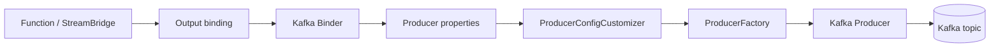

# Customizing ProducerFactory and the Kafka Client as Needed

The Kafka Binder creates and manages producer clients to send records from output bindings to Kafka. In most applications, configuration properties are sufficient to tune serializers, compression, batching, acknowledgments, and security. When you need to adjust configuration conditionally at runtime, per binding, or based on application beans, you can use `ProducerConfigCustomizer` to modify the configuration map before the binder creates the `ProducerFactory`.

Distinguish between two things: customizing **the configuration used to build the ProducerFactory** and replacing the **ProducerFactory object** managed by the binder. The documented extension point of the Kafka Binder is `ProducerConfigCustomizer`; it receives the producer properties map along with the binding name and destination, and lets you mutate that map. It is not a general hook for replacing every factory behavior. Understanding this boundary helps you choose the simplest solution and avoid creating extra producer clients unintentionally.

## 1. Where does ProducerFactory sit in the send path?

When a function returns a message or the application sends through an output binding, Spring Cloud Stream passes the message to the Kafka Binder. The binder uses the binding configuration and Kafka client configuration to create a producer factory. The factory manages creating and using Kafka producers for the send path.



The layers have distinct responsibilities:

- **Output binding** defines the destination and producer behavior at the Spring Cloud Stream level.
- **Kafka Binder properties** configure brokers, shared security, and binder defaults.
- **Kafka producer properties** tune the Kafka client, such as `acks`, `compression.type`, and `linger.ms`.
- **ProducerConfigCustomizer** modifies the configuration map before the binder creates the factory.
- **ProducerFactory** manages the lifecycle and creation of Kafka producers.
- **Kafka Producer** performs serialization, partitioning, buffering, and sending records to brokers.

The application does not need to instantiate a `KafkaProducer` per message when using the binder. The binder manages the producer client and wires it to the output binding.

## 2. Distinguishing standard configuration from customizers

Prefer property-based configuration when values are fixed per environment or binding. Use a customizer only when Java logic is needed, such as selecting configuration by binding name, destination, or application-managed beans.

| Configuration method | Scope | When appropriate |
|---|---|---|
| `spring.cloud.stream.kafka.binder.configuration` | Shared properties for both binder producer and consumer | Security or shared client configuration |
| `spring.cloud.stream.kafka.binder.producer-properties` | Binder-wide Kafka producer properties | Shared producer defaults |
| `spring.cloud.stream.kafka.bindings.<binding>.producer.configuration` | Producer properties specific to one binding | One output needs different compression, serializer, or timeouts |
| `spring.cloud.stream.kafka.default.producer.<property>` | Producer property applied across output bindings | Shared defaults for multiple outputs |
| `ProducerConfigCustomizer` | Modifies the producer properties map in Java before factory creation | Runtime conditions or application bean dependencies required |

Binder-level `configuration` is shared between producers and consumers, so place only shared settings like security there. `producer-properties` is dedicated to producers and supports arbitrary Kafka producer properties. Per-binding configuration limits impact to the specific output being tuned.

## 3. Configuring the producer directly in YAML

Example of an application with a function publishing order events:

```java
@Bean
Supplier<OrderPlaced> publishOrder(OrderService service) {
    return service::nextEvent;
}
```

Output binding:

```yaml
spring:
  cloud:
    function:
      definition: publishOrder
    stream:
      bindings:
        publishOrder-out-0:
          destination: orders.placed
          content-type: application/json
      kafka:
        binder:
          brokers:
            - kafka-1.internal:9092
            - kafka-2.internal:9092
        bindings:
          publishOrder-out-0:
            producer:
              configuration:
                acks: all
                compression.type: zstd
                linger.ms: 10
                batch.size: 32768
```

The properties under `spring.cloud.stream.kafka.bindings.publishOrder-out-0.producer.configuration` are Kafka client producer properties for that binding alone. This example instructs the Kafka producer to use `all` acknowledgments, Zstandard compression, a short linger to batch records, and a 32 KiB batch size.

If all output bindings need the same producer configuration, you can use `spring.cloud.stream.kafka.binder.producer-properties` or `spring.cloud.stream.kafka.default.producer.<property>` depending on the property group. Do not put `acks`, `linger.ms`, or `compression.type` in binder `configuration` when they are intended solely for producers.

## 4. ProducerConfigCustomizer as the extension point for ProducerFactory

When configuration requires Java conditionals, declare a `ProducerConfigCustomizer` bean. The Kafka Binder detects this bean and invokes its `configure` method right before creating the `ProducerFactory`. The customizer receives the producer properties map, binding name, and destination name.

```java
import java.util.Map;

import org.apache.kafka.clients.producer.ProducerConfig;
import org.springframework.cloud.stream.binder.kafka.ProducerConfigCustomizer;
import org.springframework.context.annotation.Bean;
import org.springframework.context.annotation.Configuration;

@Configuration
public class KafkaProducerConfiguration {

    @Bean
    ProducerConfigCustomizer producerConfigCustomizer() {
        return (producerProperties, bindingName, destination) -> {
            if ("publishOrder-out-0".equals(bindingName)
                    && "orders.placed".equals(destination)) {

                producerProperties.put(
                    ProducerConfig.COMPRESSION_TYPE_CONFIG,
                    "zstd"
                );
                producerProperties.put(
                    ProducerConfig.LINGER_MS_CONFIG,
                    10
                );
                producerProperties.put(
                    ProducerConfig.BATCH_SIZE_CONFIG,
                    32 * 1024
                );
            }
        };
    }
}
```

The customizer alters the configuration map only for the matching binding. Other bindings are unaffected by the conditional branch. This is useful when a single application has multiple outputs targeting topics with different latency or throughput requirements.

Binding names are derived from the function definition. For function `publishOrder`, the default output is `publishOrder-out-0`. If the application renames the binding via `spring.cloud.stream.function.bindings`, use the renamed binding name in the customizer condition.

### Using application beans to determine configuration

A customizer can inject Spring dependencies via `@Bean` method parameters. For example, a bean supplying environment-specific producer tuning:

```java
import org.springframework.boot.context.properties.ConfigurationProperties;

@ConfigurationProperties(prefix = "app.kafka.producer")
public record ProducerTuning(
    String clientIdPrefix,
    int orderBatchSize,
    int orderLingerMs
) {}
```

```java
@Bean
ProducerConfigCustomizer producerConfigCustomizer(
        ProducerTuning tuning) {

    return (properties, bindingName, destination) -> {
        if ("publishOrder-out-0".equals(bindingName)) {
            properties.put(
                ProducerConfig.CLIENT_ID_CONFIG,
                tuning.clientIdPrefix() + "-" + bindingName
            );
            properties.put(
                ProducerConfig.BATCH_SIZE_CONFIG,
                tuning.orderBatchSize()
            );
            properties.put(
                ProducerConfig.LINGER_MS_CONFIG,
                tuning.orderLingerMs()
            );
        }
    };
}
```

Register the configuration record using `@ConfigurationPropertiesScan` on the application class or `@EnableConfigurationProperties(ProducerTuning.class)`. Values can be supplied per profile or via external configuration. Do not read secrets from arbitrary files inside a customizer; use the platform's secret management mechanism.

### Preserving already-configured values

If a customizer should only supply a default when a property is absent, use `putIfAbsent`:

```java
@Bean
ProducerConfigCustomizer producerDefaults() {
    return (properties, bindingName, destination) -> {
        properties.putIfAbsent(
            ProducerConfig.COMPRESSION_TYPE_CONFIG,
            "lz4"
        );
    };
}
```

Using `put()` replaces any existing value in the map. Override only when that is an intentional application policy. Do not create conflicts among YAML, profiles, and customizers without clear precedence conventions.

## 5. A customizer does not directly replace ProducerFactory

The Kafka Binder's extension point is named `ProducerConfigCustomizer`. It lets you edit the property map used to construct the factory; it does not directly hand you the `ProducerFactory` object to invoke factory-specific methods.

This means:

- Do not declare a bean named `ProducerFactoryCustomizer` expecting the Kafka Binder to detect it automatically if your binder version does not provide that extension point.
- Do not instantiate a `DefaultKafkaProducerFactory` and assume the binder will use it for output bindings.
- Do not create a new `KafkaProducer` on every function invocation.
- To adjust Kafka client properties, prefer configuration or `ProducerConfigCustomizer`.
- If you need the direct Spring Kafka API for a dedicated send path, you can configure a separate `ProducerFactory` and `KafkaTemplate`; that send path is managed by the application, independent of the binder's output bindings.

Creating a producer directly is appropriate only when the application intentionally owns a dedicated send path:

```java
import java.util.HashMap;
import java.util.Map;

import org.apache.kafka.clients.producer.ProducerConfig;
import org.apache.kafka.common.serialization.StringSerializer;
import org.springframework.beans.factory.annotation.Value;
import org.springframework.context.annotation.Bean;
import org.springframework.context.annotation.Configuration;
import org.springframework.kafka.core.DefaultKafkaProducerFactory;
import org.springframework.kafka.core.KafkaTemplate;
import org.springframework.kafka.core.ProducerFactory;

@Configuration
public class DirectKafkaConfiguration {

    @Bean
    ProducerFactory<String, String> directProducerFactory(
            @Value("${app.kafka.bootstrap-servers}") String bootstrapServers) {

        Map<String, Object> properties = new HashMap<>();
        properties.put(
            ProducerConfig.BOOTSTRAP_SERVERS_CONFIG,
            bootstrapServers
        );

        properties.put(
            ProducerConfig.KEY_SERIALIZER_CLASS_CONFIG,
            StringSerializer.class
        );
        properties.put(
            ProducerConfig.VALUE_SERIALIZER_CLASS_CONFIG,
            StringSerializer.class
        );

        return new DefaultKafkaProducerFactory<>(properties);
    }

    @Bean
    KafkaTemplate<String, String> directKafkaTemplate(
            ProducerFactory<String, String> directProducerFactory) {
        return new KafkaTemplate<>(directProducerFactory);
    }
}
```

This example illustrates a separate Spring Kafka send path. It does not replace the producer factory inside the Kafka Binder. In a project, ensure bootstrap servers, serializers, transaction managers, and the separate factory's lifecycle are managed consistently. If you do not need the direct send API, avoid maintaining two producer paths just to tweak a few properties.

## 6. Choosing producer properties by requirements

Kafka producer properties are commonly tuned for performance, durability, or data limits:

| Property | Effect | Trade-off to consider |
|---|---|---|
| `acks` | Broker acknowledgment level awaited by the producer | Higher confirmation levels can increase latency |
| `enable.idempotence` | Reduces duplicates from retries within a producer session | Constrains certain send properties |
| `compression.type` | Compresses record batches | Saves network/disk but uses CPU |
| `batch.size` | Target batch size per partition | Large batches can increase memory and wait time |
| `linger.ms` | Wait time to accumulate more records before sending | Increases throughput but adds latency |
| `buffer.memory` | Buffer memory for pending outbound records | Larger buffers consume heap/native memory |
| `max.request.size` | Maximum producer request size | Must align with broker/topic limits |
| `delivery.timeout.ms` | Maximum total time to deliver a record before failing | Must coordinate with retries and request timeout |
| `max.in.flight.requests.per.connection` | Unacknowledged requests per connection | Affects throughput and ordering during retries |

No single set of values is optimal for every workload. Measure message sizes, partition counts, throughput, latency, retry rates, and broker capacity before tuning.

### Acknowledgments and idempotence

Example producer configuration prioritizing reliability:

```yaml
spring:
  cloud:
    stream:
      kafka:
        bindings:
          publishOrder-out-0:
            producer:
              configuration:
                acks: all
                enable.idempotence: true
                delivery.timeout.ms: 120000
```

`acks=all` instructs the leader to wait for replicas in the in-sync replicas set to acknowledge per the Kafka protocol. Actual durability also depends on replication factor and `min.insync.replicas`. `enable.idempotence` helps the producer avoid duplicate writes from retries within the producer session and supported settings.

An idempotent producer does not guarantee end-to-end business exactly-once semantics. It does not replace event IDs, consumer idempotency, or the transactional outbox when consistency with a database is needed. If binder transactions are enabled, use the corresponding transactional producer configuration.

Kafka enforces compatibility among idempotence, `acks`, `retries`, and `max.in.flight.requests.per.connection`. Do not set conflicting values; use configurations supported by the running Kafka client version.

### Throughput and batching

Example producer prioritizing throughput over latency:

```yaml
spring:
  cloud:
    stream:
      kafka:
        bindings:
          publishTelemetry-out-0:
            producer:
              configuration:
                compression.type: lz4
                batch.size: 65536
                linger.ms: 20
                buffer.memory: 67108864
```

`linger.ms` gives the producer a brief window to accumulate more records into a batch; `batch.size` is the target batch size per partition. If traffic is low, the producer may send smaller batches. Raising these values does not automatically increase throughput if the broker, network, or serialization is the bottleneck.

Choose compression appropriate for your data. Repetitive JSON usually compresses well; already-compressed payloads may gain little. Benchmark CPU, network, and end-to-end latency before choosing a codec.

## 7. Serializers and native encoding

By default, Spring Cloud Stream can convert payloads via message converters and have the binder send bytes. When you need the Kafka client itself to serialize objects, enable native encoding and declare the matching serializer.

```yaml
spring:
  cloud:
    stream:
      kafka:
        bindings:
          publishOrder-out-0:
            producer:
              use-native-encoding: true
              configuration:
                key.serializer: org.apache.kafka.common.serialization.StringSerializer
                value.serializer: com.example.kafka.OrderPlacedSerializer
```

The value serializer must match the actual payload type. If using `StringSerializer`, the payload must be a `String`; if the payload is `OrderPlaced`, the serializer must know how to convert that type into a byte array.

If continuing with Spring Cloud Stream message conversion, do not enable native encoding just to change a producer property. Let the framework convert payloads to bytes by content type and customize only the producer properties you need.

Do not configure the same serializer at multiple levels without understanding how properties merge. A mismatched serializer typically fails when sending records, not necessarily at application startup.

## 8. Configuring a Kafka producer interceptor

Kafka supports `interceptor.classes` for registering producer interceptors. An interceptor can inspect or enrich `ProducerRecord` metadata before sending and receive acknowledgment outcomes via the Kafka API.

You can configure it via a customizer:

```java
@Bean
ProducerConfigCustomizer producerInterceptorCustomizer() {
    return (properties, bindingName, destination) -> {
        if ("publishOrder-out-0".equals(bindingName)) {
            properties.put(
                ProducerConfig.INTERCEPTOR_CLASSES_CONFIG,
                OrderProducerInterceptor.class.getName()
            );
        }
    };
}
```

Interceptors are instantiated by the Kafka client using its own mechanism. Do not assume Spring will inject services into an interceptor like a regular bean. If the interceptor needs configuration, use constructor/initialization or config map entries supported by Kafka's API; avoid stuffing arbitrary Spring objects into the config map.

Interceptors should be lightweight, thread-safe, and non-blocking on the send path. Never perform blocking database or HTTP calls inside `onSend()`; doing so can stall every record on that producer. If complex business logic is required, run it in a service before publishing rather than in an interceptor.

## 9. When binder transactions are enabled

The Kafka Binder supports transactions via `spring.cloud.stream.kafka.binder.transaction.transaction-id-prefix`. When this property is configured, the binder creates a transactional producer. In that mode, per-binding producer properties may be ignored; producer configuration is taken from this group:

```yaml
spring:
  cloud:
    stream:
      kafka:
        binder:
          transaction:
            transaction-id-prefix: orders-tx-
            producer:
              configuration:
                acks: all
                compression.type: lz4
```

Place producer properties for a transactional binder under `spring.cloud.stream.kafka.binder.transaction.producer.*` according to your version's configuration structure. Do not place them only under `spring.cloud.stream.kafka.bindings.<binding>.producer.configuration` and assume they take effect when transactions are enabled.

Kafka transactions can combine consuming and producing in a single Kafka transaction when consumer/producer bindings share the same transaction manager and proper configuration. They do not automatically encompass external database transactions. For database state and events that must stay consistent, evaluate the transactional outbox or an appropriate integration strategy.

## 10. Configuration limits and scopes

Several properties have special scopes:

- `spring.cloud.stream.kafka.binder.configuration`: shared by producer and consumer clients; suitable for security properties.
- `spring.cloud.stream.kafka.binder.producer-properties`: binder-wide, for producer clients only.
- `spring.cloud.stream.kafka.bindings.<binding>.producer.configuration`: scoped to a single producer binding.
- `spring.cloud.stream.kafka.default.producer.<property>`: sets defaults across producer bindings.
- `spring.cloud.stream.kafka.binder.transaction.producer.*`: used when the transactional binder is enabled.

Do not place `bootstrap.servers` inside a producer binding's `configuration`; broker addresses belong in binder configuration. If you need to send to multiple Kafka clusters, configure multiple binder instances and assign bindings to their respective binders.

If both direct `KafkaTemplate` and the Kafka Binder exist, each send path can use a different factory and configuration. Inspect both separately. Do not assume Spring Boot properties automatically configure every producer managed by the binder.

## 11. Testing customizers and producers

Test two parts: the configuration selection logic and the actual send behavior to Kafka.

### Unit testing the customizer

You can invoke the customizer directly with a mock map to verify only the intended binding is modified:

```java
@Test
void customizesOnlyOrderProducer() {
    ProducerConfigCustomizer customizer =
        (properties, bindingName, destination) -> {
            if ("publishOrder-out-0".equals(bindingName)
                    && "orders.placed".equals(destination)) {
                properties.put(
                    ProducerConfig.COMPRESSION_TYPE_CONFIG,
                    "zstd"
                );
            }
        };

    Map<String, Object> properties = new HashMap<>();

    customizer.configure(
        properties,
        "publishOrder-out-0",
        "orders.placed"
    );

    assertThat(properties)
        .containsEntry(ProducerConfig.COMPRESSION_TYPE_CONFIG, "zstd");
}
```

This snippet illustrates testing customizer logic. Interface signatures and imports must match the Kafka Binder version in your project's dependencies.

### Integration testing with Kafka

Use real Kafka or Testcontainers to verify:

1. The binder connects to the right broker and the binding targets the right topic.
2. The producer is created with the expected serializer and compression.
3. Record key, partition, and payload are accurate.
4. Producer acknowledgments and errors are observed per configuration.
5. Any producer interceptor does not alter payloads unexpectedly.
6. Transaction commit/rollback works when the transactional binder is enabled.
7. Customizer settings apply only to the intended binding/destination.

The Test Binder tests functions and bindings in memory, but it does not prove the actual Kafka client received the intended producer settings. Properties such as compression, idempotence, serializers, record keys, and broker acknowledgments require integration tests against Kafka.

## 12. Diagnosing common errors

| Symptom | Possible cause | How to check |
|---|---|---|
| Customizer does not run | Bean not detected by binder or wrong interface/package imported | Check dependencies, imports, and startup logs |
| Setting affects every output | Placed at binder level instead of binding level or missing binding check | Check prefix and bindingName |
| YAML value has no effect | Customizer overwrites with `put()` after the map is assembled | Check application order and use `putIfAbsent` for defaults |
| Serializer throws ClassCastException | Serializer incompatible with payload type | Check payload type and native encoding |
| Cannot connect to broker | Bootstrap servers placed at wrong level or wrong listener | Check `binder.brokers`, DNS, and network |
| Transactional producer ignores per-binding config | Transactional binder uses the transaction producer property group | Place settings under `binder.transaction.producer` |
| Throughput does not improve | Bottleneck is broker, partitions, network, or serialization | Measure batch size, linger, CPU, and latency |
| Interceptor slows down producer | Blocking I/O performed inside callbacks | Keep interceptors lightweight and non-blocking |

When debugging, you can log the binding name, destination, and non-sensitive properties inside the customizer. Never log passwords, JAAS configs, tokens, truststore passwords, or private keys. Avoid printing the entire config map because it may contain credentials.

## 13. Pre-production checklist for customizations

- Clarify whether you need to change a Kafka client property or introduce an independent Kafka send path.
- Use per-binding properties when values are static.
- Use `ProducerConfigCustomizer` when Java logic per binding/destination or application dependencies are needed.
- Do not confuse `ProducerConfigCustomizer` with a hook that directly replaces `ProducerFactory`.
- Keep `bootstrap.servers` in binder configuration.
- Use binder-level common configuration for shared security; use producer properties for producer-specific settings.
- Check transactional binder configuration, as per-binding producer properties may be ignored.
- Choose a serializer compatible with the payload and enable native encoding only when you want the Kafka client to serialize.
- Evaluate `acks`, idempotence, retries, and timeouts alongside the replication policy.
- Measure `batch.size`, `linger.ms`, compression, and buffers under realistic workloads.
- Keep interceptors thread-safe and non-blocking.
- Unit-test customizer logic and run integration tests against real Kafka.
- Protect credentials and avoid logging the full producer configuration.

## 14. References

- [Spring Cloud Stream — Customizing Consumer and Producer Configuration](https://docs.spring.io/spring-cloud-stream/reference/kafka/kafka-binder/cons-prod-config-cust.html), `ProducerConfigCustomizer` section.
- [Spring Cloud Stream — Kafka Binder Configuration Options](https://docs.spring.io/spring-cloud-stream/reference/kafka/kafka-binder/config-options.html), binder, producer, and transaction producer properties.
- [Spring Cloud Stream Kafka Binder — Producer Properties](https://docs.spring.io/spring-cloud-stream/reference/kafka/kafka-binder/index.html), per-binding settings, serializers, and record metadata.
- [Spring for Apache Kafka — Sending Messages](https://docs.spring.io/spring-kafka/reference/kafka/sending-messages.html), `ProducerFactory`, `KafkaTemplate`, and sending records.
- [Apache Kafka Producer Configuration](https://kafka.apache.org/documentation/#producerconfigs), producer client properties and configuration constraints.

The Kafka Binder builds `ProducerFactory` from a map of Kafka client properties. Use YAML for static values and `ProducerConfigCustomizer` when Java logic is needed before factory creation. By choosing the right configuration scope and properly controlling serializers, transactions, and producer tuning, an application can satisfy each output binding's requirements while letting the binder manage the producer lifecycle consistently.
