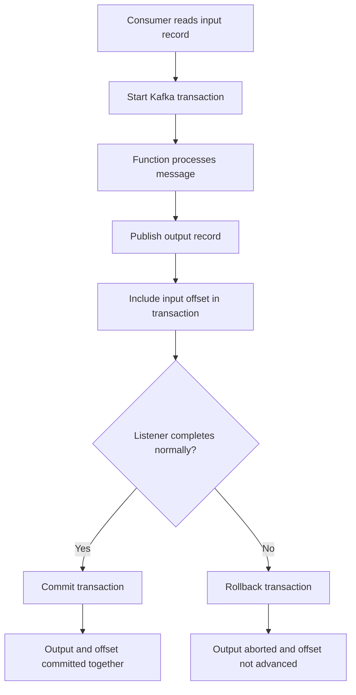

# Enabling the Transactional Binder with transactionIdPrefix

Kafka supports transactions to group multiple publish operations into a single commit or rollback unit. The Spring Cloud Stream Kafka binder integrates this mechanism with Spring for Apache Kafka's bindings and listener containers. Simply configuring a non-empty `transactionIdPrefix` causes the binder to create a transactional producer factory and enable transactional behavior for the producer bindings belonging to that binder.

In applications following the **consume-process-produce** model, a transaction can include both the output records and the input record's offset. If processing completes normally, the listener container sends the offset into the transaction and commits it. If processing throws an exception, the transaction rolls back and the output records sent within the transaction are not committed either. This is the foundation for achieving exactly-once processing within Kafka when the producer, consumer, and transaction are properly configured.

## 1. What problem does the transactional binder solve?

A processor typically reads an event from an input topic, transforms it, and publishes the result to another topic. If publishing the output succeeds but committing the input offset fails, the input message may be read again and the output emitted twice. Conversely, if the offset is committed before the output is durably written, the system may lose the output.

When using Kafka transactions, the consumer offset and output records can be written in the same Kafka transaction:



In a processor application, the listener container starts a transaction when receiving a message. Records sent on the consumer thread participate in the same transaction. When the listener returns normally, the container includes the processed offset in the transaction and commits. If the listener fails, the transaction rolls back; the input message can be redelivered according to the container's retry mechanism.

The transactional binder is well suited when the operations that need to be coordinated are all within Kafka—for example, reading from topic A, transforming, and writing to topics B/C. It does not automatically create a distributed transaction spanning SQL databases, Redis, or HTTP APIs.

## 2. Enabling transactions with transactionIdPrefix

The property to enable transactions is:

```text
spring.cloud.stream.kafka.binder.transaction.transactionIdPrefix
```

When set to a non-empty value, the Kafka binder enables the transactional producer. If unconfigured, it defaults to `null`, meaning the binder does not use transactional mode.

Example `application.yml`:

```yaml
spring:
  cloud:
    stream:
      kafka:
        binder:
          transaction:
            transaction-id-prefix: ${KAFKA_TX_ID_PREFIX}
```

`transaction-id-prefix` is the kebab-case YAML representation of the `transactionIdPrefix` property. The `KAFKA_TX_ID_PREFIX` environment variable must be provided at runtime and have a non-empty value. You should not hardcode a single shared prefix in the configuration file if the application runs multiple instances.

It can be configured directly in a dedicated profile, but the prefix still needs to be uniquely assigned per instance. For example, the deployment environment might provide `KAFKA_TX_ID_PREFIX=order-processor-pod-7f8c-`; other instances must have different values.

## 3. transactionIdPrefix must be unique per instance

Kafka uses the transactional ID to identify the producer that owns a transaction. Spring Kafka generates a transactional ID for each producer by combining the prefix with a suffix managed by the producer factory. If multiple running instances use the same prefix, they can generate duplicate transactional IDs, and Kafka will fence (invalidate) the older producer when the new producer registers the same ID.

Deployment rules:

- Each running instance needs its own distinct `transactionIdPrefix`.
- Use an instance identifier that is stable for the instance's lifetime, such as a pod name or a platform-assigned instance ID.
- Do not use a single prefix value for all replicas in a Deployment.
- When an instance is replaced, the new instance's prefix must avoid colliding with other active instances.
- Do not confuse the prefix with the consumer group. The consumer group identifies the reader group; the transaction ID prefix defines the namespace for producer transaction identifiers.

Deployment example:

```yaml
spring:
  cloud:
    stream:
      kafka:
        binder:
          transaction:
            transaction-id-prefix: order-processor-${HOSTNAME}-
```

This example assumes `HOSTNAME` differs across running instances. In Kubernetes, you can pass the Pod name or a unique instance ID via an environment variable. Check your platform's naming rules to ensure a prefix is not reused while an older producer is still active.

## 4. Transactional binder in consume-process-produce applications

This is the case where the binder integrates most directly. The application has one input binding and one or more output bindings. The consumer transaction is started by the listener container; any output sent synchronously on the consumer thread participates in that transaction.

Example function declaration:

```java
import java.util.function.Function;

import org.springframework.context.annotation.Bean;
import org.springframework.context.annotation.Configuration;

@Configuration
class OrderProcessor {

    @Bean
    Function<OrderCreated, OrderEnriched> enrichOrder(
            OrderService orderService) {
        return event -> orderService.enrich(event);
    }
}

record OrderCreated(String eventId, String orderId, long totalAmount) {}
record OrderEnriched(String eventId, String orderId, String status) {}
```

Binding configuration:

```yaml
spring:
  cloud:
    function:
      definition: enrichOrder
    stream:
      bindings:
        enrichOrder-in-0:
          destination: orders.created
          group: order-enrichment
          content-type: application/json
        enrichOrder-out-0:
          destination: orders.enriched
          content-type: application/json
      kafka:
        binder:
          transaction:
            transaction-id-prefix: ${KAFKA_TX_ID_PREFIX}
```

When the consumer receives a record from `orders.created`, the listener container starts a Kafka transaction. The function processes it and returns `OrderEnriched`; the binder publishes the result to `orders.enriched` within the transaction. When the listener completes, the input record's offset is sent into the same transaction. A successful commit makes both the output record and the input offset take effect together.

If `orderService.enrich(...)` throws an exception or sending an output fails in a way that causes the listener to fail, the transaction rolls back. The output record in the transaction is not committed and the input offset does not advance past that record. The post-rollback retry mechanism determines when the record is reprocessed.

## 5. Multiple output bindings participating in the same transaction

A processor can emit multiple outputs from the same processing step. For example, when an order is created, the application emits a business event and an audit event. If both outputs are sent within the same consumer transaction, they commit or roll back together with the input offset.

```java
import java.util.function.Function;

import org.springframework.cloud.stream.function.StreamBridge;
import org.springframework.context.annotation.Bean;

@Bean
Function<OrderCreated, OrderEnriched> enrichAndAudit(
        OrderService orderService,
        StreamBridge streamBridge) {
    return event -> {
        OrderEnriched result = orderService.enrich(event);

        boolean sent = streamBridge.send(
            "orderAudit-out-0",
            new OrderAudit(event.eventId(), "ENRICHED")
        );
        if (!sent) {
            throw new IllegalStateException("Could not send order audit event");
        }

        return result;
    };
}

record OrderAudit(String eventId, String action) {}
```

Additional output binding declaration:

```yaml
spring:
  cloud:
    function:
      definition: enrichAndAudit
    stream:
      output-bindings: orderAudit-out-0
      bindings:
        enrichAndAudit-in-0:
          destination: orders.created
          group: order-enrichment
        enrichAndAudit-out-0:
          destination: orders.enriched
        orderAudit-out-0:
          destination: orders.audit
```

`StreamBridge.send(...)` is called synchronously on the thread handling the consumer, so the binder's transactional producer can join the open transaction. Do not offload the send call to another executor or thread and assume the transaction is automatically propagated to that thread.

The return value of `send(...)` should be checked. If the application ignores a failed send and returns normally, the listener may complete the transaction even though the secondary output was not sent as expected. When an output is a mandatory part of the business logic, make a send failure fail the listener so the transaction rolls back.

## 6. Producer bindings share a single transactional producer factory

When the transactional binder is enabled, the Kafka binder uses a shared producer factory for producer bindings configured via:

```text
spring.cloud.stream.kafka.binder.transaction.producer.*
```

Kafka producer properties set individually on each binding are ignored in transactional mode. Therefore, if you need to customize producer settings such as serializers, compression, or other Kafka client properties, configure them under the `transaction.producer` namespace according to the supported properties.

Example shared producer configuration:

```yaml
spring:
  cloud:
    stream:
      kafka:
        binder:
          transaction:
            transaction-id-prefix: ${KAFKA_TX_ID_PREFIX}
            producer:
              configuration:
                compression.type: lz4
```

This configuration illustrates a Kafka producer property. Property names and binding syntax must match the version of the Kafka binder/Kafka client in use. Do not set the same property at both the binding level and the transaction level expecting the binding level to override; in transactional mode, the shared producer factory is configured from `transaction.producer.*`.

Consumer properties remain in their respective consumer configurations. Enabling the transactional binder does not mean all consumer properties move to the producer namespace.

## 7. Producer-only transactions in source applications

A source application that only produces data—such as a `Supplier`, REST controller, or `@Scheduled` job—has no consumer listener to automatically open a transaction. In this case, you need to retrieve the transactional producer factory from the Kafka binder and create a `KafkaTransactionManager` using that exact factory.

The prefix configuration is still declared as in the previous section. Then create the transaction manager:

```java
import org.springframework.beans.factory.annotation.Value;
import org.springframework.cloud.stream.binder.BinderFactory;
import org.springframework.cloud.stream.binder.kafka.KafkaMessageChannelBinder;
import org.springframework.context.annotation.Bean;
import org.springframework.context.annotation.Configuration;
import org.springframework.kafka.core.ProducerFactory;
import org.springframework.kafka.transaction.KafkaTransactionManager;
import org.springframework.messaging.MessageChannel;

@Configuration
class KafkaProducerTransactionConfiguration {

    @Bean
    KafkaTransactionManager<byte[], byte[]> kafkaTransactionManager(
            BinderFactory binders,
            @Value("${app.kafka.transaction-id}") String transactionId) {

        KafkaMessageChannelBinder binder = (KafkaMessageChannelBinder)
            binders.getBinder(null, MessageChannel.class);

        ProducerFactory<byte[], byte[]> producerFactory =
            binder.getTransactionalProducerFactory();

        KafkaTransactionManager<byte[], byte[]> manager =
            new KafkaTransactionManager<>(producerFactory);
        manager.setTransactionId(transactionId);
        return manager;
    }
}
```

In the example, `null` in `getBinder(...)` is appropriate when the application has only one Kafka binder. If there are multiple binders, pass the corresponding binder name. `transactionId` must be unique per instance following Kafka's transaction ID rules. Ensure the transaction manager uses the exact transactional producer factory that the binder uses.

You can then use Spring transaction support for the producer-only flow:

```java
import java.util.List;

import org.springframework.cloud.stream.function.StreamBridge;
import org.springframework.stereotype.Service;
import org.springframework.transaction.annotation.Transactional;

@Service
class OrderEventSource {

    private final StreamBridge streamBridge;

    OrderEventSource(StreamBridge streamBridge) {
        this.streamBridge = streamBridge;
    }

    @Transactional("kafkaTransactionManager")
    public void publishBatch(List<OrderCreated> events) {
        for (OrderCreated event : events) {
            if (!streamBridge.send("orders-out-0", event)) {
                throw new IllegalStateException("Kafka publish failed");
            }
        }
    }
}
```

If the method finishes normally, the transaction manager commits the records sent within the transaction. If an exception escapes the method and matches the rollback rules, the transaction rolls back. `@Transactional` works via a Spring proxy; calling a transactional method from another method in the same instance (self-invocation) may not trigger the proxy as expected.

## 8. Do not confuse the binder's transactionIdPrefix with Spring Boot configuration

Spring Boot has its own property:

```text
spring.kafka.producer.transaction-id-prefix
```

This property can cause Spring Boot to auto-configure a `KafkaTransactionManager` based on a producer factory created by Spring Boot. In Spring Cloud Stream, the binder uses its own producer factory. If you want `StreamBridge` or output binding transactions to participate in the transaction manager, both components must use the same producer factory.

Therefore, to enable the transactional binder, use:

```text
spring.cloud.stream.kafka.binder.transaction.transactionIdPrefix
```

If creating a transaction manager for a producer-only flow, obtain `getTransactionalProducerFactory()` from the Kafka binder and construct `KafkaTransactionManager` from that factory. Do not assume a transaction manager auto-configured by `spring.kafka.producer.transaction-id-prefix` will automatically control the binder's producer.

## 9. Retry after rollback in the transactional binder

Standard binder retry and retry in the transactional binder work differently. When a transaction is open, if the binder retries inside the original transaction, output records may still be rolled back with that transaction. Therefore, normal binder retry and dead-lettering are not used in the traditional way in transactional mode.

When retry is enabled via the common `maxAttempts` property greater than 0, retry properties are used to configure `DefaultAfterRollbackProcessor` on the listener container. The flow is:

1. The listener starts a transaction and processes the record.
2. If the listener throws an exception, the current transaction rolls back.
3. `DefaultAfterRollbackProcessor` decides whether to retry the record after rollback.
4. Once retries are exhausted, the processor can recover the record—for example, publishing to a dead-letter topic—after the main transaction has rolled back.

Do not assume that a retry will re-run the function inside the same rolled-back transaction. Each reprocessing attempt requires a new transaction per the container mechanism.

### Exception classification

In the transactional binder, you can control which exceptions are retried using `defaultRetryable` and `retryableExceptions`:

```yaml
spring:
  cloud:
    stream:
      kafka:
        bindings:
          processOrder-in-0:
            consumer:
              defaultRetryable: false
              retryableExceptions:
                java.net.SocketTimeoutException: true
                java.lang.IllegalArgumentException: false
```

With `defaultRetryable: false`, exceptions not explicitly declared will not be retried. The example above enables retries for network timeouts and disables retries for invalid argument errors. Only exception types extending `Exception` can be configured in `retryableExceptions` with this mechanism.

### Dead-letter after rollback

With the transactional binder, publishing dead-letter records is shifted to `DefaultAfterRollbackProcessor`, which runs after the main transaction rolls back. Do not send a dead-letter record inside the failed transaction and expect it to survive the rollback.

If the record is recovered, `txCommitRecovered` controls committing the recovered record's offset in a new transaction; the current default is `true`. When changing this property, test both the DLT state and committed offsets to avoid losing records or causing infinite loops.

## 10. Batch listeners and transaction retry limitations

Current Kafka binder documentation notes that `DefaultAfterRollbackProcessor` is only configured under this transactional retry mechanism when transactions are enabled and batch mode is not enabled. Therefore, do not assume the same retry configuration will behave identically between a record listener and a batch listener.

If using `batch-mode: true`, carefully examine:

- Whether the listener receives the entire batch or individual records.
- Whether an exception affects the entire batch or part of the batch.
- How the batch's offsets are committed or rolled back.
- How failed records are recovered and whether previously processed records might be replayed.
- Compatibility of the binder version with batch listeners and transactional processing.

If business requirements demand per-record transactional retry and precise control over the failing record, a record listener is usually easier to reason about. If batch throughput is needed, rollback, idempotency, and replay policies must be designed specifically.

## 11. Transactions only cover operations within the Kafka transaction

A Kafka transaction can coordinate output records and input offsets within Kafka. It does not automatically include database operations:

```java
@Bean
Function<OrderCreated, OrderEnriched> processOrder(
        OrderRepository repository,
        StreamBridge streamBridge) {
    return event -> {
        repository.save(...); // Separate database transaction
        streamBridge.send("orders-audit-out-0", ...); // Kafka transaction
        return ...;
    };
}
```

If the database commits successfully but the Kafka transaction rolls back, the database data may still have changed. If Kafka commits but the database transaction rolls back, the two systems can drift out of sync. There is no automatic XA transaction just because the method executes inside a single function.

When the database and Kafka require durable synchronization, consider the transactional outbox pattern: write business data and the event in the same database transaction, then have a relay publish the event to Kafka. Consumers use an inbox/idempotency check to prevent duplicate processing. If the business flow spans multiple services or external APIs, use a saga with appropriate compensating actions.

## 12. Transactions are bound to the processing thread

In a processor application, the Kafka transaction is bound to the consumer thread. Synchronous output sends on that thread can join the open transaction. If processing is handed off to a `CompletableFuture`, executor, `@Async`, or another Reactor scheduler, the transaction context is not automatically propagated to the new thread.

Example where you should not assume the transaction remains active:

```java
return event -> CompletableFuture.runAsync(() ->
    streamBridge.send("orders-out-0", transform(event))
);
```

The send runs on a different thread and does not automatically belong to the open consumer transaction. The listener can finish and commit the offset before the async task finishes sending. When transactional consume-process-produce is required, perform the protected send calls on the consumer thread before the listener completes, or explicitly open a separate producer transaction on the executing thread.

For reactive processing, do not assume the listener container's transaction propagates across all subscriptions/schedulers. Check specific support for your binder/version and use the corresponding reactive transaction mechanism if supported. Do not mix imperative Kafka transactions with a reactive pipeline simply by calling `subscribe()`.

## 13. Consumers reading only committed data

Kafka consumers have `isolation.level` to determine whether to read records belonging to uncommitted or rolled-back transactions:

- `read_uncommitted`: may see transactional records before the transaction completes as well as records from aborted transactions.
- `read_committed`: returns only records belonging to committed transactions; records from aborted transactions are not delivered to the application.

When the system relies on transactional output to ensure consumers only see committed data, configure downstream consumers to use `read_committed` via the corresponding binding or binder property. For example:

```yaml
spring:
  cloud:
    stream:
      kafka:
        bindings:
          auditConsumer-in-0:
            consumer:
              configuration:
                isolation.level: read_committed
```

The Kafka client property name is `isolation.level`. This configuration only takes effect when the consumer actually uses the Kafka binder and the property is passed to the Kafka client. Applications that do not require committed-transaction read semantics may choose differently, but should understand the impact before changing it.

## 14. Testing the transactional binder

The Spring Cloud Stream Test Binder is useful for testing function and binding logic, but it does not fully simulate the Kafka transaction coordinator, producer fencing, offset transactions, or isolation levels. For transactions, integration tests with a real Kafka broker are needed.

Scenarios to verify:

| Scenario | Expected Outcome |
|---|---|
| Processor succeeds and emits output | Output appears to `read_committed` consumers; input offset is committed. |
| Function throws exception after sending output | Transaction rolls back; output does not appear to `read_committed` consumers; input offset does not advance past the record. |
| Sending multiple outputs in one processing call | All outputs commit or roll back together with the input offset. |
| Consumer restarts while a transaction is open | Uncommitted transaction is aborted or recovered per the Kafka transaction protocol; input record is reprocessed if offset was not committed. |
| Two instances use different prefixes | Both can create transactional producers independently. |
| Two instances use duplicate prefixes | Producer fencing or transactional ID error is detected; configuration must be fixed to be unique. |
| Retry after rollback | Each attempt uses the appropriate transaction; only the successful attempt commits output and offset. |
| Retries exhausted and recovered to DLT | DLT receives the record via the after-rollback mechanism; recovered offset is committed per configuration. |
| Producer-only `@Transactional` | Outputs sent inside the method commit/roll back together via the transaction manager using the binder's producer factory. |
| Sending output from another thread | Do not assume the output joins the consumer transaction; tests should make this boundary explicit. |

When testing, read outputs using a `read_committed` consumer, inspect the group's committed offsets, and verify the state of the input record. Checking logs or the return value of `StreamBridge.send(...)` alone is not sufficient to prove that a transaction committed.

## 15. Monitoring and troubleshooting

Signals to observe:

- Transaction commit/abort counts and transaction error rates.
- Producer fencing exceptions or transactional ID errors.
- Transaction timeouts and how long transactions remain open.
- Consumer lag, rebalances, and listener processing duration.
- Post-rollback retry counts, recovered record counts, and records sent to the DLT.
- Ratio of committed outputs to received inputs.
- Output send failures and errors when closing producers/transaction managers.

Long-running transactions can hold resources and increase the likelihood of timeouts. Do not put slow HTTP calls or human-wait steps inside a Kafka transaction. Keep transactions short, including only the Kafka operations that must commit together.

When encountering `ProducerFencedException`, check whether the prefix is duplicated across instances, whether an old producer is still alive after a deployment, or whether a transaction ID is being reused. When encountering transaction timeouts, review listener processing time, transaction timeout settings, and broker limits.

## 16. Procedure for enabling the transactional binder

1. Determine whether the flow needs consume-process-produce coordination within Kafka or just standard producer sends.
2. Configure `spring.cloud.stream.kafka.binder.transaction.transactionIdPrefix` with a non-empty value.
3. Assign a unique prefix per instance; do not hardcode a shared prefix across all replicas.
4. Define shared producer properties under `spring.cloud.stream.kafka.binder.transaction.producer.*`.
5. For processor applications, let the listener container open the transaction and ensure protected outputs are sent on the consumer thread.
6. For producer-only source applications, obtain the transactional producer factory from the binder and create a `KafkaTransactionManager` using that exact factory.
7. Configure post-rollback retry and dead-letter recovery according to the transactional binder, rather than blindly applying normal retry/DLQ settings.
8. If downstream consumers must only read committed records, configure `isolation.level=read_committed` on the consumer.
9. Do not assume Kafka transactions cover databases or external APIs; use outbox/inbox or sagas when coordinating other resources.
10. Integration test commits, rollbacks, retries, fencing, offsets, and outputs against a real Kafka broker.

`transactionIdPrefix` is the switch that enables transactional producers for the Kafka binder and is the key identifier for producer transactions. When the prefix is unique per instance, outputs and offsets are sent in the same transaction, retries are handled after rollback, and transaction scope is kept within Kafka, applications can build highly consistent consume-process-produce flows while clearly understanding boundaries with databases and external systems.

## References

- [Spring Cloud Stream – Transactional Binder](https://docs.spring.io/spring-cloud-stream/reference/kafka/kafka-binder/transactional.html)
- [Spring Cloud Stream – Kafka Binder Configuration Options](https://docs.spring.io/spring-cloud-stream/reference/kafka/kafka-binder/config-options.html)
- [Spring for Apache Kafka – Transactions](https://docs.spring.io/spring-kafka/reference/kafka/transactions.html)
- [Spring Blog – Producer Initiated Transactions in Spring Cloud Stream Kafka Applications](https://spring.io/blog/2023/09/28/producer-initiated-transactions-in-spring-cloud-stream-kafka-applications/)
