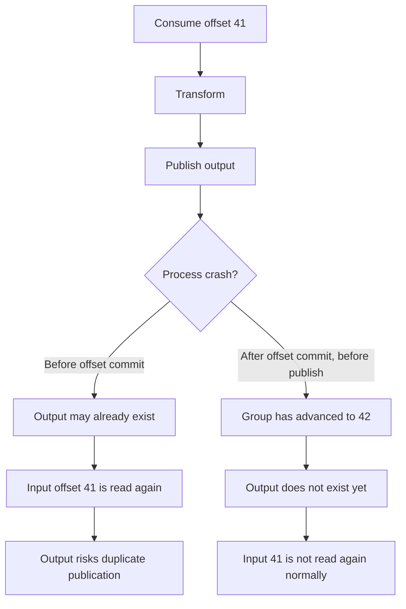
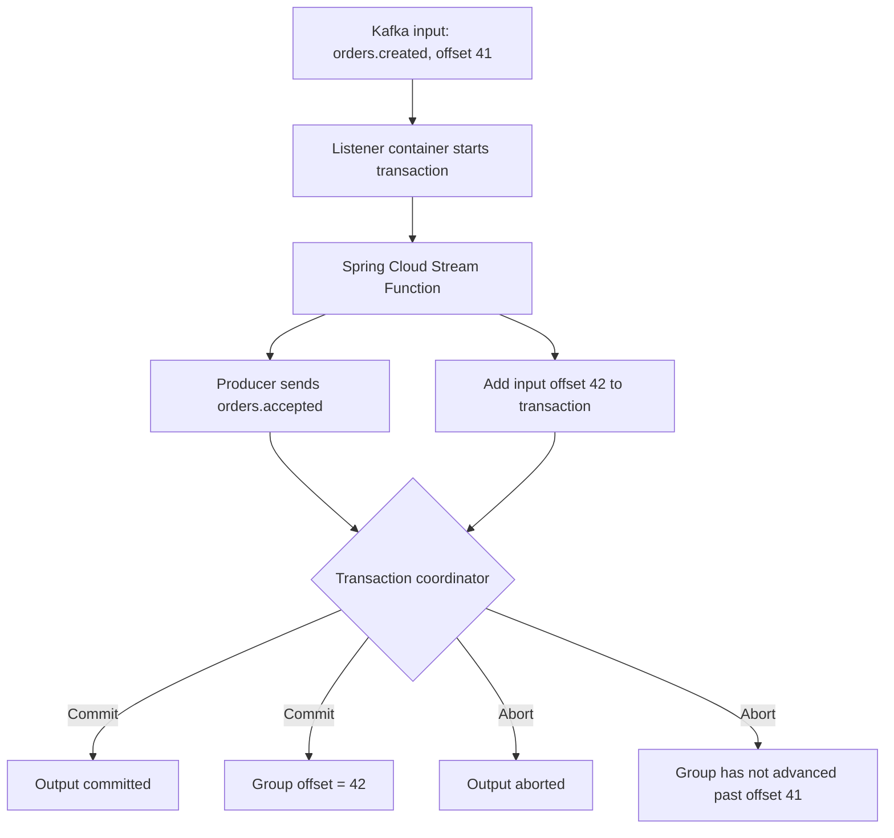

# Committing Offsets and Output Records in a Single Kafka Transaction

## 1. The consume-transform-produce problem

An event-processing application typically receives a message from one topic, executes business logic, and emits the result to another topic. For example, an order service reads `orders.created`, validates the order, and emits `orders.accepted`.

Two operations must stay consistent:

1. Writing the output result so downstream consumers can see it.
2. Committing the input offset so the consumer group records that the message has been processed.

If the two operations are independent, a failure can create an undesirable state:

- Output is published, but the offset is not committed. When the consumer reads the input again, the output may be published a second time.
- Offset is committed, but output is not published. The consumer continues from the next record and the business result may be lost.

Kafka transactions close this failure window within Kafka by placing the output records and the input offset into the same transaction. When the transaction commits, both the output and the consumption progress take effect together. When the transaction aborts, the output is hidden from `read_committed` consumers and the input offset is not advanced by that transaction.

This is the **consume-transform-produce** pattern: consume a record, transform it, emit new records, and acknowledge the input record as a single atomic unit in Kafka.

## 2. Why is committing outputs and offsets separately risky?

Suppose a consumer receives an `OrderCreated` record at partition 0, offset 41. The function produces `OrderAccepted` and sends it to the output topic.

If publishing and committing the offset are two separate operations, there are two failure windows:



Kafka transactions bind these operations together. The application does not have to choose between "publish first" or "commit offset first" to reduce risk; the coordinator decides whether to commit or abort the transaction for all participating operations.

## 3. What does a Kafka transaction include?

A Kafka transaction can include:

- Multiple records sent to one or more topics/partitions within the same Kafka cluster.
- The input record's offset acknowledged for the consumer group via the transaction.
- Commit or abort state managed by the Kafka transaction coordinator.

When processing an input record at offset 41, the consumer needs to commit the next position, 42. Offset 42 is added to the transaction alongside the output record. When the transaction commits, the output is marked committed and the group advances to offset 42. When the transaction aborts, outputs belonging to that transaction are marked aborted and the offset is not committed by that transaction.



The input offset is not a business record sent to a topic. It is consumption-progress metadata recorded by Kafka in the same transaction as the output.

## 4. Roles of producer, consumer, and transaction coordinator

In a consume-transform-produce flow:

- The consumer reads the record from the partition and retains group, topic, partition, and offset metadata.
- The listener container opens a transaction before invoking processing logic when the binder is configured for transactions in the consumer-initiated model.
- The transactional producer sends output records within the current transaction.
- When the listener completes successfully, the input offset is sent into the transaction.
- The transaction coordinator decides commit or abort and persists the transaction state.

Kafka uses `transactional.id` to identify the logical producer, along with Producer ID and epoch to manage producer ownership. Transactional producers must have proper identifiers across instances; if identifiers are misconfigured and shared, producers can fence each other.

A transaction can send outputs to multiple topics/partitions within the same Kafka cluster. It does not create a distributed transaction across two independent Kafka clusters.

## 5. Configuring Kafka transactions in Spring Cloud Stream

The Spring Cloud Stream Kafka binder supports transactions via `transactionIdPrefix`. When transactions are enabled, the binder uses a transactional producer and integrates transactions with the listener container according to the binder version's capabilities.

Example configuration:

```yaml
spring:
  cloud:
    function:
      definition: processOrder
    stream:
      bindings:
        processOrder-in-0:
          destination: orders.created
          group: order-processor
          content-type: application/json
        processOrder-out-0:
          destination: orders.accepted
          content-type: application/json
      kafka:
        binder:
          transaction:
            transactionIdPrefix: ${KAFKA_TX_ID_PREFIX}
```

`KAFKA_TX_ID_PREFIX` must be supplied appropriately for each running application instance. Prefixes must avoid collisions among concurrent transactional producers. The binder/Spring Kafka manages suffixes and producer lifecycles according to the respective version's mechanism.

When `transactionIdPrefix` is configured, producer bindings managed by the binder use a transactional producer. With consumer-initiated transactions, the listener container starts a transaction before invoking the listener; outputs sent during processing can participate in that transaction, and the input offset is committed with the transaction upon success.

Property names and locations should be verified against your project's Spring Cloud Stream Kafka binder version. Do not copy Kafka binder transaction configuration to RabbitMQ or Pulsar binders.

## 6. Processing function and emitting output

With the functional model, Spring Cloud Stream can map an input binding to a `Function` parameter and send the return value through an output binding.

```java
import java.util.function.Function;
import org.springframework.context.annotation.Bean;
import org.springframework.context.annotation.Configuration;

record OrderCreated(String eventId, String orderId, long totalCents) {}
record OrderAccepted(String eventId, String orderId, String status) {}

interface OrderService {
    OrderAccepted accept(OrderCreated event);
}

@Configuration
class OrderFunctions {

    @Bean
    Function<OrderCreated, OrderAccepted> processOrder(OrderService service) {
        return event -> service.accept(event);
    }
}
```

The `Function` receives `OrderCreated`, executes business logic, and returns `OrderAccepted`. The binder maps the function to:

- `processOrder-in-0`: input binding reading from `orders.created`.
- `processOrder-out-0`: output binding writing to `orders.accepted`.

When Kafka transactions are enabled and the function is invoked inside a transactional listener container, sending output via the output binding occurs within the transaction handling the input record. When the listener completes successfully, the container adds the input offset to the transaction to commit alongside the output.

If the function throws an exception before the listener finishes, the transaction is rolled back/aborted according to the binder's error handling. Check retry and recovery policies to determine how many times a record is retried or routed to a DLQ.

## 7. Consumer group and offsets participating in the transaction

Offsets are committed per consumer group and partition. For a record at offset 41, the transaction sends the next offset 42 for the active group.

Example:

| Component | Value |
|---|---|
| Input topic | `orders.created` |
| Input partition | `0` |
| Record being processed | `offset 41` |
| Consumer group | `order-processor` |
| Offset included in transaction | `42` |
| Output topic | `orders.accepted` |

If the transaction commits, group `order-processor` advances to offset 42 and the output record is committed. Another consumer group reading the same input topic has independent offsets; this group's transaction does not automatically update another group's progress.

If a function handles multiple input bindings or batches, the scope of offsets participating in the transaction depends on how the binder/container creates listeners and batches. Do not assume a transaction always corresponds to exactly one record if the application uses batch listeners or special processing modes.

## 8. What happens when a transaction commits successfully?

When the listener finishes processing and the transaction commits successfully:

1. Output records belonging to the transaction are marked committed.
2. The input offset is committed in the same transaction.
3. `read_committed` consumers can read the output after the transaction completes.
4. The consumer group continues from the next offset.

This is the desired success state: there is no situation where the output is committed while the input offset remains behind in that transaction, or the offset advances while the output is uncommitted.

Note that a successful commit in Kafka does not mean downstream consumers have already processed the output. It only means the broker has committed the records. Downstream consumers still need to process, commit their own offsets, and protect their own side effects.

## 9. What happens when a transaction aborts?

A transaction can abort when:

- The function throws an exception and the listener container rolls back the transaction.
- The application explicitly marks the transaction rollback-only.
- The producer encounters a fatal error during sending.
- The transaction times out or the producer is fenced.
- The process crashes while the transaction is uncommitted and the coordinator aborts the incomplete transaction.

When a transaction aborts:

- Output records in the transaction are not treated as committed data by `read_committed` consumers.
- The input offset is not advanced by that transaction.
- The input record may be redelivered according to the retry/recovery policy.
- Function logic may run again; side effects outside Kafka may repeat without idempotency.

Records belonging to an aborted transaction may still exist physically in the Kafka log. `read_committed` filters out uncommitted or aborted records from read results, whereas `read_uncommitted` can see them. Therefore, when testing atomicity, use a consumer with the appropriate isolation level.

## 10. read_committed and read_uncommitted

Kafka consumers have an `isolation.level` property:

| Value | Behavior |
|---|---|
| `read_uncommitted` | Can read records belonging to uncommitted or aborted transactions |
| `read_committed` | Reads only records belonging to committed transactions and non-transactional records |

If downstream consumers must only see results of committed transactions, configure the consumer with `read_committed`:

```yaml
spring:
  cloud:
    stream:
      kafka:
        bindings:
          consumeAccepted-in-0:
            consumer:
              configuration:
                isolation.level: read_committed
```

This is a Kafka binder consumer configuration. The binding name must match the actual input binding. A `read_uncommitted` consumer can still observe outputs of aborted transactions, so it is unsuitable if downstream applications assume every visible record is committed.

### Last Stable Offset

A `read_committed` consumer only reads up to the Last Stable Offset (LSO), which is the boundary before the earliest open transaction in the partition. If a transaction remains open for a long time, consumers may temporarily be unable to read newer records even though they have been appended to the log. This is a consequence of guaranteeing that only committed data is read.

Monitor transaction duration, transaction timeout, and consumer lag to distinguish backlog caused by slow consumers from backlog caused by open transactions.

## 11. Distinguishing transactions from auto commit and manual ack

`enable.auto.commit` and acknowledgement modes control how a consumer records progress in standard consumption models. When using consume-transform-produce transactions, the input offset needs to participate in the Kafka transaction rather than being committed independently before output completion.

Do not arbitrarily enable auto-commit in a transactional flow. Let the Kafka binder/Spring Kafka container manage offsets according to the transaction manager and supported version behavior. Configuring manual ack mode does not create a transaction on its own; calling `acknowledge()` does not replace sending offsets into a Kafka transaction if the flow is not configured as transactional.

Check listener container configuration and binder documentation for your version. Do not mix manual consumer client offset commits with binder-managed transactions.

## 12. Exception handling, retry, and DLQ

When a function throws an exception, the listener container can abort the transaction. An error handler then decides on retry, backoff, or message recovery. The exact handling depends on the Spring Cloud Stream Kafka binder, Spring Kafka, and error handler configuration.

A general policy:

- Transient errors such as dependent service timeouts: bounded retries with backoff.
- Permanent data errors such as malformed JSON schemas: avoid infinite retries; route to a DLQ or quarantine stream.
- Retries exhausted: explicitly define whether the message is recovered, routed to a DLQ, or continues failing for operational handling.

Illustrative consumer retry and DLQ configuration example:

```yaml
spring:
  cloud:
    stream:
      bindings:
        processOrder-in-0:
          destination: orders.created
          group: order-processor
          consumer:
            max-attempts: 3
      kafka:
        bindings:
          processOrder-in-0:
            consumer:
              enable-dlq: true
```

DLQ properties, compatibility with transactions, and post-retry behavior must be verified against the Kafka binder version. Do not assume every recovery/DLQ mechanism automatically runs in the same transaction as the primary output. Verify the DLQ topic, write permissions, input offsets, and how the error handler terminates the transaction.

## 13. Transactions only cover Kafka operations

A Kafka transaction can group output records and input offsets within the same cluster. It does not automatically include:

- Committing PostgreSQL, MySQL, or other databases.
- Calling HTTP APIs, payments, sending emails, or SMS.
- Publishing to RabbitMQ or Pulsar.
- Side effects in external systems.

Example of a function updating a database and returning an output:

```java
@Bean
Function<OrderCreated, OrderAccepted> processOrder(OrderService service) {
    return event -> {
        service.updateDatabase(event); // Separate database transaction
        return service.createAcceptedEvent(event);
    };
}
```

If the database commits successfully but the Kafka transaction aborts, the input may be read again and the database side effect may execute a second time. If the database rolls back while the Kafka transaction still commits because an exception was swallowed or work was detached from the processing flow, downstream consumers may receive output inconsistent with database state.

For non-Kafka data, use a transactional outbox/inbox or idempotency keys. Do not call a Kafka transaction an atomic transaction across the entire business domain.

## 14. Do not detach output sends from the transaction context

Outputs only join an open transaction when the producer/binder sends within the managed transaction context. If the application offloads sending to another thread, executor, scheduler, or async task running after the listener finishes, the send operation may fall outside the original transaction.

Example to avoid:

```java
@Bean
Consumer<OrderCreated> processOrder(Executor executor, StreamBridge bridge) {
    return event -> executor.execute(() ->
        bridge.send("orders-out-0", transform(event))
    );
}
```

The listener returns immediately after submitting the task to the executor. The listener's transaction may commit the offset before the output send task even runs. If atomic consume-transform-produce is required, perform the send within the binder-managed listener transaction flow or use a dedicated outbox design.

With `StreamBridge`, the return value of `send()` indicates API-level acceptance; it is not proof that the transaction committed. If using `StreamBridge` inside a transactional listener, invoke it synchronously on the processing thread and verify that the binding/producer participates in the transaction according to your binder version.

## 15. Transaction IDs and multiple application instances

A transactional producer requires a proper `transactionIdPrefix`. Each concurrently running application instance must have a distinct prefix to prevent producer fencing. The binder/Spring Kafka may append suffixes to form concrete producer transactional IDs.

Example:

```text
order-processor-tx-pod-a-
order-processor-tx-pod-b-
order-processor-tx-pod-c-
```

Consumer groups can still be shared across instances to distribute partitions. The transactional ID prefix must distinguish producer instances. During rolling deployments, do not allow old and new versions to share a common prefix if they run transactional producers concurrently.

## 16. Transaction timeouts and open transactions

A Kafka transaction must complete within timeout limits. If the function calls a dependent system for too long, the transaction can expire or abort. A long-open transaction can also pin the LSO and stall `read_committed` consumers.

Factors to consider:

- Producer `transaction.timeout.ms`.
- Broker-side `transaction.max.timeout.ms` limit.
- Function execution time and dependent service calls.
- Listener poll intervals and consumer configuration.
- Shutdown timeout and how transactions abort when the application stops.
- Batch size and number of output records per transaction.

Do not set timeouts too short so that valid processing frequently aborts; nor too long so that failed transactions hold resources and delay failure detection. Measure p95/p99 processing time and set timeouts with appropriate headroom.

## 17. Inspecting group status and outputs

After a test run, you can inspect the group's offsets:

```bash
kafka-consumer-groups.sh \
  --bootstrap-server localhost:9092 \
  --describe \
  --group order-processor
```

Read outputs with a consumer at isolation level `read_committed`:

```bash
kafka-console-consumer.sh \
  --bootstrap-server localhost:9092 \
  --topic orders.accepted \
  --from-beginning \
  --isolation-level read_committed
```

When inspecting, cross-check:

- Input topic, partition, and processed offset.
- Committed offset of the exact consumer group.
- Output record with the matching event ID.
- Whether the output appears under `read_committed` after commit.
- Retries, aborts, DLQ, and consumer lag.

Do not use a `read_uncommitted` consumer to conclude that a transaction's output committed successfully; such a consumer can see aborted records.

## 18. Testing failures before and after transaction commit

To verify atomicity, use test topics/groups and introduce failpoints in an integration environment:

### Experiment A: failure before sending output

1. Consumer receives an input record.
2. Function throws an exception before producing output.
3. Verify the transaction aborts or retries per the error handler.
4. Check that the input offset has not advanced past that record.
5. Verify no corresponding committed output exists.

### Experiment B: output sent but transaction not yet committed

1. Function sends an output record inside the transaction.
2. Trigger an error before the listener completes/transaction commits.
3. Verify the transaction aborts.
4. Read outputs with `read_committed` and verify the record does not appear.
5. Verify the input can be redelivered.

### Experiment C: transaction commits successfully then process crashes

1. Process input and send output.
2. Wait for the transaction to commit successfully.
3. Stop the process immediately after commit.
4. Restart the consumer in the same group.
5. Verify the group resumes from the next offset and the committed output still exists.

### Experiment D: consumers reading output with different isolation levels

1. Create a transaction that sends output and then aborts.
2. Read the topic with both `read_uncommitted` and `read_committed`.
3. Compare results to confirm that aborted records may be visible in uncommitted mode but are filtered out under `read_committed`.

These experiments require a real Kafka broker or an integration environment with a transaction coordinator. The Test Binder only verifies function and binding logic at an abstraction level and does not replace testing the transaction protocol.

## 19. Common configuration mistakes

| Mistake | Consequence | Resolution |
|---|---|---|
| Not configuring `transactionIdPrefix` | Producer does not run in the binder's transaction mode | Enable transactions in the Kafka binder configuration |
| Using the same prefix across replicas | Producer fencing, transactions abort | Assign a unique prefix per concurrent instance |
| Downstream using `read_uncommitted` | May see records from aborted transactions | Use `read_committed` if only committed data is desired |
| Sending output on another thread | Output may fall outside the listener's transaction | Send inside the transaction context or use an outbox |
| Swallowing exceptions in the function | Listener may exit normally and transaction commits | Re-throw errors if abort/retry is needed |
| Calling a database and assuming it shares the Kafka transaction | Database may commit separately | Use outbox/inbox and idempotency |
| Transaction open too long | Timeouts, aborts, LSO stalled | Reduce processing time and set appropriate timeouts |
| Testing only with Test Binder | Does not test real transaction coordinator/offsets | Integration test with real Kafka |

## 20. Monitoring transactions in production

Monitor the following metrics and logs:

- Counts of started, committed, aborted, and timed-out transactions.
- `ProducerFencedException`, `InvalidProducerEpochException`, and coordinator errors.
- Producer send latency, retries, and delivery timeouts.
- Consumer lag and open transaction duration.
- Output topic throughput and aborted record rate.
- DLQ count, retry count, and function errors.
- Rebalance count and consumer recovery time.

Logs should include binding name, topic, partition, offset, event ID, consumer group, and application instance. Do not log sensitive payloads. When `read_committed` consumer lag grows while the broker is still receiving new records, check long-open transactions and the LSO before concluding the consumer lacks capacity.

## 21. Procedure for deploying transactional consume-transform-produce

1. Identify the input topic, output topic, and consumer group.
2. Enable transactions via `transactionIdPrefix` in the Kafka binder.
3. Assign a unique prefix to each running application instance.
4. Use synchronous processing inside the listener transaction; do not detach output sends to another thread.
5. Let the binder/container include the input offset in the transaction alongside outputs.
6. Configure downstream consumers with `read_committed` if they must read only committed results.
7. Define retry, backoff, DLQ, and behavior when the function throws an exception.
8. Keep transactions short; avoid long external service calls inside transactions.
9. Use outbox/inbox and idempotency for databases or side effects outside Kafka.
10. Test aborts, crashes, restarts, fencing, and offset commits against real Kafka.
11. Monitor transactions, LSO, consumer lag, and producer errors after deployment.

Committing offsets alongside output records in a single Kafka transaction prevents divergent states between outputs and consumption progress. The Spring Cloud Stream Kafka binder can coordinate transactions for consume-transform-produce flows when properly configured: the listener processes the input, the producer emits the output, and the offset is committed in the same transaction. This guarantee stays within Kafka; databases and external services still require outbox, inbox, or idempotency for consistent recovery.
