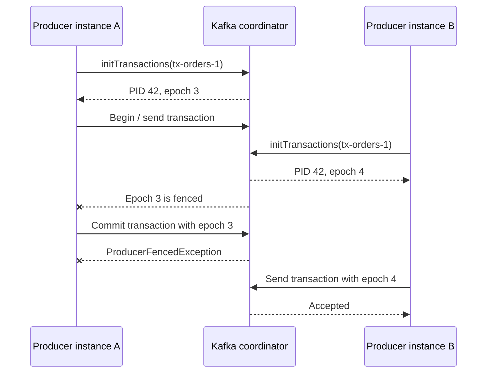

# Unique Transaction IDs Across Instances and Producer Fencing Errors

## 1. Why does Kafka need a transactional ID?

Kafka supports producer transactions to write multiple records and, in an appropriate consume-transform-produce flow, commit input offsets together with output records. For the broker to track a transactional producer across initializations, the producer uses an identifier called **`transactional.id`**.

`transactional.id` represents a logical producer. When a producer initializes transactions with this identifier, Kafka assigns or recovers a corresponding producer ID and epoch. The epoch helps the broker distinguish the current producer from an older producer that may still be running without write authority.

If two concurrently running producers use the same `transactional.id`, the later-initializing producer bumps the epoch and **fences** the older producer. The older producer is rejected on subsequent transactional operations. This is a consistency safeguard: at any point in time, only the producer holding the valid epoch for a transactional ID may continue.

Therefore, each application instance running a transactional producer concurrently needs an appropriate identifier. Sharing a single fixed `transactional.id` across all replicas is a common configuration mistake that leads to `ProducerFencedException`.

## 2. Producer ID, epoch, and the fencing mechanism

Kafka distinguishes producers using two internal components:

- **Producer ID (PID):** a broker-managed producer identifier.
- **Producer epoch:** the producer's generation number tied to the transactional ID. When a new producer initializes with the same transactional ID, the epoch increments to invalidate the old producer.

Each batch sent by a transactional producer also carries a per-partition sequence number so the broker can detect retries and maintain producer session consistency.



In the diagram, two instances use the same transactional ID. Kafka transfers ownership to the new epoch; the old instance can no longer commit transactions. This is intentional fencing behavior, not a transient network error that can be retried on the same producer.

## 3. Why must transactional IDs be unique across instances?

A Spring Cloud Stream application may run multiple replicas to share load. Replicas normally share a consumer group to read a topic, but they must have separate transactional producer identities if each replica creates independent transactional producers.

Example three-replica deployment:

| Instance | Consumer group | Transactional ID prefix |
|---|---|---|
| `orders-0` | `order-processor` | `orders-tx-orders-0-` |
| `orders-1` | `order-processor` | `orders-tx-orders-1-` |
| `orders-2` | `order-processor` | `orders-tx-orders-2-` |

Sharing a consumer group is normal: instances coordinate to split partitions. The transactional ID prefix must differentiate active instances so one instance's producer does not fence another instance's producer.

Do not confuse the two identifiers:

- `group` or `group.id` identifies the consumer group and read progress.
- `transactional.id` identifies the logical producer and epoch ownership of a transactional producer.

A consumer group can contain many instances, each with its own transactional producer. Sharing a group does not mean sharing a transactional ID.

## 4. How stable should a transactional ID be?

A transactional ID must satisfy two seemingly opposing requirements:

1. **Distinct across concurrent producers:** two simultaneously active instances must never accidentally share an ID.
2. **Reusable by the same logical instance upon recovery:** if an old process hangs or shuts down uncleanly, a new producer for the same logical instance can reuse the ID so Kafka fences the old producer.

Therefore, derive the identifier from a logical instance identity that is stable over the instance's lifecycle, rather than using one constant across the entire deployment or generating a new random string on every send.

For example, in containerized environments, you can include the Pod UID or a stable StatefulSet ordinal in the prefix. Understand the identity lifecycle:

- Replicas `orders-0` and `orders-1` must have different prefixes.
- When `orders-0`'s process restarts and replaces that same instance, reusing `orders-0`'s identity helps fence any lingering old producer.
- When scaling up a new replica, the new replica must receive an identity not used by any running replica.

If every restart generates a brand-new identity, the new producer cannot fence an old producer holding the previous transactional ID. If every replica uses the same identity, they fence each other. Identity assignment must align with instance orchestration and controlled shutdown.

## 5. Configuring transactionIdPrefix in the Spring Cloud Stream Kafka binder

The Spring Cloud Stream Kafka binder enables transactions by configuring `transactionIdPrefix`. This prefix is used to generate transactional IDs for producers managed by the binder/Spring Kafka.

Example configuration:

```yaml
spring:
  cloud:
    function:
      definition: processOrder
    stream:
      kafka:
        binder:
          transaction:
            transactionIdPrefix: ${KAFKA_TX_ID_PREFIX}
      bindings:
        processOrder-in-0:
          destination: orders.events
          group: order-processor
        processOrder-out-0:
          destination: orders.processed
```

Each replica needs a distinct `KAFKA_TX_ID_PREFIX` value while producers of the same logical instance use the prefix managed for that instance. For example:

```text
orders-tx-orders-0-
orders-tx-orders-1-
orders-tx-orders-2-
```

Spring Kafka's producer factory can generate concrete transactional IDs by combining the prefix with suffixes to manage multiple producers within the same application. Do not manually append a random suffix per `send` call; let the binder/producer factory manage producer lifecycles according to your version's mechanism.

Property names and configuration structure should be verified against your project's Spring Cloud Stream Kafka binder version. In versions supporting this structure, `spring.cloud.stream.kafka.binder.transaction.transactionIdPrefix` enables transactions and provides the prefix.

## 6. Examples of providing prefixes from the deployment environment

In Kubernetes, you can use the Pod name as an identity when it distinguishes active replicas. Referenced variables must be declared earlier in the `env` list:

```yaml
env:
  - name: POD_NAME
    valueFrom:
      fieldRef:
        fieldPath: metadata.name
  - name: KAFKA_TX_ID_PREFIX
    value: "orders-tx-$(POD_NAME)-"
```

If using Pod UID instead of name, declare UID first and then reference it:

```yaml
env:
  - name: POD_UID
    valueFrom:
      fieldRef:
        fieldPath: metadata.uid
  - name: KAFKA_TX_ID_PREFIX
    value: "orders-tx-$(POD_UID)-"
```

The Pod name typically distinguishes concurrent replicas and can be reused when a StatefulSet replaces a Pod with the same ordinal; the Pod UID distinguishes each Pod incarnation. Use the Pod name if the same logical slot should reuse its identity during controlled replacement; use the UID if each incarnation needs a separate identity and the platform ensures the old process has terminated before creating a new incarnation. Choose the identity strategy based on your fencing goals and how your platform manages instance lifecycles.

Do not use a shared service hostname, deployment name, or a literal like `orders-tx-` for all replicas. Those values are typically identical across instances.

## 7. Spring Kafka producer factory and suffixes

In Spring Kafka, `transactionIdPrefix` is the prefix used by `DefaultKafkaProducerFactory` to construct transactional IDs for producers. The producer factory can manage caching and suffixes to supply separate producers for active transactions within the same application.

Thus, distinguish between:

- **Application/instance-level prefix:** supplied via binder or producer factory configuration; must be unique across concurrent instances.
- **Full transactional ID:** prefix combined with a suffix generated by the producer factory.
- **Producer ID and epoch:** values managed by the broker after the producer initializes transactions.

Avoid manually managing all three layers in business code. Normally, the application simply configures the proper prefix and lets the binder/Spring Kafka manage producer lifecycles. If creating a `KafkaProducer` manually outside the binder, the application itself is responsible for configuring transactional IDs, calling `initTransactions`, begin/commit/abort, and closing the producer properly.

## 8. What is ProducerFencedException?

`ProducerFencedException` indicates that the current producer has been fenced by Kafka because another producer initialized with the same transactional ID and a newer epoch, or producer ownership changed under the transaction protocol.

Common scenarios:

- Two replicas share the same `transactionIdPrefix` and generate the same transactional ID.
- A new logical instance starts with the same ID while the old producer is still active.
- A rolling deployment accidentally uses the same prefix for old and new versions.
- Two independent processes are configured with the same transactional ID.
- A stalled old process wakes up and tries to send or commit after its replacement instance has initialized with the same ID.

Once an old producer is fenced, its subsequent transactional operations are no longer valid. Do not treat this error like an ordinary timeout by retrying endlessly on the same producer instance. Resolve the identity conflict and let the producer lifecycle reinitialize properly.

## 9. Distinguishing fencing from other producer errors

Not all producer errors are fencing. Accurate classification guides recovery:

| Error | Common Meaning | Resolution |
|---|---|---|
| `ProducerFencedException` | Producer was fenced by a newer producer using the same transactional ID | Stop old producer, locate duplicate ID instances, fix identity/ownership |
| `InvalidProducerEpochException` | Producer epoch is no longer valid for the operation | Inspect transaction lifecycle and producer fencing; current producer cannot continue that transaction |
| `OutOfOrderSequenceException` | Sequence number does not match broker-expected state | Inspect producer session, retries, and config; handle per client/binder semantics |
| `TimeoutException` | Request or transaction did not complete within allowed time | Check network, broker, timeouts, and transaction state; may retry per policy |
| `NotEnoughReplicasException` | ISR below required write threshold | Check ISR, replication, and `min.insync.replicas` |
| `TransactionalIdAuthorizationException` | Principal lacks permission to use transactional ID | Fix ACLs/broker permissions; retries will not help |

Exceptions may be wrapped in Spring Messaging or binder exceptions. When investigating, inspect the cause chain and check the transactional ID, client ID, application instance, and startup timestamps.

## 10. What does fencing protect?

Suppose instance A starts a transaction and loses connectivity with the orchestrator. Instance B starts up to replace A and reuses A's transactional ID. The broker issues a new epoch to B. If A recovers and tries to commit its transaction using the old epoch, the broker rejects it.

Without fencing, A and B could continue writing under the same logical producer identity, making it hard for the application to know which transaction is valid. Fencing strips the old producer of commit authority.

Fencing does not automatically guarantee that the entire business operation runs only once. If A already executed a side effect outside Kafka before getting fenced, that side effect does not roll back automatically. Databases, HTTP APIs, or payment systems still require idempotency and their own transaction handling.

## 11. Handling ProducerFencedException in Spring Cloud Stream

For producers managed by the Kafka binder/Spring Kafka, do not catch `ProducerFencedException` inside a function and ignore it to proceed as if it succeeded. Being fenced means the current producer has lost transactional ownership. If the exception is wrapped, preserve the cause for logging and investigation.

Appropriate response procedure:

1. Identify the transactional ID/prefix of the failing producer.
2. Locate other instances using the same prefix or ID.
3. Check rolling deployments, autoscaling, and lingering old processes.
4. Ensure every active instance has a unique prefix.
5. Stop the producer/instance that lost ownership; do not continue using the current transaction.
6. Let the binder/producer factory close and recreate producers according to its supported lifecycle.
7. Verify input messages were not falsely acknowledged and reprocess idempotently if needed.

Depending on how the binder/container manages producers, a fatal error may halt the transaction or listener and require restarting the context/instance. Do not assume Spring Cloud Stream will automatically alter the prefix after an error; the prefix is an identity setting, not a retry counter.

## 12. Rolling deployments and autoscaling

When deploying a new version, old and new instances may coexist briefly. If all share the same `transactionIdPrefix`, the new producer can fence the old producer as soon as it initializes transactions. This causes errors during rolling updates and can abort in-flight transactions.

Identity design for deployments:

- Each running replica has its own prefix.
- Do not use an identical shared configuration variable across all replicas if the binder requires distinct prefixes.
- With StatefulSets, the ordinal can form part of the identity when guaranteed that no two processes with the same ordinal run concurrently.
- With Deployments where Pod names change, use an instance identity assigned uniquely to each Pod incarnation or an explicit lease/ownership mechanism.
- Ensure shutdown has a graceful timeout so open transactions complete or abort before the process exits.
- Do not reuse an old instance's identity while that instance may still be active.

If a new instance needs to fence a stalled old process, reuse the same logical identity intentionally only after the system determines the old instance has lost ownership. Never carelessly assign identical IDs to two healthy replicas.

## 13. Transaction timeouts and producer fencing

Kafka transactions have timeouts. If a transaction is not committed or aborted within the allowed time, the coordinator can terminate it per broker policy. A transaction timeout is not the same as producer fencing from duplicate IDs, though both can appear together when an application hangs or producer lifecycles are mismanaged.

Items to verify:

- Producer/binder `transaction.timeout.ms`.
- Broker-side `transaction.max.timeout.ms`.
- Function processing time and dependent service call durations.
- Consumer poll interval and listener processing time.
- Shutdown timeout and how transactions abort on stop.
- Number of cached transactional producers and binding concurrency.

If the transaction timeout is too short relative to processing time, transactions may abort before the function completes. If the timeout is too long, failed transactions hold resources and delay recovery. Choose timeouts based on SLOs and measured processing times.

## 14. Inspecting transactional IDs and fencing errors

When errors occur, gather sufficient evidence to identify which two producers are contending:

1. Record application name, instance ID, Pod/host, and deployment version.
2. Record the resolved `transactionIdPrefix` (without logging secrets).
3. Inspect Kafka client logs containing `client.id`, transactional ID, and exception causes.
4. Compare producer initialization timestamps across instances.
5. Check whether environment/secret/config-map settings were unintentionally shared.
6. Check actual replica counts during rolling updates and autoscaling.
7. Determine whether open transactions were aborted or input offsets remained uncommitted.

Logs should not merely say "Kafka transaction failed". Include instance identity, binding, topic, and root exception to distinguish fencing from network or ISR errors.

## 15. Testing uniqueness across instances

Testing must run genuinely separate instances, not just instantiate two producers in a single unit test:

1. Start two replicas with two different prefixes and verify both can execute transactions.
2. Send many messages through a shared consumer group and verify partitions balance normally.
3. Intentionally start two producers with the same transactional ID in a test environment and observe the older producer getting fenced.
4. Restart the same logical instance with an identity designed for reuse; verify the old producer can no longer commit.
5. Perform a rolling deployment with old/new replicas and verify prefixes do not collide.
6. Stop an instance mid-transaction and verify the transaction aborts or recovers per configuration.
7. Check input offsets and output records after fencing to detect loss or duplicate processing.
8. Test consumer retry/idempotency because fencing does not roll back side effects outside Kafka.

The Test Binder does not fully simulate the Kafka transaction coordinator, producer epochs, or fencing. These tests require a real Kafka broker or an integration environment compatible with your Kafka client/binder version.

## 16. Observability and operations

Monitor the following metrics and logs:

- Counts of `ProducerFencedException` and `InvalidProducerEpochException`.
- Counts of started, committed, aborted, and timed-out transactions.
- Transactional ID prefix per instance (non-sensitive metadata only).
- Producer creation/close events, producer cache, and active producer count.
- Rolling deployments, restarts, and autoscaling events.
- Consumer lag, rebalances, and reprocessed message counts after aborts.
- Output binding and transaction coordinator errors.

Set alerts on repeated fencing across instances. A single fencing error can happen during intentional recovery, whereas continuous fencing usually indicates duplicate identities or mis-coordinated producer lifecycles.

## 17. Procedure for designing transactional IDs

1. Determine how many transactional producers can operate concurrently.
2. Choose a stable logical instance identity for each replica.
3. Generate a `transactionIdPrefix` that is unique across active instances.
4. Configure the prefix via `spring.cloud.stream.kafka.binder.transaction.transactionIdPrefix` per your binder version.
5. Let the binder/Spring Kafka manage suffixes and producer lifecycles.
6. Design restarts/rolling deployments so the same logical instance can recover safely without colliding with other replicas.
7. Classify `ProducerFencedException` as a producer ownership-loss error; do not blindly retry it like a timeout.
8. Test multiple replicas, restarts, autoscaling, and fencing against real Kafka.
9. Monitor transaction aborts, fencing, and consumer replays in production.

A transactional ID is the logical producer's identity in Kafka's transaction protocol. Prefixes must be unique across concurrent producer instances, while reusing an identity on restart must tie back to ownership of the same logical instance. Kafka uses producer epochs to fence older producers when a new producer takes over the same ID. Configuring `transactionIdPrefix` properly, managing instance lifecycles, and treating fencing as a fatal producer error enable Spring Cloud Stream to run transactions reliably in multi-replica environments.
