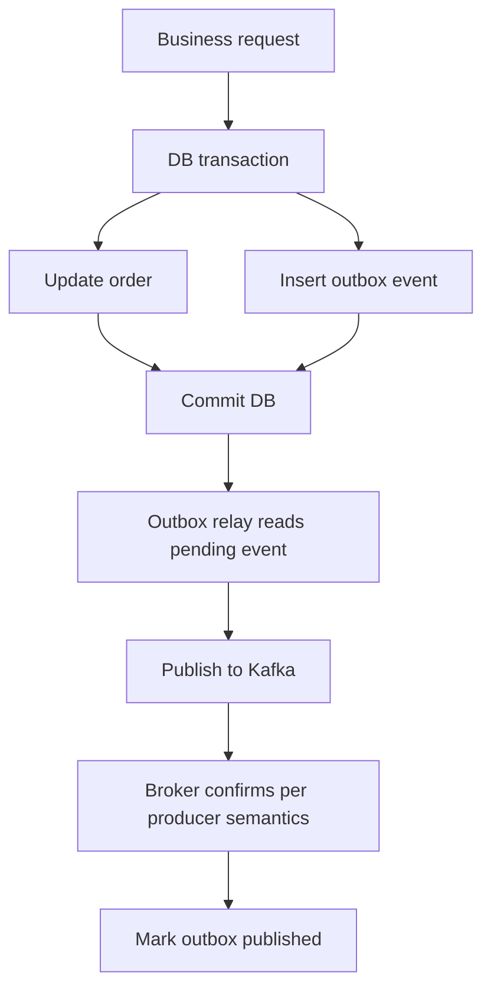

# Distinguishing Kafka Transactions from Database Transactions

## Objectives

A Spring Cloud Stream application can read an event from Kafka, update a database, and emit a new event. Looking at the code, all of those operations might sit inside a single service method, yet in reality they belong to two independent storage systems: Kafka manages records and offsets; the database manages rows and its own transactions.

**Kafka transactions** guarantee atomicity for Kafka operations within the same transaction, such as writing multiple records and committing consumer offsets. **Database transactions** guarantee atomicity for changes inside the database. The two types of transactions do not automatically become a distributed transaction simply because they are invoked in the same Java method or under the same `@Transactional` annotation.

This lesson clarifies the guarantee scope of each transaction type, failure windows when coordinating Kafka with a database, how the Spring Cloud Stream Kafka binder supports transactions, and how to use transactional outbox/inbox to build reliable data flows.

After this lesson, you will be able to:

- Distinguish Kafka transactions from JDBC/database transactions.
- Understand how Kafka transactions can make output records and input offsets atomic.
- Configure transactions for the Spring Cloud Stream Kafka binder.
- Explain why a standard `@Transactional` does not automatically commit Kafka and a database together.
- Identify failures when the database commits but Kafka publishing fails, or vice versa.
- Design a transactional outbox and inbox/idempotency.
- Choose the right strategy for consume-transform-produce versus workflows with database side effects.
- Test commits, aborts, duplicates, and failure windows.

## 1. A transaction is the atomic boundary of a single resource

A transaction groups a set of operations into a single unit of success or failure. If the transaction commits, changes within its scope are confirmed; if it rolls back/aborts, those changes are not treated as committed.

The crucial point is that **a transaction manager only manages the resources enlisted and supported within its transaction**. A JDBC transaction typically manages a database connection. A Kafka transaction manages a transactional producer, the sent records, and offsets included in the transaction. They can be used in the same business flow, but they do not implicitly share an atomic commit.

| Transaction Type | Primary Resource | Can Protect |
|---|---|---|
| Database/JDBC transaction | Database connection and transaction | `INSERT`, `UPDATE`, `DELETE`, and database changes in the same transaction |
| Kafka producer transaction | Kafka transactional producer | Writing multiple records to one or more topics/partitions in the same Kafka cluster |
| Kafka consume-transform-produce transaction | Kafka input offsets and output records | Committing offsets and output records together in one Kafka transaction |
| Business transaction combining DB + Kafka | Two independent systems | Requires a coordination pattern; does not get atomic commit from a single annotation |

Example database transaction:

    @Transactional
    public void createOrder(Order order) {
        orderRepository.save(order);
        inventoryReservationRepository.create(order.id());
    }

If both repositories use the same transaction manager and the same database transaction, both changes commit or roll back together. Kafka is not part of this transaction just because the service might also call `StreamBridge.send()`.

## 2. What do Kafka transactions guarantee?

A Kafka transaction allows a producer to write a group of records atomically. Consumers using the `read_committed` isolation level read only records belonging to committed transactions; records from aborted transactions are not treated as committed data.

Kafka transactions also support the consume-transform-produce model: the application reads a record, creates output records, and includes the corresponding input offset in the same transaction. When the transaction commits, output records and input progress are confirmed together. If the transaction aborts, outputs are not exposed to `read_committed` consumers and the input offset is not committed by that transaction, so the input record can be reprocessed.

High-level flow:

    Consumer reads input record
        -> Process and create output record
        -> Send output record in Kafka transaction
        -> Include input offset in same transaction
        -> Commit Kafka transaction
             -> Output visible to read_committed consumers
             -> Input offset acknowledged
        -> If aborted:
             -> Transaction output is not visible
             -> Input offset does not advance via transaction

A Kafka transaction can span multiple topics and partitions within the same cluster. It does not include a standard JDBC transaction, filesystem, HTTP API, or another broker.

### Producer idempotence and transactions are different

Producer idempotence helps a Kafka producer handle protocol-level retries to avoid creating duplicate records from resends within the same producer session/sequence. Kafka transactions add the ability to commit or abort a group of records and coordinate offsets.

These two features are related but not synonymous:

- An idempotent producer does not automatically merge multiple business operations into a transaction.
- A Kafka transaction does not automatically make database writes atomic.
- Neither removes the need for idempotency when an application replays events or re-executes side effects outside Kafka.

## 3. Kafka transactions in Spring Cloud Stream

The Spring Cloud Stream Kafka binder can use a transactional producer. When a transaction ID prefix is configured, the binder creates a producer with a transaction ID and manages Kafka transactions via the binder's integration mechanism.

Illustrative configuration example:

    spring:
      cloud:
        stream:
          bindings:
            orders-out-0:
              destination: orders.processed
          kafka:
            binder:
              transaction:
                transaction-id-prefix: ${INSTANCE_ID:local}-orders-tx-

`transaction-id-prefix` enables the Kafka binder's transaction support when configured according to the corresponding binder version. The prefix must be designed so concurrently running instances do not contend for transactional IDs. In multi-replica environments, provide a distinct/stable per-instance identity per binder and Spring Kafka guidance; do not share a conflicting transactional identity across multiple independent producers.

Producer properties for the transactional producer are configured under the binder's transaction producer configuration section, rather than assuming all regular binding-level producer properties apply identically:

    spring:
      cloud:
        stream:
          kafka:
            binder:
              transaction:
                transaction-id-prefix: ${INSTANCE_ID:local}-orders-tx-
                producer:
                  configuration:
                    acks: all

Property names, how the binder generates suffixes, and placement of producer properties should be verified against your Spring Cloud Stream Kafka binder version. In particular, transaction IDs must be unique among concurrently active producers.

When transactions are enabled on the binder, output bindings belonging to that binder can use the transactional producer per the transaction configuration. In a consume-transform-produce flow, the binder can place output records and input offsets into the same transaction via container transaction integration. This applies only to Kafka operations participating in that transaction.

### Consumers reading committed data

Consumers need an appropriate isolation level if they must not see data from uncommitted or aborted transactions:

    spring:
      cloud:
        stream:
          kafka:
            binder:
              configuration:
                isolation.level: read_committed

Configuring isolation in the exact namespace may vary by binder version or by consumer binding. Verify the effective Kafka consumer properties in the application. If a consumer uses `read_uncommitted`, it can see records from in-progress or aborted transactions; that is unsuitable when only committed data must be read.

### Transaction timeouts and operations

Kafka transactions have timeouts. If processing runs past the allowed time, the broker can abort the transaction. Consider:

- Batch processing duration.
- Dependency call durations.
- Output sending time.
- Commit duration.
- `transaction.timeout.ms` configuration and broker limits.
- Maximum time allowed between consumer polls.

Do not raise timeouts indefinitely to hide a hanging handler. Set dependency timeouts, bound batch sizes/concurrency, and monitor transaction aborts.

## 4. Database transactions do not automatically include Kafka

The following example looks like an atomic operation:

    @Service
    public class OrderService {

        private final OrderRepository repository;
        private final StreamBridge streamBridge;

        @Transactional
        public void createOrder(Order order) {
            repository.save(order);
            streamBridge.send("orders-out-0", OrderCreated.from(order));
        }
    }

If the selected transaction manager is the database transaction manager, `repository.save()` joins the database transaction. Calling `StreamBridge.send()` sends a message via the output binding, but it does not automatically become part of that JDBC transaction.

Some integrations can coordinate transaction managers or synchronize commit order across resources. However, sequentially committing two resources does not create a distributed atomic commit. If the process crashes between the two commits, one resource may have committed while the other has not.

Always identify which transaction manager governs a method. `@Transactional` is not a universal directive that every external system invoked inside the method rolls back together.

## 5. Two failure windows when writing a database and publishing to Kafka

Suppose the business logic must persist an order and emit `OrderCreated`.

### Database commits first, Kafka publish fails

1. The database saves the order and commits.
2. The application sends `OrderCreated`, but the broker rejects it or the producer errors.
3. The order exists, yet consumers never learn about the new order.

This is a missing event relative to database state. Retrying the HTTP request may create an extra order if the endpoint is not idempotent.

### Kafka commits first, database rolls back

1. The application publishes `OrderCreated` successfully.
2. The database transaction rolls back due to an error.
3. Consumers receive an event for an order that does not exist or was never committed.

This is a phantom event relative to the database.

### Both succeed, but the response is lost

1. The database commits.
2. The Kafka publish succeeds.
3. The process or client connection fails before the caller receives the response.
4. The caller retries and may trigger the operation/publish again.

This is a common source of duplicates. API idempotency keys and stable message event IDs are required.

| Failure Window | Database | Kafka | Consequence |
|---|---|---|---|
| DB commits, publish fails | Committed | No event | Missing event |
| Publish commits, DB rolls back | Rolled back | Event committed | Event does not reflect DB state |
| Both commit, response lost | Committed | Committed | Caller retry may create duplicate |
| Process dies between commits | One side committed | Other side uncommitted | Divergent state |
| Publish succeeds, outbox marking fails | Outbox still pending | Event already exists | Relay may send duplicate |

This is why two independent operations must not be treated as "one transaction" merely because they live in the same service method.

## 6. Transactional outbox: writing state and event in the same DB transaction

The transactional outbox closes the producer-side failure window by writing both the business state change and an outbox record in **the same database transaction**. A separate relay reads the outbox and sends messages to Kafka.

Flow:

If the database transaction rolls back, both the order update and the outbox row roll back. If it commits, the event is durably persisted in the database so the relay can retry after Kafka outages.

Example schema:

    CREATE TABLE outbox_event (
        event_id VARCHAR(120) PRIMARY KEY,
        aggregate_id VARCHAR(120) NOT NULL,
        event_type VARCHAR(160) NOT NULL,
        payload JSON NOT NULL,
        created_at TIMESTAMP NOT NULL,
        published_at TIMESTAMP NULL
    );

Business service:

    @Transactional
    public void createOrder(Order order) {
        orderRepository.save(order);

        OrderCreated event = OrderCreated.from(order);
        outboxRepository.insert(
                event.eventId(),
                order.id(),
                "order.created",
                serialize(event),
                clock.instant()
        );
    }

Both repository operations participate in the same database transaction. The method does not send to Kafka directly; the relay handles publishing after the transaction commits.

### Outbox relay must confirm publishing before marking

The relay can use polling, batching, or CDC. With polling, it queries unpublished rows, sends messages, and marks rows published only after proof of successful delivery per producer/binder semantics.

Pseudo-flow:

    for each pending outbox row:
        publish event with original event_id
        wait for successful broker send result
        mark row published

Do not treat `StreamBridge.send()` returning `true` as proof that the broker durably stored the record; that value indicates the message was accepted by the framework's send path. Use an appropriate confirmation mechanism for your binder/producer, such as a send result/callback or Kafka producer future depending on configuration, before marking the outbox.

### Why can an outbox still send duplicates?

Suppose Kafka received the event, but the relay crashed before updating `published_at`. Upon restart, the relay sees the row is still pending and sends it again. Hence, the transactional outbox typically provides at-least-once delivery rather than guaranteeing end-to-end exactly-once on its own.

To handle duplicates:

- Keep `event_id` unchanged across all retries.
- Have consumers store processed event IDs with a unique constraint.
- Perform inbox/dedup writes and business state updates in the same DB transaction.
- Emit metrics for outbox age, pending row count, retries, and publish failures.
- Have a procedure to handle stuck rows or incompatible payloads.

### Polling or CDC?

| Relay Approach | Characteristics | Considerations |
|---|---|---|
| Polling relay | Application queries pending rows in batches | Row locking/claiming, batch size, polling interval, and cleanup |
| CDC/outbox connector | Reads database transaction log changes and streams outbox records to Kafka | Connector setup, schema routing, log/replication permissions, and CDC operations |

CDC can reduce polling overhead and leverage the database log, but requires connector infrastructure and schema policies. Regardless of approach, event IDs and consumer idempotency remain essential.

## 7. Consumer writing to a database: inbox and commit order

On the consumer side, an application may receive a Kafka event and update a database. The Kafka offset and the database transaction are also two separate resources.

A failure window:

1. Consumer reads the event.
2. Database updates and commits successfully.
3. Process dies before the Kafka offset is committed.
4. Kafka redelivers the event after consumer restart/rebalance.
5. The database may receive the same side effect again.

One solution is an inbox table:

    CREATE TABLE inbox_event (
        event_id VARCHAR(120) PRIMARY KEY,
        received_at TIMESTAMP NOT NULL
    );

The consumer executes within one DB transaction:

    @Transactional
    public void handle(OrderCreated event) {
        boolean firstDelivery = inboxRepository.insertIfAbsent(
                event.eventId(),
                clock.instant()
        );

        if (!firstDelivery) {
            return;
        }

        inventoryService.reserve(event.orderId());
    }

If the event ID already exists, the side effect was already applied in an earlier transaction; redelivery can return without repeating business logic. If the transaction rolls back, both the inbox insert and the database side effect roll back, allowing redelivery to try again.

Ensure `insertIfAbsent` relies on a unique constraint or an atomic database operation. An unprotected "SELECT first then INSERT" pattern can race when two consumers process the same event concurrently.

### When is the offset committed?

For a Kafka consumer, configure acknowledgement/commit so the offset never advances past incomplete database work. Exact mechanics depend on the Kafka binder, container transaction mode, ack mode, and function model.

If the offset commits before the DB commits and then the DB rolls back, the message may be skipped upon restart. If the DB commits before the offset commits, the message may be redelivered, but inbox/idempotency handles the duplicate. For database side effects, the latter is usually easier to make correct because it trades controlled duplicates for avoiding message loss.

Do not blindly enable Kafka auto-commit or manually commit offsets outside the binder's mechanism without understanding the interactions. Test the failure window by stopping the consumer between the DB commit and the offset commit.

## 8. Kafka consume-transform-produce: atomicity within Kafka

An ideal use case for Kafka transactions is:

- Read `orders.created`.
- Compute and produce `orders.accepted`.
- Commit the input record's offset.
- Group the output and offset into the same Kafka transaction.

When the binder supports transactional listeners/containers and bindings share the same Kafka binder transaction, the framework can coordinate sending output records and committing input offsets within a single Kafka transaction. If processing fails and the transaction aborts, the output record is hidden from `read_committed` consumers and the input offset does not advance via that transaction.

This is a strong guarantee for Kafka-to-Kafka flows. If the function also calls a database or HTTP API, those side effects do not automatically roll back when the Kafka transaction aborts. When the message is reprocessed, side effects outside Kafka may happen again.

### Function example

    @Bean
    Function<OrderCreated, OrderAccepted> acceptOrder(OrderPolicy policy) {
        return event -> policy.accept(event);
    }

Function and binding configuration:

    spring:
      cloud:
        function:
          definition: acceptOrder
        stream:
          bindings:
            acceptOrder-in-0:
              destination: orders.created
              group: order-acceptor
            acceptOrder-out-0:
              destination: orders.accepted
        kafka:
          binder:
            transaction:
              transaction-id-prefix: ${INSTANCE_ID:local}-accept-order-

The example illustrates binder transaction configuration. Verify transaction mode, producer settings, consumer isolation, and error handling for your Spring Cloud Stream Kafka binder version. Simply declaring the prefix does not enlist database calls inside the function into the Kafka transaction.

## 9. Why doesn't @Transactional solve cross-resource atomicity?

Spring's `@Transactional` typically selects one transaction manager via qualifier or default resolution. For example:

- `DataSourceTransactionManager`/corresponding transaction manager manages database connections.
- `KafkaTransactionManager` manages Kafka producer transactions.
- The Kafka binder has its own transaction integration for listener/output flows.

If a method uses the database transaction manager, Kafka sends do not automatically join the database transaction. If a method uses the Kafka transaction manager, JDBC operations do not automatically join the Kafka transaction.

Transaction synchronization can be configured so one transaction manager commits before or after another resource, but that is merely ordering coordination and still leaves a failure window between commits. Synchronization must not be interpreted as an atomic distributed commit.

A true distributed transaction/2PC system requires a coordinator and resource managers that actually support that protocol. Kafka transactions are not a generic XA mechanism to automatically enlist arbitrary JDBC databases. In most event-driven architectures, outbox/inbox and idempotency are more practical and operable than attempting a distributed transaction across a database and Kafka.

## 10. Choosing a strategy by use case

| Use Case | Mechanism to Consider | Guarantee Scope |
|---|---|---|
| Write multiple Kafka records as one unit | Kafka producer transaction | Output records commit/abort together |
| Consume Kafka, transform, produce Kafka | Offset-integrated Kafka transaction | Input offset and output records share one transaction |
| Update DB then emit event | Transactional outbox | DB state and outbox row are atomic; relay delivers at-least-once |
| Consume Kafka then update DB | Inbox/idempotency + DB transaction | DB side effects do not repeat on redelivery |
| Call external HTTP API then commit Kafka offset | API idempotency key or workflow/outbox | Handles retries outside Kafka |
| Write DB and Kafka in the same method | Do not assume a single shared transaction | Must explicitly design failure recovery |

The key design question is not "should we use `@Transactional`?", but rather:

1. Which resources must commit together?
2. Can duplicates be tolerated?
3. Can events be recovered after a process crash?
4. Is the source of truth in the database, Kafka, or an event store?
5. Are consumers idempotent?
6. Is immediate consistency required or is eventual consistency sufficient?

## 11. Testing Kafka transactions

A Kafka transaction test must verify both commit and abort behavior with the proper consumer isolation level.

### Successful commit

- Start transaction.
- Send one or more records.
- Commit transaction.
- A `read_committed` consumer sees all committed records.
- No records in the transaction group are unexpectedly missing.

### Abort

- Start transaction.
- Send output records.
- Abort due to exception or error.
- A `read_committed` consumer does not see records belonging to the aborted transaction.
- For consume-transform-produce, the input offset was not committed with the transaction and the record can be reprocessed.

### Consume-transform-produce

- Send input record.
- Consumer processes and sends output inside a transaction.
- Verify output record and input offset commit together.
- Force the transaction to abort and verify output is hidden while input can be read again.
- Use a `read_committed` consumer to inspect results.

The Test Binder is useful for verifying Spring Cloud Stream wiring, but does not replace Kafka broker integration tests for verifying the transaction coordinator, isolation levels, offset transactions, and fencing.

## 12. Testing database and Kafka coordination

Failure windows must be tested rather than testing only the happy path.

### Outbox tests

- Roll back DB transaction: neither domain row nor outbox row exists.
- Commit DB transaction: both domain row and outbox row exist.
- Kafka unavailable: outbox row remains pending and relay retries later.
- Kafka receives event but relay dies before marking published: event may be resent; consumer deduplicates by event ID.
- Bad payload/schema: row is retained for investigation or moved to error state per policy, not silently deleted.

### Inbox tests

- New event: inbox row and domain update commit together.
- Duplicate event ID: side effect does not repeat.
- DB rollback: inbox row also rolls back so the event can be reprocessed.
- DB commits but offset is uncommitted: redelivery does not repeat side effects.
- Consumer crashes before DB commit: event is redelivered and processed normally.

### Failure injection

You can simulate:

- Stopping the process after DB commit but before Kafka publish.
- Stopping the relay after Kafka send succeeds but before updating the outbox.
- Stopping the consumer after DB commit but before offset commit.
- Making the Kafka transaction abort after sending output.
- Injecting timeouts or connection drops during commit.

Tests must observe the final state of the database, Kafka topics, outbox/inbox tables, and offsets. Checking only that an exception was thrown is insufficient.

## 13. Operations and observability

For Kafka transactions, monitor:

- Transaction commit/abort rates.
- Transaction timeouts and fencing errors.
- Producer send failures.
- Consumer lag and offset commit failures.
- Processing duration per transaction/batch.
- Number of records sent per transaction.

For outbox/inbox, monitor:

- Pending row count.
- Age of the oldest outbox row.
- Retry and publish failure rates.
- Duplicates filtered by the inbox.
- Events in error state requiring intervention.
- Latency from DB commit to Kafka publish.
- Size and cleanup policy of outbox/inbox tables.

Do not let the outbox grow unbounded. Define retention/archival for published rows, indexes on status and timestamp, batch sizes, locking strategies, and cleanup jobs. Do not delete a pending row merely because it is old; investigate and make an explicit operational decision.

## 14. Common mistakes

| Symptom | Possible Cause | Resolution |
|---|---|---|
| DB rolls back but Kafka event still exists | Kafka send did not participate in the DB transaction | Use outbox or proper transaction boundaries |
| DB commits but event is missing | Publish failed after DB commit | Write outbox in the same DB transaction |
| Consumer applies side effect twice | DB committed but offset did not commit | Inbox/unique event ID and idempotent handler |
| Consumer sees records from aborted transaction | Consumer uses wrong isolation level | Use `read_committed` when only committed records should be read |
| Kafka transaction gets fenced | Transactional ID prefix duplicated across producer instances | Assign distinct prefixes/identities per binder requirements |
| Transaction timeout | Processing took too long or dependency hung | Bound batch sizes, dependency timeouts, and transaction duration |
| Outbox sends duplicates | Relay died after publish before marking | Preserve event ID and deduplicate on consumer |
| Thinking `@Transactional` covers every call | Unclear transaction manager and enlisted resources | Identify transaction manager, use outbox/inbox |
| Tests pass but production loses events | Only happy path tested, crash windows untested | Add broker integration and failure injection tests |

## 15. Procedure for designing transactions in an event flow

Before implementing, clarify these steps:

1. Draw the boundary of database transactions and Kafka transactions.
2. List all side effects: database writes, Kafka publishes, HTTP calls, files, or other brokers.
3. Determine which operations can commit atomically within the same resource.
4. If purely consume-transform-produce in Kafka, consider Kafka binder transactions and `read_committed` consumers.
5. If database state must accompany an event, write to an outbox in the same DB transaction.
6. If a consumer updates a database, write inbox/dedup and business state in the same DB transaction.
7. Keep event IDs stable across retries/replays.
8. Determine when offsets/acks are committed and test crash windows.
9. Test transaction commit/abort, outbox retries, duplicates, and consumer restarts.
10. Monitor transaction aborts, outbox age, consumer lag, and duplicate rates.

## Conclusion

Kafka transactions protect Kafka operations within the same transaction, especially useful when writing multiple output records and committing input offsets in a consume-transform-produce flow. Database transactions protect changes within a database. A standard `@Transactional` does not automatically turn these two transaction types into one shared atomic commit.

When business logic needs to update a database and emit an event, a transactional outbox persists business state alongside an event record in a single DB transaction; a relay emits the event at-least-once and consumers use inbox/idempotency to tolerate duplicates. When a consumer reads Kafka and writes to a database, commit DB side effects before the offset advances per binder policy and use an inbox to handle redeliveries. Always test real failure windows rather than relying solely on happy paths or annotation names.
