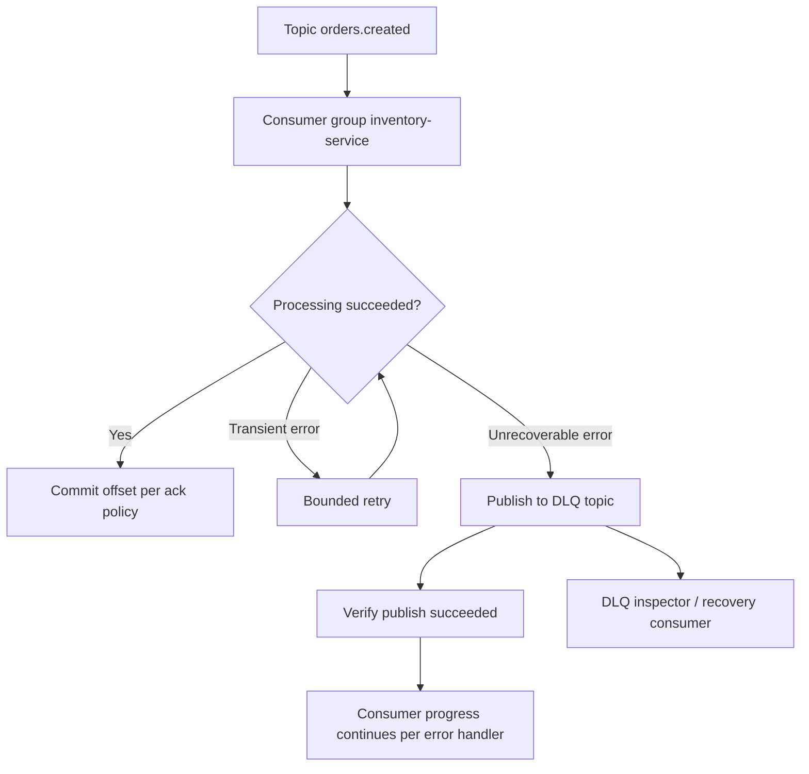

# Choosing Destination and Partition for Failed Records

When a Kafka consumer cannot process a record after appropriate attempts, the system can route the record to a Dead Letter Topic (DLT/DLQ) for investigation and recovery. Choosing the target topic and partition for a failed record affects error isolation across services, throughput, key ordering, access permissions, and the replay workflow.

In the Spring Cloud Stream Kafka Binder, you can enable dead-letter publishing for an input binding, specify the target topic name with `dlqName`, and control the DLQ's partition count. When multiple partitions are needed, `DlqPartitionFunction` lets you choose the partition for each failed record. A good design must retain sufficient source metadata for tracing, scope destinations properly, ensure the topic is configured appropriately, and avoid creating a DLQ that cannot be operated or replayed safely.

## 1. The DLQ Is Where Unprocessable Records Are Isolated

Kafka stores records in topics by partition. When a consumer cannot process a record, the error handler can retry, recover, or publish that record to another topic. This target topic is commonly called a Dead Letter Topic (DLT) or Dead Letter Queue (DLQ). For Kafka, the term "topic" is more accurate because records are stored in a log and re-read by consumer group/offset.



A DLQ separates failed records from the main stream so the consumer can continue processing other records according to the configured policy. It does not automatically fix payloads, determine how to recover business state, or guarantee that a record will be reprocessed exactly once. The operations team still needs to classify root causes, fix data or code, and replay in a controlled manner.

## 2. Choosing a Destination by Ownership Boundary

The DLQ destination should clearly indicate which stream the record came from and who owns handling it. With the Kafka Binder, if DLQ is enabled without declaring a custom name, the default name typically follows the pattern `error.<destination>.<group>`. For example, input destination `orders.created` with group `inventory-service` may use the topic `error.orders.created.inventory-service` depending on the binder/version naming convention.

You can set an explicit name with `dlqName`:

```yaml
spring:
  cloud:
    stream:
      bindings:
        processOrder-in-0:
          destination: orders.created
          group: inventory-service
      kafka:
        bindings:
          processOrder-in-0:
            consumer:
              enable-dlq: true
              dlq-name: orders.created.inventory-service.dlq
```

In this example, `enable-dlq` enables publishing unprocessable records to the Kafka Binder DLQ. `dlq-name` specifies the target topic. The binding needs a stable consumer group so consumption state and the DLQ have clear ownership. Verify the property names and support requirements for the Kafka Binder version you are using.

### 2.1. Dedicated DLQ per Destination and Group

This is usually the easiest option to operate when each group has its own error-handling process:

- `orders.created` + `inventory-service` → `orders.created.inventory-service.dlq`.
- `orders.created` + `payment-service` → `orders.created.payment-service.dlq`.
- `payments.requested` + `payment-worker` → `payments.requested.payment-worker.dlq`.

Two consumer groups reading the same topic can experience different errors and require different owning teams, retention periods, access permissions, and replay processes. A dedicated DLQ isolates backlogs and prevents one consumer's recovery from affecting another group.

### 2.2. When to Use a Shared DLQ?

A centralized DLQ can fit a platform that has a shared error-orchestration service, but it must retain complete source metadata and have a clear router. At minimum, it must be able to distinguish:

- Source topic and source consumer group.
- Original partition and offset.
- Event ID, key, and occurrence timestamp.
- Exception type and retry count.
- Application/schema version that processed the record.
- Owning team and recovery procedure.

If multiple streams write to the same DLQ without source metadata, operators will struggle to know where to replay records. A shared DLQ can also create a hot spot for throughput and access permissions. Do not choose a shared destination just to reduce topic count while ignoring ownership boundaries.

### 2.3. Dynamic Routing by Error Type

In some Kafka Binder versions, `DlqDestinationResolver` can be used to determine the DLQ topic at runtime, for instance separating schema errors, business errors, or system errors. Use dynamic routing only when there is a controlled set of destinations and an operational procedure for each category. Avoid constructing topic names directly from exception messages, tenant IDs, or untrusted data; that approach can generate an unbounded number of topics.

If you only need to classify failure causes, a stable DLQ accompanied by a `failureCategory` header or equivalent metadata field is usually easier to manage than many dynamic topics. The resolver API and configuration depend on the binder version; check the exact Javadoc before implementing.

## 3. Choosing the DLQ Partition Count

A DLQ can have one or multiple partitions. The choice depends on error throughput, parallelism requirements, preserving the relationship to source partitions, and how replay works.

| DLQ design | Benefits | Limitations |
|---|---|---|
| Single partition | Simple, easy to observe, and easy to read sequentially | Low throughput and parallelism; all failed records land in partition 0 |
| Same partition count as source topic | Can map failed records by source partition and process in parallel accordingly | Higher resource usage; requires consistent mapping and ensuring the DLQ topic is provisioned properly |
| Fewer partitions than source topic | Saves resources, consolidates multiple source partitions into one DLQ partition | Can create hot spots and loses one-to-one mapping between source and DLQ partitions |
| More partitions than source topic | Extra processing capacity during error spikes | Does not increase throughput without consumers; requires custom partitioning rules and separate offset management |

With `dlqPartitions`, the Kafka Binder allows specifying the desired partition count for the DLQ in supported configurations. When multiple partitions are needed, you can declare a `DlqPartitionFunction` bean to decide the target partition for each failed record. If there is only one partition, all records are sent to the single partition per binder behavior; do not return an index based on the source partition if that index could exceed the DLQ's range.

Example mapping that preserves the source partition index when the DLQ is provisioned with the same partition count:

```java
import org.apache.kafka.clients.consumer.ConsumerRecord;
import org.springframework.cloud.stream.binder.kafka.DlqPartitionFunction;
import org.springframework.context.annotation.Bean;
import org.springframework.context.annotation.Configuration;

@Configuration
public class KafkaDlqConfiguration {

    @Bean
    DlqPartitionFunction dlqPartitionFunction() {
        return (group, record, exception) -> record.partition();
    }
}
```

The function above uses the source partition as the DLQ partition. Only apply this when the DLQ topic has at least the required number of partitions and the source index is valid in the DLQ. If the source topic has 12 partitions while the DLQ only has 4, this function can return invalid indices 4–11. When partition counts differ, map explicitly—for instance using modulo against the known DLQ partition count or another bounds-checked rule.

The example below illustrates mapping onto 4 DLQ partitions:

```java
@Bean
DlqPartitionFunction dlqPartitionFunction() {
    int dlqPartitionCount = 4;
    return (group, record, exception) ->
            Math.floorMod(record.partition(), dlqPartitionCount);
}
```

Do not hardcode `4` in code if the partition count is managed per environment. Externalize the partition count into application configuration or retrieve it from validated metadata/provisioning. The function must return an existing partition; sending to an invalid index will cause DLQ publishing to fail.

### 3.1. Partitioning by Business Key

If records for the same entity must go to the same DLQ partition, you can select the partition based on the business key instead of the source partition. For example, all failures for the same `orderId` are grouped into one partition so a recovery worker can process them by key.

However, key-based partitioning requires ensuring:

- The key is present and stable on the failed record.
- The DLQ producer and recovery consumer use the same partitioning rule.
- The DLQ partition count is not changed arbitrarily because changing partition count can map keys to different partitions.
- A single key with excessive error volume does not create a hot partition.

Preserving the source partition works well when tracing and processing along the source stream. Choosing by key works well when the main goal is grouping failures by entity. There is no single rule that fits every DLQ.

## 4. Preserving Source Metadata

Records in the DLQ need enough information for investigation and replay. When the binder publishes a failed record, it can attach headers about the exception and origin. Exact header names depend on the binder version and configuration; inspect actual messages instead of assuming header names stay identical across all releases.

Fields that should be preserved or recorded include:

| Metadata | Purpose |
|---|---|
| Original topic | Identify the source destination to replay to the right place |
| Original partition | Trace source partitioning and ordering |
| Original offset | Locate the original record in the Kafka log |
| Record key | Maintain entity association and partitioning |
| Event ID | Prevent duplicate business processing |
| Correlation ID | Link logs/traces across services |
| Exception class/message | Classify the failure cause |
| Retry count or delivery attempt | Know how many times the record was tried |
| Consumer group and application | Identify the owner of the processing flow |
| Schema/content type/version | Select the right converter and consumer version during recovery |

Do not put stack traces or sensitive payloads into open logs. If the binder attaches exception headers, limit their size and access scope; consider storing full stack traces in a controlled logging system and keeping only short error codes/details in Kafka headers.

If an error occurs during deserialization before a Java payload is constructed, the path to the DLQ may differ from an error thrown inside the function. Deserializer settings, `ErrorHandlingDeserializer`, and the binder version affect how raw bytes and exceptions are forwarded. Test deserialization errors and business handler errors separately; do not assume every error reaches the same recoverer.

## 5. Provisioning and Configuring the DLQ Topic

A DLQ is a real Kafka topic and must be governed like a business topic:

- Partition count aligned with `DlqPartitionFunction` and the number of recovery consumers.
- Replication factor matching data durability requirements.
- Retention long enough for investigation and reprocessing; bounded to avoid unbounded storage growth.
- ACLs for DLQ publishers, recovery consumers, and operators.
- Quotas and monitoring so the DLQ does not impact primary topics.
- Cleanup policy suited to retaining failed records; do not enable compaction blindly if every error occurrence must be kept.

Example provisioning a dedicated DLQ topic with 12 partitions and replication factor 3:

```bash
kafka-topics.sh \
  --bootstrap-server kafka-1:9092 \
  --create \
  --topic orders.created.inventory-service.dlq \
  --partitions 12 \
  --replication-factor 3
```

These values are illustrative for a cluster with enough brokers. Inspect the topic after creation:

```bash
kafka-topics.sh \
  --bootstrap-server kafka-1:9092 \
  --describe \
  --topic orders.created.inventory-service.dlq
```

If the Kafka Binder is permitted to auto-create topics, you can let the binder provision them via `autoCreateTopics` and `autoAddPartitions`. In centrally managed production environments, provision DLQs via infrastructure-as-code pipelines and disable automatic creation/expansion in the application. Never allow `DlqPartitionFunction` to return a partition that has not been created.

## 6. Complete Consumer Configuration

The example below enables DLQ and declares a dedicated topic name:

```yaml
spring:
  cloud:
    function:
      definition: processOrder
    stream:
      bindings:
        processOrder-in-0:
          destination: orders.created
          group: inventory-service
          content-type: application/json
      kafka:
        bindings:
          processOrder-in-0:
            consumer:
              enable-dlq: true
              dlq-name: orders.created.inventory-service.dlq
              dlq-partitions: 12
              configuration:
                max.poll.interval.ms: 300000
```

`dlq-partitions` must match the provisioned topic and partitioning logic. `max.poll.interval.ms` is a Kafka consumer property controlling the maximum interval between polls before the consumer is considered dead; it is not the DLQ retry interval. Only add this setting when actual processing time requires it and has been measured.

DLQ properties, auto-provisioning support, and partition mapping depend on the Kafka Binder version. Read the documentation for your exact release train before using in production; configuration examples do not replace integration testing.

## 7. Choosing Destination and Partition by Scenario

| Scenario | Suggested destination | Partition strategy |
|---|---|---|
| Single consumer group processing orders | Dedicated DLQ for `orders.created` + group | Same source partition if DLQ has matching partition count |
| Multiple groups reading the same topic, each with a different owner | One DLQ per group | Map by source partition within each DLQ |
| Multiple error types requiring separate workflows | Several DLQs by defined category | Preserve source partition or key by entity depending on recovery flow |
| Low error volume, simple operations needed | Single-partition DLQ | Partition 0 |
| High error volume and parallel recovery | Multi-partition DLQ | Deterministic `DlqPartitionFunction`, verify index and capacity |
| Need processing grouped by the same `orderId` | DLQ by destination/group, keep record key | Partition by stable key |
| Multiple services sharing a quarantine system | Centralized DLQ with clear source metadata | Partition by source or business key, with quotas/owners |

Prefer isolating DLQs by destination and group before optimizing topic count. Only consolidate multiple sources into one DLQ once a shared metadata schema, access permissions, quotas, and replay process have been established.

## 8. Recovery Consumer and Replaying Failed Records

A DLQ needs a dedicated consumption workflow. A recovery worker typically reads failed records, surfaces source details, enables root-cause triage, and decides whether to fix data, fix code, or replay.

A safe workflow may include:

1. Read the DLQ record and identify original topic, group, partition, offset, and event ID.
2. Classify the failure: malformed data, incompatible schema, transient dependency failure, or code bug.
3. Fix the root cause before replaying; if the payload is wrong, enforce correction rules and auditing.
4. Select the target destination and partition by key or defined source rules.
5. Publish the recovered record and confirm the send result.
6. Record recovery status, actor/component, and timestamp.
7. Mark the DLQ record completed only after durable evidence of successful publish/recovery processing.
8. Monitor the primary consumer and reconcile business side effects.

Do not continuously read the DLQ and republish without tracking state. If the recovery worker stops after publishing succeeds but before marking the record processed, the record may be replayed again. Use a stable event ID, recovery attempt ID, and state table to prevent duplicates.

### 8.1. Preserving Key and Choosing Partition on Replay

When replaying, keep the key if it represents an entity and requires consistent partitioning with the main flow. However, the target topic's partition does not necessarily equal the DLQ partition. Select the partition using the target topic's partitioner or agreed business rules; do not copy the DLQ partition number onto the source topic if the two topics have different partition counts.

If entity ordering must be preserved, replay in the appropriate order and avoid running multiple recovery workers on the same key concurrently. Kafka only guarantees ordering within a single partition; it does not provide global ordering between the main topic and the DLQ.

## 9. Common Configuration Mistakes

| Symptom | Possible cause | Resolution |
|---|---|---|
| Failed record does not appear in DLQ | `enable-dlq` is off, error occurs outside supported error path, or DLQ publish failed | Check binder logs, error handler, deserializer path, and producer permissions |
| Binding fails to initialize | DLQ topic does not exist, auto-create is disabled, or missing permissions | Pre-provision the topic and check ACLs |
| DLQ publish reports invalid partition | `DlqPartitionFunction` returns an index >= partition count | Align partition count and mapping function |
| All records land in partition 0 | DLQ has only one partition or mapping does not distribute | Increase partitions when needed and declare an appropriate function |
| One DLQ partition becomes too hot | Key/partition mapping is skewed or one key generates many failures | Measure distribution and adjust partitioning strategy |
| Recovery produces duplicate side effects | Record was republished after crash or consumer is not idempotent | Use event ID, unique constraints, and recovery state |
| Cannot find source topic for replay | Missing original topic/group/partition/offset metadata | Preserve metadata when publishing to DLQ and test actual headers |
| DLQ grows continuously | Root cause is not fixed or primary consumer keeps failing | Classify exceptions, alert, and resolve by owner |

Do not delete the DLQ or extend retention without checking storage capacity and audit requirements. Failed records may contain the only evidence of an incomplete transaction.

## 10. Testing Destination and Partition

Testing should verify both provisioning configuration and actual records:

- With `enable-dlq=true`, trigger a deterministic error in the consumer and verify the record appears in the expected `dlqName`.
- Send failed records from multiple source partitions and verify `DlqPartitionFunction` returns valid partitions.
- Test both a single-partition DLQ and a DLQ with the same partition count as the source.
- Verify `record.partition()` does not exceed the DLQ partition count when the two topics differ in size.
- Verify key, payload, event ID, original topic/partition/offset, and exception metadata remain intact.
- Simulate DLQ publish failures caused by ACLs, missing topic, or broker timeout; verify the original record is not considered safely quarantined.
- Verify retries exhaust before routing to the DLQ per policy.
- Replay records from the DLQ and verify the primary consumer does not produce duplicate side effects.
- Verify retention, ACLs, and the recovery consumer in an integrated Kafka environment.

The Test Binder can test part of the messaging logic, but it does not fully simulate Kafka topic provisioning, partition assignment, offsets, and ACLs. Use real Kafka or an equivalent test environment to verify those behaviors.

## 11. Observing and Securing the DLQ

Monitor the following metrics:

- Count of new records entering each DLQ and growth rate over time.
- DLQ partition distribution to detect hot partitions.
- Age of the oldest record and total backlog.
- Error rate by exception category, source topic, and consumer group.
- Recovery count, recovery success rate, and records replayed multiple times.
- Producer errors when publishing to the DLQ and authorization errors.

DLQs can contain failed payloads, personal information, or transaction data. Grant read access only to responsible teams, encrypt data according to platform standards, and set appropriate retention. Do not log full payloads/stack traces to public logs. Audit who viewed, modified, or replayed records.

## 12. Pre-Deployment Checklist

- [ ] `enable-dlq` is enabled on the right input binding and consumer group.
- [ ] `dlqName` clearly reflects the source destination and owner/group.
- [ ] Dedicated vs. shared DLQ has been chosen according to operational boundaries.
- [ ] DLQ partition count matches throughput and recovery strategy.
- [ ] `DlqPartitionFunction` returns valid partitions within the target topic's range.
- [ ] DLQ topic is provisioned with appropriate replication, retention, ACLs, and quotas.
- [ ] Key, event ID, and source metadata are preserved for tracing/replay.
- [ ] Deserialization errors, conversion errors, and business handler errors have been tested separately.
- [ ] Recovery worker is idempotent and persists replay state.
- [ ] Alerts exist for backlog, partition skew, publish errors, and record age.
- [ ] Processes exist for auditing, data correction, replay, and DLQ cleanup.

Choosing the DLQ destination by source destination and consumer group helps isolate error-handling responsibility. Choosing the partition by source partition works well when partitioning relationships must be preserved and the DLQ has a matching partition count; choosing by key works well when recovery needs to group events for the same entity. Regardless of strategy, preserve metadata, pre-provision topics, validate partition indices, and replay using an idempotent workflow so failed records can be recovered safely.

## References

- [Spring Cloud Stream Kafka Binder — Dead-Letter Topic Processing](https://docs.spring.io/spring-cloud-stream/reference/kafka/kafka-binder/dlq.html)
- [Spring Cloud Stream Kafka Binder — Consumer Properties](https://docs.spring.io/spring-cloud-stream/reference/kafka/kafka-binder/config-options.html)
- [Apache Kafka — Topics, Partitions and Consumer Groups](https://kafka.apache.org/documentation/)
