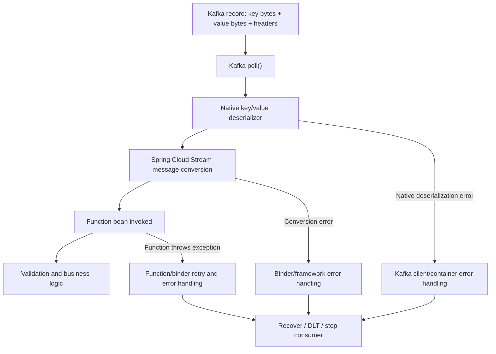
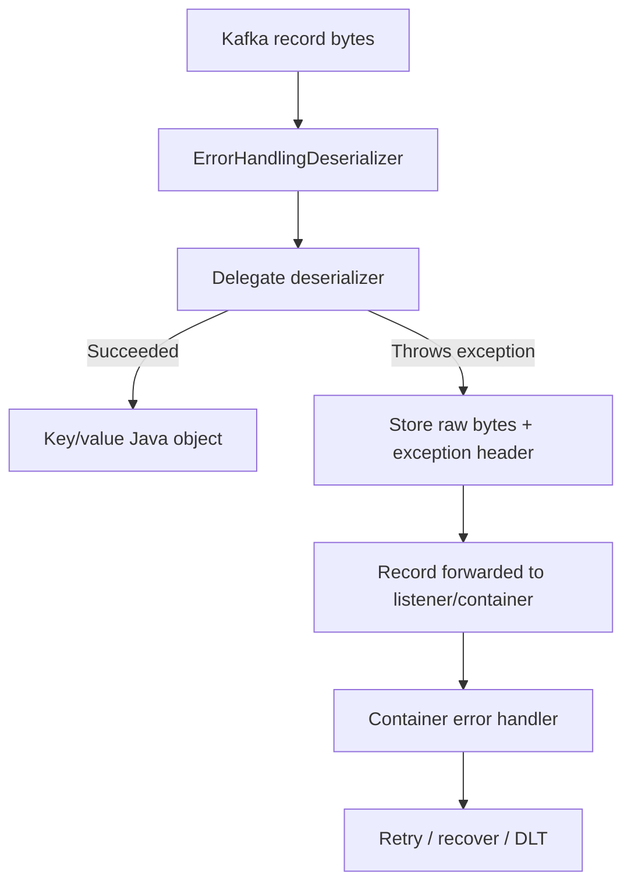

# Distinguishing Deserialization Errors from Business Function Errors

When a Kafka record fails to process, the first step is to determine where the failure occurred. A **deserialization error** happens when the Kafka client cannot convert key or value bytes into the expected Java type. A **business function error** happens after the message has been read, converted, and the application function begins executing. Because these two errors occur at different stages, their retry mechanisms, error handlers, and dead-letter topic (DLT/DLQ) flows can also differ.

The most important distinction is this: with a native Kafka deserializer, an error can occur right inside `poll()`, before the listener or function receives the message. When that happens, Spring Cloud Stream's standard retry/DLQ cannot handle it on its own. Spring Kafka provides `ErrorHandlingDeserializer` to preserve the raw bytes and exception details, then route the failed record to the container error handler. Conversely, if the function has already been invoked and throws an exception, the Kafka binder can apply retry and DLQ according to the consumer binding configuration.

This lesson analyzes each stage from record bytes to function execution, how to recognize each error type accurately, configuring handling for the Kafka binder, preserving error data, and testing both paths independently.

## 1. Two Error Types Occur at Two Different Stages

A Kafka record is stored as key bytes, value bytes, and headers. The consumer must read the record, decode the key/value, construct a Spring message, and only then invoke the function. The pipeline can be divided into stages:

1. The Kafka client fetches the record from the broker.
2. The Kafka deserializer decodes key and value if native decoding is used.
3. The binder/message converter transforms the record into a Spring Message and Java payload.
4. Spring Cloud Function invokes the function bean.
5. The function runs validation and business logic.
6. The binder/container handles acknowledgement, offset commit, or error recovery.

Native deserialization errors typically occur at step 2. Message conversion errors occur at step 3. Business errors typically occur at step 4 or 5.

`Note:` In everyday conversation, any error converting bytes into objects is sometimes called "deserialization." In this lesson, you must accurately distinguish **Kafka native deserializer**, **Spring message conversion**, and **function logic**, because they have different recovery mechanisms.



If the function has not been invoked, do not jump straight to debugging the function's service or repository. First verify whether the record made it past the deserializer and message converter.

## 2. What Is a Deserialization Error?

Kafka stores records as byte arrays. The consumer configures a key deserializer and a value deserializer to convert bytes into Java types.

Examples:

| Kafka record | Deserializer | Expected result |
|---|---|---|
| Key bytes | StringDeserializer | String |
| Value bytes | JsonDeserializer | OrderCreated |
| Value bytes | Avro deserializer | Avro-generated object |
| Value bytes | IntegerDeserializer | Integer |

An error occurs when the bytes do not match the format expected by the deserializer. Common causes include:

- The producer writes JSON while the consumer uses an Avro deserializer.
- The producer changed its schema or serializer, but the consumer has not been upgraded.
- The record was written malformed, truncated, or contains invalid bytes.
- The key/value deserializer class is misconfigured.
- Schema Registry is unreachable or the schema ID cannot be found.
- The producer emits a different data type than the consumer expects.
- Older records in the topic were created with an incompatible schema/encoding.

For example, the consumer expects a JSON object with an `orderId` field, but the producer wrote binary data in another format. The deserializer cannot decode it and throws an exception before the function ever gets a chance to inspect the payload.

### Key Deserialization and Value Deserialization

Key and value are decoded separately. A record can fail on the key, the value, or both. A key error can prevent restoring the partition key as a Java object; a value error prevents converting the payload into the function's input type.

When investigating, note which deserializer failed. Spring Kafka's `ErrorHandlingDeserializer` provides separate exception headers for key and value:

- `ErrorHandlingDeserializer.KEY_DESERIALIZER_EXCEPTION_HEADER`
- `ErrorHandlingDeserializer.VALUE_DESERIALIZER_EXCEPTION_HEADER`

Do not assume every failure is a value failure. Some pipelines rely on the key for routing, deduplication, or identifying aggregates; key errors can also compromise correctness.

## 3. Native Deserialization Errors Occur Before poll Returns

When the Kafka consumer uses a deserializer directly and the deserializer throws an exception, the error can happen inside the `poll()` call. The listener container never receives a fully decoded record to pass to the Spring Cloud Stream function.

This explains why normal function retries do not resolve this error:

- The function has not been called.
- There is no valid Java payload to pass to the function.
- Binder retries intended for message handler failures cannot retry a function invocation that never happened.
- If the exception escapes poll/container without handling, the consumer may stop or repeatedly hit the same failed record depending on container configuration.

A poison record at the head of partition progress can prevent the consumer from advancing past that record. If the consumer restarts and reads the same offset again, the failure can repeat. Error handling at the Kafka consumer/container layer is required.

### Example of a Blocked Path

Suppose we have this function:

```java
@Bean
Consumer<OrderCreated> processOrder(OrderService service) {
    return event -> service.handle(event);
}
```

If the Kafka native deserializer cannot construct `OrderCreated`, the `processOrder` function never receives the object. A breakpoint inside `OrderService.handle` will not be hit. Check the Kafka client logs, exception type, and deserializer before modifying business code.

## 4. Spring Cloud Stream Message Conversion Errors

Spring Cloud Stream can use the framework's message conversion mechanism instead of native deserializers to construct Java payloads. In this mode, the Kafka client can read bytes into `byte[]`, and then the binder/framework uses content type and converters to turn the payload into the function's expected type.

Example binding:

```yaml
spring:
  cloud:
    function:
      definition: processOrder
    stream:
      bindings:
        processOrder-in-0:
          destination: orders.events
          group: order-service
          content-type: application/json
```

Function receiving the object:

```java
@Bean
Consumer<OrderCreated> processOrder(OrderService service) {
    return event -> service.handle(event);
}
```

If the bytes are not valid JSON or the JSON cannot be converted into the target type, the error happens during the message conversion stage. This is still an error before the function runs, though not necessarily a native Kafka deserializer error inside `poll()`.

Consequences:

- The Kafka client may have returned the record to the listener container.
- The Spring message converter failed to build the target payload.
- The function may not have been invoked.
- The error may flow through the binder/framework error-handling mechanism, depending on version and configuration.

Therefore, explicitly note whether the application uses `useNativeDecoding` or framework message conversion. Do not configure `ErrorHandlingDeserializer` as a blanket fix for all conversion errors without verifying the actual path.

## 5. What Is a Business Function Error?

A business error only occurs after the record has been read, converted into a message, and the function has been invoked. Examples include:

- An order is in a state that does not allow payment.
- An account does not exist or is locked.
- The payment service temporarily times out.
- The database temporarily loses connectivity.
- A business rule detects a negative amount or invalid currency.
- An external API call fails.
- A domain model invariant is violated.

Example:

```java
@Bean
Consumer<OrderCreated> processOrder(OrderService service) {
    return event -> {
        if (event.total() <= 0) {
            throw new InvalidOrderException(
                    "Order total must be positive");
        }

        service.createOrder(event);
    };
}
```

In this case, Kafka delivered the record and the function received the object. The exception is thrown during processing. The binder can perform retries according to the consumer policy; once retries are exhausted, the error handler or DLQ handles the failed message.

### Business Errors Are Not Synonymous with Transient Errors

Not every exception inside a function should be retried:

| Error type | Example | Is retry helpful? |
|---|---|---|
| Transient | HTTP 503, database connection timeout | Usually yes |
| Invalid data | Negative total, missing order ID | Usually no |
| Business state | Order already canceled, operation disallowed | Depends on rules; usually needs dedicated handling |
| Configuration error | Wrong credentials, missing endpoint | Retrying per message usually does not help |
| Programming bug | Null pointer, wrong mapping | Requires code fix; retry usually does not help |

Retrying a deterministic data error only adds latency and load. For transient errors, retrying with backoff can let the message succeed once the dependency recovers.

## 6. Comparing Symptoms and Handling Locations

| Criterion | Native deserialization | Message conversion | Function/business |
|---|---|---|---|
| Stage | Kafka client deserializes key/value | Binder/framework converts payload | Function has been invoked |
| Did function run? | No | Usually not | Yes |
| Valid Java payload exists? | No | Target payload could not be built | Yes |
| Common exceptions | SerializationException or delegate error | MessageConversionException, ConversionException | Domain exception, IllegalStateException, dependency exception |
| Primary mechanism | ErrorHandlingDeserializer and container error handler | Binder/framework error handling, appropriate converter | Binding retry/error channel/DLQ |
| Fixable by retry? | Usually no if bytes/schema are wrong; maybe if schema service disruption is transient | Usually no if payload format is wrong | Possible for transient errors |
| Key evidence | Raw bytes, key/value exception headers, topic/partition/offset | Content type, converter, payload bytes | Stack trace inside function and event ID |

The exception class is only a clue. One exception can be wrapped inside another. Find the **originating failure point** and determine whether the function was actually called.

## 7. How ErrorHandlingDeserializer Handles Native Deserialization

Spring Kafka provides `ErrorHandlingDeserializer` to wrap an actual (delegate) deserializer. It calls the delegate to decode. If the delegate succeeds, the result is returned normally. If the delegate throws an exception, the wrapper stores the exception details and raw bytes in the record metadata rather than letting the error escape directly from poll.

Conceptually:



When the delegate fails, the corresponding key or value is set to null in the forwarded record; the original raw bytes and exception are stored in headers. The container error handler can read that metadata and decide to recover or publish the failed record to a DLT.

This does not make bad bytes into a valid object. It simply lets the consumer preserve the failed record and hand decision-making over to error handling.

### Configuring the Delegate

Example using native decoding and a JSON deserializer:

```yaml
spring:
  cloud:
    function:
      definition: processOrder
    stream:
      bindings:
        processOrder-in-0:
          destination: orders.events
          group: order-service
          consumer:
            use-native-decoding: true
      kafka:
        bindings:
          processOrder-in-0:
            consumer:
              configuration:
                value.deserializer: org.springframework.kafka.support.serializer.ErrorHandlingDeserializer
                spring.deserializer.value.delegate.class: org.springframework.kafka.support.serializer.JsonDeserializer
                spring.json.value.default.type: com.example.events.OrderCreated
                spring.json.trusted.packages: com.example.events
```

Here:

- `use-native-decoding: true` tells the binder to use Kafka deserializers instead of regular message conversion.
- `value.deserializer` is the `ErrorHandlingDeserializer` wrapper.
- `spring.deserializer.value.delegate.class` specifies the actual deserializer.
- `spring.json.value.default.type` specifies the default Java type for the JSON value.
- `spring.json.trusted.packages` restricts packages allowed for deserialization per Spring Kafka configuration.

If the key also needs fault-tolerant native deserialization, configure `key.deserializer` to `ErrorHandlingDeserializer` and set `spring.deserializer.key.delegate.class` accordingly. Only add the wrapper for the key when the key deserializer can genuinely fail and the application has a policy to handle it.

Property names, target types, and trusted packages must match the Spring Kafka/Spring Cloud Stream version in use. For Avro or Protobuf, replace the delegate with the corresponding deserializer and configure Schema Registry per that library.

## 8. Handling Deserialization Failures with a Container Error Handler

Because native deserialization can fail before the function is invoked, it must be handled in the Kafka listener container. The Spring Cloud Stream Kafka binder lets you customize the container via `ListenerContainerCustomizer`. Spring Kafka provides `DefaultErrorHandler` and `DeadLetterPublishingRecoverer` to perform retry/recovery and publish failed records to a DLT.

Configuration pattern:

```java
@Bean
ListenerContainerCustomizer<AbstractMessageListenerContainer<byte[], byte[]>> containerCustomizer(
        DefaultErrorHandler errorHandler) {

    return (container, destination, group) ->
            container.setCommonErrorHandler(errorHandler);
}

@Bean
DefaultErrorHandler kafkaErrorHandler(
        DeadLetterPublishingRecoverer recoverer) {

    return new DefaultErrorHandler(recoverer);
}

@Bean
DeadLetterPublishingRecoverer deadLetterRecoverer(
        KafkaTemplate<Object, Object> template) {

    return new DeadLetterPublishingRecoverer(template);
}
```

This is an illustrative configuration skeleton. The generic types of the listener container and KafkaTemplate must match your application's actual key/value types, raw bytes, and serializers. If custom backoff, exception classification, or DLT routing is needed, configure `DefaultErrorHandler` and `DeadLetterPublishingRecoverer` accordingly.

With Spring Kafka's `DefaultErrorHandler`, `DeserializationException` belongs to the non-retryable exception group by default because retrying the exact same bytes usually does not change the outcome. The recoverer is invoked to send the record to the DLT or perform the configured recovery action. If the application overrides that classification, ensure retries can genuinely resolve the root cause.

### Why Must Raw Bytes Be Preserved?

When a deserializer fails, there is no properly typed Java object to serialize back. The DLT publisher must be able to send the original byte array. If the publisher only has a serializer for `OrderCreated`, it may fail to publish records whose value failed and remains raw bytes.

When using native decoding with a DLT publisher, verify the DLT's key/value serializers. You may need a serializer that supports both byte[] and successfully decoded objects, or a template suited to the record data types. Do not assume the primary producer's serializer always handles raw bytes properly.

## 9. Standard Kafka Binder DLQ vs. Deserialization DLQ

This is the easiest place to get confused.

### Function/Business Error

The Kafka binder has a DLQ mechanism for errors that occur while processing in the message handler. For example, the function is called and then throws an exception. You can enable DLQ on the consumer binding:

```yaml
spring:
  cloud:
    function:
      definition: processOrder
    stream:
      bindings:
        processOrder-in-0:
          destination: orders.events
          group: order-service
      kafka:
        bindings:
          processOrder-in-0:
            consumer:
              enableDlq: true
              dlqName: orders.events-dlq
```

An explicit group is mandatory to use the Kafka binder's DLQ. If `dlqName` is omitted, the default name typically follows the pattern `error.<destination>.<group>`. When the function throws an exception, the binder retries as configured; after retries are exhausted, the failed record can be routed to the DLQ.

Default retry values documented by the Kafka binder for message handlers:

- Maximum 3 attempts.
- Initial backoff 1 second.
- Multiplier 2.
- Max backoff 10 seconds.

You can configure `maxAttempts`, `backOffInitialInterval`, `backOffMultiplier`, `backOffMaxInterval`, `retryableExceptions`, and `defaultRetryable` per binding. Check your exact binder version since properties and behavior can vary across versions.

### Native Deserialization Error

Spring Cloud Stream's standard DLQ cannot automatically catch native deserialization exceptions if the error occurs inside Kafka `poll()` before reaching the listener. You need `ErrorHandlingDeserializer` and a container error handler as shown in the previous section.

Both mechanisms can coexist in an application, but they address two separate error paths:

| Error path | Primary mechanism |
|---|---|
| Kafka native deserializer fails before listener | ErrorHandlingDeserializer + Spring Kafka container error handler/recoverer |
| Function/business handler throws exception | Kafka binder retry + `enableDlq` or chosen error handler |

When native decoding and DLQ are both enabled, check the DLQ producer's serializers. With native decoding, the Kafka binder documentation requires configuring appropriate key/value serializers in `dlqProducerProperties.configuration` when using the binder's DLQ for records processed on that path.

### Impact of Custom Error Handlers

Spring Cloud Stream lets you declare a function accepting `ErrorMessage` via `error-handler-definition`. When using this custom error handler, it replaces the default framework/binder error handlers for that binding; the documentation warns that the binder-provided DLQ will no longer operate as before, even if `enableDlq` remains enabled. If you need both custom handling and a DLT, design a single recovery path and publish/ack in a controlled manner yourself, or let the binder manage the DLQ and observe via an appropriate mechanism. Avoid registering two handlers that both process the same exception without clear ownership rules.

### Do Not Configure Both Mechanisms as If They Were One

Do not simply enable `enableDlq: true` and assume every deserialization error will automatically route to the DLQ. Conversely, do not only configure `ErrorHandlingDeserializer` and assume exceptions inside the function will automatically be recovered too. Verify which handler each exception type passes through.

## 10. Retry and Exception Classification Inside the Function

Function errors can be retried by the binder because the function was invoked and the binder knows which message failed. However, retries need exception classification:

```yaml
spring:
  cloud:
    stream:
      bindings:
        processOrder-in-0:
          consumer:
            maxAttempts: 3
            backOffInitialInterval: 1000
            backOffMultiplier: 2.0
            backOffMaxInterval: 10000
            defaultRetryable: false
            retryableExceptions:
              com.example.PaymentUnavailableException: true
              com.example.InvalidOrderException: false
      kafka:
        bindings:
          processOrder-in-0:
            consumer:
              enableDlq: true
              dlqName: orders.events-dlq
```

With this configuration, only errors marked retryable are retried per policy. Invalid data errors can be routed quickly to recovery/DLQ rather than repeated multiple times.

Keep in mind that Spring Cloud Stream's message handler retry configuration applies to imperative functions processing one message at a time. Reactive functions accepting Flux have their own error-handling operators from Reactor; do not assume the binder's RetryTemplate applies identically.

### Do Not Retry Malformed Deserialization Indefinitely

If a record has malformed bytes or a permanently incompatible schema, retrying the same bytes usually does not help. Store the raw bytes, exception, and schema metadata in the DLT/quarantine, then investigate the producer or schema contract. Only retry if the failure is genuinely transient, such as a brief Schema Registry outage where the deserializer can safely retry.

## 11. Message Conversion and Business Validation

Three commonly conflated situations should be separated:

1. **Bytes cannot be parsed:** Malformed JSON or wrong encoding. This is a data conversion error.
2. **Parsed but fails type/contract match:** Incompatible field, unrecognized enum, or missing required data. This may be conversion/schema validation.
3. **Valid payload that violates business rules:** Order exists but cannot be paid, or account is locked. This is business validation.

Example valid JSON payload:

```json
{
  "orderId": "order-42",
  "total": -100
}
```

The JSON converter can build the object successfully because `total` is still a number. However, the function or domain validator will reject the negative value. This is a validation/business error, not native deserialization.

A clean way to structure the code:

```java
@Bean
Consumer<OrderCreated> processOrder(
        OrderValidator validator,
        OrderService service) {

    return event -> {
        validator.validate(event);
        service.create(event);
    };
}
```

Separating validation from mapping helps logs and metrics clearly distinguish schema/contract errors from domain rule violations. Do not use a single generic exception for all cases if their retry policies differ.

## 12. Preserving Failed Record Information

A record placed in the DLT needs enough information for investigation and replay. At a minimum, preserve:

- Original topic.
- Original partition and offset.
- Original record key bytes and value bytes if possible.
- Original headers and content type.
- Exception class, message, and stack trace.
- Failure category: key deserialization, value deserialization, conversion, or function.
- Event ID/correlation ID if readable.
- Receipt timestamp and attempt count.
- Failing consumer group and binding.

The Kafka binder DLQ commonly attaches headers such as `x-original-topic`, `x-exception-message`, and `x-exception-stacktrace` (as byte[] per binder documentation). These headers help with investigation, though you should still verify how your specific binder/version preserves keys, values, and metadata.

For native deserialization failures, there is no valid object from which to reconstruct the payload. Raw bytes are the single most important piece of evidence. Avoid parsing and re-serializing under another schema if the goal is preserving the original record.

## 13. DLT Triage and Replay Workflow

A DLT is a place to isolate failed records for later handling. It does not fix data or guarantee successful replay on its own.

The operational workflow should include:

1. Identify the error type and failing stage.
2. Retrieve the record's topic, partition, offset, and raw bytes.
3. Identify the producer/schema/version that created the record.
4. Fix the root cause: serializer, schema, converter, code, or dependency.
5. Test the failed record against the fixed consumer.
6. Choose the replay method: replay raw bytes, transform to a new schema, or issue a compensating event.
7. Replay with rate limiting and keep the original event ID when appropriate.
8. Monitor duplicates, ordering, and side effects.
9. Close the incident only after reconciling record counts in the DLT.

If the data cannot be repaired, move it to quarantine for manual handling or emit a business correction event. Do not purge the DLT simply because the primary consumer is healthy again.

### Raw Replay and Transformed Replay

- **Raw replay:** Replay the exact original key/value bytes after fixing the consumer/deserializer. This preserves evidence and works when the bug was in consumer code.
- **Transformed replay:** Read raw bytes, convert to a new schema/contract, and emit a new record. Record the event lineage and ensure semantics are not silently altered.
- **Business correction:** Create a new compensating or state-fixing event. Use when the original event cannot be applied safely.

Do not alter the original payload inside the DLT to make it "look valid" without recording the transformation. That destroys auditability.

## 14. Idempotency and Offsets During Error Handling

Retries, redeliveries, and replays can cause the same event to be processed multiple times. With a function/business exception, a side effect might already have completed before the exception occurred. With a deserialization failure, the function usually never ran, so after fixing the consumer and replaying, the record will create its side effects for the first time.

Use the event ID as an idempotency key:

```java
@Transactional
public void handle(OrderCreated event) {
    if (processedEventRepository.existsById(event.eventId())) {
        return;
    }

    orderRepository.create(event);
    processedEventRepository.save(event.eventId());
}
```

Updating business state and marking the event as processed should happen in the same transaction when sharing a database. If side effects occur in external services, use an idempotency key or the inbox/outbox pattern with reconciliation.

An offset commit does not mean a business transaction completed. Understand the binder's ack mode, retry/recoverer behavior, and transaction boundaries. Never commit offsets too early and lose records when side effects fail; equally, never assume a record will be processed strictly once.

## 15. Observing and Classifying Errors in Production

To identify which stage failed, logs/metrics should capture:

| Field | Purpose |
|---|---|
| Topic, partition, offset | Identify the original record |
| Consumer group, binding | Identify the consumer pipeline |
| Event ID/correlation ID | Business tracing if readable |
| Deserializer class | Identify the codec in use |
| Content type/schema ID | Detect contract mismatches |
| Exception class and root cause | Classify the failure |
| Processing stage | deserialize, convert, function, downstream |
| Delivery attempt | Track retries/redeliveries |
| DLT destination | Track quarantine location |
| Function invocation count | Verify whether the function was called |

Some telltale signs:

- Consumer logs errors inside `poll()` with no function entry log: suspect native deserialization.
- ErrorHandlingDeserializer headers contain an exception and raw bytes: confirms the delegate deserializer failed.
- Record reached the listener but message conversion threw an exception: check content type and converter.
- Function entry log appears followed by a stack trace in service/domain code: function/business error.
- Retries increase and then DLT receives the record: inspect exception classification and recovery.
- Consumer repeatedly restarts at the same partition/offset: look for a poison record or unhandled error.

Do not log full sensitive payloads. You can log byte length, checksum, schema ID, and event ID; store raw bytes only in a DLT/quarantine with proper access controls.

## 16. Testing Both Error Paths Separately

A test that only sends valid messages and verifies the function runs is insufficient to prove error handling works. Create separate tests for each stage.

### Test Native Deserialization Failure

1. Create a Kafka topic and consumer binding with `useNativeDecoding: true`.
2. Configure `ErrorHandlingDeserializer` wrapping the delegate.
3. Send a record with value bytes invalid for the delegate.
4. Verify the function is not invoked.
5. Verify the error handler receives deserialization exception metadata.
6. Verify raw bytes are published to the DLT.
7. Verify the consumer continues reading the next valid record.
8. Inspect the DLT record's topic, partition, offset, and exception headers.

### Test Business Function Failure

1. Send a record with valid bytes and schema.
2. Verify the deserializer/converter constructs the object.
3. Have the function invoked and throw a deliberate exception.
4. Verify the binder retries the configured number of times.
5. After retries are exhausted, verify the record is routed to the DLQ if enabled.
6. Verify error headers and original topic metadata.
7. Verify side effects are not duplicated unintentionally.

### Test Message Conversion Failure

1. Use framework message conversion (native decoding disabled).
2. Send bytes that are not valid JSON or a payload incompatible with the target type.
3. Verify the function is not invoked.
4. Observe the error channel/binder handling of your version.
5. Verify the record is recovered or routed to the DLQ per actual configuration.

### Test Replay

- Fix the deserializer or schema and replay the DLT record.
- Verify the payload is read properly.
- Keep the event ID so idempotency works.
- Rate-limit replay.
- Reconcile counts of replayed, succeeded, and still-failing records.

Use real Kafka or Testcontainers when verifying `poll()`, listener containers, DLTs, and offsets. Unit tests on the function alone cannot fully simulate errors occurring before the function is called.

## 17. Do Not Confuse the Kafka Binder with the Kafka Streams Binder

Spring Cloud Stream has both a regular Kafka message binder and a Kafka Streams binder. Both use Kafka, but they have different processing models and error-handling mechanisms.

For the **Kafka Streams binder**, the binder provides dedicated deserialization exception handlers, such as:

- `logAndContinue`: log and skip the bad record to continue.
- `logAndFail`: log and stop processing; this is the default described in the Kafka Streams binder documentation.
- `sendToDlq`: send the failed record to the configured DLQ.

The property used in the Kafka Streams binder is:

```yaml
spring:
  cloud:
    stream:
      kafka:
        streams:
          binder:
            deserializationExceptionHandler: sendToDlq
```

This configuration is specific to the Kafka Streams binder. Do not copy this property to the regular Kafka message binder expecting it to control `ErrorHandlingDeserializer` or the listener container's `DefaultErrorHandler`. Identify which binder you are using before choosing a mechanism.

## 18. Quick Diagnostic Procedure

When a record fails to process, follow this order:

1. Identify the topic, partition, offset, and consumer group.
2. Determine whether the function was invoked.
3. If the function never ran, inspect the native deserializer and framework message converter.
4. If using native decoding, inspect key/value deserializers and ErrorHandlingDeserializer headers.
5. If the function ran, inspect the root cause in the handler/service.
6. Classify the failure as transient or permanent.
7. Choose the appropriate retry, error channel, recoverer, or DLQ.
8. Check the offset and whether side effects already ran.
9. Preserve the raw record and metadata if investigation/replay is needed.
10. After fixing, perform controlled replay and reconcile.

The first question is not "should we retry?" but "which stage did the record reach?". Knowing the exact stage prevents futile retries on malformed bytes or overlooking business errors after the function already produced side effects.

## 19. Implementation Checklist

- Determined whether the binding uses native decoding or framework message conversion.
- Key/value deserializers match the format written by the producer.
- Distinguished native deserialization, message conversion, and business validation.
- Added ErrorHandlingDeserializer where protection against native deserialization failures is needed.
- Delegate deserializers and Schema Registry are configured properly.
- Container error handler has a clear retry/recovery strategy.
- DLT publisher preserves raw key/value bytes when deserialization fails.
- DLT serializers are compatible with both raw bytes and decoded objects if needed.
- Kafka binder `enableDlq` is enabled for function/business errors requiring isolation.
- Consumer has an explicit group when using the Kafka binder DLQ.
- Retries are restricted to recoverable exceptions.
- Custom error handlers do not unintentionally disable the binder DLQ.
- Raw record, topic, partition, offset, and exception metadata are preserved.
- Handlers are idempotent to tolerate retries and replays.
- Deserialization, conversion, function exceptions, and replay are tested separately.
- Dashboards distinguish processing stage, retries, DLT, and consumer lag.
- Confirmed whether the application uses the Kafka binder or the Kafka Streams binder.

Deserialization errors and business function errors cannot be treated as a single exception category. Native deserialization can fail before `poll()` returns the record; message conversion can fail before the function runs; business exceptions only arise after the function receives the payload. Use ErrorHandlingDeserializer and container recovery for the native decoding path, use binder retry/DLQ for message handler errors, preserve raw bytes for investigation, and test each error path independently.

## References

- [Spring Cloud Stream Kafka Binder — Tips, Tricks and Recipes: Handling Deserialization Errors with DLQ](https://docs.spring.io/spring-cloud-stream/reference/kafka/kafka_tips.html)
- [Spring Cloud Stream Kafka Binder — Retry and Dead Letter Processing](https://docs.spring.io/spring-cloud-stream/docs/current/reference/html/spring-cloud-stream-binder-kafka.html)
- [Spring Cloud Stream — Error Handling](https://docs.spring.io/spring-cloud-stream/reference/spring-cloud-stream/overview-error-handling.html)
- [Spring for Apache Kafka — Handling Exceptions](https://docs.spring.io/spring-kafka/reference/kafka/annotation-error-handling.html)
- [Spring Kafka — Serialization, Deserialization, and Message Conversion](https://docs.spring.io/spring-kafka/reference/kafka/serdes.html)
