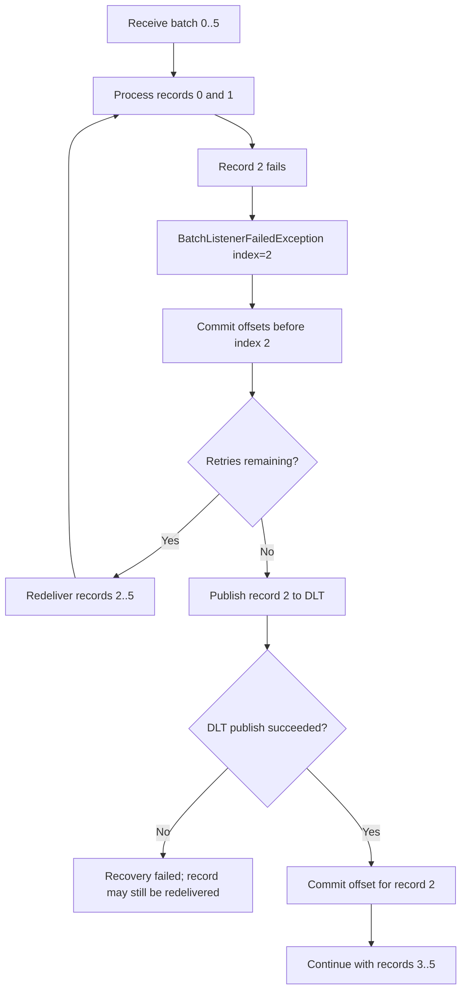

# Retry Limits and DLT Routing in Batch Consumption

A Kafka batch consumer receives multiple records in a single `poll()` and passes them as a list for the function to process. This reduces handler invocation overhead and suits bulk operations, but an error midway through a batch raises key questions: which records have completed, which records need retrying, and which records must be routed to a Dead Letter Topic (DLT)?

With the Kafka Binder, you must distinguish binder-managed retries from retries managed by Spring Kafka's listener container. When batch mode is enabled, internal binder retry is unsupported and `maxAttempts` is overridden to `1`. The binder has supported batch DLTs since version 4.0.2, though when using the built-in DLT, all records received from the previous poll are sent to the DLT. If you need to isolate only the failing record, you can combine Spring Kafka's `DefaultErrorHandler` with `BatchListenerFailedException` to pinpoint the index of the failed element.

## 1. Batch Consumers and Error-Handling Boundaries

Enable batch mode via the `consumer.batch-mode` property on the input binding. The function receives a list of payloads:

```java
@Bean
Consumer<List<OrderCreated>> processOrderBatch(OrderBatchService service) {
    return service::process;
}
```

Binding configuration:

```yaml
spring:
  cloud:
    function:
      definition: processOrderBatch
    stream:
      bindings:
        processOrderBatch-in-0:
          destination: orders.created
          group: order-batch-service
          consumer:
            batch-mode: true
```

A single Kafka poll can return multiple records from one or more partitions assigned to the consumer. The binder converts those records into a `List<OrderCreated>` and calls the function once. Batch size is influenced by `max.poll.records`, `fetch.min.bytes`, `fetch.max.wait.ms`, and available data.

Example of a five-element batch:

```text
Index 0: order-101
Index 1: order-102
Index 2: order-103  <- processing failed
Index 3: order-104
Index 4: order-105
```

If the function throws a generic exception without specifying the failing element, the error handler may have to reprocess the entire batch. If the function reports the exact index via `BatchListenerFailedException`, Spring Kafka can commit the records before that index, retry starting from the failed record, and then continue with the remaining records.

This is a vital distinction between retrying the whole batch and retrying from a specific record. The choice of mechanism must align with your business transaction boundaries and how the consumer commits offsets.

## 2. Two Retry/DLT Mechanisms to Distinguish

| Mechanism | Managed by | Behavior in batch mode |
|---|---|---|
| Kafka Binder internal retry | Spring Cloud Stream Kafka Binder | Not supported; `maxAttempts` is overridden to `1` |
| Binder built-in DLT | Kafka Binder | Since binder 4.0.2; all records from the previous poll are sent to the DLT when the batch fails |
| `DefaultErrorHandler` | Spring for Apache Kafka | Can retry the whole batch or isolate the failing record if the listener throws `BatchListenerFailedException` |
| `DeadLetterPublishingRecoverer` | Spring for Apache Kafka | Publishes recovered records to the DLT according to the error handler's strategy |

Do not configure `max-attempts: 5` and expect the binder to call the function five times while batch mode is enabled. To control attempt counts, backoff, and which records enter the DLT, move that logic to the listener container's error handler or use the built-in DLT policy with clear awareness of its whole-batch behavior.

## 3. Using the Kafka Binder's Built-In DLT

Since Spring Cloud Stream Kafka Binder 4.0.2, batch-mode consumers support a built-in DLT. Example configuration:

```yaml
spring:
  cloud:
    function:
      definition: processOrderBatch
    stream:
      bindings:
        processOrderBatch-in-0:
          destination: orders.created
          group: order-batch-service
          consumer:
            batch-mode: true
      kafka:
        bindings:
          processOrderBatch-in-0:
            consumer:
              enable-dlq: true
              dlq-name: orders.created.batch.dlt
```

Points to note:

- The consumer must have an explicitly declared group; anonymous subscriptions do not meet the Kafka Binder's DLT requirement.
- `enable-dlq: true` enables the dead-letter mechanism.
- `dlq-name` sets a custom DLT name; if omitted, the binder uses a default name derived from destination and group.
- Write permissions to the DLT topic must be granted to the producer used by the binder.
- The DLT must have a partition count and routing compatible with the binder's record-forwarding policy.
- When the batch listener fails, all records received from the previous poll are routed to the DLT, even records that did not cause the error.

For instance, if a batch has five records and one record fails, the built-in DLT may receive all five records. This isolates the batch so the main stream can move on, but increases the number of records to investigate and can put valid records into the DLT.

This behavior must be accounted for when designing replay. Do not automatically replay the entire batch if some records already produced business side effects. Consumers should be idempotent, and replay tooling should support filtering by event ID.

## 4. Isolating Only the Failing Record with BatchListenerFailedException

If you want retries to start from the exact failing record and send only that record to the DLT after attempts are exhausted, use `DefaultErrorHandler` together with `DeadLetterPublishingRecoverer`.

The function must identify the index of the failing element:

```java
import java.util.List;
import java.util.function.Consumer;

import org.springframework.context.annotation.Bean;
import org.springframework.kafka.listener.BatchListenerFailedException;

@Bean
Consumer<List<OrderCreated>> processOrderBatch(OrderService orderService) {
    return events -> {
        for (int index = 0; index < events.size(); index++) {
            OrderCreated event = events.get(index);

            try {
                orderService.processOne(event);
            }
            catch (Exception ex) {
                throw new BatchListenerFailedException(
                    "Could not process batch element at index " + index,
                    ex,
                    index
                );
            }
        }
    };
}
```

The constructor taking a message, cause, and index lets Spring Kafka pinpoint the failing record within the batch. With a `List<T>` signature, the index is the element's position in the list passed to the function by the binder.

Do not replace this exception with a generic `RuntimeException` if you want per-record handling. When the listener throws anything other than `BatchListenerFailedException`, `DefaultErrorHandler` falls back to retrying the entire batch.

Preserve the original exception in the `cause` parameter. The error handler can inspect the root exception type to decide whether to retry or route straight to the DLT.

## 5. Configuring DefaultErrorHandler and the DLT Recoverer

To use an application-managed error handler, declare a `ListenerContainerCustomizer`. The following example targets only the selected destination and group:

```java
import org.apache.kafka.common.TopicPartition;
import org.springframework.cloud.stream.config.ListenerContainerCustomizer;
import org.springframework.context.annotation.Bean;
import org.springframework.kafka.core.KafkaTemplate;
import org.springframework.kafka.listener.AbstractMessageListenerContainer;
import org.springframework.kafka.listener.DeadLetterPublishingRecoverer;
import org.springframework.kafka.listener.DefaultErrorHandler;
import org.springframework.util.backoff.FixedBackOff;

@Bean
DefaultErrorHandler orderBatchErrorHandler(
        KafkaTemplate<Object, Object> dltKafkaTemplate) {

    DeadLetterPublishingRecoverer recoverer =
        new DeadLetterPublishingRecoverer(
            dltKafkaTemplate,
            (record, exception) -> new TopicPartition(
                record.topic() + ".DLT",
                record.partition()
            )
        );

    // 1 second between attempts; 2 retries after the initial delivery.
    DefaultErrorHandler handler =
        new DefaultErrorHandler(recoverer, new FixedBackOff(1000L, 2L));

    handler.addNotRetryableExceptions(InvalidOrderEventException.class);

    return handler;
}

@Bean
ListenerContainerCustomizer<AbstractMessageListenerContainer<?, ?>>
        orderBatchContainerCustomizer(
                DefaultErrorHandler orderBatchErrorHandler) {

    return (container, destinationName, group) -> {
        if ("orders.created".equals(destinationName)
                && "order-batch-service".equals(group)) {
            container.setCommonErrorHandler(orderBatchErrorHandler);
        }
    };
}
```

In this example:

- `ListenerContainerCustomizer` is called when the binder creates the listener container.
- The destination and group check limits the customizer to the intended consumer.
- `DefaultErrorHandler` manages retries and recovery.
- `DeadLetterPublishingRecoverer` sends recovered records to a topic suffixed with `.DLT`.
- `FixedBackOff(1000L, 2L)` means one initial delivery and up to two retries, for three total attempts.
- `InvalidOrderEventException` is marked non-retryable; it goes straight to the recoverer per the handler's classification.

`dltKafkaTemplate` must connect to the target cluster and have key/value serializers compatible with the records being sent. If records can contain multiple payload types or raw bytes from deserialization failures, configure an appropriate serializer, possibly using a dedicated template for the DLT. The DLT topic in this example preserves the original partition; therefore, ensure the corresponding partitions exist on the target topic.

When using a custom error handler like this, do not enable the built-in `enable-dlq` on the same binding. The two mechanisms may compete for error-handling control. The binder's built-in DLT may take precedence over the customizer; pick one explicit recovery path.

## 6. How Does Retry Work When an Error Index Is Reported?

Suppose a batch has six records and the record at index 2 fails. The function succeeded on indices 0 and 1, then threw `BatchListenerFailedException` with index 2.

With `DefaultErrorHandler`, the typical sequence is:

1. Commit offsets for the records preceding the failed record.
2. If retry attempts remain, seek so the failed record and subsequent records are redelivered.
3. If retries are exhausted, invoke the recoverer for the failed record.
4. Once DLT publishing succeeds, commit the failed record's offset.
5. Records after the failed record are redelivered so processing continues.



Retrying from the error index does not mean only that single record is re-invoked. Records following that index are also redelivered because the container needs to resume from the failure position in each partition. Consequently, trailing records may be processed multiple times if an earlier pass produced side effects before the batch failed.

If the recoverer cannot publish to the DLT, recovery is treated as failed. The failed record should not be skipped; it may be redelivered and go through backoff/recovery again. Monitor DLT publish failures and ensure target topics, ACLs, serializers, and brokers are ready.

## 7. Why Must the Failing Index Be Specified?

If the function throws a regular exception without `BatchListenerFailedException`, `DefaultErrorHandler` does not know which record caused the error. Its batch-listener fallback mechanism will then retry the entire in-memory batch.

After retries are exhausted, the recoverer is called for every record in the batch. This behavior can send many valid records to the DLT.

| How function reports error | Error handler behavior |
|---|---|
| `BatchListenerFailedException` with valid index | Commits records before index; retries from failed record and trailing records; recovers only the failed record when retries exhaust |
| Other exception | Falls back to retrying the entire batch; when retries exhaust, recovers every record in the batch |
| Exception occurs before failing element can be identified | Usually requires whole-batch strategy or splitting validation to pinpoint the index |

Therefore, iterate over elements with an index and wrap exceptions at the exact failing position. If there is a whole-batch validation step before processing, identify the invalid element precisely to throw the right `BatchListenerFailedException`; if the failure truly applies to the whole batch, deliberately choose a whole-batch retry strategy.

## 8. Error Classification and Retry Budget

Retries only help when the error can change over time. For instance, a database timeout or transient connection error can recover; an unsupported schema or missing required field usually will not fix itself on retry.

| Error type | Suggested policy |
|---|---|
| Timeout or transient connection error | Retry with backoff and cap |
| Rate limiting from a dependency | Retry after an appropriate wait, with jitter if multiple consumers exist |
| Malformed schema or missing required field | Do not retry; route to DLT for investigation |
| Permanent business error | Classify by business contract; usually send to DLT |
| Authentication/authorization error | Stop retrying quickly, alert on configuration/infrastructure |
| Unexpected bug | Limit retries, send to DLT, and alert to fix the application |

`DefaultErrorHandler` supports classifying exceptions. Example:

```java
handler.addNotRetryableExceptions(
    InvalidOrderEventException.class,
    UnsupportedOrderVersionException.class
);
```

For non-retryable exceptions, the recoverer is invoked without waiting through normal retry attempts. For transient errors, backoff reduces pressure on the struggling service. You can replace `FixedBackOff` with a capped exponential backoff if the workload needs longer wait times.

Non-blocking retries based on `@RetryableTopic` are not supported with batch listeners. If you need intermediate retry topics, consider switching to record mode or designing a dedicated controlled retry pipeline; do not apply record-listener `@RetryableTopic` configuration to batch consumers.

Be explicit when counting attempts. In the `FixedBackOff(1000L, 2L)` example, there is one initial processing attempt and two retries. Do not mistake the retry count for the total delivery count. Clearly document the total number of times the handler can run in operational runbooks.

## 9. Retry Time Limits and max.poll.interval.ms

A Kafka consumer must continue polling within `max.poll.interval.ms`. If total batch processing plus backoff time exceeds this limit, the consumer can be considered stalled and evicted from the group, triggering a rebalance.

When choosing a retry policy, account for:

- Normal batch processing duration.
- Duration of each retry attempt.
- Total backoff time.
- DLT publishing duration.
- Poll/fetch durations and container wait intervals.

If backoffs are long, you can use `ContainerPausingBackOffHandler` to pause the listener container while waiting instead of sleeping the consumer thread for too long. The pause mechanism still needs to keep polling as managed by the container to maintain group membership. Review `max.poll.interval.ms`, `pollTimeout`, and shutdown timeouts together.

Large batches do not just raise throughput; they also increase processing time before offsets are committed. If batches routinely take a long time, lower `max.poll.records`, optimize bulk operations, or raise limits carefully after evaluating rebalance impact.

## 10. Using nack(index, sleep) as an Alternative

Spring Kafka provides `Acknowledgment.nack(index, sleep)` for batch listeners when an application wants to acknowledge everything before index and request that the record at index plus subsequent records be redelivered. This mechanism controls offset/seek on the listener thread.

In Spring Cloud Stream, you can obtain the acknowledgment from headers when using `Message<List<T>>` with manual acknowledgement configured appropriately:

```java
import java.time.Duration;
import java.util.List;
import java.util.function.Consumer;

import org.springframework.kafka.support.Acknowledgment;
import org.springframework.kafka.support.KafkaHeaders;
import org.springframework.messaging.Message;

@Bean
Consumer<Message<List<OrderCreated>>> processOrderBatch(
        OrderService service) {

    return batch -> {
        List<OrderCreated> events = batch.getPayload();
        Acknowledgment acknowledgment =
            batch.getHeaders().get(
                KafkaHeaders.ACKNOWLEDGMENT,
                Acknowledgment.class
            );

        for (int index = 0; index < events.size(); index++) {
            try {
                service.processOne(events.get(index));
            }
            catch (TransientOrderException ex) {
                if (acknowledgment == null) {
                    throw ex;
                }

                acknowledgment.nack(index, Duration.ofSeconds(2));
                return;
            }
        }

        if (acknowledgment != null) {
            acknowledgment.acknowledge();
        }
    };
}
```

This example illustrates requesting redelivery on a transient error. You must configure `ack-mode: MANUAL` on the Kafka consumer binding and verify the acknowledgment header is present in your binder version. `nack` must be called on the consumer thread. Actual wait time is bounded below by `pollTimeout`; both the sleep duration and processing time prior to index must fit within `max.poll.interval.ms`.

`nack(index, sleep)` alone does not impose a retry limit and does not send messages to a DLT. If you use this approach, the application must maintain a durable retry counter or another policy to move messages to a DLT after maximum attempts. Otherwise, a poison message can be redelivered forever.

Do not combine manual `nack` with `DefaultErrorHandler` on the same error path without clearly designing offset-management ownership. Pick one primary mechanism to avoid overlapping commits, seeks, or redeliveries.

## 11. Transactions and Batch Recovery

When a listener container uses Kafka transactions, processing errors typically cause a transaction rollback. In that case, Spring Kafka uses `DefaultAfterRollbackProcessor` for post-rollback handling rather than applying the non-transactional `DefaultErrorHandler` configuration verbatim.

Clarify the following:

- Whether producer and consumer participate in the same Kafka transaction.
- When offsets are sent into the transaction.
- Whether DLT publishing occurs inside the recovery transaction.
- Post-rollback retry settings and attempt counts.
- Whether the transaction timeout covers processing plus backoff duration.

Kafka transactions do not encompass external database transactions. If a batch updates a database and then publishes to Kafka, design an outbox or proper coordination mechanism. Never assume a Kafka rollback undoes side effects already committed to a database.

When using transactions, consult `DefaultAfterRollbackProcessor` and the transactional recovery settings for your Spring Kafka version. Do not treat the non-transactional `DefaultErrorHandler` snippet above as a complete configuration for a transactional listener.

## 12. Deserialization Errors in a Batch

Deserialization errors can happen before the function receives the payload. For batch listeners, use `ErrorHandlingDeserializer` or an appropriate conversion error mechanism so one bad record does not halt conversion for the whole batch without identifying its position.

When using `ErrorHandlingDeserializer`, deserialization errors can be stored in headers while the corresponding payload becomes null. The batch function must inspect null elements alongside error metadata, determine the index, and throw `BatchListenerFailedException` so the error handler processes that record.

General check example:

```java
for (int index = 0; index < events.size(); index++) {
    OrderCreated event = events.get(index);

    if (event == null) {
        throw new BatchListenerFailedException(
            "Payload is null or could not be converted",
            index
        );
    }

    process(event);
}
```

Not every null payload is a deserialization error. Kafka tombstones can also appear as null elements in a batch, especially on compacted topics. Distinguish valid tombstones from deserialization errors via exception/header metadata before sending records to a DLT.

The DLT producer needs serializers matching the actual data. If you want to preserve raw bytes of records that failed deserialization, configure the template/recoverer to support byte arrays and error metadata; do not assume a JSON serializer for business payloads can serialize every failed record.

## 13. Idempotency During Retries and Redelivery

When a batch fails, the failed record and trailing records may be redelivered. If the handler already produced side effects before the failure occurred, redelivery can duplicate those effects.

Use a stable event ID and persist a processing marker in the same transaction as the business state change:

```java
@Service
public class OrderService {

    private final ProcessedEventRepository processedEvents;
    private final OrderRepository orders;

    public OrderService(
            ProcessedEventRepository processedEvents,
            OrderRepository orders) {
        this.processedEvents = processedEvents;
        this.orders = orders;
    }

    @Transactional
    public void processOne(OrderCreated event) {
        if (processedEvents.existsById(event.eventId())) {
            return;
        }

        orders.apply(event);
        processedEvents.save(new ProcessedEvent(event.eventId()));
    }
}
```

This example assumes the event ID has a unique constraint and that updating the order and saving the processed marker share a database transaction. If multiple instances can process the same event concurrently, handle unique-constraint conflicts explicitly; checking before writing does not prevent race conditions on its own.

If the function relies on partial offset commits by index, align database transactions per record or with a compatible strategy. Never let a database transaction roll back the whole batch while the error handler already committed offsets for records before the failing index, as that can roll back side effects without those offsets ever being re-read.

## 14. Operating and Replaying the DLT

A DLT is a place to isolate messages for investigation and recovery. It does not repair payloads automatically and must not be wired blindly back to the main topic indefinitely.

A safe replay workflow:

1. Read the event ID, source topic, partition, offset, exception, and failure timestamp.
2. Classify the root cause as data, schema, business, or infrastructure.
3. Fix the data or deploy a consumer capable of processing the message.
4. Confirm the message has not already completed business processing or that the consumer is idempotent.
5. Replay by event ID or approved scope—not necessarily replaying the whole batch.
6. Rate-limit replay to prevent traffic spikes.
7. Audit and monitor outcomes after replay.

Monitor these metrics:

| Metric | Purpose |
|---|---|
| Batch size and function invocation count | Know actual batch consumer load |
| Retries per record | Detect poison messages or flaky dependencies |
| Records entering DLT | Detect data bugs and persistent processing errors |
| DLT publish failure | Detect permission, serializer, or target broker errors |
| Consumer lag by partition | Assess catch-up capability |
| Batch processing duration | Detect risk of exceeding `max.poll.interval.ms` |
| Redelivery count | Detect commit/ack issues or non-idempotent handlers |

When logging, use event ID, topic, partition, and offset for correlation. Avoid logging full sensitive payloads or storing them in a DLT without access and retention policies.

## 15. Testing Retry and DLT for Batch Consumers

The Test Binder helps test functions and bindings at the application level, but it does not fully simulate Kafka polling, partitions, offset commits, seeks, and DLTs. Integration tests with real Kafka or Testcontainers are required for these behaviors.

Scenarios to test:

1. Healthy batch: all records processed and offsets advance.
2. Error at the first index: no preceding records to commit.
3. Error mid-batch: records before index are committed; failed record and suffix are redelivered.
4. Transient error: attempt counts and backoff match configuration.
5. Non-retryable error: routed immediately to DLT per classification.
6. Retries exhausted: only the failed record enters the DLT when using `BatchListenerFailedException` and a custom recoverer.
7. Exception without index: verify whole-batch fallback behavior.
8. DLT broker unavailable: recovery is not treated as successful and the record is not lost.
9. Built-in binder DLT: verify all records from the previous poll go to the DLT as of version 4.0.2.
10. Consumer restart or rebalance mid-retry.
11. Deserialization failures and tombstones/null payloads.
12. DLT replay: verify idempotency and absence of duplicate side effects.

In tests, check both the records in the DLT and committed offsets. Checking logs or function invocation counts alone is not enough to prove delivery semantics.

## 16. Common Errors

| Symptom | Possible cause | Resolution |
|---|---|---|
| `max-attempts` produces no retries for batch | Binder retry is disabled in batch mode | Configure `DefaultErrorHandler` or an appropriate container mechanism |
| Many valid records appear in the DLT | Built-in batch DLT routes all records from the previous poll | Use a custom error handler with index if you need to isolate only failed records |
| Whole batch gets reprocessed | Function threw a generic exception instead of `BatchListenerFailedException` | Throw an exception with the failing index |
| Failed record loops indefinitely | Unbounded backoff/recovery or DLT publish failed | Configure finite retries, monitor recoverer, and inspect DLT |
| Consumer triggers rebalance | Total processing/backoff time exceeds `max.poll.interval.ms` | Adjust batch size, timeout, or backoff handler |
| Trailing records processed twice | Suffix records were redelivered after an earlier index failed | Design for idempotency |
| DLT receives no records | Incompatible topic/ACL/serializer/partition | Inspect DLT producer and topology |
| Null payloads mistakenly sent to DLT | Tombstones treated as deserialization errors | Inspect error metadata before classifying |

## 17. Implementation Checklist

- Clarified whether whole-batch DLT or single-record DLT is needed.
- Used a named group if enabling the Kafka Binder's built-in DLT.
- Remembered that built-in batch DLT is only available from binder 4.0.2 and routes all records from the previous poll.
- Did not rely on binder `maxAttempts` for batch retries.
- Used `BatchListenerFailedException` with the exact index when per-record handling is needed.
- Configured `DefaultErrorHandler`, finite backoff, and `DeadLetterPublishingRecoverer` when selective recovery is required.
- Avoided enabling competing built-in DLT and custom recoverer on the same binding.
- Ensured the DLT exists with sufficient partitions, ACLs, and compatible serializers.
- Classified retryable vs. non-retryable exceptions.
- Checked total processing plus backoff time against `max.poll.interval.ms`.
- Applied idempotency and transaction boundaries compatible with partial offset commits.
- Tested batch failures, recovery failures, rebalances, deserialization, and replay against real Kafka.

## 18. References

- [Spring Cloud Stream — Consuming Batches](https://docs.spring.io/spring-cloud-stream/reference/kafka/kafka-binder/consume-batches.html), batch mode, retry limits, and built-in DLT.
- [Spring Cloud Stream — Dead-Letter Topic Processing](https://docs.spring.io/spring-cloud-stream/reference/kafka/kafka-binder/dlq.html), group setup, enabling DLQ, and replay workflows.
- [Spring for Apache Kafka — Handling Exceptions](https://docs.spring.io/spring-kafka/reference/kafka/annotation-error-handling.html), `DefaultErrorHandler`, `BatchListenerFailedException`, recovery, and batch listeners.
- [Spring for Apache Kafka — Message Listener Containers](https://docs.spring.io/spring-kafka/reference/kafka/receiving-messages/message-listener-container.html), acknowledgement, `nack(index, sleep)`, and offset commits.

Batch retries require pinpointing the failing record and aligning with how Kafka commits offsets. The binder's built-in DLT is a simple choice when isolating the entire poll batch is acceptable; `DefaultErrorHandler` combined with `BatchListenerFailedException` fits when you need to retry from an index and send only the failing record to the DLT. With either approach, bounded retries, idempotency, a writable DLT, and Kafka integration tests are essential for safe recovery.
