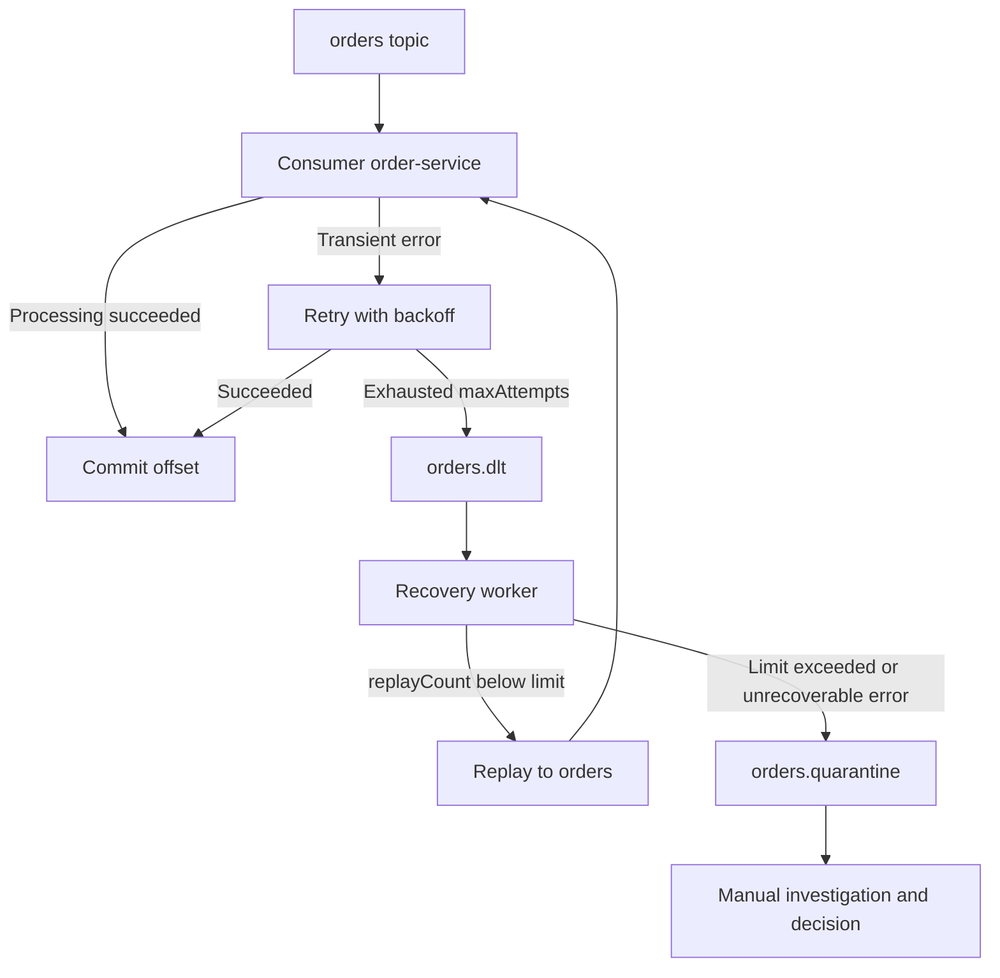

# Bounded DLT Replay and Final Quarantine

A Dead Letter Topic (DLT) is where messages are stored after they fail to process within the configured retries. A DLT keeps the main consumer processing subsequent messages instead of stalling indefinitely on one bad record. However, saving a message to the DLT is only the initial isolation step. Once the root cause is fixed, the operations team may need to replay selected messages back into the main processing flow.

DLT replay must be bounded. If a failing message is resent indefinitely, it can create an infinite loop between the main topic and the DLT, increasing load, producing duplicates, and obscuring the root cause. A safe recovery workflow tracks replay counts, limits replay rate and scope, and moves messages that exceed the threshold to a final quarantine topic for human investigation.

## 1. Distinguishing Retry, DLT, Replay, and Quarantine

These four concepts play distinct roles:

| Concept | Purpose | Position in lifecycle |
| --- | --- | --- |
| Retry | Re-attempt message processing when an error may be transient | Inside the consumer, before declaring processing failed |
| DLT/DLQ | Store messages that exhausted the main consumer's retries | Isolation point for investigation or recovery |
| Replay | Return a message from the DLT back into the processing flow | After the root cause is resolved or an operational decision is made |
| Quarantine | Store messages no longer eligible for automatic replay or needing manual intervention | Final isolation point; never automatically returned to the main topic |

For example, an order-processing service reads the `orders` topic. If processing a record fails, the consumer may retry three times. When it still fails, the Kafka binder routes the record to `orders.dlt`. Once developers fix a schema or data bug, a recovery worker can replay the record to `orders`. If the record fails again and exhausts its allowed replay count, the worker moves it to `orders.quarantine`.



Consumer retries and DLT replay counts are two separate counters. For instance, `maxAttempts: 3` allows up to three processing attempts during one message delivery pass; `maxReplayAttempts: 2` allows up to two cycles of sending a message from the DLT back to the main topic. Total actual processing attempts can exceed three because each replay cycle gets its own retries.

## 2. Enabling DLT for a Kafka Consumer with Spring Cloud Stream

The Kafka binder supports routing failed messages to a DLT after consumer retries are exhausted. The consumer needs a stable group so the binder can identify the consumption scope and DLT configuration.

Example configuration:

```yaml
spring:
  cloud:
    function:
      definition: processOrder
    stream:
      bindings:
        processOrder-in-0:
          destination: orders
          group: order-service
          content-type: application/json
          consumer:
            maxAttempts: 3
            backOffInitialInterval: 1000
            backOffMaxInterval: 10000
            backOffMultiplier: 2.0
      kafka:
        bindings:
          processOrder-in-0:
            consumer:
              enableDlq: true
              dlqName: orders.dlt
```

In this example:

- `maxAttempts` is the number of processing attempts during a single delivery pass, including the initial attempt.
- `backOffInitialInterval`, `backOffMaxInterval`, and `backOffMultiplier` control wait intervals between retries.
- `enableDlq: true` enables the DLT for the Kafka input binding.
- `dlqName` sets the target topic name for storing messages that exhausted retries.
- `group` gives a stable consumer group identity; never omit group when group-scoped DLT is needed.

Check exact property names and placement against your project's Spring Cloud Stream Kafka binder version. Common retry properties sit under `spring.cloud.stream.bindings.<binding>.consumer`; Kafka-specific DLT properties sit under `spring.cloud.stream.kafka.bindings.<binding>.consumer`.

### Retry with Backoff

With the example configuration, the consumer tries up to three times. Wait times grow by the multiplier without exceeding `backOffMaxInterval`. Backoff prevents tight retry loops when a database, broker, or downstream service is overloaded.

Retry is not a cure-all for every exception. Transient network errors may benefit from retries; invalid data, incompatible schemas, or business invariant violations usually need to go to the DLT early for investigation. Configure exception classification by retryability instead of applying one policy to all errors.

## 3. Metadata to Preserve in the DLT

When the Kafka binder moves a message to the DLT, Spring Kafka adds metadata about the original record and the failure. Common headers include:

- `KafkaHeaders.DLT_ORIGINAL_TOPIC`: original topic.
- `KafkaHeaders.DLT_ORIGINAL_PARTITION`: original partition.
- `KafkaHeaders.DLT_ORIGINAL_OFFSET`: original offset.
- `KafkaHeaders.DLT_ORIGINAL_TIMESTAMP`: original record timestamp.
- `KafkaHeaders.DLT_ORIGINAL_CONSUMER_GROUP`: consumer group that processed the record.
- `KafkaHeaders.DLT_EXCEPTION_FQCN`: fully qualified exception class name.
- `KafkaHeaders.DLT_EXCEPTION_MESSAGE`: error message.
- `KafkaHeaders.DLT_EXCEPTION_STACKTRACE`: stack trace, if configured to be retained.

Exact constants and headers depend on the Spring Kafka version. In code, prefer the corresponding `KafkaHeaders` constants instead of hardcoding header names. Do not assume every error header is always present: header mappers, binder configuration, and error types can alter which metadata is kept.

Beyond DLT metadata, applications should have a stable event ID and business key. Event IDs enable duplicate detection; business keys identify the target aggregate and help maintain business ordering.

## 4. Designing a Bounded Replay Counter

By default, a DLT does not know how many times a message has been replayed. The application must persist the replay counter durably and propagate it across each recovery cycle.

A dedicated Kafka header can be used, for example:

| Header | Meaning |
| --- | --- |
| `x-event-id` | Stable event identifier |
| `x-replay-count` | Number of replay cycles executed |
| `x-replay-request-id` | Replay request ID created by operations |
| `x-replay-requested-by` | Identity of the person or system requesting replay |
| `x-replay-reason` | Reason for replay after resolving the root cause |

Example policy:

```text
MAX_REPLAY_ATTEMPTS = 2

DLT record has replayCount = 0
  -> replay to orders, set replayCount = 1

If it fails again and returns to DLT with replayCount = 1
  -> replay to orders, set replayCount = 2

If it fails again and returns to DLT with replayCount = 2
  -> move to orders.quarantine
```

In this example, `MAX_REPLAY_ATTEMPTS = 2` allows two replays after initial processing. When `replayCount >= MAX_REPLAY_ATTEMPTS`, the recovery worker stops sending back to the main topic.

### Headers or a Recovery Ledger?

Headers work when the binder and header mapper preserve custom headers across the main topic → DLT → replay cycle. Test this with your exact binder version; if headers are stripped or change type, the counter can reset and limits become ineffective.

For audit requirements or critical recoveries, store the counter in a durable recovery ledger keyed by `(consumerName, eventId)` or `(eventId, replayRequestId)`. Update the ledger atomically with the replay workflow so state is not lost when a worker restarts. When choosing a ledger outside Kafka, address the gap between updating the ledger and sending the message—for example, using a transactional outbox for the recovery command itself.

Do not use the binder's internal retry count as the DLT replay counter. Internal retries finish before the message enters the DLT; replay is a subsequent recovery cycle.

## 5. Controlled Replay Workflow

The recovery worker reads the DLT and chooses one of two paths:

1. If the message qualifies and still has replay attempts left, send it back to the original topic or a replay topic subscribed to by the main consumer.
2. If the message has exceeded the limit, lacks required metadata, or is classified as unrecoverable, send it to quarantine.

Before replaying, verify:

- The root cause has been fixed or there is a clear rationale to retry.
- Messages are selected accurately by event ID, time window, or approved criteria.
- The target destination is on a configured allowlist.
- The current replay count is below the limit.
- Payload and schema remain compatible with the current consumer.
- Event ID, key, and required metadata are preserved.
- Replay rate will not overload the consumer or downstream dependencies.

Do not automatically replay the entire DLT on application startup. If the underlying bug remains, the worker can continuously feed a DLT → main topic → DLT loop. It is safer to replay in small, rate-limited batches, potentially requiring operator approval after root-cause verification.

## 6. Example Recovery Worker with KafkaTemplate

A dedicated recovery worker can use Spring Kafka's `@KafkaListener` to read the DLT and `KafkaTemplate` to resend records. This gives direct access to `ConsumerRecord`, preserves the key, and lets you inspect original Kafka headers.

Example manual acknowledgment listener config:

```yaml
spring:
  kafka:
    consumer:
      enable-auto-commit: false
    listener:
      ack-mode: manual
```

The following code illustrates the replay vs. quarantine decision. Helpers for reading headers and copying business headers are separated to keep the main flow clear:

```java
import java.nio.ByteBuffer;
import java.nio.charset.StandardCharsets;
import java.util.concurrent.TimeUnit;

import org.apache.kafka.clients.consumer.ConsumerRecord;
import org.apache.kafka.clients.producer.ProducerRecord;
import org.apache.kafka.common.header.Header;
import org.springframework.kafka.annotation.KafkaListener;
import org.springframework.kafka.core.KafkaTemplate;
import org.springframework.kafka.support.KafkaHeaders;
import org.springframework.kafka.support.Acknowledgment;
import org.springframework.stereotype.Component;

@Component
public class OrderDltRecovery {

    private static final String REPLAY_COUNT = "x-replay-count";
    private static final int MAX_REPLAY_ATTEMPTS = 2;
    private static final String QUARANTINE_TOPIC = "orders.quarantine";

    private final KafkaTemplate<String, OrderEvent> kafkaTemplate;

    public OrderDltRecovery(KafkaTemplate<String, OrderEvent> kafkaTemplate) {
        this.kafkaTemplate = kafkaTemplate;
    }

    @KafkaListener(
            topics = "orders.dlt",
            groupId = "orders-dlt-recovery")
    public void recover(
            ConsumerRecord<String, OrderEvent> failed,
            Acknowledgment acknowledgment) throws Exception {

        int replayCount;
        try {
            replayCount = readIntHeader(failed, REPLAY_COUNT, 0);
            if (replayCount < 0) {
                throw new IllegalArgumentException("Negative replay count");
            }
        }
        catch (RuntimeException invalidCounter) {
            publish(QUARANTINE_TOPIC, failed, -1,
                    "INVALID_REPLAY_COUNT");
            acknowledgment.acknowledge();
            return;
        }

        String originalTopic = readStringHeader(
                failed, KafkaHeaders.DLT_ORIGINAL_TOPIC);

        if (replayCount >= MAX_REPLAY_ATTEMPTS) {
            publish(QUARANTINE_TOPIC, failed, replayCount,
                    "MAX_REPLAY_ATTEMPTS_EXCEEDED");
        }
        else {
            if (originalTopic == null || originalTopic.isBlank()) {
                publish(QUARANTINE_TOPIC, failed, replayCount,
                        "MISSING_ORIGINAL_TOPIC");
            }
            else {
                publish(originalTopic, failed, replayCount + 1, "REPLAY");
            }
        }

        // Only acknowledge the DLT offset after the send is confirmed by the broker.
        acknowledgment.acknowledge();
    }

    private void publish(
            String destination,
            ConsumerRecord<String, OrderEvent> failed,
            int nextReplayCount,
            String action) throws Exception {

        ProducerRecord<String, OrderEvent> outgoing = new ProducerRecord<>(
                destination,
                failed.key(),
                failed.value());

        copyBusinessHeaders(failed, outgoing);
        outgoing.headers().add(REPLAY_COUNT,
                ByteBuffer.allocate(Integer.BYTES)
                        .putInt(nextReplayCount).array());
        outgoing.headers().add("x-recovery-action",
                action.getBytes(StandardCharsets.UTF_8));

        kafkaTemplate.send(outgoing).get(10, TimeUnit.SECONDS);
    }

    private static int readIntHeader(
            ConsumerRecord<?, ?> record, String name, int defaultValue) {
        Header header = record.headers().lastHeader(name);
        if (header == null) {
            return defaultValue;
        }
        return ByteBuffer.wrap(header.value()).getInt();
    }

    private static String readStringHeader(
            ConsumerRecord<?, ?> record, String name) {
        Header header = record.headers().lastHeader(name);
        return header == null ? null
                : new String(header.value(), StandardCharsets.UTF_8);
    }

    private static void copyBusinessHeaders(
            ConsumerRecord<?, ?> source,
            ProducerRecord<?, ?> target) {
        // Copy only an allowlist of business/tracing headers to preserve.
        // Do not copy internal DLT headers or old replay headers.
    }
}
```

This is a skeleton to complete for your project's model and configuration. `OrderEvent` is the application payload type; the consumer deserializer must be able to read payloads from the DLT. `copyBusinessHeaders` should selectively copy event ID, correlation ID, and necessary business headers, while stripping stale DLT headers and old `x-replay-count` values before adding the new value. If the DLT contains multiple payload types, use compatible serializers/deserializers or store payloads as a byte/JSON envelope to avoid unsafe casts.

`KafkaTemplate.send(...).get(...)` waits for the producer's send result before acknowledging the DLT offset. The producer should be configured with `acks=all` and replication matching durability requirements. Even so, a crash window exists after the broker accepts the message but before the DLT offset is committed; if that happens, the DLT message can be redelivered and replayed again. This gives at-least-once semantics, so event IDs and consumer idempotency remain essential.

If atomic consume-DLT-and-produce-replay/quarantine is needed, configure the listener container with a Kafka transaction manager and a `KafkaTemplate` sharing a transactional producer factory so output records and input offsets commit in the same Kafka transaction. Test this setup against your Spring Kafka version and container factory; simply setting `transactional.id` does not automatically provide atomicity.

## 7. Why Must Headers Be Copied Selectively?

A DLT record contains both business metadata and failure metadata added by the binder/Spring Kafka. When replaying back to the main topic, do not blindly copy all DLT headers:

- Preserve event ID, correlation ID, tenant ID, or schema version if consumers need them.
- Preserve or regenerate the replay count to bound loops.
- Record the replay request ID and requester for auditing.
- Remove old exception/DLT headers if they no longer describe the new attempt.
- Do not overwrite broker-generated Kafka metadata such as the new record's offset, partition, or timestamp.

Kafka generates a fresh offset, partition, and timestamp for the replayed record. Preserve original metadata in separate audit headers or a recovery ledger if investigation needs it. Never assume the old offset still locates the record after replay.

## 8. Final Quarantine (Quarantine Topic)

A quarantine topic holds messages that exceeded replay limits or cannot safely self-recover. An example topic name is `orders.quarantine`. This topic serves a different operational purpose than the DLT:

| DLT | Quarantine |
| --- | --- |
| Holds messages that exhausted main consumer retries | Holds messages that exhausted replays or are flagged for manual handling |
| Eligible for replay after fixing the root cause | Never automatically replayed to the main topic |
| Supports failure investigation and controlled recovery | Serves as final retention, audit, and exception handling |
| Typically read by recovery workers | Read only by authorized operational tools/teams |

A quarantine record should retain:

- Original payload or raw payload bytes so no data is lost.
- Event ID, business key, original topic/partition/offset.
- Final replay count and reason for moving to quarantine.
- Last exception and most recent failure timestamp.
- Replay request ID, approver identity, and action timestamp.
- Schema version, correlation ID, and necessary trace context.

The quarantine topic needs dedicated ACLs, appropriate retention, and monitoring dashboards. Never let regular business consumers subscribe to quarantine and auto-replay it, or it becomes a second unbounded DLT.

## 9. Preserving Ordering During Replay

Replaying to the original topic can alter processing order. Suppose `OrderCreated` for `ORD-1` failed and went to the DLT, while `PaymentReceived` and `OrderShipped` for the same order already processed. When `OrderCreated` is replayed, the older event arrives after newer events.

If business logic requires strict ordering per key:

1. Use an event ID and aggregate sequence number to detect stale events.
2. Have the consumer check sequence numbers and avoid applying out-of-order late events.
3. Pause the relevant partition or aggregate during recovery if the architecture allows.
4. Replay by key/partition in small batches after verifying current state.
5. If needed, route the event to a separate reconciliation flow instead of writing straight back to the main topic.

Kafka does not insert replayed records back at their old offset position. A replayed record is a new record with a new offset. Even if you keep the key so the partitioner selects the current partition, historical key ordering is not automatically restored.

## 10. Limiting Replay Rate and Scope

A DLT can accumulate millions of records. Replaying everything at once can overwhelm the main consumer, database, or downstream APIs. A recovery worker should support:

- Bounded batch sizes.
- Rate limiting by records/second.
- Filtering by approved event IDs, time range, error type, or tenant.
- Dry-run mode to count how many records will be replayed or quarantined.
- Pause/resume without losing read position.
- Backoff between batches and a circuit breaker if downstream fails again.
- Audit logging for every replay action.

Do not accept arbitrary destination names from operational requests. The recovery service should allow only preconfigured target topics and verify the original topic is on an allowlist. This prevents a replay action from sending sensitive data to an out-of-scope topic.

## 11. Manual Replay After Fixing the Root Cause

An operational workflow should follow these steps:

1. Identify why the message entered the DLT: data bug, schema, dependency, ACL, or application bug.
2. Fix the issue and deploy the updated consumer version.
3. Run a dry-run over a small subset of event IDs.
4. Verify payload, schema, replay count, and original destination.
5. Approve the replay according to operational permissions.
6. Replay in small, rate-limited batches.
7. Watch consumer lag, new errors, and records returning to the DLT.
8. Move records exceeding limits or deemed unsafe to quarantine.
9. Reconcile counts of DLT input, successful replays, and quarantined records.

Do not replay a message just because it has been sitting in the DLT for a while. If the underlying bug is unfixed, replay only creates another failure cycle. For permanent data errors, repair payloads through an audited process or keep them in quarantine for separate business resolution; never silently mutate original data.

## 12. Idempotency and Duplicate Prevention During Replay

DLT replay usually carries at-least-once semantics. Duplicates can occur when:

- The recovery worker sends successfully but crashes before committing the DLT offset.
- A producer timeout leaves the worker unsure whether the broker received the record.
- A replay request is submitted twice due to repeated operator actions.
- A message was processed successfully, but the DLT offset was not acknowledged yet.

The primary consumer should use a stable event ID and record processed markers via a unique constraint or inbox table. When encountering an existing event ID, the consumer skips duplicate side effects while still completing acknowledgment per policy.

The recovery worker should also use an idempotency key for replay requests, such as `(eventId, replayAttempt)`. If an operator submits the same request twice, the system can detect it and avoid producing redundant replays.

## 13. Do Retry Topics, DLTs, and Quarantine Replace Each Other?

No. Retry topics, DLTs, and quarantine address different stages:

- A retry topic delays retry attempts over time and separates retry traffic from primary partitions.
- A DLT holds messages that exhausted the consumer's retry policy.
- Quarantine holds messages that exceeded replay policies or require manual investigation.

When long delays are required, do not block consumer threads for minutes or hours. Use tiered delay retry topics (e.g., `orders.retry.1m`, `orders.retry.10m`) or a scheduler reading a recovery store with `nextAttemptAt`. When using retry topics, bound retry counts and prevent loops among retry topics.

## 14. Observability and Alerting

Metrics to track:

- Current message counts in the DLT and quarantine.
- Age of the oldest message in DLT/quarantine.
- Successful, failed, and limit-rejected replay counts.
- Average replay count and replay count distribution.
- Replay rate per second and main topic consumer lag.
- Duplicates detected by the consumer.
- Publish failures to the original topic or quarantine.
- Replay requests running, paused, or awaiting approval.

Set alerts when the DLT spikes, quarantine receives new records, replays fail repeatedly, or message age breaches SLA. Do not track record counts alone; a single record can remain stuck for a long time even when total DLT volume is small.

## 15. Testing Bounded Replay and Quarantine

Unit tests should verify decisions based on replay count:

| Current replay count | Expected action |
| ---: | --- |
| 0 | Replay to original topic, new count is 1 |
| 1 | Replay to original topic, new count is 2 |
| 2 | Move to quarantine, do not replay to original topic |
| Invalid header | Isolate or transition to error state per policy; do not silently reset to 0 |

Integration tests with Kafka should verify:

1. Main consumer exhausts retries and message appears in the DLT.
2. Recovery worker reads the right original topic and event ID.
3. Replay preserves the business key and required custom headers.
4. Replay count increments across each DLT cycle.
5. Upon reaching the limit, the message is sent to quarantine.
6. If broker send fails, the DLT offset is not acknowledged.
7. A crash after send but before offset commit produces a duplicate that is handled idempotently.
8. Replay rate does not overload the main consumer or downstream systems.
9. Header mapper preserves replay count across the main topic and DLT.
10. Records with permanent errors are never auto-replayed indefinitely.

The Test Binder is helpful for testing handler functions and message mapping, but it does not replace Kafka integration tests for offset commits, DLT headers, producer acknowledgments, partitions, transactions, and crash windows.

## 16. Common Mistakes

| Symptom | Possible cause | Resolution |
| --- | --- | --- |
| Message loops DLT → main topic → DLT forever | Replay count not stored or threshold not checked | Use a durable counter and move to quarantine when limit is reached. |
| Replay count is always 0 | Custom header stripped by header mapper or not copied on replay | Check the mapper and run a full-loop integration test; use a recovery ledger if needed. |
| DLT worker commits offset despite publish failure | Acknowledged before broker confirmed output | Ack only after send acknowledgment; consider Kafka transactions to commit output and offset together. |
| Same event replayed multiple times | Crash after publish before DLT offset commit | Idempotent consumer and replay request ID; consider consume-produce transactions. |
| Replay disrupts business ordering | Older record written as a new record after newer events | Use aggregate sequences, ordering checks, and reconciliation workflows. |
| Quarantine records get auto-reprocessed | Business consumer subscribed to quarantine or auto-replay is active | Separate ACLs, groups, and approval workflows for quarantine. |
| Replay overloads the main consumer | Entire DLT replayed without rate limiting | Small batches, rate limits, pause/resume, and lag monitoring. |
| Message missing original topic | DLT header absent or record placed in DLT outside the binder | Isolate and require destination verification; do not guess the topic. |

## 17. Implementation Checklist

Before enabling DLT replay in production:

- Configured consumer group and `enableDlq` on the right input binding.
- Set an explicit `dlqName` and provisioned appropriate access permissions.
- Selected retry count/backoff for transient errors.
- Defined maximum replay count independently from retry count.
- Chosen where to store replay count: tested custom Kafka header or durable recovery ledger.
- Defined event ID and idempotency strategy.
- Allowlisted original topics and quarantine destinations.
- Ack DLT only after publish confirmation or within an appropriate Kafka transaction.
- Preserved keys, schemas, and required business headers; stripped stale DLT headers.
- Evaluated key ordering and aggregate sequences.
- Configured rate limits, batch sizes, dry-run mode, and audit logs.
- Configured quarantine retention, ACLs, dashboards, and manual handling procedures.
- Tested crash windows, duplicates, publish failures, and exceeding replay limits.

## References

- [Spring Cloud Stream Kafka Binder — Dead-Letter Topic Processing](https://docs.spring.io/spring-cloud-stream/reference/kafka/kafka-binder/dlq.html)
- [Spring Cloud Stream — Consumer Properties](https://docs.spring.io/spring-cloud-stream/reference/spring-cloud-stream/binding-properties.html)
- [Spring for Apache Kafka — Handling Exceptions](https://docs.spring.io/spring-kafka/reference/kafka/annotation-error-handling.html)
- [Spring for Apache Kafka — Dead-Letter Publishing Recoverer](https://docs.spring.io/spring-kafka/reference/kafka/annotation-error-handling.html#dead-letters)
- [Apache Kafka — Consumer Configs](https://kafka.apache.org/documentation/#consumerconfigs)

Verify against the documentation of your exact Spring Cloud Stream Kafka binder and Spring Kafka versions, especially DLT property names, metadata headers, acknowledgment modes, and listener-container transaction support.

## Conclusion

Retry handles short-term failures inside the consumer; the DLT stores messages that exhausted retries; replay returns messages to the stream once root causes are addressed; quarantine retains messages that exceeded limits or require manual intervention. A safe workflow requires a replay counter independent of the retry count, a stable event ID, confirmed publishing before committing the DLT offset, idempotency, rate limiting, and ordering controls. Once `MAX_REPLAY_ATTEMPTS` is reached, the recovery worker must stop replaying and move the record to quarantine to prevent infinite loops.
