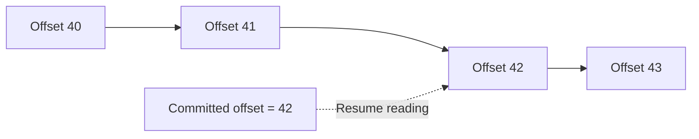
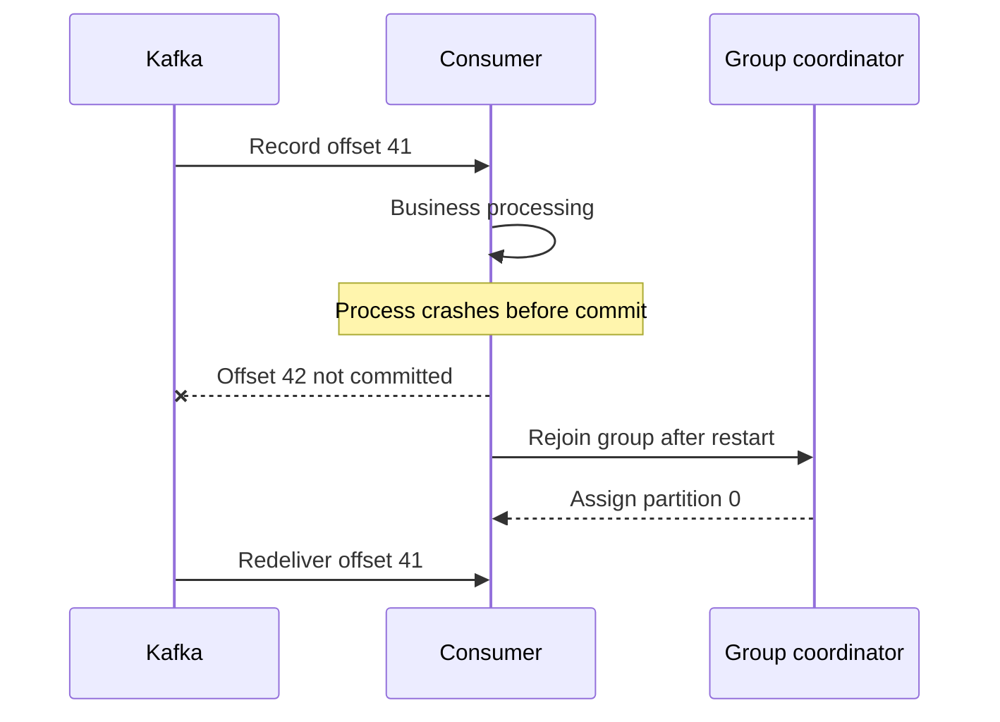
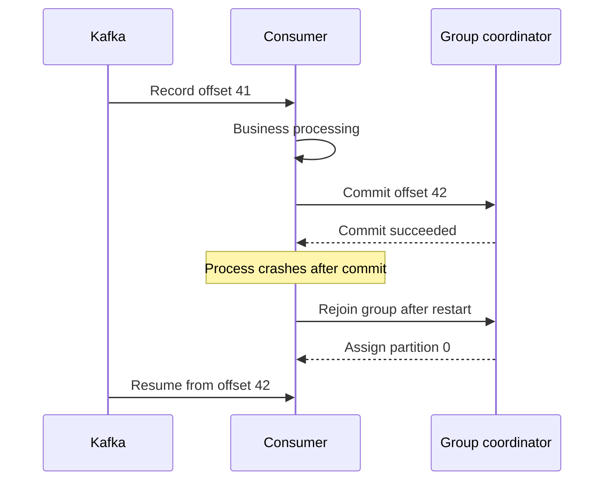
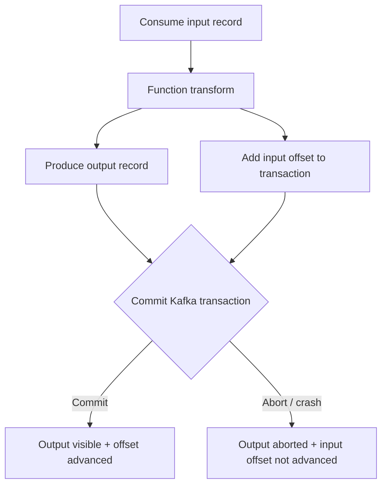

# Experimenting with Process Crashes Before and After Offset Commit

## 1. Why Experiment with Crash Timing?

A Kafka consumer can read a message, execute business logic, and then commit the offset to record the consumer group's progress. If the process stops abruptly, the outcome depends on whether the broker has acknowledged the offset commit and whether business side effects have completed.

Two critical scenarios:

- **Crash before offset commit:** Kafka still considers the record unacknowledged. When the consumer restarts or the partition is reassigned to another member, the record can be read again.
- **Crash after offset commit:** The consumer group resumes from the committed offset. The preceding record is not redelivered during normal reading, even if the process stopped right after committing.

Experimenting with these two timings clarifies why Kafka is typically operated with at-least-once semantics when committing after processing, why duplicates can still occur, and why committing too early can lose business side effects.

## 2. What Does a Committed Offset Mean?

Each record in a Kafka partition has an offset. A consumer group stores progress independently for each partition. The committed offset value is the next position the group will read—usually equal to the offset of the last completed record plus one.

For example, a consumer processes record offset `41` and commits `42`. After restarting, the consumer resumes from `42` and does not re-read record `41`, provided the group still has a valid offset and no reset occurs.



An offset commit is not a confirmation that a database committed, an email was sent, or an external API finished processing. It only records the group's consumption progress in Kafka. The application must order side effects and commits appropriately.

## 3. Two Independent Milestones: Side Effect and Offset Commit

When a consumer updates a database, two separate operations occur:

1. The database commits the business state change.
2. Kafka commits the consumer group's offset.

These two operations do not automatically form a single atomic transaction. Four outcomes are possible:

| Database side effect | Offset commit | Outcome after crash |
|---|---|---|
| Incomplete | Uncommitted | Record is re-read; processing can start over |
| Committed | Uncommitted | Record is re-read; side effect risks duplication |
| Incomplete | Committed | Record is not re-read; side effect may be lost |
| Committed | Committed | Consumer continues past that record; this is the desired state |

A consumer's goal is usually to finish durable side effects first, then acknowledge the offset. This favors at-least-once semantics: duplicate processing is possible, but it avoids marking a record complete before its side effects are saved. To prevent duplicates, idempotency or an inbox is required.

## 4. Crash Before Offset Commit

Suppose group `order-processor` reads topic `orders.events`, partition 0. The consumer receives record offset `41`:

1. Consumer reads record `41`.
2. Application begins processing.
3. Process is killed before offset `42` is committed.
4. Consumer restarts with the same group ID.
5. Kafka redelivers record `41` because the committed offset is still at `41` or earlier.



If the crash occurred before the side effect completed, the subsequent run can complete normally. If the database committed before the process crashed, the subsequent run may execute the side effect a second time. Therefore, "crash before offset commit" alone does not tell you whether business logic ran; you must check the crash point relative to database/API calls.

## 5. Crash After Offset Commit

If the broker has recorded offset `42`, the group resumes from that offset. Suppose the consumer commits and then the process stops:

1. Consumer reads record `41`.
2. Application processes the record.
3. Consumer commits offset `42` and receives commit confirmation.
4. Process crashes.
5. Consumer restarts with the same group.
6. Kafka starts from offset `42`; record `41` is not redelivered in normal reads.



If the application commits the offset before the database commit or before calling a business API, a crash after commit can skip the record while its side effects remain incomplete. This is a data-loss window caused by the wrong commit order.

## 6. Experiments Must Distinguish "Sending Commit" from "Broker-Confirmed Commit"

In code, a commit call can dispatch a request to the group coordinator. The process may stop while the request is in flight or before receiving the response. In that situation, the client cannot be sure whether the broker persisted the commit.

Therefore, when testing "crash after commit," confirm the commit completed under your commit mode, or inspect the committed offset from an independent admin client before killing the process. If you stop immediately after calling the commit API without awaiting the result, the experiment can land in an indeterminate state.

Similarly, if a crash happens while a commit request is being processed, restarting may either re-read the record or resume from the new offset depending on whether the coordinator persisted the request. Consumers must be safe under both outcomes.

## 7. Auto Commit vs. Container-Managed Commit

The Kafka consumer has an `enable.auto.commit` property. When enabled, the client commits offsets periodically without necessarily waiting for business logic to finish. If the application processes slower than the commit interval, offsets can be committed while side effects are still running; a crash then prevents the record from being re-read.

Spring Kafka containers typically manage commits and disable auto commit by default unless explicitly enabled by the application. The Spring Cloud Stream Kafka binder provides `ackMode` to control when the container acknowledges offsets. For consumers performing business logic, understand the binder configuration clearly and do not enable auto commit casually.

Common Spring Kafka acknowledgement modes:

| Ack mode | General commit timing | Replay scope on crash |
|---|---|---|
| `RECORD` | After the listener finishes each record | Uncommitted records can be re-read |
| `BATCH` | After finishing all records in a poll batch | Uncommitted portion of the batch can be re-read |
| `TIME` | At a configured interval, when batch conditions are met | Multiple records since the last commit can be re-read |
| `COUNT` | When a configured record count is reached | Records since the last commit can be re-read |
| `MANUAL` | Application calls acknowledge; container commits periodically/after batch | Depends on actual acknowledge and commit timing |
| `MANUAL_IMMEDIATE` | Commits immediately when acknowledge is called on the consumer thread | Smaller replay window once commit finishes |

Exact behavior also depends on the Spring Kafka version, listener type, batch/record mode, and sync commit settings. Verify against your project's binder version.

## 8. Configuring ackMode in the Spring Cloud Stream Kafka Binder

Example input binding configured with `RECORD`:

```yaml
spring:
  cloud:
    function:
      definition: processOrder
    stream:
      bindings:
        processOrder-in-0:
          destination: orders.events
          group: order-processor
      kafka:
        bindings:
          processOrder-in-0:
            consumer:
              ackMode: RECORD
```

With `RECORD`, the container commits the offset after the listener completes processing the record per Spring Kafka semantics. If the function throws an exception and the error is not recovered, the commit is typically not considered successful for that record; error handler/retry/DLQ decides the next step.

If `BATCH` is used, the container can commit after processing all records returned in a single poll. When the process crashes mid-batch, uncommitted records can be redelivered, including records whose logic already finished if they were not yet committed.

`ackMode` is a Kafka binder property, not a generic property across all binders. RabbitMQ and Pulsar have their own acknowledgement semantics.

## 9. Manual Acknowledgement Inside a Function

When you need explicit control over when acknowledgement happens, use manual ack as supported by the Kafka binder. The example below retrieves `Acknowledgment` from message headers and acknowledges only after the service finishes its business operation:

```java
import java.util.function.Consumer;
import org.springframework.context.annotation.Bean;
import org.springframework.context.annotation.Configuration;
import org.springframework.kafka.support.Acknowledgment;
import org.springframework.kafka.support.KafkaHeaders;
import org.springframework.messaging.Message;

record OrderEvent(String eventId, String orderId) {}

interface OrderService {
    void apply(OrderEvent event);
}

@Configuration
class OrderFunctions {

    @Bean
    Consumer<Message<OrderEvent>> processOrder(OrderService service) {
        return message -> {
            service.apply(message.getPayload());

            Acknowledgment acknowledgment = message.getHeaders().get(
                KafkaHeaders.ACKNOWLEDGMENT,
                Acknowledgment.class
            );
            if (acknowledgment == null) {
                throw new IllegalStateException("Kafka acknowledgment header is missing");
            }
            acknowledgment.acknowledge();
        };
    }
}
```

Binding configuration:

```yaml
spring:
  cloud:
    function:
      definition: processOrder
    stream:
      bindings:
        processOrder-in-0:
          destination: orders.events
          group: order-processor
      kafka:
        bindings:
          processOrder-in-0:
            consumer:
              ackMode: MANUAL
```

`service.apply` must finish durable side effects before the function calls `acknowledge`. If the service uses `@Transactional`, calling through the Spring proxy usually returns only after the transactional method finishes and commits; make sure database writes are not offloaded to an unfinished asynchronous task.

With `MANUAL`, acknowledge marks the record processed and the container commits according to that mode's rules. `MANUAL_IMMEDIATE` can commit immediately when acknowledge is called on the consumer thread. Do not call ack from another thread without understanding your container and version semantics.

Manual ack does not create a shared transaction with the database. If the database commits and the process crashes before ack takes effect, the record can still be redelivered. Consumers must be idempotent.

## 10. Experiment A: Crash Before Offset Commit

The goal is to observe a record being redelivered when the process stops after receiving the message but before committing the offset.

### Preparation

1. Create a test topic `recovery-lab` with one partition.
2. Use a dedicated group `recovery-lab-group` so other workloads are unaffected.
3. Set `auto.offset.reset=earliest` for the new test group.
4. Send a record with a unique event ID, such as `evt-001`.
5. Run a consumer that logs `eventId`, partition, and offset.
6. Place a failpoint after receiving the record but before acknowledge/commit.

### Execution

- Start the consumer and wait for logs showing `evt-001` was received.
- Force-kill the process before the offset commit is confirmed by the broker.
- Restart the consumer with the same group ID.
- Observe `evt-001` being received again with the same partition and offset.
- Inspect the group's committed offset before and after the restart.

Expected result: because the offset was not committed, Kafka redelivers the record. If side effects had not run before the failpoint, the next run executes them once. If side effects had committed before the failpoint, the next run may produce a duplicate.

## 11. Experiment B: Crash After Offset Commit

The goal is to observe the group resuming from the next offset after the broker confirms a commit.

### Execution

1. Reuse the test topic and group or create a new group.
2. Send record `evt-002` at a known offset.
3. Consumer processes the record and acknowledges/commits.
4. Wait for commit completion; verify the committed offset advanced to the next position.
5. Force-kill the process immediately after commit confirmation.
6. Restart the consumer with the same group ID.
7. Observe the consumer resuming from the next offset without receiving `evt-002` again during normal reads.

Expected result: once the broker persists the offset commit, the consumer does not re-read the earlier record. If business side effects did not complete before the commit, this experiment demonstrates how premature commits can lose side effects.

## 12. Experiment C: Database Commits Before Crash, Kafka Offset Uncommitted

This is the classic window that causes duplicates in at-least-once systems:

1. Consumer receives event `evt-003`.
2. Database transaction writes business changes and commits successfully.
3. Process crashes before the Kafka offset is committed.
4. Kafka redelivers `evt-003` after restart.
5. Consumer re-executes logic and risks writing the same change again.

To observe this, record `eventId` in a processed table and test both cases: without a unique constraint and with an inbox unique constraint. With the inbox, redelivery must be recognized as a duplicate and skip reapplying side effects.

Do not use an offset sequence number as a global idempotency key. Offsets are only unique within a topic/partition; a stable business event ID is far better when data is copied or replayed across streams.

## 13. Experiment D: Offset Committed Before Database Commit

This experiment illustrates how side effects can be lost:

1. Consumer receives `evt-004`.
2. Application acknowledges/commits the offset.
3. Wait for committed offset confirmation.
4. Stop the process before the database commits.
5. Restart the consumer with the same group.
6. Confirm the consumer starts from the next offset and does not automatically re-read `evt-004`.

Result: Kafka recorded the group as finished with the record, so the record is not redelivered by group progress. If the database never committed, the side effect can be lost. Never use this commit order for consumers that must guarantee database side effects.

## 14. Inspecting Committed Offsets with the Kafka CLI

Before and after each experiment, inspect group status:

```bash
kafka-consumer-groups.sh \
  --bootstrap-server localhost:9092 \
  --describe \
  --group recovery-lab-group
```

Compare these columns:

- `CURRENT-OFFSET`: next position the group will read according to committed state.
- `LOG-END-OFFSET`: end of log as displayed by the CLI for the partition.
- `LAG`: difference between log end and current offset.
- `CONSUMER-ID` and `HOST`: active member holding the assignment, if any.

While the consumer is running, `CURRENT-OFFSET` may not reflect a just-processed record yet if the commit mode waits until the end of a batch or interval. Understand `ackMode` before comparing application logs with CLI offsets.

## 15. Batch Processing and Replay Scope

With `AckMode.BATCH`, a consumer can receive a poll batch containing many records. The container typically commits offsets after the batch finishes processing. If the process crashes mid-batch, uncommitted records can be re-read after restart.

For example, a batch containing offsets `10`, `11`, `12`, `13`:

- Application finishes processing `10` and `11`.
- Application begins processing `12` and crashes.
- Previously committed offset is still `10`.
- On restart, the group may re-read from `10`, causing `10` and `11` to be processed again.

This is a trade-off between batch-commit performance and potential replay scope. `RECORD` can shrink the number of records re-read at the cost of more frequent commits. Choose based on throughput, latency, and idempotency capabilities.

## 16. Rebalances Can Also Trigger Redelivery

A consumer crash or lost connection can trigger a group rebalance. Partitions move to another member. If records were already processed while offsets remained uncommitted, the new consumer can re-read from the last committed offset.

Beyond crashes, rebalances can happen when:

- Instances scale up or scale down.
- Consumers stop during rolling deployments.
- `max.poll.interval.ms` is exceeded due to slow processing.
- Network blips cause a member to drop out of the group.
- Subscriptions or partition assignments change.

Handle shutdown gracefully, avoid blocking the poll thread for too long, and design idempotent consumers. Do not treat redelivery after a rebalance as abnormal Kafka behavior.

## 17. Impact of auto.offset.reset

`auto.offset.reset` is used only when a group has no valid committed offset or its committed offset falls outside the retained log range. Common values:

- `earliest`: start from the earliest retained offset.
- `latest`: start from the end of the log.
- `none`: fail if no valid offset is found.

If a group already has a valid committed offset, changing `auto.offset.reset` does not rewind the group back to the start of the topic. To replay, reset offsets via admin tools or use a new group. During experiments, always use a dedicated group to avoid accidentally altering production progress.

## 18. Kafka Transactions for Consume-Transform-Produce

If a consumer reads Kafka records and emits output Kafka records, Kafka transactions can combine output records and input offsets into one transaction when the binder/container is properly configured.



If the process crashes before transaction commit, the transaction can be aborted or timed out by the coordinator; consumers reading with `read_committed` do not see uncommitted outputs, and input offsets are not advanced inside that transaction. On reprocessing, the function can run again.

If the transaction commits and then the process crashes, output records are committed and input offsets are advanced within the same Kafka transaction boundary. This provides stronger guarantees for consume-transform-produce inside Kafka.

Kafka transactions do not cover external databases or HTTP services. If the function updates a database before the Kafka transaction commits, a crash can leave database side effects persisted while input records get re-read. Use outbox/inbox or idempotency at boundaries outside Kafka.

## 19. Designing an Idempotent Consumer

Because crashes before offset commit can cause redelivery, consumers should recognize already processed events:

```java
import org.springframework.stereotype.Service;
import org.springframework.transaction.annotation.Transactional;

record OrderEvent(String eventId, String orderId, long totalCents) {}

interface InboxRepository {
    boolean insertIfAbsent(String eventId);
}

interface OrderRepository {
    void apply(OrderEvent event);
}

@Service
class IdempotentOrderHandler {

    private final InboxRepository inbox;
    private final OrderRepository orders;

    IdempotentOrderHandler(InboxRepository inbox, OrderRepository orders) {
        this.inbox = inbox;
        this.orders = orders;
    }

    @Transactional
    void handle(OrderEvent event) {
        if (!inbox.insertIfAbsent(event.eventId())) {
            return;
        }
        orders.apply(event);
    }
}
```

`insertIfAbsent` must be implemented using an atomic database operation and a unique constraint on `event_id`; do not check existence and then insert in two separate statements. Inserting into the inbox and updating the order must share the same database transaction. If the transaction rolls back, both operations roll back. If it commits, subsequent redeliveries are detected and completed side effects are skipped.

## 20. Safe Experimentation Workflow

1. Use a test Kafka cluster, a single-partition topic, and a dedicated consumer group.
2. Disable or control auto commit so commit timing is explicit.
3. Send events with unique IDs and record topic, partition, and offset.
4. Create one failpoint before acknowledgement and one failpoint after commit confirmation.
5. Run each experiment separately, force-killing the process at the failpoint.
6. Restart with the same group and observe whether records are redelivered or skipped.
7. Read committed offsets with the Kafka CLI after each stop.
8. Repeat with database side effects before/after commit to observe duplicates and loss windows.
9. Enable inbox/idempotency and rerun to confirm side effects do not repeat.
10. Test `RECORD` and `BATCH` to compare replay scopes.

Never reset offsets or kill production consumers for experimentation. If testing in staging, use dedicated topics/groups and coordinate the test window with operations.

## 21. Interpreting Results and Diagnosing

| Observation | Likely explanation | What to check |
|---|---|---|
| Record reappears after restart | Offset was uncommitted or commit was not confirmed by broker | Committed offset, ack mode, commit request result |
| Record does not reappear | Offset was committed or group started at another position | Group ID, committed offset, reset policy, and log range |
| Database has data but record is re-read | Database committed before Kafka offset commit | Inbox/idempotency and side-effect/ack ordering |
| Record not re-read but database lacks data | Offset may have committed before side effect | Auto commit, manual ack placement, batch behavior |
| Multiple batch records re-read | Batch had not committed when process crashed | `ackMode`, poll batch, and committed offset before crash |
| Record redelivered after rebalance | Partition moved to another member while offset was uncommitted | Consumer membership, poll interval, and graceful shutdown |

Do not draw conclusions from application logs alone. Cross-check event ID, partition, offset, database state, and committed offsets for the exact group.

## 22. Workflow for Choosing Commit Timing

1. Identify which side effects must complete before a message is acknowledged.
2. For databases, wait for the transaction commit to succeed before acknowledging input.
3. Choose `RECORD`, `BATCH`, or manual ack according to latency needs and replay scope.
4. Keep auto commit disabled when the container is responsible for post-processing commits.
5. Make side effects idempotent to survive crashes after database commit but before offset commit.
6. Use Kafka transactions when atomic consume-transform-produce within Kafka is needed.
7. Use outbox/inbox when coordinating databases and brokers.
8. Experiment with crashes before/after commits in test environments and verify actual offsets.

Crashing before an offset commit typically causes Kafka to redeliver the record; crashing after a broker-confirmed commit causes the group to resume from the next offset. These two outcomes create the at-least-once trade-off and the risk of duplicates—or the risk of lost side effects if committed in the wrong order. In Spring Cloud Stream, understand `ackMode`, place acknowledgements after durable side effects finish, and use idempotency to protect the crash window between database commits and Kafka offset commits.
