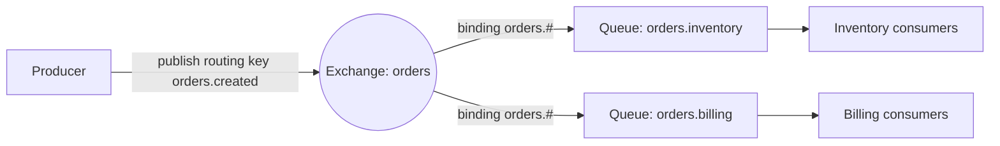
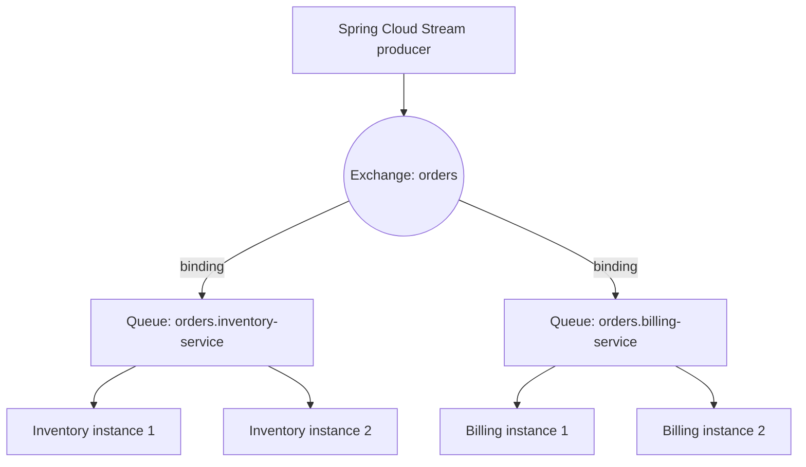

# Mapping Destinations to Exchanges and Groups to Queues

## Objectives

RabbitMQ organizes message routing through exchanges, bindings, and queues. The Spring Cloud Stream RabbitMQ binder maps the framework's binding model to these components: **destination** determines the exchange that producers send to and consumers subscribe from; **consumer group** determines the dedicated queue of a logical subscriber bound to the exchange.

Understanding this mapping correctly helps design fan-out across multiple services, load balancing across replicas, choosing routing keys, and managing durable queues. Confusing a destination with a queue or a group with an exchange can cause an application to send messages to the wrong topology, create duplicate queues, or cause multiple services to inadvertently compete for the same message.

After this lesson, you will be able to:

- Explain the roles of exchanges, queues, bindings, and routing keys in RabbitMQ.
- Understand how Spring Cloud Stream maps destinations to exchanges.
- Understand how consumer groups are mapped to queues.
- Distinguish between replicas in the same group and logical subscribers in different groups.
- Configure exchange types, routing keys, and binding routing keys.
- Choose appropriate queue names, durability, and subscription lifecycles.
- Test the topology and verify that messages are routed to the correct queues.

## 1. Core Routing Components of RabbitMQ

RabbitMQ does not send messages directly to a queue in a way where the producer must know the queue name. Producers publish messages to an **exchange**. The exchange inspects the exchange type, routing key, and declared bindings to decide which queues receive the message.

Four components to distinguish:

| Component | Role | Example |
|---|---|---|
| Exchange | Receives messages from producers and performs routing | `orders` |
| Queue | Stores messages waiting for consumers to receive | `orders.inventory` |
| Binding | Rule linking a queue to an exchange | Queue `orders.inventory` receives key `orders.#` |
| Routing key | Value attached by the producer to a message for the exchange to match against bindings | `orders.created` |

Sending flow:



The producer only needs to know the exchange and routing key. It does not need to know which queues will receive the message. An exchange can route a message to one queue or multiple queues depending on the exchange type and bindings.

A single queue can have multiple consumers reading from it concurrently. Those consumers compete to receive messages from the queue. If two services both need to receive independent copies, two different queues bound to the exchange are typically created, rather than having both services read from the same queue.

## 2. Mapping in the Spring Cloud Stream RabbitMQ Binder

In Spring Cloud Stream, an input/output binding has a `destination` property. With the RabbitMQ binder, the destination typically maps to the exchange name:

- **Output binding:** the binder publishes messages to the exchange named by the destination.
- **Input binding:** the binder declares or uses the corresponding exchange and binds the consumer's queue to that exchange.
- **Consumer group:** the binder uses the group to determine the logical subscriber's queue.
- **Binding routing key:** specifies which types of messages from the exchange are routed into the consumer's queue.

Example of an input binding:

```yaml
spring:
  cloud:
    function:
      definition: processOrders
    stream:
      bindings:
        processOrders-in-0:
          destination: orders
          group: inventory
          content-type: application/json
```

Here:

- `orders` is the destination and the exchange name according to the Rabbit binder configuration.
- `inventory` is the consumer group.
- A queue is created for the `inventory` logical subscriber and bound to the `orders` exchange.
- The default queue name typically combines the destination and group, e.g., `orders.inventory`; the binder's queue naming configuration can alter this rule.

This is the most important mapping: **destination selects the exchange, group selects the consumer's queue**. A group is not an exchange name; a destination is not a queue name either.

If no group is declared, the binder creates an anonymous consumer queue according to its mechanism. Anonymous queues typically have auto-generated names and temporary lifecycles, suitable for subscribers that do not need to maintain a stable identity across restarts. For business consumers that require durable queues and must continue receiving messages after a restart, use a stably named group.

## 3. One Destination, Multiple Groups: Fan-Out to Multiple Logical Subscribers

Suppose the system emits order events to the `orders` exchange. Two services need to receive all events:

- `inventory-service` updates inventory.
- `billing-service` creates payment requests.

Each service declares the same destination but a different group:

```yaml
# inventory-service
spring:
  cloud:
    function:
      definition: processOrders
    stream:
      bindings:
        processOrders-in-0:
          destination: orders
          group: inventory-service
```

```yaml
# billing-service
spring:
  cloud:
    function:
      definition: createInvoices
    stream:
      bindings:
        createInvoices-in-0:
          destination: orders
          group: billing-service
```

The Rabbit binder creates a separate queue for each group and binds both queues to the `orders` exchange. When the exchange routes a matching message to both queues, each service receives an independent copy.



Replicas within the same group read from the shared queue and divide the work. Different groups have separate queues, so each group receives a copy. This combines fan-out across logical subscribers with competing consumers within each subscriber.

If inventory and billing use the same group name, they can end up reading from the same queue and competing for messages. In that case, a message goes to either inventory or billing instead of both services receiving it. Assign different group names to services that need independent copies.

## 4. One Group, Multiple Instances: Load Sharing on the Same Queue

When a service runs multiple replicas, its replicas typically use the same destination and group:

```text
inventory-service instance 1 -> exchange orders, queue orders.inventory-service
inventory-service instance 2 -> exchange orders, queue orders.inventory-service
inventory-service instance 3 -> exchange orders, queue orders.inventory-service
```

All three consumers read from the `orders.inventory-service` queue. RabbitMQ distributes messages to consumers based on readiness, prefetch, and queue/channel conditions. This is the competing consumers model.

Unlike Kafka, RabbitMQ does not divide a queue into partitions statically assigned to individual consumers within a consumer group. A queue is a message store; multiple consumers can receive messages from the same queue. Processing completion order may differ from delivery order when there are multiple consumers, large prefetch values, or asynchronous processing.

Consider:

- Number of consumers/concurrency and processing capacity per instance.
- Prefetch to limit the number of unacknowledged messages held by each consumer.
- Processing time and dependency timeouts.
- Acknowledgment after successful processing.
- Redelivery when a consumer stops before acknowledging.
- Idempotency in case the same message is redelivered.

Increasing the number of replicas does not automatically guarantee exactly-once message processing. RabbitMQ can redeliver unacknowledged messages; consumers should use an event ID or idempotency key to avoid duplicate side effects.

## 5. Queue Name and Group Name

Under the common default convention of the Rabbit binder, a named group's queue combines the destination and group, for example:

```text
destination = orders
group       = inventory-service
queue       = orders.inventory-service
```

You can use the `queue-name-group-only` property to make the queue name based solely on the group:

```yaml
spring:
  cloud:
    stream:
      bindings:
        processOrders-in-0:
          destination: orders
          group: inventory-service
      rabbit:
        bindings:
          processOrders-in-0:
            consumer:
              queue-name-group-only: true
```

When this option is enabled, the queue name no longer includes the destination by default. Ensure the group name is unique within the broker/vhost where the queue is declared; if two different destinations share the same group name and the queue name is only the group, they may collide or create an unintended topology.

Naming decisions should consider:

- Uniqueness within the broker virtual host.
- Deployment environment, e.g., dev/staging/prod.
- Service or logical subscriber name.
- Queue observability and operations.
- Plans for renaming destinations/groups and migrating queues.

Group names should be stable across replicas and deployments. Do not include pod IDs, hostnames, or UUIDs in a named group if the goal is for replicas to share a queue.

## 6. Exchange Type Determines Routing Behavior

RabbitMQ has several exchange types. The exchange type determines how routing keys and bindings are used.

| Exchange type | Routing behavior | Suitable example |
|---|---|---|
| Direct | Routing key must match the binding key exactly | `orders.created` goes only to queues registered with that exact key |
| Topic | Routing key is matched using wildcard patterns | `orders.*`, `orders.#` |
| Fanout | Sends to every bound queue, ignoring the routing key | Broadcast events to all subscribers |
| Headers | Matches based on message headers and binding arguments | Routing by header attributes |

The Rabbit binder supports configuring the exchange type. For example, producer and consumer both using a topic exchange:

```yaml
spring:
  cloud:
    stream:
      bindings:
        orders-out-0:
          destination: orders
      rabbit:
        bindings:
          orders-out-0:
            producer:
              exchange-type: topic
```

The exchange type must be compatible across the producer, consumer, and existing topology. If the `orders` exchange was already declared as direct and an application tries to redeclare the same name as topic, RabbitMQ may reject it because an exchange's type cannot be changed in place. When topology changes are needed, use a migration plan or a new exchange name.

### Topic Wildcards

With a topic exchange, routing keys and binding keys are dot-delimited strings:

- `*` matches exactly one segment.
- `#` matches zero or more segments.

Examples:

| Binding key | Matching routing keys | Non-matching routing keys |
|---|---|---|
| `orders.created` | `orders.created` | `orders.updated` |
| `orders.*` | `orders.created`, `orders.cancelled` | `orders.eu.created` |
| `orders.#` | `orders.created`, `orders.eu.created` | `payments.created` |
| `#` | Nearly all routing keys | No prefix restriction |

Choose patterns narrow enough so that a queue only receives messages the consumer needs. Using `#` for every queue can cause subscribers to receive more message types than intended.

## 7. Configuring Producer Routing Keys and Consumer Binding Keys

The producer routing key and consumer binding key are two sides of the same routing rule:

- **Producer routing key:** the value attached to a message when publishing to the exchange.
- **Consumer binding key:** the pattern a queue registers with the exchange to receive matching messages.

Example of a producer sending the event type as the routing key:

```yaml
spring:
  cloud:
    stream:
      bindings:
        orders-out-0:
          destination: orders
          content-type: application/json
      rabbit:
        bindings:
          orders-out-0:
            producer:
              exchange-type: topic
              routing-key-expression: payload.eventType
```

Assuming the payload has `eventType = "orders.created"`, the producer publishes to the `orders` exchange with routing key `orders.created`.

The inventory consumer receives all order events:

```yaml
spring:
  cloud:
    stream:
      bindings:
        processOrders-in-0:
          destination: orders
          group: inventory-service
      rabbit:
        bindings:
          processOrders-in-0:
            consumer:
              binding-routing-key: orders.#
              durable-subscription: true
```

The billing consumer can receive only order creation events:

```yaml
spring:
  cloud:
    stream:
      bindings:
        createInvoices-in-0:
          destination: orders
          group: billing-service
      rabbit:
        bindings:
          createInvoices-in-0:
            consumer:
              binding-routing-key: orders.created
              durable-subscription: true
```

In this example:

- Both input bindings use the `orders` exchange.
- Each group has its own queue.
- The inventory queue binds with `orders.#`.
- The billing queue binds with `orders.created`.
- An `orders.created` message is routed to both queues.
- An `orders.cancelled` message matches only the inventory queue.

Binder property names use kebab-case in YAML. Check your actual configuration and Rabbit binder version when using multiple bindings or custom exchanges.

### Routing Key Expression

`routing-key-expression` is a SpEL expression evaluated against the message/payload as supported by the Rabbit binder. You can derive the key from event type, region, or a business attribute:

```yaml
routing-key-expression: payload.region + '.' + payload.eventType
```

If the expression produces `eu.orders.created`, the queue can bind with `eu.orders.#`. Do not take arbitrary routing keys from HTTP requests or untrusted data; map input values into an allowlisted set of routing keys.

## 8. Named Groups and Anonymous Queues

A named group creates a logical subscriber with a stable identity. The group's queue can be configured as durable so it survives restarts and retains messages while the consumer is paused, depending on queue/message durability and broker policy.

Example:

```yaml
spring:
  cloud:
    stream:
      bindings:
        processOrders-in-0:
          destination: orders
          group: inventory-service
      rabbit:
        bindings:
          processOrders-in-0:
            consumer:
              durable-subscription: true
```

When no group is declared, the binder creates an anonymous queue. This queue typically has an auto-generated name and a temporary lifecycle, suitable for observer or experimental consumers that do not need to keep a long-lived subscription. When the application stops, the queue may be deleted according to the binder and broker's auto-delete/non-durable mechanism.

| Characteristic | Named group | Anonymous group |
|---|---|---|
| Queue identity | Stable based on destination/group and naming config | Auto-generated name |
| Used for | Production logical subscribers | Temporary, experimental, or observer consumers |
| Multiple replicas | Can share the same queue | Depends on the identity/queue created per instance |
| After restart | Can resume the queue and messages if durable | Should not rely on retaining the queue or re-reading messages |
| Management | Clear naming, ACLs, monitoring, and retention | Lifecycle is typically managed by the binder/broker |

A durable queue does not by itself guarantee that every message is persisted durably. Distinguish queue durability from message delivery mode/persistence, publisher confirms, consumer acknowledgments, and broker replication. A durable queue containing non-persistent messages still does not provide the same guarantee across broker restarts as a durable queue with persistent messages.

## 9. When Are Exchanges and Queues Declared?

The Rabbit binder can declare exchanges, queues, and bindings during binding creation if provisioning settings allow. Several properties commonly need review:

- `declare-exchange`: whether the binder declares the exchange.
- `bind-queue`: whether the binder creates the binding between the queue and exchange.
- `durable-subscription`: whether the queue subscription is durable.
- `queue-name-group-only`: selects the group-only queue naming rule.
- `binding-routing-key`: routing key/pattern for the queue binding.
- `exchange-type`: exchange type.
- `auto-bind-dlq`: whether to automatically declare dead-letter topology.

Example of a consumer using infrastructure-managed topology:

```yaml
spring:
  cloud:
    stream:
      bindings:
        processOrders-in-0:
          destination: orders
          group: inventory-service
      rabbit:
        bindings:
          processOrders-in-0:
            consumer:
              declare-exchange: false
              bind-queue: false
              durable-subscription: true
```

When exchange or binding declaration is disabled, the infrastructure must pre-create the corresponding components. The queue must exist and be bound to the right exchange/routing key before the consumer starts receiving. If the exchange or queue does not exist, the binding may not work or the channel may be closed depending on the broker operation.

Do not disable provisioning in isolation without verifying that the topology has been created by IaC or the operations team. The application needs appropriate permissions to declare, bind, consume, and publish according to the deployment model.

## 10. Queue Durability, Message Persistence, and Acknowledgment

The following three mechanisms are independent:

1. **Durable queue:** the queue is declared durable and can survive a broker restart according to the queue type's semantics.
2. **Persistent message:** the message is published with the appropriate delivery mode so the broker stores it durably.
3. **Publisher confirm and consumer ack:** the publisher receives confirmation from the broker about the publish; the consumer confirms the message has been processed according to policy.

A durable queue does not mean messages have been confirmed as durably published. A consumer ack also does not mean the database transaction has committed unless the code orders those steps properly.

A safe consumer flow typically:

1. Receives the message.
2. Validates the payload and contract.
3. Executes business logic within a database transaction.
4. Commits the database.
5. Acknowledges the message via the binder/container mechanism.
6. If the process dies after the DB commit but before the ack, RabbitMQ may redeliver; the consumer must be idempotent.

For processing failures, nack/reject can requeue or dead-letter depending on configuration. Do not use infinite requeue for poison messages; a retry budget and DLQ are required.

## 11. Complete Example: Producer Publishes, Two Groups Receive

Suppose a producer emits `OrderEvent` to the `orders` exchange:

```java
public record OrderEvent(
        String eventId,
        String eventType,
        String orderId,
        String region
) {}

@Service
public class OrderPublisher {

    private final StreamBridge streamBridge;

    public OrderPublisher(StreamBridge streamBridge) {
        this.streamBridge = streamBridge;
    }

    public boolean publish(OrderEvent event) {
        return streamBridge.send("orders-out-0", event);
    }
}
```

Output binding:

```yaml
spring:
  cloud:
    stream:
      bindings:
        orders-out-0:
          destination: orders
          content-type: application/json
      rabbit:
        bindings:
          orders-out-0:
            producer:
              exchange-type: topic
              routing-key-expression: payload.eventType
```

Inventory consumer:

```java
@Bean
Consumer<OrderEvent> processOrders(InventoryService service) {
    return event -> service.process(event);
}
```

```yaml
spring:
  cloud:
    stream:
      bindings:
        processOrders-in-0:
          destination: orders
          group: inventory-service
      rabbit:
        bindings:
          processOrders-in-0:
            consumer:
              binding-routing-key: orders.#
              durable-subscription: true
```

Billing consumer:

```java
@Bean
Consumer<OrderEvent> createInvoices(BillingService service) {
    return event -> service.createInvoice(event);
}
```

```yaml
spring:
  cloud:
    stream:
      bindings:
        createInvoices-in-0:
          destination: orders
          group: billing-service
      rabbit:
        bindings:
          createInvoices-in-0:
            consumer:
              binding-routing-key: orders.created
              durable-subscription: true
```

If the producer sends routing key `orders.created`, both the inventory queue and the billing queue receive the message. If it sends `orders.cancelled`, only the inventory queue matches the configured binding key.

## 12. Common Configuration Mistakes

| Symptom | Possible cause | Resolution |
|---|---|---|
| Consumer does not receive messages | Queue is not bound to the exchange or binding key does not match | Inspect exchange, queue, and routing key on the broker |
| Two services split messages between them | Both services use the same group and read from the same queue | Use different groups for logical subscribers that need independent copies |
| Each replica receives its own copy | Each replica creates its own queue/identity | Keep the same named group across replicas |
| Messages enter the exchange but no queue receives them | No matching binding or wrong routing key | Check exchange type and binding pattern |
| Application fails to start when declaring an exchange | An exchange with the same name already exists with a different type/arguments | Align the topology or migrate to a new name |
| Queue is deleted after restart | Anonymous/auto-delete or incorrect durability | Use a named group and configure durable subscription |
| Queue is durable but messages are still lost on restart | Messages are not persistent or publish was not confirmed | Check delivery mode, confirms, and broker durability |
| Queue name collision | `queue-name-group-only` enabled with non-unique group name | Use a unique group name or keep destination in the queue name |
| Duplicate message processing after consumer restart | Consumer stopped before ack or broker redelivery | Use an event ID and idempotent handler |

## 13. Testing the RabbitMQ Binder Topology

The Test Binder can verify wiring and function behavior at the Spring Cloud Stream level, but it does not prove that native exchanges, queues, and bindings are declared properly on RabbitMQ. Integration tests against a real broker or a RabbitMQ test environment equivalent to production are needed.

Cases to verify:

1. The producer publishes to the exchange named by the destination.
2. A named group creates a queue following the naming policy.
3. The queue is bound with the expected routing key/pattern.
4. Two different groups both receive a copy of matching messages.
5. Multiple replicas in the same group compete for messages from a single queue.
6. Messages with non-matching routing keys do not enter that queue.
7. Direct/topic/fanout exchange types produce the expected routing behavior.
8. Queue durability, message persistence, and redelivery behave as configured.
9. Anonymous queues have the expected lifecycle when consumers stop and restart.
10. Restricted RabbitMQ permissions still allow the binder to perform required operations.

During testing, you can use the RabbitMQ Management UI or management API to inspect exchanges, queues, bindings, consumer counts, and ready/unacked messages. Do not only check whether the consumer function was invoked; verify the topology created by the binder.

### Testing Fan-Out Between Two Groups

A test scenario:

- Create the `orders` exchange of type topic.
- Start inventory with group `inventory-service`, binding key `orders.#`.
- Start billing with group `billing-service`, binding key `orders.created`.
- Publish a message with routing key `orders.created`.
- Verify both queues receive one copy.
- Publish `orders.cancelled`.
- Verify only the inventory queue receives the message.
- Start an additional inventory replica in the same group and verify they share the queue without creating a new subscriber queue.

## 14. Operations and Observability

Useful metrics:

| Metric | Meaning |
|---|---|
| Queue ready count | Number of messages waiting for consumers |
| Unacked count | Number of messages delivered but not yet acknowledged |
| Consumer count | Number of consumers reading from the queue |
| Publish rate | Rate at which producers send messages |
| Deliver/ack rate | Rate at which the broker delivers and consumers acknowledge |
| Redelivery rate | Frequency at which messages are redelivered |
| Queue depth age | Age of the oldest waiting message |
| DLQ depth | Number of dead-lettered messages |
| Connection/channel count | Connection and resource health of consumers/producers |

Alert when queue depth grows continuously, unacked counts spike abnormally, consumer count drops to 0, or redelivery rate spikes suddenly. Queue backlog can result from slow consumers, downstream errors, misrouting, or a group having no consumers; correlate publish rate and binding topology to find the root cause.

Use recognizable exchange/queue names and clearly document owner, group, environment, retention, and associated DLQ. Restrict read permissions on business queues and error queues according to the principle of least privilege.

## Conclusion

With the RabbitMQ binder, a Spring Cloud Stream destination maps to an exchange; the consumer group determines the logical subscriber's queue; and the binding routing key decides which messages from the exchange enter the queue. Multiple replicas in the same group share a queue, while different groups have separate queues to receive independent copies.

Distinguish between exchange type, producer routing keys, and consumer binding keys; manage queue names, durability, and provisioning according to the actual topology. Queue durability, message persistence, publisher confirms, and consumer acknowledgments are separate guarantees. Test exchanges, queues, and bindings on real RabbitMQ to verify fan-out, competing consumers, redelivery, and queue lifecycles before deploying to production.
